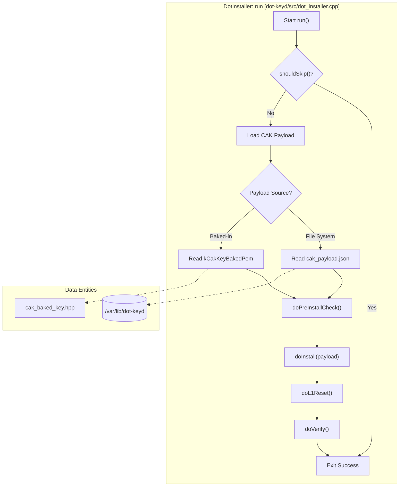
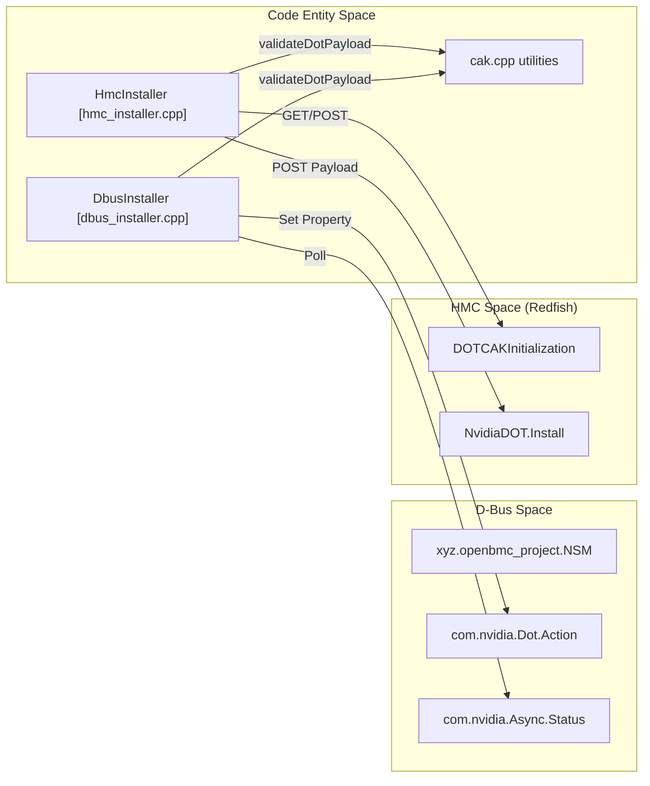

<!-- source: DeepWiki mcp.deepwiki.com · repo NVIDIA/nvidia-code-mgmt · page 7.1 DOT Key Management Daemon · fetched 2026-10-26 -->

# DOT Key Management Daemon

Relevant source files

The following files were used as context for generating this wiki page:

- [dot-keyd/meson.build](dot-keyd/meson.build)
- [dot-keyd/src/binary_installer.cpp](dot-keyd/src/binary_installer.cpp)
- [dot-keyd/src/binary_installer.hpp](dot-keyd/src/binary_installer.hpp)
- [dot-keyd/src/cak.cpp](dot-keyd/src/cak.cpp)
- [dot-keyd/src/cak.hpp](dot-keyd/src/cak.hpp)
- [dot-keyd/src/cak_baked_key.hpp.in](dot-keyd/src/cak_baked_key.hpp.in)
- [dot-keyd/src/config.hpp](dot-keyd/src/config.hpp)
- [dot-keyd/src/dbus_installer.cpp](dot-keyd/src/dbus_installer.cpp)
- [dot-keyd/src/dbus_installer.hpp](dot-keyd/src/dbus_installer.hpp)
- [dot-keyd/src/dot-keyd.cpp](dot-keyd/src/dot-keyd.cpp)
- [dot-keyd/src/dot_installer.cpp](dot-keyd/src/dot_installer.cpp)
- [dot-keyd/src/dot_installer.hpp](dot-keyd/src/dot_installer.hpp)
- [dot-keyd/src/hmc_installer.cpp](dot-keyd/src/hmc_installer.cpp)
- [dot-keyd/src/hmc_installer.hpp](dot-keyd/src/hmc_installer.hpp)
- [services/dot-keyd.service](services/dot-keyd.service)

The `dot-keyd` service is responsible for installing and managing Device Ownership Transfer (DOT) keys on NVIDIA platforms. It orchestrates the provisioning of the Customer Anchor Key (CAK) and optionally the Local Anchor Key (LAK) to target endpoints, ensuring secure ownership transfer and firmware validation.

## Architecture and Design

The daemon is built around the Template Method pattern, implemented via the `DotInstaller` base class. This allows the system to support multiple installation backends (HMC Redfish, D-Bus/NSM, or direct binary execution) while maintaining a consistent provisioning lifecycle: Load → Pre-install Check → Install → L1 Reset → Verify.

### System Flow Diagram
This diagram illustrates the high-level logic flow within the `DotInstaller::run` method and its interaction with configuration and storage.

**Sources:** [dot-keyd/src/dot_installer.cpp:36-89](), [dot-keyd/src/config.hpp:35-35]()

## Key Components and Implementation

### Installer Factory and Subclasses
The `createInstaller` factory function instantiates the appropriate subclass based on the provided `Config` object [dot-keyd/src/dot_installer.cpp:109-122]().

| Class | Purpose | Key File |
| :--- | :--- | :--- |
| `DotInstaller` | Abstract base class defining the provisioning skeleton. | [dot-keyd/src/dot_installer.hpp:96-179]() |
| `HmcInstaller` | Communicates with the Hardware Management Controller via Redfish/HTTP. | [dot-keyd/src/hmc_installer.cpp:43-121]() |
| `DbusInstaller` | Installs keys via the `xyz.openbmc_project.NSM` D-Bus interface. | [dot-keyd/src/dbus_installer.cpp:74-166]() |
| `BinaryInstaller` | Executes an external binary for "HMC-less" environments. | [dot-keyd/src/binary_installer.cpp]() |

### CAK Key Management
Keys can be provided via D-Bus arguments, local files, or "baked" into the binary at compile-time.

*   **Baked-in Keys:** The build system can embed a PEM public key directly into the binary using the `DOT_KEYD_CAK_KEY` Meson option [dot-keyd/meson.build:9-22](). This is stored in `kCakKeyBakedPem` [dot-keyd/src/cak_baked_key.hpp.in:37-38]().
*   **Validation:** All payloads are validated via `validateDotPayload` and `validateCakBytes` to ensure they meet size limits and PEM formatting requirements [dot-keyd/src/cak.cpp:134-148]().
*   **Atomic Storage:** When keys are written to the filesystem, `atomicWrite` is used to prevent corruption by writing to a temporary file and performing a rename [dot-keyd/src/cak.cpp:64-111]().

**Sources:** [dot-keyd/src/cak.cpp:1-148](), [dot-keyd/src/dot-keyd.cpp:58-100]()

## Communication and Integration

### Redfish (HMC) Integration
The `HmcInstaller` uses `boost::beast` for asynchronous HTTP communication with the HMC [dot-keyd/src/hmc_installer.hpp:30-33](). It polls the `DOTCAKInitialization` property to synchronize installation steps.

*   **Pre-install:** Waits for state to become `Waiting` [dot-keyd/src/hmc_installer.cpp:54-75]().
*   **Verification:** Waits for state to become `Complete` [dot-keyd/src/hmc_installer.cpp:91-121]().

### D-Bus Interface (NSM)
The `DbusInstaller` interacts with the `com.nvidia.Dot.Action` interface on the NSM service [dot-keyd/src/config.hpp:38-40]().

*   **Async Operations:** Installation is treated as an asynchronous operation. The daemon polls the `com.nvidia.Async.Status` interface until the `Status` property reaches `Success` [dot-keyd/src/config.hpp:43-48]().
*   **L1 Reset:** Triggered via the `com.nvidia.L1Reset` interface [dot-keyd/src/config.hpp:50-50]().

### Entity Association Diagram
This diagram bridges the conceptual installation steps with specific code entities and D-Bus/HTTP interfaces.

**Sources:** [dot-keyd/src/config.hpp:38-55](), [dot-keyd/src/dbus_installer.cpp:153-159](), [dot-keyd/src/hmc_installer.cpp:78-89]()

## Error Handling and Recovery

The daemon implements specific exceptions to handle different failure modes during the provisioning process [dot-keyd/src/dot_installer.hpp:41-88]():

*   **`CakInstallDeclinedException`**: Thrown if the endpoint permanently rejects the key (e.g., key already installed or policy violation).
*   **`CpuInRecoveryException`**: Thrown during verification if the CPUs boot into firmware recovery, suggesting a mismatch between the installed CAK and the SBIOS signature [dot-keyd/src/hmc_installer.cpp:111-115]().
*   **`CakInstallFailedException`**: Thrown if the maximum number of retries (`cakInstallRetries`, default 30) is exceeded [dot-keyd/src/dot_installer.hpp:174-178]().

**Sources:** [dot-keyd/src/dot_installer.hpp:41-88](), [dot-keyd/src/config.hpp:34-34]()

---

