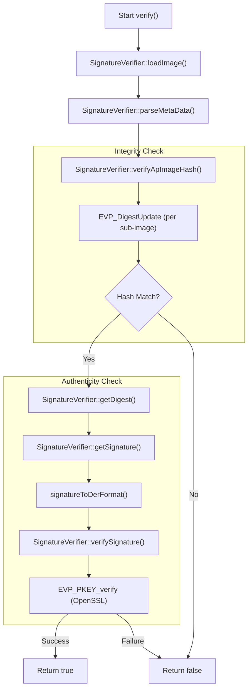
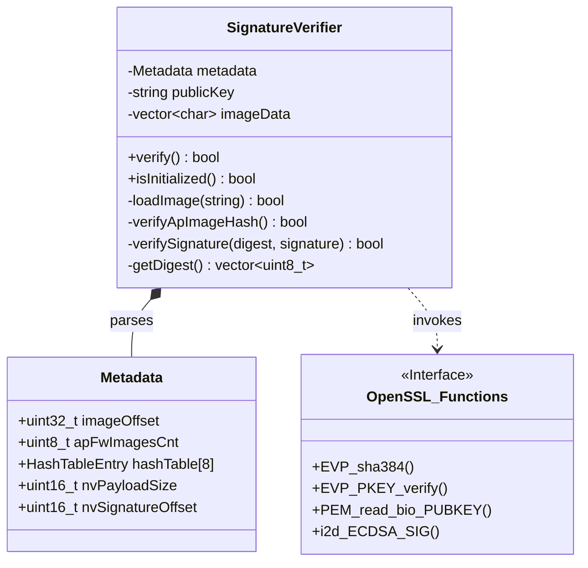

<!-- source: DeepWiki mcp.deepwiki.com · repo NVIDIA/nvidia-code-mgmt · page 7.2 Firmware Signature Verification · fetched 2026-10-26 -->

# Firmware Signature Verification

Relevant source files

The following files were used as context for generating this wiki page:

- [src/signature_verifier.cpp](src/signature_verifier.cpp)
- [src/signature_verifier.hpp](src/signature_verifier.hpp)
- [test/test_signature_verifier.cpp](test/test_signature_verifier.cpp)

The `SignatureVerifier` system provides a mechanism for validating the integrity and authenticity of firmware images before they are applied to hardware components. It utilizes OpenSSL to perform SHA-384 hashing and P-384 ECDSA signature verification against a provided public key.

## Overview

The signature verification process ensures that a firmware image has not been tampered with and originates from a trusted source. The implementation specifically targets "Metadata 2.0" structures commonly found in NVIDIA firmware payloads [src/signature_verifier.hpp:35-38]().

### Core Components

*   **`Metadata` Class**: A packed structure representing the firmware header, containing image offsets, hash tables for sub-images, and signature metadata [src/signature_verifier.hpp:37-84]().
*   **`SignatureVerifier` Class**: The primary engine that loads image data, parses metadata, calculates digests, and validates ECDSA signatures [src/signature_verifier.hpp:90-157]().
*   **OpenSSL Integration**: Utilizes `libcrypto` for cryptographic operations including `EVP_Digest` for hashing and `EVP_PKEY` for signature validation [src/signature_verifier.cpp:22-35]().

## Image Metadata Structure

Firmware images are expected to start with a `Metadata` header. This header guides the verifier on how to process the remainder of the file.

| Field | Description |
| :--- | :--- |
| `imageOffset` | Global offset where actual firmware data begins [src/signature_verifier.hpp:42](). |
| `apFwImagesCnt` | Number of sub-images (Application Processor firmware) contained in the payload [src/signature_verifier.hpp:45](). |
| `hashTable` | Array of entries containing the offset, length, and SHA-384 hash for each sub-image [src/signature_verifier.hpp:60-66](). |
| `nvPayloadSize` | The total size of the data covered by the signature [src/signature_verifier.hpp:80](). |
| `nvSignatureOffset` | The offset within the file where the 96-byte raw R/S signature is located [src/signature_verifier.hpp:81](). |

**Sources:** [src/signature_verifier.hpp:37-84]()

## Verification Workflow

The verification process follows a two-stage approach: first validating the individual sub-images against the internal hash table, and then validating the entire payload against the external signature.

### Logic Flow Diagram: Signature Verification
This diagram maps the high-level verification steps to the internal functions of the `SignatureVerifier` class.

**Sources:** [src/signature_verifier.cpp:118-167](), [src/signature_verifier.cpp:169-181](), [src/signature_verifier.cpp:197-215]()

### Implementation Details

#### 1. Hash Validation (`verifyApImageHash`)
The verifier iterates through the `metadata.hashTable`. For each entry, it calculates the SHA-384 hash of the data segment located at `metadata.imageOffset + entry.offset` and compares it to the pre-calculated hash stored in the metadata [src/signature_verifier.cpp:125-156]().

#### 2. Signature Extraction and Conversion
The signature is stored in a raw 96-byte R/S format (48 bytes for R, 48 bytes for S) [src/signature_verifier.cpp:54-63](). OpenSSL requires signatures in DER (Distinguished Encoding Rules) format for verification.
*   **`calculateECDSASignature`**: Converts raw R and S big-numbers into a DER-encoded `ECDSA_SIG` [src/signature_verifier.cpp:37-52]().
*   **`signatureToDerFormat`**: Splits the 96-byte buffer and invokes the calculation [src/signature_verifier.cpp:54-63]().

#### 3. Cryptographic Validation (`verifySignature`)
The final validation step uses the provided public key (passed during construction) to verify the digest of the payload.
*   The public key is expected in PEM format [src/signature_verifier.cpp:220-225]().
*   The verification uses `EVP_PKEY_verify_init` and `EVP_PKEY_verify` [src/signature_verifier.cpp:245-255]().

**Sources:** [src/signature_verifier.cpp:37-63](), [src/signature_verifier.cpp:118-167](), [src/signature_verifier.cpp:197-260]()

## Code Entity Map

The following diagram bridges the logical verification concepts to specific code entities and data structures.

**Sources:** [src/signature_verifier.hpp:37-157](), [src/signature_verifier.cpp:27-31](), [src/signature_verifier.cpp:230-240]()

## Runtime Configuration

The signature verification is typically triggered during the firmware update lifecycle. The `SignatureVerifier` is initialized with the path to the temporary firmware image and the platform's public key [src/signature_verifier.cpp:65-84](). If the `publicKey` string is empty, the verifier logs an error and initialization fails [src/signature_verifier.cpp:69-73]().

**Sources:** [src/signature_verifier.cpp:65-84]()

---

