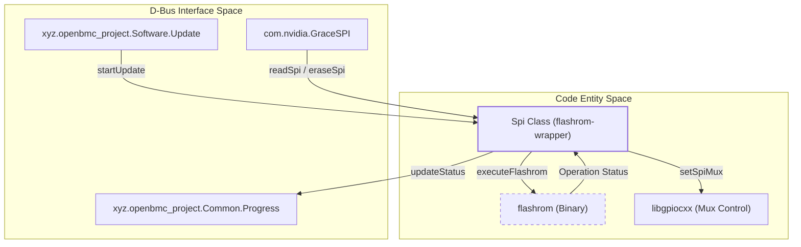
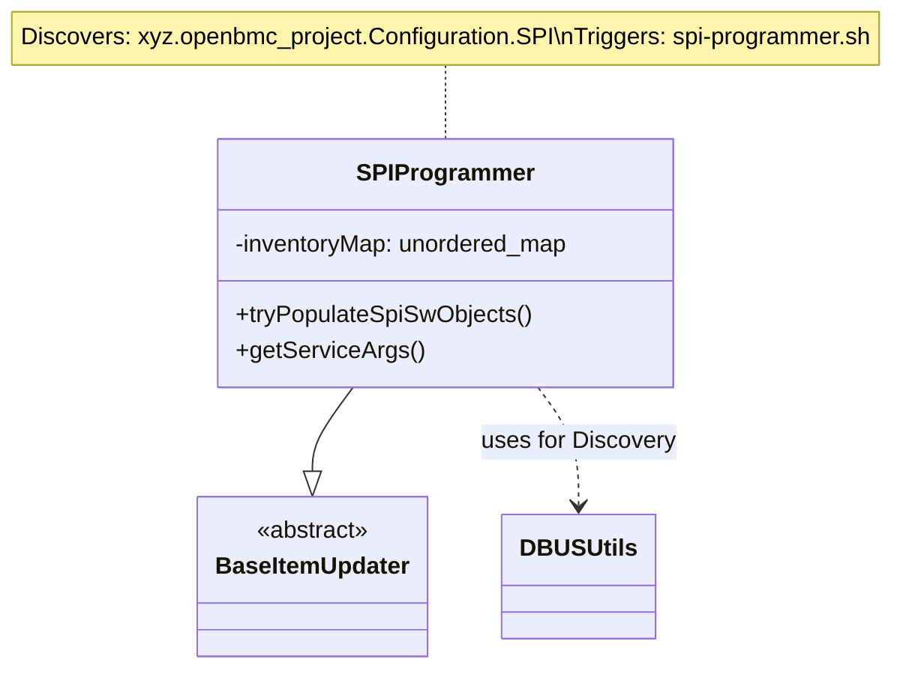

<!-- source: DeepWiki mcp.deepwiki.com · repo NVIDIA/nvidia-code-mgmt · page 7.3 SPI Flash Programming and Write Protection · fetched 2026-10-26 -->

# SPI Flash Programming and Write Protection

Relevant source files

The following files were used as context for generating this wiki page:

- [flashrom-wrapper/README.md](flashrom-wrapper/README.md)
- [flashrom-wrapper/flashrom_wrapper.cpp](flashrom-wrapper/flashrom_wrapper.cpp)
- [flashrom-wrapper/meson.build](flashrom-wrapper/meson.build)
- [flashrom-wrapper/spi.hpp](flashrom-wrapper/spi.hpp)
- [services/com.Nvidia.FlashromWrapper.service](services/com.Nvidia.FlashromWrapper.service)
- [services/com.Nvidia.SpiProgrammer.Updater.service](services/com.Nvidia.SpiProgrammer.Updater.service)
- [services/spi-programmer@.service](services/spi-programmer@.service)
- [set-spi-wp/meson.build](set-spi-wp/meson.build)
- [set-spi-wp/set_spi_wp.cpp](set-spi-wp/set_spi_wp.cpp)
- [src/spi_programmer.cpp](src/spi_programmer.cpp)
- [src/spi_programmer.hpp](src/spi_programmer.hpp)

The SPI flash programming infrastructure provides the BMC with the capability to read, write, and erase CPU SPI devices (both code and data) across multiple sockets. This system is critical for standby (S5) power firmware flashing and managing CPU R/W variable SPI regions. It incorporates safety mechanisms to ensure SPI multiplexers are only engaged when host power is off and includes utilities for hardware-level write protection.

## System Architecture

The infrastructure consists of three primary components:
1.  **flashrom-wrapper**: A D-Bus service that orchestrates `flashrom` operations, manages GPIO-based SPI multiplexers, and enforces power-state safety rules [flashrom-wrapper/README.md:8-16]().
2.  **SPIProgrammer**: A `code-manager` plugin that discovers SPI targets via Entity Manager and triggers update services [src/spi_programmer.hpp:22-35]().
3.  **set-spi-wp**: A low-level utility for asserting/deasserting SPI status register write-protect bits [set-spi-wp/set_spi_wp.cpp:34-55]().

### Component Interaction Diagram
This diagram shows how the D-Bus interfaces map to the underlying execution logic and hardware control.

Title: SPI Programming Data Flow

Sources: [flashrom-wrapper/spi.hpp:28-36](), [flashrom-wrapper/flashrom_wrapper.cpp:133-156](), [flashrom-wrapper/spi.hpp:183-191]()

## flashrom-wrapper Implementation

The `flashrom-wrapper` daemon manages access to SPI chips by wrapping the standard `flashrom` utility. It implements the `com.nvidia.GraceSPI` and `xyz.openbmc_project.Software.Update` interfaces [flashrom-wrapper/spi.hpp:28-32]().

### Safety and Power Management
The service strictly enforces that SPI muxing only occurs when the host is powered off.
*   **Power Check**: Before any operation, `isHostPowerOff()` is called to verify the `CurrentHostState` is `Off` [flashrom-wrapper/flashrom_wrapper.cpp:82-89]().
*   **State Monitoring**: The service monitors `xyz.openbmc_project.State.Host` via D-Bus matches. If the host powers on during an operation, the `flashrom` process is immediately terminated and SPI muxes are reset to default positions to allow the CPU to boot [flashrom-wrapper/flashrom_wrapper.cpp:201-230]().

### SPI Multiplexer Control
Accessing the CPU SPI requires toggling specific GPIOs to switch the SPI bus from the CPU to the BMC.
*   `setSpiMux()`: Configures the GPIOs to the "active" state defined in the Entity Manager configuration [flashrom-wrapper/spi.hpp:183-184]().
*   `resetSpiMux()`: Restores GPIOs to their "deactive" (default) state [flashrom-wrapper/spi.hpp:189-191]().

### Operation Timing and Progress
The system tracks progress based on hardcoded timing estimates for specific chip types (e.g., `W25Q64BV`, `MX66U1G45G`) [flashrom-wrapper/flashrom_wrapper.cpp:27-32]().
*   **Read Operation**: Uses `Operation::Read`. Upon success, it opens the resulting dump file and passes the file descriptor back via the `spiReadFd` property [flashrom-wrapper/flashrom_wrapper.cpp:163-183]().
*   **Execution**: Operations are run asynchronously using `boost::process::v2` [flashrom-wrapper/flashrom_wrapper.cpp:137-145]().

Sources: [flashrom-wrapper/flashrom_wrapper.cpp:82-89](), [flashrom-wrapper/flashrom_wrapper.cpp:201-230](), [flashrom-wrapper/spi.hpp:183-191](), [flashrom-wrapper/flashrom_wrapper.cpp:27-32]()

## SPI Programmer (Code Manager Integration)

The `SPIProgrammer` class extends `BaseItemUpdater` to integrate SPI flashing into the standard BMC firmware update flow [src/spi_programmer.hpp:22]().

### Discovery and Configuration
`SPIProgrammer` discovers targets by searching for Entity Manager objects implementing the `xyz.openbmc_project.Configuration.SPI` interface [src/spi_programmer.hpp:12]().
*   **Target Identification**: It extracts `TargetFirmware` and `ChassisName` to build its internal `inventoryMap` [src/spi_programmer.cpp:48-67]().
*   **Service Triggering**: When an update is initiated, it generates arguments for the `spi-programmer@.service`, which executes the `spi-programmer.sh` script [src/spi_programmer.hpp:83-103](), [services/spi-programmer@.service:8]().

Title: SPI Programmer Inventory Mapping

Sources: [src/spi_programmer.hpp:22-40](), [src/spi_programmer.cpp:48-67](), [services/spi-programmer@.service:1-9]()

## Write Protection Management

The `set-spi-wp` utility provides direct control over the SPI flash status register to manage hardware write protection [set-spi-wp/set_spi_wp.cpp:115]().

### Key Functions
*   **`spi_xfer`**: Performs raw SPI transfers using `ioctl(fd, SPI_IOC_MESSAGE(1), ...)` [set-spi-wp/set_spi_wp.cpp:57-74]().
*   **`read_status_register`**: Sends command `0x05` to retrieve the current protection bits [set-spi-wp/set_spi_wp.cpp:100-105]().
*   **`write_status_register`**: Sends command `0x01` followed by the status byte to update protection settings [set-spi-wp/set_spi_wp.cpp:107-112]().

### Bit Manipulation
The utility targets specific bits in the status register [set-spi-wp/set_spi_wp.cpp:30-32]():
*   `BPL_BIT` (Bit 7): Block Protect Lock.
*   `WPP_BIT` (Bit 4): Write Protect Pin.
*   `BP0_BIT` (Bit 2): Block Protect 0.

It supports `assert` (setting bits to protect) and `deassert` (clearing bits to allow writing) actions [set-spi-wp/set_spi_wp.cpp:45-46]().

Sources: [set-spi-wp/set_spi_wp.cpp:57-74](), [set-spi-wp/set_spi_wp.cpp:100-112](), [set-spi-wp/set_spi_wp.cpp:30-32]()

---

