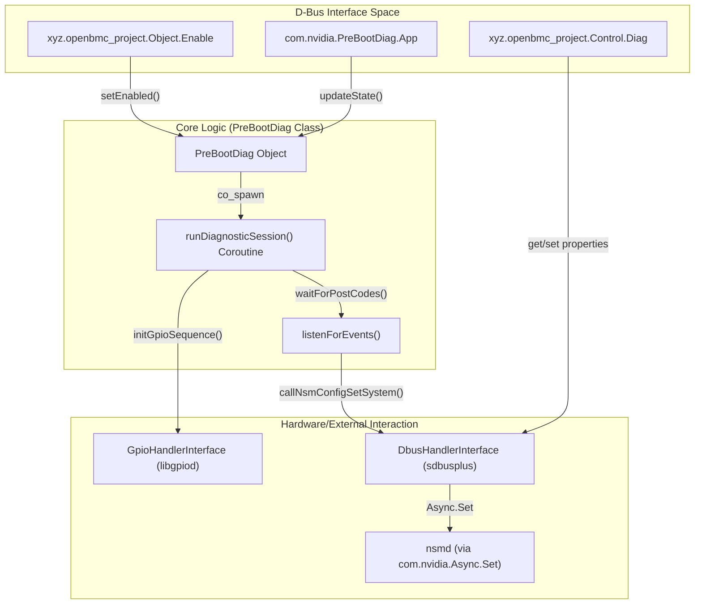
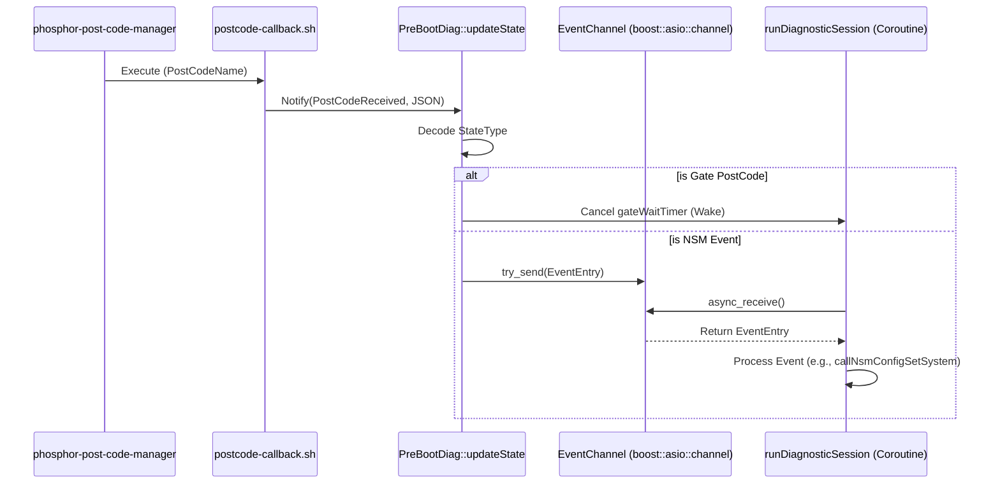

<!-- source: DeepWiki mcp.deepwiki.com · repo NVIDIA/nvidia-code-mgmt · page 7.4 Pre-Boot Diagnostics · fetched 2026-10-26 -->

# Pre-Boot Diagnostics

Relevant source files

The following files were used as context for generating this wiki page:

- [prebootdiag/scripts/prebootdiag-postcode-callback.sh](prebootdiag/scripts/prebootdiag-postcode-callback.sh)
- [prebootdiag/src/constants.hpp](prebootdiag/src/constants.hpp)
- [prebootdiag/src/dbus_handler.cpp](prebootdiag/src/dbus_handler.cpp)
- [prebootdiag/src/dbus_handler.hpp](prebootdiag/src/dbus_handler.hpp)
- [prebootdiag/src/prebootdiag.cpp](prebootdiag/src/prebootdiag.cpp)
- [prebootdiag/test/prebootdiag_test_fixture.hpp](prebootdiag/test/prebootdiag_test_fixture.hpp)
- [prebootdiag/test/scripts/test_prebootdiag.sh](prebootdiag/test/scripts/test_prebootdiag.sh)
- [prebootdiag/test/test_prebootdiag.cpp](prebootdiag/test/test_prebootdiag.cpp)

The `PreBootDiag` service orchestrates diagnostic boot sequences for NVIDIA hardware. It manages the lifecycle of a diagnostic session by controlling CPU boot chain selection via GPIOs, monitoring post-codes from the `phosphor-post-code-manager`, and communicating asynchronous configuration payloads to the Network Support Module (NSM) daemon (`nsmd`).

## Overview and Purpose

The service provides a mechanism to put the system into a specialized diagnostic mode before the main OS boots. This is achieved by:
1.  **Hardware Strapping**: Driving GPIOs to select the diagnostic boot chain [prebootdiag/src/constants.hpp:94-105]().
2.  **Gate-keeping**: Waiting for specific post-codes (`PSC_FMC` and `MB2`) to ensure the CPU has reached the appropriate boot stage [prebootdiag/src/prebootdiag.cpp:202-218]().
3.  **NSM Orchestration**: Pushing `SystemConfig` and `TIDConfig` to `nsmd` and awaiting completion via the `com.nvidia.Async` interface [prebootdiag/src/dbus_handler.cpp:67-95]().
4.  **Monitoring**: Watching for heartbeats and diagnostic results until the session is terminated or times out [prebootdiag/src/prebootdiag.cpp:391-410]().

### Code Entity Space: Service Architecture

The following diagram maps the high-level system concepts to the specific C++ classes and D-Bus interfaces implemented in the codebase.

**Pre-Boot Diagnostics Component Map**

Sources: [prebootdiag/src/prebootdiag.cpp:35-57](), [prebootdiag/src/dbus_handler.hpp:35-69](), [prebootdiag/src/constants.hpp:26-48]()

## Diagnostic Session Lifecycle

A diagnostic session is managed as a `boost::asio` coroutine (`runDiagnosticSession`) that progresses through several distinct phases.

### 1. Initialization and Hardware Strapping
When `Enabled` is set to `true`, the service verifies that no session is already running and checks for the existence of `DiagConfig` in the settings service [prebootdiag/src/prebootdiag.cpp:67-86](). It then drives the `cpuBootChain0` GPIOs and toggles the `istSysRst` lines to force the CPUs into the diagnostic boot path [prebootdiag/src/prebootdiag.cpp:265-294]().

### 2. Post-Code Gating
The service waits for two specific post-codes communicated via the `Notify` method:
*   `PSC_FMC_PC_BOOT_MODE_PREBOOT_DIAG`: Signifies the early BootROM stage [prebootdiag/src/constants.hpp:67-68]().
*   `MB2_PC_CCPLEX_PREBOOT_DIAG_ENTRY`: Signifies the MB2 bootloader stage [prebootdiag/src/constants.hpp:69-70]().

These post-codes are typically injected by a helper script triggered by the systemd post-code handler [prebootdiag/scripts/prebootdiag-postcode-callback.sh:36-44]().

### 3. NSM Configuration and Event Loop
Once the gates are passed, the service enters `listenForEvents()`, which processes the following `StateType` events [prebootdiag/src/prebootdiag.cpp:333-350]():
*   **SystemConfigRequested**: The service retrieves `DiagSystemConfig` from Settings and pushes it to `nsmd` [prebootdiag/src/prebootdiag.cpp:353-370]().
*   **TIDConfigRequested**: The service pushes the per-TID (Target ID) configuration [prebootdiag/src/prebootdiag.cpp:372-389]().
*   **HeartbeatReceived**: Resets the 3-minute `eventTimeout` watchdog [prebootdiag/src/prebootdiag.cpp:391-395]().
*   **ResultReceived**: Appends the diagnostic results to the `DiagResult` property [prebootdiag/src/prebootdiag.cpp:397-404]().

### Data Flow: Diagnostic Event Processing

This diagram illustrates how external notifications (like post-codes or NSM requests) flow through the service to advance the state machine.

**Sequence: Diagnostic Event Flow**

Sources: [prebootdiag/src/prebootdiag.cpp:122-163](), [prebootdiag/src/prebootdiag.cpp:202-218](), [prebootdiag/src/prebootdiag.cpp:453-480](), [prebootdiag/scripts/prebootdiag-postcode-callback.sh:36-44]()

## Implementation Details

### Asynchronous NSM Communication
The `SdbusHandler` implements the `callAsyncSet` method to handle NSM's asynchronous D-Bus pattern. It calls `com.nvidia.Async.Set`, which returns an `object_path`. The handler then monitors the `Status` property on that path using both a `DBus Match` (for signals) and a "defense-in-depth" `Get` call to handle race conditions [prebootdiag/src/dbus_handler.cpp:67-121]().

### Error Handling and Recovery
If any stage fails (e.g., a timeout, a missing configuration, or an NSM push failure), the service executes the `abortSession` path:
1.  Sets `DiagStatus` to `Abort` [prebootdiag/src/prebootdiag.cpp:314]().
2.  Creates an OpenBMC error log via `xyz.openbmc_project.Logging.Create` [prebootdiag/src/dbus_handler.cpp:231-244]().
3.  Releases all GPIO pins to return the hardware to a safe state [prebootdiag/src/prebootdiag.cpp:319]().
4.  Cleans up internal timers and channels [prebootdiag/src/prebootdiag.cpp:107-117]().

### Key Constants and Timeouts
| Constant | Value | Description |
| :--- | :--- | :--- |
| `eventTimeout` | 3 minutes | Max idle time between NSM events [prebootdiag/src/constants.hpp:111]() |
| `pscFmcPostCodeWaitTimeout` | 30 seconds | Max wait for the first post-code gate [prebootdiag/src/constants.hpp:115]() |
| `mb2PostCodeWaitTimeout` | 15 minutes | Max wait for the second post-code gate [prebootdiag/src/constants.hpp:116]() |
| `cpuBootChain0Brd0Gpio` | "BRD0_CPU_BOOT_CHAIN0-O" | Primary boot chain selection pin [prebootdiag/src/constants.hpp:94]() |

Sources: [prebootdiag/src/constants.hpp:94-117](), [prebootdiag/src/dbus_handler.cpp:67-121](), [prebootdiag/src/prebootdiag.cpp:305-329]()

---

