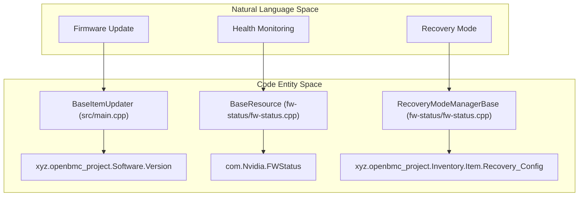
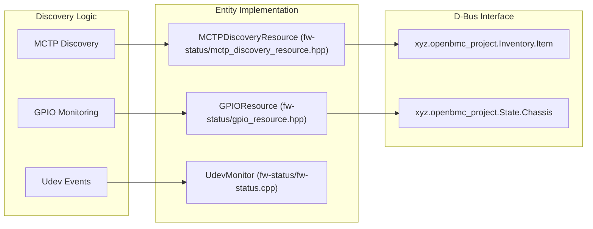

<!-- source: DeepWiki mcp.deepwiki.com · repo NVIDIA/nvidia-code-mgmt · page 8 Glossary · fetched 2026-10-26 -->

# Glossary

Relevant source files

The following files were used as context for generating this wiki page:

- [debug_token/main.cpp](debug_token/main.cpp)
- [debug_token/nsm_debug_token.cpp](debug_token/nsm_debug_token.cpp)
- [debug_token/update_debug_token.cpp](debug_token/update_debug_token.cpp)
- [debug_token/update_debug_token.hpp](debug_token/update_debug_token.hpp)
- [fw-status/ap_resource.cpp](fw-status/ap_resource.cpp)
- [fw-status/ap_resource.hpp](fw-status/ap_resource.hpp)
- [fw-status/erot_resource.hpp](fw-status/erot_resource.hpp)
- [fw-status/fw-status.cpp](fw-status/fw-status.cpp)
- [fw-status/gpio_resource.cpp](fw-status/gpio_resource.cpp)
- [fw-status/gpio_resource.hpp](fw-status/gpio_resource.hpp)
- [fw-status/mctp_discovery_resource.cpp](fw-status/mctp_discovery_resource.cpp)
- [fw-status/mctp_discovery_resource.hpp](fw-status/mctp_discovery_resource.hpp)
- [meson.build](meson.build)
- [meson_options.txt](meson_options.txt)
- [recovery_tool/mcu_recovery_tool/mcu_recovery_interfaces.cpp](recovery_tool/mcu_recovery_tool/mcu_recovery_interfaces.cpp)
- [recovery_tool/mcu_recovery_tool/mcu_recovery_manager.cpp](recovery_tool/mcu_recovery_tool/mcu_recovery_manager.cpp)
- [recovery_tool/mcu_recovery_tool/mcu_recovery_manager.hpp](recovery_tool/mcu_recovery_tool/mcu_recovery_manager.hpp)
- [recovery_tool/mcu_recovery_tool/utils.cpp](recovery_tool/mcu_recovery_tool/utils.cpp)
- [recovery_tool/ocp_recovery_tool/recovery_commands.cpp](recovery_tool/ocp_recovery_tool/recovery_commands.cpp)
- [recovery_tool/ocp_recovery_tool/recovery_commands.hpp](recovery_tool/ocp_recovery_tool/recovery_commands.hpp)
- [recovery_tool/ocp_recovery_tool/recoverytool_interface.cpp](recovery_tool/ocp_recovery_tool/recoverytool_interface.cpp)
- [recovery_tool/ocp_recovery_tool/recoverytool_utils.cpp](recovery_tool/ocp_recovery_tool/recoverytool_utils.cpp)
- [recovery_tool/ocp_recovery_tool/recoverytool_utils.hpp](recovery_tool/ocp_recovery_tool/recoverytool_utils.hpp)
- [services/meson.build](services/meson.build)
- [src/debug_token_erase.cpp](src/debug_token_erase.cpp)
- [src/debug_token_install.cpp](src/debug_token_install.cpp)
- [src/main.cpp](src/main.cpp)
- [src/meson.build](src/meson.build)
- [test/fw_status_fakes/mcu_recovery_manager.hpp](test/fw_status_fakes/mcu_recovery_manager.hpp)
- [test/test_fw_status_glacier_gpio.cpp](test/test_fw_status_glacier_gpio.cpp)
- [test/test_fw_status_main.cpp](test/test_fw_status_main.cpp)

This page provides definitions for codebase-specific terms, jargon, abbreviations, and domain concepts used throughout the `nvidia-code-mgmt` repository. It serves as a technical reference for onboarding engineers to understand the mapping between high-level hardware concepts and their specific software implementations.

## System Architecture Overview

The repository is organized into two primary functional domains: firmware update orchestration (`code-manager`) and hardware health/recovery monitoring (`fw-status`).

### Core Software Entities

| Term | Definition | Code Reference |
| :--- | :--- | :--- |
| **code-manager** | The main executable responsible for firmware updates across various device types. | [src/main.cpp:112-126]() |
| **fw-status** | The service responsible for monitoring device health, boot status, and orchestrating recovery. | [fw-status/fw-status.cpp:73-74]() |
| **BaseItemUpdater** | Abstract base class providing D-Bus software versioning and activation logic. | [src/main.cpp:161-161]() |
| **BaseResource** | Base class for all monitored hardware components in the status service. | [fw-status/fw-status.cpp:91-91]() |

### Natural Language to Code Entity Mapping

The following diagram illustrates how high-level system operations map to specific C++ classes and D-Bus interfaces.

**Firmware Update and Status Mapping**

**Sources:** [src/main.cpp:152-161](), [fw-status/fw-status.cpp:73-91](), [meson.build:38-38]()

---

## Domain Concepts

### 1. ERoT (Enhanced Root of Trust)
Hardware components responsible for platform security. In this codebase, ERoT devices are monitored for fatal errors via GPIO and recovered using the Glacier protocol.
*   **Implementation**: `ERoTResource` class.
*   **Monitoring**: Often uses `GPIOResource` to watch `FATAL_ERROR` pins [fw-status/gpio_resource.hpp:58-60]().
*   **Recovery**: Managed via `GlacierRecoveryCommands` [fw-status/gpio_resource.cpp:109-112]().

### 2. MCTP (Management Component Transport Protocol)
A protocol for inter-chip communication. The system uses MCTP for endpoint discovery and Vendor Defined Messages (VDM).
*   **MCTPVdmHelper**: A utility for sending NVIDIA-specific VDM requests [fw-status/fw-status.cpp:89-89]().
*   **Endpoint Discovery**: Handled by `MCTPDiscoveryResource` [fw-status/fw-status.cpp:27-27]().

### 3. Debug Tokens
Cryptographic tokens used to enable advanced debugging features on NVIDIA hardware.
*   **Operations**: Installation (`DebugTokenInstallItemUpdater`) and Erasure (`DebugTokenEraseItemUpdater`) [src/main.cpp:249-256]().
*   **Protocols**: Supports both NSM (NVIDIA System Management) over MCTP [debug_token/nsm_debug_token.cpp:37-38]() and direct MCTP VDM [debug_token/update_debug_token.hpp:113-113]().

### 4. Recovery Protocols
Specialized procedures to restore a device from a non-functional state.
*   **OCP Recovery**: Open Compute Project recovery protocol for GPUs [src/main.cpp:198-203]().
*   **Glacier Crisis Recovery**: A protocol used to unlock or recover ERoT devices over I2C [fw-status/fw-status.cpp:55-56]().
*   **MCU Recovery**: Recovery for Microcontrollers, often involving `blhost` and GPIO strapping [recovery_tool/mcu_recovery_tool/mcu_recovery_manager.cpp:227-237]().

---

## Hardware Abstractions

**Resource Discovery and Management**

**Sources:** [fw-status/fw-status.cpp:27-34](), [fw-status/gpio_resource.hpp:37-41](), [fw-status/mctp_discovery_resource.hpp:1-25]()

### Common Abbreviations

| Abbreviation | Full Term | Context |
| :--- | :--- | :--- |
| **AP** | Application Processor | Monitored for boot status and health [fw-status/ap_resource.hpp:1-20](). |
| **CPLD** | Complex Programmable Logic Device | Updated via `CPLDItemUpdater` [src/main.cpp:174-180](). |
| **EID** | Endpoint ID | The MCTP address of a device [debug_token/update_debug_token.hpp:54-54](). |
| **NSM** | NVIDIA System Management | Protocol used for debug token and telemetry [debug_token/update_debug_token.hpp:95-95](). |
| **PEX** | PCI Express Switch | Updated via `PEXItemUpdater` [src/main.cpp:204-209](). |
| **PSU** | Power Supply Unit | Updated via `PSUItemUpdater` [src/main.cpp:162-167](). |
| **RT** | Retimer | PCIe signal integrity devices, updated via `ReTimerItemUpdater` [src/main.cpp:181-188](). |
| **VDM** | Vendor Defined Message | Custom MCTP messages for NVIDIA-specific tasks [fw-status/fw-status.cpp:89-89](). |

---

## Build and Configuration Terms

*   **Meson Options**: Build-time toggles located in `meson_options.txt` that enable or disable support for specific hardware (e.g., `PSU_SUPPORT`, `RT_SUPPORT`) [meson_options.txt:12-55]().
*   **Settle Delay**: A configurable timer (`FWSTATUS_POWER_STATE_SETTLE_DELAY_SEC`) that prevents the `fw-status` service from probing devices immediately after power-on, allowing hardware to stabilize [fw-status/fw-status.cpp:80-85]().
*   **Inventory Interface**: Standard OpenBMC D-Bus interfaces (e.g., `xyz.openbmc_project.Inventory.Item.PowerSupply`) used to discover hardware presence before starting updaters [meson.build:55-58]().

**Sources:** [meson.build:1-115](), [meson_options.txt:1-243](), [fw-status/fw-status.cpp:1-105](), [src/main.cpp:1-270](), [debug_token/update_debug_token.hpp:1-160](), [recovery_tool/mcu_recovery_tool/mcu_recovery_manager.cpp:1-240]()