# Page: Overview

# Overview

<details>
<summary>Relevant source files</summary>

The following files were used as context for generating this wiki page:

- [README.md](README.md)
- [meson.build](meson.build)
- [meson_options.txt](meson_options.txt)
- [nvidia_igx/README.md](nvidia_igx/README.md)
- [services/meson.build](services/meson.build)
- [src/main.cpp](src/main.cpp)
- [src/meson.build](src/meson.build)
- [test/test_fw_status_main.cpp](test/test_fw_status_main.cpp)

</details>


The `nvidia-code-mgmt` repository provides a comprehensive firmware management system for NVIDIA hardware components. It encompasses firmware update orchestration, health monitoring, and recovery operations through a modular architecture integrated into the OpenBMC ecosystem.

For detailed information on the architectural building blocks, see [System Components](#1.1). For details on how the system is compiled and tailored for specific hardware, see [Build System and Configuration](#1.2).

## System Purpose and Scope

The system is designed to handle the full lifecycle of firmware across diverse hardware, including Power Supply Units (PSUs), FPGAs, CPLDs, PCIe Retimers, and specialized NVIDIA platforms like IGX.

1.  **Update Mechanisms**: Orchestrates image discovery, signature verification, and flashing via the `code-manager` service.
2.  **Status Monitoring**: Tracks resource health and operational status (e.g., via MCTP or GPIO) using the `fw-status` service.
3.  **Recovery Operations**: Provides specialized tools for hardware fault handling, including OCP recovery, Glacier crisis recovery, and USB-based recovery.

Sources: [README.md:1-4](), [src/main.cpp:162-264](), [meson.build:52-183]()

## High-Level Architecture

The system is organized into two primary daemons and a set of specialized recovery tools, all communicating over D-Bus and utilizing standard OpenBMC interfaces.

### Service Orchestration Diagram
This diagram maps the high-level system functions to the primary C++ classes and service entities defined in the codebase.

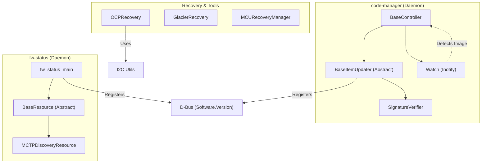
Sources: [src/main.cpp:160-264](), [src/base_controller.hpp:20-20](), [src/base_item_updater.hpp:11-13](), [src/signature_verifier.hpp:12-12](), [test/test_fw_status_main.cpp:63-63]()

## Functional Modules

### 1. Firmware Update System (`code-manager`)
The `code-manager` service handles the lifecycle of a firmware update. It monitors specific directories for new images, validates them, and triggers device-specific update logic. It utilizes a `BaseItemUpdater` [src/base_item_updater.cpp:11-13]() to provide a common D-Bus interface for all hardware types.

*   **Discovery**: Uses `Watch` [src/watch.cpp:8-8]() to monitor `IMG_UPLOAD_DIR_BASE` [meson.build:46-46]().
*   **Validation**: Employs `SignatureVerifier` [src/signature_verifier.cpp:12-12]() to ensure image integrity.
*   **Execution**: Launches systemd units (e.g., `psu-update@.service` [meson.build:61-61]()) to perform the actual flashing.

For details, see [System Components](#1.1).

### 2. Status Monitoring (`fw-status`)
The `fw-status` service tracks the health of hardware components. It supports multiple discovery and monitoring methods:
*   **MCTP**: Monitoring via Management Component Transport Protocol [test/test_fw_status_main.cpp:7-7]().
*   **GPIO**: Monitoring hardware pins for status changes [test/test_fw_status_main.cpp:5-5]().

### 3. Recovery Systems
Specialized recovery tools are included to handle "bricked" or unresponsive hardware:
*   **OCP Recovery**: Implementation of the Open Compute Project recovery protocol for GPUs [src/main.cpp:198-203]().
*   **Glacier Recovery**: Crisis recovery for ERoT and GPIO-controlled devices [src/main.cpp:240-245]().
*   **USB RCM**: Recovery mode for devices accessible via USB [src/main.cpp:91-93]().

## Code Entity Mapping
The following table bridges the hardware support mentioned in documentation to the specific `Meson` options and C++ classes that implement them.

| Hardware Feature | Meson Option | Implementation Class |
| :--- | :--- | :--- |
| **PSU** | `PSU_SUPPORT` | `PSUItemUpdater` [src/main.cpp:162-167]() |
| **FPGA** | `FPGA_SUPPORT` | `FPGAItemUpdater` [src/main.cpp:168-173]() |
| **PCIe Retimer** | `RT_SUPPORT` | `ReTimerItemUpdater` [src/main.cpp:181-188]() |
| **CPLD** | `CPLD_SUPPORT` | `CPLDItemUpdater` [src/main.cpp:174-180]() |
| **GPU Recovery** | `GPU_OCP_RECOVERY_SUPPORT` | `OCPRecovery` [src/main.cpp:198-203]() |
| **Debug Tokens** | `DEBUG_TOKEN_SUPPORT` | `DebugTokenInstallItemUpdater` [src/main.cpp:246-257]() |

Sources: [meson_options.txt:12-208](), [src/main.cpp:160-264]()

## Build and Configuration
The project uses the Meson build system [meson.build:1-12](). Many features are optional and must be enabled at build time via `meson_options.txt`. This allows the same codebase to support different NVIDIA platforms (e.g., HGX vs. IGX) by toggling specific updaters and monitoring resources.

For details, see [Build System and Configuration](#1.2).

Sources: [meson.build:1-12](), [meson_options.txt:1-240]()

---

# Page: System Components

# System Components

<details>
<summary>Relevant source files</summary>

The following files were used as context for generating this wiki page:

- [meson.build](meson.build)
- [meson_options.txt](meson_options.txt)
- [services/com.Nvidia.FWStatus.service](services/com.Nvidia.FWStatus.service)
- [services/meson.build](services/meson.build)
- [src/base_controller.cpp](src/base_controller.cpp)
- [src/base_controller.hpp](src/base_controller.hpp)
- [src/main.cpp](src/main.cpp)
- [src/meson.build](src/meson.build)
- [test/test_fw_status_main.cpp](test/test_fw_status_main.cpp)

</details>


This document provides an overview of the major system components within the nvidia-code-mgmt repository, including the core service framework, firmware update system, status monitoring infrastructure, and their relationships within the OpenBMC ecosystem.

## Core Service Framework

The nvidia-code-mgmt system is built around two primary service executables that integrate with the OpenBMC D-Bus infrastructure and systemd service management.

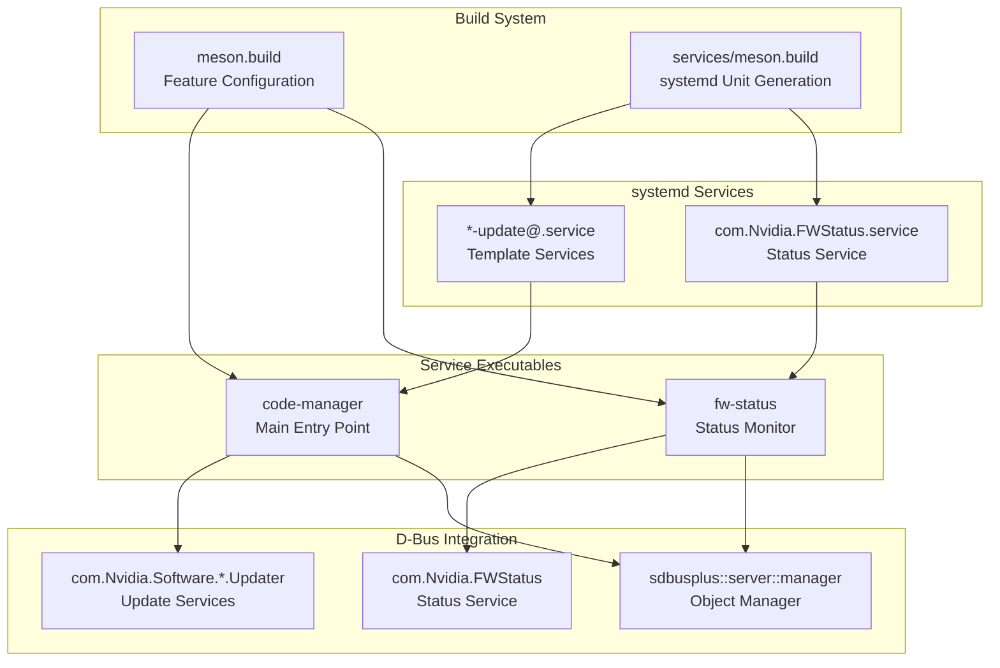

The `code-manager` executable serves as the primary firmware update service, instantiated with different command-line arguments to support various hardware types [src/main.cpp:108-150](). The `BaseController` class [src/base_controller.hpp:33-90]() orchestrates the update process while `BaseItemUpdater` [src/base_item_updater.hpp]() subclasses handle device-specific logic.

**Sources:** [src/main.cpp:97-282](), [meson.build:1-329](), [services/meson.build:1-253](), [src/base_controller.hpp:33-90]()

## Firmware Update System Architecture

The firmware update system implements a modular architecture where device-specific updaters inherit from common base classes and integrate with the D-Bus software management interfaces.

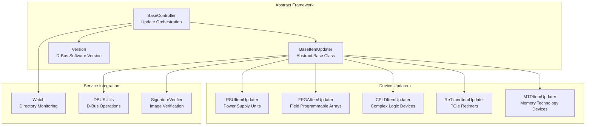

Each updater type is conditionally compiled based on feature flags defined in `meson_options.txt` [meson_options.txt:1-253](). The `main()` function in `code-manager` instantiates the appropriate updater based on the `-u` command-line argument [src/main.cpp:162-282](), enabling a single executable to support multiple hardware types. For instance, the `PSUItemUpdater` is used when `updater == "PSU"` [src/main.cpp:163-166]().

**Sources:** [src/main.cpp:131-282](), [src/base_controller.hpp:33-90](), [src/base_item_updater.hpp](), [meson.build:52-243](), [meson_options.txt:1-253]()

## Status Monitoring System

The `fw-status` service implements comprehensive hardware status monitoring through resource abstraction and communication protocols.

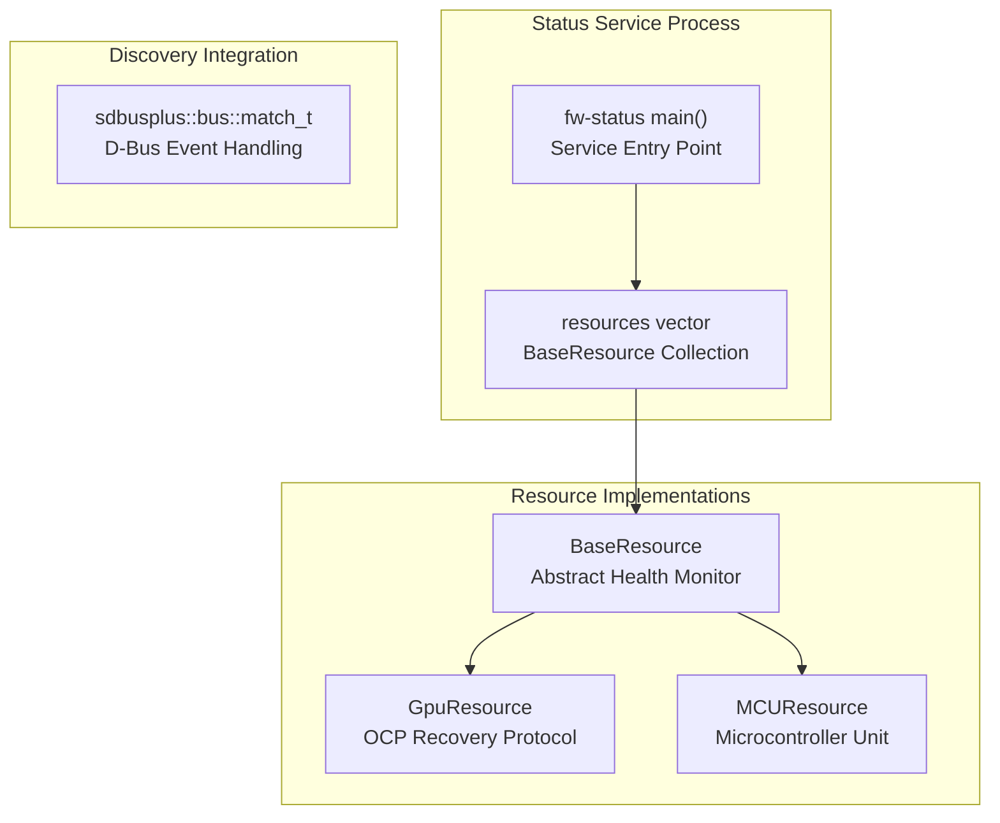

The status monitoring system is managed by the `com.Nvidia.FWStatus.service` [services/com.Nvidia.FWStatus.service:1-12](), which runs the `fw-status` binary [services/com.Nvidia.FWStatus.service:8](). It tracks hardware health across various components like MCUs and GPUs, often using MCTP or I2C interfaces.

**Sources:** [test/test_fw_status_main.cpp:63-64](), [services/com.Nvidia.FWStatus.service:1-12](), [meson_options.txt:1-10]()

## Communication Infrastructure

The system implements multiple communication layers to interface with hardware devices and integrate with the OpenBMC D-Bus ecosystem.

| Component | Class/Interface | Purpose |
|-----------|----------------|---------|
| D-Bus Integration | `DBUSUtils` | Property retrieval, service discovery, systemd control [src/dbusutils.cpp]() |
| Image Monitoring | `Watch` | Inotify-based monitoring of directories for new firmware images [src/watch.cpp]() |
| Versioning | `Version` | Implementation of `xyz.openbmc_project.Software.Version` [src/version.cpp]() |
| Hardware Access | `I2C`, `GPIO`, `USB` | Low-level hardware communication [test/test_fw_status_main.cpp:5-11]() |

**Sources:** [src/dbusutils.cpp](), [src/watch.cpp](), [src/version.cpp](), [test/test_fw_status_main.cpp:1-11]()

## Service Dependency Architecture

The nvidia-code-mgmt system integrates with OpenBMC through systematic service dependencies and D-Bus interface implementations.

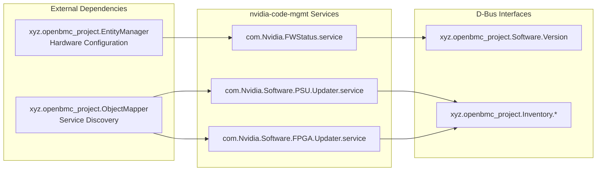

Service activation and configuration are handled via Meson, which defines bus names and service files for each component [meson.build:52-115](). For example, `PSU_BUSNAME_UPDATER` is defined as `com.Nvidia.Software.PSU.Updater` [meson.build:59]().

**Sources:** [meson.build:52-115](), [services/meson.build:1-253]()

## Build-Time Configuration System

The Meson build system provides extensive feature flags that control which components are compiled and configured for specific hardware platforms.

| Feature Flag | D-Bus Service | Update Service | Hardware Interface |
|--------------|---------------|----------------|-------------------|
| `PSU_SUPPORT` | `com.Nvidia.Software.PSU.Updater` | `psu-update@.service` | `xyz.openbmc_project.Inventory.Item.PowerSupply` [meson.build:57-61]() |
| `FPGA_SUPPORT` | `com.Nvidia.Software.FPGA.Updater` | `fpga-update@.service` | `xyz.openbmc_project.Inventory.Item.Chassis` [meson.build:68-73]() |
| `RT_SUPPORT` | `com.Nvidia.Software.RT.Updater` | `rt-update@.service` | `xyz.openbmc_project.Inventory.Item.PCIeDevice` [meson.build:95-100]() |
| `CPLD_SUPPORT` | `com.Nvidia.Software.CPLD.Updater.` | `cpld-update@.service` | `xyz.openbmc_project.Inventory.Item.Chassis` [meson.build:83-88]() |
| `ORIN_FLASH_SUPPORT` | `com.Nvidia.Software.ORIN.Updater` | `orin-update@.service` | `xyz.openbmc_project.Inventory.Item.Chassis` [meson.build:121-126]() |

Each feature flag controls compilation of specific source files in `src/meson.build` [src/meson.build:15-110]() and installation of systemd unit files in `services/meson.build` [services/meson.build:18-253]().

**Sources:** [meson.build:52-243](), [services/meson.build:7-253](), [meson_options.txt:1-253](), [src/meson.build:15-110]()

---

# Page: Build System and Configuration

# Build System and Configuration

<details>
<summary>Relevant source files</summary>

The following files were used as context for generating this wiki page:

- [fw-status/cpld_resource.cpp](fw-status/cpld_resource.cpp)
- [fw-status/cpld_resource.hpp](fw-status/cpld_resource.hpp)
- [fw-status/meson.build](fw-status/meson.build)
- [fw-status/usb_rcm_resource.hpp](fw-status/usb_rcm_resource.hpp)
- [meson.build](meson.build)
- [meson_options.txt](meson_options.txt)
- [services/meson.build](services/meson.build)
- [src/main.cpp](src/main.cpp)
- [src/meson.build](src/meson.build)
- [test/lsan.supp](test/lsan.supp)
- [test/meson.build](test/meson.build)
- [test/test_fw_status_main.cpp](test/test_fw_status_main.cpp)
- [test/test_fw_status_mctp_discovery.cpp](test/test_fw_status_mctp_discovery.cpp)

</details>


This document covers the Meson-based build system and configuration management for the nvidia-code-mgmt repository. It explains how hardware support options are enabled, how conditional compilation works, and how the build system generates appropriate service files and configuration headers for different deployment scenarios.

For information about the runtime service architecture and D-Bus interfaces, see [System Services and Deployment](#6). For details about individual hardware updater implementations, see [Device-Specific Updaters](#2.3).

## Meson Build System Overview

The nvidia-code-mgmt project uses Meson as its primary build system, providing flexible configuration through feature flags and string options. The build system supports conditional compilation of hardware-specific components, automated service file generation, and comprehensive dependency management.

**Build System Architecture**

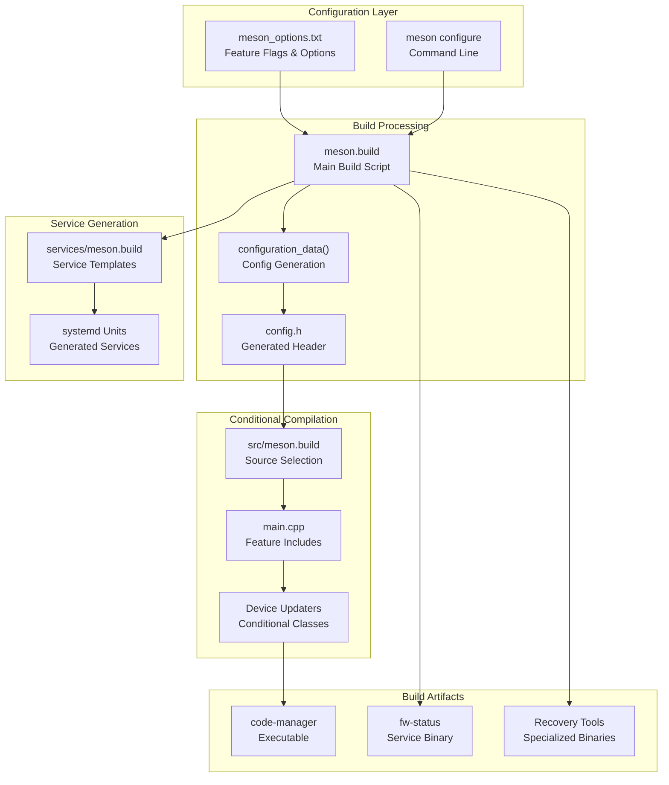

Sources: [meson.build:1-329](), [meson_options.txt:1-353](), [src/main.cpp:97-282]()

## Configuration Options and Hardware Support

The build system provides extensive configuration options organized into logical categories. Each hardware component can be independently enabled or disabled, with associated model specifications and service parameters.

### Hardware Component Options

| Component | Feature Flag | Model Option | Service Names |
|-----------|-------------|--------------|---------------|
| PSU Support | `PSU_SUPPORT` | `PSU_SUPPORTED_MODEL` | `com.Nvidia.PSU.Updater.service`, `psu-update@.service` |
| FPGA Support | `FPGA_SUPPORT` | `FPGA_SUPPORTED_MODEL` | `com.Nvidia.FPGA.Updater.service`, `fpga-update@.service` |
| CPLD Support | `CPLD_SUPPORT` | `CPLD_SUPPORTED_MODEL` | `com.Nvidia.CPLD.Updater.service`, `cpld-update@.service` |
| Retimer Support | `RT_SUPPORT` | `RT_SUPPORTED_MODEL` | `com.Nvidia.RT.Updater.service`, `rt-update@.service` |

**Configuration Processing Flow**

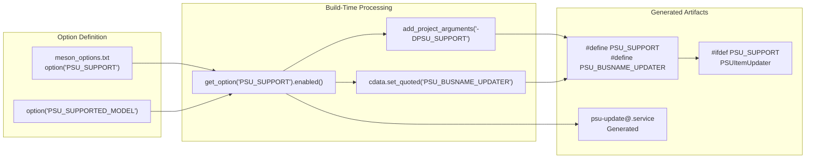

Sources: [meson.build:52-62](), [meson_options.txt:12-20](), [src/main.cpp:162-167]()

### Recovery and Debugging Options

The build system includes specialized options for recovery operations and debugging capabilities:

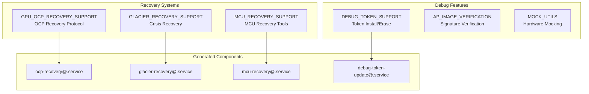

Sources: [meson.build:185-201](), [meson.build:226-233](), [meson.build:240-246]()

## Conditional Compilation System

The build system implements conditional compilation through preprocessor directives, allowing fine-grained control over included functionality based on configuration options.

### Main Entry Point Conditional Logic

The `main.cpp` file demonstrates the conditional compilation pattern used throughout the codebase:

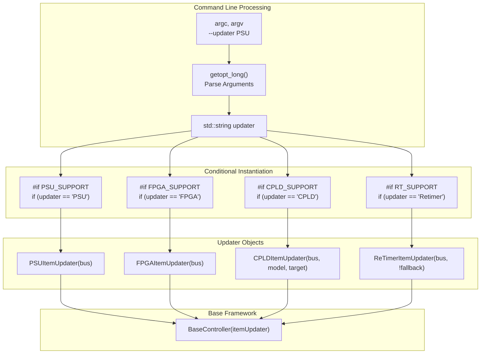

Sources: [src/main.cpp:21-32](), [src/main.cpp:162-188]()

### Source File Inclusion Pattern

The `src/meson.build` file demonstrates how source files are conditionally included based on feature flags:

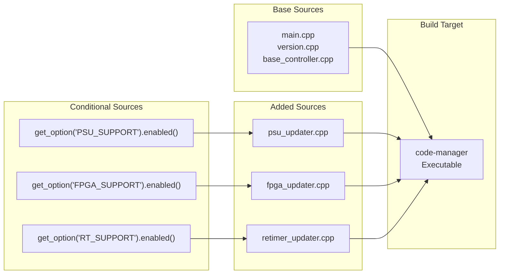

Sources: [src/meson.build:4-30]()

## Configuration Data Generation

The build system generates a comprehensive `config.h` header file containing all configuration constants and paths used by the runtime components.

### Configuration Categories

| Category | Configuration Keys | Purpose |
|----------|-------------------|---------|
| D-Bus Interface Names | `VERSION_IFACE`, `PSU_INVENTORY_IFACE` | Standard OpenBMC and NVIDIA interfaces |
| Service Bus Names | `PSU_BUSNAME_UPDATER`, `FPGA_BUSNAME_UPDATER` | Component-specific D-Bus names |
| Inventory Paths | `RT_INVENTORY_PATH`, `RT_SW_VERSION_PATH` | Hardware discovery paths |
| Update Services | `PSU_UPDATE_SERVICE`, `FPGA_UPDATE_SERVICE` | systemd service templates |
| File Paths | `IMG_UPLOAD_DIR_BASE` | Firmware image upload locations |
| Timeouts | `RT_UPDATE_TIMEOUT`, `SEP_TIMEOUT` | Operation timeout values |

**Configuration Generation Process**

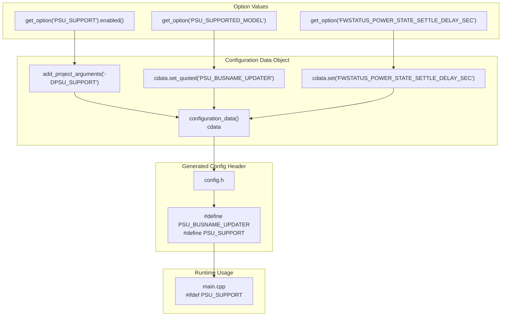

Sources: [meson.build:36-62](), [src/meson.build:1]()

## Service File Generation

The build system automatically generates systemd service files based on enabled features, with support for template services and model-specific configurations.

### Service Generation Logic

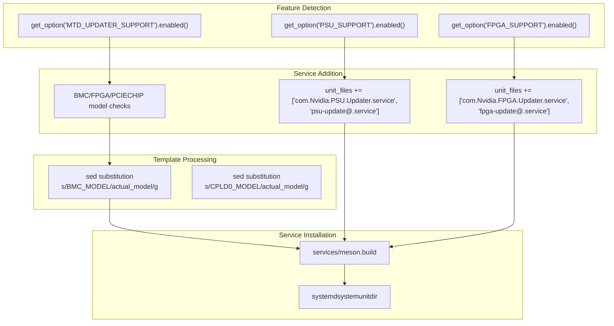

Sources: [services/meson.build:18-177](), [services/meson.build:193-231]()

## Build Dependencies and Linking

The build system manages a comprehensive set of dependencies required for firmware management operations:

### Core Dependencies

| Dependency | Purpose | Usage |
|------------|---------|--------|
| `systemd` | Service management | systemd unit file generation |
| `phosphor-logging` | OpenBMC logging | Structured logging via `lg2` and `log` |
| `sdbusplus` | D-Bus communication | Primary IPC mechanism |
| `nlohmann_json` | JSON parsing | Configuration file processing |
| `libusb-1.0` | USB communication | USB RCM and recovery protocols |
| `libudev` | Device monitoring | Hardware event detection |

### Optional Dependencies

The build system conditionally includes dependencies based on environment availability:

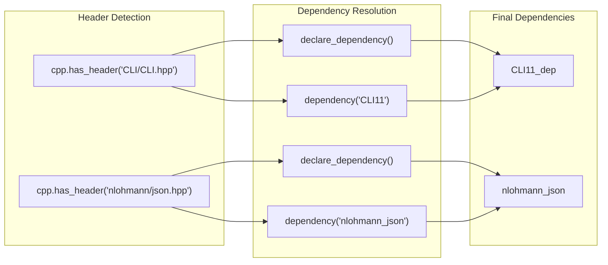

Sources: [meson.build:21-31](), [fw-status/meson.build:24-25](), [fw-status/meson.build:59]()

---

# Page: Firmware Update System

# Firmware Update System

<details>
<summary>Relevant source files</summary>

The following files were used as context for generating this wiki page:

- [src/activation_listener.hpp](src/activation_listener.hpp)
- [src/base_item_updater.cpp](src/base_item_updater.cpp)
- [src/base_item_updater.hpp](src/base_item_updater.hpp)
- [src/retimer_updater.cpp](src/retimer_updater.cpp)
- [src/retimer_updater.hpp](src/retimer_updater.hpp)
- [src/version.cpp](src/version.cpp)
- [src/version.hpp](src/version.hpp)

</details>


## Purpose and Scope

The Firmware Update System provides a comprehensive framework for managing firmware updates across NVIDIA hardware components. This system handles device discovery, version management, image verification, update orchestration, and progress tracking through standardized D-Bus interfaces integrated with systemd services.

The system supports multiple device types including PSUs, FPGAs, CPLDs, Retimers, and MTD devices. For hardware status monitoring and recovery operations, see [Firmware Status Monitoring](#3). For communication protocols and D-Bus utilities, see [Communication Infrastructure](#5).

## System Architecture

The firmware update system is built around a layered architecture with device-agnostic base classes and device-specific implementations.

### Core Architecture Overview

```mermaid
graph TB
    subgraph "D-Bus Layer"
        VERSION_DBUS["SoftwareVersion<br/>xyz.openbmc_project.Software.Version"]
        ACTIVATION_DBUS["Version Inherit<br/>xyz.openbmc_project.Software.Activation"]
        PROGRESS_DBUS["ActivationProgress<br/>xyz.openbmc_project.Software.ActivationProgress"]
        DELETE_DBUS["Delete<br/>xyz.openbmc_project.Object.Delete"]
    end
    
    subgraph "Core Framework"
        BASE_UPDATER["BaseItemUpdater<br/>Abstract Base Class"]
        VERSION_CLASS["Version<br/>Activation Lifecycle Manager"]
        ACTIVATION_LISTENER["ActivationListener<br/>Interface"]
        ITEM_UPDATER_UTILS["ItemUpdaterUtils<br/>Interface"]
    end
    
    subgraph "Device Implementations"
        RT_UPDATER["ReTimerItemUpdater"]
        PSU_UPDATER["PSUItemUpdater"]
        FPGA_UPDATER["FPGAItemUpdater"]
        CPLD_UPDATER["CPLDItemUpdater"]
    end
    
    subgraph "System Integration"
        SYSTEMD_SERVICES["systemd Update Services"]
        IMAGE_MONITOR["File System Monitoring"]
        INVENTORY_SYSTEM["Device Inventory"]
    end
    
    BASE_UPDATER --> VERSION_CLASS
    VERSION_CLASS --> VERSION_DBUS
    VERSION_CLASS --> ACTIVATION_DBUS
    VERSION_CLASS --> PROGRESS_DBUS
    VERSION_CLASS --> DELETE_DBUS
    
    BASE_UPDATER --> RT_UPDATER
    BASE_UPDATER --> PSU_UPDATER
    BASE_UPDATER --> FPGA_UPDATER
    BASE_UPDATER --> CPLD_UPDATER
    
    VERSION_CLASS --> SYSTEMD_SERVICES
    BASE_UPDATER --> IMAGE_MONITOR
    BASE_UPDATER --> INVENTORY_SYSTEM
    
    BASE_UPDATER -.-> ACTIVATION_LISTENER
    BASE_UPDATER -- "implements" --> ITEM_UPDATER_UTILS
```

**Sources:** [src/base_item_updater.hpp:47-51](), [src/version.hpp:71-76](), [src/version.hpp:102-118](), [src/retimer_updater.hpp:81-88]()

### Update Flow Architecture

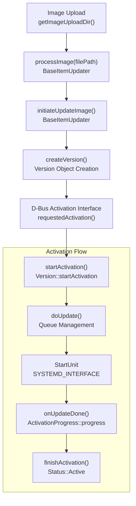

**Sources:** [src/base_item_updater.cpp:50-64](), [src/version.cpp:75-97](), [src/version.cpp:122-155](), [src/version.cpp:222-232]()

## Base Framework Components

### BaseItemUpdater Abstract Class

The `BaseItemUpdater` class provides the foundational framework for all device-specific updaters. It implements the core update lifecycle, device discovery, and D-Bus integration patterns. For details, see [Base Updater Framework](#2.1).

| Component | Purpose | Key Methods |
|-----------|---------|-------------|
| Device Discovery | Enumerate compatible devices | `getItemUpdaterInventoryPaths()`, `readExistingFirmWare()` |
| Image Processing | Handle uploaded firmware images | `processImage()`, `initiateUpdateImage()` |
| Version Management | Create and manage version objects | `createVersion()`, `erase()` |
| Inventory Monitoring | Track device presence and properties | `onInventoryChanged()`, `readDeviceDetails()` |

The class defines pure virtual methods that device implementations must override:

```cpp
virtual std::string getVersion(const std::string& inventoryPath) const = 0;
virtual std::string getManufacturer(const std::string& inventoryPath) const = 0;
virtual std::string getModel(const std::string& inventoryPath) const = 0;
virtual std::string getServiceArgs(const std::string& inventoryPath,
                                   const std::string& imagePath, 
                                   const std::string& version,
                                   const TargetFilter& targetFilter) const = 0;
```

**Sources:** [src/base_item_updater.hpp:47-136](), [src/base_item_updater.cpp:50-125](), [src/activation_listener.hpp:76-189]()

### Version Class and Activation Lifecycle

The `Version` class manages the complete firmware activation lifecycle through D-Bus interfaces. It implements multiple OpenBMC standard interfaces for software management. For details, see [Version Management and Activation](#2.2).

```mermaid
stateDiagram-v2
    [*] --> Ready: "Version Object Created"
    Ready --> Activating: "RequestedActivation::Active"
    Activating --> Active: "finishActivation()"
    Activating --> Failed: "onUpdateFailed()"
    Active --> [*]: "Delete::delete_()"
    Failed --> [*]: "Delete::delete_()"
    
    note right of Activating: "systemd unit execution<br/>unitStateChange monitoring<br/>UpdateTimeout management"
```

The `Version` class integrates several D-Bus interfaces:

| Interface | Implementation Class | Purpose |
|-----------|---------------------|---------|
| `xyz.openbmc_project.Software.Activation` | `VersionInherit` | Activation state management |
| `xyz.openbmc_project.Software.ActivationProgress` | `ActivationProgress` | Update progress reporting |
| `xyz.openbmc_project.Object.Delete` | `Delete` | Version object cleanup |
| `com.nvidia.Software.UpdateTimeout` | `VersionInherit` | Firmware update timeout tracking |

**Sources:** [src/version.hpp:71-76](), [src/version.hpp:152-167](), [src/version.cpp:61-97](), [src/version.cpp:157-187]()

## Device Discovery and Inventory Integration

### Inventory Path Resolution

Device updaters integrate with the OpenBMC inventory system to discover compatible hardware and retrieve device properties.

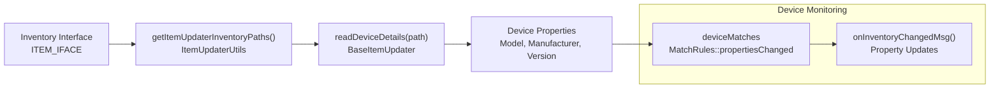

**Sources:** [src/base_item_updater.cpp:84-105](), [src/base_item_updater.cpp:166-175](), [src/base_item_updater.hpp:516-520]()

### UUID and Model Mapping

The system maintains a mapping between device UUIDs, models, and manufacturers to support proper image routing and compatibility validation.

```cpp
// Mapping expected string format <Manufacture>:<Model>:<UUID>
void insertToUUIDMap(const std::string& uuid, const std::string& model, 
                     const std::string& manufacture);
// Retrieve UUID for device compatibility
std::string getUUID(const std::string& model, const std::string& manufacture) const;
```

**Sources:** [src/base_item_updater.hpp:79-88](), [src/base_item_updater.hpp:252-262]()

## Update Execution and Service Integration

### Systemd Service Orchestration

Updates are executed through systemd services that are dynamically configured with device-specific arguments. The `Version` class coordinates service execution and monitors completion.

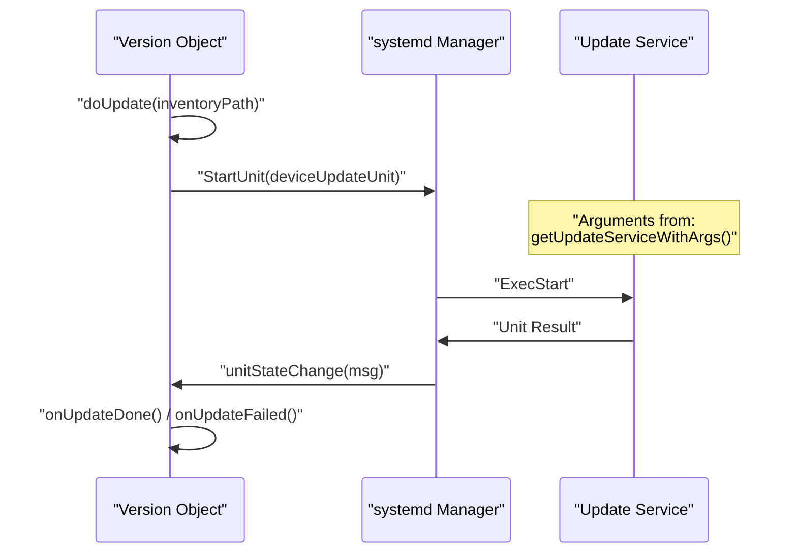

The service execution includes:

- **Service Name Generation**: `getUpdateService(inventoryPath)` creates systemd unit names with encoded arguments.
- **Progress Monitoring**: `unitStateChange` D-Bus match monitors `newStateResult` for "done" or "failed".
- **Timeout Handling**: `cancelInProgressUpdate()` provides failure detection and service termination.
- **Queue Management**: `deviceQueue` handles sequential device updates for multi-device components.

**Sources:** [src/version.cpp:99-120](), [src/version.cpp:122-155](), [src/version.cpp:189-220]()

### Target Filtering and Selective Updates

The system supports selective device updates through target filtering mechanisms. For details, see [Device-Specific Updaters](#2.3).

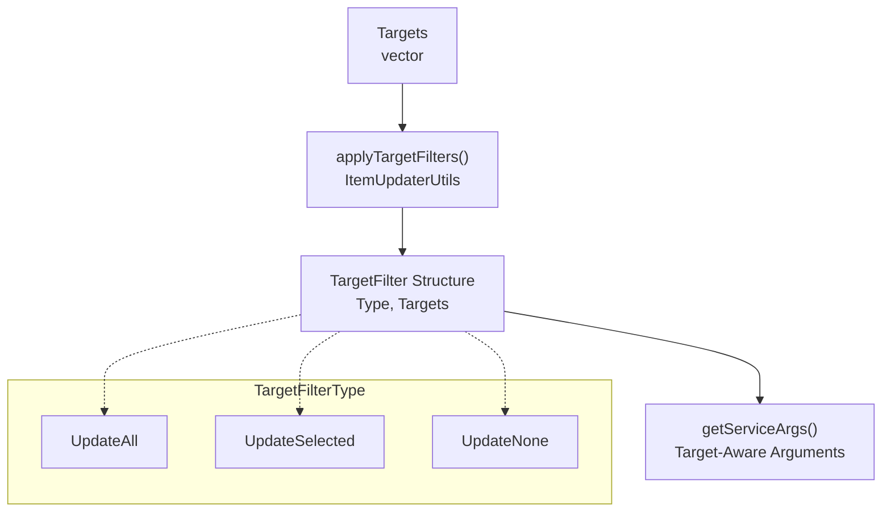

**Sources:** [src/activation_listener.hpp:43-59](), [src/activation_listener.hpp:124-126](), [src/base_item_updater.hpp:490-514]()

## Device-Specific Implementation Example

### ReTimerItemUpdater Implementation

The `ReTimerItemUpdater` demonstrates the device-specific implementation pattern for PCIe Retimers. For details, see [Retimer Updater](#2.3.4).

#### Device Configuration and Discovery

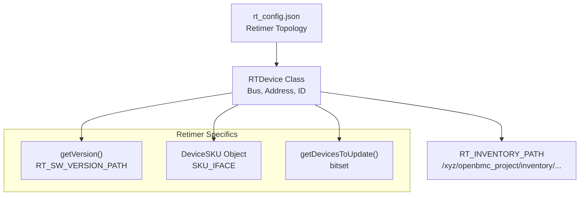

#### Service Argument Generation

The retimer updater supports both individual and batch update modes:

```cpp
// ReTimerItemUpdater::getServiceArgs
if (updateAllTogether())
{
    std::string devicesBits = getDevicesToUpdate(targetFilter);
    args += std::to_string(invs[0]->getBus()); // pull first device bus
    args += devicesBits;                        // bitset of devices to update
    args += imagePath;                          // image path
}
```

**Sources:** [src/retimer_updater.hpp:81-139](), [src/retimer_updater.hpp:184-207](), [src/retimer_updater.hpp:218-245](), [src/retimer_updater.cpp:33-56]()

### Configuration Integration

Device updaters integrate with JSON configuration files and compile-time defines to support different hardware platforms:

| Configuration Source | Purpose | Example |
|---------------------|---------|---------|
| JSON Config Files | Runtime device enumeration | `rt_config.json` via `rtcommonutils::loadJSONFile` |
| Compile Defines | Build-time feature selection | `RT_SUPPORTED_MODEL`, `RT_UPDATE_SERVICE` |
| D-Bus Properties | Runtime device properties | `VERSION_IFACE`, `SKU_IFACE` from inventory |

**Sources:** [src/retimer_updater.hpp:96-102](), [src/retimer_updater.cpp:45-48](), [src/retimer_updater.cpp:82-84]()

---

# Page: Base Updater Framework

# Base Updater Framework

<details>
<summary>Relevant source files</summary>

The following files were used as context for generating this wiki page:

- [src/base_controller.cpp](src/base_controller.cpp)
- [src/base_controller.hpp](src/base_controller.hpp)
- [src/base_item_updater.cpp](src/base_item_updater.cpp)
- [src/base_item_updater.hpp](src/base_item_updater.hpp)
- [src/watch.cpp](src/watch.cpp)

</details>


The Base Updater Framework provides the foundational architecture for all firmware update operations in the `nvidia-code-mgmt` system. This framework defines abstract interfaces and orchestration mechanisms that enable device-specific updaters to implement consistent firmware management patterns across different hardware types.

## Framework Architecture

The framework consists of two primary components: the `BaseItemUpdater` abstract class that defines the updater interface, and the `BaseController` class that orchestrates the update process.

Title: Core Framework Class Relationship
```mermaid
graph TB
    subgraph "Framework Core"
        BaseController["BaseController<br/>orchestration"]
        BaseItemUpdater["BaseItemUpdater<br/>abstract class"]
    end
    
    subgraph "Supporting Components"
        DBUSUtils["DBUSUtils<br/>D-Bus helper"]
        ActivationListener["ActivationListener<br/>activation events"]
        ItemUpdaterUtils["ItemUpdaterUtils<br/>inventory helpers"]
    end
    
    subgraph "Implementation Entities"
        Version["Version<br/>software object"]
        Watch["Watch<br/>inotify monitor"]
    end
    
    BaseController --> BaseItemUpdater
    BaseItemUpdater -- "inherits" --> DBUSUtils
    BaseItemUpdater -- "inherits" --> ActivationListener
    BaseItemUpdater -- "inherits" --> ItemUpdaterUtils
    
    BaseController -- "uses" --> Watch
    BaseItemUpdater -- "manages" --> Version
```

Sources: [src/base_item_updater.hpp:47-51](), [src/base_controller.hpp:33-48](), [src/base_controller.cpp:47-73]()

## BaseItemUpdater Abstract Class

The `BaseItemUpdater` class serves as the base for all device-specific updaters. It abstracts underlying device implementations, performs updates via systemd services, and manages D-Bus objects representing firmware versions [src/base_item_updater.hpp:41-46]().

### Core Abstract Methods

Device-specific updaters must implement several pure virtual methods to provide hardware context:

| Method | Purpose | File Reference |
|--------|---------|----------------|
| `getVersion()` | Retrieve current firmware version from device | [src/base_item_updater.hpp:252-252]() |
| `getManufacturer()` | Get device manufacturer from inventory | [src/base_item_updater.hpp:261-261]() |
| `getModel()` | Get device model from inventory | [src/base_item_updater.hpp:257-257]() |
| `getServiceArgs()` | Generate systemd service arguments for the update tool | [src/base_item_updater.hpp:333-333]() |

### Device Discovery and UUID Mapping

The framework maintains a mapping between hardware characteristics (Manufacturer, Model) and Unique Identifiers (UUID) to support multi-device scenarios. This is initialized via the `supportedDevices` string in the constructor, which expects the format `<Manufacture>:<Model>:<UUID>` [src/base_item_updater.hpp:81-86]().

Title: Inventory to Software Object Mapping
```mermaid
flowchart LR
    subgraph "D-Bus Inventory"
        InventoryPath["Inventory Object Path"]
        Properties["PropertiesChanged<br/>Present, Model, Manufacturer"]
    end
    
    subgraph "BaseItemUpdater Logic"
        onInventoryChanged["onInventoryChanged()"]
        getUUID["getUUID(model, mfg)"]
        createSoftwareObject["createSoftwareObject()"]
    end
    
    subgraph "Software Management"
        VersionObj["/xyz/openbmc_project/software/{id}"]
        Activation["Activation Interface"]
    end
    
    InventoryPath --> Properties
    Properties --> onInventoryChanged
    onInventoryChanged --> getUUID
    getUUID --> createSoftwareObject
    createSoftwareObject --> VersionObj
    VersionObj --> Activation
```

Sources: [src/base_item_updater.cpp:127-164](), [src/base_item_updater.cpp:177-248](), [src/base_item_updater.hpp:72-89]()

### Image Processing Pipeline

When a new image is detected, the framework follows a standardized pipeline:
1. **Detection**: The `Watch` class triggers the `processImage` callback [src/watch.cpp:122-127]().
2. **Identification**: `getIdProperty` generates a unique ID based on the image path [src/base_item_updater.cpp:50-61]().
3. **Update Initiation**: `initiateUpdateImage` creates a `Version` object with `Status::Active` (for existing firmware) or `Status::Ready` (for new uploads) [src/base_item_updater.cpp:62-63]().
4. **Activation**: When a user sets `RequestedActivation` to `Active`, the `onReqActivationChanged` handler is triggered [src/base_item_updater.cpp:250-255]().
5. **Execution**: The framework starts the systemd service returned by `getUpdateServiceWithArgs` [src/base_item_updater.cpp:278-284]().

## BaseController Orchestration

The `BaseController` class manages the lifecycle of the updater service, including initial firmware discovery and ongoing file system monitoring.

### Controller Responsibilities

- **Initial Discovery**: `processExistingImages()` calls `readExistingFirmWare()` to populate D-Bus with currently installed versions [src/base_controller.cpp:96-101]().
- **File Watching**: `startWatching()` initializes the `Watch` class to monitor directories for incoming image files via `inotify` [src/base_controller.cpp:75-95]().
- **Image Validation**: `processImage()` verifies that the file is a regular file and has a valid stem (version string) before passing it to the updater [src/base_controller.cpp:47-73]()

Title: Update Orchestration Flow
```mermaid
sequenceDiagram
    participant W as Watch (inotify)
    participant BC as BaseController
    participant IU as BaseItemUpdater
    participant S as Systemd
    
    W->>BC: imageCallback(filePath)
    BC->>IU: processImage(path)
    IU->>IU: createVersion(objPath, versionId)
    Note over IU: Wait for D-Bus Activation Request
    IU->>S: StartUnit(updateService)
    S-->>IU: Job Finished
    IU->>IU: cleanupImageUploadDir()
```

Sources: [src/base_controller.cpp:47-73](), [src/watch.cpp:122-133](), [src/base_item_updater.cpp:250-284]()

## D-Bus Integration Patterns

The framework implements comprehensive D-Bus signal monitoring to react to system changes:

| Signal / Method | Role | File Reference |
|-----------------|------|----------------|
| `onInventoryChangedMsg` | Reacts to hardware being added or replaced | [src/base_item_updater.cpp:166-175]() |
| `onReqActivationChangedMsg` | Detects user requests to start a firmware update | [src/base_item_updater.cpp:250-255]() |
| `newDeviceAdded` | Handles `InterfacesAdded` signals for dynamic device discovery | [src/base_item_updater.cpp:335-342]() |

## Configuration and Extensibility

The framework is designed for extensibility through virtual method overrides:

- **Verification**: `needVerify()` determines if signature verification is required before update [src/base_item_updater.hpp:513-516]().
- **Batch Updates**: `updateTogether()` indicates if multiple devices of the same type should be updated in a single service call [src/base_item_updater.hpp:219-222]().
- **Validation**: `pathIsValidDevice()` allows device-specific logic to filter which inventory paths are relevant to the updater [src/base_item_updater.hpp:478-482]().

Sources: [src/base_item_updater.hpp:63-89](), [src/base_item_updater.hpp:478-546]()

---

# Page: Version Management and Activation

# Version Management and Activation

<details>
<summary>Relevant source files</summary>

The following files were used as context for generating this wiki page:

- [src/activation_listener.hpp](src/activation_listener.hpp)
- [src/retimer_updater.cpp](src/retimer_updater.cpp)
- [src/retimer_updater.hpp](src/retimer_updater.hpp)
- [src/signature_verifier.cpp](src/signature_verifier.cpp)
- [src/signature_verifier.hpp](src/signature_verifier.hpp)
- [src/version.cpp](src/version.cpp)
- [src/version.hpp](src/version.hpp)
- [test/test_base_updater_controller.cpp](test/test_base_updater_controller.cpp)
- [test/test_signature_verifier.cpp](test/test_signature_verifier.cpp)
- [test/test_version.cpp](test/test_version.cpp)

</details>


This document covers the `Version` class and software activation lifecycle that forms the core of the firmware update system. The `Version` class manages firmware images, coordinates device updates, tracks progress, and provides D-Bus interfaces for external clients to monitor and control firmware updates. For information about device-specific update implementations, see [Device-Specific Updaters](#2.3). For details about the base updater framework, see [Base Updater Framework](#2.1).

## Version Class Architecture

The `Version` class serves as the central coordinator for firmware update operations, implementing multiple D-Bus server interfaces to provide standardized access to version information, activation control, and file management. It inherits from `VersionInherit`, which aggregates multiple OpenBMC standard interfaces.

### Version Entity Relationship
The following diagram bridges the natural language concept of "Version Management" to the code entities defined in `src/version.hpp`.

```mermaid
graph TB
    subgraph "Code Entity: Version Class"
        Version["Version [src/version.hpp:246]"]
        VersionInherit["VersionInherit [src/version.hpp:71]"]
        DBUSUtils["DBUSUtils [src/dbusutils.hpp]"]
    end
    
    subgraph "D-Bus Server Interfaces (Inherited)"
        UUID["xyz::openbmc_project::Common::server::UUID"]
        Activation["xyz::openbmc_project::Software::server::Activation"] 
        ExtendedVersion["xyz::openbmc_project::Software::server::ExtendedVersion"]
        FilePath["xyz::openbmc_project::Common::server::FilePath"]
        UpdateTimeout["com::nvidia::Software::server::UpdateTimeout"]
    end
    
    subgraph "Associated Component Objects"
        ActivationProgress["ActivationProgress [src/version.hpp:152]"]
        UpdatePolicy["UpdatePolicy [src/version.hpp:210]"]
        Delete["Delete [src/version.hpp:177]"]
        SoftwareVersion["SoftwareVersion [src/version.hpp:102]"]
    end
    
    subgraph "Interface Logic Providers"
        ItemUpdaterUtils["ItemUpdaterUtils [src/activation_listener.hpp:76]"]
        ActivationListener["ActivationListener [src/activation_listener.hpp:61]"]
    end
    
    Version --> VersionInherit
    Version --> DBUSUtils
    VersionInherit --> UUID
    VersionInherit --> Activation
    VersionInherit --> ExtendedVersion
    VersionInherit --> FilePath
    VersionInherit --> UpdateTimeout
    
    Version --> ActivationProgress
    Version --> UpdatePolicy
    Version --> Delete
    Version --> ItemUpdaterUtils
    Version --> ActivationListener
```
Sources: [src/version.hpp:68-85](), [src/version.hpp:246-300](), [src/version.hpp:152-167](), [src/version.hpp:210-222](), [src/version.hpp:177-202]()

## Activation State Machine

The firmware activation process follows a defined state machine that transitions through multiple phases, from initial request via D-Bus to final completion or failure. The state transitions are primarily managed in `Version::activation` and `Version::requestedActivation`.

```mermaid
stateDiagram-v2
    [*] --> Ready : "Version Created"
    Ready --> Activating : "requestedActivation(Active) [src/version.cpp:78]"
    Failed --> Activating : "requestedActivation(Active)"
    Active --> Activating : "requestedActivation(Active)"
    
    Activating --> ImageVerification : "startActivation() [src/version.cpp:222]"
    ImageVerification --> DeviceDiscovery : "Verification Success [src/version.cpp:249]"
    ImageVerification --> Failed : "Verification Failed [src/version.cpp:244]"
    
    DeviceDiscovery --> CompatibilityCheck : "getItemUpdaterInventoryPaths() [src/version.cpp:265]"
    CompatibilityCheck --> QueueDevices : "isCompatible() == true [src/version.cpp:295]"
    CompatibilityCheck --> Failed : "No Compatible Devices [src/version.cpp:311]"
    
    QueueDevices --> UpdateExecution : "doUpdate() [src/version.cpp:143]"
    UpdateExecution --> ProgressTracking : "systemd.StartUnit [src/version.cpp:129]"
    ProgressTracking --> UpdateNext : "onUpdateDone() [src/version.cpp:157]"
    ProgressTracking --> Failed : "onUpdateFailed() [src/version.cpp:173]"
    
    UpdateNext --> UpdateExecution : "deviceQueue.pop() [src/version.cpp:168]"
    UpdateNext --> Active : "finishActivation() [src/version.cpp:148]"
    
    Failed --> [*] : "cleanupImageUploadDir() [src/version.cpp:184]"
    Active --> [*] : "Update Complete"
```
Sources: [src/version.cpp:61-97](), [src/version.cpp:122-155](), [src/version.cpp:157-187](), [src/version.cpp:222-264](), [src/version.cpp:265-313]()

## D-Bus Interface Integration

The `Version` class exposes firmware update functionality through standardized OpenBMC D-Bus interfaces. This allows tools like `bmcweb` (Redfish) or `busctl` to interact with the update process.

| Interface | Purpose | Key Properties/Methods |
|-----------|---------|----------------------|
| `xyz.openbmc_project.Software.Activation` | Control activation state | `activation`, `requestedActivation()` |
| `xyz.openbmc_project.Software.ExtendedVersion` | Detailed version info | `extendedVersion` |
| `xyz.openbmc_project.Software.ActivationProgress` | Update progress (%) | `progress` |
| `xyz.openbmc_project.Common.UUID` | Unique ID for the image | `uuid` |
| `xyz.openbmc_project.Common.FilePath` | Local path to firmware image | `path` |
| `xyz.openbmc_project.Software.UpdatePolicy` | Configuration for update | `targets`, `forceUpdate` |

### Data Flow: Client to Code Entity
This diagram maps D-Bus interactions to specific member functions in the `Version` class.

```mermaid
graph LR
    subgraph "External Clients"
        BMCWeb["bmcweb (Redfish)"]
        CLI["busctl / CLI"]
    end
    
    subgraph "D-Bus Property/Method"
        ReqAct["requestedActivation()"]
        GetProg["progress"]
        GetExtVer["extendedVersion"]
        DoDelete["delete_()"]
    end
    
    subgraph "Code Entity: Version Class"
        v_reqAct["Version::requestedActivation() [src/version.cpp:75]"]
        v_prog["ActivationProgress::progress() [src/version.hpp:165]"]
        v_extVer["Version::extendedVersion()"]
        v_delete["Delete::delete_() [src/version.cpp:46]"]
    end
    
    BMCWeb --> ReqAct
    CLI --> GetProg
    CLI --> GetExtVer
    BMCWeb --> DoDelete
    
    ReqAct --> v_reqAct
    GetProg --> v_prog
    GetExtVer --> v_extVer
    DoDelete --> v_delete
```
Sources: [src/version.hpp:68-82](), [src/version.cpp:46-52](), [src/version.cpp:75-97](), [src/version.hpp:152-167]()

## Signature Verification

If configured via `ItemUpdaterUtils::needVerify()`, the system utilizes the `SignatureVerifier` class to validate images before activation.

*   **Logic**: `Version::startActivation` calls `itemUpdaterUtils->doVerify(path())` [src/version.cpp:240]().
*   **Implementation**: `SignatureVerifier` parses a `Metadata` structure [src/signature_verifier.hpp:37-84]() from the beginning of the image and validates SHA-384 hashes and ECDSA signatures [src/signature_verifier.cpp:118-200]().
*   **Hardware Compatibility**: The verifier checks `apSkuId`, `pciVendorId`, and other hardware identifiers within the metadata [src/signature_verifier.hpp:75-79]().

Sources: [src/version.cpp:235-245](), [src/signature_verifier.cpp:118-167](), [src/signature_verifier.hpp:37-84]()

## Progress Tracking and Status Management

The activation process provides progress tracking through the `ActivationProgress` interface. Progress is updated incrementally as each device in the `deviceQueue` is processed.

*   **Initialization**: Progress starts at 10% upon successful image verification [src/version.cpp:252]().
*   **Incremental Steps**: The `progressStep` is calculated as `80 / deviceCount` [src/version.cpp:319]().
*   **Updates**: `onUpdateDone()` increments the D-Bus `progress` property [src/version.cpp:165-166]().
*   **Completion**: `finishActivation()` sets progress to 100% and activation status to `Active` [src/version.cpp:351-352]().

Sources: [src/version.cpp:157-171](), [src/version.cpp:250-253](), [src/version.cpp:315-321](), [src/version.cpp:349-354]()

## Target Filtering and Device Selection

The system supports flexible device selection through `TargetFilter`, allowing updates to be applied to specific devices or all discovered devices.

*   **Filter Types**: `UpdateNone`, `UpdateSelected`, `UpdateAll` [src/activation_listener.hpp:43-48]().
*   **Selection**: `ReTimerItemUpdater::getDevicesToUpdate` uses a `std::bitset` to map target strings (e.g., "RT0") to specific hardware indices [src/retimer_updater.hpp:184-207]().
*   **Compatibility**: `Version::isCompatible` verifies that the device's `model` and `manufacturer` match the values expected by the `Version` object [src/version.cpp:265-288]().

Sources: [src/activation_listener.hpp:43-59](), [src/version.cpp:265-313](), [src/retimer_updater.hpp:184-207]()

## Integration with Device Updaters

The `Version` class coordinates with device-specific updaters through the `ItemUpdaterUtils` abstract interface. This decoupling allows the same activation logic to support Retimers, PSUs, FPGAs, and CPLDs.

*   **Service Orchestration**: `Version::doUpdate` retrieves the systemd unit name via `getUpdateService` [src/version.cpp:125]() and starts it using the `StartUnit` D-Bus method on `org.freedesktop.systemd1` [src/version.cpp:128-131]().
*   **Timeout Management**: A timer is started using `itemUpdaterUtils->getTimeout()` to ensure updates do not hang indefinitely [src/version.cpp:132]().
*   **Signal Handling**: `Version::unitStateChange` listens for `JobRemoved` signals from systemd to determine when a specific device update has finished [src/version.cpp:99-120]().

Sources: [src/version.cpp:99-141](), [src/activation_listener.hpp:76-189](), [src/retimer_updater.hpp:220-259]()

---

# Page: Device-Specific Updaters

# Device-Specific Updaters

<details>
<summary>Relevant source files</summary>

The following files were used as context for generating this wiki page:

- [services/com.Nvidia.NVMe.Updater.service](services/com.Nvidia.NVMe.Updater.service)
- [services/nvme-update@.service](services/nvme-update@.service)
- [src/cpld_updater.hpp](src/cpld_updater.hpp)
- [src/fpga_updater.hpp](src/fpga_updater.hpp)
- [src/jamplayer.hpp](src/jamplayer.hpp)
- [src/mtd_updater.hpp](src/mtd_updater.hpp)
- [src/nvme_updater.cpp](src/nvme_updater.cpp)
- [src/nvme_updater.hpp](src/nvme_updater.hpp)
- [src/pex_updater.hpp](src/pex_updater.hpp)
- [src/psu_updater.hpp](src/psu_updater.hpp)

</details>


This section covers the hardware-specific updater implementations that handle firmware updates for different types of devices in the NVIDIA firmware management system. Each device-specific updater inherits from the `BaseItemUpdater` framework and implements specialized logic for device discovery, version retrieval, and update execution.

For information about the base updater framework architecture, see [Base Updater Framework](#2.1). For details on version management and activation lifecycle, see [Version Management and Activation](#2.2).

## Overview and Common Architecture

All device-specific updaters follow a consistent architectural pattern built on top of the `BaseItemUpdater` abstract class. They implement device-specific logic for hardware communication, configuration parsing, and update service integration while maintaining a common D-Bus interface for external clients.

### Updater Class Hierarchy

```mermaid
graph TB
    subgraph "Base Framework"
        BaseItemUpdater["BaseItemUpdater<br/>Abstract Base Class"]
    end
    
    subgraph "Device-Specific Updaters"
        CPLDItemUpdater["CPLDItemUpdater<br/>Complex Logic Devices"]
        MTDItemUpdater["MTDItemUpdater<br/>Memory Technology Devices"]
        PSUItemUpdater["PSUItemUpdater<br/>Power Supply Units"]
        FPGAItemUpdater["FPGAItemUpdater<br/>Field Programmable Arrays"]
        PEXItemUpdater["PEXItemUpdater<br/>Peripheral Expansion"]
        JamPlayer["JamPlayer<br/>JAMPLAYER Firmware"]
        NVMeItemUpdater["NVMeItemUpdater<br/>NVMe Storage Drives"]
    end
    
    subgraph "Hardware Communication Utilities"
        CPLDDevice["CPLDDevice<br/>cpldcommonutils::Util"]
        PowerSupplyDevice["PowerSupplyDevice<br/>psucommonutils::PSShellIntf"]
        CECDevice["CECDevice<br/>fpga_ceccommonutils::Util"]
        NVMeDevice["NVMeDevice<br/>NVMe Drive Interface"]
    end
    
    BaseItemUpdater --> CPLDItemUpdater
    BaseItemUpdater --> MTDItemUpdater
    BaseItemUpdater --> PSUItemUpdater
    BaseItemUpdater --> FPGAItemUpdater
    BaseItemUpdater --> PEXItemUpdater
    BaseItemUpdater --> JamPlayer
    BaseItemUpdater --> NVMeItemUpdater
    
    CPLDItemUpdater --> CPLDDevice
    PSUItemUpdater --> PowerSupplyDevice
    FPGAItemUpdater --> CECDevice
    NVMeItemUpdater --> NVMeDevice
```

Sources: [src/cpld_updater.hpp:136-151](), [src/mtd_updater.hpp:38-56](), [src/psu_updater.hpp:91-105](), [src/fpga_updater.hpp:72-85](), [src/pex_updater.hpp:35-47](), [src/jamplayer.hpp:36-43](), [src/nvme_updater.hpp:89-111]()

## Device Discovery and Configuration

Device-specific updaters implement a consistent pattern for discovering and configuring hardware devices through JSON configuration files, environment files, and hardware utility libraries.

### Configuration-Based Device Discovery Flow

```mermaid
flowchart TD
    subgraph "Configuration Loading"
        JSONConfig["JSON Configuration Files<br/>/usr/share/nvidia-power-manager/<br/>/usr/share/nvidia-cec/<br/>/usr/share/mtd_targets/"]
        EnvConfig["Environment Files<br/>/etc/nvme/nvmemodels.env"]
        ConfigParse["Configuration Parsing<br/>nlohmann::json / sh parser"]
    end
    
    subgraph "Device Instantiation"
        DeviceFilter["Device Filtering<br/>Model/Manufacturer Match"]
        DeviceCreate["Device Object Creation<br/>CPLDDevice, NVMeDevice, etc."]
        InventoryMap["Inventory Path Mapping<br/>D-Bus Object Paths"]
    end
    
    subgraph "Hardware Communication Setup"
        I2CParams["I2C Parameters<br/>Bus Number, Slave Address"]
        NVMeParams["NVMe Parameters<br/>Device Node Path"]
        HardwareUtils["Hardware Utility Integration<br/>cpldcommonutils, psucommonutils"]
        DeviceValidation["Device Presence Validation<br/>pathIsValidDevice() / Mapper checks"]
    end
    
    JSONConfig --> ConfigParse
    EnvConfig --> ConfigParse
    ConfigParse --> DeviceFilter
    DeviceFilter --> DeviceCreate
    DeviceCreate --> InventoryMap
    DeviceCreate --> I2CParams
    DeviceCreate --> NVMeParams
    I2CParams --> HardwareUtils
    NVMeParams --> DeviceValidation
    HardwareUtils --> DeviceValidation
```

Sources: [src/cpld_updater.hpp:153-222](), [src/psu_updater.hpp:107-143](), [src/fpga_updater.hpp:87-124](), [src/mtd_updater.hpp:60-161](), [services/com.Nvidia.NVMe.Updater.service:9-25](), [src/nvme_updater.hpp:187-220]()

### Device Configuration Examples

| Updater Type | Configuration Source | Key Parameters | Hardware Interface |
|--------------|-------------------|----------------|-------------------|
| CPLD | `/usr/share/nvidia-power-manager/cpld_config.json` | Bus, Address, ImageSelect, CPLDDeviceNo | I2C via `cpldcommonutils::Util` |
| PSU | `/usr/share/nvidia-power-manager/psu_config.json` | I2cBus, I2cSlaveAddress, Index | I2C via `psucommonutils::PSShellIntf` |
| FPGA | `/usr/share/nvidia-cec/cec_config.json` | Bus, Address, Index | I2C via `fpga_ceccommonutils::Util` |
| MTD | `/usr/share/mtd_targets/{mtdName}.json` | Path, Offset, VersionSize | File system operations |
| NVMe | `/etc/nvme/nvmemodels.env` | Model Name, Target Instance | `/dev/nvmeXnX` via `nvme-fw-update` |

## Common Interface Implementation

All device-specific updaters implement a set of common virtual methods from `BaseItemUpdater` that provide hardware abstraction for the update framework.

### Core Interface Methods

Each updater implements these key methods:

- **`getVersion(inventoryPath)`** - Retrieves current firmware version from hardware or D-Bus properties [src/nvme_updater.cpp:95-110]()
- **`getManufacturer(inventoryPath)`** - Returns device manufacturer string [src/nvme_updater.cpp:112-128]()
- **`getModel(inventoryPath)`** - Returns device model identifier, often parsing composite strings [src/nvme_updater.cpp:130-173]()
- **`getServiceArgs(inventoryPath, imagePath, version, targetFilter)`** - Generates systemd service arguments for update execution [src/nvme_updater.hpp:159-162]()

### Service Arguments Generation Pattern

```mermaid
graph LR
    subgraph "Input Parameters"
        InventoryPath["inventoryPath<br/>D-Bus Object Path"]
        ImagePath["imagePath<br/>Firmware Image File"]
        Version["version<br/>Target Version"]
        TargetFilter["targetFilter<br/>Update Scope"]
    end
    
    subgraph "Device-Specific Processing"
        DeviceLookup["Device Lookup<br/>Match inventory path"]
        ParamExtraction["Parameter Extraction<br/>Bus, Address, etc."]
        ArgFormatting["Argument Formatting<br/>Systemd Unit Escaping"]
    end
    
    subgraph "Output"
        ServiceArgs["Service Arguments<br/>Escaped systemd arguments"]
    end
    
    InventoryPath --> DeviceLookup
    ImagePath --> ParamExtraction
    Version --> ParamExtraction
    TargetFilter --> ParamExtraction
    
    DeviceLookup --> ParamExtraction
    ParamExtraction --> ArgFormatting
    ArgFormatting --> ServiceArgs
```

Sources: [src/cpld_updater.hpp:289-324](), [src/psu_updater.hpp:179-203](), [src/fpga_updater.hpp:162-185](), [src/mtd_updater.hpp:231-251](), [src/nvme_updater.hpp:159-162]()

### Service Arguments Examples

Different updaters generate service arguments specific to their update mechanisms:

**CPLD Updater Arguments:**
```
\x20{BusNumber}\x20{ImageSelect}\x20{ImagePath}\x20{CPLDDeviceNum}\x20{Version}
```

**NVMe Updater Arguments:**
Uses an environment file at `/run/nvidia-nvme-update/%i.env` to pass `${FW_IMAGE}`, `${FW_VERSION}`, and `${FW_TARGETS}` to the `nvme-fw-update` utility.

Sources: [src/cpld_updater.hpp:301-319](), [src/psu_updater.hpp:191-198](), [services/nvme-update@.service:7-8]()

## Authentication and Verification

Device-specific updaters support optional firmware image authentication through configurable verification mechanisms.

### Authentication Implementation Pattern

Most updaters support compile-time authentication features:

- **CPLD**: `VERIFY_CPLD` with `PUBKEY_CPLD` public key [src/cpld_updater.hpp:223-228]()
- **MTD/PCIe Chip**: `VERIFY_PCIECHIP` with `PUBKEY_PCIECHIP` public key [src/mtd_updater.hpp:131-137]()
- **JamPlayer**: `VERIFY_JAMPLAYER` with `PUBKEY_JAMPLAYER` public key [src/jamplayer.hpp:45-81]()

The `needVerify()` method determines if verification is required based on:
1. Non-empty public key configuration
2. Presence of `/var/check_signature` file [src/jamplayer.hpp:197-201]()

## Special Updater Characteristics

### NVMe Updater Multi-Instance Support

The `NVMeItemUpdater` supports multiple instances based on drive models. The `com.Nvidia.NVMe.Updater.service` parses `/etc/nvme/nvmemodels.env` and spawns separate `code-manager` instances for each model found [services/com.Nvidia.NVMe.Updater.service:9-25](). It also implements:
- **Composite Model Extraction**: Extracts the specific model from strings like "Manufacturer:Model:UUID" [src/nvme_updater.cpp:185-210]().
- **Target Validation**: Strips "FW_" prefixes from inventory names to identify raw drive names [src/nvme_updater.cpp:245-253]().

### MTD Updater Unique Features

The `MTDItemUpdater` has several distinctive characteristics:
- **File-based version reading** from MTD device files at configurable offsets [src/mtd_updater.hpp:81-84]().
- **Asset interface integration** for manufacturer property publishing [src/mtd_updater.hpp:115-121]().
- **Inventory support disabled** (`inventorySupported()` returns `false`) [src/mtd_updater.hpp:282-285]().

### JamPlayer Target Filtering

The `JamPlayer` updater implements sophisticated target filtering logic:
- Supports `TargetFilterType::UpdateAll` for system-wide updates [src/jamplayer.hpp:143-145]().
- Checks for specific `JAMPLAYER_NAME` in target filter lists [src/jamplayer.hpp:144-145]().
- Generates `EXECUTE` or `IGNORE` arguments based on filter matching [src/jamplayer.hpp:149-157]().

### CPLD Power Management Integration

The `CPLDItemUpdater` includes power-aware device management:
- **Power-on device detection** from JSON configuration (`PowerOnDevice` flag) [src/cpld_updater.hpp:204-205]().
- **Conditional software object creation** based on power state [src/cpld_updater.hpp:205-210]().
- **Inventory mapping** with power state tracking [src/cpld_updater.hpp:211]().

---

# Page: CPLD and MTD Updaters

# CPLD and MTD Updaters

<details>
<summary>Relevant source files</summary>

The following files were used as context for generating this wiki page:

- [services/com.Nvidia.CPLD_N.Starter.service](services/com.Nvidia.CPLD_N.Starter.service)
- [services/com.Nvidia.CPLD_N.Updater@.service](services/com.Nvidia.CPLD_N.Updater@.service)
- [services/com.Nvidia.Jamplayer.service](services/com.Nvidia.Jamplayer.service)
- [services/com.Nvidia.MTD.Updater.bmc.service](services/com.Nvidia.MTD.Updater.bmc.service)
- [services/com.Nvidia.MTD.Updater.fpga1.service](services/com.Nvidia.MTD.Updater.fpga1.service)
- [services/com.Nvidia.Vmeplayer0.service](services/com.Nvidia.Vmeplayer0.service)
- [services/com.Nvidia.Vmeplayer1.service](services/com.Nvidia.Vmeplayer1.service)
- [services/cpld-update@.service](services/cpld-update@.service)
- [services/jamplayer-flash@.service](services/jamplayer-flash@.service)
- [services/mtd-update@.service](services/mtd-update@.service)
- [services/psu-update@.service](services/psu-update@.service)
- [services/vmeplayer-flash@.service](services/vmeplayer-flash@.service)
- [src/cpld_updater.cpp](src/cpld_updater.cpp)
- [src/cpld_updater.hpp](src/cpld_updater.hpp)
- [src/cpld_util.hpp](src/cpld_util.hpp)
- [src/jamplayer.hpp](src/jamplayer.hpp)
- [src/mtd_updater.cpp](src/mtd_updater.cpp)
- [src/mtd_updater.hpp](src/mtd_updater.hpp)
- [src/psu_util.hpp](src/psu_util.hpp)
- [src/vmeplayer.cpp](src/vmeplayer.cpp)
- [src/vmeplayer.hpp](src/vmeplayer.hpp)

</details>


## Overview

The CPLD and MTD updaters are specialized components within the NVIDIA Code Management System responsible for updating firmware on Complex Programmable Logic Devices (CPLDs), Memory Technology Devices (MTDs), and JamPlayer devices. All three updaters inherit from the `BaseItemUpdater` framework and implement device-specific functionality for their respective firmware update operations.

| Updater Class | Device Type | Configuration Source | Key Features |
|---------------|-------------|---------------------|--------------|
| `CPLDItemUpdater` | Complex Programmable Logic Devices | `/usr/share/nvidia-power-manager/cpld_config.json` | I2C communication, multiple device support, image selection |
| `MTDItemUpdater` | Memory Technology Devices | `/usr/share/mtd_targets/{mtdName}.json` | Version offset reading, Asset interface, per-device config |
| `JamPlayer` | JAM file devices | `/usr/share/nvidia-power-manager/cpld_config.json` | Target filtering, simplified updates |
| `VmePlayer` | VME JTAG devices | Command line arguments | JTAG-based updates via VME player |

Sources: [src/cpld_updater.hpp:136-151](), [src/mtd_updater.hpp:38-58](), [src/jamplayer.hpp:36-44](), [src/vmeplayer.hpp:15-26]()

## Architecture

### Updater Class Hierarchy

```mermaid
classDiagram
    class "BaseItemUpdater" {
        <<abstract>>
        +std::string getVersion()
        +std::string getManufacturer()
        +std::string getModel()
        +std::string getServiceArgs()
    }
    class "CPLDItemUpdater" {
        -std::vector~std::unique_ptr~CPLDDevice~~ invs
        -std::map~std::string, std::unique_ptr~SoftwareVersion~~ softwareVersionIntf
        +CPLDItemUpdater(bus, model, target)
        +getServiceArgs()
        +getItemUpdaterInventoryPaths()
    }
    class "MTDItemUpdater" {
        -std::string mtdName
        -std::string copyPath
        -std::streamoff versionOffset
        +MTDItemUpdater(bus, mtdN, modelName, nostrip)
        +getVersion()
        +getServiceArgs()
    }
    class "JamPlayer" {
        +JamPlayer(bus)
        +getServiceArgs()
        +getTimeout()
    }
    class "VmePlayer" {
        -std::string vmeName
        +VmePlayer(bus, vmeN, modelName)
        +getServiceArgs()
    }
    
    BaseItemUpdater <|-- CPLDItemUpdater
    BaseItemUpdater <|-- MTDItemUpdater  
    BaseItemUpdater <|-- JamPlayer
    BaseItemUpdater <|-- VmePlayer
```

Sources: [src/cpld_updater.hpp:135-151](), [src/mtd_updater.hpp:38-58](), [src/jamplayer.hpp:36-43](), [src/vmeplayer.hpp:15-26]()

### Service Integration

The updaters are orchestrated by the `code-manager` process and trigger systemd units to perform the actual flashing operations.

```mermaid
flowchart TD
    subgraph "Code Entities"
        CPLDU["CPLDItemUpdater"]
        MTDU["MTDItemUpdater"]
        JAMP["JamPlayer"]
    end

    subgraph "Systemd Units"
        CPLDSVC["cpld-update@.service"]
        MTDSVC["mtd-update@.service"]
        JAMSVC["jamplayer-flash@.service"]
    end

    subgraph "Executables"
        CPLDEXE["cpldupdate"]
        MTDEXE["mtdupdate.sh"]
    end

    CPLDU -- "triggers" --> CPLDSVC
    MTDU -- "triggers" --> MTDSVC
    JAMP -- "triggers" --> JAMSVC

    CPLDSVC -- "calls" --> CPLDEXE
    MTDSVC -- "calls" --> MTDEXE
```

Sources: [services/cpld-update@.service:15-17](), [services/mtd-update@.service:15-17](), [src/cpld_updater.hpp:149-149](), [src/mtd_updater.hpp:56-56]()

## CPLD Updater

### CPLD Device Management

The CPLD Updater uses `CPLDDevice`, which inherits from `cpldcommonutils::Util` to handle low-level I2C operations.

- **Discovery**: Reads `/usr/share/nvidia-power-manager/cpld_config.json` to identify devices [src/cpld_updater.hpp:152-153]().
- **Inventory Path**: Uses a base path of `/xyz/openbmc_project/inventory/system/board/CPLD_` suffixed with the device index [src/cpld_updater.hpp:163-172]().
- **Power Awareness**: Tracks if a device is powered by main power (`PowerOnDevice`) and checks host power status before allowing updates [src/cpld_updater.cpp:88-107]().

### CPLD Service Arguments

The `getServiceArgs` method generates the following argument string for `cpld-update@.service`:
`{bus} {imageSelect} {imagePath} {cpldDeviceNo} {version} [EXECUTE|IGNORE]`

The `EXECUTE` or `IGNORE` suffix is appended based on `TargetFilter` criteria [src/cpld_updater.hpp:313-321]().

Sources: [src/cpld_updater.hpp:36-55](), [src/cpld_updater.hpp:289-324](), [src/cpld_util.hpp:162-172]()

## MTD Updater

### MTD Implementation

The `MTDItemUpdater` interacts with Memory Technology Devices (typically SPI flash partitions).

- **Configuration**: Loads device-specific settings from `/usr/share/mtd_targets/{mtdName}.json` [src/mtd_updater.hpp:61-78]().
- **Version Retrieval**: Reads the firmware version directly from the flash image at a configured `versionOffset` and `versionSize` [src/mtd_updater.cpp:39-78]().
- **Asset Interface**: Publishes an `AssetObject` on D-Bus to expose the `Manufacturer` property [src/mtd_updater.hpp:115-121]().

### MTD Service Arguments

Arguments for `mtd-update@.service`:
`{imagePath} {mtdName} {inventory} [EXECUTE|IGNORE] [nostrip]`

Sources: [src/mtd_updater.hpp:38-58](), [src/mtd_updater.cpp:96-135]()

## JamPlayer and VmePlayer

### JamPlayer

Handles JAM file updates, typically for Lattice CPLDs via JTAG.
- **Service**: `JAMPLAYER_SERVICE` (usually `jamplayer-flash@.service`) [src/jamplayer.hpp:42-42]().
- **Arguments**: `{imagePath} {version} JAMPLAYER [EXECUTE|IGNORE]` [src/jamplayer.hpp:135-157]().

### VmePlayer

Handles VME JTAG updates.
- **Service**: `VMEPLAYER_SERVICE` (usually `vmeplayer-flash@.service`) [src/vmeplayer.hpp:23-23]().
- **Arguments**: `{imagePath} {version} {vmeName}` [src/vmeplayer.hpp:69-77]().

Sources: [src/jamplayer.hpp:36-43](), [src/vmeplayer.hpp:15-26]()

## Common Implementation Patterns

### Signature Verification

All updaters implement `needVerify()` which checks for a public key and the presence of the trigger file `/var/check_signature`.

```cpp
virtual bool needVerify() const override
{
    return !publicKey.empty() && std::filesystem::exists("/var/check_signature");
}
```
Sources: [src/cpld_updater.hpp:364-368](), [src/mtd_updater.hpp:298-302](), [src/jamplayer.hpp:197-201]()

### Shell Command Execution

Updaters use a common utility `executeCmd` (defined in `cpld_util.hpp` and `psu_util.hpp`) to run shell scripts like `cpldi2ccmd.sh` or `mtdupdate.sh`. This utility uses `popen` to capture standard output into a `std::vector<std::string>`.

Sources: [src/cpld_util.hpp:114-132](), [src/psu_util.hpp:114-133]()

### Service Unit Template Mapping

The updaters map to specific systemd service templates:

| Updater | Service Template | Bus Name Pattern |
|---------|------------------|------------------|
| CPLD | `com.Nvidia.CPLD_N.Updater@.service` | `com.Nvidia.Software.CPLD.Updater.%i` |
| VmePlayer | `com.Nvidia.VmeplayerN.service` | `com.Nvidia.Software.Vmeplayer.Updater.%i` |
| MTD | `com.Nvidia.MTD.Updater.{name}.service` | `com.Nvidia.Software.MTD.Updater.{name}` |

Sources: [services/com.Nvidia.CPLD_N.Updater@.service:19-19](), [services/com.Nvidia.Vmeplayer1.service:12-12](), [src/mtd_updater.hpp:55-57]()

---

# Page: PSU and Power Management Updaters

# PSU and Power Management Updaters

<details>
<summary>Relevant source files</summary>

The following files were used as context for generating this wiki page:

- [services/psu-update@.service](services/psu-update@.service)
- [src/cpld_updater.cpp](src/cpld_updater.cpp)
- [src/cpld_util.hpp](src/cpld_util.hpp)
- [src/fpga_updater.hpp](src/fpga_updater.hpp)
- [src/pex_updater.hpp](src/pex_updater.hpp)
- [src/psu_updater.hpp](src/psu_updater.hpp)
- [src/psu_util.hpp](src/psu_util.hpp)

</details>


This document covers the Power Supply Unit (PSU) and Peripheral Expansion (PEX) device updaters within the firmware update system. These updaters handle firmware updates for power management hardware components including power supply units and peripheral expansion devices. For information about FPGA and other hardware accelerator updaters, see [FPGA and Hardware Accelerator Updaters](#2.3.3). For CPLD and MTD updaters, see [CPLD and MTD Updaters](#2.3.1).

## System Overview

The PSU and PEX updaters are concrete implementations of the `BaseItemUpdater` framework, providing device-specific functionality for power management hardware. The PSU updater includes sophisticated JSON configuration parsing and I2C communication parameter management, while the PEX updater provides a simpler interface for peripheral expansion devices.

Title: PSU and PEX Class Hierarchy
```mermaid
classDiagram
    class BaseItemUpdater {
        <<abstract>>
        +getVersion()
        +getManufacturer()
        +getModel()
        +getServiceArgs()
    }
    
    class PSUItemUpdater {
        -invs: vector<PowerSupplyDevice>
        -softwareVersionIntf: map
        +PSUItemUpdater(bus)
        +getVersion()
        +getManufacturer()
        +getModel()
        +getServiceArgs()
    }
    
    class PEXItemUpdater {
        +PEXItemUpdater(bus)
        +getVersion()
        +getManufacturer()
        +getModel() 
        +getServiceArgs()
    }
    
    class PowerSupplyDevice {
        -name: string
        -inventoryPath: string
        -I2cBus: uint32_t
        -I2cSlaveAddress: uint32_t
        -index: uint8_t
        +getInventoryPath()
        +getName()
        +getIndex()
        +getBusNum()
        +getSlaveAddress()
    }
    
    class PSShellIntf {
        <<interface>>
        #commandList: vector
        #Id: string
        #commandUtilityName: string
        +runCommand(command)
        +getVersion()
    }
    
    BaseItemUpdater <|-- PSUItemUpdater
    BaseItemUpdater <|-- PEXItemUpdater
    PSUItemUpdater *-- PowerSupplyDevice
    PowerSupplyDevice --|> PSShellIntf
```

Sources: [src/psu_updater.hpp:38-44](), [src/psu_updater.hpp:90-94](), [src/pex_updater.hpp:35-47](), [src/psu_util.hpp:150-155]()

## PSU Updater Implementation

The `PSUItemUpdater` class provides firmware update capabilities for power supply units through I2C communication. It manages multiple PSU devices discovered through JSON configuration and integrates with the `nvidia-power-supply` utility library (or `mock_util` during testing).

### PowerSupplyDevice Class

The `PowerSupplyDevice` class encapsulates individual PSU device properties and inherits from `nvidia::power::common::PSShellIntf` to provide shell-based command execution capabilities via the `psui2ccmd.sh` script [src/psu_updater.hpp:48-49]().

| Property | Type | Description |
|----------|------|-------------|
| `name` | string | Device name (e.g., "powersupply0") |
| `inventoryPath` | string | D-Bus inventory path |
| `I2cBus` | uint32_t | I2C bus number |
| `I2cSlaveAddress` | uint32_t | I2C slave address |
| `index` | uint8_t | Device index derived from JSON ID |

The class provides accessor methods that convert numeric values to strings for use in systemd service arguments:

- `getIndex()`: Returns device index as string [src/psu_updater.hpp:63-69]()
- `getBusNum()`: Returns I2C bus number as string [src/psu_updater.hpp:70-76]()
- `getSlaveAddress()`: Returns I2C slave address as string [src/psu_updater.hpp:77-83]()

Sources: [src/psu_updater.hpp:38-84](), [src/psu_util.hpp:150-245]()

### JSON Configuration Loading

The PSU updater loads device configuration from `/usr/share/nvidia-power-manager/psu_config.json` during initialization [src/psu_updater.hpp:106-107](). The configuration parsing creates `PowerSupplyDevice` objects for each PSU defined in the JSON.

Title: PSU Configuration Parsing Flow
```mermaid
flowchart TD
    A["PSUItemUpdater::PSUItemUpdater"] --> B["nvidia::power::common::loadJSONFile"]
    B --> C["Parse 'PowerSupplies' Array"]
    C --> D["Extract 'Index', 'I2cBus', 'I2cSlaveAddress'"]
    D --> E["Construct Inventory Path: /xyz/openbmc_project/inventory/system/chassis/motherboard/powersupply{id}"]
    E --> F["Check if Device already in 'invs' vector"]
    F -- "No" --> G["Create new PowerSupplyDevice"]
    G --> H["Add to 'invs'"]
    H --> I["Next entry in JSON"]
    F -- "Yes" --> I
    I --> C
```

The JSON structure expects a `PowerSupplies` array with objects containing:
- `Index`: Device index string [src/psu_updater.hpp:121]()
- `I2cBus`: I2C bus number [src/psu_updater.hpp:123]()
- `I2cSlaveAddress`: I2C slave address [src/psu_updater.hpp:124]()

Sources: [src/psu_updater.hpp:101-143](), [src/psu_util.hpp:49-77]()

### Service Arguments Generation

The PSU updater generates systemd service arguments by encoding I2C communication parameters and image paths with proper escaping for systemd unit execution.

Title: PSU Update Service Argument Mapping
```mermaid
sequenceDiagram
    participant B as BaseItemUpdater
    participant P as PSUItemUpdater
    participant D as PowerSupplyDevice
    participant S as psufwupgrade (systemd)
    
    B->>P: getServiceArgs(inventoryPath, imagePath)
    P->>P: Find device in 'invs' by inventoryPath
    P->>D: getBusNum()
    D-->>P: "1"
    P->>D: getSlaveAddress()
    D-->>P: "88"
    P->>P: Concatenate: "\\x20" + bus + "\\x20" + addr + "\\x20" + imagePath
    P->>P: Replace '/' with '-' for systemd escaping
    P-->>B: Escaped string
    B->>S: ExecStart=psufwupgrade fwupgrade $ARGS
```

The service arguments format includes:
- `\\x20`: Escaped space characters for systemd [src/psu_updater.hpp:190]()
- I2C bus number [src/psu_updater.hpp:191]()
- I2C slave address [src/psu_updater.hpp:193]()
- Firmware image path [src/psu_updater.hpp:195]()
- Path character replacement (`/` → `-`) [src/psu_updater.hpp:200]()

The corresponding systemd unit `psu-update@.service` consumes these arguments via the `ARGS` environment variable and calls the `psufwupgrade` utility [services/psu-update@.service:8-9]().

Sources: [src/psu_updater.hpp:178-202](), [services/psu-update@.service:1-10]()

## PEX Updater Implementation

The `PEXItemUpdater` class provides a simpler updater implementation for Peripheral Expansion devices. Unlike the PSU updater, it does not require complex JSON configuration parsing in the constructor.

### Configuration and Initialization

The PEX updater initializes with predefined configuration constants passed to the `BaseItemUpdater` constructor [src/pex_updater.hpp:43-47]():
- `PEX_SUPPORTED_MODEL`: Supported device models
- `PEX_INVENTORY_IFACE`: D-Bus inventory interface
- `PEX_BUSNAME_UPDATER`: D-Bus service name
- `PEX_UPDATE_SERVICE`: Systemd service name

### Service Arguments

The PEX updater generates service arguments by combining the inventory path and image path with systemd escaping [src/pex_updater.hpp:83-96]():

```cpp
std::string args = inventoryPath;
args += "\\x20";
args += imagePath;
std::replace(args.begin(), args.end(), '/', '-');
```

Sources: [src/pex_updater.hpp:35-97]()

## Integration with Update System

Both updaters integrate with the broader firmware update system through several mechanisms:

| Component | PSU Updater | PEX Updater |
|-----------|-------------|-------------|
| **Base Class** | `BaseItemUpdater` | `BaseItemUpdater` |
| **D-Bus Service** | `PSU_BUSNAME_UPDATER` | `PEX_BUSNAME_UPDATER` |
| **Systemd Service** | `PSU_UPDATE_SERVICE` | `PEX_UPDATE_SERVICE` |
| **Inventory Interface** | `PSU_INVENTORY_IFACE` | `PEX_INVENTORY_IFACE` |
| **Configuration** | JSON file (`psu_config.json`) | Build-time constants |
| **Device Discovery** | Dynamic from JSON | Static configuration |

Both updaters override core `BaseItemUpdater` methods to provide hardware-specific metadata:
- `getVersion()`: Retrieve current firmware version [src/psu_updater.hpp:151](), [src/pex_updater.hpp:55]()
- `getManufacturer()`: Get device manufacturer [src/psu_updater.hpp:159](), [src/pex_updater.hpp:63]()
- `getModel()`: Get device model [src/psu_updater.hpp:168](), [src/pex_updater.hpp:72]()

The PSU implementation delegates version and metadata retrieval to `PSShellIntf::runCommand`, which executes the `psui2ccmd.sh` utility [src/psu_util.hpp:181-245]().

Sources: [src/psu_updater.hpp:90-105](), [src/pex_updater.hpp:35-47](), [src/psu_util.hpp:150-173]()

---

# Page: FPGA and Hardware Accelerator Updaters

# FPGA and Hardware Accelerator Updaters

<details>
<summary>Relevant source files</summary>

The following files were used as context for generating this wiki page:

- [services/com.Nvidia.NVMe.Updater.service](services/com.Nvidia.NVMe.Updater.service)
- [services/com.Nvidia.SMCU.Updater.service](services/com.Nvidia.SMCU.Updater.service)
- [services/com.Nvidia.vHMC.Updater.service](services/com.Nvidia.vHMC.Updater.service)
- [services/nvme-update@.service](services/nvme-update@.service)
- [services/smcu-update@.service](services/smcu-update@.service)
- [services/vhmc-update@.service](services/vhmc-update@.service)
- [src/fpga_updater.hpp](src/fpga_updater.hpp)
- [src/nvme_updater.cpp](src/nvme_updater.cpp)
- [src/nvme_updater.hpp](src/nvme_updater.hpp)
- [src/pex_updater.hpp](src/pex_updater.hpp)
- [src/psu_updater.hpp](src/psu_updater.hpp)
- [src/sep_updater.hpp](src/sep_updater.hpp)
- [src/smcu_updater.cpp](src/smcu_updater.cpp)
- [src/smcu_updater.hpp](src/smcu_updater.hpp)
- [src/vhmc_updater.cpp](src/vhmc_updater.cpp)
- [src/vhmc_updater.hpp](src/vhmc_updater.hpp)

</details>


## Overview

The FPGA and Hardware Accelerator Updaters provide functionality for updating firmware on Field Programmable Gate Array (FPGA) devices, Peripheral Expansion (PEX) devices, NVMe drives, and specialized Microcontrollers (SMCU/SEP/vHMC) within the NVIDIA code management system. These updaters handle device discovery, version management, and coordinate the update process for specialized hardware accelerator components.

This document covers several specific updater implementations:
*   `FPGAItemUpdater`: Manages FPGA devices through the CEC (Card Edge Connector) interface.
*   `PEXItemUpdater`: Manages PEX (Peripheral Expansion) devices for hardware acceleration.
*   `NVMeItemUpdater`: Orchestrates firmware updates for NVMe storage devices.
*   `SMCUItemUpdater`: Handles System Microcontroller updates for IGX platforms (Aurix and Renesas).
*   `SEPItemUpdater` & `VHMCItemUpdater`: Manage specialized secure and virtual hardware management controllers.

Sources: [src/fpga_updater.hpp:70-71](), [src/pex_updater.hpp:35-36](), [src/nvme_updater.hpp:89-90](), [src/smcu_updater.hpp:42-43](), [src/vhmc_updater.hpp:18-19](), [src/sep_updater.hpp:30-31]()

## Architecture

All hardware accelerator updaters extend the `BaseItemUpdater` class. They implement hardware-specific logic for `getVersion`, `getModel`, and `getServiceArgs`, which dictates how the underlying systemd update service is invoked.

### Class Hierarchy and Entity Mapping

The following diagram maps the high-level system components to the specific C++ classes and D-Bus interfaces used in the codebase.

```mermaid
classDiagram
    class "BaseItemUpdater" {
        <<Abstract>>
        +bus: sdbusplus::bus_t
        +getVersion(path) string*
        +getServiceArgs(path, image, version, filter) string*
    }
    
    class "FPGAItemUpdater" {
        -invs: vector<unique_ptr<CECDevice>>
        +FPGAItemUpdater(bus)
    }
    
    class "NVMeItemUpdater" {
        -targetName: string
        -modelName: string
        +validateTarget(path) string
        +getDevicesToUpdate(filter) string
    }
    
    class "SMCUItemUpdater" {
        -currentModelToken: string
        -detectedPlatformSmcu: string
        +detectPlatformSmcu() string
    }

    class "PEXItemUpdater" {
        +PEXItemUpdater(bus)
    }

    class "CECDevice" {
        +b: uint8_t
        +d: uint8_t
        +getInventoryPath() string
    }

    "BaseItemUpdater" <|-- "FPGAItemUpdater"
    "BaseItemUpdater" <|-- "NVMeItemUpdater"
    "BaseItemUpdater" <|-- "SMCUItemUpdater"
    "BaseItemUpdater" <|-- "PEXItemUpdater"
    "FPGAItemUpdater" *-- "CECDevice"
```

Sources: [src/fpga_updater.hpp:70-83](), [src/nvme_updater.hpp:89-111](), [src/smcu_updater.hpp:42-51](), [src/pex_updater.hpp:35-47]()

## Specialized Updater Implementations

### FPGA and CEC Management
The `FPGAItemUpdater` discovers devices by parsing `/usr/share/nvidia-cec/cec_config.json` [src/fpga_updater.hpp:85-87](). Each device is represented as a `CECDevice`, which inherits from `nvidia::cec::common::Util` [src/fpga_updater.hpp:36-37]().
*   **Discovery**: It iterates through the "CEC" array in the JSON, extracting "Bus" and "Address" [src/fpga_updater.hpp:92-104]().
*   **Arguments**: `getServiceArgs` generates a fixed string for the update service: `-f <image> -t 1 -b 10 -d 0x55` [src/fpga_updater.hpp:160-183]().

### NVMe Drive Updates
The `NVMeItemUpdater` is unique because it often handles multiple models via separate service instances.
*   **Multi-Instance**: The `com.Nvidia.NVMe.Updater.service` parses `/etc/nvme/nvmemodels.env` and spawns a `code-manager` instance for each `NVMeMODEL` found [services/com.Nvidia.NVMe.Updater.service:9-25]().
*   **Update Coordination**: Instead of passing arguments directly via command line, it writes an environment file to `/run/nvidia-nvme-update/<requestId>.env` containing `FW_IMAGE`, `FW_VERSION`, and `FW_TARGETS` [src/nvme_updater.cpp:87-91](). The `nvme-update@.service` then loads this file [services/nvme-update@.service:7-8]().
*   **Model Matching**: It extracts the model name from D-Bus (e.g., splitting "SAMSUNG MZTL2..." to get "MZTL2...") to ensure the correct firmware is applied to the correct drive [src/nvme_updater.cpp:130-172]().

### SMCU (System Microcontroller)
The `SMCUItemUpdater` manages firmware for the Aurix (`ASMCU`) or Renesas (`RSMCU`) controllers on IGX platforms.
*   **Platform Detection**: At startup, it runs `/usr/bin/igx-platform-detection.py` to determine if the hardware uses ASMCU or RSMCU [src/smcu_updater.hpp:57-75]().
*   **Version Retrieval**: It executes `/usr/bin/smcu-version.py` to fetch the active firmware version [src/smcu_updater.cpp:81-86]().
*   **Service Integration**: It passes the inventory path, image path, and model as arguments to the `smcu-update@.service` [src/smcu_updater.hpp:159-195]().

### vHMC and SEP Updaters
*   **vHMC**: Manages virtual Hardware Management Controllers. It overrides `getImageUploadDir` to provide a specialized path for vHMC images and uses `vhmc-update@.service` [src/vhmc_updater.hpp:27-44]().
*   **SEP**: Manages Secure Execution Processors. It overrides the default update timeout using `SEP_TIMEOUT` [src/sep_updater.hpp:111-119]().

## Data Flow: Update Execution

The following diagram illustrates how an update request flows from the D-Bus interface through the specific updater to the systemd execution layer.

```mermaid
sequenceDiagram
    participant DBUS as D-Bus (Software.Activation)
    participant BC as BaseController
    participant IU as ItemUpdater (e.g. NVMeItemUpdater)
    participant SD as Systemd (Manager)
    participant SVC as Update Service (oneshot)

    DBUS->>BC: Start Activation
    BC->>IU: getServiceArgs(invPath, imgPath, version)
    
    alt NVMe Logic
        IU->>IU: Create /run/nvidia-nvme-update/<id>.env
    else Generic Accelerator
        IU-->>BC: Return Escaped String
    end

    BC->>SD: StartUnit(UpdateService, "replace")
    SD->>SVC: ExecStart (with args or env)
    SVC->>SVC: /usr/bin/nvme-fw-update OR /usr/bin/vhmc_stage_v7.sh
    SVC-->>SD: Exit Code
    SD-->>BC: Job Finished
    BC->>DBUS: Update Activation Status
```

Sources: [src/nvme_updater.cpp:78-91](), [src/smcu_updater.hpp:159-195](), [services/nvme-update@.service:7-8](), [services/vhmc-update@.service:7-8]()

## Service Configuration Summary

| Updater Class | D-Bus Bus Name | Systemd Update Service | Configuration Source |
| :--- | :--- | :--- | :--- |
| `FPGAItemUpdater` | `FPGA_BUSNAME_UPDATER` | `FPGA_UPDATE_SERVICE` | `cec_config.json` |
| `PEXItemUpdater` | `PEX_BUSNAME_UPDATER` | `PEX_UPDATE_SERVICE` | N/A |
| `NVMeItemUpdater` | `com.Nvidia.Software.NVMe.Updater` | `nvme-update@.service` | `nvmemodels.env` |
| `SMCUItemUpdater` | `SMCU_BUSNAME_UPDATER` | `smcu-update@.service` | `igx-platform-detection.py` |
| `VHMCItemUpdater` | `VHMC_BUSNAME_UPDATER` | `vhmc-update@.service` | N/A |

Sources: [src/fpga_updater.hpp:81-83](), [src/pex_updater.hpp:43-46](), [services/com.Nvidia.NVMe.Updater.service:28](), [src/smcu_updater.hpp:118-121](), [src/vhmc_updater.hpp:21-24]()

---

# Page: Retimer Updater

# Retimer Updater

<details>
<summary>Relevant source files</summary>

The following files were used as context for generating this wiki page:

- [services/com.Nvidia.RT.Updater.service](services/com.Nvidia.RT.Updater.service)
- [src/activation_listener.hpp](src/activation_listener.hpp)
- [src/dbusutils.cpp](src/dbusutils.cpp)
- [src/dbusutils.hpp](src/dbusutils.hpp)
- [src/retimer_updater.cpp](src/retimer_updater.cpp)
- [src/retimer_updater.hpp](src/retimer_updater.hpp)
- [src/version.cpp](src/version.cpp)
- [src/version.hpp](src/version.hpp)

</details>


The Retimer Updater is a specialized firmware management component responsible for updating PCIe Retimer devices. It handles device bitset management, SKU handling, and supports both individual and batch update modes. It extends the base updater framework to provide hardware-specific logic for NVIDIA retimer components.

## Architecture Overview

The Retimer Updater implementation is centered around the `ReTimerItemUpdater` class, which manages a collection of `RTDevice` objects. It interacts with the OpenBMC software management ecosystem via D-Bus and utilizes systemd services to execute the actual firmware flashing operations.

### Core Components and Relationships

The following diagram illustrates the relationship between the Retimer-specific classes and the base firmware update framework.

```mermaid
graph TB
    subgraph "Retimer Updater Core [src/retimer_updater.hpp]"
        RIU["ReTimerItemUpdater"]
        RTD["RTDevice"]
        DSKU["DeviceSKU"]
    end
    
    subgraph "Base Framework [src/activation_listener.hpp]"
        BIU["BaseItemUpdater"]
        VER["Version"]
        IU_UTILS["ItemUpdaterUtils"]
    end
    
    subgraph "Hardware Communication [nvidia-retimer]"
        RTUTIL["rtcommonutils::Util"]
    end
    
    RIU -- "inherits" --> BIU
    RIU -- "manages" --> RTD
    RIU -- "owns" --> DSKU
    RTD -- "inherits" --> RTUTIL
    RIU -- "implements" --> IU_UTILS
    
    VER -- "uses" --> IU_UTILS
```
Sources: [src/retimer_updater.hpp:43-44](), [src/retimer_updater.hpp:81-81](), [src/retimer_updater.hpp:83-84](), [src/activation_listener.hpp:76-76]()

### Update Execution Flow

The Retimer Updater supports a unique "Update All Together" mode where multiple retimers can be updated in a single systemd service call using a bitset.

```mermaid
sequenceDiagram
    participant V as Version [src/version.cpp]
    participant RIU as ReTimerItemUpdater [src/retimer_updater.hpp]
    participant SYS as Systemd [src/version.cpp]

    V->>RIU: getUpdateServiceWithArgs(invPath, imgPath, ver, filter)
    RIU->>RIU: getDevicesToUpdate(filter)
    Note over RIU: Generates bitset for batch update
    RIU-->>V: return Service + Escaped Args
    V->>SYS: StartUnit(deviceUpdateUnit, "replace")
    Note over SYS: Executes code-manager -u Retimer
```
Sources: [src/version.cpp:122-133](), [src/retimer_updater.hpp:184-207](), [src/retimer_updater.hpp:218-259]()

## Device Management

### RTDevice Class
The `RTDevice` class represents an individual hardware retimer. It stores the I2C bus and address, which are essential for identifying the device during the update process.

| Code Entity | File | Purpose |
|:---|:---|:---|
| `RTDevice` | [src/retimer_updater.hpp:43]() | Represents a physical retimer device. |
| `b` (bus) | [src/retimer_updater.hpp:51]() | I2C bus number. |
| `d` (address) | [src/retimer_updater.hpp:52]() | I2C device address. |
| `inventoryPath` | [src/retimer_updater.hpp:45]() | D-Bus path for the device in the inventory. |

Sources: [src/retimer_updater.hpp:43-74]()

### Device Discovery
Devices are discovered during the construction of `ReTimerItemUpdater` by parsing a JSON configuration file located at `/usr/share/nvidia-retimer/rt_config.json`.

1. The updater loads the JSON file using `rtcommonutils::loadJSONFile` [src/retimer_updater.hpp:101-102]().
2. It iterates through the "RT" array in the JSON [src/retimer_updater.hpp:108]().
3. For each entry, it extracts the `Index`, `Bus`, and `Address` [src/retimer_updater.hpp:113-115]().
4. A new `RTDevice` object is created and stored in the `invs` vector [src/retimer_updater.hpp:130-131]().

Sources: [src/retimer_updater.hpp:95-139]()

## Update Execution Modes

The Retimer Updater provides logic to handle updates either individually or as a batch. This is controlled by the `updateAllTogether()` configuration.

### Batch Update Mode (Bitset Management)
In batch mode, the updater calculates which devices need to be updated based on a `TargetFilter`. It uses a bitset where each bit represents a retimer index.

- **getDevicesToUpdate**: Converts a `TargetFilter` into a string representation of a bitset [src/retimer_updater.hpp:184-207]().
- **TargetFilterType::UpdateAll**: Sets all bits in the bitset [src/retimer_updater.hpp:187-190]().
- **TargetFilterType::UpdateSelected**: Sets specific bits corresponding to the device IDs provided in the targets list [src/retimer_updater.hpp:191-203]().

### Service Argument Generation
The `getServiceArgs` function constructs the command-line arguments for the systemd update service.

- **Batch Mode**: Arguments include the bus number, the device bitset, the image path, and the version [src/retimer_updater.hpp:225-244]().
- **Single Mode**: Arguments include the bus number, the specific device address, and the image path [src/retimer_updater.hpp:245-257]().

Sources: [src/retimer_updater.hpp:218-259](), [src/activation_listener.hpp:43-59]()

## SKU and Version Handling

### SKU Management
The `ReTimerItemUpdater` manages a `DeviceSKU` object. It retrieves the SKU from the first discovered retimer in the inventory.

- **getSKU()**: Fetches the `SKU` property from the `SKU_IFACE` on D-Bus [src/retimer_updater.cpp:71-90]().
- **createSKUInventory()**: Initializes the D-Bus object for SKU reporting [src/retimer_updater.hpp:138]().

Sources: [src/retimer_updater.cpp:71-90](), [src/retimer_updater.hpp:383-418]()

### Version Retrieval
Version information is fetched dynamically from the inventory service (typically the GPU Manager).

- **getVersion()**: Iterates through discovered devices and queries the `VERSION_IFACE` for the `VERSION` property at a path formatted as `RT_SW_VERSION_PATH` [src/retimer_updater.cpp:33-56]().

Sources: [src/retimer_updater.cpp:33-56]()

## Service Integration

The Retimer Updater is integrated into the system via the `com.Nvidia.RT.Updater.service`.

| Service Property | Value |
|:---|:---|
| **ExecStart** | `/usr/bin/code-manager -u Retimer` |
| **BusName** | `com.Nvidia.Software.RT.Updater` |
| **After** | `nvidia-fpga-ready.target`, `pldmd.service`, `obmc-mapper.target` |

Sources: [services/com.Nvidia.RT.Updater.service:1-17]()

### Target Validation
The `validateTarget` function ensures that an update target string (e.g., from a Redfish request) corresponds to a valid, supported retimer device. It uses `sscanf` with `RT_SW_ID_FORMAT` to extract the device index and verifies it is within the `SUPPORTED_RETIMERS` limit.

Sources: [src/retimer_updater.hpp:316-330]()

---

# Page: Debug Token Management

# Debug Token Management

<details>
<summary>Relevant source files</summary>

The following files were used as context for generating this wiki page:

- [debug_token/main.cpp](debug_token/main.cpp)
- [debug_token/meson.build](debug_token/meson.build)
- [debug_token/nsm_debug_token.cpp](debug_token/nsm_debug_token.cpp)
- [debug_token/tlv/error.h](debug_token/tlv/error.h)
- [debug_token/tlv/tlv.h](debug_token/tlv/tlv.h)
- [debug_token/tlv/tlv_decoder.cpp](debug_token/tlv/tlv_decoder.cpp)
- [debug_token/tlv/types.h](debug_token/tlv/types.h)
- [debug_token/token_utility.hpp](debug_token/token_utility.hpp)
- [debug_token/update_debug_token.cpp](debug_token/update_debug_token.cpp)
- [debug_token/update_debug_token.hpp](debug_token/update_debug_token.hpp)
- [src/debug_token_erase.cpp](src/debug_token_erase.cpp)
- [src/debug_token_erase.hpp](src/debug_token_erase.hpp)
- [src/debug_token_install.cpp](src/debug_token_install.cpp)
- [src/debug_token_install.hpp](src/debug_token_install.hpp)
- [src/orin_updater.hpp](src/orin_updater.hpp)
- [test/debug_token_multiple.bin](test/debug_token_multiple.bin)
- [test/debug_token_single.bin](test/debug_token_single.bin)
- [test/test_debug_token_utility.cpp](test/test_debug_token_utility.cpp)
- [test/test_update_debug_token.cpp](test/test_update_debug_token.cpp)

</details>


## Purpose and Scope

The Debug Token Management system provides comprehensive debug token installation, erasure, and status monitoring capabilities for NVIDIA hardware components. This system supports both MCTP (Management Component Transport Protocol) devices and NSM (Network Security Module) endpoints, enabling secure debug access control across various hardware platforms.

The system is implemented as a standalone utility `updateDebugToken` that interfaces with D-Bus services and uses vendor-defined messages for hardware communication. [debug_token/meson.build:11-25]()

## System Architecture

The debug token management system operates through a unified interface that handles device discovery, token operations, and status monitoring across multiple communication protocols.

### High-Level Architecture

```mermaid
graph TB
    subgraph "Debug Token Management System"
        DT_MAIN["UpdateDebugToken<br/>Main Controller"]
        TOKEN_UTIL["TokenUtility<br/>Base Parser"]
        
        subgraph "Device Discovery"
            MCTP_DISC["MCTP Device Discovery<br/>getMCTPManagedObjects()"]
            NSM_ENUM["NSM Endpoint Enumeration<br/>enumerateNsmDebugTokenEndpoints()"]
        end
        
        subgraph "Token Operations"
            INSTALL["Token Installation<br/>installDebugToken()"]
            ERASE["Token Erasure<br/>eraseDebugToken()"]
            QUERY["Status Query<br/>queryDebugToken()"]
        end
        
        subgraph "Communication Protocols"
            MCTP_VDM["MCTP VDM Communication<br/>mctp-vdm-util"]
            NSM_DBUS["NSM D-Bus Interface<br/>com.nvidia.DebugToken"]
        end
        
        subgraph "Background Management"
            BG_DISABLE["disableBackgroundCopy()"]
            BG_ENABLE["enableBackgroundCopy()"]
        end
    end
    
    subgraph "External Interfaces"
        CLI["Command Line Interface<br/>main.cpp"]
        DBUS_CLIENTS["D-Bus Clients"]
        MESSAGE_REG["Message Registry<br/>Error Reporting"]
    end
    
    CLI --> DT_MAIN
    DBUS_CLIENTS --> DT_MAIN
    DT_MAIN --> TOKEN_UTIL
    DT_MAIN --> MCTP_DISC
    DT_MAIN --> NSM_ENUM
    DT_MAIN --> INSTALL
    DT_MAIN --> ERASE
    DT_MAIN --> QUERY
    
    INSTALL --> MCTP_VDM
    INSTALL --> NSM_DBUS
    ERASE --> MCTP_VDM
    ERASE --> NSM_DBUS
    QUERY --> MCTP_VDM
    QUERY --> NSM_DBUS
    
    INSTALL --> BG_DISABLE
    ERASE --> BG_ENABLE
    
    DT_MAIN --> MESSAGE_REG
```

Sources: [debug_token/update_debug_token.hpp:421-521](), [debug_token/update_debug_token.cpp:34-141](), [debug_token/main.cpp:35-112]()

### Class Structure and Relationships

```mermaid
graph TB
    subgraph "Core Classes"
        UPDATE_DT["UpdateDebugToken"]
        TOKEN_UTIL["TokenUtility"]
        
        subgraph "Data Structures"
            MCTP_EID_INFO["MctpEidInfo"]
            DEVICE_MAP["DeviceMap"]
            TOKEN_MAP["TokenMap"]
            NSM_ENDPOINTS["NSMEndpoints"]
        end
        
        subgraph "Error Management"
            ERROR_CODES["InstallErrorCodes<br/>EraseErrorCodes<br/>CommonErrorCodes"]
            MESSAGE_MAPPING["installErrorMapping<br/>eraseErrorMapping<br/>debugTokenCommonErrorMapping"]
        end
    end
    
    subgraph "Communication Layer"
        MCTP_VDM_UTIL["mctp-vdm-util<br/>External Tool"]
        DBUS_INTERFACES["D-Bus Interfaces<br/>MCTP, NSM, ObjectMapper"]
    end
    
    UPDATE_DT --> TOKEN_UTIL
    UPDATE_DT --> MCTP_EID_INFO
    UPDATE_DT --> DEVICE_MAP
    UPDATE_DT --> TOKEN_MAP
    UPDATE_DT --> NSM_ENDPOINTS
    UPDATE_DT --> ERROR_CODES
    UPDATE_DT --> MESSAGE_MAPPING
    UPDATE_DT --> MCTP_VDM_UTIL
    UPDATE_DT --> DBUS_INTERFACES
```

Sources: [debug_token/update_debug_token.hpp:421-435](), [debug_token/update_debug_token.hpp:226-383](), [debug_token/token_utility.hpp:79-193]()

## Core Components

### UpdateDebugToken Class

The `UpdateDebugToken` class serves as the primary interface for all debug token operations, inheriting from `TokenUtility` for token parsing capabilities. [debug_token/update_debug_token.hpp:421-423]()

| Method | Purpose | Protocol Support |
|--------|---------|------------------|
| `installDebugToken()` | Install debug tokens on discovered devices | MCTP, NSM |
| `eraseDebugToken()` | Erase debug tokens with policy checking | MCTP, NSM |
| `queryDebugToken()` | Query token installation status | MCTP |
| `getMCTPManagedObjects()` | Discover and enumerate all compatible devices | MCTP |
| `nsmTokenInstallV2()` | NSM-specific token installation | NSM |
| `nsmTokenEraseV2()` | NSM-specific token erasure | NSM |

Sources: [debug_token/update_debug_token.hpp:438-521](), [debug_token/update_debug_token.cpp:34-86](), [debug_token/update_debug_token.cpp:170-196]()

### Device Discovery and Management

The system maintains comprehensive device mapping and prioritization. MCTP devices are prioritized based on their binding and medium types. [debug_token/update_debug_token.hpp:150-163]()

```mermaid
graph LR
    subgraph "Device Discovery Flow"
        MCTP_SCAN["getMCTPManagedObjects()<br/>Scan MCTP Services"]
        EID_PARSE["fetchEidInfoFromObject()<br/>Parse EID Information"]
        MEDIUM_PRIO["Medium Priority<br/>PCIe > USB > SPI > KCS > Serial > SMBus"]
        DEVICE_FILTER["checkSupportForSPDMandMCTPVDM()<br/>Filter Compatible Devices"]
        
        PLDM_SCAN["PLDM Service Scan<br/>Serial Number Retrieval"]
        DEVICE_MAP_UPDATE["updateDeviceMap()<br/>EID to Serial Mapping"]
        
        NSM_SCAN["enumerateNsmDebugTokenEndpoints()<br/>NSM D-Bus Object Discovery"]
    end
    
    MCTP_SCAN --> EID_PARSE
    EID_PARSE --> MEDIUM_PRIO
    MEDIUM_PRIO --> DEVICE_FILTER
    DEVICE_FILTER --> PLDM_SCAN
    PLDM_SCAN --> DEVICE_MAP_UPDATE
    
    NSM_SCAN --> DEVICE_MAP_UPDATE
```

Sources: [debug_token/update_debug_token.cpp:170-196](), [debug_token/update_debug_token.cpp:198-230](), [debug_token/nsm_debug_token.cpp:37-63]()

## Device Discovery and Communication

### MCTP Device Discovery

The system discovers MCTP endpoints through D-Bus service enumeration and applies priority-based selection for devices with multiple communication paths. [debug_token/update_debug_token.cpp:141-168]()

**Medium Priority Mapping:**
- PCIe: Priority 0 (highest)
- USB: Priority 1  
- SPI: Priority 2
- KCS: Priority 3
- Serial: Priority 4
- SMBus: Priority 5 (lowest)
[debug_token/update_debug_token.hpp:150-157]()

**Device Filtering Criteria:**
- Must support SPDM (message type 0x5) [debug_token/update_debug_token.hpp:75]()
- Must support MCTP VDM IANA (message type 0x7f) [debug_token/update_debug_token.hpp:76]()
- Must be enabled via `xyz.openbmc_project.Object.Enable` [debug_token/update_debug_token.cpp:226]()

### NSM Endpoint Discovery

NSM endpoints are discovered through D-Bus ObjectMapper queries for the `com.nvidia.DebugToken` interface. [debug_token/nsm_debug_token.cpp:41-46]()

```mermaid
graph TB
    subgraph "NSM Discovery Process"
        OBJ_MAPPER["ObjectMapper.GetSubTree()<br/>Path: /"]
        NSM_FILTER["Interface Filter<br/>com.nvidia.DebugToken"]
        ENDPOINT_LIST["NSMEndpoints List<br/>Object Paths"]
        
        subgraph "Per-Endpoint Operations"
            GET_STATUS["GetStatus(TokenType)"]
            GET_DEVICE_ID["Get TokenDeviceID Property"]
            ASYNC_OPS["Async Operation Handling<br/>com.nvidia.Async.Status"]
        end
    end
    
    OBJ_MAPPER --> NSM_FILTER
    NSM_FILTER --> ENDPOINT_LIST
    ENDPOINT_LIST --> GET_STATUS
    ENDPOINT_LIST --> GET_DEVICE_ID
    GET_STATUS --> ASYNC_OPS
```

Sources: [debug_token/nsm_debug_token.cpp:37-63](), [debug_token/nsm_debug_token.cpp:65-94](), [debug_token/nsm_debug_token.cpp:143-205]()

## Token Operations

### Installation Workflow

The token installation process handles both MCTP and NSM devices with comprehensive error handling and status verification. [debug_token/update_debug_token.cpp:34-64]()

```mermaid
graph TB
    subgraph "Token Installation Flow"
        PARSE_TOKENS["updateTokenMap()<br/>Parse Debug Token File"]
        DEVICE_MATCH["Match Serial Numbers<br/>to Discovered Devices"]
        
        subgraph "MCTP Installation"
            QUERY_STATUS["queryDebugToken()<br/>Check Current Status"]
            DISABLE_BG["disableBackgroundCopy()<br/>Prepare for Install"]
            INSTALL_MCTP["installToken()<br/>MCTP VDM Command"]
            VERIFY_MCTP["Parse Response<br/>Verify Installation"]
        end
        
        subgraph "NSM Installation"
            NSM_STATUS["getTokenStatusV2()<br/>Check NSM Status"]
            NSM_INSTALL["handleAsyncCall()<br/>InstallToken Method"]
            NSM_VERIFY["Verify Installation<br/>DebugSessionActive"]
        end
        
        ERROR_HANDLING["createMessageRegistryResourceErrors()<br/>Log Failures"]
    end
    
    PARSE_TOKENS --> DEVICE_MATCH
    DEVICE_MATCH --> QUERY_STATUS
    DEVICE_MATCH --> NSM_STATUS
    
    QUERY_STATUS --> DISABLE_BG
    DISABLE_BG --> INSTALL_MCTP
    INSTALL_MCTP --> VERIFY_MCTP
    
    NSM_STATUS --> NSM_INSTALL
    NSM_INSTALL --> NSM_VERIFY
    
    VERIFY_MCTP --> ERROR_HANDLING
    NSM_VERIFY --> ERROR_HANDLING
```

Sources: [debug_token/update_debug_token.cpp:34-64](), [debug_token/nsm_debug_token.cpp:297-385](), [debug_token/update_debug_token.cpp:635-694]()

### Erasure Workflow

Token erasure includes policy checking and background copy management. The `getErasePolicy` method retrieves the current policy from D-Bus to determine if erasure should proceed. [debug_token/update_debug_token.cpp:88-139]()

```mermaid
graph TB
    subgraph "Token Erasure Flow"
        POLICY_CHECK["getErasePolicy()<br/>Check Manual vs Automatic"]
        
        subgraph "MCTP Erasure"
            MCTP_QUERY["queryDebugToken()<br/>Verify Token Present"]
            MCTP_ERASE["eraseToken()<br/>VDM Erase Command"]
            ENABLE_BG["enableBackgroundCopy()<br/>Restore Default"]
        end
        
        subgraph "NSM Erasure"
            NSM_STATUS_CHECK["getTokenStatusV2()<br/>Check NSM Token Status"]
            NSM_DISABLE["handleAsyncCall()<br/>DisableTokens Method"]
            NSM_VERIFY_ERASE["Verify Erasure<br/>NoTokenApplied Status"]
        end
        
        ERROR_LOG["Error Logging and<br/>Message Registry"]
    end
    
    POLICY_CHECK --> MCTP_QUERY
    POLICY_CHECK --> NSM_STATUS_CHECK
    
    MCTP_QUERY --> MCTP_ERASE
    MCTP_ERASE --> ENABLE_BG
    
    NSM_STATUS_CHECK --> NSM_DISABLE
    NSM_DISABLE --> NSM_VERIFY_ERASE
    
    ENABLE_BG --> ERROR_LOG
    NSM_VERIFY_ERASE --> ERROR_LOG
```

Sources: [debug_token/update_debug_token.cpp:66-86](), [debug_token/update_debug_token.cpp:88-139](), [debug_token/nsm_debug_token.cpp:231-295]()

### Status Query Operations

The system supports multiple query protocol versions with fallback capability. Different versions are identified by their response lengths and status byte positions. [debug_token/update_debug_token.hpp:120-134]()

| Query Version | Response Length | Status Byte Position | Additional Data |
|---------------|-----------------|---------------------|-----------------|
| V1 | 19 bytes | Byte 9 | Basic status only |
| V2 | 37 bytes | Byte 9 | Token type (bytes 19-22) |
| V3 | 50 bytes | Byte 12 | Extended token type (bytes 30-33) |

**Query Fallback Strategy:** The implementation attempts the highest supported version (V3) and falls back to V2 then V1 based on the response length received from the device. [debug_token/update_debug_token.cpp:928-1059]()

## Error Handling and Message Registry

### Error Code Categories

The system defines comprehensive error codes for different operation types, mapped to standardized messages and resolutions. [debug_token/update_debug_token.hpp:194-373]()

```mermaid
graph TB
    subgraph "Error Code Hierarchy"
        INSTALL_ERRORS["InstallErrorCodes<br/>InvalidToken, TokenAuthFailed<br/>TokenNonceInvalid, etc."]
        ERASE_ERRORS["EraseErrorCodes<br/>EraseInternalError<br/>EraseFailed"]
        BG_COPY_ERRORS["BackgroundCopyErrorCodes<br/>BackgroundEnableFail<br/>BackgroundDisableFail"]
        COMMON_ERRORS["CommonErrorCodes<br/>MCTPDiscoveryFailed<br/>TokenParseFailure"]
        
        subgraph "Message Mappings"
            INSTALL_MAP["installErrorMapping<br/>Error → Message + Resolution"]
            ERASE_MAP["eraseErrorMapping<br/>Error → Message + Resolution"]
            BG_MAP["backgroundCopyErrorMapping<br/>Error → Message + Resolution"]
            COMMON_MAP["debugTokenCommonErrorMapping<br/>Error → Message + Resolution"]
        end
    end
    
    INSTALL_ERRORS --> INSTALL_MAP
    ERASE_ERRORS --> ERASE_MAP
    BG_COPY_ERRORS --> BG_MAP
    COMMON_ERRORS --> COMMON_MAP
```

Sources: [debug_token/update_debug_token.hpp:194-227](), [debug_token/update_debug_token.hpp:229-373]()

### Message Registry Integration

Error reporting integrates with the system message registry for standardized logging via `createMessageRegistryResourceErrors`. [debug_token/update_debug_token.cpp:1060-1087]()

**Message Registry Functions:**
- `createMessageRegistry()`: Standard message creation for successful or failed transfers. [debug_token/update_debug_token.cpp:1089-1110]()
- `getMessage()`: Retrieves the message and resolution for a specific error code from the internal mappings. [debug_token/update_debug_token.cpp:1112-1144]()

Sources: [debug_token/update_debug_token.cpp:1060-1110](), [debug_token/update_debug_token.hpp:442-478]()

## Configuration and Deployment

### Build Configuration

The debug token utility is compiled as the `updateDebugToken` executable. [debug_token/meson.build:11-25]() It depends on `phosphor-logging`, `sdbusplus`, and `openssl`. [debug_token/meson.build:16-22]()

### Service Integration

The debug token system integrates with the broader firmware management infrastructure through:

- **Command-line interface**: Supports `EraseToken` (0) and `InstallToken` (1) operations. [debug_token/main.cpp:32-33]()
- **D-Bus integration**: Uses `ObjectMapper` for service discovery and `NSM` services for endpoint communication. [debug_token/update_debug_token.hpp:79-103]()
- **Message registry**: Standardized error reporting for Redfish/Logging consumption. [debug_token/update_debug_token.hpp:114-119]()

**Command-line Usage:**
- `updateDebugToken 0 <version>`: Erase debug tokens. [debug_token/main.cpp:49-68]()
- `updateDebugToken 1 <version> <path>`: Install debug tokens from file. [debug_token/main.cpp:69-103]()

### Async Operation Handling

NSM operations use asynchronous D-Bus patterns with status monitoring. The `handleAsyncCall` function manages the lifecycle of these operations by watching for `PropertiesChanged` signals on the async status interface. [debug_token/nsm_debug_token.cpp:143-205]()

**Async Operation Flow:**
1. Call NSM method (e.g., `InstallToken`). [debug_token/nsm_debug_token.cpp:78-81]()
2. Method returns an async object path. [debug_token/nsm_debug_token.cpp:83-85]()
3. Monitor `com.nvidia.Async.Status` for completion. [debug_token/nsm_debug_token.cpp:150-172]()
4. On failure, retrieve detailed error info from `com.nvidia.Async.Value`. [debug_token/nsm_debug_token.cpp:96-105]()

Sources: [debug_token/nsm_debug_token.cpp:65-141](), [debug_token/nsm_debug_token.cpp:143-205]()

---

# Page: Specialized Platform Updaters

# Specialized Platform Updaters

<details>
<summary>Relevant source files</summary>

The following files were used as context for generating this wiki page:

- [flashrom-wrapper/README.md](flashrom-wrapper/README.md)
- [flashrom-wrapper/flashrom_wrapper.cpp](flashrom-wrapper/flashrom_wrapper.cpp)
- [flashrom-wrapper/spi.hpp](flashrom-wrapper/spi.hpp)
- [nvidia_igx/igx_fuse/meson.build](nvidia_igx/igx_fuse/meson.build)
- [nvidia_igx/igx_fuse/services/igx-fuse-version.service](nvidia_igx/igx_fuse/services/igx-fuse-version.service)
- [nvidia_igx/igx_fuse/services/meson.build](nvidia_igx/igx_fuse/services/meson.build)
- [nvidia_igx/igx_fuse/src/igx_fuse.hpp](nvidia_igx/igx_fuse/src/igx_fuse.hpp)
- [nvidia_igx/igx_fuse/src/igx_fuse_manager.cpp](nvidia_igx/igx_fuse/src/igx_fuse_manager.cpp)
- [nvidia_igx/igx_fuse/src/igx_fuse_manager.hpp](nvidia_igx/igx_fuse/src/igx_fuse_manager.hpp)
- [nvidia_igx/igx_fuse/src/igx_fuse_util.hpp](nvidia_igx/igx_fuse/src/igx_fuse_util.hpp)
- [nvidia_igx/igx_fuse/src/main.cpp](nvidia_igx/igx_fuse/src/main.cpp)
- [nvidia_igx/igx_fuse/src/meson.build](nvidia_igx/igx_fuse/src/meson.build)
- [nvidia_igx/orin/services/igx-orin-version.service](nvidia_igx/orin/services/igx-orin-version.service)
- [nvidia_igx/orin/src/main.cpp](nvidia_igx/orin/src/main.cpp)
- [nvidia_igx/orin/src/orin.hpp](nvidia_igx/orin/src/orin.hpp)
- [nvidia_igx/orin/src/orin_manager.cpp](nvidia_igx/orin/src/orin_manager.cpp)
- [nvidia_igx/orin/src/orin_manager.hpp](nvidia_igx/orin/src/orin_manager.hpp)
- [nvidia_igx/orin/src/orin_util.hpp](nvidia_igx/orin/src/orin_util.hpp)
- [nvidia_igx/smcu/services/igx-smcu-version.service](nvidia_igx/smcu/services/igx-smcu-version.service)
- [nvidia_igx/smcu/src/smcu.hpp](nvidia_igx/smcu/src/smcu.hpp)
- [nvidia_igx/smcu/src/smcu_manager.cpp](nvidia_igx/smcu/src/smcu_manager.cpp)
- [nvidia_igx/smcu/src/smcu_manager.hpp](nvidia_igx/smcu/src/smcu_manager.hpp)
- [nvswitch-config/README.md](nvswitch-config/README.md)
- [nvswitch-config/main.cpp](nvswitch-config/main.cpp)
- [nvswitch-config/meson.build](nvswitch-config/meson.build)
- [nvswitch-config/nvswitch_config_manager.cpp](nvswitch-config/nvswitch_config_manager.cpp)
- [nvswitch-config/nvswitch_config_manager.hpp](nvswitch-config/nvswitch_config_manager.hpp)
- [services/com.Nvidia.ORIN.Updater.service](services/com.Nvidia.ORIN.Updater.service)
- [services/com.Nvidia.Software.NVSwitchConfig.Updater.service](services/com.Nvidia.Software.NVSwitchConfig.Updater.service)
- [services/com.Nvidia.Switchtec.Fuse.service](services/com.Nvidia.Switchtec.Fuse.service)
- [services/orin-update@.service](services/orin-update@.service)
- [services/switchtec-fuser@.service](services/switchtec-fuser@.service)
- [src/igx_fuse_updater.hpp](src/igx_fuse_updater.hpp)
- [src/orin_updater.cpp](src/orin_updater.cpp)
- [src/spi_programmer.cpp](src/spi_programmer.cpp)
- [src/spi_programmer.hpp](src/spi_programmer.hpp)
- [src/switchtec_fuse.cpp](src/switchtec_fuse.cpp)
- [src/switchtec_fuse.hpp](src/switchtec_fuse.hpp)

</details>


This section documents the platform-specific firmware update implementations for NVIDIA-specific hardware architectures, including NVIDIA IGX (Orin and SMCU), NVSwitch configuration management, CPU SPI flash programming, and Switchtec fuse management. These updaters often involve complex dependencies such as host power state monitoring, GPIO-based multiplexer control, and asynchronous process orchestration.

## NVIDIA IGX (Orin and SMCU) Management

The NVIDIA IGX platform management involves tracking and reporting firmware versions for the Orin Application Processor and the System Microcontroller Unit (SMCU). These managers dynamically detect the platform type (e.g., Thor vs. Orin) to establish the correct inventory and software paths.

### Implementation and Data Flow
The `ORINManager` initializes the `Orin` device class, which inherits from standard OpenBMC inventory and version interfaces [nvidia_igx/orin/src/orin.hpp:38-43](). It uses a `Util` helper to query the platform name [nvidia_igx/orin/src/orin_manager.cpp:30-31]().

1.  **Platform Detection**: The `Util::getPlatformName()` function identifies the specific IGX hardware [nvidia_igx/orin/src/orin_manager.cpp:31]().
2.  **Inventory Registration**: Based on the platform (Thor, Orin, or Host), it constructs the D-Bus inventory path [nvidia_igx/orin/src/orin_manager.cpp:34-47]().
3.  **Version Reporting**: The `VersionInterface` class publishes the `xyz.openbmc_project.Software.Version` interface [nvidia_igx/orin/src/orin.hpp:52-68]().

### IGX Management Structure
| Component | Class / Service | Responsibility |
| :--- | :--- | :--- |
| **Orin Manager** | `ORINManager` | Orchestrates Orin inventory and version objects [nvidia_igx/orin/src/orin_manager.cpp:25]() |
| **Orin Device** | `Orin` | Implements Asset and OperationalStatus interfaces [nvidia_igx/orin/src/orin.hpp:73]() |
| **Version Service** | `igx-orin-version.service` | Systemd unit for managing Orin version reporting |

**Sources:** [nvidia_igx/orin/src/orin_manager.cpp:25-56](), [nvidia_igx/orin/src/orin.hpp:38-128]()

---

## NVSwitch Configuration Management

The `NVSwitchConfigManager` provides a mechanism to manage and apply configuration blobs to NVSwitch devices. Unlike standard firmware updates, this involves a multi-phase application process (ports down, configure, ports up).

### Blob Application Lifecycle
The manager handles configuration files via D-Bus methods and persists them to the BMC filesystem.

*   **AddConfigFile**: Receives a file descriptor, validates the content, and stores it at a persistent path [nvswitch-config/nvswitch_config_manager.cpp:103-196]().
*   **BlobSendContext**: A structure used to track the state of an asynchronous configuration chain, including the current phase and success/failure counts [nvswitch-config/nvswitch_config_manager.cpp:55-72]().

### Configuration Logic Diagram
Title: NVSwitch Configuration Data Flow
```mermaid
graph TD
    subgraph "D-Bus Interface"
        A["register_method('AddConfigFile')"] --> B["handleAddConfigFile(fileFd)"]
    end

    subgraph "Persistence"
        B --> C["readFromFd(fileFd)"]
        C --> D["parseConfigFile(content)"]
        D --> E["fs::rename(tempPath, configFilePath)"]
    end

    subgraph "Application Context"
        F["BlobSendContext"]
        F --> G["Phase: ports_down"]
        G --> H["Phase: configure"]
        H --> I["Phase: ports_up"]
    end

    E -.-> F
```
**Sources:** [nvswitch-config/nvswitch_config_manager.cpp:55-196](), [nvswitch-config/nvswitch_config_manager.hpp:1-50]()

---

## CPU SPI Flash Programming

The `SPIProgrammer` and `flashrom-wrapper` provide low-level access to CPU SPI devices. This system is used for raw firmware flashing and variable SPI management on platforms like GB200.

### Key Constraints and Safety
*   **Power State Dependency**: Operations are only permitted if the host power is **OFF** [flashrom-wrapper/README.md:12-13]().
*   **Mux Management**: The system controls SPI multiplexers via GPIOs to switch access between the CPU and the BMC [flashrom-wrapper/spi.hpp:178-191]().
*   **Automatic Cleanup**: If host power is turned ON during an operation, the service must deactivate muxes to allow the CPU to boot [flashrom-wrapper/README.md:14-16]().

### Flashrom Wrapper Execution
The `Spi` class encapsulates `flashrom` execution using `boost::process::v2`. It supports `Erase`, `Read`, and `Write` operations [flashrom-wrapper/spi.hpp:70-75]().

```mermaid
sequenceDiagram
    participant DB as D-Bus Client
    participant S as Spi Class
    participant G as GPIO/Mux
    participant F as /usr/sbin/flashrom

    DB->>S: startUpdate(imageFd)
    S->>S: isHostPowerOff()
    Note over S: Check Host State [flashrom_wrapper.cpp:82]
    S->>G: setSpiMux()
    Note over S: Toggle GPIOs for SPI Access [spi.hpp:183]
    S->>F: executeFlashrom(args)
    F-->>S: async_wait(exit_code)
    S->>G: resetSpiMux()
    S->>DB: finishSpiOperation(Completed)
```

### Implementation Details
*   **Device Discovery**: `SPIProgrammer` populates SPI software objects by watching Entity Manager for interfaces matching `xyz.openbmc_project.Configuration.SPI` [src/spi_programmer.hpp:37-40]().
*   **Timing Map**: The system maintains a `chipTimingMap` to estimate operation durations for different flash chips (e.g., MX66U1G45G) [flashrom-wrapper/flashrom_wrapper.cpp:27-32]().

**Sources:** [flashrom-wrapper/flashrom_wrapper.cpp:27-193](), [flashrom-wrapper/spi.hpp:68-130](), [src/spi_programmer.cpp:33-102]()

---

## Switchtec Fuse Management

The `SwitchtecFuse` updater manages the security state (fusing) of Switchtec PCIe switches. It integrates with the `BaseItemUpdater` framework but implements custom version retrieval via CLI tools.

### Implementation Patterns
*   **Version Retrieval**: Instead of PLDM or MCTP, it executes `switchtec mfg info` via a pipe to extract the "Secure State" of the device [src/switchtec_fuse.cpp:35-53]().
*   **Dynamic Updates**: It monitors `CurrentHostState` on `/xyz/openbmc_project/state/host0`. When the host enters the `Running` state, it triggers a version refresh [src/switchtec_fuse.hpp:48-69]().
*   **Service Integration**: The `com.Nvidia.Software.Switchtec.Updater` bus name is registered by the `code-manager` service with the `-u SWITCHTEC` argument [services/com.Nvidia.Switchtec.Fuse.service:11-16]().

### Specialized Updater Summary
| Feature | Implementation | File Reference |
| :--- | :--- | :--- |
| **Mux Control** | GPIO-based `setSpiMux` / `resetSpiMux` | [flashrom-wrapper/spi.hpp:183-191]() |
| **CLI Wrapper** | `popen` for `switchtec` utility | [src/switchtec_fuse.cpp:41]() |
| **Process Mgmt** | `boost::process::v2` for `flashrom` | [flashrom-wrapper/flashrom_wrapper.cpp:137]() |
| **EM Integration** | `MatchRules::interfacesAdded` for SPI config | [src/spi_programmer.cpp:80-82]() |

**Sources:** [src/switchtec_fuse.hpp:36-74](), [src/switchtec_fuse.cpp:35-63](), [services/com.Nvidia.Switchtec.Fuse.service:1-20]()

---

# Page: Firmware Status Monitoring

# Firmware Status Monitoring

<details>
<summary>Relevant source files</summary>

The following files were used as context for generating this wiki page:

- [fw-status/base_resource.hpp](fw-status/base_resource.hpp)
- [fw-status/connectx_resource.hpp](fw-status/connectx_resource.hpp)
- [fw-status/erot_resource.cpp](fw-status/erot_resource.cpp)
- [fw-status/fw-status.cpp](fw-status/fw-status.cpp)
- [fw-status/gpio_resource.cpp](fw-status/gpio_resource.cpp)
- [fw-status/gpio_resource.hpp](fw-status/gpio_resource.hpp)
- [fw-status/gpu_resource.hpp](fw-status/gpu_resource.hpp)
- [fw-status/mcu_resource.hpp](fw-status/mcu_resource.hpp)
- [fw-status/nvlinkmgmt_nic_resource.hpp](fw-status/nvlinkmgmt_nic_resource.hpp)
- [fw-status/nvswitch_resource.hpp](fw-status/nvswitch_resource.hpp)
- [fw-status/usb_rcm_resource.cpp](fw-status/usb_rcm_resource.cpp)
- [src/connectx_recovery.hpp](src/connectx_recovery.hpp)
- [test/test_fw_status_glacier_gpio.cpp](test/test_fw_status_glacier_gpio.cpp)

</details>


## Purpose and Scope

The Firmware Status Monitoring system provides comprehensive health tracking and operational status management for NVIDIA hardware components. This system implements a resource-based architecture that monitors various hardware devices including GPUs, Application Processors (APs), Embedded Root of Trust (ERoT) devices, GPIO-controlled components, and Microcontroller Units (MCUs). The monitoring is performed through multiple communication protocols including MCTP (Management Component Transport Protocol), I2C, and GPIO interfaces.

For information about firmware updates and version management, see [Firmware Update System](#2). For recovery operations and fault handling, see [Recovery Systems](#4).

## System Architecture

The firmware status monitoring system centers around the `fw-status` service, which implements a resource-based monitoring framework. Each monitored hardware component is represented as a resource object that publishes health and operational status information via D-Bus interfaces.

### Service Architecture

```mermaid
graph TB
    subgraph "fw-status Service"
        MAIN["main() function<br/>[fw-status.cpp:836]"]
        FWSTATUS_SERVICE["com.Nvidia.FWStatus<br/>D-Bus Service"]
        MCTP_VDM_HELPER["MCTPVdmHelper<br/>MCTP Communication"]
        MCU_RECOVERY_MGR["MCURecoveryManager<br/>MCU Management"]
    end
    
    subgraph "Resource Framework"
        BASE_RESOURCE["BaseResource<br/>[base_resource.hpp:133]"]
        MCTP_DISCOVERY["MCTPDiscoveryResource<br/>[mctp_discovery_resource.hpp:46]"]
        RESOURCE_INTERFACES["ResourceInterfaces<br/>D-Bus Object Publisher"]
    end
    
    subgraph "Hardware Resources"
        GPU_RESOURCE["GpuResource<br/>[gpu_resource.hpp:32]"]
        EROT_RESOURCE["ERoTResource<br/>[erot_resource.hpp:21]"]
        AP_RESOURCE["APResource<br/>[ap_resource.hpp:24]"]
        GPIO_RESOURCE["GPIOResource<br/>[gpio_resource.hpp:40]"]
        MCU_RESOURCE["MCUResource<br/>[mcu_resource.hpp:29]"]
        NVSWITCH_RESOURCE["NVSwitchResource<br/>[nvswitch_resource.hpp:37]"]
        CONNECTX_RESOURCE["ConnectXResource<br/>[connectx_resource.hpp:38]"]
    end
    
    subgraph "Communication Protocols"
        MCTP_ENDPOINTS["MCTP Endpoints<br/>Device Discovery"]
        I2C_DEVICES["I2C Devices<br/>Hardware Access"]
        GPIO_LINES["GPIO Lines<br/>Signal Monitoring"]
    end
    
    MAIN --> FWSTATUS_SERVICE
    MAIN --> MCTP_VDM_HELPER
    MAIN --> MCU_RECOVERY_MGR
    
    BASE_RESOURCE --> MCTP_DISCOVERY
    MCTP_DISCOVERY --> GPU_RESOURCE
    MCTP_DISCOVERY --> EROT_RESOURCE
    BASE_RESOURCE --> AP_RESOURCE
    BASE_RESOURCE --> GPIO_RESOURCE
    BASE_RESOURCE --> MCU_RESOURCE
    MCTP_DISCOVERY --> NVSWITCH_RESOURCE
    MCTP_DISCOVERY --> CONNECTX_RESOURCE
    
    BASE_RESOURCE --> RESOURCE_INTERFACES
    
    GPU_RESOURCE --> MCTP_ENDPOINTS
    EROT_RESOURCE --> MCTP_ENDPOINTS
    GPU_RESOURCE --> I2C_DEVICES
    EROT_RESOURCE --> I2C_DEVICES
    GPIO_RESOURCE --> GPIO_LINES
```

Sources: [fw-status/fw-status.cpp:1-108](), [fw-status/base_resource.hpp:133-146](), [fw-status/mctp_discovery_resource.hpp:46-52]()

## Resource Base Framework

The monitoring system implements a hierarchical resource framework with `BaseResource` as the foundation class. This framework provides standardized health tracking and D-Bus interface publication for all monitored hardware components.

For details, see [Resource Base Framework](#3.1).

### Resource Class Hierarchy

```mermaid
graph TB
    subgraph "Base Framework"
        BASE_RESOURCE["BaseResource<br/>path, bus<br/>[base_resource.hpp:133]"]
        RESOURCE_INTERFACES["ResourceInterfaces<br/>Health, OperationalStatus<br/>[base_resource.hpp:57]"]
        BOOT_STATUS["BootStatus<br/>com.nvidia.RoT.BootStatus<br/>[base_resource.hpp:72]"]
    end
    
    subgraph "Discovery Layer"  
        MCTP_DISCOVERY["MCTPDiscoveryResource<br/>uuid, mctpEidObjects<br/>[mctp_discovery_resource.hpp:46]"]
    end
    
    subgraph "Hardware-Specific Resources"
        GPU_RESOURCE["GpuResource<br/>ocpRecoveryCommands<br/>[gpu_resource.hpp:32]"]
        EROT_RESOURCE["ERoTResource<br/>glacierRecoveryObj, apResource<br/>[erot_resource.hpp:21]"]
        AP_RESOURCE["APResource<br/>apBootStatusTimer<br/>[ap_resource.hpp:24]"]
        GPIO_RESOURCE["GPIOResource<br/>gpio, target, polarity<br/>[gpio_resource.hpp:40]"]
        MCU_RESOURCE["MCUResource<br/>deviceId, mcuRecoveryManager<br/>[mcu_resource.hpp:29]"]
        NVSWITCH_RESOURCE["NVSwitchResource<br/>resetGpioName<br/>[nvswitch_resource.hpp:37]"]
    end
    
    BASE_RESOURCE --> RESOURCE_INTERFACES
    BASE_RESOURCE --> BOOT_STATUS
    BASE_RESOURCE --> MCTP_DISCOVERY
    BASE_RESOURCE --> AP_RESOURCE
    BASE_RESOURCE --> GPIO_RESOURCE
    BASE_RESOURCE --> MCU_RESOURCE
    
    MCTP_DISCOVERY --> GPU_RESOURCE
    MCTP_DISCOVERY --> EROT_RESOURCE
    MCTP_DISCOVERY --> NVSWITCH_RESOURCE
```

Sources: [fw-status/base_resource.hpp:57-146](), [fw-status/mctp_discovery_resource.hpp:46-52](), [fw-status/gpu_resource.hpp:32-54](), [fw-status/erot_resource.hpp:21-49]()

### Health and Status Management

The `BaseResource` class provides standardized methods for managing device health and operational status through D-Bus interfaces:

| Method | Purpose | D-Bus Interface |
|--------|---------|-----------------|
| `health(value)` | Sets device health status [base_resource.hpp:154]() | `xyz.openbmc_project.State.Decorator.Health` |
| `state(value)` | Sets operational status [base_resource.hpp:182]() | `xyz.openbmc_project.State.Decorator.OperationalStatus` |
| `getObjectPath()` | Returns D-Bus object path [base_resource.hpp:221]() | N/A |
| `deleteDbusObject()` | Removes D-Bus object [base_resource.hpp:209]() | N/A |

Health states include `OK`, `Warning`, and `Critical`. Operational states include `Enabled`, `Disabled`, `UnavailableOffline`, `StandbyOffline`, and `Absent`.

Sources: [fw-status/base_resource.hpp:154-224]()

## MCTP-Based Resource Discovery

The `MCTPDiscoveryResource` class extends `BaseResource` to provide MCTP endpoint discovery and monitoring capabilities. This class serves as the foundation for resources that communicate via MCTP protocol, such as GPUs and ERoTs.

For details, see [MCTP-Based Resource Discovery](#3.2).

### MCTP Discovery Process

The discovery process maintains mappings between MCTP services and endpoint objects, enabling resources to monitor device availability:
- **Service Discovery**: Queries ObjectMapper for services implementing the MCTP Endpoint interface.
- **UUID Matching**: Filters endpoints based on configured UUID.
- **State Monitoring**: Watches for `Enabled` property changes on endpoint objects.

Sources: [fw-status/mctp_discovery_resource.hpp:46-152]()

## Hardware Resource Types

The firmware status monitoring system supports multiple hardware resource types, each with specialized monitoring and communication capabilities.

### Application Processor (AP) Monitoring
`APResource` tracks the health of application processors, often coordinating with an ERoT. It monitors boot status and handles recovery timeouts. For details, see [Application Processor Monitoring](#3.3).

Sources: [fw-status/ap_resource.hpp:24-40]()

### Enhanced Root of Trust (ERoT) Monitoring
`ERoTResource` provides monitoring for Embedded Root of Trust devices using the Glacier Crisis Recovery integration and MCTP-based boot status queries. For details, see [Enhanced Root of Trust Monitoring](#3.4).

Sources: [fw-status/erot_resource.cpp:21-49]()

### GPIO-Based Monitoring
`GPIOResource` monitors hardware status via GPIO lines. It supports both interrupt-driven and polling modes to detect fatal errors or ready signals. For details, see [GPIO-Based Monitoring](#3.5).

Sources: [fw-status/gpio_resource.cpp:95-152]()

### MCU Resource Management
`MCUResource` manages Microcontroller Units through the MCU recovery manager, tracking health via USB device enumeration and recovery mode status. For details, see [MCU Resource Management](#3.6).

Sources: [fw-status/mcu_resource.hpp:29-51]()

## Entity Manager Integration

The firmware status monitoring system integrates with Entity Manager for dynamic configuration discovery and resource instantiation.

### Configuration Discovery Process

The `fw-status` service parses managed objects from Entity Manager to instantiate the appropriate resource types:

| Configuration Interface | Resource Class |
|-------------------------|----------------|
| `...Configuration.OCPRecovery` | `GpuResource` [fw-status.cpp:53-54]() |
| `...Configuration.GlacierCrisisRecovery` | `ERoTResource` [fw-status.cpp:55-56]() |
| `...Configuration.GPIORecovery` | `GPIOResource` [fw-status.cpp:57-58]() |
| `...Configuration.MCURecovery` | `MCUResource` [fw-status.cpp:59-60]() |
| `...Configuration.NVSwitchRecovery` | `NVSwitchResource` [fw-status.cpp:63-64]() |
| `...Configuration.ConnectXRecovery` | `ConnectXResource` [fw-status.cpp:61-62]() |

Sources: [fw-status/fw-status.cpp:51-72]()

### Power State Handling
The service monitors chassis power states via `xyz.openbmc_project.State.Chassis`. When a power transition occurs, a settle delay (configured by `FWSTATUS_POWER_STATE_SETTLE_DELAY_SEC`) is applied before re-checking device health to allow hardware to stabilize.

Sources: [fw-status/fw-status.cpp:80-100]()

---

# Page: Resource Base Framework

# Resource Base Framework

<details>
<summary>Relevant source files</summary>

The following files were used as context for generating this wiki page:

- [fw-status/ap_resource.cpp](fw-status/ap_resource.cpp)
- [fw-status/ap_resource.hpp](fw-status/ap_resource.hpp)
- [fw-status/base_resource.cpp](fw-status/base_resource.cpp)
- [fw-status/base_resource.hpp](fw-status/base_resource.hpp)
- [fw-status/connectx_resource.hpp](fw-status/connectx_resource.hpp)
- [fw-status/erot_resource.cpp](fw-status/erot_resource.cpp)
- [fw-status/erot_resource.hpp](fw-status/erot_resource.hpp)
- [fw-status/gpu_resource.hpp](fw-status/gpu_resource.hpp)
- [fw-status/mctp_discovery_resource.cpp](fw-status/mctp_discovery_resource.cpp)
- [fw-status/mctp_discovery_resource.hpp](fw-status/mctp_discovery_resource.hpp)
- [fw-status/mcu_resource.hpp](fw-status/mcu_resource.hpp)
- [fw-status/nvlinkmgmt_nic_resource.hpp](fw-status/nvlinkmgmt_nic_resource.hpp)
- [fw-status/nvswitch_resource.hpp](fw-status/nvswitch_resource.hpp)
- [fw-status/usb_rcm_resource.cpp](fw-status/usb_rcm_resource.cpp)
- [src/connectx_recovery.hpp](src/connectx_recovery.hpp)

</details>


The Resource Base Framework is the foundation of the firmware status monitoring system in the NVIDIA Code Management System. It provides a unified abstraction for representing, monitoring, and reporting the health status of various hardware components. This framework defines a common interface for interacting with resources, regardless of how they are monitored (via MCTP, GPIO, USB, etc.), enabling a consistent approach to firmware health monitoring and recovery orchestration.

## Class Architecture

The framework is built around a core class hierarchy that enables extensibility while maintaining a consistent interface for health status reporting.

### Core Class Hierarchy

```mermaid
classDiagram
    class BaseResource {
        +sdbusplus::bus_t& bus
        +std::string path
        +BaseResource(bus, objPath)
        +health(auto health)
        +health() auto
        +state(auto state)
        +state() auto
        +deleteDbusObject()
        +getObjectPath() string
        +isChassisPoweredOff() bool
        -std::unique_ptr~ResourceInterfaces~ resourceDbusObj
    }
    
    class ResourceInterfaces {
        +ResourceInterfaces(bus, objPath)
    }
    
    class MCTPDiscoveryResource {
        #uint8_t eid
        #std::string mctpObjectPath
        #bool wasEnumeratedOnce
        +MCTPDiscoveryResource(bus, objPath, eid)
        +fetchEid() uint8_t
        +isDeviceEnumerated() bool
        +wasDeviceEnumeratedBefore() bool
        #onMCTPDiscoveryMsg(message)
        #monitorMCTPEndpoint()
        #updateHealth()*
    }
    
    class GpuResource {
        +GpuResource(...)
        -updateHealth()
        -ocpRecoveryCommands unique_ptr~OCPRecoveryCommands~
        -bootStatus unique_ptr~BootStatus~
    }

    class ERoTResource {
        +ERoTResource(...)
        +updateBootStatusAsync()
        -updateHealth()
        -glacierRecoveryObj unique_ptr~GlacierRecoveryCommands~
    }
    
    class BootStatus {
        +BootStatus(bus, objPath)
        +bootStatusType(BootStatusTypes)
        +bootStatus(vector~uint8_t~)
    }
    
    BaseResource <|-- MCTPDiscoveryResource
    MCTPDiscoveryResource <|-- GpuResource
    MCTPDiscoveryResource <|-- ERoTResource
    BaseResource ..> ResourceInterfaces : creates
    GpuResource ..> BootStatus : creates
    ERoTResource ..> BootStatus : creates
```
Sources: [fw-status/base_resource.hpp:133-148](), [fw-status/mctp_discovery_resource.hpp:43-58](), [fw-status/gpu_resource.hpp:32-53](), [fw-status/erot_resource.hpp:55-81]()

## Core Components

### BaseResource
The `BaseResource` class is the abstract foundation. It manages the D-Bus representation of a hardware component's health and operational state [fw-status/base_resource.hpp:133-146]().

*   **Lazy Initialization**: D-Bus objects are created on-demand when health or state is first set [fw-status/base_resource.hpp:154-161]().
*   **Health and State**: It wraps the `xyz.openbmc_project.State.Decorator.Health` and `OperationalStatus` interfaces [fw-status/base_resource.hpp:32-35]().
*   **Chassis Awareness**: Includes utility to check if the chassis is powered off, which influences health reporting (e.g., reporting `UnavailableOffline` instead of `Critical` when power is absent) [fw-status/base_resource.hpp:226-229]().

### ResourceInterfaces
A concrete implementation of the standard OpenBMC State Decorator interfaces [fw-status/base_resource.hpp:57-64](). It uses `action::emit_interface_added` to ensure the D-Bus object is published immediately upon instantiation [fw-status/base_resource.hpp:61-62]().

### BootStatus
Implements the `com.nvidia.RoT.BootStatus` D-Bus interface [fw-status/base_resource.hpp:72-79](). This allows resources to publish raw status vectors (e.g., OCP status codes or ERoT boot bits) to a chassis object path [fw-status/gpu_resource.hpp:65-67]().

### SetRecoveryModeInterface
Provides a D-Bus method `setRecoveryMode` that triggers a hardware-specific recovery callback [fw-status/base_resource.hpp:87-103](). This is used by `GpuResource`, `ConnectXResource`, and `NVSwitchResource` to allow manual or automated triggers for force-recovery via I2C or GPIO [fw-status/gpu_resource.hpp:139-157](), [fw-status/nvswitch_resource.hpp:111-128]().

## MCTPDiscoveryResource Foundation

The `MCTPDiscoveryResource` class extends `BaseResource` for any device identified by a Management Component Transport Protocol (MCTP) Endpoint ID (EID) [fw-status/mctp_discovery_resource.hpp:43-55]().

### Discovery Mechanism
It monitors the MCTP daemon (`au.com.codeconstruct.MCTP1`) for the appearance or disappearance of endpoints matching its assigned EID [fw-status/mctp_discovery_resource.hpp:28-33]().

1.  **Initial Discovery**: On construction, it searches existing MCTP objects for a matching EID [fw-status/mctp_discovery_resource.cpp:22-46]().
2.  **Dynamic Monitoring**: It maintains `sdbusplus::bus::match_t` objects for `InterfacesAdded` and `InterfacesRemoved` signals on the MCTP service path [fw-status/mctp_discovery_resource.cpp:56-117]().
3.  **State Tracking**:
    *   `isDeviceEnumerated()`: Returns true if the device currently has an active MCTP object path [fw-status/mctp_discovery_resource.hpp:77-80]().
    *   `wasDeviceEnumeratedBefore()`: Tracks if the device was ever seen, helping distinguish between a device that failed to boot (`Absent`) and one that crashed after being functional (`UnavailableOffline`) [fw-status/mctp_discovery_resource.hpp:92-95]().

Sources: [fw-status/mctp_discovery_resource.cpp:48-118](), [fw-status/mctp_discovery_resource.hpp:98-117]()

## Health Monitoring Patterns

Concrete resources implement the virtual `updateHealth()` method to reconcile MCTP connectivity with out-of-band (OOB) status checks.

### Logic Flow: Natural Language to Code Entity Space

The following diagram maps the logical health assessment process to the specific code entities involved in a typical MCTP-based resource (e.g., `GpuResource` or `MCUResource`).

```mermaid
flowchart TD
    subgraph "MCTP Discovery Layer"
        Match["endpointAddedMatch / endpointRemovedMatch"]
        Enumerated{"isDeviceEnumerated()"}
    end

    subgraph "Hardware Status Layer"
        OCP["OCPRecoveryCommands::getDeviceStatus()"]
        MCU["MCURecoveryManager::isHealthy()"]
        Glacier["GlacierRecoveryCommands::performInitialization()"]
    end

    subgraph "D-Bus Publication Layer"
        Health["BaseResource::health()"]
        State["BaseResource::state()"]
        BStatus["BootStatus::bootStatus()"]
    end

    Match -->|Signal| Enumerated
    Enumerated -->|False| OCP
    Enumerated -->|False| MCU
    Enumerated -->|False| Glacier
    
    OCP -->|Status Bytes| BStatus
    OCP -->|Result| Health
    MCU -->|Result| Health
    Glacier -->|Result| Health
    
    Health -->|Update| State
```
Sources: [fw-status/gpu_resource.hpp:168-185](), [fw-status/mcu_resource.hpp:64-138](), [fw-status/erot_resource.cpp:88-163](), [fw-status/mctp_discovery_resource.cpp:62-117]()

### Implementation Examples

| Resource Type | Status Check Mechanism | Code Reference |
| :--- | :--- | :--- |
| **GpuResource** | OCP Recovery Protocol via I2C | [fw-status/gpu_resource.hpp:168-185]() |
| **ERoTResource** | Glacier Crisis Recovery + MCTP VDM BootStatus | [fw-status/erot_resource.cpp:100-163]() |
| **MCUResource** | MCURecoveryManager (USB/LibUSB) | [fw-status/mcu_resource.hpp:89-138]() |
| **USBRcmResource** | Udev Monitoring + recovery_status script | [fw-status/usb_rcm_resource.cpp:110-171]() |
| **APResource** | Coordinated check via associated ERoTResource | [fw-status/ap_resource.cpp:30-54]() |

### The "Degraded" vs "Critical" Pattern
A common pattern across these resources is the handling of functional but unreachable devices:
*   If a device is reachable via OOB (e.g., I2C/USB) and reports it is healthy, but the **MCTP EID is missing**, the resource is marked `Health: Critical` and `State: Degraded` [fw-status/mcu_resource.hpp:117-125](), [fw-status/erot_resource.cpp:156-162]().
*   If the device reports it is in **Recovery Mode**, it is marked `Health: Critical` and `State: StandbyOffline` [fw-status/mcu_resource.hpp:107-115](), [fw-status/gpu_resource.hpp:192-200]().

## Specialized Resource Interactions

### AP and ERoT Coordination
The `APResource` (Application Processor) does not always have its own OOB recovery path. Instead, it relies on an `ERoTResource` (Embedded Root of Trust) to query boot status [fw-status/ap_resource.hpp:57-59](). 

1.  `APResource::updateHealth()` triggers an asynchronous update [fw-status/ap_resource.cpp:30-54]().
2.  It calls `erotResource->updateBootStatusAsync()` to fetch the latest bits via MCTP Vendor Defined Messages (VDM) [fw-status/ap_resource.cpp:114-117]().
3.  It checks specific bits (e.g., `AP0_BOOT_COMPLETE_TIMEOUT_BIT`) to determine if the AP is in recovery [fw-status/ap_resource.cpp:157-165]().

Sources: [fw-status/ap_resource.cpp:56-102](), [fw-status/erot_resource.hpp:33-35]()

---

# Page: MCTP-Based Resource Discovery

# MCTP-Based Resource Discovery

<details>
<summary>Relevant source files</summary>

The following files were used as context for generating this wiki page:

- [fw-status/ap_resource.cpp](fw-status/ap_resource.cpp)
- [fw-status/ap_resource.hpp](fw-status/ap_resource.hpp)
- [fw-status/erot_resource.hpp](fw-status/erot_resource.hpp)
- [fw-status/mctp_discovery_resource.cpp](fw-status/mctp_discovery_resource.cpp)
- [fw-status/mctp_discovery_resource.hpp](fw-status/mctp_discovery_resource.hpp)
- [fw-status/mctp_util/handler.hpp](fw-status/mctp_util/handler.hpp)
- [fw-status/mctp_util/mctp_endpoint_discovery.cpp](fw-status/mctp_util/mctp_endpoint_discovery.cpp)
- [fw-status/mctp_util/mctp_endpoint_discovery.hpp](fw-status/mctp_util/mctp_endpoint_discovery.hpp)
- [fw-status/mctp_util/mctp_vdm_helper.cpp](fw-status/mctp_util/mctp_vdm_helper.cpp)
- [fw-status/mctp_util/mctp_vdm_helper.hpp](fw-status/mctp_util/mctp_vdm_helper.hpp)
- [fw-status/mctp_util/request.hpp](fw-status/mctp_util/request.hpp)
- [fw-status/mctp_util/socket_handler.cpp](fw-status/mctp_util/socket_handler.cpp)
- [fw-status/mctp_util/socket_handler.hpp](fw-status/mctp_util/socket_handler.hpp)
- [fw-status/mctp_util/socket_manager.hpp](fw-status/mctp_util/socket_manager.hpp)
- [fw-status/mctp_util/types.hpp](fw-status/mctp_util/types.hpp)
- [fw-status/mctp_util/utils.cpp](fw-status/mctp_util/utils.cpp)
- [fw-status/mctp_util/utils.hpp](fw-status/mctp_util/utils.hpp)

</details>


## Purpose and Scope

This document describes the MCTP (Management Component Transport Protocol) based resource discovery system within the firmware status monitoring framework. The system provides endpoint discovery, communication protocols, and the `MCTPVdmHelper` system for vendor-defined message handling and device enumeration.

For information about the base resource framework that MCTP discovery builds upon, see [Resource Base Framework](#3.1). For details on specific resource implementations that use MCTP discovery, see [Application Processor Monitoring](#3.3) and [Enhanced Root of Trust Monitoring](#3.4).

## MCTP Discovery Architecture

The MCTP discovery system consists of components that work together to discover, monitor, and communicate with MCTP endpoints. It supports both active polling and signal-based discovery.

### Natural Language to Code Entity Space: Discovery
Title: MCTP Discovery Logic Mapping
```mermaid
graph TB
    subgraph "MCTP Discovery Framework"
        MCTPDR["MCTPDiscoveryResource"]
        MCTPDISC["MCTPDiscovery"]
        DISCHANDLER["MctpDiscoveryHandlerIntf"]
    end
    
    subgraph "D-Bus Interfaces"
        MCTP_INTF["xyz.openbmc_project.MCTP.Endpoint"]
        SOCKET_INTF["xyz.openbmc_project.Common.UnixSocket"]
    end
    
    subgraph "Logic Entities"
        GET_PATH["getMCTPObjectPath()"]
        MONITOR["monitorMCTPEndpoint()"]
        POPULATE["populateMctpInfo()"]
    end
    
    MCTPDR -- "calls" --> GET_PATH
    MCTPDR -- "initializes" --> MONITOR
    MCTPDISC -- "uses" --> POPULATE
    POPULATE -- "parses" --> MCTP_INTF
    POPULATE -- "parses" --> SOCKET_INTF
    MCTPDISC -- "notifies" --> DISCHANDLER
```
Sources: [fw-status/mctp_discovery_resource.hpp:43-58](), [fw-status/mctp_util/mctp_endpoint_discovery.hpp:36-104](), [fw-status/mctp_util/mctp_endpoint_discovery.cpp:100-158]()

## MCTPDiscoveryResource Class

The `MCTPDiscoveryResource` class extends `BaseResource` to provide MCTP endpoint discovery and monitoring capabilities for specific EIDs. It maintains the link between a physical resource and its MCTP representation on D-Bus.

### Key Implementation Details

| Function | Purpose |
|-----------|---------|
| `getMCTPObjectPath()` | Iterates through `au.com.codeconstruct.MCTP1` managed objects to find the path matching a specific EID. [fw-status/mctp_discovery_resource.cpp:22-46]() |
| `monitorMCTPEndpoint()` | Sets up `sdbusplus::bus::match_t` for `interfacesAdded` and `interfacesRemoved` on the MCTP service path. [fw-status/mctp_discovery_resource.cpp:48-118]() |
| `isDeviceEnumerated()` | Returns true if `mctpObjectPath` is not empty, indicating the endpoint is active in the system. [fw-status/mctp_discovery_resource.hpp:77-80]() |

### Endpoint Monitoring Flow

The `MCTPDiscoveryResource` monitors MCTP endpoints through D-Bus signal matching:

```mermaid
sequenceDiagram
    participant MCTPDR as "MCTPDiscoveryResource"
    participant MCTPSVC as "au.com.codeconstruct.MCTP1"
    
    MCTPDR->>MCTPSVC: "GetManagedObjects()"
    MCTPSVC-->>MCTPDR: "Return all endpoints"
    Note over MCTPDR: Matches EID to find mctpObjectPath
    
    MCTPSVC->>MCTPDR: "InterfacesAdded (Signal)"
    Note over MCTPDR: If EID matches, updateHealth()
    
    MCTPSVC->>MCTPDR: "InterfacesRemoved (Signal)"
    Note over MCTPDR: If path matches, clear mctpObjectPath and updateHealth()
```
Sources: [fw-status/mctp_discovery_resource.cpp:48-118](), [fw-status/mctp_discovery_resource.hpp:28-33]()

## MCTP VDM Communication

The MCTP VDM (Vendor Defined Messages) system provides structured communication using NVIDIA-specific message formats, primarily for querying device status.

### MCTPVdmHelper and Requester System

The `MCTPVdmHelper` facilitates higher-level operations like `queryBootStatus` by coordinating the `requester::Handler` and `mctp_socket::Handler`.

### Natural Language to Code Entity Space: VDM Requester
Title: MCTP VDM Requester Components
```mermaid
graph LR
    subgraph "MCTP VDM Requester"
        REQ_HANDLER["mctp_vdm::requester::Handler"]
        RETRY_TIMER["mctp_vdm::requester::RequestRetryTimer"]
        IK_REQ["mctp_vdm::requester::InKernelRequest"]
        SEND_RECV["mctp_vdm::requester::SendRecvMctpVdmMsg"]
    end

    subgraph "Communication Entities"
        MCTP_SOCK["sockaddr_mctp"]
        SENDTO["sendto()"]
    end

    IK_REQ -- "inherits" --> RETRY_TIMER
    IK_REQ -- "populates" --> MCTP_SOCK
    IK_REQ -- "calls" --> SENDTO
    SEND_RECV -- "registers with" --> REQ_HANDLER
```
Sources: [fw-status/mctp_util/handler.hpp:92-123](), [fw-status/mctp_util/request.hpp:48-69](), [fw-status/mctp_util/request.hpp:142-205]()

### VDM Message Structure

The VDM messages follow NVIDIA's message format defined in `MsgHeader`:

| Field | Purpose |
|-------|---------|
| `iana` | NVIDIA IANA identifier (0x192, big-endian). [fw-status/mctp_util/mctp_vdm_helper.cpp:67-67]() |
| `instanceId` | Generated by `instanceIdMgr` to track request/response pairs. [fw-status/mctp_util/mctp_vdm_helper.cpp:69-69]() |
| `commandCode` | Command identifier (e.g., 0x05 for `queryBootStatus`). [fw-status/mctp_util/mctp_vdm_helper.cpp:71-71]() |

## Socket Management

The `mctp_socket::Handler` manages the lifecycle of sockets used for MCTP communication.

### Socket Activation and Deactivation

The system optimizes resource usage by activating sockets only when needed for communication with specific EIDs.

- **`activateSockets(eids)`**: Initializes the physical socket (e.g., `AF_MCTP`) and registers it with the `mctp_socket::Manager`. [fw-status/mctp_util/socket_handler.hpp:85-128]()
- **`deactivateSocket(eid)`**: Removes the EID registration. If no other EIDs are using that specific communication path (checked via `checkActiveEndpoints`), the socket is closed. [fw-status/mctp_util/socket_handler.hpp:143-157]()
- **`InKernelRequest::send()`**: Uses `sendto` with `AF_MCTP` family and `MCTP_TAG_OWNER`. [fw-status/mctp_util/request.hpp:181-203]()

Sources: [fw-status/mctp_util/socket_handler.hpp:38-157](), [fw-status/mctp_util/request.hpp:181-203]()

## Request Handling and Retries

The `mctp_vdm::requester::Handler` manages the state of outgoing requests, including timeouts and retries.

- **`RequestKey`**: Uniquely identifies a request using EID, Instance ID, Type, and Command. [fw-status/mctp_util/handler.hpp:52-64]()
- **`RequestRetryTimer`**: An abstract base class that manages a `sdbusplus::Timer` for retries. [fw-status/mctp_util/request.hpp:48-69]()
- **Instance ID Expiry**: If a response isn't received within the `instanceIdExpiryInterval` (default 15s), the request is cleaned up. [fw-status/mctp_util/handler.hpp:115-123](), [fw-status/mctp_util/handler.hpp:149-170]()

Sources: [fw-status/mctp_util/handler.hpp:40-189](), [fw-status/mctp_util/request.hpp:41-136]()

## Integration with Health Monitoring

The MCTP discovery system integrates with specific resource types like `APResource` and `ERoTResource` to provide real-time health status.

### Example: AP Health and MCTP Correlation

The `APResource` uses MCTP enumeration status as a primary health indicator:

```mermaid
graph TD
    START["updateHealth()"] --> IS_ENUM["isDeviceEnumerated()?"]
    IS_ENUM -- "Yes" --> OK["Health: OK, State: Enabled"]
    IS_ENUM -- "No" --> CHECK_RECOVERY["isAPInRecovery()?"]
    CHECK_RECOVERY -- "Yes" --> RECOVERY["Health: Critical, State: StandbyOffline"]
    CHECK_RECOVERY -- "No" --> DEGRADED["Health: Critical, State: Degraded"]
```
Sources: [fw-status/ap_resource.cpp:119-150](), [fw-status/ap_resource.hpp:91-94]()

- **Boot Status Query**: `ERoTResource` uses `mctpVdmHelper->updateBootStatusAsync()` to poll the hardware for specific status bits (e.g., `AP0_BOOT_COMPLETE_BIT`). [fw-status/erot_resource.hpp:34-46](), [fw-status/erot_resource.hpp:113-144]()
- **Retry Mechanism**: If a device is in recovery, the system uses `sdbusplus::Timer` to re-evaluate health after a timeout (e.g., `maxBootCompleteTimeout`). [fw-status/ap_resource.cpp:87-94]()

Sources: [fw-status/ap_resource.cpp:56-102](), [fw-status/erot_resource.hpp:113-144]()

---

# Page: Application Processor Monitoring

# Application Processor Monitoring

<details>
<summary>Relevant source files</summary>

The following files were used as context for generating this wiki page:

- [fw-status/ap_resource.cpp](fw-status/ap_resource.cpp)
- [fw-status/ap_resource.hpp](fw-status/ap_resource.hpp)
- [fw-status/erot_resource.hpp](fw-status/erot_resource.hpp)
- [fw-status/mctp_discovery_resource.cpp](fw-status/mctp_discovery_resource.cpp)
- [fw-status/mctp_discovery_resource.hpp](fw-status/mctp_discovery_resource.hpp)
- [test/test_fw_status_resources.cpp](test/test_fw_status_resources.cpp)
- [test/test_mctp_discovery_resource.cpp](test/test_mctp_discovery_resource.cpp)

</details>


The Application Processor (AP) monitoring system provides health tracking and status management for Application Processor firmware components through MCTP endpoint discovery and coordination with Embedded Root of Trust (ERoT) devices. This system monitors AP boot status, manages recovery timeouts, and publishes health information via D-Bus interfaces.

For Enhanced Root of Trust monitoring details, see [Enhanced Root of Trust Monitoring](#3.4). For broader firmware status monitoring concepts, see [Firmware Status Monitoring](#3).

## System Architecture

The AP monitoring system operates as a resource class that integrates with the MCTP discovery framework and coordinates with ERoT resources to provide comprehensive Application Processor health monitoring. It inherits from `MCTPDiscoveryResource` to leverage standard MCTP endpoint watching capabilities.

### Component Relationship Diagram

The following diagram illustrates how the `APResource` class interacts with MCTP discovery and the ERoT monitoring logic.

```mermaid
graph TB
    subgraph "AP Monitoring Core"
        APResource["APResource"]
        MCTPDiscoveryResource["MCTPDiscoveryResource"]
        BaseResource["BaseResource"]
    end
    
    subgraph "MCTP Integration"
        MCTPEndpoint["MCTP Endpoint EID"]
        MCTPService["au.com.codeconstruct.MCTP1"]
        MCTPObjManager["MCTP ObjectManager"]
    end
    
    subgraph "ERoT Coordination"
        ERoTResource["ERoTResource"]
        BootStatus["BootStatus Interface"]
        GlacierRecovery["GlacierRecoveryCommands"]
    end
    
    subgraph "Timer Management"
        SDBUSTimer["sdbusplus::Timer"]
        BootTimeout["Boot Complete Timeout"]
    end
    
    APResource -- "Inherits" --> MCTPDiscoveryResource
    MCTPDiscoveryResource -- "Inherits" --> BaseResource
    
    APResource -- "References" --> ERoTResource
    APResource -- "Manages" --> SDBUSTimer
    
    MCTPDiscoveryResource -- "Watches" --> MCTPService
    MCTPService -- "Contains" --> MCTPEndpoint
    
    ERoTResource -- "Provides" --> BootStatus
    ERoTResource -- "Uses" --> GlacierRecovery
    
    SDBUSTimer -- "Triggers" --> BootTimeout
    BootTimeout -- "Updates" --> APResource
```

Sources: [fw-status/ap_resource.hpp:45-46](), [fw-status/mctp_discovery_resource.hpp:43-44](), [fw-status/erot_resource.hpp:55-56]()

### Class Structure

The `APResource` class manages the lifecycle of AP health monitoring, utilizing coroutines for non-blocking D-Bus and MCTP operations.

```mermaid
classDiagram
    class APResource {
        -Timer* timer
        -ERoTResource* erotResource
        -coroutine_handle co
        +APResource(bus, objPath, apEid, erotResource)
        +updateHealth() void
        -isApHealthy() bool
        -isERoTHealthy() bool
        -initializeHealth() Coroutine
        -updateHealthAsync(chassisPoweredOff) Coroutine
        -isAPInRecovery() bool
    }
    
    class MCTPDiscoveryResource {
        #string mctpObjectPath
        #bool wasEnumeratedOnce
        -uint8_t eid
        +fetchEid() uint8_t
        +isDeviceEnumerated() bool
        -monitorMCTPEndpoint() void
        #updateHealth()* void
    }
    
    class ERoTResource {
        -APResource* apResource
        -BootStatus* bootStatus
        +updateBootStatusAsync() Coroutine
        +getBootStatus() vector~uint8_t~
        +isDeviceEnumerated() bool
    }
    
    APResource --|> MCTPDiscoveryResource
    APResource --> ERoTResource : references
    ERoTResource --> APResource : manages
```

Sources: [fw-status/ap_resource.hpp:45-129](), [fw-status/mctp_discovery_resource.hpp:43-136](), [fw-status/erot_resource.hpp:148-164]()

## MCTP Endpoint Discovery and Monitoring

Discovery is handled by the `MCTPDiscoveryResource` base class, which monitors the MCTP Object Manager for endpoint additions and removals.

### Endpoint Discovery Process

1.  **Initial Scan**: Upon construction, `getMCTPObjectPath` queries the MCTP service (`au.com.codeconstruct.MCTP1`) via `GetManagedObjects` to find an endpoint matching the target EID [fw-status/mctp_discovery_resource.cpp:22-46]().
2.  **Dynamic Monitoring**: It sets up D-Bus matches for `InterfacesAdded` and `InterfacesRemoved` on the MCTP Object Manager path [fw-status/mctp_discovery_resource.cpp:48-118]().
3.  **State Tracking**:
    *   `mctpObjectPath`: Stores the current D-Bus path of the MCTP endpoint. If empty, the device is considered not enumerated [fw-status/mctp_discovery_resource.hpp:77-80]().
    *   `wasEnumeratedOnce`: Tracks if the device was ever seen during the service lifetime [fw-status/mctp_discovery_resource.hpp:93-95]().

Sources: [fw-status/mctp_discovery_resource.cpp:22-118](), [fw-status/mctp_discovery_resource.hpp:28-33]()

## Health State Management

The AP resource determines health based on a combination of MCTP enumeration and ERoT boot status bits.

| Condition | Health Property | State Property | Logic |
| :--- | :--- | :--- | :--- |
| **Chassis Off** | `Warning` | `UnavailableOffline` | Detected via `erotResource->isChassisPoweredOff()` [fw-status/ap_resource.cpp:107-112]() |
| **Healthy** | `OK` | `Enabled` | `isApHealthy()` returns true (MCTP endpoint is enumerated) [fw-status/ap_resource.cpp:119-124]() |
| **In Recovery** | `Critical` | `StandbyOffline` | MCTP endpoint missing AND `AP0_BOOT_COMPLETE_TIMEOUT_BIT` is set in ERoT [fw-status/ap_resource.cpp:136-141]() |
| **Degraded** | `Critical` | `Degraded` | MCTP endpoint missing but NOT in recovery [fw-status/ap_resource.cpp:142-147]() |
| **ERoT Missing** | `Critical` | `UnavailableOffline` | Neither ERoT nor AP MCTP endpoints are found [fw-status/ap_resource.cpp:126-134]() |

Sources: [fw-status/ap_resource.cpp:105-150](), [fw-status/ap_resource.hpp:91-94]()

## Boot Status Monitoring and Recovery Timeout

The system implements a timeout mechanism to allow the AP sufficient time to complete its boot process before declaring a recovery failure.

### Timeout Configuration

The total timeout is calculated to account for multiple slots and retry attempts:

*   **`maxBootCompleteTimeoutPerAttempt`**: 120 seconds [fw-status/ap_resource.hpp:31]()
*   **`numberOfSlots`**: 2 [fw-status/ap_resource.hpp:32]()
*   **`maxAttemptsPerSlot`**: 3 [fw-status/ap_resource.hpp:33]()
*   **`maxBootCompleteTimeout`**: 720 seconds (120 * 2 * 3) [fw-status/ap_resource.hpp:34-35]()

### Recovery Detection Logic

The AP is considered "In Recovery" if the MCTP endpoint is missing and the ERoT reports a boot timeout.

```mermaid
sequenceDiagram
    participant AP as APResource
    participant ERoT as ERoTResource
    participant T as sdbusplus::Timer

    AP->>ERoT: isERoTHealthy()
    alt ERoT is Enumerated
        AP->>ERoT: updateBootStatusAsync()
        ERoT-->>AP: Boot Status Vector
        AP->>AP: getBit(status, AP0_BOOT_COMPLETE_TIMEOUT_BIT)
        alt Timeout Bit Set
            AP->>T: start(maxBootCompleteTimeout)
            Note over AP: Wait for recovery boot
        end
    else ERoT Missing
        AP->>AP: Check isApHealthy()
    end
```

Sources: [fw-status/ap_resource.cpp:87-102](), [fw-status/ap_resource.cpp:157-165](), [fw-status/erot_resource.hpp:35]()

## Asynchronous Operations (Coroutines)

The monitoring system uses `mctp_vdm::requester::Coroutine` to handle asynchronous tasks without blocking the main event loop.

*   **`initializeHealth()`**: Triggered at construction. It checks the chassis power state and initiates the first health assessment [fw-status/ap_resource.cpp:56-102]().
*   **`updateHealthAsync()`**: The core logic for assessing health. It awaits the ERoT boot status update before evaluating AP health [fw-status/ap_resource.cpp:104-150]().
*   **`updateBootStatusAsync()`**: Defined in `ERoTResource`, this coroutine performs the actual MCTP VDM communication to fetch boot status from the ERoT hardware [fw-status/erot_resource.hpp:113]().

Sources: [fw-status/ap_resource.cpp:30-54](), [fw-status/ap_resource.cpp:104-112](), [fw-status/erot_resource.hpp:113-144]()

---

# Page: Enhanced Root of Trust Monitoring

# Enhanced Root of Trust Monitoring

<details>
<summary>Relevant source files</summary>

The following files were used as context for generating this wiki page:

- [fw-status/ap_resource.cpp](fw-status/ap_resource.cpp)
- [fw-status/ap_resource.hpp](fw-status/ap_resource.hpp)
- [fw-status/base_resource.hpp](fw-status/base_resource.hpp)
- [fw-status/connectx_resource.hpp](fw-status/connectx_resource.hpp)
- [fw-status/erot_resource.cpp](fw-status/erot_resource.cpp)
- [fw-status/erot_resource.hpp](fw-status/erot_resource.hpp)
- [fw-status/gpu_resource.hpp](fw-status/gpu_resource.hpp)
- [fw-status/mctp_discovery_resource.cpp](fw-status/mctp_discovery_resource.cpp)
- [fw-status/mctp_discovery_resource.hpp](fw-status/mctp_discovery_resource.hpp)
- [fw-status/mcu_resource.hpp](fw-status/mcu_resource.hpp)
- [fw-status/nvlinkmgmt_nic_resource.hpp](fw-status/nvlinkmgmt_nic_resource.hpp)
- [fw-status/nvswitch_resource.hpp](fw-status/nvswitch_resource.hpp)
- [fw-status/usb_rcm_resource.cpp](fw-status/usb_rcm_resource.cpp)
- [src/connectx_recovery.hpp](src/connectx_recovery.hpp)
- [test/test_fw_status_resources.cpp](test/test_fw_status_resources.cpp)

</details>


Enhanced Root of Trust (ERoT) Monitoring provides comprehensive status tracking and health assessment for Embedded Root of Trust devices within the firmware management system. This component monitors boot status, coordinates recovery operations, and manages associated Application Processor resources.

For information about Application Processor monitoring, see [Application Processor Monitoring](#3.3). For details about Glacier Crisis Recovery operations, see [Glacier Crisis Recovery](#4.2). For MCTP communication infrastructure, see [MCTP Communication Layer](#5.2).

## ERoT Resource Architecture

The `ERoTResource` class serves as the primary component for monitoring Enhanced Root of Trust devices, providing boot status tracking, health assessment, and integration with recovery systems. It inherits from `MCTPDiscoveryResource` to leverage standard MCTP endpoint monitoring.

### ERoT Resource Architecture Diagram

```mermaid
classDiagram
    class ERoTResource {
        -sdEvent: sdeventplus::Event
        -mctpVdmHelper: shared_ptr~MCTPVdmHelper~
        -glacierRecoveryObj: unique_ptr~GlacierRecoveryCommands~
        -bootStatus: unique_ptr~BootStatus~
        -apResource: unique_ptr~APResource~
        -apBootStatusTimer: unique_ptr~sdbusplus::Timer~
        -isRecoverable: bool
        +ERoTResource(bus, objPath, event, i2cBus, i2cAddress, eid, apEid, chassisObjPath, apObjPath, isRecoverable, mctpVdmHelper)
        +updateERoTHealth()
        +updateBootStatusAsync() Coroutine
        +getBootStatus() vector~uint8_t~
        +isApBootFinished(status) bool
    }
    
    class MCTPDiscoveryResource {
        +isDeviceEnumerated() bool
        +wasDeviceEnumeratedBefore() bool
        +fetchEid() uint8_t
    }
    
    class GlacierRecoveryCommands {
        +performInitialization() RecoveryResult
    }
    
    class BootStatus {
        +bootStatus(status) void
        +bootStatus() vector~uint8_t~
        +bootStatusType(type) void
    }
    
    class APResource {
        +APResource(bus, objPath, apEid, erotResource)
    }
    
    class MCTPVdmHelper {
        +queryBootStatus(eid, responseMsg, responseLen) Coroutine
    }
    
    ERoTResource --|> MCTPDiscoveryResource
    ERoTResource *-- GlacierRecoveryCommands
    ERoTResource *-- BootStatus
    ERoTResource *-- APResource
    ERoTResource o-- MCTPVdmHelper
```

Sources: [fw-status/erot_resource.hpp:55-193](), [fw-status/erot_resource.cpp:21-49](), [fw-status/mctp_discovery_resource.hpp:43-136]()

## Boot Status Monitoring

The ERoT monitoring system implements asynchronous boot status tracking through MCTP Vendor Defined Message (VDM) communication, providing real-time visibility into device boot progress and completion status.

### Boot Status Query Flow

```mermaid
sequenceDiagram
    participant Timer as "apBootStatusTimer"
    participant ERoT as "ERoTResource"
    participant Helper as "MCTPVdmHelper"
    participant Device as "ERoT Device"
    participant Boot as "BootStatus"
    
    Timer->>ERoT: "Timer callback triggered"
    ERoT->>ERoT: "updateBootStatusAsync()"
    ERoT->>ERoT: "Check mutex lock (mtx)"
    ERoT->>ERoT: "isDeviceEnumerated()"
    ERoT->>Helper: "queryBootStatus(eid, responseMsg, responseLen)"
    Helper->>Device: "MCTP VDM Boot Status Query"
    Device-->>Helper: "Boot Status Response"
    Helper-->>ERoT: "Response data"
    ERoT->>Boot: "bootStatus(status)"
    ERoT->>ERoT: "isApBootFinished(status)"
    alt Boot not finished
        ERoT->>Timer: "Restart timer (apBootCompleteRetryInterval)"
    else Boot finished
        Note over ERoT: "Stop monitoring"
    end
```

The boot status monitoring process uses coroutines for asynchronous operation:

| Component | Function | Purpose |
|-----------|----------|---------|
| `updateBootStatusAsync()` | [fw-status/erot_resource.cpp:165-195]() | Coroutine for async boot status queries via MCTP VDM |
| `isApBootFinished()` | [fw-status/erot_resource.cpp:74-86]() | Checks AP boot completion status bits |
| `apBootStatusTimer` | [fw-status/erot_resource.cpp:44-48]() | Timer for periodic boot status checks |
| `apBootCompleteRetryInterval` | [fw-status/erot_resource.hpp:33]() | Interval for polling boot status (10 seconds) |

Sources: [fw-status/erot_resource.cpp:165-195](), [fw-status/erot_resource.cpp:74-86](), [fw-status/erot_resource.hpp:33-35]()

## Health Assessment and Recovery Integration

The ERoT monitoring system performs comprehensive health assessment by evaluating MCTP connectivity, device enumeration status, and recovery state through `GlacierRecoveryCommands` integration.

### ERoT Health Assessment Flow

```mermaid
flowchart TD
    Start["updateERoTHealth()"] --> BootCheck["Update Boot Status"]
    BootCheck --> RecoverableCheck{"isRecoverable?"}
    RecoverableCheck -->|No| End["Return"]
    RecoverableCheck -->|Yes| MCTPCheck{"MCTP Device Enumerated?"}
    MCTPCheck -->|Yes| HealthOK["health(OK)<br/>state(Enabled)"]
    HealthOK --> End
    MCTPCheck -->|No| PowerCheck{"isChassisPoweredOff()?"}
    PowerCheck -->|Yes| WarnState["health(Warning)<br/>state(UnavailableOffline)"]
    WarnState --> End
    PowerCheck -->|No| GlacierCheck{"glacierRecoveryObj exists?"}
    GlacierCheck -->|No| FailState["health(Critical)<br/>state(UnavailableOffline/Absent)"]
    FailState --> End
    GlacierCheck -->|Yes| Init["glacierRecoveryObj->performInitialization()"]
    Init --> RecoveryCheck{"Status != FirmwareNotInRecovery?"}
    RecoveryCheck -->|Yes| InRecovery["health(Critical)<br/>state(StandbyOffline)"]
    InRecovery --> CommitError["commitRecoveryModeError(eid)"]
    CommitError --> End
    RecoveryCheck -->|No| HealthyNoMctp["health(Critical)<br/>state(Degraded)"]
    HealthyNoMctp --> End
```

The health assessment evaluates multiple factors:

| Health Status | Operational State | Condition |
|---------------|-------------------|-----------|
| `OK` | `Enabled` | MCTP device enumerated |
| `Warning` | `UnavailableOffline` | MCTP not enumerated and chassis powered off |
| `Critical` | `StandbyOffline` | Device in recovery mode (determined by Glacier protocol) |
| `Critical` | `Degraded` | Device healthy via I2C but MCTP connectivity missing |
| `Critical` | `Absent` | Glacier object missing and device never enumerated before |

Sources: [fw-status/erot_resource.cpp:88-163](), [fw-status/erot_resource.hpp:186-192]()

## Application Processor (AP) Coordination

The `ERoTResource` manages an associated `APResource` object, coordinating health updates between the Root of Trust and the primary processor.

### AP Monitoring Integration

```mermaid
graph LR
    subgraph "ERoT Resource Context"
        ERoT["ERoTResource"]
        AP["APResource"]
    end
    
    subgraph "External Interfaces"
        MCTP["MCTP Discovery"]
        Boot["D-Bus BootStatus"]
    end

    ERoT -- "owns" --> AP
    ERoT -- "updateHealth()" --> AP
    AP -- "isERoTHealthy()" --> MCTP
    AP -- "updateBootStatusAsync()" --> ERoT
    ERoT -- "queryBootStatus()" --> Boot
```

The `APResource` health depends on the ERoT's ability to communicate:
- `isERoTHealthy()`: Checks if the ERoT MCTP endpoint is enumerated [fw-status/ap_resource.cpp:152-155]().
- `isAPInRecovery()`: Checks if `AP0_BOOT_COMPLETE_TIMEOUT_BIT` is set in the ERoT boot status [fw-status/ap_resource.cpp:157-165]().

Sources: [fw-status/ap_resource.cpp:152-165](), [fw-status/erot_resource.cpp:39]()

## Configuration and Initialization

ERoT resources support two initialization patterns based on whether the device is recoverable via I2C.

### Constructor Variants

| Constructor | Parameters | Use Case |
|-------------|------------|----------|
| Full Constructor | `bus, objPath, event, i2cBus, i2cAddress, eid, apEid, chassisObjPath, apObjPath, isRecoverable, mctpVdmHelper` | Recoverable devices with associated AP monitoring [fw-status/erot_resource.cpp:21-49](). |
| Minimal Constructor | `bus, objPath, event, eid, chassisObjPath, isRecoverable, mctpVdmHelper` | Monitoring-only ERoT without AP resource or I2C recovery [fw-status/erot_resource.cpp:51-72](). |

Both constructors initialize:
- `BootStatus` object with `ERoTBootStatus` type [fw-status/erot_resource.cpp:37-38]().
- Health status as `OK` and state as `Enabled` [fw-status/erot_resource.cpp:41-42]().
- `apBootStatusTimer` for periodic status polling [fw-status/erot_resource.cpp:44-48]().

Sources: [fw-status/erot_resource.cpp:21-72](), [fw-status/base_resource.hpp:47]()

## Status Reporting and Integration

The ERoT monitoring system publishes status information through D-Bus interfaces and coordinates with other system components for comprehensive hardware management.

### Boot Status Bit Analysis

The system analyzes boot status using specific bit positions defined in the ERoT specification:

| Bit Position | Constant | Meaning |
|--------------|----------|---------|
| `5` | `AP0_BOOT_COMPLETE_BIT` | AP boot process finished [fw-status/erot_resource.hpp:34](). |
| `27` | `AP0_BOOT_COMPLETE_TIMEOUT_BIT` | AP boot process timed out [fw-status/erot_resource.hpp:35](). |

The helper function `getBit` [fw-status/erot_resource.hpp:37-46]() is used to extract these status bits from the raw status vector returned by the device.

Sources: [fw-status/erot_resource.hpp:33-46](), [fw-status/erot_resource.cpp:74-86]()

---

# Page: GPIO-Based Monitoring

# GPIO-Based Monitoring

<details>
<summary>Relevant source files</summary>

The following files were used as context for generating this wiki page:

- [fw-status/cpld_resource.cpp](fw-status/cpld_resource.cpp)
- [fw-status/cpld_resource.hpp](fw-status/cpld_resource.hpp)
- [fw-status/fw-status.cpp](fw-status/fw-status.cpp)
- [fw-status/gpio_resource.cpp](fw-status/gpio_resource.cpp)
- [fw-status/gpio_resource.hpp](fw-status/gpio_resource.hpp)
- [fw-status/meson.build](fw-status/meson.build)
- [fw-status/usb_rcm_resource.hpp](fw-status/usb_rcm_resource.hpp)
- [test/test_fw_status_glacier_gpio.cpp](test/test_fw_status_glacier_gpio.cpp)

</details>


## Purpose and Scope

This document describes the GPIO-Based Monitoring subsystem, which is a component of the firmware status monitoring framework. This subsystem uses GPIO (General Purpose Input/Output) signals to monitor the health and status of various hardware components in the system. It supports monitoring both Enhanced Root of Trust (ERoT) devices and Application Processors (AP), with different monitoring strategies for each type of device.

For information about other monitoring approaches, see [MCTP-Based Monitoring](3.2) and [Application Processor Monitoring](3.3).

## Overview

The GPIO-Based Monitoring subsystem implements the `GPIOResource` class to monitor hardware component health using GPIO line events. The system supports two distinct monitoring modes:

1.  **ERoT Device Monitoring** - Monitors ERoT devices using GPIO fatal error signals combined with Glacier Crisis Recovery protocol validation [fw-status/gpio_resource.cpp:109-112]().
2.  **Application Processor Monitoring** - Tracks AP health via GPIO ready/status signals with configurable polarity and edge/level triggering [fw-status/gpio_resource.cpp:146-152]().

The implementation uses the `libgpiocxx` library for GPIO line management and integrates with systemd for service orchestration based on GPIO state changes [fw-status/gpio_resource.cpp:187-198]().

### GPIO Monitoring Architecture

```mermaid
graph TD
    subgraph "GPIOResource Class"
        GPIOResource["GPIOResource"] --> BaseResource["BaseResource"]
        GPIOResource --> gpiodLine["gpiod::line gpioLine"]
        GPIOResource --> sdeventIO["sdeventplus::source::IO gpioEvent"]
        GPIOResource --> glacierRecovery["GlacierRecoveryCommands glacierRecoveryObj"]
    end

    subgraph "Event Processing"
        waitForGPIOEvent["waitForGPIOEvent()"] --> updateERoTHealth["updateERoTHealth()"]
        waitForGPIOEvent --> updateAPHealth["updateAPHealth()"]
        registerGPIOEvent["registerGPIOEvent()"] --> gpiodFind["gpiod::find_line()"]
    end

    subgraph "External Dependencies"
        gpiodLib["gpiod library"]
        DBUSUtils["DBUSUtils"]
        MCTPVdmHelper["MCTPVdmHelper"]
    end

    GPIOResource --> waitForGPIOEvent
    GPIOResource --> registerGPIOEvent
    updateERoTHealth --> glacierRecovery
    updateAPHealth --> DBUSUtils
    updateAPHealth --> MCTPVdmHelper
    registerGPIOEvent --> gpiodLib
```

Sources: [fw-status/gpio_resource.hpp:37-138](), [fw-status/gpio_resource.cpp:166-199]()

## Components and Architecture

The GPIO-Based Monitoring subsystem is implemented by the `GPIOResource` class which monitors GPIO signals and updates the health status of hardware components accordingly. This class inherits from `BaseResource` and is part of the firmware status monitoring framework [fw-status/gpio_resource.hpp:40-41]().

```mermaid
classDiagram
    class BaseResource {
        +health()
        +state()
        +deleteDbusObject()
    }
    
    class GPIOResource {
        -sdeventplus::Event& sdEvent
        -std::string gpioLineName
        -bool isEROT
        -gpiod::line gpioLine
        +GPIOResource(ERoT Constructor)
        +GPIOResource(AP Constructor)
        -waitForGPIOEvent()
        -registerGPIOEvent()
        -updateERoTHealth()
        -updateAPHealth()
        -initAPHealth()
        -pollGpio()
    }
    
    BaseResource <|-- GPIOResource
```

Sources: [fw-status/gpio_resource.hpp:37-138]()

### Key Classes and Functions

#### GPIOResource Class

The `GPIOResource` class implements GPIO-based hardware monitoring with the following core functionality:

| Method | Purpose | Used For |
| :--- | :--- | :--- |
| `waitForGPIOEvent()` | GPIO event callback handler [fw-status/gpio_resource.cpp:166-199]() | Both ERoT and AP |
| `registerGPIOEvent()` | GPIO line setup and event registration [fw-status/gpio_resource.cpp:234-269]() | Both ERoT and AP |
| `updateERoTHealth()` | ERoT health assessment via Glacier protocol [fw-status/gpio_resource.cpp:389-425]() | ERoT only |
| `updateAPHealth()` | AP health assessment via GPIO state [fw-status/gpio_resource.cpp:427-526]() | AP only |
| `initAPHealth()` | Initial AP health status setup [fw-status/gpio_resource.cpp:528-545]() | AP only |
| `pollGpio()` | Polling-based GPIO check [fw-status/gpio_resource.cpp:324-343]() | ERoT Polling mode |
| `requestGPIOInputLine()` | Configures line for polling [fw-status/gpio_resource.cpp:302-322]() | ERoT Polling mode |

Sources: [fw-status/gpio_resource.hpp:113-210](), [fw-status/gpio_resource.cpp:102-152]()

## GPIOResource Initialization and Operation

The `GPIOResource` class is initialized with different parameters depending on whether it's monitoring an ERoT device or an Application Processor.

### GPIO Line Management and Event Registration

The `GPIOResource` class uses the `gpiod` library for GPIO line management with specific request configurations:

```mermaid
sequenceDiagram
    participant GPIOResource as "GPIOResource"
    participant gpiod as "gpiod library"
    participant sdevent as "sdeventplus"
    
    GPIOResource->>gpiod: "gpiod::find_line(gpioLineName)"
    gpiod-->>GPIOResource: "gpiod::line gpioLine"
    
    GPIOResource->>gpiod: "gpioLine.request(REQUEST_EVENT_BOTH_EDGES)"
    gpiod-->>GPIOResource: "GPIO line configured"
    
    GPIOResource->>gpiod: "gpioLine.event_get_fd()"
    gpiod-->>GPIOResource: "File descriptor"
    
    GPIOResource->>sdevent: "sdeventplus::source::IO(fd, EPOLLIN)"
    sdevent-->>GPIOResource: "Event source created"
    
    GPIOResource->>GPIOResource: "waitForGPIOEvent() callback registered"
```

Sources: [fw-status/gpio_resource.cpp:234-269]()

## ERoT Device Monitoring

For ERoT devices, the monitoring is done using a dedicated GPIO signal (typically a FATAL_ERROR pin) and the Glacier Crisis Recovery protocol [fw-status/gpio_resource.hpp:58-59](). When the GPIO signal indicates a state change, the system uses the Glacier protocol to verify if the device is in recovery mode [fw-status/gpio_resource.cpp:389-425]().

### ERoT Health Monitoring Implementation

The ERoT monitoring constructor creates a `GlacierRecoveryCommands` instance and uses it to validate device recovery status [fw-status/gpio_resource.cpp:109-112]():

```mermaid
flowchart TD
    gpioEvent["waitForGPIOEvent()"] --> updateERoTHealth["updateERoTHealth()"]
    updateERoTHealth --> glacierInit["glacierRecoveryObj->performInitialization()"]
    
    glacierInit --> recoveryCheck{"status == FirmwareNotInRecovery?"}
    
    recoveryCheck -->|"No"| setRecovery["isFirmwareInRecovery = true"]
    setRecovery --> setCritical["health(Critical)"]
    setCritical --> setOffline["state(StandbyOffline)"]
    
    recoveryCheck -->|"Yes"| wasRecovery{"isFirmwareInRecovery == true?"}
    wasRecovery -->|"Yes"| restartTarget["dbusUtil.restartSystemUnit(systemTarget)"]
    wasRecovery -->|"No"| updateHealthy["updateHealthyState()"]
    restartTarget --> resetFlag["isFirmwareInRecovery = false"]
    resetFlag --> updateHealthy
```

Sources: [fw-status/gpio_resource.cpp:389-425](), [fw-status/gpio_resource.cpp:102-125]()

## Application Processor Monitoring

For Application Processors, the monitoring is done using GPIO signals that indicate the boot or operational status of the processor [fw-status/gpio_resource.hpp:83-86](). The system responds to both edge (rising/falling) transitions of the GPIO [fw-status/gpio_resource.cpp:187-190]().

### AP Health Monitoring Implementation

The AP monitoring supports edge trigger modes with configurable GPIO polarity [fw-status/gpio_resource.cpp:427-526]():

```mermaid
flowchart TD
    waitForGPIOEvent["waitForGPIOEvent()"] --> updateAPHealth["updateAPHealth(EDGE_TRIGGER)"]
    
    updateAPHealth --> triggerType{"trigger type?"}
    
    triggerType -->|"EDGE_TRIGGER"| edgeCheck["lineEvent.event_type"]
    
    edgeCheck --> edgePolarity{"(RISING_EDGE && ACTIVE_HIGH) || (FALLING_EDGE && ACTIVE_LOW)?"}
    
    edgePolarity -->|"Yes"| healthy["healthy = true"]
    edgePolarity -->|"No"| unhealthy["healthy = false"]
    
    healthy --> updateHealthy["updateHealthyState()"]
    unhealthy --> setCritical["health(Critical), state(StandbyOffline)"]
    
    updateHealthy --> startRise["Start risingTarget"]
    setCritical --> startFall["Start fallingTarget"]
```

Sources: [fw-status/gpio_resource.cpp:427-526](), [fw-status/gpio_resource.cpp:127-152]()

## Configuration and Service Integration

The GPIO-Based Monitoring is configured through Entity Manager. The `fw-status` service queries these configurations (interface `xyz.openbmc_project.Configuration.CPLDGPIOMonitor`) during startup [fw-status/fw-status.cpp:71-72]().

### Configuration Parameters

| Parameter | Type | Class Member | Used For |
| :--- | :--- | :--- | :--- |
| `GPIO` | string | `gpioLineName` | GPIO line name [fw-status/gpio_resource.hpp:116]() |
| `I2CBus` | uint64 | `i2cBus` | ERoT Glacier protocol I2C bus [fw-status/gpio_resource.cpp:96]() |
| `I2CAddress` | uint64 | `i2cAddress` | ERoT Glacier protocol I2C address [fw-status/gpio_resource.cpp:97]() |
| `Target` | string | `systemTarget` | ERoT systemd unit for recovery [fw-status/gpio_resource.hpp:117]() |
| `RisingTarget` | string | `risingTarget` | AP systemd unit for rising edge [fw-status/gpio_resource.hpp:118]() |
| `FallingTarget` | string | `fallingTarget` | AP systemd unit for falling edge [fw-status/gpio_resource.hpp:119]() |
| `Polarity` | string | `polarity` | GPIO polarity (`ActiveHigh`/`ActiveLow`) [fw-status/gpio_resource.cpp:49-65]() |
| `MonitorMode` | string | `monitorMode` | Monitoring mode (`Interrupt`/`Polling`) [fw-status/gpio_resource.cpp:31-47]() |

Sources: [fw-status/gpio_resource.cpp:95-152](), [fw-status/gpio_resource.hpp:114-138]()

## Boot Status Monitoring and MCTP Integration

For AP devices, the `GPIOResource` maintains boot status through MCTP VDM queries [fw-status/gpio_resource.cpp:485-500](). The boot status functionality uses coroutines for asynchronous MCTP communication [fw-status/gpio_resource.hpp:138]():

```mermaid
sequenceDiagram
    participant updateAPHealth as "updateAPHealth()"
    participant updateBootStatus as "updateBootStatusAsync()"
    participant MCTPVdmHelper as "mctpVdmHelper"
    participant BootStatus as "BootStatus D-Bus object"
    
    updateAPHealth->>updateBootStatus: "co_await updateBootStatusAsync()"
    
    updateBootStatus->>MCTPVdmHelper: "queryBootStatus(eid)"
    MCTPVdmHelper-->>updateBootStatus: "response payload"
    
    updateBootStatus->>BootStatus: "bootStatus->bootStatus(status)"
```

Sources: [fw-status/gpio_resource.cpp:485-500](), [fw-status/gpio_resource.cpp:557-610]()

## Error Handling

The GPIO-Based Monitoring system includes error handling for various scenarios:

1.  **GPIO Line Availability** - If a GPIO line becomes unavailable (e.g., `ENODEV`), the system clears the event source and starts a retry timer [fw-status/gpio_resource.cpp:171-181]().
2.  **Registration Retries** - If initial GPIO registration fails, a `gpioRetryTimer` is used to attempt re-registration every 5 seconds [fw-status/gpio_resource.cpp:27-28](), [fw-status/gpio_resource.cpp:271-285]().
3.  **Glacier Protocol Errors** - Errors during Glacier initialization or status queries are logged, and the device state is updated based on the last known or default failure states [fw-status/gpio_resource.cpp:389-425]().

Sources: [fw-status/gpio_resource.cpp:171-185](), [fw-status/gpio_resource.cpp:271-300]()

## Summary

The GPIO-Based Monitoring subsystem provides a mechanism for monitoring hardware component health using physical GPIO signals. It supports both ERoT devices (via Glacier protocol validation) and Application Processors (via edge/level detection), integrating these hardware signals into the OpenBMC D-Bus health and operational status ecosystem.

---

# Page: MCU Resource Management

# MCU Resource Management

<details>
<summary>Relevant source files</summary>

The following files were used as context for generating this wiki page:

- [fw-status/base_resource.hpp](fw-status/base_resource.hpp)
- [fw-status/connectx_resource.hpp](fw-status/connectx_resource.hpp)
- [fw-status/erot_resource.cpp](fw-status/erot_resource.cpp)
- [fw-status/force_recovery/mcu_recovery_mode_manager.cpp](fw-status/force_recovery/mcu_recovery_mode_manager.cpp)
- [fw-status/force_recovery/mcu_recovery_mode_manager.hpp](fw-status/force_recovery/mcu_recovery_mode_manager.hpp)
- [fw-status/force_recovery/recovery_mode_manager_base.hpp](fw-status/force_recovery/recovery_mode_manager_base.hpp)
- [fw-status/force_recovery/usbrcm_recovery_manager.cpp](fw-status/force_recovery/usbrcm_recovery_manager.cpp)
- [fw-status/force_recovery/usbrcm_recovery_manager.hpp](fw-status/force_recovery/usbrcm_recovery_manager.hpp)
- [fw-status/gpu_resource.hpp](fw-status/gpu_resource.hpp)
- [fw-status/mcu_resource.hpp](fw-status/mcu_resource.hpp)
- [fw-status/nvlinkmgmt_nic_resource.hpp](fw-status/nvlinkmgmt_nic_resource.hpp)
- [fw-status/nvswitch_resource.hpp](fw-status/nvswitch_resource.hpp)
- [fw-status/udev_monitor.cpp](fw-status/udev_monitor.cpp)
- [fw-status/udev_monitor.hpp](fw-status/udev_monitor.hpp)
- [fw-status/usb_rcm_resource.cpp](fw-status/usb_rcm_resource.cpp)
- [src/connectx_recovery.hpp](src/connectx_recovery.hpp)
- [test/test_fw_status_misc.cpp](test/test_fw_status_misc.cpp)

</details>


The MCU Resource Management system provides health monitoring and recovery capabilities for Microcontroller Unit (MCU) devices within the NVIDIA firmware management infrastructure. This system operates as part of the `fw-status` service and integrates USB device enumeration, GPIO-based hardware control, and firmware recovery protocols to maintain MCU device operational status.

For information about other hardware resource types, see [Application Processor Monitoring](3.3), [Enhanced Root of Trust Monitoring](3.4), and [GPIO-Based Monitoring](3.5). For details about the recovery tools used by this system, see [MCU Recovery Management](4.3).

## System Architecture

The MCU Resource Management system consists of components that extend the base monitoring framework to handle MCU-specific discovery and recovery logic.

### MCU Resource Management Architecture

```mermaid
graph TB
    subgraph "fw-status Service"
        FWSTATUS["fw-status executable"]
        MCURES["MCUResource instances"]
    end
    
    subgraph "MCU Management Layer"
        MCUMGR["MCURecoveryManager"]
        RECMGR["MCURecoveryModeManager"]
    end
    
    subgraph "Hardware Interface Layer"
        LIBUSB["libusb context"]
        GPIOD["gpiod GPIO lines"]
    end
    
    subgraph "D-Bus Infrastructure"
        DBUS["D-Bus bus"]
        HEALTHIF["Health interface"]
        STATUSIF["OperationalStatus interface"]
        RECOVIF["com.nvidia.SetRecoveryMode"]
    end
    
    subgraph "Physical Hardware"
        MCUHW["MCU devices"]
        USBHW["USB ports"]
        GPIOHW["GPIO pins"]
    end
    
    FWSTATUS --> MCURES
    MCURES --> MCUMGR
    MCURES --> DBUS
    RECMGR --> MCUMGR
    MCUMGR --> LIBUSB
    MCUMGR --> GPIOD
    
    DBUS --> HEALTHIF
    DBUS --> STATUSIF
    DBUS --> RECOVIF
    
    LIBUSB --> USBHW
    GPIOD --> GPIOHW
    
    USBHW --> MCUHW
    GPIOHW --> MCUHW
```

Sources: [fw-status/mcu_resource.hpp:23-56](), [fw-status/force_recovery/mcu_recovery_mode_manager.hpp:18-34]()

### MCU Resource Class Hierarchy

The `MCUResource` class inherits from `MCTPDiscoveryResource`, which in turn inherits from `BaseResource`. This hierarchy provides standardized D-Bus interfaces for health and operational status.

```mermaid
graph TB
    BASERES["BaseResource"]
    MCTPDIS["MCTPDiscoveryResource"]
    MCURES["MCUResource"]
    
    RECMANBASE["RecoveryModeManagerBase"]
    MCURECMAN["MCURecoveryModeManager"]
    
    BASERES --> MCTPDIS
    MCTPDIS --> MCURES
    
    RECMANBASE --> MCURECMAN
    
    MCURES -.->|"uses"| MCUMGR["MCURecoveryManager"]
    MCURECMAN -.->|"uses"| MCUMGR
```

Sources: [fw-status/mcu_resource.hpp:29-32](), [fw-status/force_recovery/mcu_recovery_mode_manager.hpp:18-20](), [fw-status/base_resource.hpp:127-133]()

## Health Monitoring and Status Management

The `MCUResource` class implements MCU-specific health assessment by overriding the `updateHealth()` function. It relies on a shared `MCURecoveryManager` to query the physical state of the hardware.

### Health Assessment Logic

The health assessment logic follows a prioritized flow, checking MCTP enumeration, chassis power state, and device-level recovery status.

```mermaid
flowchart TD
    START["MCUResource::updateHealth()"]
    ENUM{"isDeviceEnumerated()?"}
    POWER{"isChassisPoweredOff()?"}
    MGR{"MCURecoveryManager Available?"}
    RECOV{"isInRecoveryMode()?"}
    HEALTHY{"isHealthy()?"}

    OK["Health: OK<br/>State: Enabled"]
    WARN["Health: Warning<br/>State: UnavailableOffline"]
    CRIT_RECOV["Health: Critical<br/>State: StandbyOffline"]
    CRIT_DEG["Health: Critical<br/>State: Degraded"]
    CRIT_ABSENT["Health: Critical<br/>State: Absent/Unavailable"]

    START --> ENUM
    ENUM -->|Yes| OK
    ENUM -->|No| POWER
    POWER -->|Yes| WARN
    POWER -->|No| MGR
    MGR -->|No| CRIT_ABSENT
    MGR -->|Yes| RECOV
    RECOV -->|Yes| CRIT_RECOV
    RECOV -->|No| HEALTHY
    HEALTHY -->|Yes| CRIT_DEG
    HEALTHY -->|No| CRIT_ABSENT
```

Sources: [fw-status/mcu_resource.hpp:64-138]()

### Status Definitions

| Health | State | Condition |
| :--- | :--- | :--- |
| `OK` | `Enabled` | Device is enumerated via MCTP [fw-status/mcu_resource.hpp:98-105]() |
| `Warning` | `UnavailableOffline` | MCTP not found but Chassis is Powered Off [fw-status/mcu_resource.hpp:70-76]() |
| `Critical` | `StandbyOffline` | Device is detected in Recovery Mode [fw-status/mcu_resource.hpp:107-114]() |
| `Critical` | `Degraded` | Device is "Healthy" (accessible) but MCTP is missing [fw-status/mcu_resource.hpp:117-125]() |
| `Critical` | `Absent` | Device is not accessible and was never seen before [fw-status/mcu_resource.hpp:135-137]() |

## Force Recovery Coordination

The system provides a mechanism to force an MCU into recovery mode via the `com.nvidia.SetRecoveryMode` D-Bus interface. This is orchestrated by the `MCURecoveryModeManager`.

### Recovery Mode Execution

When the `setRecoveryMode()` method is called on the D-Bus interface, the following sequence occurs:

1.  **Interface Invocation**: The `RecoveryModeManagerBase::setRecoveryMode()` function is triggered [fw-status/force_recovery/recovery_mode_manager_base.hpp:56-60]().
2.  **GPIO Initialization**: The manager calls `mcuRecoveryManager->initGpioLines()` to take control of the physical pins [fw-status/force_recovery/mcu_recovery_mode_manager.cpp:39-44]().
3.  **Mode Entry**: The manager executes `mcuRecoveryManager->enterRecoveryMode(deviceId)` to manipulate the Reset and Recovery pins [fw-status/force_recovery/mcu_recovery_mode_manager.cpp:47]().
4.  **GPIO Release**: Pins are released back to their default state via `releaseGpioLines()` [fw-status/force_recovery/mcu_recovery_mode_manager.cpp:50]().
5.  **Post-Recovery Callback**: If registered, a callback is executed to immediately refresh the resource health [fw-status/force_recovery/recovery_mode_manager_base.hpp:79-91]().

Sources: [fw-status/force_recovery/mcu_recovery_mode_manager.cpp:25-64](), [fw-status/force_recovery/recovery_mode_manager_base.hpp:56-92]()

## Related MCU-like Resources

Several other resources follow similar monitoring and recovery patterns using GPIOs and specialized status registers:

*   **ConnectXResource**: Monitors ConnectX network controllers. It uses the `CXBootStatus` type and implements `SetRecoveryMode` using Reset and Flash-Not-Present (FNP) GPIOs [fw-status/connectx_resource.hpp:38-75]().
*   **NVLinkMgmtNicResource**: Monitors NVLink management NICs. It reuses the `CXBootStatus` type as these devices are part of the ConnectX family [fw-status/nvlinkmgmt_nic_resource.hpp:68-72]().
*   **NVSwitchResource**: Manages NVSwitch health using `NVSwitchBootStatus` and coordinates recovery via GPIO-based FNP assertion [fw-status/nvswitch_resource.hpp:55-74]().
*   **USBRcmResource**: Handles devices that recover via USB RCM (Recovery Mode). It integrates with `UdevMonitor` to trigger health updates when USB devices are plugged in [fw-status/usb_rcm_resource.cpp:25-44]().

Sources: [fw-status/connectx_resource.hpp:38-75](), [fw-status/nvlinkmgmt_nic_resource.hpp:34-77](), [fw-status/nvswitch_resource.hpp:31-74](), [fw-status/usb_rcm_resource.cpp:25-44]()

---

# Page: Recovery Systems

# Recovery Systems

<details>
<summary>Relevant source files</summary>

The following files were used as context for generating this wiki page:

- [recovery_tool/mcu_recovery_tool/mcu_recovery_interfaces.cpp](recovery_tool/mcu_recovery_tool/mcu_recovery_interfaces.cpp)
- [recovery_tool/mcu_recovery_tool/mcu_recovery_manager.cpp](recovery_tool/mcu_recovery_tool/mcu_recovery_manager.cpp)
- [recovery_tool/mcu_recovery_tool/mcu_recovery_manager.hpp](recovery_tool/mcu_recovery_tool/mcu_recovery_manager.hpp)
- [recovery_tool/mcu_recovery_tool/utils.cpp](recovery_tool/mcu_recovery_tool/utils.cpp)
- [recovery_tool/ocp_recovery_tool/recovery_commands.cpp](recovery_tool/ocp_recovery_tool/recovery_commands.cpp)
- [recovery_tool/ocp_recovery_tool/recovery_commands.hpp](recovery_tool/ocp_recovery_tool/recovery_commands.hpp)
- [recovery_tool/ocp_recovery_tool/recoverytool_interface.cpp](recovery_tool/ocp_recovery_tool/recoverytool_interface.cpp)
- [recovery_tool/ocp_recovery_tool/recoverytool_utils.cpp](recovery_tool/ocp_recovery_tool/recoverytool_utils.cpp)
- [recovery_tool/ocp_recovery_tool/recoverytool_utils.hpp](recovery_tool/ocp_recovery_tool/recoverytool_utils.hpp)
- [test/fw_status_fakes/mcu_recovery_manager.hpp](test/fw_status_fakes/mcu_recovery_manager.hpp)

</details>


This document covers the comprehensive recovery system architecture supporting hardware fault handling across NVIDIA firmware components. The recovery systems provide automated mechanisms for restoring functionality to failed hardware components including GPU devices, Embedded Root of Trust (ERoT) modules, and microcontroller units (MCU) through various recovery protocols.

For information about firmware update mechanisms, see [Firmware Update System](#2). For hardware status monitoring that triggers recovery operations, see [Firmware Status Monitoring](#3).

## Recovery System Architecture

The recovery systems implement four distinct recovery protocols, each optimized for specific hardware component types and failure scenarios. The architecture provides both automated recovery through systemd services and manual recovery through command-line interfaces.

```mermaid
graph TB
    subgraph "Recovery Protocols"
        OCP["OCPRecoveryCommands<br/>(GPU Recovery via I2C)"]
        GLACIER["GlacierRecoveryCommands<br/>(ERoT Recovery via I2C)"]
        MCU["MCURecoveryManager<br/>(MCU Recovery via USB/GPIO)"]
        RCM["RCM Recovery<br/>(USB Recovery Mode)"]
    end
    
    subgraph "Device Discovery & Config"
        EM["EntityManager<br/>(D-Bus Configuration)"]
        OCPIF["xyz.openbmc_project.Configuration.OCPRecovery"]
        MCUIF["xyz.openbmc_project.Configuration.MCURecovery"]
        GLACIERIF["xyz.openbmc_project.Configuration.GlacierCrisisRecovery"]
    end
    
    subgraph "Recovery Tools"
        OCPCLI["ocp-commandline<br/>CLI Tool"]
        MCUCLI["mcu-recovery-tool<br/>CLI Tool"]
        GLACIERCLI["glacier-recovery-tool<br/>CLI Tool"]
    end
    
    subgraph "Communication Layer"
        I2C["I2C Bus / i2c-dev"]
        USB["libusb-1.0 / USB Port"]  
        GPIO["libgpiod / GPIO Control"]
        DBUS["D-Bus Message Registry"]
    end
    
    EM --> OCPIF
    EM --> GLACIERIF
    EM --> MCUIF
    
    OCPIF --> OCP
    GLACIERIF --> GLACIER
    MCUIF --> MCU
    
    OCP --> OCPCLI
    MCU --> MCUCLI
    GLACIER --> GLACIERCLI
    
    OCP --> I2C
    GLACIER --> I2C
    MCU --> USB
    MCU --> GPIO
    
    OCP --> DBUS
    MCU --> DBUS
```

**Sources:** [recovery_tool/ocp_recovery_tool/recovery_commands.hpp:122-135](), [recovery_tool/mcu_recovery_tool/mcu_recovery_manager.hpp:119-136](), [recovery_tool/mcu_recovery_tool/utils.cpp:30-34]()

## Common Recovery Framework

All recovery protocols share common infrastructure components for device discovery, error reporting, and status validation. The recovery systems integrate with the broader firmware management ecosystem through D-Bus interfaces and systemd service management.

| Component | Purpose | Interface / Class |
|-----------|---------|-----------|
| `EntityManager` | Device configuration discovery | `xyz.openbmc_project.EntityManager` |
| `MessageRegistry` | Standardized error reporting | `mcu_recovery_manager::MessageRegistry` |
| `DBUSUtils` | D-Bus property access | `nvidia::software::updater::DBUSUtils` |
| `MCUInfo` | Hardware metadata (GPIOs, I2C, USB) | `mcu_recovery_manager::MCUInfo` |

**Recovery Operation States:**

```mermaid
stateDiagram-v2
    [*] --> DeviceDiscovery
    DeviceDiscovery --> StatusCheck: probeI2cAddress / libusb_get_device_descriptor
    StatusCheck --> RecoveryNeeded: Device Error / RecoveryMode
    StatusCheck --> Operational: Device Healthy
    RecoveryNeeded --> InitializeRecovery: enterRecoveryMode (GPIO Straps)
    InitializeRecovery --> TransferFirmware: sendIndirectDataCommand / blhost
    TransferFirmware --> ActivateRecovery: RecoveryImageSelection::ActivateImage
    ActivateRecovery --> ValidateRecovery: isHealthy check
    ValidateRecovery --> Operational: Success
    ValidateRecovery --> RecoveryFailed: Failure
    RecoveryFailed --> [*]
    Operational --> [*]
```

**Sources:** [recovery_tool/mcu_recovery_tool/mcu_recovery_manager.cpp:99-137](), [recovery_tool/ocp_recovery_tool/recovery_commands.cpp:68-89](), [recovery_tool/mcu_recovery_tool/mcu_recovery_manager.hpp:193-213]()

## Sub-System Overviews

### OCP Recovery Protocol
The OCP (Open Compute Project) recovery protocol is primarily used for GPU devices. It utilizes I2C communication to check `DeviceStatus` [recovery_tool/ocp_recovery_tool/recoverytool_utils.hpp:49-64](), transfer firmware images via indirect data commands, and trigger resets. The implementation supports both standard Linux I2C and CP2112 bridge controllers.

For details, see [OCP Recovery Protocol](#4.1).

### Glacier Crisis Recovery
Glacier Crisis Recovery provides a specialized path for ERoT (Enhanced Root of Trust) and GPIO-controlled devices. It focuses on unlocking I2C devices and performing initialization procedures required when the primary boot flow fails.

For details, see [Glacier Crisis Recovery](#4.2).

### MCU Recovery Management
The `MCURecoveryManager` handles Microcontroller Units via USB or I2C. It manages hardware straps using `libgpiod` to force devices into recovery mode [recovery_tool/mcu_recovery_tool/mcu_recovery_manager.cpp:227-236]() and uses tools like `blhost` for firmware transfer. It supports automated discovery via Entity Manager [recovery_tool/mcu_recovery_tool/utils.cpp:116-185]().

For details, see [MCU Recovery Management](#4.3).

### USB RCM Recovery
The USB Recovery Mode (RCM) tool is used for NVIDIA devices accessible via USB. It handles device enumeration, ECID retrieval, and parses progress codes to monitor the low-level recovery state of the SoC.

For details, see [USB RCM Recovery](#4.4).

## Recovery Protocol Integration

The recovery systems integrate with the overall firmware management architecture through standardized interfaces and error handling mechanisms.

```mermaid
graph LR
    subgraph "Firmware Status Monitoring"
        FWSTATUS["fw-status service"]
        RESOURCES["APResource / ERoTResource"]
    end
    
    subgraph "Recovery Trigger Mechanisms"
        HEALTHMON["isHealthy() Check"]
        ERRDET["MessageRegistry Errors"]
        MANUAL["mcu-recovery-tool CLI"]
    end
    
    subgraph "Recovery Execution"
        SVCMGR["systemd Service Manager"]
        RECOVERY["MCURecoveryManager / OCPRecoveryTool"]
        VALIDATION["Post-Recovery Probe"]
    end
    
    FWSTATUS --> HEALTHMON
    RESOURCES --> ERRDET
    MANUAL --> RECOVERY
    
    HEALTHMON --> SVCMGR
    ERRDET --> SVCMGR
    SVCMGR --> RECOVERY
    RECOVERY --> VALIDATION
```

**Sources:** [recovery_tool/mcu_recovery_tool/mcu_recovery_manager.cpp:139-161](), [recovery_tool/ocp_recovery_tool/recoverytool_interface.cpp:157-195](), [recovery_tool/mcu_recovery_tool/mcu_recovery_interfaces.cpp:28-60]()

---

# Page: OCP Recovery Protocol

# OCP Recovery Protocol

<details>
<summary>Relevant source files</summary>

The following files were used as context for generating this wiki page:

- [recovery_tool/common/i2c_utils.cpp](recovery_tool/common/i2c_utils.cpp)
- [recovery_tool/common/i2c_utils.hpp](recovery_tool/common/i2c_utils.hpp)
- [recovery_tool/ocp_recovery_tool/README.md](recovery_tool/ocp_recovery_tool/README.md)
- [recovery_tool/ocp_recovery_tool/meson.build](recovery_tool/ocp_recovery_tool/meson.build)
- [recovery_tool/ocp_recovery_tool/ocp_commandline.cpp](recovery_tool/ocp_recovery_tool/ocp_commandline.cpp)
- [recovery_tool/ocp_recovery_tool/recovery_commandline.cpp](recovery_tool/ocp_recovery_tool/recovery_commandline.cpp)
- [recovery_tool/ocp_recovery_tool/recovery_commandline.hpp](recovery_tool/ocp_recovery_tool/recovery_commandline.hpp)
- [recovery_tool/ocp_recovery_tool/recovery_commands.cpp](recovery_tool/ocp_recovery_tool/recovery_commands.cpp)
- [recovery_tool/ocp_recovery_tool/recovery_commands.hpp](recovery_tool/ocp_recovery_tool/recovery_commands.hpp)
- [recovery_tool/ocp_recovery_tool/recoverytool_interface.cpp](recovery_tool/ocp_recovery_tool/recoverytool_interface.cpp)
- [recovery_tool/ocp_recovery_tool/recoverytool_interface.hpp](recovery_tool/ocp_recovery_tool/recoverytool_interface.hpp)
- [recovery_tool/ocp_recovery_tool/recoverytool_utils.cpp](recovery_tool/ocp_recovery_tool/recoverytool_utils.cpp)
- [recovery_tool/ocp_recovery_tool/recoverytool_utils.hpp](recovery_tool/ocp_recovery_tool/recoverytool_utils.hpp)
- [recovery_tool/ocp_recovery_tool/usb_i2c_mapper.cpp](recovery_tool/ocp_recovery_tool/usb_i2c_mapper.cpp)
- [recovery_tool/ocp_recovery_tool/usb_i2c_mapper.hpp](recovery_tool/ocp_recovery_tool/usb_i2c_mapper.hpp)
- [services/com.Nvidia.OCP.GPU.Recovery.service](services/com.Nvidia.OCP.GPU.Recovery.service)
- [services/ocp-recovery@.service](services/ocp-recovery@.service)
- [src/ocp_recovery.cpp](src/ocp_recovery.cpp)
- [src/ocp_recovery.hpp](src/ocp_recovery.hpp)

</details>


## Purpose and Scope

The OCP Recovery Protocol implementation provides a standardized mechanism for recovering unresponsive or corrupted GPU devices using the Open Compute Project (OCP) recovery specification. This system facilitates low-level communication over I2C or USB-to-I2C bridges to query device health, force recovery modes, and transfer firmware images to restore device functionality.

## OCP Recovery Architecture

The OCP Recovery architecture is divided into low-level protocol command implementation, high-level orchestration, and command-line interfaces for both manual and automated operations.

### Component Relationship

The following diagram illustrates how the different code entities interact to perform recovery operations.

**OCP Recovery Entity Map**
```mermaid
graph TD
    subgraph "Interface Layer"
        CLI1["ocp-recovery-tool (Binary)"]
        CLI2["ocp-commandline (Binary)"]
    end

    subgraph "Orchestration Layer"
        TOOL["OCPRecoveryTool Class"]
        CMDLINE["OCPRecoveryCommandLine Class"]
        INTERFACE["CommandInterface Class"]
    end

    subgraph "Protocol Layer"
        RECCMD["OCPRecoveryCommands Class"]
        I2C["i2c_utils Namespace"]
        USB["usb_i2c Namespace"]
    end

    CLI1 --> INTERFACE
    INTERFACE --> TOOL
    CLI2 --> CMDLINE
    TOOL --> RECCMD
    CMDLINE --> RECCMD
    RECCMD --> I2C
    RECCMD --> USB
    
    subgraph "Communication"
        I2C --> FD["/dev/i2c-N"]
        USB --> SYS["/sys/bus/usb/devices"]
    end
```
Sources: 
[recovery_tool/ocp_recovery_tool/recovery_commands.hpp:122-123](), [recovery_tool/ocp_recovery_tool/recoverytool_utils.hpp:140-141](), [recovery_tool/ocp_recovery_tool/recovery_commandline.hpp:155-156](), [recovery_tool/ocp_recovery_tool/recoverytool_interface.hpp:27-28]()

### Key Classes and Roles

*   **`OCPRecoveryCommands`**: Implements the raw OCP recovery protocol commands (DeviceID, DeviceStatus, IndirectData, etc.) as defined in the OCP specification. It manages I2C file descriptors and transaction retries. [recovery_tool/ocp_recovery_tool/recovery_commands.hpp:122-297]()
*   **`OCPRecoveryTool`**: Provides a JSON-based interface for recovery operations, typically used by the `ocp-recovery-tool` binary for diagnostic output. [recovery_tool/ocp_recovery_tool/recoverytool_utils.hpp:140-211]()
*   **`OCPRecoveryCommandLine`**: Orchestrates automated recovery flows, including status checking and image selection, integrated with the OpenBMC message registry for logging. [recovery_tool/ocp_recovery_tool/recovery_commandline.hpp:155-234]()
*   **`i2c_utils`**: Provides low-level wrappers for `ioctl(fd, I2C_RDWR, ...)` to perform atomic write-read transactions required by the protocol. [recovery_tool/common/i2c_utils.hpp:36-82]()

## Protocol Implementation

The protocol relies on specific command codes and state transitions to manage the firmware transfer process.

### OCP Recovery Commands
| Command | Code | Description |
| :--- | :--- | :--- |
| `DeviceID` | 0x23 | Retrieves device identification (PCI Vendor, IANA, etc.) |
| `DeviceStatus` | 0x24 | Queries health status and boot failure reason codes |
| `Reset` | 0x25 | Triggers device reset or forces recovery mode |
| `RecoveryCtrl` | 0x26 | Selects recovery image source and activation |
| `RecoveryStatus` | 0x27 | Reports current recovery phase (e.g., Awaiting Image) |
| `IndirectCtrl` | 0x29 | Prepares the device for indirect data transfer |
| `IndirectStatus` | 0x2A | Polls device readiness for the next data chunk |
| `IndirectData` | 0x2B | Transfers a chunk of the firmware image |

Sources: [recovery_tool/ocp_recovery_tool/recovery_commands.hpp:48-58]()

### Recovery Status States
The `RecoveryStatus` enum tracks the device's progress through the recovery lifecycle:
*   `NotInRecoveryMode` (0x0)
*   `AwaitingRecoveryImg` (0x1)
*   `BootingRecoveryImg` (0x2)
*   `RecoverySuccess` (0x3)
*   `RecoveryFailed` (0xC)
*   `RecoveryImgAuthFailed` (0xD)

Sources: [recovery_tool/ocp_recovery_tool/recoverytool_utils.hpp:120-130]()

## Recovery Data Flow

The recovery process involves transferring firmware images (typically CMS0 and CMS1) in small chunks to accommodate I2C buffer limits.

**Recovery Sequence Logic**
```mermaid
sequenceDiagram
    participant App as ocp-commandline
    participant Tool as OCPRecoveryCommands
    participant Dev as GPU Device

    App->>Tool: getDeviceStatusCommand()
    Tool->>Dev: I2C Write 0x24 (DeviceStatus)
    Dev-->>Tool: Status (e.g., RecoveryMode)
    
    App->>Tool: writeRecoveryImage(imagePath)
    Tool->>Dev: I2C Write 0x26 (RecoveryCtrl: Select CMS)
    Tool->>Dev: I2C Write 0x29 (IndirectCtrl: Init Transfer)
    
    loop Chunked Transfer
        Tool->>Dev: I2C Write 0x2B (IndirectData: Chunk)
        Note over Tool,Dev: Chunk size 32B (CP2112) or 252B
        Tool->>Dev: I2C Write/Read 0x2A (IndirectStatus)
        Note over Dev: Poll until ACK bit set
    end
    
    Tool->>Dev: I2C Write 0x26 (RecoveryCtrl: Activate)
    App->>Tool: getRecoveryStatusCommand()
    Dev-->>App: RecoverySuccess (0x3)
```
Sources: [recovery_tool/ocp_recovery_tool/recovery_commands.cpp:209-249](), [recovery_tool/ocp_recovery_tool/recovery_commands.cpp:413-470]()

### Chunk Management
The system adjusts `chunkSize` based on the hardware interface. If `GPU_OCP_RECOVERY_COMPAT_CP2112` is defined (for USB-to-I2C bridges), the chunk size is limited to 32 bytes to ensure reliability across the bridge; otherwise, it defaults to 252 bytes. [recovery_tool/ocp_recovery_tool/recovery_commands.hpp:129-135]()

## System Integration

### D-Bus Discovery
The `ocp-commandline` tool uses `DBUSUtils` to query the `xyz.openbmc_project.EntityManager` for objects implementing the `xyz.openbmc_project.Configuration.OCPRecovery` interface. This allows the tool to automatically discover the I2C bus and slave address for every OCP-capable device in the system. [recovery_tool/ocp_recovery_tool/ocp_commandline.cpp:17-21](), [recovery_tool/ocp_recovery_tool/ocp_commandline.cpp:133-176]()

### USB-I2C Mapping
For platforms where the recovery interface is exposed via a USB-to-I2C bridge (like the CP2112), the `usb_i2c` utility maps the physical USB port path to the logical I2C bus number. [recovery_tool/ocp_recovery_tool/usb_i2c_mapper.cpp:28-119]()

### Firmware Update Integration
The `OCPRecovery` class extends `BaseItemUpdater`, allowing the OCP recovery process to be triggered via the standard OpenBMC software update flow. It monitors specific directories for image uploads and generates service arguments for the recovery binaries. [src/ocp_recovery.hpp:22-37](), [src/ocp_recovery.hpp:90-102]()

## Command-line Tools

### ocp-recovery-tool
A diagnostic tool that outputs JSON responses for various protocol commands.
*   **Usage**: `ocp-recovery-tool [Command] -b [Bus] -s [Address]`
*   **Subcommands**: `GetDeviceID`, `GetDeviceStatus`, `SetForceRecoveryMode`, `PerformRecovery`, `GetCMSLogs`. [recovery_tool/ocp_recovery_tool/recoverytool_interface.cpp:41-241]()

### ocp-commandline
An automated tool for platform-level recovery.
*   **Usage**: `ocp-commandline [image_paths] [options]`
*   **Integration**: Uses the `MessageRegistry` to log standardized Redfish events like `RecoveryStarted` and `RecoverySuccessful` to the system log. [recovery_tool/ocp_recovery_tool/ocp_commandline.cpp:202-230](), [recovery_tool/common/message_registry.cpp:363-371]()

Sources:
[recovery_tool/ocp_recovery_tool/recovery_commands.cpp:1-533]()
[recovery_tool/ocp_recovery_tool/recoverytool_utils.cpp:1-445]()
[recovery_tool/ocp_recovery_tool/ocp_commandline.cpp:1-230]()
[src/ocp_recovery.hpp:1-177]()

---

# Page: Glacier Crisis Recovery

# Glacier Crisis Recovery

<details>
<summary>Relevant source files</summary>

The following files were used as context for generating this wiki page:

- [recovery_tool/glacier_recovery_tool/glacier_recovery_commands.cpp](recovery_tool/glacier_recovery_tool/glacier_recovery_commands.cpp)
- [recovery_tool/glacier_recovery_tool/glacier_recovery_commands.hpp](recovery_tool/glacier_recovery_tool/glacier_recovery_commands.hpp)
- [recovery_tool/glacier_recovery_tool/glacier_recovery_interface.cpp](recovery_tool/glacier_recovery_tool/glacier_recovery_interface.cpp)
- [recovery_tool/glacier_recovery_tool/glacier_recovery_interface.hpp](recovery_tool/glacier_recovery_tool/glacier_recovery_interface.hpp)
- [recovery_tool/glacier_recovery_tool/glacier_recovery_utils.cpp](recovery_tool/glacier_recovery_tool/glacier_recovery_utils.cpp)
- [recovery_tool/glacier_recovery_tool/glacier_recovery_utils.hpp](recovery_tool/glacier_recovery_tool/glacier_recovery_utils.hpp)
- [recovery_tool/glacier_recovery_tool/main.cpp](recovery_tool/glacier_recovery_tool/main.cpp)
- [recovery_tool/glacier_recovery_tool/meson.build](recovery_tool/glacier_recovery_tool/meson.build)
- [services/com.Nvidia.GlacierRecovery.Updater.service](services/com.Nvidia.GlacierRecovery.Updater.service)
- [services/glacier-recovery@.service](services/glacier-recovery@.service)
- [src/glacier_crisis_recovery.hpp](src/glacier_crisis_recovery.hpp)

</details>


The Glacier Crisis Recovery system provides firmware recovery capabilities for ERoT (Embedded Root of Trust) and GPIO-controlled devices that have entered a crisis state. This system uses I2C communication protocols to perform low-level recovery operations when standard firmware update mechanisms fail. The recovery process includes device discovery through EntityManager, I2C device unlocking for FPGA-hidden devices, initialization procedures, firmware image flashing, and recovery validation.

For OCP protocol-based GPU recovery, see [OCP Recovery Protocol](#4.1). For general MCU recovery operations, see [MCU Recovery Management](#4.3).

## System Architecture

The Glacier Crisis Recovery system consists of a core command-line utility (`glacier-recovery`) and a secondary tool (`glacier-recovery-tool`) for manual diagnostics. It integrates with the OpenBMC D-Bus infrastructure for device discovery and status reporting.

```mermaid
graph TB
    subgraph "Execution Space"
        CLI["glacier-recovery (main.cpp)"]
        GRT["glacier-recovery-tool (glacier_recovery_interface.cpp)"]
    end

    subgraph "Core Logic Space"
        GRC["GlacierRecoveryCommands"]
        UTILS["GlacierRecoveryTool (Utility Class)"]
        I2C_U["i2c_utils"]
    end

    subgraph "OpenBMC Ecosystem"
        EM["EntityManager (Inventory)"]
        MR["MessageRegistry"]
        DBUS["D-Bus Interfaces"]
    end

    CLI --> |"Discovers"| EM
    CLI --> |"Instantiates"| GRC
    CLI --> |"Logs to"| MR
    
    GRT --> |"Uses"| UTILS
    UTILS --> |"Wraps"| GRC
    GRC --> |"Communicates"| I2C_U
    
    I2C_U --> |"IOCTL"| HW["/dev/i2c-X"]
```

**Sources:** [recovery_tool/glacier_recovery_tool/main.cpp:1-247](), [recovery_tool/glacier_recovery_tool/glacier_recovery_interface.cpp:1-152](), [recovery_tool/glacier_recovery_tool/glacier_recovery_utils.hpp:18-61]()

## Device Discovery and Configuration

The recovery tool discovers target devices through `EntityManager` by querying for specific D-Bus configuration interfaces. Devices are identified as recoverable ERoT devices based on their interface properties.

| Property | Interface | Purpose |
|----------|-----------|---------|
| `I2CBus` | `glacierCrisisObjInterface` / `gpioObjInterface` | I2C bus number for device communication [recovery_tool/glacier_recovery_tool/main.cpp:36-37]() |
| `I2CAddress` | `glacierCrisisObjInterface` / `gpioObjInterface` | I2C slave address for the device [recovery_tool/glacier_recovery_tool/main.cpp:38-39]() |
| `isRecoverable` | `xyz.openbmc_project.Configuration.GlacierCrisisRecovery` | Boolean flag indicating device recovery capability [recovery_tool/glacier_recovery_tool/main.cpp:52-58]() |
| `HiddenByFPGA` | Configuration interfaces | Indicates if device requires I2C unlocking [recovery_tool/glacier_recovery_tool/main.cpp:113-114]() |
| `IsERoT` | `xyz.openbmc_project.Configuration.GPIORecovery` | Identifies device as Embedded Root of Trust [recovery_tool/glacier_recovery_tool/main.cpp:61-62]() |

The `isGlacierDevice` function determines device eligibility by checking for supported interfaces and recovery flags:

```mermaid
flowchart TD
    START["isGlacierDevice(interfaces)"]
    CHECK_GLACIER["interfaces.contains(glacierCrisisObjInterface)"]
    CHECK_RECOVERABLE["Check isRecoverable property"]
    CHECK_GPIO["interfaces.contains(gpioObjInterface)"]
    CHECK_EROT["IsERoT property == true"]
    RECOVERABLE["Return true"]
    NOT_RECOVERABLE["Return false"]
    
    START --> CHECK_GLACIER
    CHECK_GLACIER --> |"true"| CHECK_RECOVERABLE
    CHECK_GLACIER --> |"false"| CHECK_GPIO
    CHECK_RECOVERABLE --> |"true"| RECOVERABLE
    CHECK_RECOVERABLE --> |"false"| NOT_RECOVERABLE
    CHECK_GPIO --> |"true"| CHECK_EROT
    CHECK_GPIO --> |"false"| NOT_RECOVERABLE
    CHECK_EROT --> |"true"| RECOVERABLE
    CHECK_EROT --> |"false"| NOT_RECOVERABLE
```

**Sources:** [recovery_tool/glacier_recovery_tool/main.cpp:19-23](), [recovery_tool/glacier_recovery_tool/main.cpp:44-68]()

## Recovery Protocol Implementation

The `GlacierRecoveryCommands` class implements the low-level I2C protocol used for crisis recovery.

### Command Structure
The protocol uses a specific set of commands defined in the `RecoveryCommand` enum [recovery_tool/glacier_recovery_tool/glacier_recovery_commands.hpp:39-49]():
- `Initialization` (0x55): Prepares the device for recovery.
- `HeaderWrite` (0x65): Writes the image header.
- `KeyHashBlobWrite` (0x66): Writes the KHB (Key Hash Blob).
- `FWImageWrite` (0x67): Writes the actual firmware payload.
- `SRAMExe` (0x69): Triggers the BootROM to authenticate and execute the image.
- `ShowHiddenERoTs` (0x60): Unlocks devices behind an FPGA.

### CRC32 Validation
Every command packet includes a CRC32 checksum (IEEE 802.3 standard) to ensure data integrity over the I2C bus [recovery_tool/glacier_recovery_tool/glacier_recovery_commands.cpp:21-73]().

```mermaid
sequenceDiagram
    participant CLI as "glacier-recovery"
    participant GRC as "GlacierRecoveryCommands"
    participant I2C as "I2C Device (/dev/i2c-X)"
    
    CLI->>GRC: performInitialization()
    GRC->>I2C: Write 0x55 (Initialization)
    I2C-->>GRC: Read Response (InitResponseByte0-2)
    
    alt Device in Recovery
        CLI->>GRC: performGlacierRecovery(imgPath)
        GRC->>GRC: Parse Image (Header, KHB, Payload)
        GRC->>I2C: HeaderWrite (0x65) + CRC32
        GRC->>I2C: KeyHashBlobWrite (0x66) + CRC32
        loop Every 128 bytes
            GRC->>I2C: FWImageWrite (0x67) + CRC32
        end
        GRC->>I2C: SRAMExe (0x69)
    end
```

**Sources:** [recovery_tool/glacier_recovery_tool/glacier_recovery_commands.hpp:39-112](), [recovery_tool/glacier_recovery_tool/glacier_recovery_commands.cpp:75-135]()

## Recovery Result Codes and Error Handling

The recovery system uses strongly-typed result codes through the `RecoveryResult` enumeration [recovery_tool/glacier_recovery_tool/glacier_recovery_commands.hpp:67-90]().

| RecoveryResult | Meaning |
|----------------|---------|
| `Ok` | Operation successful [recovery_tool/glacier_recovery_tool/glacier_recovery_commands.cpp:90]() |
| `CRCFailure` | CRC check failed on command parameters [recovery_tool/glacier_recovery_tool/glacier_recovery_commands.cpp:94]() |
| `InvalidCommandSignature` | Authentication check failed using Platform Command Key [recovery_tool/glacier_recovery_tool/glacier_recovery_commands.cpp:104]() |
| `FirmwareNotInRecovery` | Device is not in Crisis/Recovery state [recovery_tool/glacier_recovery_tool/glacier_recovery_commands.cpp:106]() |
| `SRAMCmdFailed` | Execution of recovery image in SRAM failed [recovery_tool/glacier_recovery_tool/glacier_recovery_commands.cpp:120]() |

The error handling strategy includes:
- **Timing Workaround**: A 1-second sleep is added between consecutive ERoT recoveries on the same bus to prevent bus contention issues [recovery_tool/glacier_recovery_tool/main.cpp:161-165]().
- **Post-Recovery Validation**: After flashing, the tool retries initialization up to 3 times to confirm the device has exited recovery mode and booted normally [recovery_tool/glacier_recovery_tool/main.cpp:180-186]().

**Sources:** [recovery_tool/glacier_recovery_tool/glacier_recovery_commands.cpp:86-135](), [recovery_tool/glacier_recovery_tool/main.cpp:130-180]()

## Integration with code-manager

The Glacier Recovery system is integrated into the `code-manager` service via the `GlacierRecovery` class [src/glacier_crisis_recovery.hpp:13]().

- **D-Bus Service**: `com.Nvidia.Software.GlacierRecovery.Updater` [src/glacier_crisis_recovery.hpp:26]()
- **Systemd Unit**: `glacier-recovery@.service` [services/glacier-recovery@.service:1-10]()
- **Update Logic**: When an update is triggered for a Glacier device, `code-manager` invokes the recovery utility with the firmware image path as a service argument [src/glacier_crisis_recovery.hpp:67-80]().

**Sources:** [src/glacier_crisis_recovery.hpp:13-116](), [services/com.Nvidia.GlacierRecovery.Updater.service:1-14](), [services/glacier-recovery@.service:1-10]()

---

# Page: MCU Recovery Management

# MCU Recovery Management

<details>
<summary>Relevant source files</summary>

The following files were used as context for generating this wiki page:

- [recovery_tool/mcu_recovery_tool/README.md](recovery_tool/mcu_recovery_tool/README.md)
- [recovery_tool/mcu_recovery_tool/mcu_recovery_app.cpp](recovery_tool/mcu_recovery_tool/mcu_recovery_app.cpp)
- [recovery_tool/mcu_recovery_tool/mcu_recovery_interfaces.cpp](recovery_tool/mcu_recovery_tool/mcu_recovery_interfaces.cpp)
- [recovery_tool/mcu_recovery_tool/mcu_recovery_manager.cpp](recovery_tool/mcu_recovery_tool/mcu_recovery_manager.cpp)
- [recovery_tool/mcu_recovery_tool/mcu_recovery_manager.hpp](recovery_tool/mcu_recovery_tool/mcu_recovery_manager.hpp)
- [recovery_tool/mcu_recovery_tool/meson.build](recovery_tool/mcu_recovery_tool/meson.build)
- [recovery_tool/mcu_recovery_tool/utils.cpp](recovery_tool/mcu_recovery_tool/utils.cpp)
- [recovery_tool/mcu_recovery_tool/utils.hpp](recovery_tool/mcu_recovery_tool/utils.hpp)
- [services/com.Nvidia.MCURecovery.Starter.service](services/com.Nvidia.MCURecovery.Starter.service)
- [services/com.Nvidia.MCURecovery.Updater@.service](services/com.Nvidia.MCURecovery.Updater@.service)
- [services/mcu-recovery@.service](services/mcu-recovery@.service)
- [src/mcu_recovery.cpp](src/mcu_recovery.cpp)
- [test/fw_status_fakes/mcu_recovery_manager.hpp](test/fw_status_fakes/mcu_recovery_manager.hpp)

</details>


## Purpose and Scope

The MCU Recovery Management system provides comprehensive recovery capabilities for Microcontroller Unit (MCU) devices within the NVIDIA firmware management infrastructure. This system handles firmware recovery operations over **USB** and **I2C** interfaces, GPIO-controlled device reset mechanisms, and integration with the broader system service architecture.

This document covers the MCU-specific recovery tools, device enumeration, and recovery workflows. For GPU recovery operations, see [4.1 OCP Recovery Protocol](). For ERoT crisis recovery, see [4.2 Glacier Crisis Recovery](). For MCU status monitoring integration, see [3.6 MCU Resource Management]().

## System Architecture

The MCU Recovery Management system consists of two main executables and a core management library that coordinates recovery operations across multiple MCU devices.

### Core Components Architecture

```mermaid
graph TB
    subgraph "MCU Recovery Tools"
        CLI["mcu-recovery-tool<br/>mcu_recovery_interfaces.cpp"]
        APP["mcu-recovery<br/>mcu_recovery_app.cpp"]
    end
    
    subgraph "Core Management"
        MGR["MCURecoveryManager<br/>mcu_recovery_manager.cpp"]
        INFO["MCUInfo<br/>mcu_recovery_manager.hpp"]
        DEV["MCUDevice<br/>mcu_recovery_manager.hpp"]
    end
    
    subgraph "External Dependencies"
        USB["libusb-1.0<br/>USB Device Control"]
        GPIO["libgpiocxx<br/>GPIO Line Control"]
        BLHOST["blhost<br/>NXP Bootloader Tool"]
        ENTITY["EntityManager<br/>Discovery"]
        I2C["i2c-dev<br/>I2C Bus Access"]
    end
    
    subgraph "Configuration Sources"
        JSON["JSON Config Files<br/>parseJsonFile()"]
        EM_CONFIG["EntityManager Objects<br/>mcuRecoveryObjInterface"]
    end
    
    CLI --> MGR
    APP --> MGR
    APP --> ENTITY
    
    MGR --> INFO
    MGR --> DEV
    MGR --> USB
    MGR --> GPIO
    MGR --> I2C
    
    JSON --> INFO
    EM_CONFIG --> INFO
    
    ENTITY --> EM_CONFIG
```

Sources: [recovery_tool/mcu_recovery_tool/meson.build:1-52](), [recovery_tool/mcu_recovery_tool/mcu_recovery_manager.hpp:119-124](), [recovery_tool/mcu_recovery_tool/README.md:25-35]()

### Device Management Data Structures

The system uses two key data structures to manage MCU device information and runtime state:

| Structure | Purpose | Key Fields |
|-----------|---------|------------|
| `MCUInfo` | Static device configuration | `interfaceType`, `usbPort`, `i2cBus`, `resetGpioName`, `functionalPid` |
| `MCUDevice` | Runtime device state | `curUsbDevice`, `resetPin`, `recoveryPin`, `inRecoveryMode`, `i2cHealthy` |

```mermaid
classDiagram
    class MCUInfo {
        +InterfaceType interfaceType
        +string usbPort
        +uint8_t i2cBus
        +uint16_t normalI2cAddress
        +uint16_t recoveryI2cAddress
        +string resetGpioName
        +string recoveryGpioName
        +uint16_t functionalPid
        +bool resetActiveLow
    }
    
    class MCUDevice {
        +libusb_device* curUsbDevice
        +gpiod::line resetPin
        +gpiod::line recoveryPin
        +bool inRecoveryMode
        +bool i2cHealthy
        +bool hasMctpClass
    }
    
    class MCURecoveryManager {
        -libusb_context* context
        -map~string,MCUInfo~ mcuMap
        -map~string,MCUDevice~ mcuDevices
        +initialize(mcuMap, messageRegistry, initGpio)
        +performRecovery(deviceId, binaryFilePath)
        +performResetFlow()
        +updateDevInfo(deviceId)
        +isHealthy(deviceId)
    }
    
    MCURecoveryManager --> MCUInfo : manages
    MCURecoveryManager --> MCUDevice : controls
```

Sources: [recovery_tool/mcu_recovery_tool/mcu_recovery_manager.hpp:70-89](), [recovery_tool/mcu_recovery_tool/mcu_recovery_manager.hpp:99-108](), [recovery_tool/mcu_recovery_tool/mcu_recovery_manager.hpp:119-146]()

## Device Configuration and Discovery

### Static Configuration via JSON

The CLI tool supports JSON-based configuration where device information is parsed from configuration files. The system looks for objects with `Type: "MCURecovery"` in the `Exposes` array.

```mermaid
flowchart LR
    JSON_FILE["JSON Configuration File"] --> PARSER["parseJsonFile()"]
    PARSER --> MCU_MAP["map<string, MCUInfo>"]
    
    subgraph "JSON Structure"
        EXPOSES["Exposes Array"]
        TYPE["Type: MCURecovery"]
        IFACE["Interface (USB/I2C)"]
        RESET_GPIO["ResetGpioName"] 
        RECOVERY_GPIO["RecoveryGpioName"]
    end
    
    EXPOSES --> TYPE
    TYPE --> IFACE
    TYPE --> RESET_GPIO
    TYPE --> RECOVERY_GPIO
    
    PARSER --> EXPOSES
    MCU_MAP --> MGR["MCURecoveryManager"]
```

Sources: [recovery_tool/mcu_recovery_tool/utils.hpp:38-43](), [recovery_tool/mcu_recovery_tool/README.md:92-95]()

### Dynamic Discovery via EntityManager

The system service integrates with EntityManager for dynamic device discovery, querying D-Bus objects with the `xyz.openbmc_project.Configuration.MCURecovery` interface.

```mermaid
sequenceDiagram
    participant APP as "mcu-recovery app"
    participant EM as "EntityManager"
    participant MAPPER as "ObjectMapper"
    participant MGR as "MCURecoveryManager"
    
    APP->>MAPPER: GetSubTree("/xyz/openbmc_project/inventory", MCURecovery interface)
    MAPPER-->>APP: Object paths
    
    loop For each object path
        APP->>EM: getProperty("Interface")
        APP->>EM: getProperty("ResetGpioName")
        APP->>EM: getProperty("ResetGpioPolarity")
        APP->>EM: getProperty("ProductId") / getProperty("I2CBus")
        EM-->>APP: Property values
    end
    
    APP->>MGR: initialize(mcuConfig)
```

Sources: [recovery_tool/mcu_recovery_tool/utils.cpp:44-64](), [recovery_tool/mcu_recovery_tool/utils.cpp:116-210](), [recovery_tool/mcu_recovery_tool/mcu_recovery_app.cpp:48-62]()

## Recovery Operations

### Recovery Flow Management

The MCU recovery system supports multiple operational modes through distinct workflows. It utilizes `blhost` (NXP bootloader host tool) for flashing SB3/SB4 images.

| Operation | CLI Command | Method | Purpose |
|-----------|-------------|--------|---------|
| Device Recovery | `PerformRecovery` | `performRecoveryFlow()` | Flash firmware via `blhost receive-sb-file` |
| Force Reset | `ForceReset` | `performResetFlow()` | Toggle reset GPIO for all configured MCUs |
| Status Query | `GetDeviceStatus` | `updateAllDeviceInfo()` | Query device health via USB PIDs or I2C probing |
| Force Recovery | `SetForceRecovery` | `enterRecoveryMode()` | Assert recovery strap and toggle reset |

```mermaid
flowchart TD
    START["MCU Recovery Operation"] --> INIT["initialize()"]
    INIT --> GPIO_INIT["initGpioLines()"]
    GPIO_INIT --> USB_INIT["libusb_init()"]
    
    USB_INIT --> OPERATION{Operation Type}
    
    OPERATION -->|Recovery| RECOVERY_FLOW["performRecoveryFlow()"]
    OPERATION -->|Reset| RESET_FLOW["performResetFlow()"]
    OPERATION -->|Status| STATUS_FLOW["updateAllDeviceInfo()"]
    
    RECOVERY_FLOW --> ENTER_RECOVERY["enterRecoveryMode()"]
    ENTER_RECOVERY --> GPIO_ASSERT["Assert recovery GPIO"]
    GPIO_ASSERT --> GPIO_RESET["Toggle reset GPIO"]
    GPIO_RESET --> USB_WAIT["Wait for USB/I2C enumeration"]
    USB_WAIT --> BLHOST_CMD["Execute blhost commands"]
    BLHOST_CMD --> EXIT_RECOVERY["exitRecoveryMode()"]
    
    RESET_FLOW --> RESET_GPIO["Toggle reset GPIO"]
    RESET_GPIO --> RESET_DELAY["mcuResetDelaySec delay"]
    
    STATUS_FLOW --> UPDATE_DEV["updateDevInfo()"]
    UPDATE_DEV --> TRANSPORT{Interface?}
    TRANSPORT -->|USB| USB_ENUM["libusb_get_device_list()"]
    TRANSPORT -->|I2C| I2C_PROBE["probeI2cAddress()"]
```

Sources: [recovery_tool/mcu_recovery_tool/mcu_recovery_interfaces.cpp:41-104](), [recovery_tool/mcu_recovery_tool/mcu_recovery_manager.hpp:134-179](), [recovery_tool/mcu_recovery_tool/mcu_recovery_manager.cpp:163-201]()

### Interface Specific Recovery

The manager supports two primary hardware interfaces:

1.  **USB Recovery**: Uses `libusb-1.0` for device enumeration and matching by `USBPort` path. Recovery is performed by flashing SB3/SB4 images using NXP's `blhost` utility.
2.  **I2C Recovery**: Probes for devices at `normalI2cAddress` and `recoveryI2cAddress` using `I2C_SMBUS_QUICK` via `ioctl`.

```mermaid
stateDiagram-v2
    [*] --> Initializing
    Initializing --> Normal : Functional PID / I2C Healthy
    Initializing --> RecoveryMode : Recovery PID / I2C Recovery Address
    
    state RecoveryMode {
        [*] --> StrapAsserted : enterRecoveryMode()
        StrapAsserted --> Flashing : blhost execution
        Flashing --> StrapReleased : exitRecoveryMode()
    }
    
    Normal --> Resetting : performResetFlow()
    Resetting --> Normal : mcuResetDelaySec (3s)
```

Sources: [recovery_tool/mcu_recovery_tool/mcu_recovery_manager.cpp:99-137](), [recovery_tool/mcu_recovery_tool/mcu_recovery_manager.hpp:58](), [recovery_tool/mcu_recovery_tool/mcu_recovery_manager.hpp:193-213]()

## System Service Integration

### D-Bus Integration and Message Registry

The system service version (`mcu-recovery`) integrates with the OpenBMC D-Bus infrastructure and includes error reporting through the `MessageRegistry`.

```mermaid
graph LR
    subgraph "Service Architecture"
        SERVICE["mcu-recovery app"] --> DBUS_UTILS["DBUSUtils"]
        SERVICE --> MSG_REG["MessageRegistry"]
        SERVICE --> RECOVERY_MGR["MCURecoveryManager"]
    end
    
    subgraph "D-Bus Operations"
        DBUS_UTILS --> EM_SERVICE["EntityManager"]
        DBUS_UTILS --> GET_PROPS["getProperty()"]
    end
    
    subgraph "Error Handling"
        MSG_REG --> ERROR_CODES["RecoveryProtocol::MCURecovery"]
        MSG_REG --> RESOURCE_ERR["resourceErrorsDetected"]
        ERROR_CODES --> NO_DEVICES["noDevicesFound"]
    end
```

Sources: [recovery_tool/mcu_recovery_tool/mcu_recovery_app.cpp:47-67](), [recovery_tool/mcu_recovery_tool/utils.cpp:30-33]()

### Systemd Services

The system utilizes template services to manage recovery for different MCU targets:

*   **`com.Nvidia.MCURecovery.Starter.service`**: A oneshot service that iterates through `INSTANCE_COUNT` and starts individual updaters.
*   **`com.Nvidia.MCURecovery.Updater@.service`**: The template service that executes `code-manager -u MCURecovery` for a specific target.

Sources: [services/com.Nvidia.MCURecovery.Starter.service:1-28](), [services/com.Nvidia.MCURecovery.Updater@.service:1-20]()

---

# Page: USB RCM Recovery

# USB RCM Recovery

<details>
<summary>Relevant source files</summary>

The following files were used as context for generating this wiki page:

- [fw-status/force_recovery/recovery_mode_manager_base.hpp](fw-status/force_recovery/recovery_mode_manager_base.hpp)
- [fw-status/force_recovery/usbrcm_recovery_manager.cpp](fw-status/force_recovery/usbrcm_recovery_manager.cpp)
- [fw-status/force_recovery/usbrcm_recovery_manager.hpp](fw-status/force_recovery/usbrcm_recovery_manager.hpp)
- [recovery_tool/usbrcm_recovery_tool/README.md](recovery_tool/usbrcm_recovery_tool/README.md)
- [recovery_tool/usbrcm_recovery_tool/ecid_parser.hpp](recovery_tool/usbrcm_recovery_tool/ecid_parser.hpp)
- [recovery_tool/usbrcm_recovery_tool/force_recovery.cpp](recovery_tool/usbrcm_recovery_tool/force_recovery.cpp)
- [recovery_tool/usbrcm_recovery_tool/force_recovery.hpp](recovery_tool/usbrcm_recovery_tool/force_recovery.hpp)
- [recovery_tool/usbrcm_recovery_tool/get_recovery_status.cpp](recovery_tool/usbrcm_recovery_tool/get_recovery_status.cpp)
- [recovery_tool/usbrcm_recovery_tool/get_recovery_status.hpp](recovery_tool/usbrcm_recovery_tool/get_recovery_status.hpp)
- [recovery_tool/usbrcm_recovery_tool/main.cpp](recovery_tool/usbrcm_recovery_tool/main.cpp)
- [recovery_tool/usbrcm_recovery_tool/main_dbus.cpp](recovery_tool/usbrcm_recovery_tool/main_dbus.cpp)
- [recovery_tool/usbrcm_recovery_tool/meson.build](recovery_tool/usbrcm_recovery_tool/meson.build)
- [recovery_tool/usbrcm_recovery_tool/perform_rcm_recovery.cpp](recovery_tool/usbrcm_recovery_tool/perform_rcm_recovery.cpp)
- [recovery_tool/usbrcm_recovery_tool/perform_rcm_recovery.hpp](recovery_tool/usbrcm_recovery_tool/perform_rcm_recovery.hpp)
- [recovery_tool/usbrcm_recovery_tool/progress_code_parser.hpp](recovery_tool/usbrcm_recovery_tool/progress_code_parser.hpp)
- [recovery_tool/usbrcm_recovery_tool/progress_code_queue.cpp](recovery_tool/usbrcm_recovery_tool/progress_code_queue.cpp)
- [recovery_tool/usbrcm_recovery_tool/progress_code_queue.hpp](recovery_tool/usbrcm_recovery_tool/progress_code_queue.hpp)
- [recovery_tool/usbrcm_recovery_tool/usb_device_manager.cpp](recovery_tool/usbrcm_recovery_tool/usb_device_manager.cpp)
- [recovery_tool/usbrcm_recovery_tool/usb_device_manager.hpp](recovery_tool/usbrcm_recovery_tool/usb_device_manager.hpp)
- [recovery_tool/usbrcm_recovery_tool/usb_io.cpp](recovery_tool/usbrcm_recovery_tool/usb_io.cpp)
- [services/com.Nvidia.USBRCMRecovery.Updater.service](services/com.Nvidia.USBRCMRecovery.Updater.service)
- [services/usb-rcm-recovery@.service](services/usb-rcm-recovery@.service)

</details>


The USB Recovery Mode (RCM) recovery system provides tools and services for managing NVIDIA devices that are accessible via USB RCM. This system is responsible for device enumeration, health status monitoring through boot progress codes, handling security requirements via ECID/DOT blobs, and orchestrating the transfer of recovery firmware images.

### System Architecture Overview

The USB RCM recovery infrastructure consists of a standalone CLI tool (`usbrcm-recovery-tool`) and a D-Bus integrated service (`usb-rcm-recovery`) [recovery_tool/usbrcm_recovery_tool/meson.build:26-56](). It leverages `libusb-1.0` for low-level communication with target devices [recovery_tool/usbrcm_recovery_tool/meson.build:21]().

#### Data Flow and Entity Mapping
The following diagram illustrates the relationship between the D-Bus service, the recovery tool logic, and the physical hardware.

**USB RCM Recovery Entity Mapping**
```mermaid
graph TD
    subgraph "D-Bus / Redfish Space"
        DBUS["xyz.openbmc_project.Configuration.USBRCMRecovery"]
        REG["MessageRegistry"]
    end

    subgraph "Code Entity Space (Logic)"
        MAIN["main_dbus.cpp"]
        PERF["performUsbRecovery()"]
        STAT["getRecoveryStatus()"]
        FORCE["forceRecoveryMode()"]
        USB_MGR["UsbDeviceManager"]
    end

    subgraph "Hardware / Driver Space"
        LIBUSB["libusb-1.0"]
        VARA["Vera CPU (RCM Mode)"]
        GPIO["gpioset / gpiofind"]
    end

    DBUS -- "Triggers" --> MAIN
    MAIN -- "Calls" --> PERF
    MAIN -- "Calls" --> STAT
    MAIN -- "Calls" --> FORCE
    PERF -- "Uses" --> USB_MGR
    STAT -- "Uses" --> USB_MGR
    USB_MGR -- "IO" --> LIBUSB
    LIBUSB -- "USB RCM Protocol" --> VARA
    FORCE -- "Shell Exec" --> GPIO
```
Sources: [recovery_tool/usbrcm_recovery_tool/main_dbus.cpp:45-48](), [recovery_tool/usbrcm_recovery_tool/perform_rcm_recovery.cpp:77-78](), [recovery_tool/usbrcm_recovery_tool/force_recovery.cpp:190-201](), [recovery_tool/usbrcm_recovery_tool/usb_device_manager.cpp:35-51]()

---

### Device Management and Enumeration

The system identifies target devices by their USB Vendor ID (`0x0955`) and Product ID (`0x7410`) [recovery_tool/usbrcm_recovery_tool/usb_device_manager.cpp:23-24]().

#### RAII Wrappers
To ensure safe resource management, the tool uses several RAII classes:
*   `UsbContext`: Manages `libusb_context` lifetime [recovery_tool/usbrcm_recovery_tool/usb_device_manager.hpp:25-55]().
*   `UsbDevice`: Manages `libusb_device` reference counting [recovery_tool/usbrcm_recovery_tool/usb_device_manager.hpp:197-224]().
*   `UsbControlSession`: Opens a device for Control Transfers (Endpoint 0) without claiming interfaces, used for reading ECIDs and progress codes [recovery_tool/usbrcm_recovery_tool/usb_device_manager.hpp:72-121]().
*   `UsbDeviceHandle`: Opens a device and claims `INTERFACE_RECOVERY` (Interface 3) for bulk image transfers [recovery_tool/usbrcm_recovery_tool/usb_device_manager.hpp:135-189]().

#### RCM Mode Validation
A device is considered to be in valid RCM mode only if it presents the correct VID/PID and contains a recovery interface (Interface 3) with the recovery endpoint (`0x08`) [recovery_tool/usbrcm_recovery_tool/usb_device_manager.cpp:166-238]().

Sources: [recovery_tool/usbrcm_recovery_tool/usb_device_manager.cpp:23-26](), [recovery_tool/usbrcm_recovery_tool/usb_device_manager.hpp:58-59]()

---

### Progress Code and ECID Handling

Recovery status is determined by reading 32-bit boot progress codes and the 256-bit Electronic Chip ID (ECID) from the device.

#### Boot Progress Codes
The `ProgressCodeParser` decodes 32-bit values into human-readable information:
*   **Bits 31:30**: Code Type (Progress, Error, Debug) [recovery_tool/usbrcm_recovery_tool/progress_code_parser.hpp:37-43]().
*   **Bits 29:24**: Package Class (e.g., CPU 0 or CPU 1) [recovery_tool/usbrcm_recovery_tool/progress_code_parser.hpp:45-51]().
*   **Bits 23:16**: SubClass (PSC_ROM, PSC_FMC, etc.) [recovery_tool/usbrcm_recovery_tool/progress_code_parser.hpp:53-88]().
*   **Bits 5:0**: Operation code specific to the SubClass [recovery_tool/usbrcm_recovery_tool/progress_code_parser.hpp:90-105]().

#### ECID and DOT Blob Requirements
The ECID determines if a device requires a Device Owner Token (DOT) blob for recovery.
*   **DOT Blob Required**: If `BSI_OEM_KEY_VALID` (bit 1 of byte 28) is not set AND the `OPT_OWNERSHIP_STATUS` fuse count (9-bit field in bytes 20-21) is ODD [recovery_tool/usbrcm_recovery_tool/ecid_parser.hpp:92-115]().
*   **Nibble Swapping**: The ECID serial format has nibbles reversed; `swapNibbles` is used to correct the numeric value before fuse count interpretation [recovery_tool/usbrcm_recovery_tool/ecid_parser.hpp:51-89]().

Sources: [recovery_tool/usbrcm_recovery_tool/progress_code_parser.hpp:34-252](), [recovery_tool/usbrcm_recovery_tool/ecid_parser.hpp:16-178]()

---

### Recovery Execution Flow

The recovery process involves transferring multiple firmware components in a specific order defined by `componentMap` [recovery_tool/usbrcm_recovery_tool/main_dbus.cpp:54-65]().

#### Recovery Procedure Logic
**Image Transfer State Machine**
```mermaid
sequenceDiagram
    participant BMC as BMC (Recovery Tool)
    participant USB as USB Bus (libusb)
    participant CPU as Vera CPU (RCM)

    Note over BMC, CPU: Phase 1: Preparation
    BMC->>USB: Open UsbControlSession
    USB->>CPU: Read ECID & Progress Codes
    BMC->>BMC: Validate DOT Blob requirement

    Note over BMC, CPU: Phase 2: Transfer
    loop For each image in componentMap
        BMC->>USB: Claim Interface 3
        BMC->>USB: Bulk Transfer (Endpoint 0x08)
        USB->>CPU: Send Image Chunks (512B)
        loop Progress Monitoring
            BMC->>USB: Read PCQ Register (Control Transfer)
            USB->>CPU: Get Status
            BMC->>BMC: Check for Errors/Completion
        end
    end
```
Sources: [recovery_tool/usbrcm_recovery_tool/perform_rcm_recovery.cpp:331-480](), [recovery_tool/usbrcm_recovery_tool/main_dbus.cpp:182-225](), [recovery_tool/usbrcm_recovery_tool/usb_io.cpp:64-91]()

#### Transfer Parameters
*   **Endpoint**: `0x08` (Bulk OUT) [recovery_tool/usbrcm_recovery_tool/perform_rcm_recovery.cpp:30-31]().
*   **Chunk Size**: 512 Bytes for optimal throughput [recovery_tool/usbrcm_recovery_tool/perform_rcm_recovery.cpp:33]().
*   **Timeout**: 30 seconds for bulk transfers [recovery_tool/usbrcm_recovery_tool/perform_rcm_recovery.cpp:32]().

---

### Force Recovery Mechanism

Force recovery is triggered via GPIO manipulation to strap the CPU into RCM mode during boot.

#### GPIO Phasing
To ensure all CPUs in multi-socket systems sample the correct strap state, the tool uses a phased approach [recovery_tool/usbrcm_recovery_tool/force_recovery.cpp:219-225]():
1.  **Assert All Resets**: Hold all target CPUs in reset.
2.  **Program All Straps**: Set `FORCED_RECOVERY_L`, `BOOT_DEV_SEL`, and `RECOVERY_TYPE` pins [recovery_tool/usbrcm_recovery_tool/force_recovery.cpp:103-116]().
3.  **Release All Resets**: Allow CPUs to boot and sample the new strap values.

#### Supported Configurations
The system supports three primary hardware configurations [recovery_tool/usbrcm_recovery_tool/force_recovery.cpp:23-28]():
*   `c2`: MGX single board (Prefix: `B0_M1_CPU`).
*   `c1g2`: Strata single board (Prefix: `BRD0_CPU`).
*   `c2g4`: Strata dual board (Prefix: `BRD0_CPU` and `BRD1_CPU`).

Sources: [recovery_tool/usbrcm_recovery_tool/force_recovery.cpp:13-145](), [fw-status/force_recovery/recovery_mode_manager_base.hpp:23-99]()

---

# Page: Communication Infrastructure

# Communication Infrastructure

<details>
<summary>Relevant source files</summary>

The following files were used as context for generating this wiki page:

- [fw-status/mctp_util/mctp_endpoint_discovery.cpp](fw-status/mctp_util/mctp_endpoint_discovery.cpp)
- [fw-status/mctp_util/mctp_endpoint_discovery.hpp](fw-status/mctp_util/mctp_endpoint_discovery.hpp)
- [fw-status/mctp_util/mctp_vdm_helper.cpp](fw-status/mctp_util/mctp_vdm_helper.cpp)
- [fw-status/mctp_util/mctp_vdm_helper.hpp](fw-status/mctp_util/mctp_vdm_helper.hpp)
- [services/com.Nvidia.RT.Updater.service](services/com.Nvidia.RT.Updater.service)
- [src/dbusutils.cpp](src/dbusutils.cpp)
- [src/dbusutils.hpp](src/dbusutils.hpp)

</details>


The Communication Infrastructure is a foundational layer of the NVIDIA Code Management System that enables inter-process communication between different components of the system. This page provides an overview of the primary communication mechanisms used throughout the codebase: D-Bus and MCTP (Management Component Transport Protocol). For information about system-specific implementations built on top of this infrastructure, see [Firmware Update System](#2) and [Firmware Status Monitoring](#3).

## Overview

The NVIDIA Code Management System relies on two key communication protocols to enable interaction between system components and with external hardware:

1.  **D-Bus** - Used for inter-process communication within the BMC.
2.  **MCTP (Management Component Transport Protocol)** - Used for communicating with hardware devices like FPGAs, CPLDs, and other components.

These communication mechanisms are implemented through several utility classes that provide abstractions for sending and receiving messages, managing connections, and handling errors.

### Communication Architecture

The following diagram bridges the natural language space of system components to the code entities responsible for communication.

```mermaid
graph TD
    subgraph "D-Bus Layer (Code Entity Space)"
        DBU["DBUSUtils"]
        DBU --- |"new_method_call"| MAPP["MAPPER_BUSNAME"]
        DBU --- |"GetManagedObjects"| OM["DBus.ObjectManager"]
    end

    subgraph "MCTP Layer (Code Entity Space)"
        VDM["MCTPVdmHelper"]
        DISC["MctpDiscovery"]
        SOCK["mctp_socket::Handler"]
        
        DISC --- |"registerMctpEndpoint"| SOCK
        VDM --- |"activateSockets"| SOCK
        VDM --- |"SendRecvMctpVdmMsg"| REQ["mctp_vdm::requester::Handler"]
    end

    subgraph "External/System Interfaces"
        HW["MCTP Hardware Endpoint"]
        SD["systemd-logind / units"]
    end

    DBU -.-> |"controlSystemUnit"| SD
    VDM -.-> |"queryBootStatus"| HW
    DISC -.-> |"interfacesAdded"| HW
```

Sources: [src/dbusutils.hpp:74-242](), [fw-status/mctp_util/mctp_vdm_helper.cpp:29-35](), [fw-status/mctp_util/mctp_endpoint_discovery.hpp:49-67]()

## D-Bus Communication

D-Bus is an inter-process communication (IPC) system used extensively to exchange messages between different processes running on the BMC. The codebase uses `sdbusplus` for these interactions.

### D-Bus Utilities

The `DBUSUtils` class provides a comprehensive set of utilities for D-Bus communication. It encapsulates common operations into a reusable interface.

**For details, see [D-Bus Interfaces and Utilities](#5.1).**

| Method | Code Reference | Purpose |
| :--- | :--- | :--- |
| `getinventoryPath` | [src/dbusutils.cpp:52-64]() | Retrieves paths from the Mapper subtree for a specific interface. |
| `getProperty` | [src/dbusutils.hpp:125-144]() | Template wrapper for retrieving D-Bus properties with type casting. |
| `getManagedObjects` | [src/dbusutils.cpp:209-224]() | Invokes `GetManagedObjects` on a service's ObjectManager path. |
| `controlSystemUnit` | [src/dbusutils.cpp:287-301]() | Communicates with `org.freedesktop.systemd1` to manage services. |

Sources: [src/dbusutils.hpp:74-242](), [src/dbusutils.cpp:52-301]()

## MCTP Communication Layer

Management Component Transport Protocol (MCTP) is used for communication with hardware devices like FPGAs and ERoT (Enhanced Root of Trust) modules. The infrastructure supports discovery and Vendor Defined Message (VDM) handling.

**For details, see [MCTP Communication Layer](#5.2).**

### Endpoint Discovery

The `MctpDiscovery` class monitors the D-Bus path `/xyz/openbmc_project/mctp` for new interfaces. When an endpoint is added, it triggers `discoverEndpoints` to register the new hardware in the `mctp_socket::Handler` [fw-status/mctp_util/mctp_endpoint_discovery.cpp:160-171]().

### Vendor Defined Messages (VDM)

The `MCTPVdmHelper` class handles NVIDIA-specific VDM communication. It uses an `InstanceIdMgr` to track MCTP instance IDs and a `requester::Handler` to manage the request/response lifecycle [fw-status/mctp_util/mctp_vdm_helper.cpp:29-35]().

```mermaid
sequenceDiagram
    participant Helper as MCTPVdmHelper
    participant Sock as mctp_socket::Handler
    participant Req as SendRecvMctpVdmMsg
    
    Note over Helper: queryBootStatus(eid)
    Helper->>Sock: activateSockets({eid})
    Helper->>Req: Send request (cmd: 0x05)
    Req-->>Helper: co_await response
    Helper->>Sock: deactivateSocket(eid)
    Note over Helper: Return payload[0]
```

Sources: [fw-status/mctp_util/mctp_vdm_helper.cpp:37-87](), [fw-status/mctp_util/mctp_endpoint_discovery.hpp:49-103]()

## Message Registry and Error Reporting

The communication layer includes standardized methods for reporting hardware and communication errors back to the BMC's logging system. `DBUSUtils` provides `createMessageRegistryResourceErrors` which maps internal failures to the `ResourceEvent.1.0.ResourceErrorsDetected` message ID [src/dbusutils.hpp:66-68](), [src/dbusutils.cpp:273-285]().

**For details, see [Message Registry and Error Reporting](#5.3).**

Sources: [src/dbusutils.hpp:225-227](), [src/dbusutils.cpp:273-285]()

---

# Page: D-Bus Interfaces and Utilities

# D-Bus Interfaces and Utilities

<details>
<summary>Relevant source files</summary>

The following files were used as context for generating this wiki page:

- [services/com.Nvidia.RT.Updater.service](services/com.Nvidia.RT.Updater.service)
- [src/dbusutils.cpp](src/dbusutils.cpp)
- [src/dbusutils.hpp](src/dbusutils.hpp)
- [test/fw_status_fakes/dbusutils.hpp](test/fw_status_fakes/dbusutils.hpp)
- [test/test_dbusutils_realbus.cpp](test/test_dbusutils_realbus.cpp)

</details>


This document details the D-Bus utility functions and integration patterns used throughout the NVIDIA Code Management System. The `DBUSUtils` class provides the primary interface for D-Bus operations including property retrieval, service discovery, systemd unit control, and standardized logging mechanisms.

## 1. D-Bus Utility Integration Architecture

The `DBUSUtils` class serves as the central interface for D-Bus operations across all components in the NVIDIA Code Management System. It abstracts common D-Bus patterns and provides consistent interfaces for service discovery, property management, and system control.

```mermaid
graph TD
    subgraph "DBUSUtils Integration Architecture"
        DBUSUTILS["DBUSUtils Class<br/>sdbusplus::bus_t& bus"]
        
        DBUSUTILS --> MAPPER_OPS["ObjectMapper Operations<br/>getServices()<br/>getinventoryPath()<br/>getSoftwareObjects()"]
        DBUSUTILS --> PROP_OPS["Property Operations<br/>getProperty&lt;T&gt;()<br/>getPropertyImpl()"]
        DBUSUTILS --> SYS_OPS["System Operations<br/>restartSystemUnit()<br/>startSystemUnit()<br/>controlSystemUnit()"]
        DBUSUTILS --> LOG_OPS["Logging Operations<br/>createLog()<br/>createMessageRegistryResourceErrors()"]
        
        MAPPER_OPS --> MAPPER_SVC["xyz.openbmc_project.ObjectMapper<br/>/xyz/openbmc_project/object_mapper"]
        PROP_OPS --> PROP_SVC["org.freedesktop.DBus.Properties<br/>Get/Set Methods"]
        SYS_OPS --> SYSTEMD_SVC["org.freedesktop.systemd1<br/>/org/freedesktop/systemd1"]
        LOG_OPS --> LOG_SVC["xyz.openbmc_project.Logging<br/>/xyz/openbmc_project/logging"]
        
        subgraph "Usage Entities"
            RETIMER_SVC["com.Nvidia.RT.Updater.service<br/>ExecStart: code-manager -u Retimer"]
            BASE_UPD["BaseItemUpdater<br/>getDbusService()"]
            FW_STATUS["fw-status service<br/>getHostPwrStatus()"]
        end
        
        RETIMER_SVC -.-> DBUSUTILS
        BASE_UPD --> DBUSUTILS
        FW_STATUS --> DBUSUTILS
    end
```

Sources: [src/dbusutils.hpp:74-84](), [src/dbusutils.cpp:52-123](), [services/com.Nvidia.RT.Updater.service:11-14]()

## 2. DBUSUtils Class Interface

The `DBUSUtils` class provides a comprehensive set of utility methods for D-Bus operations. It encapsulates common patterns used throughout the codebase and provides type-safe property access with error handling.

```mermaid
classDiagram
    class DBUSUtils {
        -sdbusplus::bus_t& bus
        +DBUSUtils(sdbusplus::bus_t& bus)
        
        // Service Discovery Methods
        +getServices(const char* path, const char* interface) vector~string~
        +getService(const char* path, const char* interface) string
        +getinventoryPath(const string& iface) vector~string~
        +getSoftwareObjects() vector~string~
        +findSoftwareObject(string& objPath) bool
        +getManagedObjects(const char* service, const char* objManagerPath) ObjectValueTree
        
        // Property Access Methods
        +getPropertyImpl(const char* service, const char* path, const char* interface, const char* propertyName) any
        +getProperty~T~(const char* service, const char* path, const char* interface, const char* propertyName) T
        
        // System Control Methods
        +restartSystemUnit(const string& systemUnit) void
        +startSystemUnit(const string& systemUnit) void
        -controlSystemUnit(const string& systemUnit, const string& action) void
        +getHostPwrStatus() string
        
        // Logging and Error Reporting
        +createLog(const string& messageID, map~string,string~& addData, Level& level) void
        +createMessageRegistryResourceErrors(const string& messageID, const string& deviceName, const string& errorMsg, const string& resolution) void
        
        // Utility Methods
        +createVersionID(const string& updaterName, const string& version) string
    }
    
    class PropertyType {
        <<variant>>
        string
        bool
    }
    
    class Value {
        <<variant>>
        bool
        uint8_t
        int16_t
        uint16_t
        int32_t
        uint32_t
        int64_t
        uint64_t
        double
        string
        vector~uint8_t~
    }
    
    DBUSUtils --> PropertyType
    DBUSUtils --> Value
```

Sources: [src/dbusutils.hpp:47-52](), [src/dbusutils.hpp:74-242](), [src/dbusutils.cpp:52-212]()

## 3. Service Discovery and Object Enumeration

The `DBUSUtils` class provides comprehensive service discovery capabilities used throughout the firmware update system. These methods interact with the OpenBMC `ObjectMapper` service to locate and enumerate D-Bus objects.

### 3.1 Service Discovery Methods

| Method | Purpose | Common Use Cases |
|--------|---------|------------------|
| `getServices(path, interface)` | Find all services implementing an interface at a path | Locate updater services, find inventory providers | [src/dbusutils.cpp:125-171]() |
| `getService(path, interface)` | Get the first service implementing an interface | Quick service lookup, single service scenarios | [src/dbusutils.cpp:173-181]() |
| `getinventoryPath(iface)` | Get all inventory paths with a specific interface | Device discovery, compatibility checking | [src/dbusutils.cpp:52-64]() |
| `getSoftwareObjects()` | List all software version objects | Version management, update status | [src/dbusutils.cpp:183-194]() |
| `getManagedObjects(service, path)` | Get all objects managed by a service | Bulk object retrieval, service enumeration | [src/dbusutils.cpp:209-212]() |

### 3.2 Service Discovery Implementation

Service discovery includes retry logic with exponential backoff to handle service startup delays:

```mermaid
flowchart TD
    START["getServices() called"] --> ATTEMPT["Attempt D-Bus call<br/>ObjectMapper.GetObject()"]
    ATTEMPT --> SUCCESS{"Call successful?"}
    SUCCESS -->|Yes| PROCESS["Process mapper response<br/>Extract service names"]
    SUCCESS -->|No| RETRY{"Retry < 10?"}
    RETRY -->|Yes| WAIT["Sleep 1 second<br/>usleep(delay1sec)"]
    RETRY -->|No| ERROR["Throw runtime_error<br/>'Retry attempted to 9, GetObject call failed'"]
    WAIT --> ATTEMPT
    PROCESS --> RETURN["Return vector<string>"]
```

The retry mechanism handles common startup scenarios where services may not be immediately available:

```cpp
// From getServices() implementation
const int maxRetry = 10;
const int delay1sec = 1000000;
for (int retry = 0; retry < maxRetry; retry++)
{
    try
    {
        auto mapperResponseMsg = bus.call(mapper);
        // Process response...
        return ret;
    }
    catch (const sdbusplus::exception::SdBusError& ex)
    {
        // Log and retry...
        if (retry == 9)
        {
            throw std::runtime_error("Retry attemped to 9,GetObject call failed");
        }
    }
    usleep(delay1sec);
}
```

Sources: [src/dbusutils.cpp:132-169](), [src/dbusutils.hpp:148-152]()

## 4. Property Management and Type-Safe Access

The `DBUSUtils` class provides type-safe property access with comprehensive error handling. The property system uses C++ templates to ensure type safety while maintaining flexibility for different property types.

### 4.1 Property Access Architecture

```mermaid
sequenceDiagram
    participant Client as "BaseItemUpdater"
    participant DBUSUtils as "DBUSUtils"
    participant DBus as "D-Bus System"
    participant Service as "Inventory Service"
    
    Client->>DBUSUtils: "getProperty<T>(service, path, interface, property)"
    DBUSUtils->>DBUSUtils: "getPropertyImpl(service, path, interface, property)"
    DBUSUtils->>DBus: "new_method_call('org.freedesktop.DBus.Properties', 'Get')"
    DBus->>Service: "Properties.Get(interface, property)"
    Service-->>DBus: "Value (std::variant)"
    DBus-->>DBUSUtils: "Reply with Value"
    DBUSUtils->>DBUSUtils: "any_cast<Value>(result)"
    DBUSUtils->>DBUSUtils: "std::get<T>(value)"
    DBUSUtils-->>Client: "Return T"
```

### 4.2 Property Type System

The property system supports a comprehensive set of D-Bus types through the `Value` variant:

| C++ Type | D-Bus Type | Usage Examples |
|----------|------------|----------------|
| `bool` | BOOLEAN | Enable/disable states, flags |
| `std::string` | STRING | Version strings, device names, paths |
| `uint8_t`, `uint16_t`, `uint32_t`, `uint64_t` | UINT variants | IDs, counts, enumeration values |
| `int16_t`, `int32_t`, `int64_t` | INT variants | Status codes, error values |
| `double` | DOUBLE | Measurements, thresholds |
| `std::vector<uint8_t>` | ARRAY of BYTE | Binary data, raw values |

Sources: [src/dbusutils.hpp:47-49](), [src/dbusutils.hpp:125-144](), [src/dbusutils.cpp:102-123]()

## 5. System Control and Unit Management

The `DBUSUtils` class provides systemd unit control capabilities through D-Bus interfaces. This allows the firmware management system to coordinate with system services and manage update processes.

### 5.1 System Control Methods

| Method | systemd Action | Purpose |
|--------|----------------|---------|
| `startSystemUnit(unit)` | `StartUnit` | Launch update services, recovery tools |
| `restartSystemUnit(unit)` | `RestartUnit` | Restart failed services, reload configurations |
| `controlSystemUnit(unit, action)` | Generic action | Low-level systemd control |

Sources: [src/dbusutils.hpp:196-209](), [src/dbusutils.hpp:239-240]()

### 5.2 systemd Integration Flow

The system control methods use `call_noreply` to avoid blocking on systemd operations, which is critical for maintaining service responsiveness during updates.

```cpp
// From controlSystemUnit() implementation
void DBUSUtils::controlSystemUnit(const std::string& systemUnit,
                                  const std::string& action) const noexcept
{
    try
    {
        auto msg = bus.new_method_call(
            "org.freedesktop.systemd1", "/org/freedesktop/systemd1",
            "org.freedesktop.systemd1.Manager", action.c_str());
        msg.append(systemUnit.c_str(), "replace");
        bus.call_noreply(msg);
    }
    catch (const sdbusplus::exception::SdBusError& e)
    {
        lg2::error("Failed to send {ACTION} request to {UNIT}", "ACTION",
                   action, "UNIT", systemUnit);
    }
}
```

Sources: [src/dbusutils.cpp:236-252](), [test/fw_status_fakes/dbusutils.hpp:117-126]()

## 6. Logging and Error Reporting

The `DBUSUtils` class provides standardized logging mechanisms that integrate with the OpenBMC logging infrastructure and message registry system.

### 6.1 Logging Methods

| Method | Purpose |
|--------|---------|
| `createLog()` | Generic D-Bus log entry creation via `xyz.openbmc_project.Logging.Create` |
| `createMessageRegistryResourceErrors()` | Specific helper for `ResourceEvent.1.0.ResourceErrorsDetected` events |

### 6.2 Implementation Details

The `createMessageRegistryResourceErrors` function formats data specifically for Redfish-compatible message registries:

```cpp
// From src/dbusutils.cpp:287-301
void DBUSUtils::createMessageRegistryResourceErrors(
    const std::string& messageID, const std::string& deviceName,
    const std::string& errorMsg, const std::string& resolution) const
{
    std::map<std::string, std::string> addData;
    Level level = Level::Critical;
    addData["REDFISH_MESSAGE_ID"] = messageID;
    addData["REDFISH_MESSAGE_ARGS"] = (deviceName + "," + errorMsg);
    addData["namespace"] = "FWUpdate";
    if (!resolution.empty())
    {
        addData["xyz.openbmc_project.Logging.Entry.Resolution"] = resolution;
    }
    createLog(messageID, addData, level);
}
```

Sources: [src/dbusutils.cpp:263-301](), [src/dbusutils.hpp:219-227](), [src/dbusutils.hpp:66-68]()

## 7. Version ID Generation

The `createVersionID` utility provides a standardized way to generate unique identifiers for firmware versions by stripping non-alphanumeric characters and combining the updater name with the version string.

```cpp
// From src/dbusutils.cpp:66-84
std::string DBUSUtils::createVersionID(const std::string& updaterName,
                                       const std::string& version)
{
    if (version.empty() || updaterName.empty())
    {
        log<level::ERR>("Error version is empty");
        return {};
    }
    std::string chars = ".";
    std::string stripped = updaterName + "_" + version;
    for (char c : chars)
    {
        stripped.erase(std::remove(stripped.begin(), stripped.end(), c),
                       stripped.end());
    }
    return stripped;
}
```

Sources: [src/dbusutils.cpp:66-84](), [src/dbusutils.hpp:100-101]()

---

# Page: MCTP Communication Layer

# MCTP Communication Layer

<details>
<summary>Relevant source files</summary>

The following files were used as context for generating this wiki page:

- [fw-status/mctp_util/handler.hpp](fw-status/mctp_util/handler.hpp)
- [fw-status/mctp_util/mctp_endpoint_discovery.cpp](fw-status/mctp_util/mctp_endpoint_discovery.cpp)
- [fw-status/mctp_util/mctp_endpoint_discovery.hpp](fw-status/mctp_util/mctp_endpoint_discovery.hpp)
- [fw-status/mctp_util/mctp_vdm_helper.cpp](fw-status/mctp_util/mctp_vdm_helper.cpp)
- [fw-status/mctp_util/mctp_vdm_helper.hpp](fw-status/mctp_util/mctp_vdm_helper.hpp)
- [fw-status/mctp_util/request.hpp](fw-status/mctp_util/request.hpp)
- [fw-status/mctp_util/socket_handler.cpp](fw-status/mctp_util/socket_handler.cpp)
- [fw-status/mctp_util/socket_handler.hpp](fw-status/mctp_util/socket_handler.hpp)
- [fw-status/mctp_util/socket_manager.hpp](fw-status/mctp_util/socket_manager.hpp)
- [fw-status/mctp_util/utils.cpp](fw-status/mctp_util/utils.cpp)
- [fw-status/mctp_util/utils.hpp](fw-status/mctp_util/utils.hpp)

</details>


This document covers the Management Component Transport Protocol (MCTP) communication infrastructure used throughout the `nvidia-code-mgmt` system. The MCTP layer provides reliable message transport for Vendor Defined Messages (VDM) between the BMC and various hardware components including ERoT devices, GPUs, and other MCTP endpoints.

For D-Bus interface patterns and utilities, see [D-Bus Interfaces and Utilities](#5.1). For error reporting and message formatting, see [Message Registry and Error Reporting](#5.3).

## Architecture Overview

The MCTP communication layer implements a flexible architecture supporting both daemon-based and in-kernel communication modes. The system uses a centralized `Handler` to manage the lifecycle of MCTP VDM request messages, including instance ID expiration, retries, and response matching.

### Natural Language to Code Entity Space: Core Infrastructure

```mermaid
graph TB
    subgraph "High-Level Interface"
        MCTPVdmHelper["MCTPVdmHelper"]
        queryBootStatus["MCTPVdmHelper::queryBootStatus()"]
        queryBootStatusImpl["MCTPVdmHelper::queryBootStatusImpl()"]
    end
    
    subgraph "Request Management"
        RequestRetryTimer["requester::RequestRetryTimer<br/>(Base Class)"]
        InKernelRequest["requester::InKernelRequest<br/>(AF_MCTP Mode)"]
        ReqHandler["requester::Handler<br/>(Lifecycle Manager)"]
    end
    
    subgraph "Socket Management"
        SockHandler["mctp_socket::Handler<br/>(Connection Logic)"]
        SockManager["mctp_socket::Manager<br/>(FD Registry)"]
    end
    
    subgraph "Discovery"
        MctpDiscovery["mctp_vdm::MctpDiscovery"]
        MctpDiscoveryHandlerIntf["MctpDiscoveryHandlerIntf"]
    end
    
    MCTPVdmHelper -->|uses| ReqHandler
    MCTPVdmHelper -->|uses| SockHandler
    ReqHandler -->|owns| InKernelRequest
    InKernelRequest --|> RequestRetryTimer
    SockHandler -->|uses| SockManager
    MctpDiscovery -->|notifies| MctpDiscoveryHandlerIntf
    MCTPVdmHelper --|> MctpDiscoveryHandlerIntf
    
    style MCTPVdmHelper fill:#f9f9f9
    style ReqHandler fill:#f9f9f9
    style SockHandler fill:#f9f9f9
```

Sources: [fw-status/mctp_util/mctp_vdm_helper.hpp:78-98](), [fw-status/mctp_util/handler.hpp:92-123](), [fw-status/mctp_util/socket_handler.hpp:42-62](), [fw-status/mctp_util/mctp_endpoint_discovery.hpp:49-67]()

## Request Management System

The request management system provides reliable message delivery with automatic retry mechanisms. The `mctp_vdm::requester::Handler` class manages the registration of requests and matches incoming responses using a `RequestKey`.

### Request Lifecycle and Retries

The `RequestRetryTimer` abstract base class defines the retry logic framework, handling the number of retries and wait intervals.

```mermaid
graph TB
    subgraph "RequestRetryTimer Logic"
        start["RequestRetryTimer::start()"]
        stop["RequestRetryTimer::stop()"]
        send["RequestRetryTimer::send() (Pure Virtual)"]
        callback["RequestRetryTimer::callback()"]
    end
    
    subgraph "InKernelRequest Implementation"
        InKernelSend["InKernelRequest::send()"]
        SendTo["sendto(AF_MCTP)"]
    end
    
    start --> InKernelSend
    InKernelSend --> SendTo
    SendTo -->|Timer Started| callback
    callback -->|Retry Count > 0| InKernelSend
    callback -->|Retry Count == 0| stop
```

Sources: [fw-status/mctp_util/request.hpp:48-136](), [fw-status/mctp_util/request.hpp:181-203]()

### Request Identification
Requests are uniquely identified by a `RequestKey` to match responses:
*   **EID**: MCTP Endpoint ID [fw-status/mctp_util/handler.hpp:54]()
*   **Instance ID**: MCTP VDM instance ID [fw-status/mctp_util/handler.hpp:55]()
*   **Type**: MCTP VDM Message type [fw-status/mctp_util/handler.hpp:56]()
*   **Command**: MCTP VDM command [fw-status/mctp_util/handler.hpp:57]()

## Socket Management Framework

The `mctp_socket::Handler` manages the lifecycle of sockets used for communication. It supports multi-EID communication over shared sockets where applicable.

### Endpoint and Socket Mapping

| Class | Role | Key Functions |
|-------|------|---------------|
| `mctp_socket::Manager` | Registry for EID to File Descriptor mapping | `registerEndpoint`, `getSocket` [fw-status/mctp_util/socket_manager.hpp:35-70]() |
| `mctp_socket::Handler` | Logic for activating and initializing sockets | `activateSockets`, `initSocket` [fw-status/mctp_util/socket_handler.hpp:85-128]() |

### Socket Initialization (In-Kernel)
The `initSocket` implementation for in-kernel MCTP creates a `SOCK_DGRAM` socket using the `AF_MCTP` family and binds it to the VDM message type [fw-status/mctp_util/socket_handler.cpp:55-85]().

## Endpoint Discovery

The `MctpDiscovery` class monitors D-Bus for new MCTP endpoints by watching the `xyz.openbmc_project.MCTP.Endpoint` interface [fw-status/mctp_util/mctp_endpoint_discovery.cpp:42-46]().

### Discovery Data Flow

```mermaid
graph LR
    subgraph "D-Bus"
        MCTPService["MCTP Control Service"]
        ObjectManager["GetManagedObjects"]
    end
    
    subgraph "MctpDiscovery Entity"
        discoverEndpoints["discoverEndpoints()"]
        populateMctpInfo["populateMctpInfo()"]
        handleMctpEndpoints["handleMctpEndpoints()"]
    end
    
    subgraph "Consumers"
        VdmHelper["MCTPVdmHelper"]
        OtherHandlers["MctpDiscoveryHandlerIntf"]
    end
    
    MCTPService -->|Signal: InterfacesAdded| discoverEndpoints
    discoverEndpoints --> populateMctpInfo
    populateMctpInfo -->|registerMctpEndpoint| handleMctpEndpoints
    handleMctpEndpoints --> VdmHelper
    handleMctpEndpoints --> OtherHandlers
```

Sources: [fw-status/mctp_util/mctp_endpoint_discovery.cpp:160-182](), [fw-status/mctp_util/mctp_endpoint_discovery.cpp:100-158]()

## VDM Helper System

The `MCTPVdmHelper` provides high-level MCTP operations with coroutine-based asynchronous interfaces. It integrates socket management, request handling, and instance ID management.

### Boot Status Query Flow

The primary use case for `MCTPVdmHelper` is querying the boot status of ERoT devices using NVIDIA-specific VDM commands.

```mermaid
sequenceDiagram
    participant Helper as MCTPVdmHelper
    participant SockH as mctp_socket::Handler
    participant ReqH as mctp_vdm::requester::Handler
    participant Device as MCTP Endpoint
    
    Helper->>SockH: activateSockets(eid)
    Helper->>Helper: queryBootStatusImpl(eid)
    Note over Helper: Construct NVIDIA VDM Header<br/>IANA: 0x1A4 (NVIDIA)<br/>Command: 0x05
    Helper->>ReqH: SendRecvMctpVdmMsg()
    ReqH->>Device: sendto() AF_MCTP
    Device-->>SockH: handleReceivedMsg()
    SockH->>ReqH: handleResponse()
    ReqH-->>Helper: co_await returns response
    Helper->>SockH: deactivateSocket(eid)
```

Sources: [fw-status/mctp_util/mctp_vdm_helper.cpp:37-59](), [fw-status/mctp_util/mctp_vdm_helper.cpp:62-87]()

### NVIDIA VDM Message Format
The implementation constructs messages with the following parameters:
*   **IANA**: `nvidiaIANA` (0x1A4) [fw-status/mctp_util/mctp_vdm_helper.cpp:67]()
*   **Command Code**: `0x05` (Query Boot Status) [fw-status/mctp_util/mctp_vdm_helper.cpp:71]()
*   **Message Type**: `nvidiaMsgType` [fw-status/mctp_util/mctp_vdm_helper.cpp:70]()

## Utility Classes

| Class | Purpose | Source |
|-------|---------|--------|
| `utils::CustomFD` | RAII wrapper for file descriptors to ensure they are closed on destruction. | [fw-status/mctp_util/utils.hpp:36-61]() |
| `mctp_vdm::InstanceIdMgr` | Manages the generation and expiration of MCTP instance IDs per EID. | [fw-status/mctp_util/handler.hpp:20]() |
| `utils::printBuffer` | Debugging utility to log Tx/Rx buffers in hex format. | [fw-status/mctp_util/utils.cpp:27-68]() |

Sources: [fw-status/mctp_util/utils.hpp:1-102](), [fw-status/mctp_util/handler.hpp:83-91]()

---

# Page: Message Registry and Error Reporting

# Message Registry and Error Reporting

<details>
<summary>Relevant source files</summary>

The following files were used as context for generating this wiki page:

- [recovery_tool/common/message_registry.cpp](recovery_tool/common/message_registry.cpp)
- [recovery_tool/common/message_registry.hpp](recovery_tool/common/message_registry.hpp)
- [test/fw_status_fakes/message_registry.hpp](test/fw_status_fakes/message_registry.hpp)
- [test/glacier_main_fakes/message_registry.hpp](test/glacier_main_fakes/message_registry.hpp)

</details>


This page documents the standardized message registry and error reporting system that provides centralized error code mapping, message formatting, and resolution guidance across all recovery protocols in the `nvidia-code-mgmt` system. The message registry translates protocol-specific error codes into human-readable messages and actionable resolutions, integrating with OpenBMC's `phosphor-logging` framework for consistent error reporting.

## System Architecture

The message registry system provides a centralized approach to error reporting across multiple recovery protocols. The `MessageRegistry` class serves as the primary interface for creating standardized log entries and mapping protocol-specific error codes to descriptive messages.

### Message Registry Architecture

```mermaid
graph TB
    subgraph "Recovery Protocols"
        GLACIER["GlacierRecovery"]
        OCP["OCPRecovery"]
        MCU["MCURecovery"]
        USBRCM["USBRCMRecovery"]
    end
    
    subgraph "Error Code Mapping"
        GLACIER_MAP["glacierRecoveryErrorMapping"]
        OCP_MAP["ocpRecoveryErrorMapping"]
        MCU_MAP["mcuRecoveryErrorMapping"]
        USBRCM_MAP["usbRcmRecoveryErrorMapping"]
    end
    
    subgraph "Message Registry Core"
        MSG_REG["MessageRegistry Class"]
        ERROR_MAPPING["RecoveryErrorMapping recoveryMappingTbl"]
        MSG_IDS["Message ID Constants"]
    end
    
    subgraph "Logging Integration"
        PHOSPHOR["phosphor-logging"]
        DBUS_LOG["xyz.openbmc_project.Logging.Create"]
        LOG_ENTRIES["D-Bus Log Entries"]
    end
    
    GLACIER --> GLACIER_MAP
    OCP --> OCP_MAP
    MCU --> MCU_MAP
    USBRCM --> USBRCM_MAP
    
    GLACIER_MAP --> ERROR_MAPPING
    OCP_MAP --> ERROR_MAPPING
    MCU_MAP --> ERROR_MAPPING
    USBRCM_MAP --> ERROR_MAPPING
    
    ERROR_MAPPING --> MSG_REG
    MSG_IDS --> MSG_REG
    
    MSG_REG --> PHOSPHOR
    PHOSPHOR --> DBUS_LOG
    DBUS_LOG --> LOG_ENTRIES
```

Sources: [recovery_tool/common/message_registry.hpp:8-43](), [recovery_tool/common/message_registry.cpp:6-27]()

### Error Code Flow and Message Resolution

```mermaid
graph LR
    subgraph "Code Entity Space"
        RECOVERY_OP["Recovery Protocol Execution"]
        ERROR_CODE["ErrorCode (uint8_t)"]
        PROTOCOL_TYPE["RecoveryProtocol Enum"]
    end
    
    subgraph "MessageRegistry Methods"
        GET_MSG["getMessage()"]
        CREATE_REG["createMessageRegistryResourceErrors()"]
        CREATE_LOG["createLog()"]
    end
    
    subgraph "D-Bus Interface"
        DBUS_CALL["bus.new_method_call()"]
        LOG_SVC["xyz.openbmc_project.Logging"]
    end
    
    RECOVERY_OP --> ERROR_CODE
    RECOVERY_OP --> PROTOCOL_TYPE
    
    ERROR_CODE --> GET_MSG
    PROTOCOL_TYPE --> GET_MSG
    
    GET_MSG --> CREATE_REG
    CREATE_REG --> CREATE_LOG
    CREATE_LOG --> DBUS_CALL
    DBUS_CALL --> LOG_SVC
```

Sources: [recovery_tool/common/message_registry.cpp:6-27](), [recovery_tool/common/message_registry.cpp:52-83](), [recovery_tool/common/message_registry.cpp:85-115]()

## Error Code Mapping System

The message registry maintains separate error mappings for each recovery protocol, allowing protocol-specific error codes to be translated into standardized messages and resolutions.

### Recovery Protocol Types

The system supports multiple recovery protocols, each with its own error code space:

| Protocol | Enum Value | Purpose |
|----------|------------|---------|
| `GlacierRecovery` | 0x0 | Glacier Crisis Recovery protocol errors |
| `OCPRecoveryStatusError` | 0x1 | OCP recovery status-related errors |
| `OCPRecoveryProtocolError` | 0x2 | OCP protocol communication errors |
| `OCPDeviceStatusCode` | 0x3 | OCP device status code errors |
| `OCPRecovery` | 0x4 | General OCP recovery errors |
| `MCURecovery` | 0x5 | MCU recovery protocol errors |
| `USBRCMRecovery` | 0x6 | USB Recovery Mode protocol errors |

Sources: [recovery_tool/common/message_registry.hpp:32-41]()

### Error Mapping Structure

Each error mapping associates error codes with message-resolution pairs:

*   **`ErrorCode`**: `std::uint8_t` representing the raw error value from the hardware or protocol.
*   **`MessageMapping`**: A `std::pair` containing the human-readable `Message` and the actionable `Resolution`.
*   **`ErrorMapping`**: An `unordered_map` linking `ErrorCode` to its `MessageMapping`.
*   **`RecoveryErrorMapping`**: A top-level `unordered_map` linking `RecoveryProtocol` to its specific `ErrorMapping`.

Sources: [recovery_tool/common/message_registry.hpp:21-26](), [recovery_tool/common/message_registry.hpp:43]()

### Common Error Codes

The system defines common error codes used across multiple protocols:

| Error Code | Value | Description |
|------------|-------|-------------|
| `deviceRecoveryFailed` | 0x70 | Generic recovery failure |
| `deviceNotResponding` | 0x71 | Device communication failure |
| `noDevicesFound` | 0x72 | No devices available for recovery |

Sources: [recovery_tool/common/message_registry.hpp:28-30]()

## Protocol-Specific Error Handling

### Glacier Recovery Error Codes

The Glacier protocol defines codes for CRC failures, payload issues, and signature mismatches.

| Error Code | Enum Name | Value |
|------------|-----------|-------|
| `IllegalPayloadLength` | `GlacierRecoveryErrorCode::IllegalPayloadLength` | 0x1 |
| `CRCFailure` | `GlacierRecoveryErrorCode::CRCFailure` | 0x2 |
| `InvalidCommandSignature` | `GlacierRecoveryErrorCode::InvalidCommandSignature` | 0x6 |

Sources: [recovery_tool/common/message_registry.hpp:45-55]()

### OCP Recovery Error Codes

The OCP (Open Compute Project) recovery protocol provides detailed boot failure reason codes:

| Error Code | Mnemonic | Description |
|------------|----------|-------------|
| 0x0 | BFNF | No Boot Failure detected |
| 0x1 | BFGHWE | Generic hardware error |
| 0x3 | BFSTF | Self-test failure |
| 0x4 | BFCD | Corrupted/missing critical data |
| 0x8 | BFFIMC | Missing/corrupt boot loader firmware image |
| 0x11 | FR | Forced Recovery |

Sources: [recovery_tool/common/message_registry.hpp:57-84]()

### MCU Recovery Error Codes

Specific to microcontroller unit operations via tools like `blhost`:

| Error Code | Enum Value | Description |
|------------|------------|-------------|
| 0x1 | `CmdExecFailed` | Command execution failed |
| 0x2 | `DevNotProvisioned` | Device is not provisioned |
| 0x7 | `SbFileWriteFailed` | Secure Binary file write failed |

Sources: [recovery_tool/common/message_registry.hpp:114-124]()

### USB RCM Recovery Error Codes

This protocol covers both general USB communication and PSC (Processor Security Controller) ROM/FMC errors:

| Category | Range | Examples |
|----------|-------|----------|
| General USB RCM | 0x01-0x1F | `DeviceNotFound` (0x01), `Timeout` (0x0C) |
| PSC ROM Errors | 0x20-0x4F | `PscRomBootImageLoadFail` (0x29), `PscRomErotGrantFail` (0x24) |
| PSC FMC Errors | 0x50-0x6F | `PscFmcFuseCrcFailed` (0x51), `PscFmcSvnCheckFailed` (0x5B) |

Sources: [recovery_tool/common/message_registry.hpp:126-196]()

## MessageRegistry Class Implementation

### Core Methods

The `MessageRegistry` class provides the logic for D-Bus logging integration.

*   **`createLog`**: Internal helper that performs the D-Bus call to `xyz.openbmc_project.Logging.Create` [recovery_tool/common/message_registry.cpp:6-27]().
*   **`createMessageRegistry`**: Logs standard lifecycle events like `recoveryStarted` or `recoverySuccessful` [recovery_tool/common/message_registry.cpp:29-50]().
*   **`getMessage`**: Performs the lookup in `recoveryMappingTbl` using the `RecoveryProtocol` and `ErrorCode` [recovery_tool/common/message_registry.cpp:52-83]().
*   **`createMessageRegistryResourceErrors`**: Orchestrates the lookup and logging for complex resource errors, including Redfish-compatible message IDs and resolutions [recovery_tool/common/message_registry.cpp:85-115]().

### Message ID Constants

Standardized Redfish-style message IDs used for external reporting:

| Constant | Value |
|----------|-------|
| `firmwareNotInRecovery` | "NvidiaUpdate.1.0.FirmwareNotInRecovery" |
| `recoverySuccessful` | "NvidiaUpdate.1.0.RecoverySuccessful" |
| `recoveryStarted` | "NvidiaUpdate.1.0.RecoveryStarted" |
| `enterDOTRecovery` | "NvidiaUpdate.1.0.EnterDOTRecovery" |
| `resourceErrorsDetected` | "ResourceEvent.1.0.ResourceErrorsDetected" |

Sources: [recovery_tool/common/message_registry.hpp:13-19]()

## Error Reporting Workflow

The reporting flow ensures that hardware-level errors are enriched with context before reaching the system log.

1.  **Detection**: A recovery tool (e.g., `USBRCMRecovery`) encounters an error code (e.g., `0x29` for PSC ROM Boot Image Load Fail).
2.  **Resolution**: The tool calls `createMessageRegistryResourceErrors`.
3.  **Mapping**: `getMessage()` finds the entry for `USBRCMRecovery` + `0x29` in the registry table.
4.  **Enrichment**: The system adds `REDFISH_MESSAGE_ID`, `REDFISH_MESSAGE_ARGS` (device name and error string), and `xyz.openbmc_project.Logging.Entry.Resolution` to the D-Bus message.
5.  **Logging**: `createLog()` sends the data to the OpenBMC logging service.

Sources: [recovery_tool/common/message_registry.cpp:85-115](), [recovery_tool/common/message_registry.cpp:13-27]()

---

# Page: System Services and Deployment

# System Services and Deployment

<details>
<summary>Relevant source files</summary>

The following files were used as context for generating this wiki page:

- [meson.build](meson.build)
- [meson_options.txt](meson_options.txt)
- [services/com.Nvidia.FWStatus.service](services/com.Nvidia.FWStatus.service)
- [services/meson.build](services/meson.build)
- [src/main.cpp](src/main.cpp)
- [src/meson.build](src/meson.build)
- [test/test_fw_status_main.cpp](test/test_fw_status_main.cpp)

</details>


This document covers the systemd service architecture, deployment configuration, and service lifecycle management for the `nvidia-code-mgmt` system. It details how the `code-manager` and `fw-status` services are configured, deployed, and managed within the OpenBMC ecosystem.

For information about the specific updater implementations and their functionality, see [Device-Specific Updaters](#2.3). For details about the D-Bus interfaces these services expose, see [D-Bus Interfaces and Utilities](#5.1).

## Service Architecture Overview

The `nvidia-code-mgmt` system deploys as a collection of systemd services that provide firmware update and monitoring capabilities. The architecture consists of two primary service categories: `code-manager` services for firmware updates and `fw-status` services for hardware monitoring.

```mermaid
graph TB
    subgraph "SystemD Service Layer"
        CM_PSU["com.Nvidia.PSU.Updater.service"]
        CM_FPGA["com.Nvidia.FPGA.Updater.service"]
        CM_CPLD["com.Nvidia.CPLD.Updater.service"]
        CM_RT["com.Nvidia.RT.Updater.service"]
        FW_STATUS["com.Nvidia.FWStatus.service"]
        OCP_REC["com.Nvidia.OCP.GPU.Recovery.service"]
    end
    
    subgraph "Executable Layer"
        CODE_MGR["/usr/bin/code-manager"]
        FW_STATUS_BIN["/usr/bin/fw-status"]
    end
    
    subgraph "D-Bus Bus Names"
        PSU_BUS["com.Nvidia.Software.PSU.Updater"]
        FPGA_BUS["com.Nvidia.Software.FPGA.Updater"]
        CPLD_BUS["com.Nvidia.Software.CPLD.Updater"]
        RT_BUS["com.Nvidia.Software.RT.Updater"]
        FW_BUS["com.Nvidia.FWStatus"]
        OCP_BUS["com.Nvidia.Software.OCP.GPU.Recovery"]
    end
    
    subgraph "Update Service Templates"
        PSU_UPDATE["psu-update@.service"]
        FPGA_UPDATE["fpga-update@.service"]
        CPLD_UPDATE["cpld-update@.service"]
        RT_UPDATE["rt-update@.service"]
        OCP_UPDATE["ocp-recovery@.service"]
    end
    
    CM_PSU --> CODE_MGR
    CM_FPGA --> CODE_MGR
    CM_CPLD --> CODE_MGR
    CM_RT --> CODE_MGR
    FW_STATUS --> FW_STATUS_BIN
    OCP_REC --> CODE_MGR
    
    CODE_MGR --> PSU_BUS
    CODE_MGR --> FPGA_BUS
    CODE_MGR --> CPLD_BUS
    CODE_MGR --> RT_BUS
    CODE_MGR --> OCP_BUS
    FW_STATUS_BIN --> FW_BUS
    
    PSU_BUS -.-> PSU_UPDATE
    FPGA_BUS -.-> FPGA_UPDATE
    CPLD_BUS -.-> CPLD_UPDATE
    RT_BUS -.-> RT_UPDATE
    OCP_BUS -.-> OCP_UPDATE
```

Sources: [meson.build:52-185](), [services/meson.build:3-253](), [src/main.cpp:162-245]()

## Code Manager Service Configuration

The `code-manager` executable serves as the foundation for all firmware update services. Each hardware type is supported through a dedicated systemd service that launches `code-manager` with specific parameters. For details, see [Code Manager Services](#6.1).

### Service Generation and Build Configuration

The build system dynamically generates systemd service files based on enabled hardware support options defined in `meson_options.txt`. The configuration uses feature flags to determine which services to install via `services/meson.build`.

```mermaid
graph LR
    subgraph "Build Options"
        PSU_OPT["PSU_SUPPORT"]
        FPGA_OPT["FPGA_SUPPORT"]
        CPLD_OPT["CPLD_SUPPORT"]
        RT_OPT["RT_SUPPORT"]
        OCP_OPT["GPU_OCP_RECOVERY_SUPPORT"]
    end
    
    subgraph "Service Files Generated"
        PSU_SVC["com.Nvidia.PSU.Updater.service"]
        FPGA_SVC["com.Nvidia.FPGA.Updater.service"]
        CPLD_SVC["com.Nvidia.CPLD.Updater.service"]
        RT_SVC["com.Nvidia.RT.Updater.service"]
        OCP_SVC["com.Nvidia.OCP.GPU.Recovery.service"]
    end
    
    subgraph "Template Services"
        PSU_TMPL["psu-update@.service"]
        FPGA_TMPL["fpga-update@.service"]
        CPLD_TMPL["cpld-update@.service"]
        RT_TMPL["rt-update@.service"]
        OCP_TMPL["ocp-recovery@.service"]
    end
    
    PSU_OPT --> PSU_SVC
    PSU_OPT --> PSU_TMPL
    FPGA_OPT --> FPGA_SVC
    FPGA_OPT --> FPGA_TMPL
    CPLD_OPT --> CPLD_SVC
    CPLD_OPT --> CPLD_TMPL
    RT_OPT --> RT_SVC
    RT_OPT --> RT_TMPL
    OCP_OPT --> OCP_SVC
    OCP_OPT --> OCP_TMPL
```

Sources: [meson_options.txt:12-210](), [services/meson.build:18-66]()

### Main Entry Point and Updater Selection

The `code-manager` executable uses command-line arguments to determine which updater implementation to instantiate. The `main` function parses the `-u` (updater) argument and creates the appropriate `BaseItemUpdater` subclass.

| Updater Argument | Class Instantiated | Bus Name Macro |
|------------------|-------------------|----------------------|
| `PSU` | `PSUItemUpdater` | `PSU_BUSNAME_UPDATER` |
| `FPGA` | `FPGAItemUpdater` | `FPGA_BUSNAME_UPDATER` |
| `CPLD` | `CPLDItemUpdater` | `CPLD_BUSNAME_UPDATER` |
| `Retimer` | `ReTimerItemUpdater` | `RT_BUSNAME_UPDATER` |
| `OCP` | `OCPRecovery` | N/A (Internal) |

Sources: [src/main.cpp:129-245](), [meson.build:59-98]()

### Service Dependencies and Configuration

Each code-manager service is configured with specific D-Bus bus names and service dependencies. The services use a common pattern of requesting D-Bus names and initializing watch directories for firmware images.

```mermaid
graph TD
    subgraph "Service Startup Flow (main.cpp)"
        START["systemd service start"]
        PARSE_ARGS["Parse -u argument"]
        CREATE_UPDATER["Create BaseItemUpdater subclass"]
        OBJ_MGR["Create sdbusplus::server::manager"]
        INIT_CONTROLLER["Initialize BaseController"]
        START_WATCH["Start watch::Watch on IMG_UPLOAD_DIR_BASE"]
        EVENT_LOOP["Enter sd_event_loop"]
    end
    
    START --> PARSE_ARGS
    PARSE_ARGS --> CREATE_UPDATER
    CREATE_UPDATER --> OBJ_MGR
    OBJ_MGR --> INIT_CONTROLLER
    INIT_CONTROLLER --> START_WATCH
    START_WATCH --> EVENT_LOOP
```

Sources: [src/main.cpp:129-282](), [meson.build:46-46]()

## Status Monitoring Services

The `fw-status` service provides hardware status monitoring and resource health tracking. For details, see [Status Monitoring Services](#6.2).

### FW-Status Service Architecture

The `fw-status` service is implemented as a standalone executable defined in `fw-status/fw-status.cpp`. It manages multiple resource types and integrates with recovery managers.

| Component | Responsibility | Source Reference |
|-----------|---------------|-------------------|
| `com.Nvidia.FWStatus.service` | Systemd unit definition | [services/com.Nvidia.FWStatus.service:1-12]() |
| `fw-status` | Main binary entry point | [test/test_fw_status_main.cpp:63-63]() |
| `MCURecoveryManager` | Coordination of MCU recovery | [test/test_fw_status_main.cpp:8-8]() |

Sources: [services/com.Nvidia.FWStatus.service:1-12](), [services/meson.build:3-5]()

## Build System Integration

The Meson build system orchestrates service deployment through conditional compilation and service file generation.

### Service Installation Process

```mermaid
flowchart TD
    subgraph "Build Configuration"
        MESON_OPTS["meson_options.txt\nFeature definitions"]
        MAIN_BUILD["meson.build\nBuild configuration"]
        SVC_BUILD["services/meson.build\nService file selection"]
    end
    
    subgraph "Binary Build"
        SRC_BUILD["src/meson.build\ncode-manager build"]
        CODE_BIN["/usr/bin/code-manager"]
    end
    
    subgraph "Service Installation"
        UNIT_FILES["unit_files array"]
        SERVICE_DIR["systemdsystemunitdir"]
        INSTALLED_SVCS["Installed .service files"]
    end
    
    MESON_OPTS --> MAIN_BUILD
    MAIN_BUILD --> SVC_BUILD
    MAIN_BUILD --> SRC_BUILD
    
    SRC_BUILD --> CODE_BIN
    
    SVC_BUILD --> UNIT_FILES
    UNIT_FILES --> SERVICE_DIR
    SERVICE_DIR --> INSTALLED_SVCS
```

Sources: [meson.build:14-17](), [services/meson.build:1-253](), [src/meson.build:112-126]()

### Configuration Data Generation

The build system generates a `config.h` file containing preprocessor definitions for service names, D-Bus interfaces, and hardware-specific configurations.

| Configuration Category | Example Definitions | Source |
|----------------------|-------------------|--------|
| D-Bus Bus Names | `PSU_BUSNAME_UPDATER`, `FPGA_BUSNAME_UPDATER` | [meson.build:59-71]() |
| Service Names | `PSU_UPDATE_SERVICE`, `FPGA_UPDATE_SERVICE` | [meson.build:61-73]() |
| Inventory Interfaces | `PSU_INVENTORY_IFACE`, `FPGA_INVENTORY_IFACE` | [meson.build:55-68]() |

Sources: [meson.build:36-185](), [src/meson.build:1-1]()

---

# Page: Code Manager Services

# Code Manager Services

<details>
<summary>Relevant source files</summary>

The following files were used as context for generating this wiki page:

- [.clang-format](.clang-format)
- [services/com.Nvidia.CPLD_N.Starter.service](services/com.Nvidia.CPLD_N.Starter.service)
- [services/com.Nvidia.CPLD_N.Updater@.service](services/com.Nvidia.CPLD_N.Updater@.service)
- [services/com.Nvidia.Jamplayer.service](services/com.Nvidia.Jamplayer.service)
- [services/com.Nvidia.MTD.Updater.bmc.service](services/com.Nvidia.MTD.Updater.bmc.service)
- [services/com.Nvidia.MTD.Updater.fpga1.service](services/com.Nvidia.MTD.Updater.fpga1.service)
- [services/com.Nvidia.RT.Updater.service](services/com.Nvidia.RT.Updater.service)
- [services/com.Nvidia.SEP.Updater.service](services/com.Nvidia.SEP.Updater.service)
- [services/com.Nvidia.SpiProgrammer.Updater.service](services/com.Nvidia.SpiProgrammer.Updater.service)
- [services/cpld-update@.service](services/cpld-update@.service)
- [services/jamplayer-flash@.service](services/jamplayer-flash@.service)
- [services/mtd-update@.service](services/mtd-update@.service)
- [services/rt-update-direct@.service](services/rt-update-direct@.service)
- [services/rt-update@.service](services/rt-update@.service)
- [services/sep-update@.service](services/sep-update@.service)
- [services/spi-programmer@.service](services/spi-programmer@.service)
- [src/dbusutils.cpp](src/dbusutils.cpp)
- [src/dbusutils.hpp](src/dbusutils.hpp)
- [src/mtd_updater.cpp](src/mtd_updater.cpp)
- [src/sep_updater.cpp](src/sep_updater.cpp)

</details>


## Purpose and Scope

This document covers the systemd service architecture for the code-manager system, including service configuration, D-Bus bus name registration, and the relationship between build-time configuration options and deployed services. The code-manager services provide firmware update capabilities for various NVIDIA hardware components through a modular, hardware-specific updater framework.

For information about the base updater framework and device-specific implementations, see 2.1 Base Updater Framework and 2.3 Device-Specific Updaters. For details about the firmware status monitoring services, see 6.2 Status Monitoring Services.

## Service Architecture Overview

The code-manager system deploys multiple systemd services based on build-time configuration. Each hardware component type has its own D-Bus service and corresponding systemd update service that handles the actual firmware update process.

```mermaid
graph TB
    subgraph "D-Bus Services (Managers)"
        RT_DBUS["com.Nvidia.RT.Updater.service"]
        JAM_DBUS["com.Nvidia.Jamplayer.service"]
        CPLD_DBUS["com.Nvidia.CPLD_N.Updater@.service"]
        SPI_DBUS["com.Nvidia.SpiProgrammer.Updater.service"]
    end
    
    subgraph "Update Services (Executors)"
        RT_UPDATE["rt-update@.service"]
        JAM_UPDATE["jamplayer-flash@.service"]
        CPLD_UPDATE["cpld-update@.service"]
        MTD_UPDATE["mtd-update@.service"]
        SPI_UPDATE["spi-programmer@.service"]
    end
    
    subgraph "Code Manager Executable"
        MAIN["/usr/bin/code-manager"]
        UPDATERS["Hardware-Specific<br/>ItemUpdaters"]
    end
    
    RT_DBUS -- "ExecStart" --> MAIN
    JAM_DBUS -- "ExecStart" --> MAIN
    CPLD_DBUS -- "ExecStart" --> MAIN
    SPI_DBUS -- "ExecStart" --> MAIN
    
    MAIN --> UPDATERS
    
    UPDATERS -- "StartSystemUnit" --> RT_UPDATE
    UPDATERS -- "StartSystemUnit" --> JAM_UPDATE
    UPDATERS -- "StartSystemUnit" --> CPLD_UPDATE
    UPDATERS -- "StartSystemUnit" --> MTD_UPDATE
    UPDATERS -- "StartSystemUnit" --> SPI_UPDATE
```

Sources: [services/com.Nvidia.RT.Updater.service:11-14](), [services/com.Nvidia.Jamplayer.service:9-12](), [services/com.Nvidia.CPLD_N.Updater@.service:10-19](), [services/com.Nvidia.SpiProgrammer.Updater.service:9-12](), [src/dbusutils.hpp:206-209]()

## Service Types and Component Mapping

The code-manager executable supports multiple updater types through command-line arguments. Each service type maps to specific hardware components and uses dedicated D-Bus bus names.

### D-Bus Service Mapping

| Component Type | Command Line Argument | D-Bus Bus Name |
|----------------|-----------------------|----------------|
| Retimer | `-u Retimer` | `com.Nvidia.Software.RT.Updater` |
| JamPlayer | `-u JAMPLAYER` | `com.Nvidia.Software.Jamplayer.Updater` |
| CPLD | `-u CPLD -i %i -m $MODEL` | `com.Nvidia.Software.CPLD.Updater.%i` |
| SPI Programmer | `-u SPIProgrammer` | `com.Nvidia.Software.SPIProgrammer.Updater` |

Sources: [services/com.Nvidia.RT.Updater.service:11-14](), [services/com.Nvidia.Jamplayer.service:9-12](), [services/com.Nvidia.CPLD_N.Updater@.service:16-19](), [services/com.Nvidia.SpiProgrammer.Updater.service:9-12]()

## Service Arguments and Parameters

Different updater types require specific command-line arguments and configuration parameters. The `MTDItemUpdater::getServiceArgs` function demonstrates how arguments are constructed for the underlying update scripts.

### Argument Construction Logic
The `getServiceArgs` function prepares a string of arguments (using `\x20` as space delimiters) to be passed to systemd units.

```mermaid
graph TD
    START["MTDItemUpdater::getServiceArgs"] --> IMG["Append imagePath"]
    IMG --> MTD["Append mtdName"]
    MTD --> INV{Inventory set?}
    INV -- Yes --> FILT{TargetFilter match?}
    FILT -- Yes --> EXEC["Append EXECUTE"]
    FILT -- No --> IGN["Append IGNORE"]
    INV -- No --> STRIP{nostrip set?}
    STRIP -- Yes --> NS["Append nostrip"]
    NS --> RET["Replace '/' with '-'"]
```

Sources: [src/mtd_updater.cpp:96-135]()

### Update Executor Services

| Service | Executable | Purpose |
|---------|------------|---------|
| `cpld-update@.service` | `cpldupdate` | Flashes CPLD logic based on `EXECUTE`/`IGNORE` flags. [services/cpld-update@.service:8-19]() |
| `mtd-update@.service` | `mtdupdate.sh` | Flashes MTD partitions. [services/mtd-update@.service:8-19]() |
| `jamplayer-flash@.service` | `jamplayer-update.sh` | Updates FPGA over JTAG using Jam STAPL. [services/jamplayer-flash@.service:8-8]() |
| `rt-update@.service` | `updateRetimerFw` | Updates PCIe Retimer firmware. [services/rt-update@.service:9-9]() |
| `spi-programmer@.service` | `spi-programmer.sh` | Raw SPI flash programming utility. [services/spi-programmer@.service:8-8]() |

## D-Bus Integration and Bus Names

The `DBUSUtils` class provides the infrastructure for services to interact with the system bus and manage systemd units.

### Key D-Bus Operations
- **Unit Control**: Services can start or restart systemd units via `startSystemUnit` and `restartSystemUnit`, which internally call `controlSystemUnit`. [src/dbusutils.hpp:196-209]()
- **Service Discovery**: The `getService` and `getServices` methods allow the code-manager to find which D-Bus service owns a specific object path and interface. [src/dbusutils.cpp:125-181]()
- **Object Mapping**: `getSoftwareObjects` uses the D-Bus Mapper to find all objects implementing the `VERSION_IFACE`. [src/dbusutils.cpp:183-194]()

### Version ID Generation
The `createVersionID` function generates a unique D-Bus-friendly identifier for software versions by concatenating the updater name and version string, then stripping characters like ".". [src/dbusutils.cpp:66-84]()

## Service Dependencies and Lifecycle

### Startup Dependencies
Many code-manager services depend on `pldmd.service` and `obmc-mapper.target` to ensure the communication infrastructure is ready before the updaters attempt to discover hardware.

- **Retimer**: Specifically waits for `nvidia-fpga-ready.target` before starting. [services/com.Nvidia.RT.Updater.service:3-17]()
- **SPI Programmer**: Specifically waits for `xyz.openbmc_project.EntityManager` to ensure hardware configuration is available. [services/com.Nvidia.SpiProgrammer.Updater.service:3-15]()

### Lifecycle Management
The services are generally configured with `Restart=always` to ensure high availability of the update management interface. [services/com.Nvidia.RT.Updater.service:12](), [services/com.Nvidia.CPLD_N.Updater@.service:17]().

Sources: [services/com.Nvidia.RT.Updater.service:1-18](), [services/com.Nvidia.Jamplayer.service:1-16](), [services/com.Nvidia.SpiProgrammer.Updater.service:1-16]()

---

# Page: Status Monitoring Services

# Status Monitoring Services

<details>
<summary>Relevant source files</summary>

The following files were used as context for generating this wiki page:

- [fw-status/cpld_resource.cpp](fw-status/cpld_resource.cpp)
- [fw-status/cpld_resource.hpp](fw-status/cpld_resource.hpp)
- [fw-status/meson.build](fw-status/meson.build)
- [fw-status/usb_rcm_resource.hpp](fw-status/usb_rcm_resource.hpp)
- [services/com.Nvidia.FWStatus.service](services/com.Nvidia.FWStatus.service)
- [services/com.Nvidia.MCURecovery.Starter.service](services/com.Nvidia.MCURecovery.Starter.service)
- [services/com.Nvidia.MCURecovery.Updater@.service](services/com.Nvidia.MCURecovery.Updater@.service)
- [services/mcu-recovery@.service](services/mcu-recovery@.service)
- [src/mcu_recovery.cpp](src/mcu_recovery.cpp)

</details>


## Purpose and Overview

The Status Monitoring Services component (implemented as `fw-status`) provides a framework for real-time monitoring of firmware health across various hardware resources in the NVIDIA Code Management System. It detects resource failures, publishes health status via D-Bus interfaces, and can trigger recovery actions when issues are detected.

This system complements the firmware update functionality by providing continuous monitoring of hardware components after updates have been applied.

## System Architecture

The Status Monitoring Services are built around a modular resource monitoring framework that adapts to different hardware components using various monitoring mechanisms, including specialized MCU recovery management and CPLD authentication tracking.

### High-Level Architecture

```mermaid
graph TD
    subgraph "fw-status Service [fw-status.cpp]"
        A["main()"] --> B["BaseResource"]
        B --> C["MCTPDiscoveryResource"]
        C --> D1["GpuResource"]
        C --> D2["ERoTResource"]
        C --> D3["MCUResource"]
        C --> D4["USBRcmResource"]
        B --> E["GPIOResource"]
        B --> F["CpldResource"]
        
        G["DBus Registration"]
        H["SystemD Event Loop"]
        I["MCTP Discovery"]
        J["MCURecoveryManager"]
        K["UdevMonitor"]
        
        A --> G
        A --> H
        A --> I
        A --> J
        A --> K
        
        D3 --> J
        D4 --> K
    end
    
    subgraph "External Systems"
        L["D-Bus (com.Nvidia.FWStatus)"]
        M["GPIO System (libgpiocxx)"]
        N["MCTP Communication"]
        O["phosphor-logging"]
        P["USB/udev Hardware"]
    end
    
    G <--> L
    E <--> M
    I <--> N
    F <--> O
    K <--> P
    J <--> P
```

Sources: [fw-status/fw-status.cpp:1-682](), [fw-status/meson.build:27-57](), [services/com.Nvidia.FWStatus.service:1-12]()

## Resource Monitoring Framework

The monitoring framework is built on a class hierarchy that defines interfaces and behaviors for different types of resources.

### Resource Class Hierarchy

```mermaid
classDiagram
    class BaseResource {
        +bus: sdbusplus::bus::bus
        +health(HealthType)
        +state(StateType)
        +updateHealth()*
    }
    
    class MCTPDiscoveryResource {
        +smaEid: uint8_t
        +isDeviceEnumerated()
        -updateHealth()
    }
    
    class CpldResource {
        -deviceId: string
        -authFailed: bool
        -monitorLoggingEvents()
        -updateHealth()
    }
    
    class USBRcmResource {
        -usbPort: string
        -udevMonitor: shared_ptr
        -companionResource: unique_ptr
        -updateHealth()
    }
    
    class MCUResource {
        -usbPort: string
        -mcuRecoveryManager: MCURecoveryManager
    }
    
    BaseResource <|-- MCTPDiscoveryResource
    BaseResource <|-- GPIOResource
    BaseResource <|-- CpldResource
    MCTPDiscoveryResource <|-- GpuResource
    MCTPDiscoveryResource <|-- ERoTResource
    MCTPDiscoveryResource <|-- MCUResource
    MCTPDiscoveryResource <|-- USBRcmResource
```

Sources: [fw-status/base_resource.hpp:1-179](), [fw-status/cpld_resource.hpp:45-93](), [fw-status/usb_rcm_resource.hpp:41-84](), [fw-status/mctp_discovery_resource.hpp:1-152]()

### Specialized Resource Types

1.  **CpldResource**: Monitors CPLD health via two signals:
    *   **Auth Failure**: Consumes `phosphor-logging` entries with ID `HPM-CPLD-AUTH-FAIL` generated by `monitor-eventingd`.
    *   **SMA Availability**: Tracks the MCTP endpoint availability of the SMA/MCU managing the CPLD.
    *   Sources: [fw-status/cpld_resource.hpp:29-44](), [fw-status/cpld_resource.cpp:38-40]()
2.  **USBRcmResource**: Represents a resource whose recovery status is determined through the USB RCM Recovery Protocol (specifically for NVIDIA Vera CPU devices).
    *   Creates a primary and a companion D-Bus object to represent multi-component hardware.
    *   Integrates with `UdevMonitor` to track USB device events.
    *   Sources: [fw-status/usb_rcm_resource.hpp:27-40](), [fw-status/usb_rcm_resource.cpp:57-60]()
3.  **MCUResource**: Monitors Microcontroller Units using the `MCURecoveryManager` to assess health via USB interface classification (MCTP vs HID/Recovery mode).
    *   Sources: [fw-status/mcu_resource.hpp:29-101]()

## Monitoring Mechanisms

### Logging-Based Monitoring (CPLD)

`CpldResource` uses D-Bus match rules to observe `xyz.openbmc_project.Logging.Entry` objects. It specifically looks for `AdditionalData` containing `HPM-CPLD-AUTH-FAIL`.

```mermaid
sequenceDiagram
    participant ME as "monitor-eventingd"
    participant PL as "phosphor-logging"
    participant CR as "CpldResource"
    participant DB as "D-Bus"

    ME->>PL: Create Log (HPM-CPLD-AUTH-FAIL)
    PL-->>CR: InterfacesAdded Match
    CR->>CR: handleLogEntry()
    CR->>CR: authFailed = true
    CR->>DB: updateHealth(Critical / StandbyOffline)
```

Sources: [fw-status/cpld_resource.cpp:162-181](), [fw-status/cpld_resource.cpp:104-135]()

### USB and Udev Monitoring

The `UdevMonitor` class (used by `USBRcmResource`) listens for kernel udev events to detect hardware insertion/removal in real-time.

*   **Action**: Tracks `add` and `remove` events for USB devices.
*   **Identification**: Uses the USB port path (e.g., `1-1.1.1.2`) to map physical hardware to D-Bus resources.
*   Sources: [fw-status/usb_rcm_resource.cpp:73-84](), [fw-status/usb_rcm_resource.hpp:77-83]()

## MCU Recovery Manager Integration

The `MCURecoveryManager` provides the logic for hardware-level recovery of MCUs.

### Recovery Service Lifecycle

The MCU recovery system utilizes a specialized starter service to manage multiple instances:

1.  **Starter Service**: `com.Nvidia.MCURecovery.Starter.service` reads `/etc/mcurecovery/mcurecovery.env` and iterates through `INSTANCE_COUNT` to start individual updaters.
2.  **Updater Service**: `com.Nvidia.MCURecovery.Updater@.service` executes the `code-manager` with the `-u MCURecovery` flag for a specific instance.
3.  **Recovery Tool**: `mcu-recovery@.service` executes the standalone `/usr/bin/mcu-recovery` utility.

Sources: [services/com.Nvidia.MCURecovery.Starter.service:8-24](), [services/com.Nvidia.MCURecovery.Updater@.service:9-20](), [services/mcu-recovery@.service:1-9]()

### MCU Recovery Logic (`MCURecoveryManager`)

| Feature | Implementation |
| :--- | :--- |
| **Discovery** | Uses `libusb` to scan for devices with specific Vendor/Product IDs. |
| **Mode Detection** | Differentiates between "Normal" (MCTP) and "Recovery" (HID/blhost) based on USB descriptors. |
| **GPIO Control** | Toggles Reset and Recovery pins via `libgpiocxx` to force devices into specific states. |
| **Firmware Loading** | Uses `blhost` protocol to transfer SB3 firmware images during recovery. |

Sources: [recovery_tool/mcu_recovery_tool/mcu_recovery_manager.cpp:189-271](), [fw-status/meson.build:48-49]()

## D-Bus Interface Summary

The `fw-status` service publishes the following interfaces:

| Interface | Properties / Purpose |
| :--- | :--- |
| `xyz.openbmc_project.State.Decorator.Health` | `Health` (OK, Critical) |
| `xyz.openbmc_project.State.Decorator.OperationalStatus` | `State` (Enabled, StandbyOffline, Absent) |
| `com.nvidia.RoT.BootStatus` | Detailed boot/recovery status codes |
| `xyz.openbmc_project.Common.UUID` | Unique identifier for the hardware component |

Sources: [fw-status/base_resource.hpp:29-42](), [fw-status/cpld_resource.cpp:92]()

## Build Configuration

The `fw-status` executable is defined in Meson, linking various recovery sub-projects into a single monitoring daemon.

```meson
executable(
    'fw-status',
    sources: source_files,
    dependencies: [
        phosphor_logging,
        sdbusplus,
        libusb_dep,
        libudev_dep,
        nlohmann_json,
    ],
    install: true
)
```

Sources: [fw-status/meson.build:62-81]()

---

# Page: Security and Key Management

# Security and Key Management

<details>
<summary>Relevant source files</summary>

The following files were used as context for generating this wiki page:

- [dot-keyd/src/dbus_installer.cpp](dot-keyd/src/dbus_installer.cpp)
- [dot-keyd/src/dot-keyd.cpp](dot-keyd/src/dot-keyd.cpp)
- [dot-keyd/src/dot_installer.hpp](dot-keyd/src/dot_installer.hpp)
- [src/signature_verifier.cpp](src/signature_verifier.cpp)
- [src/signature_verifier.hpp](src/signature_verifier.hpp)
- [test/test_signature_verifier.cpp](test/test_signature_verifier.cpp)

</details>


The `nvidia-code-mgmt` repository implements a multi-layered security architecture to ensure the integrity and authenticity of firmware across NVIDIA hardware components. This includes managing Device Ownership Transfer (DOT) keys, verifying firmware signatures before deployment, protecting SPI flash regions, and orchestrating secure pre-boot diagnostic sequences.

### Security Architecture Overview

The security subsystem bridges high-level D-Bus requests with low-level hardware security primitives. The following diagram maps these logical security functions to their primary code entities.

**Security System Entity Map**
```mermaid
graph TD
    subgraph "D-Bus / API Layer"
        [dot-keyd] --> ["dot_installer.hpp"]
        [code-manager] --> ["signature_verifier.hpp"]
    end

    subgraph "Logic & Validation"
        ["dot_installer.hpp"] -- "Orchestrates" --> ["DbusInstaller"]
        ["dot_installer.hpp"] -- "Orchestrates" --> ["HmcInstaller"]
        ["signature_verifier.hpp"] -- "Validates" --> ["Metadata"]
    end

    subgraph "Hardware Interface"
        ["DbusInstaller"] -- "Sets" --> ["DOTCAKInitialization"]
        ["SignatureVerifier"] -- "Checks" --> ["P384_ECDSA_SIGNATURE_LEN"]
    end

    style [dot-keyd] stroke-dasharray: 5 5
    style [code-manager] stroke-dasharray: 5 5
```
**Sources:** [dot-keyd/src/dot_installer.hpp:96-179](), [src/signature_verifier.hpp:37-84]()

---

## 7.1 DOT Key Management Daemon
The `dot-keyd` service is responsible for the installation and lifecycle management of Device Ownership Transfer (DOT) keys, specifically Customer Authorization Keys (CAK) and Leaf Authorization Keys (LAK). It ensures that only authorized owners can perform sensitive operations on the hardware.

The service supports multiple installation flows via the `DotInstaller` template pattern [dot-keyd/src/dot_installer.hpp:96-101]():
*   **HMC Installer**: Integration for Hardware Management Console-based key delivery.
*   **D-Bus Installer**: A mechanism for installing keys via OpenBMC D-Bus interfaces, often used during manufacturing or manual ownership transfer [dot-keyd/src/dbus_installer.cpp:172-188]().
*   **Key Storage**: Validated keys are stored in a local key-store on the BMC filesystem [dot-keyd/src/dot-keyd.cpp:58-100]().

For details, see [DOT Key Management Daemon](#7.1).

**Sources:** [dot-keyd/src/dot-keyd.cpp:58-100](), [dot-keyd/src/dot_installer.hpp:96-101](), [dot-keyd/src/dbus_installer.cpp:172-188]()

---

## 7.2 Firmware Signature Verification
Before any firmware update is applied, the `SignatureVerifier` class validates the authenticity of the image. It uses OpenSSL to perform SHA-384 hashing and ECDSA P-384 signature checks against the image metadata [src/signature_verifier.cpp:22-35]().

**Firmware Verification Flow**
```mermaid
sequenceDiagram
    participant CM as code-manager
    participant SV as SignatureVerifier
    participant OS as OpenSSL

    CM->>SV: SignatureVerifier(filename, publicKey)
    SV->>SV: loadImage()
    SV->>SV: parseMetaData()
    CM->>SV: verify()
    SV->>SV: verifyApImageHash()
    SV->>OS: EVP_DigestUpdate(SHA384)
    SV->>OS: verifySignature(ECDSA P-384)
    OS-->>SV: Result
    SV-->>CM: Boolean Success/Fail
```
**Sources:** [src/signature_verifier.cpp:65-84](), [src/signature_verifier.cpp:118-167](), [src/signature_verifier.hpp:37-84]()

The verifier checks both the global image signature and individual Application Processor (AP) image hashes defined in the `Metadata` structure [src/signature_verifier.cpp:118-125]().

For details, see [Firmware Signature Verification](#7.2).

**Sources:** [src/signature_verifier.cpp:22-35](), [src/signature_verifier.cpp:118-125](), [src/signature_verifier.hpp:37-84]()

---

## 7.3 SPI Flash Programming and Write Protection
This subsystem handles raw access to SPI flash devices, which store critical boot firmware. It includes a `flashrom-wrapper` for executing SPI operations and a dedicated `spi-programmer` service.

Key security features include:
*   **Write Protection**: Management of SPI status registers to hardware-lock specific flash regions.
*   **Safe Programming**: Ensuring that updates do not compromise the bootability of the system by validating regions before and after writes.

For details, see [SPI Flash Programming and Write Protection](#7.3).

---

## 7.4 Pre-Boot Diagnostics
The `PreBootDiag` service orchestrates diagnostic sessions that occur before the main CPU boot sequence. This is critical for identifying hardware failures in a secure environment before the full operating system takes control.

The service manages:
*   **Boot Chain Control**: Using GPIOs to halt or redirect the CPU boot flow into diagnostic modes.
*   **Post-Code Monitoring**: Tracking progress codes emitted by the hardware during the early boot phases.
*   **NSM Configuration**: Asynchronously configuring NVIDIA Services Over MCTP (NSM) parameters required for diagnostic tools.

For details, see [Pre-Boot Diagnostics](#7.4).

---

# Page: DOT Key Management Daemon

# DOT Key Management Daemon

<details>
<summary>Relevant source files</summary>

The following files were used as context for generating this wiki page:

- [dot-keyd/meson.build](dot-keyd/meson.build)
- [dot-keyd/src/binary_installer.cpp](dot-keyd/src/binary_installer.cpp)
- [dot-keyd/src/binary_installer.hpp](dot-keyd/src/binary_installer.hpp)
- [dot-keyd/src/cak.cpp](dot-keyd/src/cak.cpp)
- [dot-keyd/src/cak.hpp](dot-keyd/src/cak.hpp)
- [dot-keyd/src/cak_baked_key.hpp.in](dot-keyd/src/cak_baked_key.hpp.in)
- [dot-keyd/src/config.hpp](dot-keyd/src/config.hpp)
- [dot-keyd/src/dbus_installer.cpp](dot-keyd/src/dbus_installer.cpp)
- [dot-keyd/src/dbus_installer.hpp](dot-keyd/src/dbus_installer.hpp)
- [dot-keyd/src/dot-keyd.cpp](dot-keyd/src/dot-keyd.cpp)
- [dot-keyd/src/dot_installer.cpp](dot-keyd/src/dot_installer.cpp)
- [dot-keyd/src/dot_installer.hpp](dot-keyd/src/dot_installer.hpp)
- [dot-keyd/src/hmc_installer.cpp](dot-keyd/src/hmc_installer.cpp)
- [dot-keyd/src/hmc_installer.hpp](dot-keyd/src/hmc_installer.hpp)
- [services/dot-keyd.service](services/dot-keyd.service)

</details>


The `dot-keyd` service is responsible for installing and managing Device Ownership Transfer (DOT) keys on NVIDIA platforms. It orchestrates the provisioning of the Customer Anchor Key (CAK) and optionally the Local Anchor Key (LAK) to target endpoints, ensuring secure ownership transfer and firmware validation.

## Architecture and Design

The daemon is built around the Template Method pattern, implemented via the `DotInstaller` base class. This allows the system to support multiple installation backends (HMC Redfish, D-Bus/NSM, or direct binary execution) while maintaining a consistent provisioning lifecycle: Load → Pre-install Check → Install → L1 Reset → Verify.

### System Flow Diagram
This diagram illustrates the high-level logic flow within the `DotInstaller::run` method and its interaction with configuration and storage.

```mermaid
graph TD
    subgraph "DotInstaller::run [dot-keyd/src/dot_installer.cpp]"
        START["Start run()"] --> SKIP_CHECK{"shouldSkip()?"}
        SKIP_CHECK -- "Yes" --> END["Exit Success"]
        SKIP_CHECK -- "No" --> LOAD_KEY["Load CAK Payload"]
        
        LOAD_KEY --> PAYLOAD_SRC{"Payload Source?"}
        PAYLOAD_SRC -- "File System" --> FS_LOAD["Read cak_payload.json"]
        PAYLOAD_SRC -- "Baked-in" --> BAKED_LOAD["Read kCakKeyBakedPem"]
        
        FS_LOAD --> PRE_CHECK["doPreInstallCheck()"]
        BAKED_LOAD --> PRE_CHECK
        
        PRE_CHECK --> INSTALL["doInstall(payload)"]
        INSTALL --> RESET["doL1Reset()"]
        RESET --> VERIFY["doVerify()"]
        VERIFY --> END
    end

    subgraph "Data Entities"
        K_STORE[("/var/lib/dot-keyd")]
        BAKED_HDR["cak_baked_key.hpp"]
    end

    FS_LOAD -.-> K_STORE
    BAKED_LOAD -.-> BAKED_HDR
```
**Sources:** [dot-keyd/src/dot_installer.cpp:36-89](), [dot-keyd/src/config.hpp:35-35]()

## Key Components and Implementation

### Installer Factory and Subclasses
The `createInstaller` factory function instantiates the appropriate subclass based on the provided `Config` object [dot-keyd/src/dot_installer.cpp:109-122]().

| Class | Purpose | Key File |
| :--- | :--- | :--- |
| `DotInstaller` | Abstract base class defining the provisioning skeleton. | [dot-keyd/src/dot_installer.hpp:96-179]() |
| `HmcInstaller` | Communicates with the Hardware Management Controller via Redfish/HTTP. | [dot-keyd/src/hmc_installer.cpp:43-121]() |
| `DbusInstaller` | Installs keys via the `xyz.openbmc_project.NSM` D-Bus interface. | [dot-keyd/src/dbus_installer.cpp:74-166]() |
| `BinaryInstaller` | Executes an external binary for "HMC-less" environments. | [dot-keyd/src/binary_installer.cpp]() |

### CAK Key Management
Keys can be provided via D-Bus arguments, local files, or "baked" into the binary at compile-time.

*   **Baked-in Keys:** The build system can embed a PEM public key directly into the binary using the `DOT_KEYD_CAK_KEY` Meson option [dot-keyd/meson.build:9-22](). This is stored in `kCakKeyBakedPem` [dot-keyd/src/cak_baked_key.hpp.in:37-38]().
*   **Validation:** All payloads are validated via `validateDotPayload` and `validateCakBytes` to ensure they meet size limits and PEM formatting requirements [dot-keyd/src/cak.cpp:134-148]().
*   **Atomic Storage:** When keys are written to the filesystem, `atomicWrite` is used to prevent corruption by writing to a temporary file and performing a rename [dot-keyd/src/cak.cpp:64-111]().

**Sources:** [dot-keyd/src/cak.cpp:1-148](), [dot-keyd/src/dot-keyd.cpp:58-100]()

## Communication and Integration

### Redfish (HMC) Integration
The `HmcInstaller` uses `boost::beast` for asynchronous HTTP communication with the HMC [dot-keyd/src/hmc_installer.hpp:30-33](). It polls the `DOTCAKInitialization` property to synchronize installation steps.

*   **Pre-install:** Waits for state to become `Waiting` [dot-keyd/src/hmc_installer.cpp:54-75]().
*   **Verification:** Waits for state to become `Complete` [dot-keyd/src/hmc_installer.cpp:91-121]().

### D-Bus Interface (NSM)
The `DbusInstaller` interacts with the `com.nvidia.Dot.Action` interface on the NSM service [dot-keyd/src/config.hpp:38-40]().

*   **Async Operations:** Installation is treated as an asynchronous operation. The daemon polls the `com.nvidia.Async.Status` interface until the `Status` property reaches `Success` [dot-keyd/src/config.hpp:43-48]().
*   **L1 Reset:** Triggered via the `com.nvidia.L1Reset` interface [dot-keyd/src/config.hpp:50-50]().

### Entity Association Diagram
This diagram bridges the conceptual installation steps with specific code entities and D-Bus/HTTP interfaces.

```mermaid
graph LR
    subgraph "D-Bus Space"
        NSM_SVC["xyz.openbmc_project.NSM"]
        DOT_INTF["com.nvidia.Dot.Action"]
        ASYNC_INTF["com.nvidia.Async.Status"]
    end

    subgraph "HMC Space (Redfish)"
        RF_INIT["DOTCAKInitialization"]
        RF_INST["NvidiaDOT.Install"]
    end

    subgraph "Code Entity Space"
        DB_INST["DbusInstaller [dbus_installer.cpp]"]
        HMC_INST["HmcInstaller [hmc_installer.cpp]"]
        CAK_UTIL["cak.cpp utilities"]
    end

    DB_INST -- "Set Property" --> DOT_INTF
    DB_INST -- "Poll" --> ASYNC_INTF
    HMC_INST -- "GET/POST" --> RF_INIT
    HMC_INST -- "POST Payload" --> RF_INST
    
    DB_INST -- "validateDotPayload" --> CAK_UTIL
    HMC_INST -- "validateDotPayload" --> CAK_UTIL
```
**Sources:** [dot-keyd/src/config.hpp:38-55](), [dot-keyd/src/dbus_installer.cpp:153-159](), [dot-keyd/src/hmc_installer.cpp:78-89]()

## Error Handling and Recovery

The daemon implements specific exceptions to handle different failure modes during the provisioning process [dot-keyd/src/dot_installer.hpp:41-88]():

*   **`CakInstallDeclinedException`**: Thrown if the endpoint permanently rejects the key (e.g., key already installed or policy violation).
*   **`CpuInRecoveryException`**: Thrown during verification if the CPUs boot into firmware recovery, suggesting a mismatch between the installed CAK and the SBIOS signature [dot-keyd/src/hmc_installer.cpp:111-115]().
*   **`CakInstallFailedException`**: Thrown if the maximum number of retries (`cakInstallRetries`, default 30) is exceeded [dot-keyd/src/dot_installer.hpp:174-178]().

**Sources:** [dot-keyd/src/dot_installer.hpp:41-88](), [dot-keyd/src/config.hpp:34-34]()

---

# Page: Firmware Signature Verification

# Firmware Signature Verification

<details>
<summary>Relevant source files</summary>

The following files were used as context for generating this wiki page:

- [src/signature_verifier.cpp](src/signature_verifier.cpp)
- [src/signature_verifier.hpp](src/signature_verifier.hpp)
- [test/test_signature_verifier.cpp](test/test_signature_verifier.cpp)

</details>


The `SignatureVerifier` system provides a mechanism for validating the integrity and authenticity of firmware images before they are applied to hardware components. It utilizes OpenSSL to perform SHA-384 hashing and P-384 ECDSA signature verification against a provided public key.

## Overview

The signature verification process ensures that a firmware image has not been tampered with and originates from a trusted source. The implementation specifically targets "Metadata 2.0" structures commonly found in NVIDIA firmware payloads [src/signature_verifier.hpp:35-38]().

### Core Components

*   **`Metadata` Class**: A packed structure representing the firmware header, containing image offsets, hash tables for sub-images, and signature metadata [src/signature_verifier.hpp:37-84]().
*   **`SignatureVerifier` Class**: The primary engine that loads image data, parses metadata, calculates digests, and validates ECDSA signatures [src/signature_verifier.hpp:90-157]().
*   **OpenSSL Integration**: Utilizes `libcrypto` for cryptographic operations including `EVP_Digest` for hashing and `EVP_PKEY` for signature validation [src/signature_verifier.cpp:22-35]().

## Image Metadata Structure

Firmware images are expected to start with a `Metadata` header. This header guides the verifier on how to process the remainder of the file.

| Field | Description |
| :--- | :--- |
| `imageOffset` | Global offset where actual firmware data begins [src/signature_verifier.hpp:42](). |
| `apFwImagesCnt` | Number of sub-images (Application Processor firmware) contained in the payload [src/signature_verifier.hpp:45](). |
| `hashTable` | Array of entries containing the offset, length, and SHA-384 hash for each sub-image [src/signature_verifier.hpp:60-66](). |
| `nvPayloadSize` | The total size of the data covered by the signature [src/signature_verifier.hpp:80](). |
| `nvSignatureOffset` | The offset within the file where the 96-byte raw R/S signature is located [src/signature_verifier.hpp:81](). |

**Sources:** [src/signature_verifier.hpp:37-84]()

## Verification Workflow

The verification process follows a two-stage approach: first validating the individual sub-images against the internal hash table, and then validating the entire payload against the external signature.

### Logic Flow Diagram: Signature Verification
This diagram maps the high-level verification steps to the internal functions of the `SignatureVerifier` class.

```mermaid
graph TD
    Start["Start verify()"] --> Load["SignatureVerifier::loadImage()"]
    Load --> Parse["SignatureVerifier::parseMetaData()"]
    Parse --> CheckHash["SignatureVerifier::verifyApImageHash()"]
    
    subgraph "Integrity Check"
    CheckHash --> CalcSubHash["EVP_DigestUpdate (per sub-image)"]
    CalcSubHash --> CompareHash{"Hash Match?"}
    end

    CompareHash -- Yes --> GetDigest["SignatureVerifier::getDigest()"]
    CompareHash -- No --> Fail["Return false"]

    subgraph "Authenticity Check"
    GetDigest --> GetSig["SignatureVerifier::getSignature()"]
    GetSig --> ToDer["signatureToDerFormat()"]
    ToDer --> EVPVerify["SignatureVerifier::verifySignature()"]
    EVPVerify --> EVP_PKEY_verify["EVP_PKEY_verify (OpenSSL)"]
    end

    EVP_PKEY_verify -- Success --> Success["Return true"]
    EVP_PKEY_verify -- Failure --> Fail
```
**Sources:** [src/signature_verifier.cpp:118-167](), [src/signature_verifier.cpp:169-181](), [src/signature_verifier.cpp:197-215]()

### Implementation Details

#### 1. Hash Validation (`verifyApImageHash`)
The verifier iterates through the `metadata.hashTable`. For each entry, it calculates the SHA-384 hash of the data segment located at `metadata.imageOffset + entry.offset` and compares it to the pre-calculated hash stored in the metadata [src/signature_verifier.cpp:125-156]().

#### 2. Signature Extraction and Conversion
The signature is stored in a raw 96-byte R/S format (48 bytes for R, 48 bytes for S) [src/signature_verifier.cpp:54-63](). OpenSSL requires signatures in DER (Distinguished Encoding Rules) format for verification.
*   **`calculateECDSASignature`**: Converts raw R and S big-numbers into a DER-encoded `ECDSA_SIG` [src/signature_verifier.cpp:37-52]().
*   **`signatureToDerFormat`**: Splits the 96-byte buffer and invokes the calculation [src/signature_verifier.cpp:54-63]().

#### 3. Cryptographic Validation (`verifySignature`)
The final validation step uses the provided public key (passed during construction) to verify the digest of the payload.
*   The public key is expected in PEM format [src/signature_verifier.cpp:220-225]().
*   The verification uses `EVP_PKEY_verify_init` and `EVP_PKEY_verify` [src/signature_verifier.cpp:245-255]().

**Sources:** [src/signature_verifier.cpp:37-63](), [src/signature_verifier.cpp:118-167](), [src/signature_verifier.cpp:197-260]()

## Code Entity Map

The following diagram bridges the logical verification concepts to specific code entities and data structures.

```mermaid
classDiagram
    class SignatureVerifier {
        -Metadata metadata
        -string publicKey
        -vector~char~ imageData
        +verify() bool
        +isInitialized() bool
        -loadImage(string) bool
        -verifyApImageHash() bool
        -verifySignature(digest, signature) bool
        -getDigest() vector~uint8_t~
    }

    class Metadata {
        +uint32_t imageOffset
        +uint8_t apFwImagesCnt
        +HashTableEntry hashTable[8]
        +uint16_t nvPayloadSize
        +uint16_t nvSignatureOffset
    }

    class OpenSSL_Functions {
        <<Interface>>
        +EVP_sha384()
        +EVP_PKEY_verify()
        +PEM_read_bio_PUBKEY()
        +i2d_ECDSA_SIG()
    }

    SignatureVerifier *-- Metadata : parses
    SignatureVerifier ..> OpenSSL_Functions : invokes
```
**Sources:** [src/signature_verifier.hpp:37-157](), [src/signature_verifier.cpp:27-31](), [src/signature_verifier.cpp:230-240]()

## Runtime Configuration

The signature verification is typically triggered during the firmware update lifecycle. The `SignatureVerifier` is initialized with the path to the temporary firmware image and the platform's public key [src/signature_verifier.cpp:65-84](). If the `publicKey` string is empty, the verifier logs an error and initialization fails [src/signature_verifier.cpp:69-73]().

**Sources:** [src/signature_verifier.cpp:65-84]()

---

# Page: SPI Flash Programming and Write Protection

# SPI Flash Programming and Write Protection

<details>
<summary>Relevant source files</summary>

The following files were used as context for generating this wiki page:

- [flashrom-wrapper/README.md](flashrom-wrapper/README.md)
- [flashrom-wrapper/flashrom_wrapper.cpp](flashrom-wrapper/flashrom_wrapper.cpp)
- [flashrom-wrapper/meson.build](flashrom-wrapper/meson.build)
- [flashrom-wrapper/spi.hpp](flashrom-wrapper/spi.hpp)
- [services/com.Nvidia.FlashromWrapper.service](services/com.Nvidia.FlashromWrapper.service)
- [services/com.Nvidia.SpiProgrammer.Updater.service](services/com.Nvidia.SpiProgrammer.Updater.service)
- [services/spi-programmer@.service](services/spi-programmer@.service)
- [set-spi-wp/meson.build](set-spi-wp/meson.build)
- [set-spi-wp/set_spi_wp.cpp](set-spi-wp/set_spi_wp.cpp)
- [src/spi_programmer.cpp](src/spi_programmer.cpp)
- [src/spi_programmer.hpp](src/spi_programmer.hpp)

</details>


The SPI flash programming infrastructure provides the BMC with the capability to read, write, and erase CPU SPI devices (both code and data) across multiple sockets. This system is critical for standby (S5) power firmware flashing and managing CPU R/W variable SPI regions. It incorporates safety mechanisms to ensure SPI multiplexers are only engaged when host power is off and includes utilities for hardware-level write protection.

## System Architecture

The infrastructure consists of three primary components:
1.  **flashrom-wrapper**: A D-Bus service that orchestrates `flashrom` operations, manages GPIO-based SPI multiplexers, and enforces power-state safety rules [flashrom-wrapper/README.md:8-16]().
2.  **SPIProgrammer**: A `code-manager` plugin that discovers SPI targets via Entity Manager and triggers update services [src/spi_programmer.hpp:22-35]().
3.  **set-spi-wp**: A low-level utility for asserting/deasserting SPI status register write-protect bits [set-spi-wp/set_spi_wp.cpp:34-55]().

### Component Interaction Diagram
This diagram shows how the D-Bus interfaces map to the underlying execution logic and hardware control.

Title: SPI Programming Data Flow
```mermaid
graph TD
    subgraph "D-Bus Interface Space"
        UpdateIntf["xyz.openbmc_project.Software.Update"]
        SpiIntf["com.nvidia.GraceSPI"]
        ProgressIntf["xyz.openbmc_project.Common.Progress"]
    end

    subgraph "Code Entity Space"
        SpiClass["Spi Class (flashrom-wrapper)"]
        FlashromProc["flashrom (Binary)"]
        GPIOD["libgpiocxx (Mux Control)"]
    end

    UpdateIntf -->|startUpdate| SpiClass
    SpiIntf -->|readSpi / eraseSpi| SpiClass
    
    SpiClass -->|setSpiMux| GPIOD
    SpiClass -->|executeFlashrom| FlashromProc
    FlashromProc -->|Operation Status| SpiClass
    SpiClass -->|updateStatus| ProgressIntf
    
    style SpiClass stroke-width:2px
    style FlashromProc stroke-dasharray: 5 5
```
Sources: [flashrom-wrapper/spi.hpp:28-36](), [flashrom-wrapper/flashrom_wrapper.cpp:133-156](), [flashrom-wrapper/spi.hpp:183-191]()

## flashrom-wrapper Implementation

The `flashrom-wrapper` daemon manages access to SPI chips by wrapping the standard `flashrom` utility. It implements the `com.nvidia.GraceSPI` and `xyz.openbmc_project.Software.Update` interfaces [flashrom-wrapper/spi.hpp:28-32]().

### Safety and Power Management
The service strictly enforces that SPI muxing only occurs when the host is powered off.
*   **Power Check**: Before any operation, `isHostPowerOff()` is called to verify the `CurrentHostState` is `Off` [flashrom-wrapper/flashrom_wrapper.cpp:82-89]().
*   **State Monitoring**: The service monitors `xyz.openbmc_project.State.Host` via D-Bus matches. If the host powers on during an operation, the `flashrom` process is immediately terminated and SPI muxes are reset to default positions to allow the CPU to boot [flashrom-wrapper/flashrom_wrapper.cpp:201-230]().

### SPI Multiplexer Control
Accessing the CPU SPI requires toggling specific GPIOs to switch the SPI bus from the CPU to the BMC.
*   `setSpiMux()`: Configures the GPIOs to the "active" state defined in the Entity Manager configuration [flashrom-wrapper/spi.hpp:183-184]().
*   `resetSpiMux()`: Restores GPIOs to their "deactive" (default) state [flashrom-wrapper/spi.hpp:189-191]().

### Operation Timing and Progress
The system tracks progress based on hardcoded timing estimates for specific chip types (e.g., `W25Q64BV`, `MX66U1G45G`) [flashrom-wrapper/flashrom_wrapper.cpp:27-32]().
*   **Read Operation**: Uses `Operation::Read`. Upon success, it opens the resulting dump file and passes the file descriptor back via the `spiReadFd` property [flashrom-wrapper/flashrom_wrapper.cpp:163-183]().
*   **Execution**: Operations are run asynchronously using `boost::process::v2` [flashrom-wrapper/flashrom_wrapper.cpp:137-145]().

Sources: [flashrom-wrapper/flashrom_wrapper.cpp:82-89](), [flashrom-wrapper/flashrom_wrapper.cpp:201-230](), [flashrom-wrapper/spi.hpp:183-191](), [flashrom-wrapper/flashrom_wrapper.cpp:27-32]()

## SPI Programmer (Code Manager Integration)

The `SPIProgrammer` class extends `BaseItemUpdater` to integrate SPI flashing into the standard BMC firmware update flow [src/spi_programmer.hpp:22]().

### Discovery and Configuration
`SPIProgrammer` discovers targets by searching for Entity Manager objects implementing the `xyz.openbmc_project.Configuration.SPI` interface [src/spi_programmer.hpp:12]().
*   **Target Identification**: It extracts `TargetFirmware` and `ChassisName` to build its internal `inventoryMap` [src/spi_programmer.cpp:48-67]().
*   **Service Triggering**: When an update is initiated, it generates arguments for the `spi-programmer@.service`, which executes the `spi-programmer.sh` script [src/spi_programmer.hpp:83-103](), [services/spi-programmer@.service:8]().

Title: SPI Programmer Inventory Mapping
```mermaid
classDiagram
    class SPIProgrammer {
        -inventoryMap: unordered_map
        +tryPopulateSpiSwObjects()
        +getServiceArgs()
    }
    class BaseItemUpdater {
        <<abstract>>
    }
    SPIProgrammer --|> BaseItemUpdater
    SPIProgrammer ..> DBUSUtils : uses for Discovery
    
    note for SPIProgrammer "Discovers: xyz.openbmc_project.Configuration.SPI\nTriggers: spi-programmer.sh"
```
Sources: [src/spi_programmer.hpp:22-40](), [src/spi_programmer.cpp:48-67](), [services/spi-programmer@.service:1-9]()

## Write Protection Management

The `set-spi-wp` utility provides direct control over the SPI flash status register to manage hardware write protection [set-spi-wp/set_spi_wp.cpp:115]().

### Key Functions
*   **`spi_xfer`**: Performs raw SPI transfers using `ioctl(fd, SPI_IOC_MESSAGE(1), ...)` [set-spi-wp/set_spi_wp.cpp:57-74]().
*   **`read_status_register`**: Sends command `0x05` to retrieve the current protection bits [set-spi-wp/set_spi_wp.cpp:100-105]().
*   **`write_status_register`**: Sends command `0x01` followed by the status byte to update protection settings [set-spi-wp/set_spi_wp.cpp:107-112]().

### Bit Manipulation
The utility targets specific bits in the status register [set-spi-wp/set_spi_wp.cpp:30-32]():
*   `BPL_BIT` (Bit 7): Block Protect Lock.
*   `WPP_BIT` (Bit 4): Write Protect Pin.
*   `BP0_BIT` (Bit 2): Block Protect 0.

It supports `assert` (setting bits to protect) and `deassert` (clearing bits to allow writing) actions [set-spi-wp/set_spi_wp.cpp:45-46]().

Sources: [set-spi-wp/set_spi_wp.cpp:57-74](), [set-spi-wp/set_spi_wp.cpp:100-112](), [set-spi-wp/set_spi_wp.cpp:30-32]()

---

# Page: Pre-Boot Diagnostics

# Pre-Boot Diagnostics

<details>
<summary>Relevant source files</summary>

The following files were used as context for generating this wiki page:

- [prebootdiag/scripts/prebootdiag-postcode-callback.sh](prebootdiag/scripts/prebootdiag-postcode-callback.sh)
- [prebootdiag/src/constants.hpp](prebootdiag/src/constants.hpp)
- [prebootdiag/src/dbus_handler.cpp](prebootdiag/src/dbus_handler.cpp)
- [prebootdiag/src/dbus_handler.hpp](prebootdiag/src/dbus_handler.hpp)
- [prebootdiag/src/prebootdiag.cpp](prebootdiag/src/prebootdiag.cpp)
- [prebootdiag/test/prebootdiag_test_fixture.hpp](prebootdiag/test/prebootdiag_test_fixture.hpp)
- [prebootdiag/test/scripts/test_prebootdiag.sh](prebootdiag/test/scripts/test_prebootdiag.sh)
- [prebootdiag/test/test_prebootdiag.cpp](prebootdiag/test/test_prebootdiag.cpp)

</details>


The `PreBootDiag` service orchestrates diagnostic boot sequences for NVIDIA hardware. It manages the lifecycle of a diagnostic session by controlling CPU boot chain selection via GPIOs, monitoring post-codes from the `phosphor-post-code-manager`, and communicating asynchronous configuration payloads to the Network Support Module (NSM) daemon (`nsmd`).

## Overview and Purpose

The service provides a mechanism to put the system into a specialized diagnostic mode before the main OS boots. This is achieved by:
1.  **Hardware Strapping**: Driving GPIOs to select the diagnostic boot chain [prebootdiag/src/constants.hpp:94-105]().
2.  **Gate-keeping**: Waiting for specific post-codes (`PSC_FMC` and `MB2`) to ensure the CPU has reached the appropriate boot stage [prebootdiag/src/prebootdiag.cpp:202-218]().
3.  **NSM Orchestration**: Pushing `SystemConfig` and `TIDConfig` to `nsmd` and awaiting completion via the `com.nvidia.Async` interface [prebootdiag/src/dbus_handler.cpp:67-95]().
4.  **Monitoring**: Watching for heartbeats and diagnostic results until the session is terminated or times out [prebootdiag/src/prebootdiag.cpp:391-410]().

### Code Entity Space: Service Architecture

The following diagram maps the high-level system concepts to the specific C++ classes and D-Bus interfaces implemented in the codebase.

**Pre-Boot Diagnostics Component Map**
```mermaid
graph TD
    subgraph "D-Bus Interface Space"
        EnableIface["xyz.openbmc_project.Object.Enable"]
        NotifyIface["com.nvidia.PreBootDiag.App"]
        SettingsIface["xyz.openbmc_project.Control.Diag"]
    end

    subgraph "Core Logic (PreBootDiag Class)"
        PBD["PreBootDiag Object"]
        Session["runDiagnosticSession() Coroutine"]
        EventLoop["listenForEvents()"]
    end

    subgraph "Hardware/External Interaction"
        GPIO["GpioHandlerInterface (libgpiod)"]
        DBUS["DbusHandlerInterface (sdbusplus)"]
        NSM["nsmd (via com.nvidia.Async.Set)"]
    end

    EnableIface -- "setEnabled()" --> PBD
    NotifyIface -- "updateState()" --> PBD
    PBD -- "co_spawn" --> Session
    Session -- "initGpioSequence()" --> GPIO
    Session -- "waitForPostCodes()" --> EventLoop
    EventLoop -- "callNsmConfigSetSystem()" --> DBUS
    DBUS -- "Async.Set" --> NSM
    SettingsIface -- "get/set properties" --> DBUS
```
Sources: [prebootdiag/src/prebootdiag.cpp:35-57](), [prebootdiag/src/dbus_handler.hpp:35-69](), [prebootdiag/src/constants.hpp:26-48]()

## Diagnostic Session Lifecycle

A diagnostic session is managed as a `boost::asio` coroutine (`runDiagnosticSession`) that progresses through several distinct phases.

### 1. Initialization and Hardware Strapping
When `Enabled` is set to `true`, the service verifies that no session is already running and checks for the existence of `DiagConfig` in the settings service [prebootdiag/src/prebootdiag.cpp:67-86](). It then drives the `cpuBootChain0` GPIOs and toggles the `istSysRst` lines to force the CPUs into the diagnostic boot path [prebootdiag/src/prebootdiag.cpp:265-294]().

### 2. Post-Code Gating
The service waits for two specific post-codes communicated via the `Notify` method:
*   `PSC_FMC_PC_BOOT_MODE_PREBOOT_DIAG`: Signifies the early BootROM stage [prebootdiag/src/constants.hpp:67-68]().
*   `MB2_PC_CCPLEX_PREBOOT_DIAG_ENTRY`: Signifies the MB2 bootloader stage [prebootdiag/src/constants.hpp:69-70]().

These post-codes are typically injected by a helper script triggered by the systemd post-code handler [prebootdiag/scripts/prebootdiag-postcode-callback.sh:36-44]().

### 3. NSM Configuration and Event Loop
Once the gates are passed, the service enters `listenForEvents()`, which processes the following `StateType` events [prebootdiag/src/prebootdiag.cpp:333-350]():
*   **SystemConfigRequested**: The service retrieves `DiagSystemConfig` from Settings and pushes it to `nsmd` [prebootdiag/src/prebootdiag.cpp:353-370]().
*   **TIDConfigRequested**: The service pushes the per-TID (Target ID) configuration [prebootdiag/src/prebootdiag.cpp:372-389]().
*   **HeartbeatReceived**: Resets the 3-minute `eventTimeout` watchdog [prebootdiag/src/prebootdiag.cpp:391-395]().
*   **ResultReceived**: Appends the diagnostic results to the `DiagResult` property [prebootdiag/src/prebootdiag.cpp:397-404]().

### Data Flow: Diagnostic Event Processing

This diagram illustrates how external notifications (like post-codes or NSM requests) flow through the service to advance the state machine.

**Sequence: Diagnostic Event Flow**
```mermaid
sequenceDiagram
    participant PC as phosphor-post-code-manager
    participant CBS as postcode-callback.sh
    participant PBD as PreBootDiag::updateState
    participant EC as EventChannel (boost::asio::channel)
    participant RDS as runDiagnosticSession (Coroutine)

    PC->>CBS: Execute (PostCodeName)
    CBS->>PBD: Notify(PostCodeReceived, JSON)
    PBD->>PBD: Decode StateType
    alt is Gate PostCode
        PBD->>RDS: Cancel gateWaitTimer (Wake)
    else is NSM Event
        PBD->>EC: try_send(EventEntry)
        RDS->>EC: async_receive()
        EC-->>RDS: Return EventEntry
        RDS->>RDS: Process Event (e.g., callNsmConfigSetSystem)
    end
```
Sources: [prebootdiag/src/prebootdiag.cpp:122-163](), [prebootdiag/src/prebootdiag.cpp:202-218](), [prebootdiag/src/prebootdiag.cpp:453-480](), [prebootdiag/scripts/prebootdiag-postcode-callback.sh:36-44]()

## Implementation Details

### Asynchronous NSM Communication
The `SdbusHandler` implements the `callAsyncSet` method to handle NSM's asynchronous D-Bus pattern. It calls `com.nvidia.Async.Set`, which returns an `object_path`. The handler then monitors the `Status` property on that path using both a `DBus Match` (for signals) and a "defense-in-depth" `Get` call to handle race conditions [prebootdiag/src/dbus_handler.cpp:67-121]().

### Error Handling and Recovery
If any stage fails (e.g., a timeout, a missing configuration, or an NSM push failure), the service executes the `abortSession` path:
1.  Sets `DiagStatus` to `Abort` [prebootdiag/src/prebootdiag.cpp:314]().
2.  Creates an OpenBMC error log via `xyz.openbmc_project.Logging.Create` [prebootdiag/src/dbus_handler.cpp:231-244]().
3.  Releases all GPIO pins to return the hardware to a safe state [prebootdiag/src/prebootdiag.cpp:319]().
4.  Cleans up internal timers and channels [prebootdiag/src/prebootdiag.cpp:107-117]().

### Key Constants and Timeouts
| Constant | Value | Description |
| :--- | :--- | :--- |
| `eventTimeout` | 3 minutes | Max idle time between NSM events [prebootdiag/src/constants.hpp:111]() |
| `pscFmcPostCodeWaitTimeout` | 30 seconds | Max wait for the first post-code gate [prebootdiag/src/constants.hpp:115]() |
| `mb2PostCodeWaitTimeout` | 15 minutes | Max wait for the second post-code gate [prebootdiag/src/constants.hpp:116]() |
| `cpuBootChain0Brd0Gpio` | "BRD0_CPU_BOOT_CHAIN0-O" | Primary boot chain selection pin [prebootdiag/src/constants.hpp:94]() |

Sources: [prebootdiag/src/constants.hpp:94-117](), [prebootdiag/src/dbus_handler.cpp:67-121](), [prebootdiag/src/prebootdiag.cpp:305-329]()

---

# Page: Glossary

# Glossary

<details>
<summary>Relevant source files</summary>

The following files were used as context for generating this wiki page:

- [debug_token/main.cpp](debug_token/main.cpp)
- [debug_token/nsm_debug_token.cpp](debug_token/nsm_debug_token.cpp)
- [debug_token/update_debug_token.cpp](debug_token/update_debug_token.cpp)
- [debug_token/update_debug_token.hpp](debug_token/update_debug_token.hpp)
- [fw-status/ap_resource.cpp](fw-status/ap_resource.cpp)
- [fw-status/ap_resource.hpp](fw-status/ap_resource.hpp)
- [fw-status/erot_resource.hpp](fw-status/erot_resource.hpp)
- [fw-status/fw-status.cpp](fw-status/fw-status.cpp)
- [fw-status/gpio_resource.cpp](fw-status/gpio_resource.cpp)
- [fw-status/gpio_resource.hpp](fw-status/gpio_resource.hpp)
- [fw-status/mctp_discovery_resource.cpp](fw-status/mctp_discovery_resource.cpp)
- [fw-status/mctp_discovery_resource.hpp](fw-status/mctp_discovery_resource.hpp)
- [meson.build](meson.build)
- [meson_options.txt](meson_options.txt)
- [recovery_tool/mcu_recovery_tool/mcu_recovery_interfaces.cpp](recovery_tool/mcu_recovery_tool/mcu_recovery_interfaces.cpp)
- [recovery_tool/mcu_recovery_tool/mcu_recovery_manager.cpp](recovery_tool/mcu_recovery_tool/mcu_recovery_manager.cpp)
- [recovery_tool/mcu_recovery_tool/mcu_recovery_manager.hpp](recovery_tool/mcu_recovery_tool/mcu_recovery_manager.hpp)
- [recovery_tool/mcu_recovery_tool/utils.cpp](recovery_tool/mcu_recovery_tool/utils.cpp)
- [recovery_tool/ocp_recovery_tool/recovery_commands.cpp](recovery_tool/ocp_recovery_tool/recovery_commands.cpp)
- [recovery_tool/ocp_recovery_tool/recovery_commands.hpp](recovery_tool/ocp_recovery_tool/recovery_commands.hpp)
- [recovery_tool/ocp_recovery_tool/recoverytool_interface.cpp](recovery_tool/ocp_recovery_tool/recoverytool_interface.cpp)
- [recovery_tool/ocp_recovery_tool/recoverytool_utils.cpp](recovery_tool/ocp_recovery_tool/recoverytool_utils.cpp)
- [recovery_tool/ocp_recovery_tool/recoverytool_utils.hpp](recovery_tool/ocp_recovery_tool/recoverytool_utils.hpp)
- [services/meson.build](services/meson.build)
- [src/debug_token_erase.cpp](src/debug_token_erase.cpp)
- [src/debug_token_install.cpp](src/debug_token_install.cpp)
- [src/main.cpp](src/main.cpp)
- [src/meson.build](src/meson.build)
- [test/fw_status_fakes/mcu_recovery_manager.hpp](test/fw_status_fakes/mcu_recovery_manager.hpp)
- [test/test_fw_status_glacier_gpio.cpp](test/test_fw_status_glacier_gpio.cpp)
- [test/test_fw_status_main.cpp](test/test_fw_status_main.cpp)

</details>


This page provides definitions for codebase-specific terms, jargon, abbreviations, and domain concepts used throughout the `nvidia-code-mgmt` repository. It serves as a technical reference for onboarding engineers to understand the mapping between high-level hardware concepts and their specific software implementations.

## System Architecture Overview

The repository is organized into two primary functional domains: firmware update orchestration (`code-manager`) and hardware health/recovery monitoring (`fw-status`).

### Core Software Entities

| Term | Definition | Code Reference |
| :--- | :--- | :--- |
| **code-manager** | The main executable responsible for firmware updates across various device types. | [src/main.cpp:112-126]() |
| **fw-status** | The service responsible for monitoring device health, boot status, and orchestrating recovery. | [fw-status/fw-status.cpp:73-74]() |
| **BaseItemUpdater** | Abstract base class providing D-Bus software versioning and activation logic. | [src/main.cpp:161-161]() |
| **BaseResource** | Base class for all monitored hardware components in the status service. | [fw-status/fw-status.cpp:91-91]() |

### Natural Language to Code Entity Mapping

The following diagram illustrates how high-level system operations map to specific C++ classes and D-Bus interfaces.

**Firmware Update and Status Mapping**
```mermaid
graph TD
    subgraph "Natural Language Space"
        A["Firmware Update"]
        B["Health Monitoring"]
        C["Recovery Mode"]
    end

    subgraph "Code Entity Space"
        A --> D["BaseItemUpdater (src/main.cpp)"]
        D --> D1["xyz.openbmc_project.Software.Version"]
        
        B --> E["BaseResource (fw-status/fw-status.cpp)"]
        E --> E1["com.Nvidia.FWStatus"]
        
        C --> F["RecoveryModeManagerBase (fw-status/fw-status.cpp)"]
        F --> F1["xyz.openbmc_project.Inventory.Item.Recovery_Config"]
    end
```
**Sources:** [src/main.cpp:152-161](), [fw-status/fw-status.cpp:73-91](), [meson.build:38-38]()

---

## Domain Concepts

### 1. ERoT (Enhanced Root of Trust)
Hardware components responsible for platform security. In this codebase, ERoT devices are monitored for fatal errors via GPIO and recovered using the Glacier protocol.
*   **Implementation**: `ERoTResource` class.
*   **Monitoring**: Often uses `GPIOResource` to watch `FATAL_ERROR` pins [fw-status/gpio_resource.hpp:58-60]().
*   **Recovery**: Managed via `GlacierRecoveryCommands` [fw-status/gpio_resource.cpp:109-112]().

### 2. MCTP (Management Component Transport Protocol)
A protocol for inter-chip communication. The system uses MCTP for endpoint discovery and Vendor Defined Messages (VDM).
*   **MCTPVdmHelper**: A utility for sending NVIDIA-specific VDM requests [fw-status/fw-status.cpp:89-89]().
*   **Endpoint Discovery**: Handled by `MCTPDiscoveryResource` [fw-status/fw-status.cpp:27-27]().

### 3. Debug Tokens
Cryptographic tokens used to enable advanced debugging features on NVIDIA hardware.
*   **Operations**: Installation (`DebugTokenInstallItemUpdater`) and Erasure (`DebugTokenEraseItemUpdater`) [src/main.cpp:249-256]().
*   **Protocols**: Supports both NSM (NVIDIA System Management) over MCTP [debug_token/nsm_debug_token.cpp:37-38]() and direct MCTP VDM [debug_token/update_debug_token.hpp:113-113]().

### 4. Recovery Protocols
Specialized procedures to restore a device from a non-functional state.
*   **OCP Recovery**: Open Compute Project recovery protocol for GPUs [src/main.cpp:198-203]().
*   **Glacier Crisis Recovery**: A protocol used to unlock or recover ERoT devices over I2C [fw-status/fw-status.cpp:55-56]().
*   **MCU Recovery**: Recovery for Microcontrollers, often involving `blhost` and GPIO strapping [recovery_tool/mcu_recovery_tool/mcu_recovery_manager.cpp:227-237]().

---

## Hardware Abstractions

**Resource Discovery and Management**
```mermaid
graph LR
    subgraph "Discovery Logic"
        MCTP["MCTP Discovery"]
        GPIO["GPIO Monitoring"]
        UDEV["Udev Events"]
    end

    subgraph "Entity Implementation"
        MCTP --> M1["MCTPDiscoveryResource (fw-status/mctp_discovery_resource.hpp)"]
        GPIO --> G1["GPIOResource (fw-status/gpio_resource.hpp)"]
        UDEV --> U1["UdevMonitor (fw-status/fw-status.cpp)"]
    end

    subgraph "D-Bus Interface"
        M1 --> D1["xyz.openbmc_project.Inventory.Item"]
        G1 --> D2["xyz.openbmc_project.State.Chassis"]
    end
```
**Sources:** [fw-status/fw-status.cpp:27-34](), [fw-status/gpio_resource.hpp:37-41](), [fw-status/mctp_discovery_resource.hpp:1-25]()

### Common Abbreviations

| Abbreviation | Full Term | Context |
| :--- | :--- | :--- |
| **AP** | Application Processor | Monitored for boot status and health [fw-status/ap_resource.hpp:1-20](). |
| **CPLD** | Complex Programmable Logic Device | Updated via `CPLDItemUpdater` [src/main.cpp:174-180](). |
| **EID** | Endpoint ID | The MCTP address of a device [debug_token/update_debug_token.hpp:54-54](). |
| **NSM** | NVIDIA System Management | Protocol used for debug token and telemetry [debug_token/update_debug_token.hpp:95-95](). |
| **PEX** | PCI Express Switch | Updated via `PEXItemUpdater` [src/main.cpp:204-209](). |
| **PSU** | Power Supply Unit | Updated via `PSUItemUpdater` [src/main.cpp:162-167](). |
| **RT** | Retimer | PCIe signal integrity devices, updated via `ReTimerItemUpdater` [src/main.cpp:181-188](). |
| **VDM** | Vendor Defined Message | Custom MCTP messages for NVIDIA-specific tasks [fw-status/fw-status.cpp:89-89](). |

---

## Build and Configuration Terms

*   **Meson Options**: Build-time toggles located in `meson_options.txt` that enable or disable support for specific hardware (e.g., `PSU_SUPPORT`, `RT_SUPPORT`) [meson_options.txt:12-55]().
*   **Settle Delay**: A configurable timer (`FWSTATUS_POWER_STATE_SETTLE_DELAY_SEC`) that prevents the `fw-status` service from probing devices immediately after power-on, allowing hardware to stabilize [fw-status/fw-status.cpp:80-85]().
*   **Inventory Interface**: Standard OpenBMC D-Bus interfaces (e.g., `xyz.openbmc_project.Inventory.Item.PowerSupply`) used to discover hardware presence before starting updaters [meson.build:55-58]().

**Sources:** [meson.build:1-115](), [meson_options.txt:1-243](), [fw-status/fw-status.cpp:1-105](), [src/main.cpp:1-270](), [debug_token/update_debug_token.hpp:1-160](), [recovery_tool/mcu_recovery_tool/mcu_recovery_manager.cpp:1-240]()