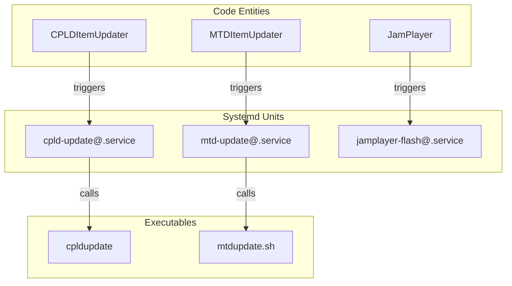

<!-- source: DeepWiki mcp.deepwiki.com · repo NVIDIA/nvidia-code-mgmt · extra page CPLD and MTD Updaters · fetched 2026-10-26 -->

# CPLD and MTD Updaters

<details>
<summary>Relevant source files</summary>

The following files were used as context for generating this wiki page:

- [services/com.Nvidia.CPLD_N.Starter.service](services/com.Nvidia.CPLD_N.Starter.service)
- [services/com.Nvidia.CPLD_N.Updater@.service](services/com.Nvidia.CPLD_N.Updater@.service)
- [services/com.Nvidia.Jamplayer.service](services/com.Nvidia.Jamplayer.service)
- [services/com.Nvidia.MTD.Updater.bmc.service](services/com.Nvidia.MTD.Updater.bmc.service)
- [services/com.Nvidia.MTD.Updater.fpga1.service](services/com.Nvidia.MTD.Updater.fpga1.service)
- [services/com.Nvidia.Vmeplayer0.service](services/com.Nvidia.Vmeplayer0.service)
- [services/com.Nvidia.Vmeplayer1.service](services/com.Nvidia.Vmeplayer1.service)
- [services/cpld-update@.service](services/cpld-update@.service)
- [services/jamplayer-flash@.service](services/jamplayer-flash@.service)
- [services/mtd-update@.service](services/mtd-update@.service)
- [services/psu-update@.service](services/psu-update@.service)
- [services/vmeplayer-flash@.service](services/vmeplayer-flash@.service)
- [src/cpld_updater.cpp](src/cpld_updater.cpp)
- [src/cpld_updater.hpp](src/cpld_updater.hpp)
- [src/cpld_util.hpp](src/cpld_util.hpp)
- [src/jamplayer.hpp](src/jamplayer.hpp)
- [src/mtd_updater.cpp](src/mtd_updater.cpp)
- [src/mtd_updater.hpp](src/mtd_updater.hpp)
- [src/psu_util.hpp](src/psu_util.hpp)
- [src/vmeplayer.cpp](src/vmeplayer.cpp)
- [src/vmeplayer.hpp](src/vmeplayer.hpp)

</details>


## Overview

The CPLD and MTD updaters are specialized components within the NVIDIA Code Management System responsible for updating firmware on Complex Programmable Logic Devices (CPLDs), Memory Technology Devices (MTDs), and JamPlayer devices. All three updaters inherit from the `BaseItemUpdater` framework and implement device-specific functionality for their respective firmware update operations.

| Updater Class | Device Type | Configuration Source | Key Features |
|---------------|-------------|---------------------|--------------|
| `CPLDItemUpdater` | Complex Programmable Logic Devices | `/usr/share/nvidia-power-manager/cpld_config.json` | I2C communication, multiple device support, image selection |
| `MTDItemUpdater` | Memory Technology Devices | `/usr/share/mtd_targets/{mtdName}.json` | Version offset reading, Asset interface, per-device config |
| `JamPlayer` | JAM file devices | `/usr/share/nvidia-power-manager/cpld_config.json` | Target filtering, simplified updates |
| `VmePlayer` | VME JTAG devices | Command line arguments | JTAG-based updates via VME player |

Sources: [src/cpld_updater.hpp:136-151](), [src/mtd_updater.hpp:38-58](), [src/jamplayer.hpp:36-44](), [src/vmeplayer.hpp:15-26]()

## Architecture

### Updater Class Hierarchy

```mermaid
classDiagram
    class "BaseItemUpdater" {
        <<abstract>>
        +std::string getVersion()
        +std::string getManufacturer()
        +std::string getModel()
        +std::string getServiceArgs()
    }
    class "CPLDItemUpdater" {
        -std::vector~std::unique_ptr~CPLDDevice~~ invs
        -std::map~std::string, std::unique_ptr~SoftwareVersion~~ softwareVersionIntf
        +CPLDItemUpdater(bus, model, target)
        +getServiceArgs()
        +getItemUpdaterInventoryPaths()
    }
    class "MTDItemUpdater" {
        -std::string mtdName
        -std::string copyPath
        -std::streamoff versionOffset
        +MTDItemUpdater(bus, mtdN, modelName, nostrip)
        +getVersion()
        +getServiceArgs()
    }
    class "JamPlayer" {
        +JamPlayer(bus)
        +getServiceArgs()
        +getTimeout()
    }
    class "VmePlayer" {
        -std::string vmeName
        +VmePlayer(bus, vmeN, modelName)
        +getServiceArgs()
    }
    
    BaseItemUpdater <|-- CPLDItemUpdater
    BaseItemUpdater <|-- MTDItemUpdater  
    BaseItemUpdater <|-- JamPlayer
    BaseItemUpdater <|-- VmePlayer
```

Sources: [src/cpld_updater.hpp:135-151](), [src/mtd_updater.hpp:38-58](), [src/jamplayer.hpp:36-43](), [src/vmeplayer.hpp:15-26]()

### Service Integration

The updaters are orchestrated by the `code-manager` process and trigger systemd units to perform the actual flashing operations.



Sources: [services/cpld-update@.service:15-17](), [services/mtd-update@.service:15-17](), [src/cpld_updater.hpp:149-149](), [src/mtd_updater.hpp:56-56]()

## CPLD Updater

### CPLD Device Management

The CPLD Updater uses `CPLDDevice`, which inherits from `cpldcommonutils::Util` to handle low-level I2C operations.

- **Discovery**: Reads `/usr/share/nvidia-power-manager/cpld_config.json` to identify devices [src/cpld_updater.hpp:152-153]().
- **Inventory Path**: Uses a base path of `/xyz/openbmc_project/inventory/system/board/CPLD_` suffixed with the device index [src/cpld_updater.hpp:163-172]().
- **Power Awareness**: Tracks if a device is powered by main power (`PowerOnDevice`) and checks host power status before allowing updates [src/cpld_updater.cpp:88-107]().

### CPLD Service Arguments

The `getServiceArgs` method generates the following argument string for `cpld-update@.service`:
`{bus} {imageSelect} {imagePath} {cpldDeviceNo} {version} [EXECUTE|IGNORE]`

The `EXECUTE` or `IGNORE` suffix is appended based on `TargetFilter` criteria [src/cpld_updater.hpp:313-321]().

Sources: [src/cpld_updater.hpp:36-55](), [src/cpld_updater.hpp:289-324](), [src/cpld_util.hpp:162-172]()

## MTD Updater

### MTD Implementation

The `MTDItemUpdater` interacts with Memory Technology Devices (typically SPI flash partitions).

- **Configuration**: Loads device-specific settings from `/usr/share/mtd_targets/{mtdName}.json` [src/mtd_updater.hpp:61-78]().
- **Version Retrieval**: Reads the firmware version directly from the flash image at a configured `versionOffset` and `versionSize` [src/mtd_updater.cpp:39-78]().
- **Asset Interface**: Publishes an `AssetObject` on D-Bus to expose the `Manufacturer` property [src/mtd_updater.hpp:115-121]().

### MTD Service Arguments

Arguments for `mtd-update@.service`:
`{imagePath} {mtdName} {inventory} [EXECUTE|IGNORE] [nostrip]`

Sources: [src/mtd_updater.hpp:38-58](), [src/mtd_updater.cpp:96-135]()

## JamPlayer and VmePlayer

### JamPlayer

Handles JAM file updates, typically for Lattice CPLDs via JTAG.
- **Service**: `JAMPLAYER_SERVICE` (usually `jamplayer-flash@.service`) [src/jamplayer.hpp:42-42]().
- **Arguments**: `{imagePath} {version} JAMPLAYER [EXECUTE|IGNORE]` [src/jamplayer.hpp:135-157]().

### VmePlayer

Handles VME JTAG updates.
- **Service**: `VMEPLAYER_SERVICE` (usually `vmeplayer-flash@.service`) [src/vmeplayer.hpp:23-23]().
- **Arguments**: `{imagePath} {version} {vmeName}` [src/vmeplayer.hpp:69-77]().

Sources: [src/jamplayer.hpp:36-43](), [src/vmeplayer.hpp:15-26]()

## Common Implementation Patterns

### Signature Verification

All updaters implement `needVerify()` which checks for a public key and the presence of the trigger file `/var/check_signature`.

```cpp
virtual bool needVerify() const override
{
    return !publicKey.empty() && std::filesystem::exists("/var/check_signature");
}
```
Sources: [src/cpld_updater.hpp:364-368](), [src/mtd_updater.hpp:298-302](), [src/jamplayer.hpp:197-201]()

### Shell Command Execution

Updaters use a common utility `executeCmd` (defined in `cpld_util.hpp` and `psu_util.hpp`) to run shell scripts like `cpldi2ccmd.sh` or `mtdupdate.sh`. This utility uses `popen` to capture standard output into a `std::vector<std::string>`.

Sources: [src/cpld_util.hpp:114-132](), [src/psu_util.hpp:114-133]()

### Service Unit Template Mapping

The updaters map to specific systemd service templates:

| Updater | Service Template | Bus Name Pattern |
|---------|------------------|------------------|
| CPLD | `com.Nvidia.CPLD_N.Updater@.service` | `com.Nvidia.Software.CPLD.Updater.%i` |
| VmePlayer | `com.Nvidia.VmeplayerN.service` | `com.Nvidia.Software.Vmeplayer.Updater.%i` |
| MTD | `com.Nvidia.MTD.Updater.{name}.service` | `com.Nvidia.Software.MTD.Updater.{name}` |

Sources: [services/com.Nvidia.CPLD_N.Updater@.service:19-19](), [services/com.Nvidia.Vmeplayer1.service:12-12](), [src/mtd_updater.hpp:55-57]()

---

