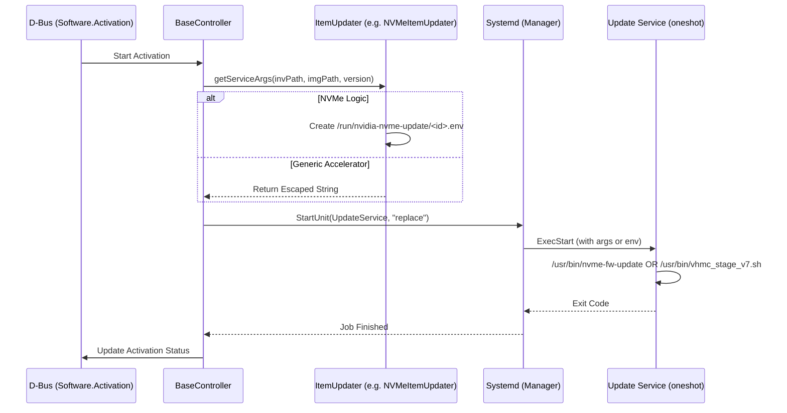

<!-- source: DeepWiki mcp.deepwiki.com · repo NVIDIA/nvidia-code-mgmt · extra page FPGA and Hardware Accelerator Updaters · fetched 2026-10-26 -->

# FPGA and Hardware Accelerator Updaters

<details>
<summary>Relevant source files</summary>

The following files were used as context for generating this wiki page:

- [services/com.Nvidia.NVMe.Updater.service](services/com.Nvidia.NVMe.Updater.service)
- [services/com.Nvidia.SMCU.Updater.service](services/com.Nvidia.SMCU.Updater.service)
- [services/com.Nvidia.vHMC.Updater.service](services/com.Nvidia.vHMC.Updater.service)
- [services/nvme-update@.service](services/nvme-update@.service)
- [services/smcu-update@.service](services/smcu-update@.service)
- [services/vhmc-update@.service](services/vhmc-update@.service)
- [src/fpga_updater.hpp](src/fpga_updater.hpp)
- [src/nvme_updater.cpp](src/nvme_updater.cpp)
- [src/nvme_updater.hpp](src/nvme_updater.hpp)
- [src/pex_updater.hpp](src/pex_updater.hpp)
- [src/psu_updater.hpp](src/psu_updater.hpp)
- [src/sep_updater.hpp](src/sep_updater.hpp)
- [src/smcu_updater.cpp](src/smcu_updater.cpp)
- [src/smcu_updater.hpp](src/smcu_updater.hpp)
- [src/vhmc_updater.cpp](src/vhmc_updater.cpp)
- [src/vhmc_updater.hpp](src/vhmc_updater.hpp)

</details>


## Overview

The FPGA and Hardware Accelerator Updaters provide functionality for updating firmware on Field Programmable Gate Array (FPGA) devices, Peripheral Expansion (PEX) devices, NVMe drives, and specialized Microcontrollers (SMCU/SEP/vHMC) within the NVIDIA code management system. These updaters handle device discovery, version management, and coordinate the update process for specialized hardware accelerator components.

This document covers several specific updater implementations:
*   `FPGAItemUpdater`: Manages FPGA devices through the CEC (Card Edge Connector) interface.
*   `PEXItemUpdater`: Manages PEX (Peripheral Expansion) devices for hardware acceleration.
*   `NVMeItemUpdater`: Orchestrates firmware updates for NVMe storage devices.
*   `SMCUItemUpdater`: Handles System Microcontroller updates for IGX platforms (Aurix and Renesas).
*   `SEPItemUpdater` & `VHMCItemUpdater`: Manage specialized secure and virtual hardware management controllers.

Sources: [src/fpga_updater.hpp:70-71](), [src/pex_updater.hpp:35-36](), [src/nvme_updater.hpp:89-90](), [src/smcu_updater.hpp:42-43](), [src/vhmc_updater.hpp:18-19](), [src/sep_updater.hpp:30-31]()

## Architecture

All hardware accelerator updaters extend the `BaseItemUpdater` class. They implement hardware-specific logic for `getVersion`, `getModel`, and `getServiceArgs`, which dictates how the underlying systemd update service is invoked.

### Class Hierarchy and Entity Mapping

The following diagram maps the high-level system components to the specific C++ classes and D-Bus interfaces used in the codebase.

```mermaid
classDiagram
    class "BaseItemUpdater" {
        <<Abstract>>
        +bus: sdbusplus::bus_t
        +getVersion(path) string*
        +getServiceArgs(path, image, version, filter) string*
    }
    
    class "FPGAItemUpdater" {
        -invs: vector<unique_ptr<CECDevice>>
        +FPGAItemUpdater(bus)
    }
    
    class "NVMeItemUpdater" {
        -targetName: string
        -modelName: string
        +validateTarget(path) string
        +getDevicesToUpdate(filter) string
    }
    
    class "SMCUItemUpdater" {
        -currentModelToken: string
        -detectedPlatformSmcu: string
        +detectPlatformSmcu() string
    }

    class "PEXItemUpdater" {
        +PEXItemUpdater(bus)
    }

    class "CECDevice" {
        +b: uint8_t
        +d: uint8_t
        +getInventoryPath() string
    }

    "BaseItemUpdater" <|-- "FPGAItemUpdater"
    "BaseItemUpdater" <|-- "NVMeItemUpdater"
    "BaseItemUpdater" <|-- "SMCUItemUpdater"
    "BaseItemUpdater" <|-- "PEXItemUpdater"
    "FPGAItemUpdater" *-- "CECDevice"
```

Sources: [src/fpga_updater.hpp:70-83](), [src/nvme_updater.hpp:89-111](), [src/smcu_updater.hpp:42-51](), [src/pex_updater.hpp:35-47]()

## Specialized Updater Implementations

### FPGA and CEC Management
The `FPGAItemUpdater` discovers devices by parsing `/usr/share/nvidia-cec/cec_config.json` [src/fpga_updater.hpp:85-87](). Each device is represented as a `CECDevice`, which inherits from `nvidia::cec::common::Util` [src/fpga_updater.hpp:36-37]().
*   **Discovery**: It iterates through the "CEC" array in the JSON, extracting "Bus" and "Address" [src/fpga_updater.hpp:92-104]().
*   **Arguments**: `getServiceArgs` generates a fixed string for the update service: `-f <image> -t 1 -b 10 -d 0x55` [src/fpga_updater.hpp:160-183]().

### NVMe Drive Updates
The `NVMeItemUpdater` is unique because it often handles multiple models via separate service instances.
*   **Multi-Instance**: The `com.Nvidia.NVMe.Updater.service` parses `/etc/nvme/nvmemodels.env` and spawns a `code-manager` instance for each `NVMeMODEL` found [services/com.Nvidia.NVMe.Updater.service:9-25]().
*   **Update Coordination**: Instead of passing arguments directly via command line, it writes an environment file to `/run/nvidia-nvme-update/<requestId>.env` containing `FW_IMAGE`, `FW_VERSION`, and `FW_TARGETS` [src/nvme_updater.cpp:87-91](). The `nvme-update@.service` then loads this file [services/nvme-update@.service:7-8]().
*   **Model Matching**: It extracts the model name from D-Bus (e.g., splitting "SAMSUNG MZTL2..." to get "MZTL2...") to ensure the correct firmware is applied to the correct drive [src/nvme_updater.cpp:130-172]().

### SMCU (System Microcontroller)
The `SMCUItemUpdater` manages firmware for the Aurix (`ASMCU`) or Renesas (`RSMCU`) controllers on IGX platforms.
*   **Platform Detection**: At startup, it runs `/usr/bin/igx-platform-detection.py` to determine if the hardware uses ASMCU or RSMCU [src/smcu_updater.hpp:57-75]().
*   **Version Retrieval**: It executes `/usr/bin/smcu-version.py` to fetch the active firmware version [src/smcu_updater.cpp:81-86]().
*   **Service Integration**: It passes the inventory path, image path, and model as arguments to the `smcu-update@.service` [src/smcu_updater.hpp:159-195]().

### vHMC and SEP Updaters
*   **vHMC**: Manages virtual Hardware Management Controllers. It overrides `getImageUploadDir` to provide a specialized path for vHMC images and uses `vhmc-update@.service` [src/vhmc_updater.hpp:27-44]().
*   **SEP**: Manages Secure Execution Processors. It overrides the default update timeout using `SEP_TIMEOUT` [src/sep_updater.hpp:111-119]().

## Data Flow: Update Execution

The following diagram illustrates how an update request flows from the D-Bus interface through the specific updater to the systemd execution layer.



Sources: [src/nvme_updater.cpp:78-91](), [src/smcu_updater.hpp:159-195](), [services/nvme-update@.service:7-8](), [services/vhmc-update@.service:7-8]()

## Service Configuration Summary

| Updater Class | D-Bus Bus Name | Systemd Update Service | Configuration Source |
| :--- | :--- | :--- | :--- |
| `FPGAItemUpdater` | `FPGA_BUSNAME_UPDATER` | `FPGA_UPDATE_SERVICE` | `cec_config.json` |
| `PEXItemUpdater` | `PEX_BUSNAME_UPDATER` | `PEX_UPDATE_SERVICE` | N/A |
| `NVMeItemUpdater` | `com.Nvidia.Software.NVMe.Updater` | `nvme-update@.service` | `nvmemodels.env` |
| `SMCUItemUpdater` | `SMCU_BUSNAME_UPDATER` | `smcu-update@.service` | `igx-platform-detection.py` |
| `VHMCItemUpdater` | `VHMC_BUSNAME_UPDATER` | `vhmc-update@.service` | N/A |

Sources: [src/fpga_updater.hpp:81-83](), [src/pex_updater.hpp:43-46](), [services/com.Nvidia.NVMe.Updater.service:28](), [src/smcu_updater.hpp:118-121](), [src/vhmc_updater.hpp:21-24]()

---

