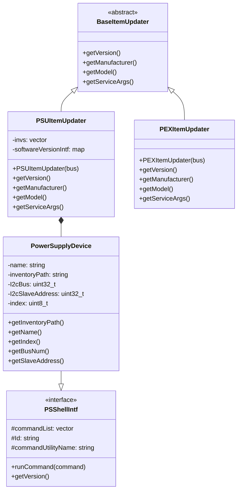
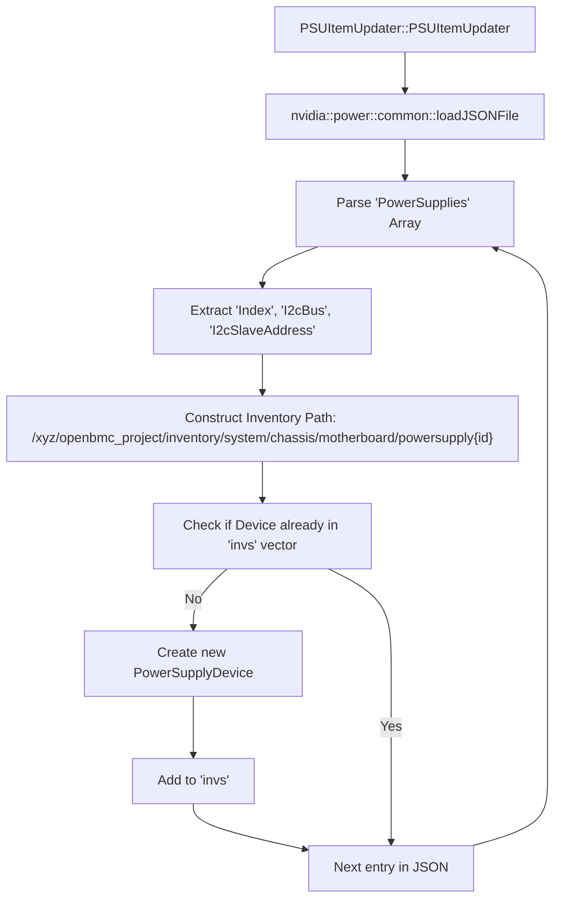
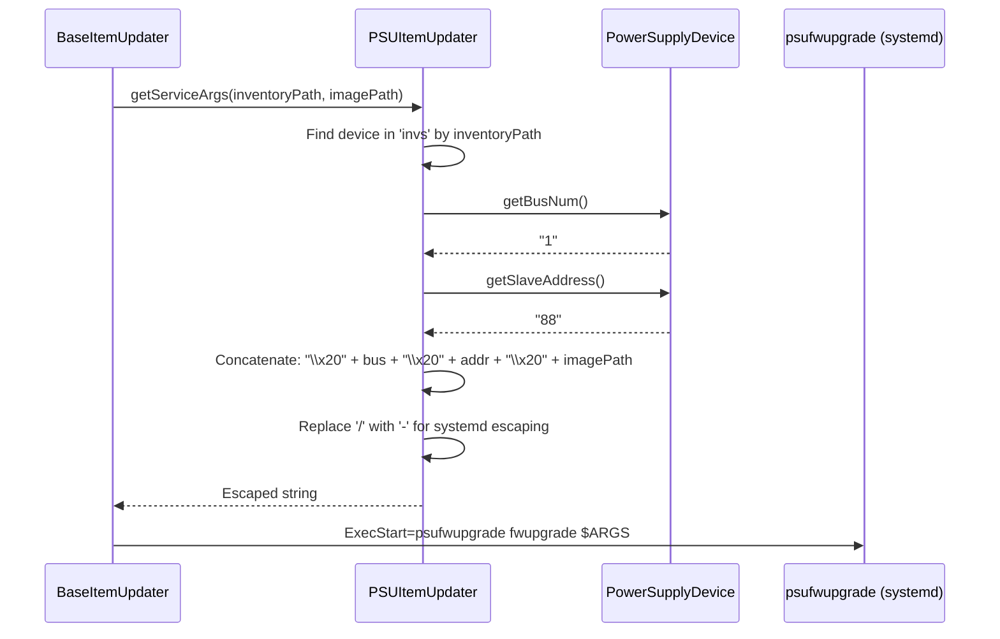

<!-- source: DeepWiki mcp.deepwiki.com · repo NVIDIA/nvidia-code-mgmt · extra page PSU and Power Management Updaters · fetched 2026-10-26 -->

# PSU and Power Management Updaters

<details>
<summary>Relevant source files</summary>

The following files were used as context for generating this wiki page:

- [services/psu-update@.service](services/psu-update@.service)
- [src/cpld_updater.cpp](src/cpld_updater.cpp)
- [src/cpld_util.hpp](src/cpld_util.hpp)
- [src/fpga_updater.hpp](src/fpga_updater.hpp)
- [src/pex_updater.hpp](src/pex_updater.hpp)
- [src/psu_updater.hpp](src/psu_updater.hpp)
- [src/psu_util.hpp](src/psu_util.hpp)

</details>


This document covers the Power Supply Unit (PSU) and Peripheral Expansion (PEX) device updaters within the firmware update system. These updaters handle firmware updates for power management hardware components including power supply units and peripheral expansion devices. For information about FPGA and other hardware accelerator updaters, see [FPGA and Hardware Accelerator Updaters](#2.3.3). For CPLD and MTD updaters, see [CPLD and MTD Updaters](#2.3.1).

## System Overview

The PSU and PEX updaters are concrete implementations of the `BaseItemUpdater` framework, providing device-specific functionality for power management hardware. The PSU updater includes sophisticated JSON configuration parsing and I2C communication parameter management, while the PEX updater provides a simpler interface for peripheral expansion devices.

Title: PSU and PEX Class Hierarchy


Sources: [src/psu_updater.hpp:38-44](), [src/psu_updater.hpp:90-94](), [src/pex_updater.hpp:35-47](), [src/psu_util.hpp:150-155]()

## PSU Updater Implementation

The `PSUItemUpdater` class provides firmware update capabilities for power supply units through I2C communication. It manages multiple PSU devices discovered through JSON configuration and integrates with the `nvidia-power-supply` utility library (or `mock_util` during testing).

### PowerSupplyDevice Class

The `PowerSupplyDevice` class encapsulates individual PSU device properties and inherits from `nvidia::power::common::PSShellIntf` to provide shell-based command execution capabilities via the `psui2ccmd.sh` script [src/psu_updater.hpp:48-49]().

| Property | Type | Description |
|----------|------|-------------|
| `name` | string | Device name (e.g., "powersupply0") |
| `inventoryPath` | string | D-Bus inventory path |
| `I2cBus` | uint32_t | I2C bus number |
| `I2cSlaveAddress` | uint32_t | I2C slave address |
| `index` | uint8_t | Device index derived from JSON ID |

The class provides accessor methods that convert numeric values to strings for use in systemd service arguments:

- `getIndex()`: Returns device index as string [src/psu_updater.hpp:63-69]()
- `getBusNum()`: Returns I2C bus number as string [src/psu_updater.hpp:70-76]()
- `getSlaveAddress()`: Returns I2C slave address as string [src/psu_updater.hpp:77-83]()

Sources: [src/psu_updater.hpp:38-84](), [src/psu_util.hpp:150-245]()

### JSON Configuration Loading

The PSU updater loads device configuration from `/usr/share/nvidia-power-manager/psu_config.json` during initialization [src/psu_updater.hpp:106-107](). The configuration parsing creates `PowerSupplyDevice` objects for each PSU defined in the JSON.

Title: PSU Configuration Parsing Flow


The JSON structure expects a `PowerSupplies` array with objects containing:
- `Index`: Device index string [src/psu_updater.hpp:121]()
- `I2cBus`: I2C bus number [src/psu_updater.hpp:123]()
- `I2cSlaveAddress`: I2C slave address [src/psu_updater.hpp:124]()

Sources: [src/psu_updater.hpp:101-143](), [src/psu_util.hpp:49-77]()

### Service Arguments Generation

The PSU updater generates systemd service arguments by encoding I2C communication parameters and image paths with proper escaping for systemd unit execution.

Title: PSU Update Service Argument Mapping


The service arguments format includes:
- `\\x20`: Escaped space characters for systemd [src/psu_updater.hpp:190]()
- I2C bus number [src/psu_updater.hpp:191]()
- I2C slave address [src/psu_updater.hpp:193]()
- Firmware image path [src/psu_updater.hpp:195]()
- Path character replacement (`/` → `-`) [src/psu_updater.hpp:200]()

The corresponding systemd unit `psu-update@.service` consumes these arguments via the `ARGS` environment variable and calls the `psufwupgrade` utility [services/psu-update@.service:8-9]().

Sources: [src/psu_updater.hpp:178-202](), [services/psu-update@.service:1-10]()

## PEX Updater Implementation

The `PEXItemUpdater` class provides a simpler updater implementation for Peripheral Expansion devices. Unlike the PSU updater, it does not require complex JSON configuration parsing in the constructor.

### Configuration and Initialization

The PEX updater initializes with predefined configuration constants passed to the `BaseItemUpdater` constructor [src/pex_updater.hpp:43-47]():
- `PEX_SUPPORTED_MODEL`: Supported device models
- `PEX_INVENTORY_IFACE`: D-Bus inventory interface
- `PEX_BUSNAME_UPDATER`: D-Bus service name
- `PEX_UPDATE_SERVICE`: Systemd service name

### Service Arguments

The PEX updater generates service arguments by combining the inventory path and image path with systemd escaping [src/pex_updater.hpp:83-96]():

```cpp
std::string args = inventoryPath;
args += "\\x20";
args += imagePath;
std::replace(args.begin(), args.end(), '/', '-');
```

Sources: [src/pex_updater.hpp:35-97]()

## Integration with Update System

Both updaters integrate with the broader firmware update system through several mechanisms:

| Component | PSU Updater | PEX Updater |
|-----------|-------------|-------------|
| **Base Class** | `BaseItemUpdater` | `BaseItemUpdater` |
| **D-Bus Service** | `PSU_BUSNAME_UPDATER` | `PEX_BUSNAME_UPDATER` |
| **Systemd Service** | `PSU_UPDATE_SERVICE` | `PEX_UPDATE_SERVICE` |
| **Inventory Interface** | `PSU_INVENTORY_IFACE` | `PEX_INVENTORY_IFACE` |
| **Configuration** | JSON file (`psu_config.json`) | Build-time constants |
| **Device Discovery** | Dynamic from JSON | Static configuration |

Both updaters override core `BaseItemUpdater` methods to provide hardware-specific metadata:
- `getVersion()`: Retrieve current firmware version [src/psu_updater.hpp:151](), [src/pex_updater.hpp:55]()
- `getManufacturer()`: Get device manufacturer [src/psu_updater.hpp:159](), [src/pex_updater.hpp:63]()
- `getModel()`: Get device model [src/psu_updater.hpp:168](), [src/pex_updater.hpp:72]()

The PSU implementation delegates version and metadata retrieval to `PSShellIntf::runCommand`, which executes the `psui2ccmd.sh` utility [src/psu_util.hpp:181-245]().

Sources: [src/psu_updater.hpp:90-105](), [src/pex_updater.hpp:35-47](), [src/psu_util.hpp:150-173]()

---

