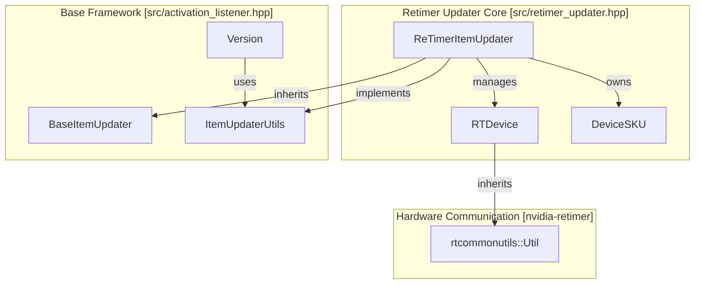
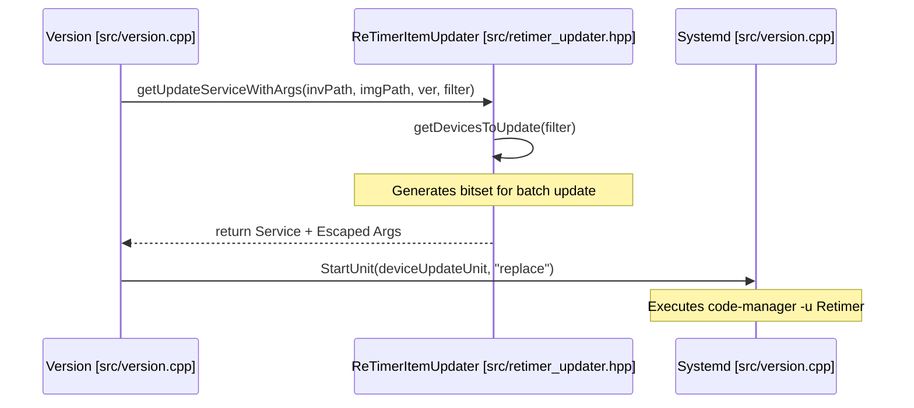

<!-- source: DeepWiki mcp.deepwiki.com · repo NVIDIA/nvidia-code-mgmt · extra page Retimer Updater · fetched 2026-10-26 -->

# Retimer Updater

Relevant source files

The following files were used as context for generating this wiki page:

- [services/com.Nvidia.RT.Updater.service](services/com.Nvidia.RT.Updater.service)
- [src/activation_listener.hpp](src/activation_listener.hpp)
- [src/dbusutils.cpp](src/dbusutils.cpp)
- [src/dbusutils.hpp](src/dbusutils.hpp)
- [src/retimer_updater.cpp](src/retimer_updater.cpp)
- [src/retimer_updater.hpp](src/retimer_updater.hpp)
- [src/version.cpp](src/version.cpp)
- [src/version.hpp](src/version.hpp)

The Retimer Updater is a specialized firmware management component responsible for updating PCIe Retimer devices. It handles device bitset management, SKU handling, and supports both individual and batch update modes. It extends the base updater framework to provide hardware-specific logic for NVIDIA retimer components.

## Architecture Overview

The Retimer Updater implementation is centered around the `ReTimerItemUpdater` class, which manages a collection of `RTDevice` objects. It interacts with the OpenBMC software management ecosystem via D-Bus and utilizes systemd services to execute the actual firmware flashing operations.

### Core Components and Relationships

The following diagram illustrates the relationship between the Retimer-specific classes and the base firmware update framework.

Sources: [src/retimer_updater.hpp:43-44](), [src/retimer_updater.hpp:81-81](), [src/retimer_updater.hpp:83-84](), [src/activation_listener.hpp:76-76]()

### Update Execution Flow

The Retimer Updater supports a unique "Update All Together" mode where multiple retimers can be updated in a single systemd service call using a bitset.

Sources: [src/version.cpp:122-133](), [src/retimer_updater.hpp:184-207](), [src/retimer_updater.hpp:218-259]()

## Device Management

### RTDevice Class
The `RTDevice` class represents an individual hardware retimer. It stores the I2C bus and address, which are essential for identifying the device during the update process.

| Code Entity | File | Purpose |
|:---|:---|:---|
| `RTDevice` | [src/retimer_updater.hpp:43]() | Represents a physical retimer device. |
| `b` (bus) | [src/retimer_updater.hpp:51]() | I2C bus number. |
| `d` (address) | [src/retimer_updater.hpp:52]() | I2C device address. |
| `inventoryPath` | [src/retimer_updater.hpp:45]() | D-Bus path for the device in the inventory. |

Sources: [src/retimer_updater.hpp:43-74]()

### Device Discovery
Devices are discovered during the construction of `ReTimerItemUpdater` by parsing a JSON configuration file located at `/usr/share/nvidia-retimer/rt_config.json`.

1. The updater loads the JSON file using `rtcommonutils::loadJSONFile` [src/retimer_updater.hpp:101-102]().
2. It iterates through the "RT" array in the JSON [src/retimer_updater.hpp:108]().
3. For each entry, it extracts the `Index`, `Bus`, and `Address` [src/retimer_updater.hpp:113-115]().
4. A new `RTDevice` object is created and stored in the `invs` vector [src/retimer_updater.hpp:130-131]().

Sources: [src/retimer_updater.hpp:95-139]()

## Update Execution Modes

The Retimer Updater provides logic to handle updates either individually or as a batch. This is controlled by the `updateAllTogether()` configuration.

### Batch Update Mode (Bitset Management)
In batch mode, the updater calculates which devices need to be updated based on a `TargetFilter`. It uses a bitset where each bit represents a retimer index.

- **getDevicesToUpdate**: Converts a `TargetFilter` into a string representation of a bitset [src/retimer_updater.hpp:184-207]().
- **TargetFilterType::UpdateAll**: Sets all bits in the bitset [src/retimer_updater.hpp:187-190]().
- **TargetFilterType::UpdateSelected**: Sets specific bits corresponding to the device IDs provided in the targets list [src/retimer_updater.hpp:191-203]().

### Service Argument Generation
The `getServiceArgs` function constructs the command-line arguments for the systemd update service.

- **Batch Mode**: Arguments include the bus number, the device bitset, the image path, and the version [src/retimer_updater.hpp:225-244]().
- **Single Mode**: Arguments include the bus number, the specific device address, and the image path [src/retimer_updater.hpp:245-257]().

Sources: [src/retimer_updater.hpp:218-259](), [src/activation_listener.hpp:43-59]()

## SKU and Version Handling

### SKU Management
The `ReTimerItemUpdater` manages a `DeviceSKU` object. It retrieves the SKU from the first discovered retimer in the inventory.

- **getSKU()**: Fetches the `SKU` property from the `SKU_IFACE` on D-Bus [src/retimer_updater.cpp:71-90]().
- **createSKUInventory()**: Initializes the D-Bus object for SKU reporting [src/retimer_updater.hpp:138]().

Sources: [src/retimer_updater.cpp:71-90](), [src/retimer_updater.hpp:383-418]()

### Version Retrieval
Version information is fetched dynamically from the inventory service (typically the GPU Manager).

- **getVersion()**: Iterates through discovered devices and queries the `VERSION_IFACE` for the `VERSION` property at a path formatted as `RT_SW_VERSION_PATH` [src/retimer_updater.cpp:33-56]().

Sources: [src/retimer_updater.cpp:33-56]()

## Service Integration

The Retimer Updater is integrated into the system via the `com.Nvidia.RT.Updater.service`.

| Service Property | Value |
|:---|:---|
| **ExecStart** | `/usr/bin/code-manager -u Retimer` |
| **BusName** | `com.Nvidia.Software.RT.Updater` |
| **After** | `nvidia-fpga-ready.target`, `pldmd.service`, `obmc-mapper.target` |

Sources: [services/com.Nvidia.RT.Updater.service:1-17]()

### Target Validation
The `validateTarget` function ensures that an update target string (e.g., from a Redfish request) corresponds to a valid, supported retimer device. It uses `sscanf` with `RT_SW_ID_FORMAT` to extract the device index and verifies it is within the `SUPPORTED_RETIMERS` limit.

Sources: [src/retimer_updater.hpp:316-330]()

---

