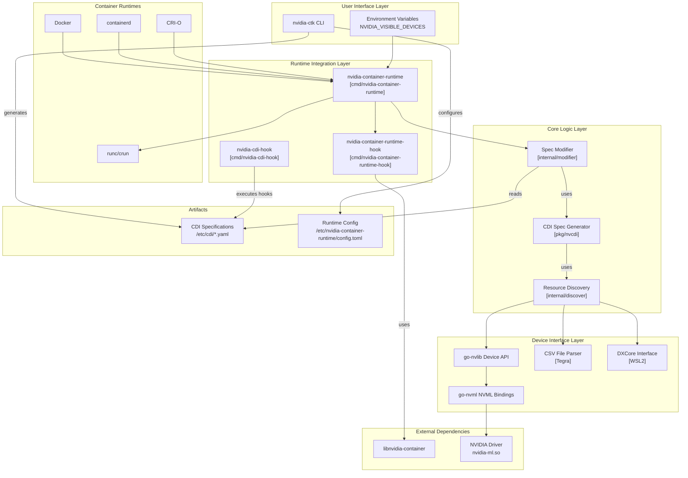
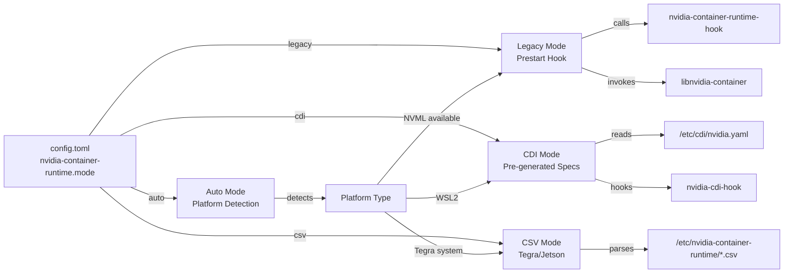
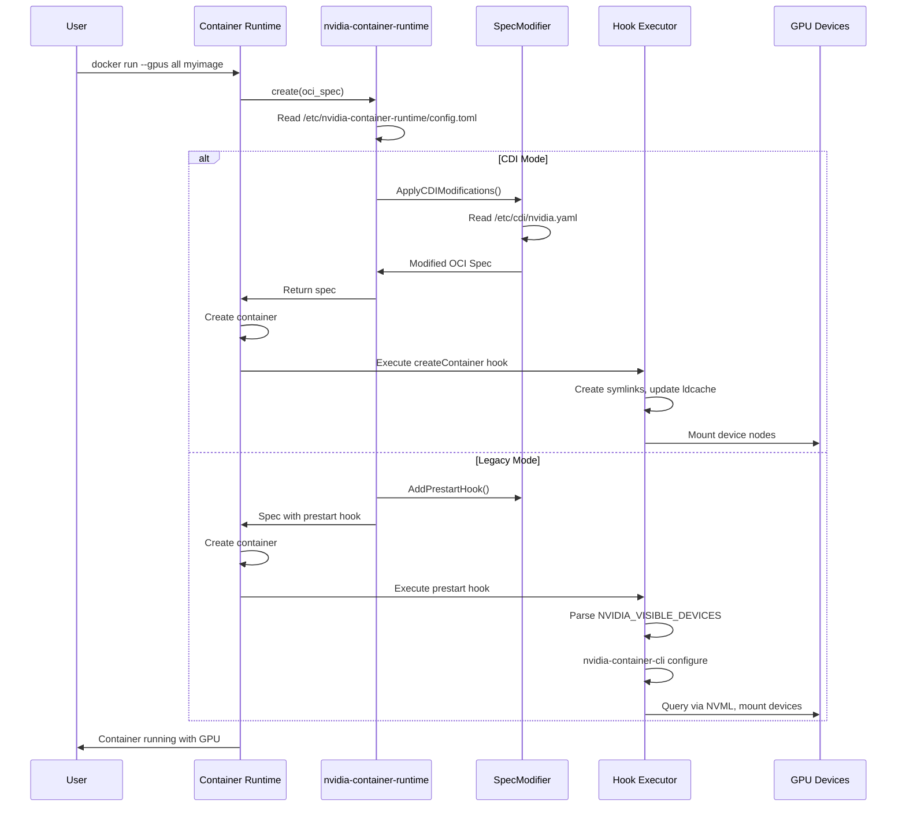
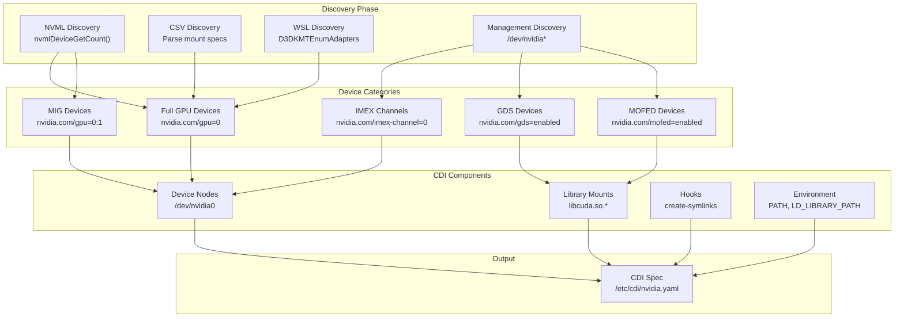
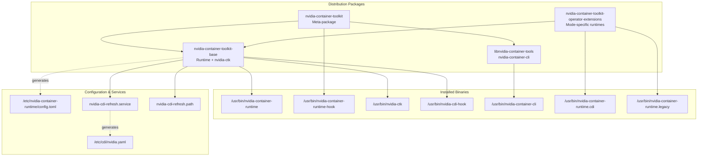
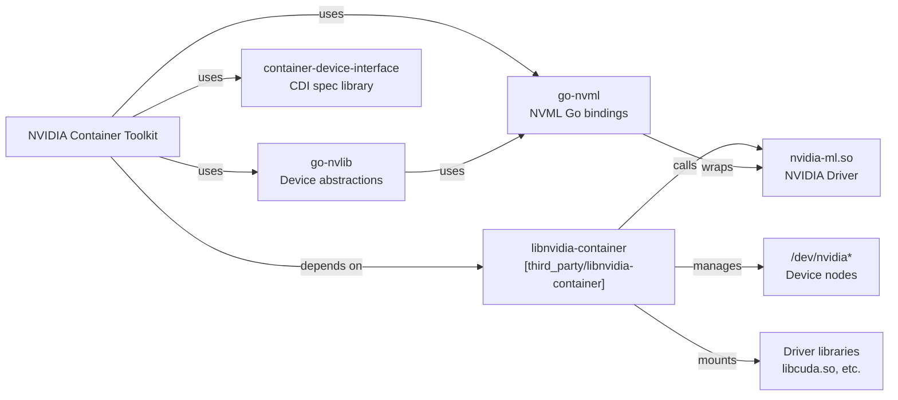

<!-- source: DeepWiki mcp.deepwiki.com · repo NVIDIA/nvidia-container-toolkit · page 1 Overview · fetched 2026-10-26 -->

# Overview

<details>
<summary>Relevant source files</summary>

The following files were used as context for generating this wiki page:

- [.gitmodules](.gitmodules)
- [CHANGELOG.md](CHANGELOG.md)
- [Makefile](Makefile)
- [cmd/nvidia-container-runtime/README.md](cmd/nvidia-container-runtime/README.md)
- [deployments/systemd/90-nvidia-container-toolkit.preset](deployments/systemd/90-nvidia-container-toolkit.preset)
- [docker/Dockerfile.devel](docker/Dockerfile.devel)
- [go.mod](go.mod)
- [go.sum](go.sum)
- [packaging/debian/control](packaging/debian/control)
- [packaging/debian/nvidia-container-toolkit-base.maintscript](packaging/debian/nvidia-container-toolkit-base.maintscript)
- [packaging/debian/prepare](packaging/debian/prepare)
- [packaging/rpm/SPECS/nvidia-container-toolkit.spec](packaging/rpm/SPECS/nvidia-container-toolkit.spec)
- [vendor/github.com/NVIDIA/go-nvlib/pkg/nvlib/device/device.go](vendor/github.com/NVIDIA/go-nvlib/pkg/nvlib/device/device.go)
- [vendor/github.com/NVIDIA/go-nvlib/pkg/nvlib/device/mig_profile.go](vendor/github.com/NVIDIA/go-nvlib/pkg/nvlib/device/mig_profile.go)
- [vendor/github.com/NVIDIA/go-nvlib/pkg/nvpci/mock.go](vendor/github.com/NVIDIA/go-nvlib/pkg/nvpci/mock.go)
- [vendor/github.com/NVIDIA/go-nvlib/pkg/nvpci/nvpci.go](vendor/github.com/NVIDIA/go-nvlib/pkg/nvpci/nvpci.go)
- [vendor/github.com/NVIDIA/go-nvlib/pkg/nvpci/nvpci_mock.go](vendor/github.com/NVIDIA/go-nvlib/pkg/nvpci/nvpci_mock.go)
- [vendor/github.com/NVIDIA/go-nvlib/pkg/nvpci/resources.go](vendor/github.com/NVIDIA/go-nvlib/pkg/nvpci/resources.go)
- [vendor/github.com/NVIDIA/go-nvlib/pkg/pciids/pciids.go](vendor/github.com/NVIDIA/go-nvlib/pkg/pciids/pciids.go)
- [vendor/modules.txt](vendor/modules.txt)
- [versions.mk](versions.mk)

</details>


The NVIDIA Container Toolkit is a collection of tools and libraries that enable GPU access in containerized workloads. It acts as a bridge between container runtimes (Docker, containerd, CRI-O) and NVIDIA GPU hardware, modifying container specifications to inject GPU devices, driver libraries, and required configurations.

For detailed information about specific components, see [Core Components](#2). For build and packaging details, see [Building and Packaging](#5). For development workflows, see [Development](#6).

## Purpose and Scope

The toolkit solves the fundamental problem of exposing host GPU devices and driver libraries to containers in a way that is:
- **Standards-compliant**: Supports the Container Device Interface (CDI) specification
- **Runtime-agnostic**: Works with multiple container runtimes
- **Platform-flexible**: Supports standard Linux systems (via NVML), Tegra/Jetson platforms (via CSV), and WSL2 (via DXCore)
- **Mode-adaptive**: Provides both legacy hook-based and modern CDI-based integration paths

## System Architecture



**Sources**: [CHANGELOG.md:1-728](), [versions.mk:15-39](), [Makefile:1-171]()

## Key Components

### Runtime Executables

| Component | Package Path | Purpose |
|-----------|-------------|---------|
| `nvidia-container-runtime` | [cmd/nvidia-container-runtime]() | OCI runtime wrapper that modifies container specs before delegating to low-level runtime |
| `nvidia-container-runtime-hook` | [cmd/nvidia-container-runtime-hook]() | Legacy prestart hook for dynamic GPU injection |
| `nvidia-ctk` | [cmd/nvidia-ctk]() | CLI tool for CDI generation, runtime configuration, and system management |
| `nvidia-cdi-hook` | [cmd/nvidia-cdi-hook]() | CDI lifecycle hook executor for symlinks, ldcache updates, and device setup |

### Core Libraries

| Package | Location | Purpose |
|---------|----------|---------|
| `nvcdi` | [pkg/nvcdi]() | CDI specification generation for GPU devices |
| `discover` | [internal/discover]() | Resource discovery (devices, libraries, firmware) |
| `modifier` | [internal/modifier]() | OCI specification modification logic |
| `config` | [internal/config]() | Configuration file parsing and management |

**Sources**: [packaging/rpm/SPECS/nvidia-container-toolkit.spec:1-135](), [packaging/debian/control:1-32](), [go.mod:1-43]()

## Runtime Modes

The toolkit supports multiple runtime modes configured via `/etc/nvidia-container-runtime/config.toml`:



**Mode Selection Logic**:
- **legacy**: Uses `nvidia-container-runtime-hook` as OCI prestart hook, calls `nvidia-container-cli` to query devices via NVML [cmd/nvidia-container-runtime/README.md:44-47]()
- **cdi**: Reads pre-generated CDI specs from `/etc/cdi/`, modifies OCI spec declaratively
- **csv**: Reads CSV mount specifications for Tegra platforms (e.g., `/etc/nvidia-container-runtime/host-files-for-container.d/`) [cmd/nvidia-container-runtime/README.md:49-58]()
- **auto**: Automatically detects platform and selects appropriate mode [cmd/nvidia-container-runtime/README.md:40-42]()

**Sources**: [CHANGELOG.md:580-582](), [internal/config](), [cmd/nvidia-container-runtime/README.md:36-60]()

## Container Execution Flow



**Sources**: [cmd/nvidia-container-runtime](), [internal/modifier]()

## CDI Specification Generation

The `nvidia-ctk cdi generate` command creates standardized device specifications:



**Key Discoverers**:
- **NVML Mode**: Uses `nvmlDeviceGetHandleByIndex()` for standard GPUs [vendor/github.com/NVIDIA/go-nvlib/pkg/nvlib/device/device.go:61-66]()
- **CSV Mode**: Parses `/etc/nvidia-container-runtime/host-files-for-container.d/*.csv`
- **WSL Mode**: Uses `D3DKMTEnumAdapters3()` on Windows Subsystem for Linux
- **Management Mode**: Discovers all device nodes including `/dev/nvidia-uvm`, `/dev/nvidia-modeset`

**Sources**: [pkg/nvcdi](), [internal/discover](), [vendor/github.com/NVIDIA/go-nvlib/pkg/nvlib/device/device.go:1-598]()

## Package Structure



**Package Dependencies**:
- `nvidia-container-toolkit` (meta-package) requires `nvidia-container-toolkit-base` and `libnvidia-container-tools` with matching versions [packaging/debian/control:11-13]()
- `nvidia-container-toolkit-base` provides runtime and CLI tools, generates default config on install [packaging/debian/control:25-27](), [packaging/rpm/SPECS/nvidia-container-toolkit.spec:106-108]()
- `libnvidia-container-tools` provides the low-level `nvidia-container-cli` binary
- `nvidia-container-toolkit-operator-extensions` provides mode-specific runtime variants for Kubernetes GPU Operator [packaging/debian/control:30-32]()

**Post-Install Behavior**:
- Creates `/etc/nvidia-container-runtime/config.toml` if it doesn't exist [packaging/rpm/SPECS/nvidia-container-toolkit.spec:110-112]()
- Enables and starts `nvidia-cdi-refresh.path` systemd service [packaging/rpm/SPECS/nvidia-container-toolkit.spec:147-154]()
- Creates `nvidia-container-toolkit` symlink pointing to `nvidia-container-runtime-hook` [packaging/rpm/SPECS/nvidia-container-toolkit.spec:79]()

**Sources**: [packaging/rpm/SPECS/nvidia-container-toolkit.spec:1-135](), [packaging/debian/control:1-32](), [versions.mk:15-22]()

## Platform Support

The toolkit adapts to different platforms through discovery modes:

| Platform | Discovery Method | Key Components |
|----------|-----------------|----------------|
| **Standard Linux** | NVML library | `go-nvml`, `nvmlDeviceGetCount()`, `/dev/nvidia*` |
| **Tegra/Jetson** | CSV mount files | `/etc/nvidia-container-runtime/host-files-for-container.d/*.csv` |
| **WSL2** | DXCore API | `D3DKMTEnumAdapters3()`, `/dev/dxg`, `libdxcore.so` |

**Platform Detection Logic**:
- Checks for `/sys/devices/soc0/family` for Tegra systems
- Detects WSL2 via `/proc/sys/kernel/osrelease` containing "microsoft"
- Falls back to NVML if available, otherwise uses CSV mode

**Sources**: [CHANGELOG.md:481-491](), [internal/discover](), [vendor/github.com/NVIDIA/go-nvlib/pkg/nvlib/device/device.go:1-598]()

## Configuration System

Primary configuration file: `/etc/nvidia-container-runtime/config.toml` [cmd/nvidia-container-runtime/README.md:6-7]()

**Key Configuration Sections**:
```toml
[nvidia-container-runtime]
mode = "auto"  # or "legacy", "cdi", "csv"
debug = "/var/log/nvidia-container-toolkit.log"
runtimes = ["docker-runc", "runc", "crun"]

[nvidia-container-runtime.modes.cdi]
default-kind = "nvidia.com/gpu"
annotation-prefixes = ["cdi.k8s.io/"]

[nvidia-container-runtime.modes.csv]
mount-spec-path = "/etc/nvidia-container-runtime/host-files-for-container.d"

[nvidia-container-cli]
root = "/run/nvidia/driver"
```

**Configuration Sources**:
- TOML file at configurable path (default `/etc/nvidia-container-runtime/config.toml`) [cmd/nvidia-container-runtime/README.md:6-7]()
- Command-line flags override file settings
- Environment variables: `NVIDIA_VISIBLE_DEVICES` [cmd/nvidia-container-runtime/README.md:94-105](), `NVIDIA_DRIVER_CAPABILITIES`, `NVIDIA_CTK_CONFIG_FILE_PATH`

**Sources**: [internal/config](), [CHANGELOG.md:369-370](), [CHANGELOG.md:459-461](), [cmd/nvidia-container-runtime/README.md:6-105]()

## External Dependencies



**libnvidia-container** ([third_party/libnvidia-container]()):
- C library handling low-level GPU device and library mounting
- Integrated as git submodule [CHANGELOG.md:33-34](), [.gitmodules:1-4]()
- Provides `nvidia-container-cli` executable
- Manages cgroup device permissions, library dependencies, firmware files

**Go Libraries**:
- `github.com/NVIDIA/go-nvml`: NVML bindings for device queries [go.mod:8]()
- `github.com/NVIDIA/go-nvlib`: Higher-level device abstractions [go.mod:7]()
- `tags.cncf.io/container-device-interface`: CDI spec generation and validation [go.mod:25-26]()

**Sources**: [go.mod:1-43](), [vendor/modules.txt:1-133](), [CHANGELOG.md:200-217](), [.gitmodules:1-4]()

## Build System Overview

The project uses a Docker-based build system for multi-architecture support:

**Build Targets**:
- `make binaries`: Build all executables [Makefile:56]()
- `make docker-native`: Build in Docker container [Makefile:24]()
- `make packages`: Generate `.deb` and `.rpm` packages
- `make docker-images`: Build toolkit container images

**Key Build Variables** ([versions.mk]()):
- `LIB_VERSION`: Current toolkit version (e.g., `1.20.0`) [versions.mk:16]()
- `LIB_TAG`: Release tag (e.g., `rc.1`) [versions.mk:17]()
- `GOLANG_VERSION`: Go compiler version [versions.mk:24]()
- `BUILDIMAGE`: Docker image for builds [versions.mk:27]()

**Distribution Channels**:
- GitHub Releases for binaries and packages
- NGC Registry (`nvcr.io/nvidia/`) for container images
- Artifactory for Kitmaker OEM integration
- APT/YUM repositories for package installation

**Sources**: [Makefile:1-171](), [versions.mk:1-39](), [docker/Dockerfile.devel:1-27]()

---

