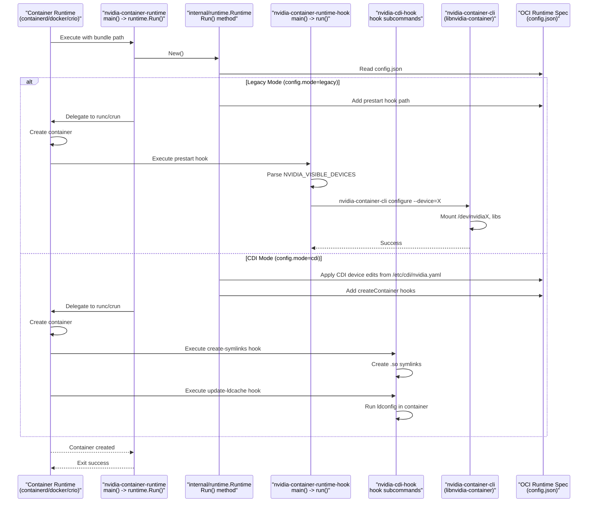
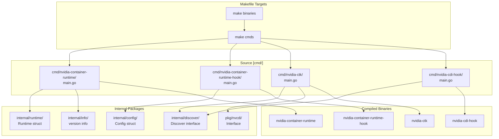
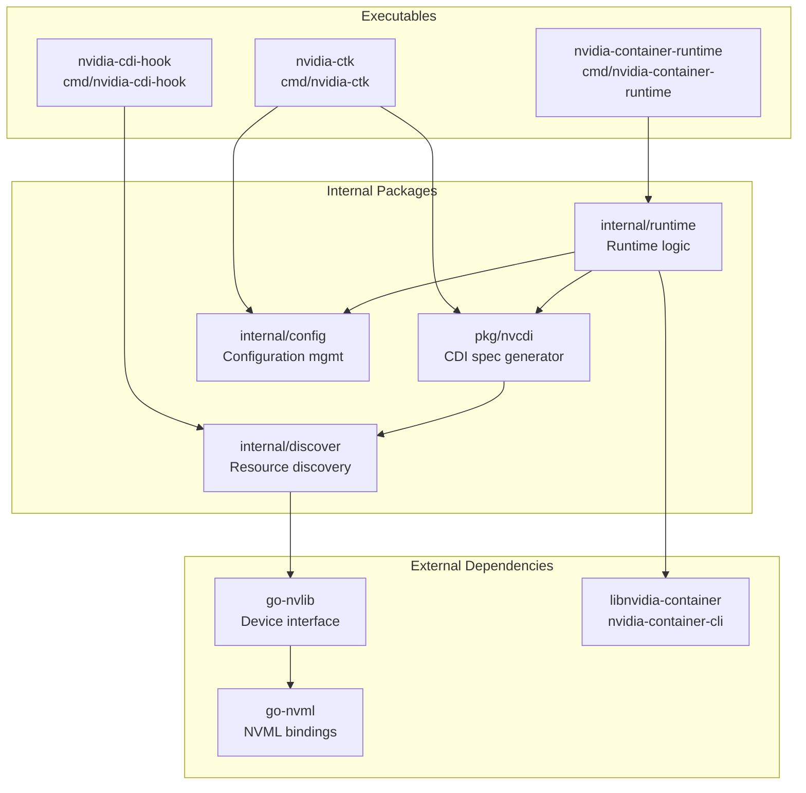
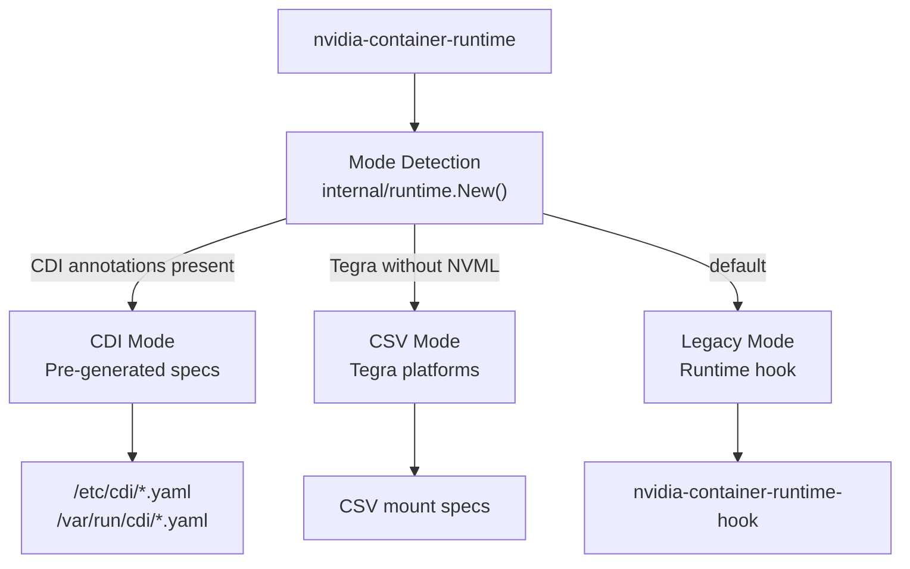
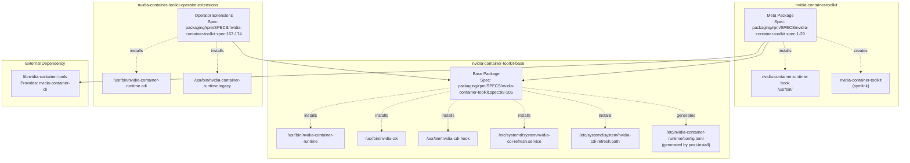
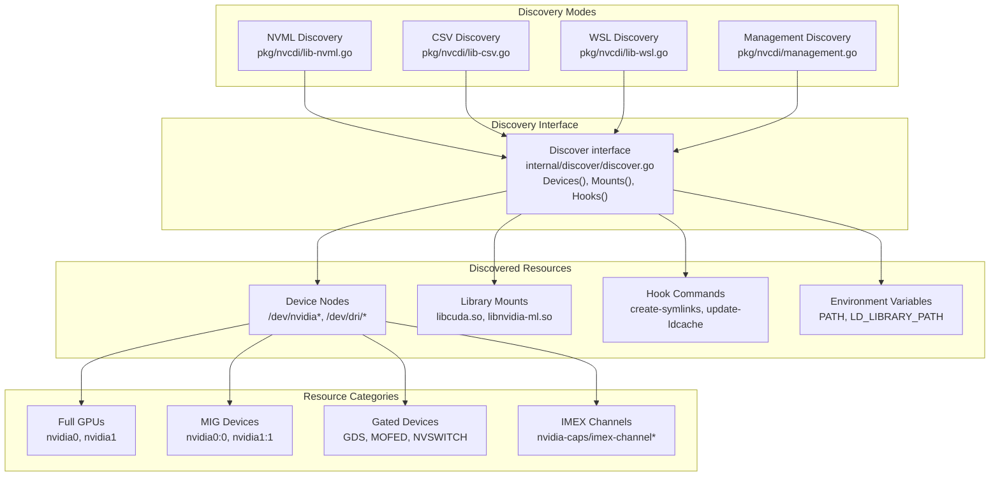
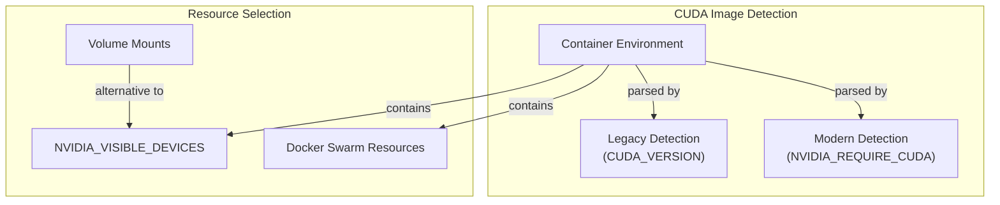

<!-- source: DeepWiki mcp.deepwiki.com · repo NVIDIA/nvidia-container-toolkit · page 2 Core Components · fetched 2026-10-26 -->

# Core Components

<details>
<summary>Relevant source files</summary>

The following files were used as context for generating this wiki page:

- [.gitmodules](.gitmodules)
- [CHANGELOG.md](CHANGELOG.md)
- [Makefile](Makefile)
- [cmd/nvidia-container-runtime/main.go](cmd/nvidia-container-runtime/main.go)
- [cmd/nvidia-container-runtime/main_test.go](cmd/nvidia-container-runtime/main_test.go)
- [cmd/nvidia-ctk/README.md](cmd/nvidia-ctk/README.md)
- [cmd/nvidia-ctk/cdi/cdi.go](cmd/nvidia-ctk/cdi/cdi.go)
- [cmd/nvidia-ctk/cdi/list/list.go](cmd/nvidia-ctk/cdi/list/list.go)
- [cmd/nvidia-ctk/cdi/transform/root/root.go](cmd/nvidia-ctk/cdi/transform/root/root.go)
- [cmd/nvidia-ctk/cdi/transform/transform.go](cmd/nvidia-ctk/cdi/transform/transform.go)
- [cmd/nvidia-ctk/config/config.go](cmd/nvidia-ctk/config/config.go)
- [cmd/nvidia-ctk/config/config_test.go](cmd/nvidia-ctk/config/config_test.go)
- [cmd/nvidia-ctk/config/create-default/create-default.go](cmd/nvidia-ctk/config/create-default/create-default.go)
- [cmd/nvidia-ctk/config/flags/options.go](cmd/nvidia-ctk/config/flags/options.go)
- [cmd/nvidia-ctk/info/info.go](cmd/nvidia-ctk/info/info.go)
- [cmd/nvidia-ctk/main.go](cmd/nvidia-ctk/main.go)
- [cmd/nvidia-ctk/runtime/runtime.go](cmd/nvidia-ctk/runtime/runtime.go)
- [deployments/systemd/90-nvidia-container-toolkit.preset](deployments/systemd/90-nvidia-container-toolkit.preset)
- [docker/Dockerfile.devel](docker/Dockerfile.devel)
- [internal/info/version.go](internal/info/version.go)
- [internal/oci/spec_memory.go](internal/oci/spec_memory.go)
- [internal/oci/spec_memory_test.go](internal/oci/spec_memory_test.go)
- [internal/runtime/logger.go](internal/runtime/logger.go)
- [packaging/debian/control](packaging/debian/control)
- [packaging/debian/nvidia-container-toolkit-base.maintscript](packaging/debian/nvidia-container-toolkit-base.maintscript)
- [packaging/debian/prepare](packaging/debian/prepare)
- [packaging/rpm/SPECS/nvidia-container-toolkit.spec](packaging/rpm/SPECS/nvidia-container-toolkit.spec)
- [versions.mk](versions.mk)

</details>


The NVIDIA Container Toolkit is built from multiple executable components and libraries that work together to enable GPU support in containers. This page provides an overview of these components, their purposes, and how they interact. For architectural concepts and detailed implementation, see [Architecture](#3).

## Component Inventory

The toolkit consists of the following main executables, compiled from Go source code in the [cmd/]() directory:

| Binary | Source Location | Purpose | Detailed Documentation |
|--------|----------------|---------|------------------------|
| `nvidia-container-runtime` | [cmd/nvidia-container-runtime/]() | OCI runtime wrapper that intercepts container creation and modifies specs to inject GPU resources | [NVIDIA Container Runtime](#2.1) |
| `nvidia-container-runtime-hook` | [cmd/nvidia-container-runtime-hook/]() | Legacy OCI prestart hook that invokes `nvidia-container-cli` for dynamic GPU injection | [NVIDIA Container Runtime Hook](#2.2) |
| `nvidia-ctk` | [cmd/nvidia-ctk/]() | Multi-purpose CLI with subcommands: `cdi generate`, `runtime configure`, `system create-device-nodes`, `hook` | [NVIDIA CTK CLI](#2.3) |
| `nvidia-cdi-hook` | [cmd/nvidia-cdi-hook/]() | Implements CDI hook specification: creates symlinks, updates ldcache, handles device permissions | [NVIDIA CDI Hook](#2.4) |
| `nvidia-ctk-installer` | [cmd/nvidia-ctk-installer/]() | Installs toolkit from container images into host systems (used in toolkit-container deployment) | [NVIDIA CTK Installer](#2.5) |

The toolkit integrates with external dependencies that are critical to its operation:

| Component | Package Source | Purpose | Integration Point |
|-----------|---------------|---------|-------------------|
| `nvidia-container-cli` | `libnvidia-container-tools` package | Low-level C binary that performs device mounting, library injection, and namespace configuration | Invoked as subprocess by [cmd/nvidia-container-runtime-hook/]() |
| `libnvidia-container` | Git submodule at [third_party/libnvidia-container/]() | C library providing GPU isolation and capability enforcement via `configure`, `list`, `info` commands | Built and packaged alongside toolkit |
| `go-nvml` | Vendored Go module | NVML API bindings for querying GPU devices, driver version, MIG configuration | Used by [internal/discover/]() and [pkg/nvcdi/]() |
| `go-nvlib` | Vendored Go module | Higher-level Device interface abstraction over NVML | Used by [pkg/nvcdi/spec.go]() for CDI generation |

Sources:
- [Makefile:38-39]()
- [cmd/nvidia-container-runtime/main.go:1-15]()
- [packaging/rpm/SPECS/nvidia-container-toolkit.spec:13-22]()
- [versions.mk:15-17]()
- [cmd/nvidia-ctk/main.go:1-100]()

## Executable Interaction Flow

The following diagram illustrates how binaries collaborate during container creation. Each binary is responsible for a distinct phase of GPU injection.

**Diagram: Component Execution Flow with Code Entry Points**



The `nvidia-container-runtime` reads the mode configuration from `/etc/nvidia-container-runtime/config.toml` (via [internal/runtime/runtime.go:10-11]()) and selects the appropriate `SpecModifier` implementation. For details on runtime modes, see [Runtime Modes](#3.1).

Sources:
- [cmd/nvidia-container-runtime/main.go:10-15]()
- [internal/runtime/runtime.go:10-11]()
- [cmd/nvidia-container-runtime/main_test.go:108-112]()
- [cmd/nvidia-container-runtime/main_test.go:119-123]()

## Build System and Binary Compilation

The toolkit uses a Makefile-based build system that compiles Go source code into static binaries. The build process is driven by `make` targets that invoke the Go compiler with specific linker flags.

**Binary Compilation Targets**

| Binary Artifact | Source Directory | Makefile Target | Build Command |
|-----------------|------------------|-----------------|---------------|
| `nvidia-container-runtime` | [cmd/nvidia-container-runtime/]() | `cmd-nvidia-container-runtime` | Invoked by [Makefile:67-68]() |
| `nvidia-container-runtime-hook` | [cmd/nvidia-container-runtime-hook/]() | `cmd-nvidia-container-runtime-hook` | Invoked by [Makefile:67-68]() |
| `nvidia-ctk` | [cmd/nvidia-ctk/]() | `cmd-nvidia-ctk` | Invoked by [Makefile:67-68]() |
| `nvidia-cdi-hook` | [cmd/nvidia-cdi-hook/]() | `cmd-nvidia-cdi-hook` | Invoked by [Makefile:67-68]() |
| `nvidia-ctk-installer` | [cmd/nvidia-ctk-installer/]() | `cmd-nvidia-ctk-installer` | Invoked by [Makefile:67-68]() |

The build uses LDFLAGS defined at [Makefile:63-68]() to inject version information and enable lazy symbol resolution:
```makefile
EXTLDFLAGS = -Wl,--export-dynamic -Wl,--unresolved-symbols=ignore-in-object-files -Wl,-z,lazy
go build -ldflags "-s -w '-extldflags=$(EXTLDFLAGS)' -X $(CLI_VERSION_PACKAGE).gitCommit=$(GIT_COMMIT)"
```

**Diagram: Build Dependency Graph**



Version information is injected at build time from [versions.mk:15-17]() and Git metadata ([versions.mk:29-32]()). The `CLI_VERSION_PACKAGE` ([Makefile:54]()) points to `github.com/NVIDIA/nvidia-container-toolkit/internal/info`, which defines the version variables.

Sources:
- [Makefile:38-68]()
- [versions.mk:15-39]()
- [cmd/nvidia-container-runtime/main.go:1-15]()
- [cmd/nvidia-ctk/main.go:61-62]()
- [internal/info/version.go:1-43]()

## Library Dependencies

The toolkit depends on several libraries that provide GPU enumeration, device management, and CDI specification generation capabilities.

**Diagram: Library Dependency Structure**



### libnvidia-container Integration

The `libnvidia-container` library is an external C library maintained in a Git submodule at [third_party/libnvidia-container/](). It provides the `nvidia-container-cli` binary, which performs:

- Device node creation: `/dev/nvidia0`, `/dev/nvidiactl`, `/dev/nvidia-uvm`
- Driver library mounting: `libcuda.so`, `libnvidia-ml.so`, driver-specific libraries
- Capability enforcement: Restricts access based on `NVIDIA_DRIVER_CAPABILITIES` (compute, graphics, utility, display)
- GPU process isolation: Uses Linux namespaces and cgroups

The `nvidia-container-runtime` (in legacy mode) or `nvidia-container-runtime-hook` invokes `nvidia-container-cli configure` as a subprocess to perform GPU injection. The CLI binary must be present at runtime and is provided by the `libnvidia-container-tools` package.

**Package requirement:** [packaging/rpm/SPECS/nvidia-container-toolkit.spec:39]() specifies `Requires: libnvidia-container-tools == %{version}-%{release}` to ensure version compatibility.

Sources:
- [third_party/libnvidia-container/]()
- [packaging/rpm/SPECS/nvidia-container-toolkit.spec:39]()

### Go Device Management Libraries

The toolkit uses vendored Go modules for GPU discovery:

| Library | Location | Purpose | Key Interfaces |
|---------|----------|---------|----------------|
| `go-nvml` | [vendor/github.com/NVIDIA/go-nvml/]() | NVML C library bindings | `nvml.Init()`, `nvml.DeviceGetCount()`, `nvml.DeviceGetHandleByIndex()` |
| `go-nvlib` | [vendor/github.com/NVIDIA/go-nvlib/]() | Device abstraction layer | `nvlib.New()`, `Device` interface with `GetUUID()`, `IsMigEnabled()` |

These libraries are managed via Go modules ([go.mod]()) and vendored using `make vendor` ([Makefile:93-114]()).

### nvcdi Package

The `pkg/nvcdi` package ([pkg/nvcdi/]()) implements the core CDI specification generation logic. It defines the `Interface` interface with methods:

```go
type Interface interface {
    GetSpec() (*specs.Spec, error)
    GetCommonEdits() (*cdi.ContainerEdits, error)
    GetAllDeviceSpecs() ([]specs.Device, error)
}
```

The package supports multiple discovery modes configured via `nvcdi.New(opts...)`:
- **NVML mode** ([pkg/nvcdi/lib.go]()): Queries GPUs via NVML API, used on standard Linux systems
- **WSL mode** ([pkg/nvcdi/wsl.go]()): Uses DXCore for GPU enumeration on Windows Subsystem for Linux
- **CSV mode** ([pkg/nvcdi/csv.go]()): Reads mount specifications from CSV files on Tegra/Jetson platforms
- **Management mode** ([pkg/nvcdi/management.go]()): Generates specs for all device nodes without filtering

Sources:
- [Makefile:93-114]()
- [pkg/nvcdi/api.go:1-50]()

## Mode-Specific Runtime Variants

The toolkit provides mode-specific runtime variants for advanced deployment scenarios, particularly in Kubernetes environments using the GPU Operator:

| Runtime Variant | Binary Name | Purpose |
|-----------------|-------------|---------|
| Default | `nvidia-container-runtime` | Auto-detects mode based on environment |
| CDI-only | `nvidia-container-runtime.cdi` | Forces CDI mode for spec-based injection |
| Legacy-only | `nvidia-container-runtime.legacy` | Forces legacy hook-based injection |

These variants are distributed in the `nvidia-container-toolkit-operator-extensions` package and allow the same codebase to be deployed with different default behaviors. The mode resolution logic is implemented in [internal/runtime/runtime.go:10-11]().

**Diagram: Runtime Mode Selection**



Sources:
- [packaging/rpm/SPECS/nvidia-container-toolkit.spec:170-171]()
- [CHANGELOG.md:82-83]()
- [internal/runtime/runtime.go:10-11]()

## Package Distribution Structure

The toolkit is distributed as three interconnected packages that can be installed independently or together, depending on deployment requirements.

**Diagram: Package Dependencies and Installation Hierarchy**



### Package Specifications

| Package | RPM Spec Location | Debian Control Location | Primary Use Case |
|---------|-------------------|-------------------------|------------------|
| `nvidia-container-toolkit-base` | [packaging/rpm/SPECS/nvidia-container-toolkit.spec:98-105]() | [packaging/debian/control:19-25]() | Core runtime and CLI; required by all installations |
| `nvidia-container-toolkit` | [packaging/rpm/SPECS/nvidia-container-toolkit.spec:1-29]() | [packaging/debian/control:11-17]() | Adds legacy hook for backward compatibility with pre-v1.11 configs |
| `nvidia-container-toolkit-operator-extensions` | [packaging/rpm/SPECS/nvidia-container-toolkit.spec:167-174]() | [packaging/debian/control:27-31]() | Mode-specific runtimes for Kubernetes GPU Operator deployments |

### Package Contents and Installation Paths

**Base Package** (`nvidia-container-toolkit-base`):
- Binaries: `/usr/bin/nvidia-container-runtime`, `/usr/bin/nvidia-ctk`, `/usr/bin/nvidia-cdi-hook`
- Systemd units: `/etc/systemd/system/nvidia-cdi-refresh.{service,path}`
- Configuration: `/etc/nvidia-container-toolkit/nvidia-cdi-refresh.env`
- Post-install script ([packaging/rpm/SPECS/nvidia-container-toolkit.spec:110-112]()): 
  - Generates default config at `/etc/nvidia-container-runtime/config.toml` via `nvidia-ctk config`
  - Enables and starts `nvidia-cdi-refresh.path` and `nvidia-cdi-refresh.service`

**Main Package** (`nvidia-container-toolkit`):
- Binaries: `/usr/bin/nvidia-container-runtime-hook`
- Symlink: `/usr/bin/nvidia-container-toolkit` → `nvidia-container-runtime-hook`
- Post-install script ([packaging/rpm/SPECS/nvidia-container-toolkit.spec:73-79]()): Creates symlink for backward compatibility

**Operator Extensions Package** (`nvidia-container-toolkit-operator-extensions`):
- Mode-specific runtimes: `/usr/bin/nvidia-container-runtime.cdi`, `/usr/bin/nvidia-container-runtime.legacy`
- These are identical binaries to `nvidia-container-runtime` but named to indicate forced mode behavior

### Version Matching Requirement

All packages require exact version match with `libnvidia-container-tools`:
```
Requires: libnvidia-container-tools == %{version}-%{release}
```
This ensures ABI compatibility between the runtime and the low-level `nvidia-container-cli` binary.

Sources:
- [packaging/rpm/SPECS/nvidia-container-toolkit.spec:1-174]()
- [packaging/debian/control:1-31]()
- [packaging/rpm/SPECS/nvidia-container-toolkit.spec:39]()
- [packaging/rpm/SPECS/nvidia-container-toolkit.spec:110-112]()
- [packaging/rpm/SPECS/nvidia-container-toolkit.spec:73-79]()

## Device Discovery System

The toolkit includes a layered discovery system that identifies NVIDIA GPUs and related resources (libraries, firmware, configuration files) on the host system for injection into containers.

**Diagram: Discovery Architecture**



### Discovery Interface

The core abstraction is the `Discover` interface defined in [internal/discover/discover.go]():

```go
type Discover interface {
    Devices() ([]Device, error)
    Mounts() ([]Mount, error)
    Hooks() ([]Hook, error)
}
```

Each discovery mode implements this interface to return device nodes, file mounts, and hook commands that should be injected into containers.

### Discovery Modes

| Mode | Implementation | Platform | Discovery Method |
|------|----------------|----------|------------------|
| **NVML** | [pkg/nvcdi/lib-nvml.go]() | Standard Linux with NVIDIA driver | Uses NVML API to enumerate GPUs and query driver paths |
| **CSV** | [pkg/nvcdi/lib-csv.go]() | Tegra/Jetson (embedded) | Reads mount specifications from CSV files in `/etc/nvidia-container-runtime/` |
| **WSL** | [pkg/nvcdi/lib-wsl.go]() | Windows Subsystem for Linux | Uses DXCore API to detect GPU adapters |
| **Management** | [pkg/nvcdi/management.go]() | All platforms | Discovers all device nodes without filtering; used for toolkit containers |

### Device Identification

Devices can be specified using multiple identifiers, parsed by [internal/config/image/devices.go:18-127]():

- **Index**: `0`, `1`, `2` (GPU index order)
- **UUID**: `GPU-12345678-1234-1234-1234-123456789abc`
- **PCI Bus ID**: `0000:01:00.0`
- **MIG format**: `0:0` (GPU index : MIG device index), `GPU-xxx:0`

The `VisibleDevices()` function resolves device requests from:
1. `NVIDIA_VISIBLE_DEVICES` environment variable
2. Kubernetes device plugin annotations (`nvidia.com/gpu`)
3. Docker Swarm resource specifications
4. Volume mount specifications

### Gated Device Discovery

Certain devices are only discovered when explicitly requested via environment variables:

| Device Type | Environment Variable | Implementation |
|-------------|---------------------|----------------|
| GPU Direct Storage | `NVIDIA_GDS=enabled` | [internal/discover/gds.go]() |
| MOFED InfiniBand | `NVIDIA_MOFED=enabled` | [internal/discover/mofed.go]() |
| NVSwitch | `NVIDIA_NVSWITCH=enabled` | [internal/discover/nvswitch.go]() |
| GDRCopy | `NVIDIA_GDRCOPY=enabled` | [internal/discover/gdrcopy.go]() |
| IMEX Channels | `NVIDIA_IMEX_CHANNELS` (list) | [internal/discover/imex.go]() |

These gated discoveries allow specialized workloads (HPC, AI training) to access additional GPU subsystems beyond standard compute GPUs.

Sources:
- [internal/discover/discover.go:1-50]()
- [pkg/nvcdi/lib-nvml.go:1-100]()
- [pkg/nvcdi/lib-csv.go:1-100]()
- [pkg/nvcdi/lib-wsl.go:1-58]()
- [internal/config/image/devices.go:18-127]()
- [internal/discover/gds.go:1-50]()
- [internal/discover/mofed.go:1-36]()

## CUDA Image Support

The toolkit provides special handling for CUDA container images, with functionality to:
- Detect legacy CUDA images via environment variables
- Extract CUDA version requirements
- Handle CUDA-specific environment variables
- Support Docker Swarm resource specifications



Sources:
- [internal/config/image/cuda_image.go:17-312]()
- [internal/config/image/cuda_image_test.go:17-247]()

---

