<!-- source: DeepWiki mcp.deepwiki.com · repo NVIDIA/nvidia-container-toolkit · page 2.1 NVIDIA Container Runtime · fetched 2026-10-26 -->

# NVIDIA Container Runtime

<details>
<summary>Relevant source files</summary>

The following files were used as context for generating this wiki page:

- [cmd/nvidia-container-runtime/README.md](cmd/nvidia-container-runtime/README.md)
- [cmd/nvidia-container-runtime/main.go](cmd/nvidia-container-runtime/main.go)
- [cmd/nvidia-container-runtime/main_test.go](cmd/nvidia-container-runtime/main_test.go)
- [internal/info/version.go](internal/info/version.go)
- [internal/oci/options.go](internal/oci/options.go)
- [internal/oci/runtime.go](internal/oci/runtime.go)
- [internal/oci/runtime_low_level.go](internal/oci/runtime_low_level.go)
- [internal/oci/runtime_mock.go](internal/oci/runtime_mock.go)
- [internal/oci/runtime_modifier.go](internal/oci/runtime_modifier.go)
- [internal/oci/runtime_modifier_test.go](internal/oci/runtime_modifier_test.go)
- [internal/oci/runtime_path.go](internal/oci/runtime_path.go)
- [internal/oci/runtime_path_test.go](internal/oci/runtime_path_test.go)
- [internal/oci/runtime_syscall_exec.go](internal/oci/runtime_syscall_exec.go)
- [internal/oci/spec.go](internal/oci/spec.go)
- [internal/oci/spec_file.go](internal/oci/spec_file.go)
- [internal/oci/spec_file_test.go](internal/oci/spec_file_test.go)
- [internal/oci/spec_memory.go](internal/oci/spec_memory.go)
- [internal/oci/spec_memory_test.go](internal/oci/spec_memory_test.go)
- [internal/oci/spec_test.go](internal/oci/spec_test.go)
- [internal/runtime/logger.go](internal/runtime/logger.go)
- [internal/test/test.go](internal/test/test.go)
- [pkg/lookup/path.go](pkg/lookup/path.go)

</details>


## Purpose and Scope

The **NVIDIA Container Runtime** (`nvidia-container-runtime`) is an OCI (Open Container Initiative) runtime wrapper that enables GPU support in containers. It acts as a shim between container runtime engines (containerd, CRI-O, Docker) and low-level OCI runtimes (runc, crun), modifying container specifications to inject NVIDIA GPU resources before delegating execution to the underlying runtime.

This document covers the architecture, execution flow, and operational modes of `nvidia-container-runtime`. For information about the legacy hook-based injection mechanism, see [NVIDIA Container Runtime Hook](#2.2). For details on CDI specification generation, see [Container Device Interface (CDI)](#3.2). For configuration options, see [Runtime Configuration Options](#4.2).

**Sources:** [cmd/nvidia-container-runtime/main.go:1-15](), [internal/runtime/runtime.go:17-91]()

---

## Architecture Overview

The NVIDIA Container Runtime implements a **wrapper pattern** around standard OCI runtimes. It intercepts container creation commands, modifies the OCI specification to include GPU resources, and then forwards the modified specification to the actual low-level runtime.

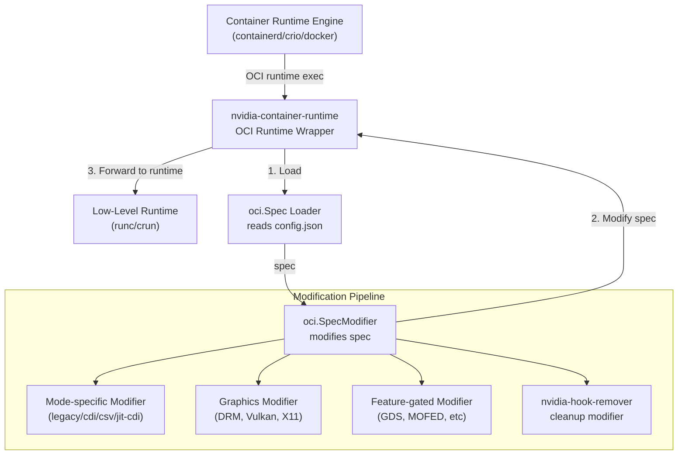

**Diagram: NVIDIA Container Runtime Architecture**

The runtime operates in distinct phases:
1. **Loading**: Reads the OCI specification from `config.json` [internal/oci/spec_file.go:60-72]()
2. **Modification**: Applies a pipeline of modifiers based on configuration and runtime mode [internal/oci/runtime_modifier.go:54-61]()
3. **Execution**: Delegates to the low-level runtime with the modified specification [internal/oci/runtime_modifier.go:63-64]()

**Sources:** [internal/runtime/runtime_factory.go:32-64](), [internal/runtime/runtime_factory.go:66-103](), [internal/oci/spec_file.go:60-72](), [internal/oci/runtime_modifier.go:54-64]()

---

## Execution Flow

### Main Entry Point

The runtime begins execution through a minimal `main()` function that delegates to the runtime library:

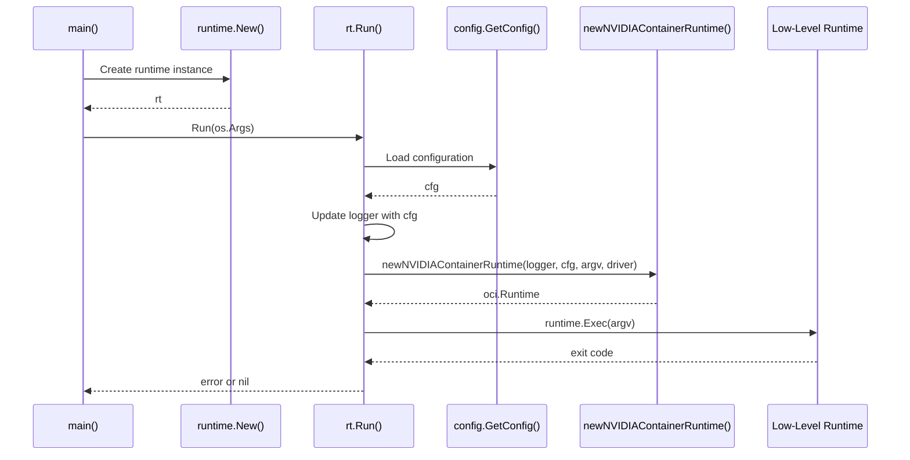

**Diagram: Runtime Execution Sequence**

**Sources:** [cmd/nvidia-container-runtime/main.go:9-15](), [internal/runtime/runtime.go:34-91]()

### Runtime Factory Pattern

The factory method constructs the runtime based on configuration and command-line arguments:

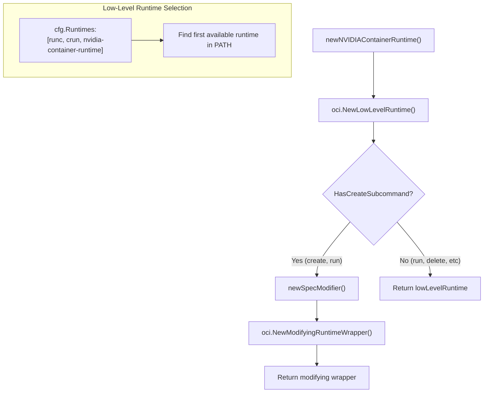

**Diagram: Runtime Factory Decision Flow**

The factory method implements a key optimization: **if the command is not a container creation command** (e.g., `delete`, `list`, `state`), no modification is needed and the low-level runtime is returned directly. [internal/oci/runtime_modifier.go:54]()

**Sources:** [internal/runtime/runtime_factory.go:32-64](), [internal/oci/runtime_low_level.go](), [internal/oci/runtime_modifier.go:54]()

---

## Runtime Modes

The NVIDIA Container Runtime supports four operational modes, each using a different mechanism to inject GPU resources:

### Mode Selection Logic

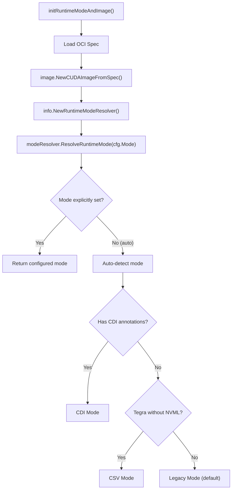

**Diagram: Runtime Mode Resolution Flow**

**Sources:** [internal/runtime/runtime_factory.go:118-130](), [internal/info/mode_resolver.go]() (referenced)

### Mode-Specific Modifiers

| Mode | Modifier Type | Device Injection | Hook Usage | Primary Use Case |
|------|---------------|------------------|------------|------------------|
| **Legacy** | `StableRuntimeModifier` | Hook-based | nvidia-container-runtime-hook | Backward compatibility |
| **CDI** | `CDIModifier` | Pre-generated specs | Minimal (hook remover) | Modern systems (default) |
| **CSV** | `CSVModifier` | File-based mounts | Feature-gated hooks | Tegra/embedded systems |
| **JIT-CDI** | `CDIModifier` (dynamic) | Just-in-time generation | CDI lifecycle hooks | Auto-generation scenarios |

**Sources:** [internal/runtime/runtime_factory.go:105-116](), [internal/modifier/stable.go](), [internal/modifier/cdi.go](), [internal/modifier/csv.go]()

### Modifier Pipeline by Mode

Different modes apply different modifier chains:

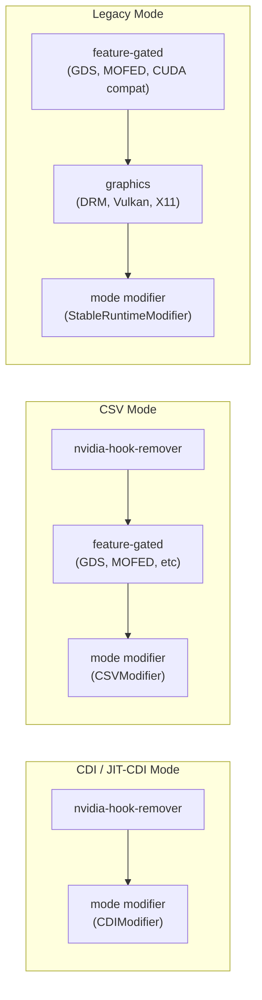

**Diagram: Modifier Pipelines by Runtime Mode**

**Key observation:** CDI mode requires the fewest modifiers because the CDI specification already contains most GPU resource declarations. Legacy mode requires the most modifiers because all resource injection happens dynamically at container creation time.

**Sources:** [internal/runtime/runtime_factory.go:130]()

---

## Component Responsibilities

### Core Runtime Components

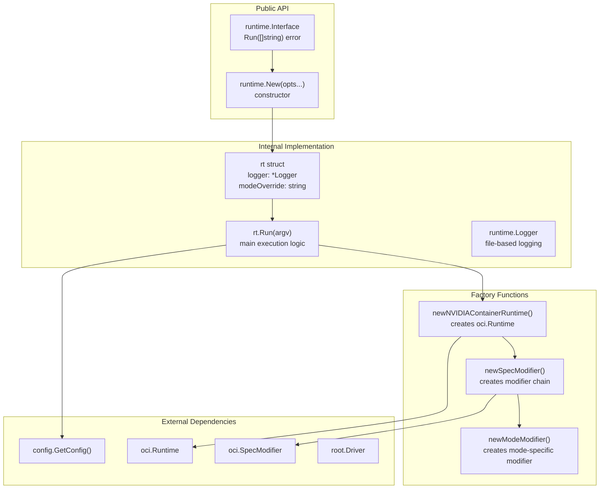

**Diagram: Component Relationships**

**Sources:** [internal/runtime/api.go:1-33](), [internal/runtime/runtime.go:17-117](), [internal/runtime/runtime_factory.go:17-130]()

### Logger Configuration

The runtime includes a sophisticated logging system that supports multiple output destinations:

| Logger Feature | Implementation | Source |
|----------------|----------------|--------|
| **File output** | `os.OpenFile()` with append mode | [internal/runtime/logger.go:161-172]() |
| **Debug mode** | Enables call stack reporting | [internal/runtime/logger.go:88-102]() |
| **Format support** | Text (default) or JSON | [internal/runtime/logger.go:104-106]() |
| **Multi-writer** | `io.MultiWriter` for multiple files | [internal/runtime/logger.go:114-118]() |
| **Argument parsing** | Extracts `--log`, `--log-format`, `--debug` | [internal/runtime/logger.go:194-254]() |

The logger is updated dynamically based on configuration and command-line flags: [internal/runtime/logger.go:49-126]()

**Sources:** [internal/runtime/logger.go:34-126](), [internal/runtime/logger.go:174-254]()

---

## Configuration Integration

### Configuration Flow

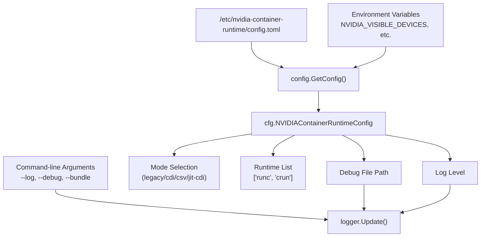

**Diagram: Configuration Sources and Usage**

### Mode Override

The runtime supports mode override through the `WithModeOverride()` option:

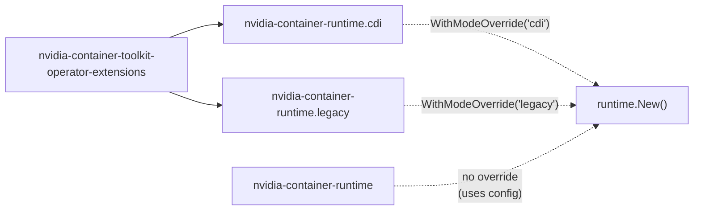

**Diagram: Mode-Specific Runtime Binaries**

Mode-specific binaries are provided in the `operator-extensions` package for Kubernetes scenarios where the mode must be guaranteed regardless of configuration.

**Sources:** [internal/runtime/api.go:28-33](), [packaging/rpm/SPECS/nvidia-container-toolkit.spec:122-135]()

---

## Low-Level Runtime Integration

### Runtime Selection

The runtime searches for a low-level OCI runtime from a prioritized list:

1. **Configuration list**: `cfg.NVIDIAContainerRuntimeConfig.Runtimes` (e.g., `["runc", "crun"]`) [cmd/nvidia-container-runtime/README.md:23-27]()
2. **PATH lookup**: Uses `lookup.NewExecutableLocator` to find the first available binary [internal/oci/runtime_low_level.go:44-52]()
3. **Fallback**: Returns error if no runtime is found [internal/oci/runtime_low_level.go:54]()

**Default runtime list** (as of v1.18.0):
```
["runc", "crun"]
```

Note: `docker-runc` was removed from the default list in v1.18.0-rc.1.

**Sources:** [CHANGELOG.md:90](), [internal/oci/runtime_low_level.go](), [cmd/nvidia-container-runtime/README.md:23-27]()

### Command Forwarding

The runtime preserves all command-line arguments when delegating to the low-level runtime:

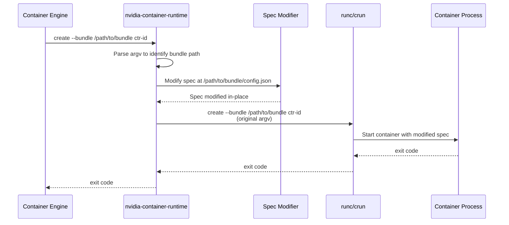

**Diagram: Command Execution Flow**

**Key design principle**: The runtime modifies the specification file in-place before delegating, ensuring the low-level runtime receives exactly the same command-line arguments as the wrapper. [internal/oci/runtime_modifier.go:63-64]()

**Sources:** [internal/runtime/runtime.go:81-90](), [internal/oci/runtime_low_level.go](), [internal/oci/runtime_modifier.go:63-64]()

---

## Error Handling and Logging

### Error Propagation

The runtime uses deferred error handling to ensure proper cleanup:

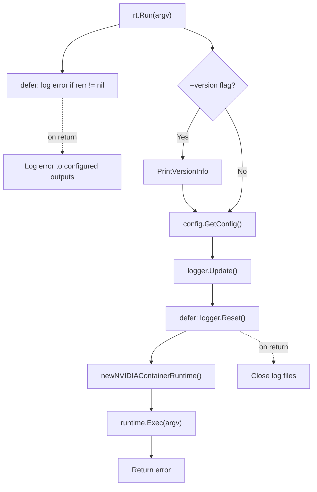

**Diagram: Error Handling Flow**

**Deferred actions:**
1. **Error logging**: Any error returned is logged before function exit [internal/runtime/runtime.go:35-39]()
2. **Logger reset**: Log files are closed and logger is restored [internal/runtime/logger.go:130-159]()

**Sources:** [internal/runtime/runtime.go:34-91](), [internal/runtime/logger.go:130-159]()

---

## Testing Infrastructure

### Test Configuration

The runtime includes integration tests that verify correct OCI spec modification:

| Test Case | Purpose | Expected Behavior |
|-----------|---------|-------------------|
| `TestBadInput` | Invalid arguments | Runtime returns error |
| `TestGoodInput` | Valid create command | Hook not present (CDI default) |
| `TestDuplicateHook` | Pre-existing hook | Hook is removed by modifier |

**Test environment setup:**
- Mock `runc` binary in `tests/bin/` [cmd/nvidia-container-runtime/main_test.go:56-59]()
- Mock `nvidia-container-runtime-hook` in `tests/bin/` [cmd/nvidia-container-runtime/main_test.go:60-63]()
- Test specs in `tests/input/` [cmd/nvidia-container-runtime/main_test.go:49]()
- Bundle directory in `tests/output/bundle/` [cmd/nvidia-container-runtime/main_test.go:24]()

**Sources:** [cmd/nvidia-container-runtime/main_test.go:41-79](), [cmd/nvidia-container-runtime/main_test.go:84-241]()

### Factory Method Tests

The factory tests verify correct runtime and modifier creation for each mode:

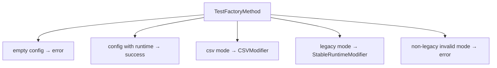

**Diagram: Factory Test Coverage**

**Sources:** [internal/runtime/runtime_factory_test.go:66-168]()

---

## Package Distribution

The NVIDIA Container Runtime is distributed in multiple packages:

### Package Hierarchy

| Package | Contents | Dependencies |
|---------|----------|--------------|
| **nvidia-container-toolkit** | `nvidia-container-runtime-hook` | `nvidia-container-toolkit-base`, `libnvidia-container-tools` |
| **nvidia-container-toolkit-base** | `nvidia-container-runtime`, `nvidia-ctk`, `nvidia-cdi-hook` | None (core package) |
| **nvidia-container-toolkit-operator-extensions** | `nvidia-container-runtime.cdi`, `nvidia-container-runtime.legacy` | `nvidia-container-toolkit-base` |

**Key packaging decisions:**
1. **Base package separation** (v1.13.0): Allows installation without the legacy hook
2. **Mode-specific binaries** (v1.13.0): Enables guaranteed mode in Kubernetes
3. **systemd integration** (v1.18.0): Auto-refresh CDI specs on driver changes

**Sources:** [packaging/rpm/SPECS/nvidia-container-toolkit.spec:1-135](), [packaging/debian/control:1-32]()

### Build Artifacts

The build system produces the following binaries:

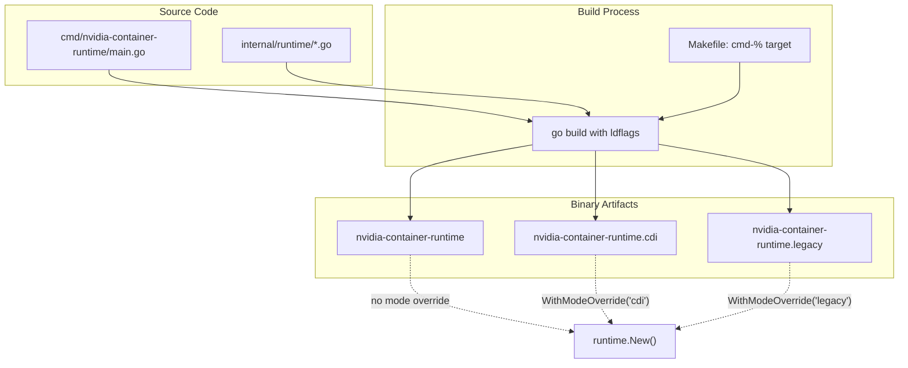

**Diagram: Build Artifacts and Mode Configuration**

**Build flags:** Version and git commit information are injected via ldflags:
- `github.com/NVIDIA/nvidia-container-toolkit/internal/info.gitCommit`
- `github.com/NVIDIA/nvidia-container-toolkit/internal/info.version`

**Sources:** [Makefile:38-68](), [versions.mk:15-39]()

---

## Summary

The NVIDIA Container Runtime serves as a **transparent OCI runtime wrapper** that:

1. **Intercepts container creation** commands from container engines
2. **Modifies OCI specifications** to include GPU resources based on operational mode
3. **Delegates execution** to low-level runtimes with modified specifications
4. **Supports multiple modes** for different deployment scenarios (legacy, CDI, CSV, JIT-CDI)
5. **Provides mode-specific binaries** for guaranteed behavior in orchestrated environments

The runtime's architecture enables GPU support without requiring changes to container engines, making it compatible with Docker, containerd, CRI-O, and other OCI-compliant systems.

**Sources:** [cmd/nvidia-container-runtime/main.go:1-15](), [internal/runtime/runtime.go:17-117](), [internal/runtime/runtime_factory.go:17-130]()

---

