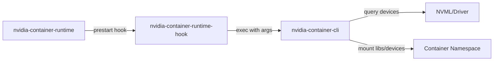
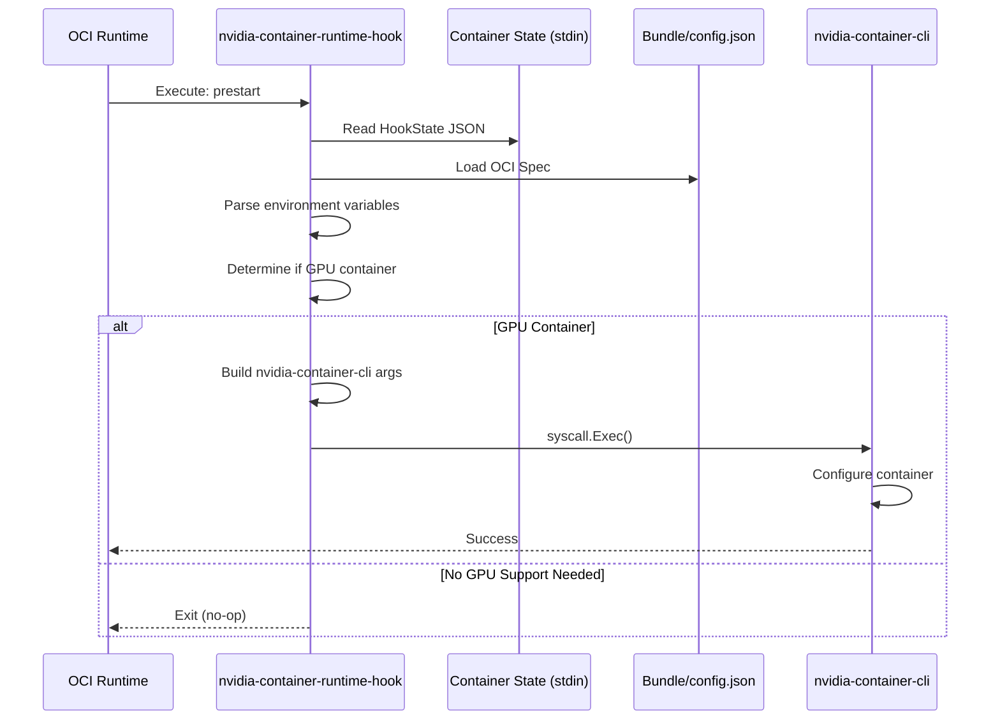
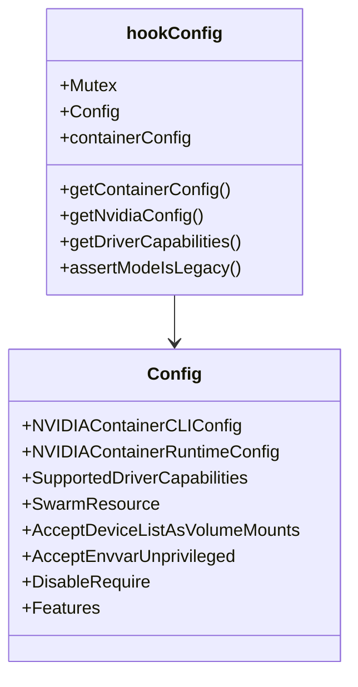
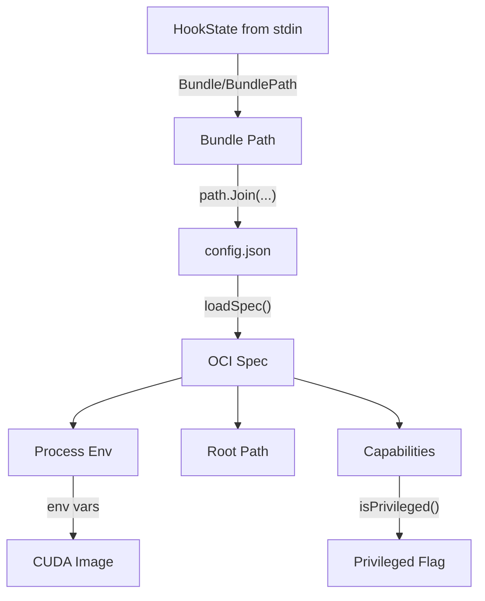
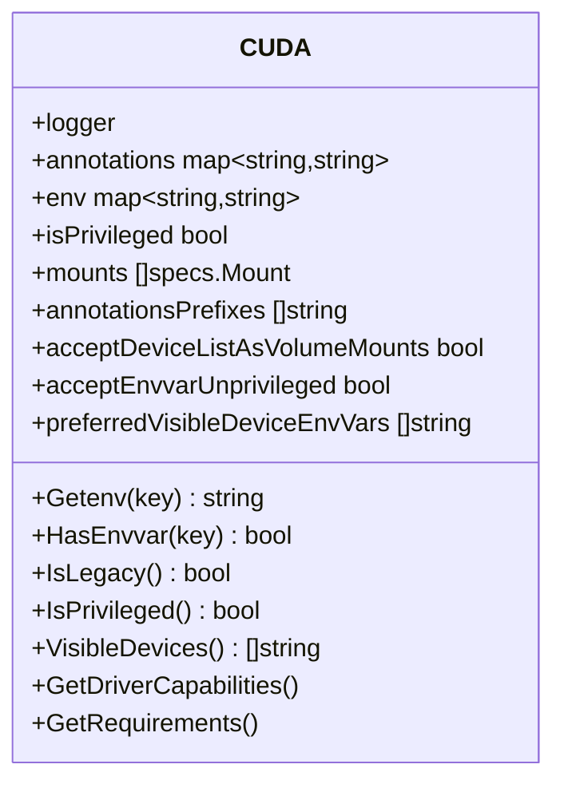
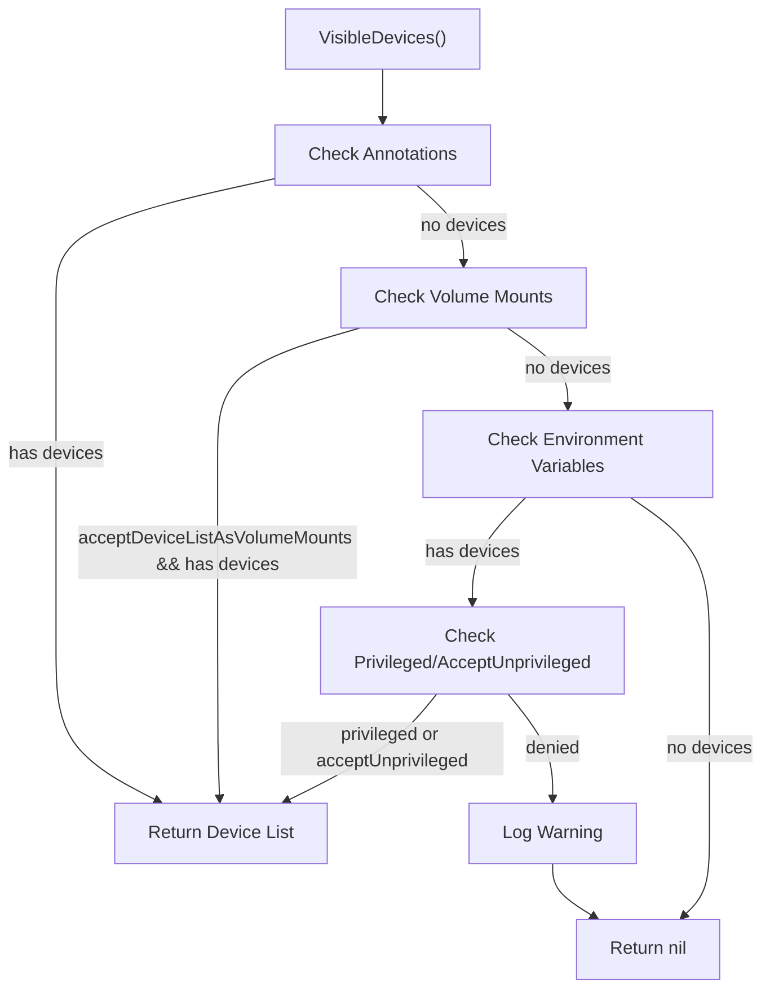
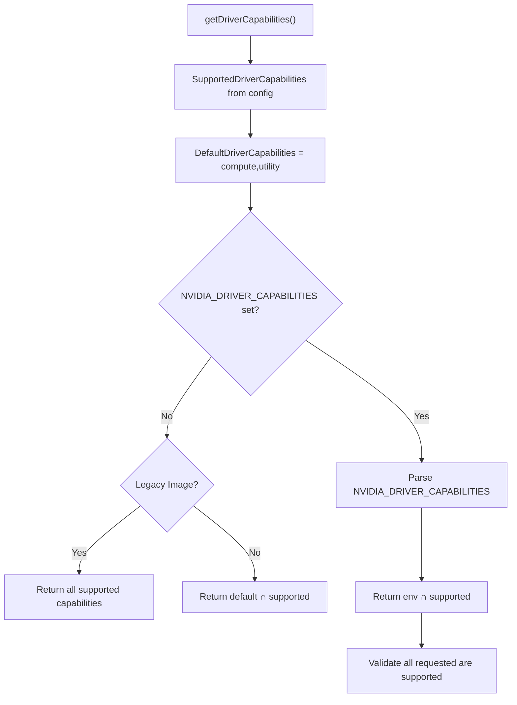
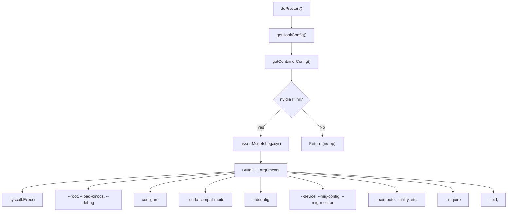
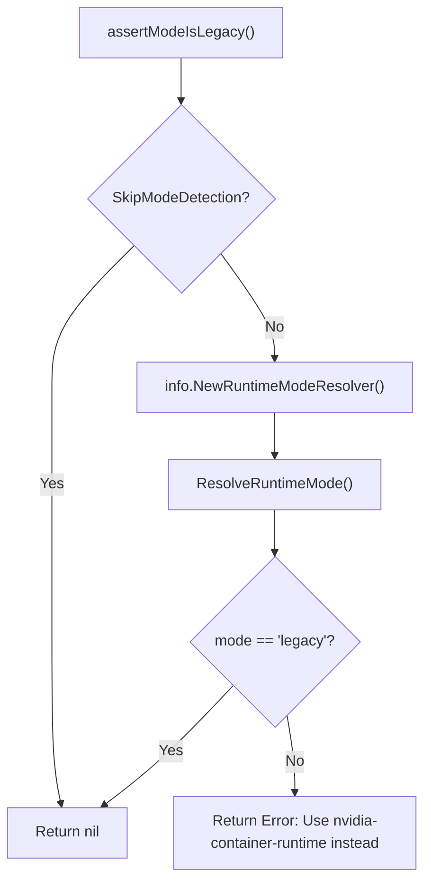

<!-- source: DeepWiki mcp.deepwiki.com · repo NVIDIA/nvidia-container-toolkit · page 2.2 NVIDIA Container Runtime Hook · fetched 2026-10-26 -->

# NVIDIA Container Runtime Hook

<details>
<summary>Relevant source files</summary>

The following files were used as context for generating this wiki page:

- [cmd/nvidia-container-runtime-hook/container_config.go](cmd/nvidia-container-runtime-hook/container_config.go)
- [cmd/nvidia-container-runtime-hook/container_config_test.go](cmd/nvidia-container-runtime-hook/container_config_test.go)
- [cmd/nvidia-container-runtime-hook/hook_config.go](cmd/nvidia-container-runtime-hook/hook_config.go)
- [cmd/nvidia-container-runtime-hook/hook_config_test.go](cmd/nvidia-container-runtime-hook/hook_config_test.go)
- [cmd/nvidia-container-runtime-hook/main.go](cmd/nvidia-container-runtime-hook/main.go)
- [internal/config/image/builder.go](internal/config/image/builder.go)
- [internal/config/image/capabilities.go](internal/config/image/capabilities.go)
- [internal/config/image/cuda_image.go](internal/config/image/cuda_image.go)
- [internal/config/image/cuda_image_test.go](internal/config/image/cuda_image_test.go)
- [internal/config/image/devices.go](internal/config/image/devices.go)
- [internal/config/image/privileged.go](internal/config/image/privileged.go)

</details>


## Overview

The **NVIDIA Container Runtime Hook** (`nvidia-container-runtime-hook`) is a legacy OCI lifecycle hook executable that configures GPU access for containers using a prestart hook approach. This component is invoked before a container starts to dynamically inject NVIDIA GPU devices, driver libraries, and capabilities into the container namespace.

**Scope**: This page documents the `nvidia-container-runtime-hook` binary, its configuration parsing, device selection logic, and invocation of `nvidia-container-cli`. For information about the NVIDIA Container Runtime that invokes this hook, see [NVIDIA Container Runtime](). For information about the modern CDI-based hook system, see [NVIDIA CDI Hook]().

**Legacy Status**: As of the toolkit's shift toward CDI-based runtime modes, this hook is primarily used in `legacy` mode. Modern deployments should prefer CDI mode or Just-In-Time CDI (`jit-cdi`) mode, which provide better performance and standards compliance.

## System Position

The runtime hook sits between the NVIDIA Container Runtime and the low-level `nvidia-container-cli` tool:



**Diagram**: Position of nvidia-container-runtime-hook in the execution flow

Sources: [cmd/nvidia-container-runtime-hook/main.go:1-203]()

## Hook Invocation Lifecycle

The hook is invoked as an OCI lifecycle hook with specific commands:



**Diagram**: Hook lifecycle execution sequence

### Entry Points

The hook supports three lifecycle commands defined in [cmd/nvidia-container-runtime-hook/main.go:167-194]():

| Command | Action | Description |
|---------|--------|-------------|
| `prestart` | Executes `doPrestart()` | Configures GPU access before container start |
| `poststart` | No-op | Reserved for future use |
| `poststop` | No-op | Reserved for future use |

Only the `prestart` command performs actual work. The hook receives container state via stdin as a `HookState` struct [cmd/nvidia-container-runtime-hook/container_config.go:68-78]():

```
HookState {
    Pid: <container-pid>
    Bundle: <path-to-bundle>
    BundlePath: <legacy-path-to-bundle>
}
```

Sources: [cmd/nvidia-container-runtime-hook/main.go:167-194](), [cmd/nvidia-container-runtime-hook/container_config.go:68-78]()

## Configuration Loading

### Config File Resolution

The hook loads its configuration from a TOML file with the following precedence [cmd/nvidia-container-runtime-hook/hook_config.go:39-47]():

1. Command-line flag `--config`
2. Environment variable `NVIDIA_CTK_CONFIG_FILE_PATH`
3. Default path `/etc/nvidia-container-runtime/config.toml`

If the configuration file doesn't exist and isn't explicitly required, the hook uses default configuration values [cmd/nvidia-container-runtime-hook/hook_config.go:25-36]().

### Configuration Structure

The `hookConfig` struct wraps the toolkit configuration [cmd/nvidia-container-runtime-hook/hook_config.go:16-22]():



**Diagram**: Configuration structure for `nvidia-container-runtime-hook`

Key configuration options include:
- `SupportedDriverCapabilities`: Restricts which driver capabilities can be requested
- `SwarmResource`: Environment variable names for Docker Swarm GPU resource specifications
- `AcceptDeviceListAsVolumeMounts`: Enable device selection via volume mounts
- `AcceptEnvvarUnprivileged`: Allow `NVIDIA_VISIBLE_DEVICES` in unprivileged containers

Sources: [cmd/nvidia-container-runtime-hook/hook_config.go:16-68]()

## Container Configuration Detection

### OCI Spec Parsing

The hook reads the OCI runtime specification from the bundle path [cmd/nvidia-container-runtime-hook/container_config.go:80-100]():



**Diagram**: Container configuration detection flow

The `loadSpec()` function [cmd/nvidia-container-runtime-hook/container_config.go:80-100]() validates required fields:
- `spec.Version` must be present
- `spec.Process` must be present  
- `spec.Root` must be present

### Privileged Container Detection

The hook determines if a container is privileged by checking for `CAP_SYS_ADMIN` in the bounding capability set [internal/config/image/privileged.go:36-47]():

```
isPrivileged(spec) -> bool:
    for each capability in spec.Process.Capabilities.Bounding:
        if capability == "CAP_SYS_ADMIN":
            return true
    return false
```

This distinction is important because:
- Privileged containers can request MIG configuration/monitoring devices
- Unprivileged containers may be restricted from using `NVIDIA_VISIBLE_DEVICES` unless `AcceptEnvvarUnprivileged` is enabled

Sources: [cmd/nvidia-container-runtime-hook/container_config.go:131-133](), [internal/config/image/privileged.go:23-58]()

## Device Selection

### CUDA Image Abstraction

Device selection is handled through the `image.CUDA` abstraction [internal/config/image/cuda_image.go:43-56]():



**Diagram**: CUDA image interface for device selection

### Device Selection Priority

The `VisibleDevices()` method implements a priority-based selection strategy [internal/config/image/cuda_image.go:258-292]():

1. **Annotations** (highest priority): CDI device requests from Kubernetes annotations
2. **Volume Mounts**: Devices specified as `/dev/null` mounts to special paths
3. **Environment Variables**: `NVIDIA_VISIBLE_DEVICES` or preferred envvars



**Diagram**: Device selection priority flow

### Device Specification Formats

Devices can be specified in multiple formats:

| Format | Example | Description |
|--------|---------|-------------|
| Index | `0,1,2` | GPU indices |
| UUID | `GPU-12345678-1234-...` | Full GPU UUID |
| MIG | `MIG-GPU-12345678-...:0:1` | MIG device with GI:CI indices |
| Symbolic | `all` | All available GPUs |
| Symbolic | `none` | No GPUs (empty string in result) |
| Symbolic | `void` | No GPUs (nil result) |

The `VisibleDevices` interface [internal/config/image/devices.go:23-28]() provides methods:
- `List() []string`: Get ordered device list
- `Has(id string) bool`: Check if specific device is selected

Sources: [internal/config/image/cuda_image.go:258-292](), [internal/config/image/devices.go:1-127]()

### Volume Mount Device Specification

When `acceptDeviceListAsVolumeMounts` is enabled, devices can be specified via volume mounts [internal/config/image/cuda_image.go:358-388]():

```
Mount Pattern:
    Source: /dev/null
    Destination: /var/run/nvidia-container-devices/<device-id>

Examples:
    /var/run/nvidia-container-devices/GPU0
    /var/run/nvidia-container-devices/GPU0-MIG0/0/1
    /var/run/nvidia-container-devices/cdi/nvidia.com/gpu/0
    /var/run/nvidia-container-devices/imex/channel0
```

CDI device mounts use the prefix `/var/run/nvidia-container-devices/cdi/` and are parsed to fully-qualified CDI names [internal/config/image/cuda_image.go:390-414]().

Sources: [internal/config/image/cuda_image.go:34-38](), [internal/config/image/cuda_image.go:358-388]()

## Driver Capabilities

### Capability Selection

Driver capabilities determine which driver functionalities are available in the container. The hook implements capability selection in `getDriverCapabilities()` [cmd/nvidia-container-runtime-hook/container_config.go:151-175]():



**Diagram**: Driver capability selection logic

### Supported Capabilities

The toolkit defines standard driver capabilities [internal/config/image/capabilities.go:20-30]():

| Capability | Description |
|------------|-------------|
| `compute` | CUDA compute libraries |
| `compat32` | 32-bit compatibility libraries |
| `graphics` | Graphics/GLX libraries |
| `utility` | nvidia-smi and utility libraries |
| `video` | Video encode/decode libraries |
| `display` | Display/X11 libraries |
| `ngx` | NGX libraries |

Default capabilities when unspecified: `compute,utility`

Configuration can restrict capabilities via `supported-driver-capabilities`:

```toml
supported-driver-capabilities = "compute,utility,graphics"
```

Sources: [cmd/nvidia-container-runtime-hook/container_config.go:151-175](), [internal/config/image/capabilities.go:1-142]()

## Requirements Checking

### Requirement Extraction

The hook extracts requirements from environment variables prefixed with `NVIDIA_REQUIRE_` [internal/config/image/cuda_image.go:113-134]():

```
GetRequirements() []string:
    if NVIDIA_DISABLE_REQUIRE == "true":
        return []
    
    requirements = []
    for each env var with prefix "NVIDIA_REQUIRE_":
        if not NVIDIA_REQUIRE_JETPACK*:
            append requirement value
    
    if IsLegacy():
        cuda_version = parse CUDA_VERSION
        append "cuda>=" + major.minor
    
    return requirements
```

### Legacy vs Modern Images

| Image Type | Detection | Requirements Behavior |
|------------|-----------|----------------------|
| Legacy | `CUDA_VERSION` set, `NVIDIA_REQUIRE_CUDA` unset | Automatically adds `cuda>=X.Y` requirement |
| Modern | `NVIDIA_REQUIRE_CUDA` set | Uses explicit requirements only |

Example requirements from a modern image:
```
NVIDIA_REQUIRE_CUDA=cuda>=11.6
NVIDIA_REQUIRE_BRAND=brand=tesla,driver>=450
```

These requirements are passed to `nvidia-container-cli` via `--require=` flags and validated against the host driver.

Sources: [internal/config/image/cuda_image.go:98-146](), [cmd/nvidia-container-runtime-hook/container_config.go:204-217]()

## MIG Device Support

### MIG Configuration

Multi-Instance GPU (MIG) devices can be configured in privileged containers via special environment variables [cmd/nvidia-container-runtime-hook/container_config.go:135-149]():

```
NVIDIA_MIG_CONFIG_DEVICES=mig0,mig1
NVIDIA_MIG_MONITOR_DEVICES=mig0,mig1
```

The hook validates privilege requirements:

```
getMigConfigDevices(image):
    if !image.HasEnvvar(NVIDIA_MIG_CONFIG_DEVICES):
        return nil
    devices = image.Getenv(NVIDIA_MIG_CONFIG_DEVICES)
    if !privileged && devices != "":
        panic("cannot set MIG_CONFIG_DEVICES in non privileged container")
    return devices
```

MIG device values are passed to `nvidia-container-cli` via:
- `--mig-config=<devices>`
- `--mig-monitor=<devices>`

Sources: [cmd/nvidia-container-runtime-hook/container_config.go:135-149](), [cmd/nvidia-container-runtime-hook/main.go:128-133]()

## NVIDIA Container CLI Invocation

### CLI Argument Construction

The `doPrestart()` function builds the `nvidia-container-cli configure` command [cmd/nvidia-container-runtime-hook/main.go:66-156]():



**Diagram**: `nvidia-container-cli` argument construction

### CLI Argument Mapping

| Hook Config/State | CLI Argument | Example |
|-------------------|--------------|---------|
| `cli.Root` | `--root=` | `--root=/run/nvidia/driver` |
| `cli.LoadKmods` | `--load-kmods` | Load kernel modules if needed |
| `cli.NoPivot` | `--no-pivot` | Skip pivot_root operation |
| `cli.Debug` | `--debug=` | `--debug=/var/log/nvidia.log` |
| `cli.Ldcache` | `--ldcache=` | `--ldcache=/etc/ld.so.cache` |
| `cli.User` | `--user=` | `--user=1000:1000` |
| `cli.NoCgroups` | `--no-cgroups` | Skip cgroup device allowlisting |
| `nvidia.Devices` | `--device=` | `--device=0,1` |
| `nvidia.MigConfigDevices` | `--mig-config=` | `--mig-config=mig0` |
| `nvidia.MigMonitorDevices` | `--mig-monitor=` | `--mig-monitor=mig1` |
| `nvidia.ImexChannels` | `--imex-channel=` | `--imex-channel=0,1` |
| Capability: `compute` | `--compute` | Enable compute capability |
| Capability: `utility` | `--utility` | Enable utility capability |
| Capability: `graphics` | `--graphics` | Enable graphics capability |
| Capability: `video` | `--video` | Enable video capability |
| Capability: `display` | `--display` | Enable display capability |
| `nvidia.Requirements` | `--require=` | `--require=cuda>=11.6` |
| `container.Pid` | `--pid=` | `--pid=12345` |
| `container.Rootfs` | `<rootfs>` | `/var/lib/containerd/.../rootfs` |

### CUDA Compatibility Mode

The hook supports CUDA forward compatibility via the `--cuda-compat-mode` flag [cmd/nvidia-container-runtime-hook/hook_config.go:104-125]():

```
nvidiaContainerCliCUDACompatModeFlags():
    switch config.CUDACompatMode:
        case "ldconfig":
            return ["--cuda-compat-mode=ldconfig"]
        case "mount":
            return ["--cuda-compat-mode=mount"]
        case "disabled", "hook":
            return ["--cuda-compat-mode=disabled"]
        default:
            if !AllowCUDACompatLibsFromContainer:
                return ["--cuda-compat-mode=disabled"]
    return []
```

This controls whether CUDA compatibility libraries are discovered via ldconfig, mounted, or disabled entirely.

Sources: [cmd/nvidia-container-runtime-hook/main.go:89-156](), [cmd/nvidia-container-runtime-hook/hook_config.go:104-125]()

### Execution via syscall.Exec

After building the argument list, the hook executes `nvidia-container-cli` by replacing its own process [cmd/nvidia-container-runtime-hook/main.go:152-156]():

```go
env := append(os.Environ(), cli.Environment...)
err = syscall.Exec(args[0], args, env)
log.Panicln("exec failed:", err)
```

This `syscall.Exec()` call:
1. Replaces the hook process with `nvidia-container-cli`
2. Preserves the process PID
3. Inherits file descriptors
4. Passes combined environment variables

The CLI then configures the container namespace and exits, returning control to the container runtime.

Sources: [cmd/nvidia-container-runtime-hook/main.go:152-156]()

## Mode Detection and Legacy Status

### Mode Resolution

The hook checks if it should operate in legacy mode via `assertModeIsLegacy()` [cmd/nvidia-container-runtime-hook/hook_config.go:127-131]():



**Diagram**: Legacy mode assertion logic

The mode resolver considers:
- Configuration file `nvidia-container-runtime.mode` setting
- Container image characteristics (CDI devices, etc.)
- Default mode (legacy for the hook)

### Direct Hook Invocation Restriction

When mode detection is enabled (default), the hook prevents direct invocation in non-legacy scenarios [cmd/nvidia-container-runtime-hook/hook_config.go:131]():

```
Error: "invoking the NVIDIA Container Runtime Hook directly 
(e.g. specifying the docker --gpus flag) is not supported. 
Please use the NVIDIA Container Runtime 
(e.g. specify the --runtime=nvidia flag) instead"
```

This error appears when:
- The runtime is configured for CDI mode
- The container requests CDI devices
- The hook is invoked directly rather than through the runtime wrapper

To bypass this check, set in the config:

```toml
[nvidia-container-runtime-hook]
  skip-mode-detection = true
```

Sources: [cmd/nvidia-container-runtime-hook/hook_config.go:127-131]()

## Package Installation

### Debian Package

The hook is installed by the `nvidia-container-toolkit` package:

```
/usr/bin/nvidia-container-runtime-hook
```

Post-installation creates a symlink for backward compatibility:

```bash
NVIDIA_CONTAINER_RUNTIME_HOOK=/usr/bin/nvidia-container-runtime-hook
NVIDIA_CONTAINER_TOOLKIT=/usr/bin/nvidia-container-toolkit

ln -s ${NVIDIA_CONTAINER_RUNTIME_HOOK} ${NVIDIA_CONTAINER_TOOLKIT}
```

### RPM Package

Similar installation and symlink creation occurs in the RPM package:

```
%install
install -m 755 -t %{buildroot}%{_bindir} nvidia-container-runtime-hook

%posttrans
ln -sf %{_bindir}/nvidia-container-runtime-hook %{_bindir}/nvidia-container-toolkit
```

The `nvidia-container-toolkit` symlink maintains backward compatibility with earlier versions where the hook was the primary binary.

## Relationship to Other Components

### Comparison with CDI Hook

| Aspect | `nvidia-container-runtime-hook` | `nvidia-cdi-hook` |
|--------|------------------------------|-----------------|
| **Mode** | Legacy mode | CDI mode |
| **Invocation** | Prestart hook | CreateContainer/CreateRuntime hooks |
| **Device Discovery** | Dynamic via NVML | Pre-generated CDI specs |
| **Performance** | Slower (runtime NVML queries) | Faster (spec already generated) |
| **Standards** | Custom | CDI specification compliant |
| **CLI Dependency** | Requires `nvidia-container-cli` | Does not require `nvidia-container-cli` |

The CDI hook system (see [NVIDIA CDI Hook]()) is the recommended approach for modern deployments.

### Integration with NVIDIA Container Runtime

The runtime wrapper [NVIDIA Container Runtime]() determines whether to inject this hook into the OCI spec based on:
1. Runtime mode configuration
2. Container image characteristics
3. Device request format

In legacy mode, the runtime adds a prestart hook entry to the OCI spec:

```json
{
  "hooks": {
    "prestart": [{
      "path": "/usr/bin/nvidia-container-runtime-hook",
      "args": ["nvidia-container-runtime-hook", "prestart"]
    }]
  }
}
```

Sources: [cmd/nvidia-container-runtime-hook/main.go:1-203]()

---

