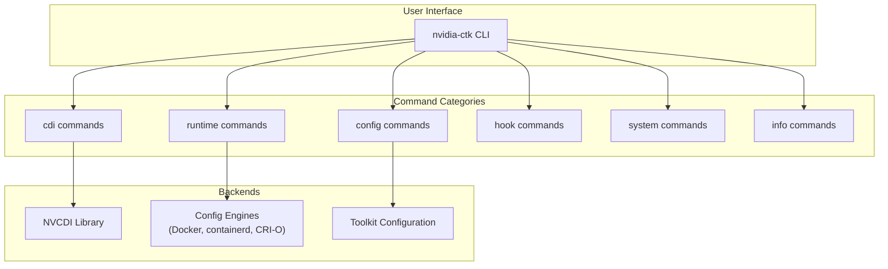
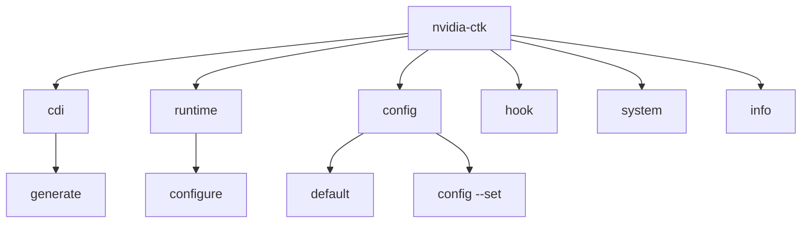
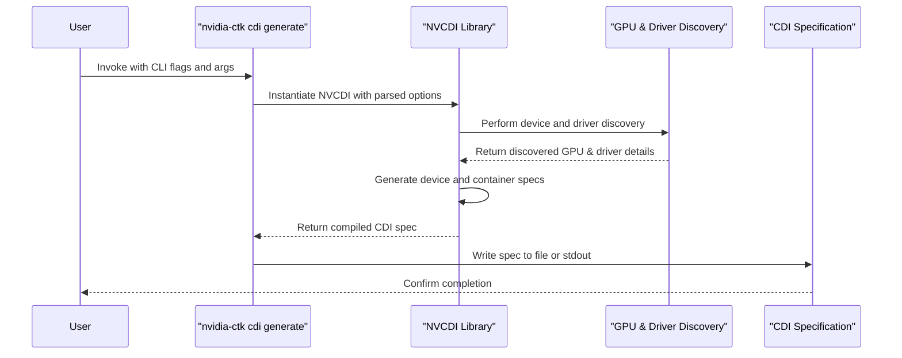
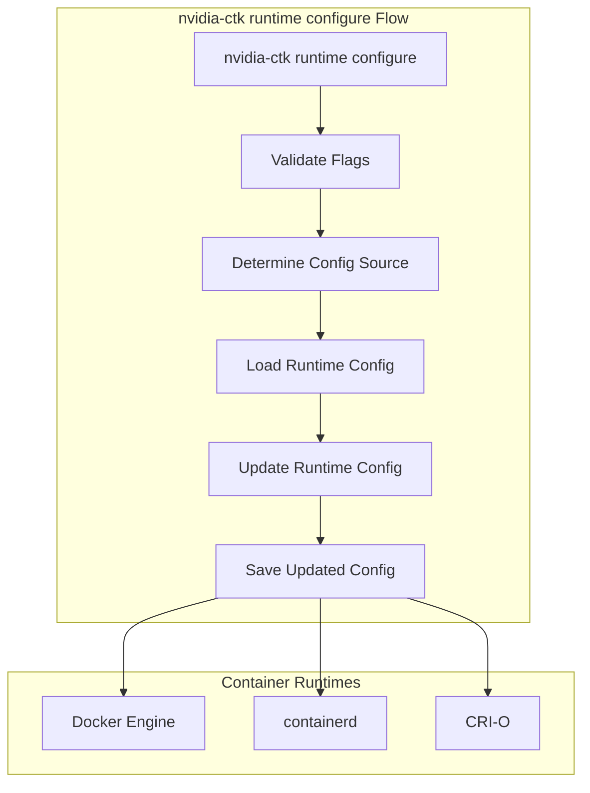
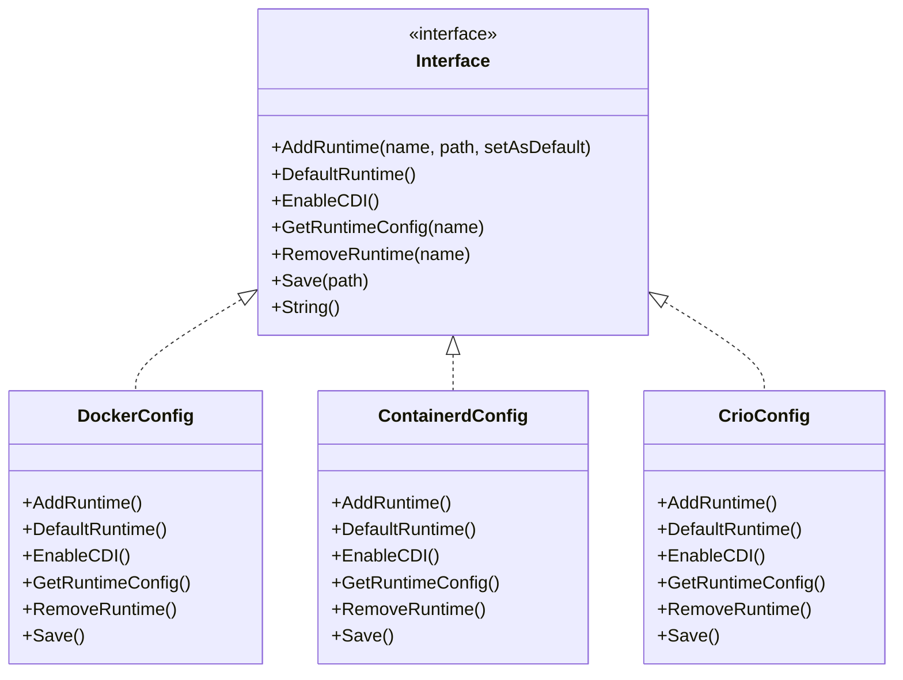
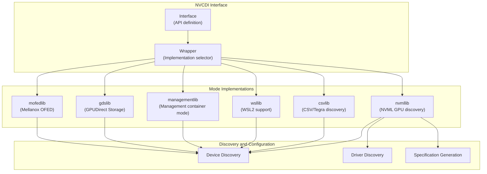

<!-- source: DeepWiki mcp.deepwiki.com · repo NVIDIA/nvidia-container-toolkit · page 2.3 NVIDIA CTK CLI · fetched 2026-10-26 -->

# NVIDIA CTK CLI

<details>
<summary>Relevant source files</summary>

The following files were used as context for generating this wiki page:

- [cmd/nvidia-cdi-hook/commands/commands.go](cmd/nvidia-cdi-hook/commands/commands.go)
- [cmd/nvidia-cdi-hook/main.go](cmd/nvidia-cdi-hook/main.go)
- [cmd/nvidia-ctk/README.md](cmd/nvidia-ctk/README.md)
- [cmd/nvidia-ctk/cdi/cdi.go](cmd/nvidia-ctk/cdi/cdi.go)
- [cmd/nvidia-ctk/cdi/generate/generate.go](cmd/nvidia-ctk/cdi/generate/generate.go)
- [cmd/nvidia-ctk/cdi/list/list.go](cmd/nvidia-ctk/cdi/list/list.go)
- [cmd/nvidia-ctk/cdi/transform/root/root.go](cmd/nvidia-ctk/cdi/transform/root/root.go)
- [cmd/nvidia-ctk/cdi/transform/transform.go](cmd/nvidia-ctk/cdi/transform/transform.go)
- [cmd/nvidia-ctk/config/config.go](cmd/nvidia-ctk/config/config.go)
- [cmd/nvidia-ctk/config/config_test.go](cmd/nvidia-ctk/config/config_test.go)
- [cmd/nvidia-ctk/config/create-default/create-default.go](cmd/nvidia-ctk/config/create-default/create-default.go)
- [cmd/nvidia-ctk/config/flags/options.go](cmd/nvidia-ctk/config/flags/options.go)
- [cmd/nvidia-ctk/hook/hook.go](cmd/nvidia-ctk/hook/hook.go)
- [cmd/nvidia-ctk/info/info.go](cmd/nvidia-ctk/info/info.go)
- [cmd/nvidia-ctk/main.go](cmd/nvidia-ctk/main.go)
- [cmd/nvidia-ctk/runtime/configure/configure.go](cmd/nvidia-ctk/runtime/configure/configure.go)
- [cmd/nvidia-ctk/runtime/runtime.go](cmd/nvidia-ctk/runtime/runtime.go)
- [cmd/nvidia-ctk/system/create-dev-char-symlinks/all.go](cmd/nvidia-ctk/system/create-dev-char-symlinks/all.go)
- [cmd/nvidia-ctk/system/create-dev-char-symlinks/create-dev-char-symlinks.go](cmd/nvidia-ctk/system/create-dev-char-symlinks/create-dev-char-symlinks.go)
- [cmd/nvidia-ctk/system/create-dev-char-symlinks/existing.go](cmd/nvidia-ctk/system/create-dev-char-symlinks/existing.go)
- [cmd/nvidia-ctk/system/create-device-nodes/create-device-nodes.go](cmd/nvidia-ctk/system/create-device-nodes/create-device-nodes.go)
- [cmd/nvidia-ctk/system/system.go](cmd/nvidia-ctk/system/system.go)
- [pkg/config/engine/api.go](pkg/config/engine/api.go)
- [pkg/config/engine/containerd/config.go](pkg/config/engine/containerd/config.go)
- [pkg/config/engine/containerd/config_test.go](pkg/config/engine/containerd/config_test.go)
- [pkg/config/engine/containerd/config_v1.go](pkg/config/engine/containerd/config_v1.go)
- [pkg/config/engine/containerd/config_v1_test.go](pkg/config/engine/containerd/config_v1_test.go)
- [pkg/config/engine/containerd/containerd.go](pkg/config/engine/containerd/containerd.go)
- [pkg/config/engine/containerd/option.go](pkg/config/engine/containerd/option.go)
- [pkg/config/engine/crio/crio.go](pkg/config/engine/crio/crio.go)
- [pkg/config/engine/crio/crio_test.go](pkg/config/engine/crio/crio_test.go)
- [pkg/config/engine/crio/option.go](pkg/config/engine/crio/option.go)
- [pkg/config/engine/docker/docker.go](pkg/config/engine/docker/docker.go)
- [pkg/config/engine/docker/option.go](pkg/config/engine/docker/option.go)
- [pkg/nvcdi/api.go](pkg/nvcdi/api.go)
- [pkg/nvcdi/common-nvml.go](pkg/nvcdi/common-nvml.go)
- [pkg/nvcdi/driver-nvml.go](pkg/nvcdi/driver-nvml.go)
- [pkg/nvcdi/full-gpu-nvml.go](pkg/nvcdi/full-gpu-nvml.go)
- [pkg/nvcdi/lib-csv.go](pkg/nvcdi/lib-csv.go)
- [pkg/nvcdi/lib-nvml.go](pkg/nvcdi/lib-nvml.go)
- [pkg/nvcdi/lib-wsl.go](pkg/nvcdi/lib-wsl.go)
- [pkg/nvcdi/lib.go](pkg/nvcdi/lib.go)
- [pkg/nvcdi/management.go](pkg/nvcdi/management.go)
- [pkg/nvcdi/mig-device-nvml.go](pkg/nvcdi/mig-device-nvml.go)
- [pkg/nvcdi/options.go](pkg/nvcdi/options.go)
- [pkg/nvcdi/transform/root/container-root.go](pkg/nvcdi/transform/root/container-root.go)
- [pkg/nvcdi/transform/root/host-root.go](pkg/nvcdi/transform/root/host-root.go)

</details>


The NVIDIA Container Toolkit CLI (`nvidia-ctk`) is a comprehensive command-line utility designed to facilitate configuration, management, and runtime integration of NVIDIA GPUs within containerized environments. It serves as the primary administrative interface to control how NVIDIA GPUs are exposed to containers, manage CDI (Container Device Interface) specifications, configure container runtimes, and manipulate toolkit settings.

This document provides a detailed technical overview of the `nvidia-ctk` CLI, covering its key subcommands, the internal implementation structure, data flows, and the underlying libraries it leverages.

---

## Overview

The `nvidia-ctk` CLI acts as a single binary exposing several subcommands, which can be classified broadly as follows:

- **cdi generate**: Generate CDI specifications for NVIDIA GPU devices.
- **runtime configure**: Configure container runtimes (Docker, containerd, CRI-O) to enable NVIDIA GPU support.
- **system**: System-level management commands, e.g., device node preparation.
- **hook**: Management of runtime hooks for NVIDIA container integration.
- **config**: View and modify NVIDIA Container Toolkit configuration files.

### High-Level Architecture



This structure highlights how the CLI delegates specific tasks to internal libraries and configuration engines tailored for container runtime compatibility.

Sources: [cmd/nvidia-ctk/main.go:90-97]()

---

## CLI Commands Structure

The `nvidia-ctk` CLI exposes key command categories as separate subcommands. The command tree resembles the following:



Each command serves a distinct operational role, e.g., `cdi generate` handles CDI spec creation, while `runtime configure` manages runtime JSON/TOML configurations.

### Global CLI Options

Across all commands, the CLI supports global flags such as:

| Option      | Description                                                       |
|-------------|-------------------------------------------------------------------|
| `--debug`   | Enable debug-level logging for verbose output                     |
| `--quiet`   | Suppress all output except for errors (overrides `--debug`)       |
| `--help`    | Display help information                                          |
| `--version` | Display the version of the CLI                                    |

Sources: [cmd/nvidia-ctk/main.go:59-74]()

---

## Detailed Command Reference

### 1. CDI Generation Command (`nvidia-ctk cdi generate`)

This command generates Container Device Interface (CDI) specifications describing NVIDIA GPU devices and their required container edits (mounts, environment variables, hooks, etc.) for runtimes that support CDI.

CDI is a vendor-neutral specification facilitating pre-defined device profiles for container runtimes.

#### Implementation Overview

- The command is implemented in `cmd/nvidia-ctk/cdi/generate/generate.go`.
- It creates a `command` struct which parses CLI options and uses the NVCDI library to discover devices and generate specs.
- The NVCDI (`nvcdi`) library supports multiple discovery modes (NVML, CSV, WSL, Management, etc.).

#### Command Data Flow



#### Key Options

| CLI Option             | Description                                                            |
|------------------------|------------------------------------------------------------------------|
| `--output`             | Output path for the generated spec (stdout if empty)                   |
| `--format`             | Output format (yaml or json), defaults to YAML                         |
| `--device-name-strategy` | One or more device naming strategies (`index`, `uuid`, `type-index`)     |
| `--mode`               | Discovery mode (`auto`, `nvml`, `csv`, `wsl`, and others)              |
| `--driver-root`        | NVIDIA driver root directory                                           |
| `--vendor`             | Vendor string for CDI specs (default: `nvidia.com`)                    |
| `--class`              | CDI class string (default: `gpu`)                                      |

Sources: [cmd/nvidia-ctk/cdi/generate/generate.go:94-179](), [pkg/nvcdi/lib.go:32-105]()

#### Discovery Modes Supported

| Mode        | Description                                                       |
|-------------|-------------------------------------------------------------------|
| `nvml`      | Use NVIDIA Management Library (NVML) to discover full GPUs and MIG devices |
| `csv`       | Use platform-specific CSV files to discover device specs (e.g., Tegra/Jetson)  |
| `wsl`       | Windows Subsystem for Linux mode, tailored for WSL2 GPU discovery    |
| `management`| Mode designed for management containers with specialized device node discovery |
| `gds`       | Specialized GPUDirect Storage devices                              |
| `mofed`     | Devices related to Mellanox OFED                                   |
| `auto`      | Auto-detect the best mode based on the running system configuration |

Sources: [pkg/nvcdi/lib.go:78-95](), [pkg/nvcdi/lib-csv.go:17-108](), [pkg/nvcdi/management.go:31-120]()

---

### 2. Runtime Configuration Command (`nvidia-ctk runtime configure`)

This command configures container runtimes such as Docker, containerd, and CRI-O to use the NVIDIA Container Runtime, enabling GPU support.

#### Implementation Overview

- Implemented in `cmd/nvidia-ctk/runtime/configure/configure.go`.
- Supports different runtimes through a unified interface, assembling config changes accordingly.
- Reads the current runtime configuration, adds or modifies NVIDIA runtime entries, and optionally enables CDI integration.
- Supports a `--dry-run` to preview changes without writing.

#### Runtime Config Engines

Container runtime config engines have implementations for:

- Docker (`pkg/config/engine/docker`)
- containerd (`pkg/config/engine/containerd`)
- CRI-O (`pkg/config/engine/crio`)

These implementations provide uniform methods such as `AddRuntime()`, `RemoveRuntime()`, `GetRuntimeConfig()`, and `Save()` for config file manipulation.

#### Command Data Flow



#### Key Options

| Option                  | Description                                                    |
|-------------------------|----------------------------------------------------------------|
| `--runtime`             | Target runtime to configure: `docker`, `containerd`, or `crio` |
| `--config`              | Path to the runtime's main config file                          |
| `--nvidia-runtime-name` | Name used for the NVIDIA runtime in the runtime configs        |
| `--nvidia-runtime-path` | Path to the NVIDIA Container Runtime executable                |
| `--set-as-default`      | Whether to set the NVIDIA runtime as the default runtime       |
| `--cdi.enabled`         | Enable CDI integration within the runtime                       |
| `--dry-run`             | Show configuration changes without modifying files             |

Sources: [cmd/nvidia-ctk/runtime/configure/configure.go:99-180](), [pkg/config/engine/api.go:20-46](), [pkg/config/engine/docker/docker.go:32-191](), [pkg/config/engine/containerd/containerd.go:50-178](), [pkg/config/engine/crio/crio.go:32-176]()

#### Config Engine Interface Diagram



---

### 3. System Commands (`nvidia-ctk system`)

The system commands facilitate lower-level host system setup tasks required for NVIDIA GPU container support, such as creating device nodes and char device symlinks, ensuring proper device nodes are present before container launch.

These utilities support preparing the host environment consistent with driver expectations.

Sources: [cmd/nvidia-ctk/system/system.go]()

---

### 4. Hook Management Commands (`nvidia-ctk hook`)

Manages the legacy container runtime hooks related to prestart injection of NVIDIA bindings in containers. This is mostly relevant when CDI hooks are not used, providing compatibility with prestart hook-based integration.

Contains commands to list, install, or manipulate hooks.

Sources: [cmd/nvidia-ctk/hook/hook.go]()

---

### 5. Configuration Management Commands (`nvidia-ctk config`)

Allows inspection and modification of the NVIDIA Container Toolkit configuration, generally stored in TOML format, e.g., `/etc/nvidia-container-runtime/config.toml`.

Features include:

- Viewing config sections and options
- Setting options in-place
- Generating default minimalist configuration files

Sources: [cmd/nvidia-ctk/config/config.go:60-142](), [cmd/nvidia-ctk/config/create-default/create-default.go:46-91]()

---

## NVCDI Library - Core CDI Spec Generation

The NVCDI (`nvcdi`) library is a foundational component within the NVIDIA Container Toolkit ecosystem for:

- Discovering NVIDIA GPU devices and associated driver components.
- Building CDI specifications that describe how to expose these devices and libraries in containers.
- Supporting multiple GPU discovery modes and specialized environments.

### Architecture Overview



The `Interface` defines the main external API to generate CDI specs. Internally, a `wrapper` dispatches calls to the appropriate implementation based on the mode set (e.g., NVML for full GPUs, CSV for Tegra devices, etc.). Each mode corresponds to a struct implementing the spec generation interface.

Sources: [pkg/nvcdi/api.go:18-47](), [pkg/nvcdi/lib.go:32-105](), [pkg/nvcdi/lib-csv.go:17-108](), [pkg/nvcdi/management.go:31-120]()

### Mode Implementations and Features

- **NVML mode (`nvmllib`)**: Uses NVIDIA’s NVML API for device enumeration, supports full GPUs, MIG devices, and provides detailed device properties. It obtains device handles, UUIDs for normalization, and generates comprehensive CDI device specs including annotations (e.g., coherence).

- **CSV mode (`csvlib`)**: Primarily targets Tegra / Jetson platforms, where device details are specified via CSV files describing driver components and device nodes. Supports pure CSV and mixed modes, enabling precise control over device node discovery.

- **Management mode (`managementlib`)**: Focused on management container runtimes. This mode discovers all device nodes in `/dev` relevant to NVIDIA, with filtering to exclude certain special nodes, without querying NVML.

- **WSL mode (`wsllib`)**: Special support for Windows Subsystem for Linux 2.

- **GDS and MOFED modes (`gdslib`, `mofedlib`)**: Specialized modes for GPUDirect Storage and Mellanox OFED devices.

### NVCDI Library Configuration Options

When constructing an NVCDI library instance (using `New()`), various options allow customization:

| Option                   | Description                                         |
|--------------------------|-----------------------------------------------------|
| `WithDeviceLib`          | Set NVIDIA GPU device discovery backend              |
| `WithDriverRoot`         | Specify the root directory of the NVIDIA driver      |
| `WithDevRoot`            | Specify root of `/dev` directory                      |
| `WithLogger`             | Logger for debug and informational output            |
| `WithMode`               | Discovery mode (auto, nvml, csv, etc.)               |
| `WithVendor`             | CDI vendor string to use (default: `nvidia.com`)    |
| `WithClass`              | CDI class string (default: `gpu`)                     |
| `WithCSVFiles`           | List of CSV files to load for CSV mode                |
| `WithDisabledHooks`      | Disable specific container hooks during discovery    |

Sources: [pkg/nvcdi/options.go:30-170](), [cmd/nvidia-ctk/cdi/generate/generate.go:40-80]()

### NVML Device Normalization and Specification

The NVML implementation normalizes device IDs, which can be provided as:

- UUID strings
- GPU indices (`0`, `1`, ...)
- MIG device indices (`<gpu_idx>:<mig_idx>`)

This normalization allows the NVCDI library to obtain the corresponding NVML device handles and generate CDI specs accordingly.

---

## Common Usage Examples

### Generating a CDI Specification for All GPUs

```bash
nvidia-ctk cdi generate --output=/etc/cdi/nvidia.yaml
```

This generates and writes a CDI specification describing all NVIDIA GPUs available on the host.

### Configuring Docker to Use the NVIDIA Runtime

```bash
nvidia-ctk runtime configure --runtime=docker --set-as-default
```

Adds the NVIDIA runtime configuration into Docker's daemon.json and sets it as the default runtime.

### Enabling CDI in containerd Configuration

```bash
nvidia-ctk runtime configure --runtime=containerd --cdi.enabled=true
```

Updates containerd's configuration to enable the NVIDIA runtime as well as CDI support.

### Modifying Toolkit Configuration

```bash
nvidia-ctk config --set nvidia-container-cli.no-cgroups=true
```

Sets the `no-cgroups` flag in the NVIDIA container CLI configuration.

---

## Configuration File Formats

- **Docker**: Uses JSON format, typically located at `/etc/docker/daemon.json`.
- **containerd**: Uses TOML format located at `/etc/containerd/config.toml`.
- **CRI-O**: Uses TOML format at `/etc/crio/crio.conf`.

Configuration changes via `nvidia-ctk runtime configure` command modify these files or add drop-in configuration files depending on runtime support.

Sources: [pkg/config/engine/docker/docker.go:1-192](), [pkg/config/engine/containerd/containerd.go:1-178](), [pkg/config/engine/crio/crio.go:1-176](), [cmd/nvidia-ctk/runtime/configure/configure.go:44-46]()

---

## Post-installation Configuration

After installation of the NVIDIA Container Toolkit packages, post-installation scripts typically invoke:

```bash
/usr/bin/nvidia-ctk --quiet config --config-file=/etc/nvidia-container-runtime/config.toml --in-place
```

This ensures that the toolkit configuration files are generated or updated accordingly to enable seamless GPU support for containers.

Sources: [packaging/debian/nvidia-container-toolkit-base.postinst:7-7]()

---

# Summary

The `nvidia-ctk` CLI is a central, versatile tool integrating multiple complex subsystems to enable GPU access in container runtimes. Its modular design delegates GPU discovery and spec generation to the NVCDI library for maximum flexibility, while runtime configuration and system management commands provide administrators with a consistent, unified interface for enabling NVIDIA GPU acceleration inside containers.

Understanding its architecture, command breakdown, and interaction with subsystems such as CDI, NVML, and container runtime configs is essential for debugging, extending, or integrating NVIDIA GPU support in modern containerized environments.

---

# References

- `cmd/nvidia-ctk/main.go` — CLI command registration and flag parsing  
- `cmd/nvidia-ctk/cdi/generate/generate.go` — Implementation of `cdi generate` command  
- `cmd/nvidia-ctk/runtime/configure/configure.go` — Implementation of `runtime configure` command  
- `pkg/nvcdi/lib.go` — Core NVCDI library constructor and wrapper  
- `pkg/nvcdi/lib-nvml.go` — NVML mode implementation for NVCDI  
- `pkg/nvcdi/lib-csv.go` — CSV mode implementation for NVCDI  
- `pkg/nvcdi/management.go` — Management mode implementation for NVCDI  
- `pkg/config/engine/docker/docker.go` — Docker runtime config engine  
- `pkg/config/engine/containerd/containerd.go` — Containerd runtime config engine  
- `pkg/config/engine/crio/crio.go` — CRI-O runtime config engine

Sources: See individual citations inline above.

---

