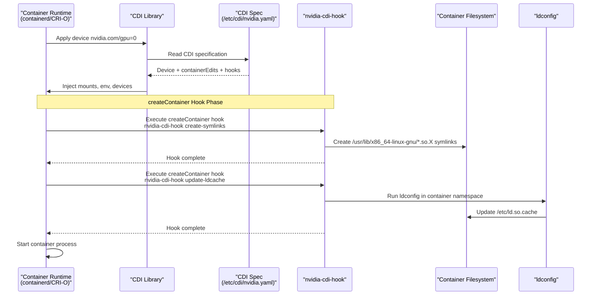
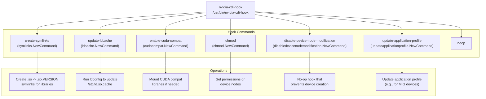
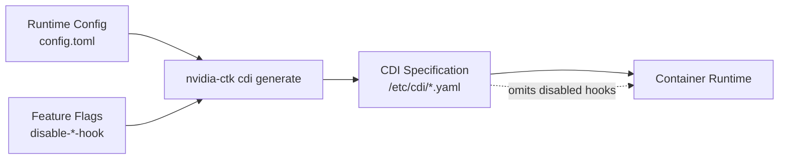
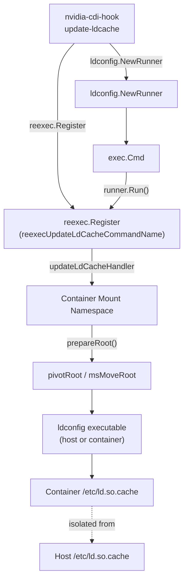
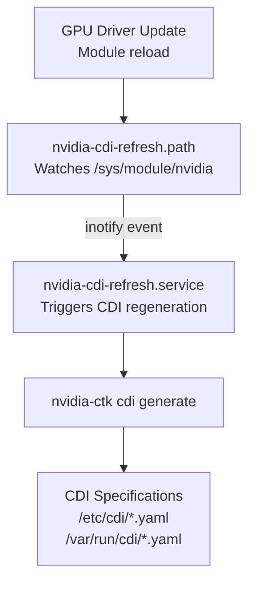
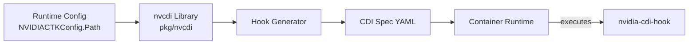
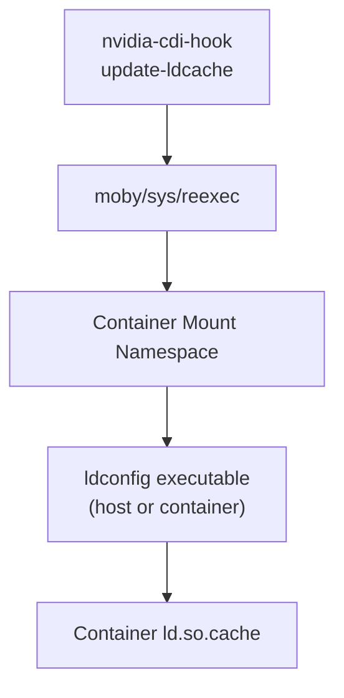

<!-- source: DeepWiki mcp.deepwiki.com · repo NVIDIA/nvidia-container-toolkit · page 2.4 NVIDIA CDI Hook · fetched 2026-10-26 -->

# NVIDIA CDI Hook

<details>
<summary>Relevant source files</summary>

The following files were used as context for generating this wiki page:

- [cmd/nvidia-cdi-hook/chmod/chmod.go](cmd/nvidia-cdi-hook/chmod/chmod.go)
- [cmd/nvidia-cdi-hook/commands/commands.go](cmd/nvidia-cdi-hook/commands/commands.go)
- [cmd/nvidia-cdi-hook/create-symlinks/container-root_linux.go](cmd/nvidia-cdi-hook/create-symlinks/container-root_linux.go)
- [cmd/nvidia-cdi-hook/create-symlinks/container_root_other.go](cmd/nvidia-cdi-hook/create-symlinks/container_root_other.go)
- [cmd/nvidia-cdi-hook/create-symlinks/create-symlinks.go](cmd/nvidia-cdi-hook/create-symlinks/create-symlinks.go)
- [cmd/nvidia-cdi-hook/create-symlinks/create-symlinks_test.go](cmd/nvidia-cdi-hook/create-symlinks/create-symlinks_test.go)
- [cmd/nvidia-cdi-hook/cudacompat/cuda-elf-header.go](cmd/nvidia-cdi-hook/cudacompat/cuda-elf-header.go)
- [cmd/nvidia-cdi-hook/cudacompat/cuda-elf-header_test.go](cmd/nvidia-cdi-hook/cudacompat/cuda-elf-header_test.go)
- [cmd/nvidia-cdi-hook/cudacompat/cudacompat.go](cmd/nvidia-cdi-hook/cudacompat/cudacompat.go)
- [cmd/nvidia-cdi-hook/cudacompat/cudacompat_test.go](cmd/nvidia-cdi-hook/cudacompat/cudacompat_test.go)
- [cmd/nvidia-cdi-hook/disable-device-node-modification/disable-device-node-modification.go](cmd/nvidia-cdi-hook/disable-device-node-modification/disable-device-node-modification.go)
- [cmd/nvidia-cdi-hook/disable-device-node-modification/disable-device-node-modification_test.go](cmd/nvidia-cdi-hook/disable-device-node-modification/disable-device-node-modification_test.go)
- [cmd/nvidia-cdi-hook/disable-device-node-modification/params_linux.go](cmd/nvidia-cdi-hook/disable-device-node-modification/params_linux.go)
- [cmd/nvidia-cdi-hook/main.go](cmd/nvidia-cdi-hook/main.go)
- [cmd/nvidia-cdi-hook/update-application-profile/minors_linux.go](cmd/nvidia-cdi-hook/update-application-profile/minors_linux.go)
- [cmd/nvidia-cdi-hook/update-application-profile/minors_other.go](cmd/nvidia-cdi-hook/update-application-profile/minors_other.go)
- [cmd/nvidia-cdi-hook/update-application-profile/update-application-profile.go](cmd/nvidia-cdi-hook/update-application-profile/update-application-profile.go)
- [cmd/nvidia-cdi-hook/update-application-profile/update-application-profile_test.go](cmd/nvidia-cdi-hook/update-application-profile/update-application-profile_test.go)
- [cmd/nvidia-cdi-hook/update-ldcache/update-ldcache.go](cmd/nvidia-cdi-hook/update-ldcache/update-ldcache.go)
- [cmd/nvidia-ctk/hook/hook.go](cmd/nvidia-ctk/hook/hook.go)
- [internal/discover/application_profile.go](internal/discover/application_profile.go)
- [internal/discover/application_profile_test.go](internal/discover/application_profile_test.go)
- [internal/discover/hooks_test.go](internal/discover/hooks_test.go)
- [internal/ldconfig/ldconfig.go](internal/ldconfig/ldconfig.go)
- [internal/ldconfig/ldconfig_linux.go](internal/ldconfig/ldconfig_linux.go)
- [internal/ldconfig/ldconfig_other.go](internal/ldconfig/ldconfig_other.go)
- [internal/ldconfig/ldconfig_test.go](internal/ldconfig/ldconfig_test.go)
- [testdata/compat/575.57.08/libcuda.so.575.57.08](testdata/compat/575.57.08/libcuda.so.575.57.08)
- [testdata/compat/590.44.01/libcuda.so.590.44.01](testdata/compat/590.44.01/libcuda.so.590.44.01)
- [testdata/compat/libcuda.invalid.json.so.99.88](testdata/compat/libcuda.invalid.json.so.99.88)
- [testdata/compat/libcuda.orin.13.2.1.so.1.1](testdata/compat/libcuda.orin.13.2.1.so.1.1)
- [vendor/github.com/Masterminds/semver/v3/.gitignore](vendor/github.com/Masterminds/semver/v3/.gitignore)
- [vendor/github.com/Masterminds/semver/v3/.golangci.yml](vendor/github.com/Masterminds/semver/v3/.golangci.yml)
- [vendor/github.com/Masterminds/semver/v3/CHANGELOG.md](vendor/github.com/Masterminds/semver/v3/CHANGELOG.md)
- [vendor/github.com/Masterminds/semver/v3/LICENSE.txt](vendor/github.com/Masterminds/semver/v3/LICENSE.txt)
- [vendor/github.com/Masterminds/semver/v3/Makefile](vendor/github.com/Masterminds/semver/v3/Makefile)
- [vendor/github.com/Masterminds/semver/v3/README.md](vendor/github.com/Masterminds/semver/v3/README.md)

</details>


## Overview

The **nvidia-cdi-hook** executable implements Container Device Interface (CDI) lifecycle hooks for NVIDIA GPU containers. It performs container setup tasks such as creating library symlinks, updating the dynamic linker cache, and enabling CUDA compatibility libraries. These hooks are invoked automatically by container runtimes when CDI device specifications are applied during container creation.

This page documents the `nvidia-cdi-hook` binary and its hook operations. For information about the legacy prestart hook system, see [NVIDIA Container Runtime Hook](#2.2). For details on CDI specification generation, see [Container Device Interface (CDI)](#3.2). For the CLI tool that generates CDI specs, see [NVIDIA CTK CLI](#2.3).

**Sources:** [CHANGELOG.md:295-296]()

## Binary Installation and Packaging

The `nvidia-cdi-hook` binary is distributed as part of the `nvidia-container-toolkit-base` package and installed to `/usr/bin/nvidia-cdi-hook`. It is a separate executable from `nvidia-ctk`, though it was historically part of the `nvidia-ctk` command as subcommands under `nvidia-ctk hook`.

| Package Component | Location | Description |
|------------------|----------|-------------|
| Binary | `/usr/bin/nvidia-cdi-hook` | Main hook executor |
| Systemd Service | `/etc/systemd/system/nvidia-cdi-refresh.service` | CDI spec regeneration service |
| Systemd Path Unit | `/etc/systemd/system/nvidia-cdi-refresh.path` | Watches for driver updates |
| Configuration | `/etc/nvidia-container-toolkit/nvidia-cdi-refresh.env` | Environment variables for service |

**Sources:** [packaging/rpm/SPECS/nvidia-container-toolkit.spec:36-49,113-120](), [CHANGELOG.md:108,295-296](), [packaging/debian/control:19-25]()

## CDI Hook Execution Flow

### Hook Invocation in Container Lifecycle



**Sources:** [internal/modifier/cdi.go:76-80](), [CHANGELOG.md:119-122,145-149]()

### Hook Specification in CDI YAML

When `nvidia-ctk cdi generate` creates a CDI specification, it embeds hook commands in the YAML that reference the `nvidia-cdi-hook` binary. The container runtime executes these hooks at specific lifecycle points.

```yaml
# Example: /etc/cdi/nvidia.yaml (simplified)
devices:
  - name: "0"
    containerEdits:
      deviceNodes:
        - path: /dev/nvidia0
      mounts:
        - containerPath: /usr/lib/x86_64-linux-gnu/libnvidia-ml.so.1
          hostPath: /usr/lib/x86_64-linux-gnu/libnvidia-ml.so.535.129.03
      hooks:
        - hookName: createContainer
          path: /usr/bin/nvidia-cdi-hook
          args: ["nvidia-cdi-hook", "create-symlinks", "--link", "libnvidia-ml.so.1::libnvidia-ml.so"]
        - hookName: createContainer
          path: /usr/bin/nvidia-cdi-hook
          args: ["nvidia-cdi-hook", "update-ldcache", "--folder", "/usr/lib/x86_64-linux-gnu"]
```

**Sources:** [internal/modifier/cdi.go:166-204](), [CHANGELOG.md:86-90,119-122]()

## Hook Types and Operations

### Hook Command Architecture



The `nvidia-cdi-hook` executable uses the `cli/v3` library to define its subcommands [cmd/nvidia-cdi-hook/commands/commands.go:31-32](). The `ConfigureCDIHookCommand` function registers the available hooks [cmd/nvidia-cdi-hook/commands/commands.go:88-103]().

**Sources:** [cmd/nvidia-cdi-hook/commands/commands.go:31-32,88-103](), [CHANGELOG.md:86,119-122,140-148,222-228,239-242]()

### Detailed Hook Descriptions

| Hook Command | Purpose | Typical Usage | Configuration Options |
|--------------|---------|---------------|----------------------|
| `create-symlinks` | Creates symbolic links for shared library SONAME compatibility | Ensures libraries with version suffixes (`.so.1.2.3`) are accessible via their SONAME (`.so.1`) | `--link` flag specifies link pairs [cmd/nvidia-cdi-hook/create-symlinks/create-symlinks.go:62-66]() |
| `update-ldcache` | Updates the dynamic linker cache in the container | Ensures the container can locate injected GPU libraries | `--folder` specifies directories, `--ldconfig-path` for custom ldconfig [cmd/nvidia-cdi-hook/update-ldcache/update-ldcache.go:78-88]() |
| `enable-cuda-compat` | Enables CUDA forward compatibility mode | Allows newer CUDA libraries to work with older drivers | `--host-driver-version`, `--host-cuda-version`, `--cuda-compat-container-root` [cmd/nvidia-cdi-hook/cudacompat/cudacompat.go:79-94]() |
| `chmod` | Modifies permissions on device nodes | Ensures containers can access GPU devices | `--mode` specifies permission bits |
| `disable-device-node-modification` | Prevents device node creation/modification | Used when host manages device nodes exclusively | No options (no-op hook) |
| `update-application-profile` | Updates application profile for specific devices | Used for configuring MIG devices or other application-specific settings | `--device-root`, `--profile-name`, `--profile-path` |

**Sources:** [cmd/nvidia-cdi-hook/create-symlinks/create-symlinks.go:62-66](), [cmd/nvidia-cdi-hook/update-ldcache/update-ldcache.go:78-88](), [cmd/nvidia-cdi-hook/cudacompat/cudacompat.go:79-94](), [CHANGELOG.md:70-71,86-90,111,120-122,140-148,174-178,222-228,239-244,412-414]()

## Hook Configuration and Feature Flags

### Runtime Configuration

Hooks are configured through the CDI specification generation process and the NVIDIA Container Runtime configuration file. The hooks can be selectively enabled or disabled based on system requirements.

```toml
# /etc/nvidia-container-runtime/config.toml
[nvidia-container-runtime.modes.jit-cdi]
feature-flags = [
    "disable-cuda-compat-lib-hook",  # Disable CUDA compat hook
    "disable-require-cuda-hook",     # Disable CUDA requirement checks
]

[nvidia-ctk-config]
path = "/usr/bin/nvidia-ctk"  # Used to locate nvidia-cdi-hook
```

The `nvidia-cdi-hook` binary path is derived from the `nvidia-ctk` path configured in the runtime configuration. During CDI spec generation, this path is embedded in the hook commands.

**Sources:** [internal/modifier/cdi.go:176-178](), [CHANGELOG.md:113-115,140-143,150]()

### Hook Disabling and Feature Flags

Individual hooks can be disabled through CDI specification annotations or feature flags:



| Feature Flag | Effect | Use Case |
|--------------|--------|----------|
| `disable-cuda-compat-lib-hook` | Omits `enable-cuda-compat` hook from CDI spec | When CUDA compat is not needed or managed externally |
| `allow-cuda-compat-libs-from-container` | Allows compat libs to be sourced from container | For containers with bundled CUDA compat libraries |
| `ignore-imex-channel-requests` | Skips IMEX channel setup hooks | When IMEX channels are not used |
| `disable-imex-channel-creation` | Prevents IMEX device node creation | Similar to above, at device level |

**Sources:** [CHANGELOG.md:113-115,140-143,150,162-163,174-178,236-237]()

## Debug Logging and Troubleshooting

### Debug Environment Variable

The `nvidia-cdi-hook` binary supports debug logging through environment variables. This is configured in the CDI specification when generated:

```yaml
# CDI spec with debug logging
hooks:
  - hookName: createContainer
    path: /usr/bin/nvidia-cdi-hook
    args: ["nvidia-cdi-hook", "update-ldcache"]
    env:
      - NVIDIA_CTK_DEBUG=true  # Enable debug logging
```

When `NVIDIA_CTK_DEBUG` is set, hooks log detailed information about their operations to stderr, which is captured by the container runtime logs. The `main` function in `cmd/nvidia-cdi-hook/main.go` handles setting the log level based on `NVIDIA_CTK_DEBUG` or `NVIDIA_CDI_DEBUG` environment variables [cmd/nvidia-cdi-hook/main.go:65-72]().

**Sources:** [cmd/nvidia-cdi-hook/main.go:65-72](), [CHANGELOG.md:115]()

### Hook Execution Isolation

The `update-ldcache` hook runs in isolated namespaces to prevent interference with the host system. It uses `moby/sys/reexec` to re-execute itself in a new mount namespace, and then performs a `pivot_root` or `MS_MOVE` operation to change the root filesystem to the container's root [internal/ldconfig/ldconfig_linux.go:40-172](). This ensures cache updates only affect the container.



The `updateLdCache` function is responsible for creating the `ldconfig.Ldconfig` struct and calling its `UpdateLDCache` method [cmd/nvidia-cdi-hook/update-ldcache/update-ldcache.go:142-149](). The `Ldconfig.UpdateLDCache` method then calls `prepareRoot` to set up the isolated environment [internal/ldconfig/ldconfig.go:143-146]().

**Sources:** [cmd/nvidia-cdi-hook/update-ldcache/update-ldcache.go:142-149](), [internal/ldconfig/ldconfig.go:143-146](), [internal/ldconfig/ldconfig_linux.go:40-172](), [CHANGELOG.md:121,149]()

## CDI Specification Refresh System

### Automatic Refresh Service

The NVIDIA Container Toolkit includes a systemd-based service that automatically regenerates CDI specifications when GPU drivers are updated. This ensures container runtimes always have up-to-date device information.



The systemd units are configured as follows:

- `nvidia-cdi-refresh.path`: Watches for changes to `/sys/module/nvidia` indicating driver reloads
- `nvidia-cdi-refresh.service`: Executes `nvidia-ctk cdi generate` when triggered
- `nvidia-cdi-refresh.env`: Contains environment variables for CDI generation (spec directories, feature flags, etc.)

**Sources:** [packaging/rpm/SPECS/nvidia-container-toolkit.spec:47-49,97-111](), [CHANGELOG.md:108]()

### Post-Install Behavior

After package installation or upgrade, the systemd service is automatically enabled and started:

```bash
# Post-install actions (from RPM spec)
systemctl daemon-reload
systemctl enable --now nvidia-cdi-refresh.path
systemctl enable --now nvidia-cdi-refresh.service
systemctl start nvidia-cdi-refresh.service  # Immediate regeneration
```

This ensures that CDI specifications are generated immediately upon toolkit installation and kept synchronized with driver updates.

**Sources:** [packaging/rpm/SPECS/nvidia-container-toolkit.spec:97-111]()

## Hook Implementation Details

### Hook Command Structure

The `nvidia-cdi-hook` binary is a single executable that dispatches to different subcommands based on the first argument [cmd/nvidia-cdi-hook/main.go:48-81](). Each subcommand (e.g., `create-symlinks`, `update-ldcache`, `enable-cuda-compat`) is implemented as a separate Go package and registered with the main CLI application [cmd/nvidia-cdi-hook/commands/commands.go:88-103]().

1.  **Binary Name**: `nvidia-cdi-hook` (separate from `nvidia-ctk`)
2.  **Command Format**: `nvidia-cdi-hook <hook-type> [flags]`
3.  **Execution Context**: Runs in container namespace (for `update-ldcache`) or host namespace (for other hooks)
4.  **Error Handling**: Hooks should fail gracefully if operations are not applicable. The `ConfigureCDIHookCommand` function includes logic to issue warnings for unsupported hooks instead of failing [cmd/nvidia-cdi-hook/commands/commands.go:46-85,112-120]().

**Sources:** [cmd/nvidia-cdi-hook/main.go:48-81](), [cmd/nvidia-cdi-hook/commands/commands.go:46-85,88-103,112-120]()

### Integration with nvcdi Library

The CDI hook commands are referenced in CDI specifications generated by the `nvcdi` library. The library constructs hook specifications that include:

-   Hook type (`createContainer`, `startContainer`, etc.)
-   Path to `nvidia-cdi-hook` binary (from config)
-   Arguments specific to the hook operation
-   Optional environment variables for debug mode



**Sources:** [internal/modifier/cdi.go:176-178](), [CHANGELOG.md:295-297]()

## Hook Execution Requirements

### Permissions and Capabilities

The hooks require appropriate permissions to perform their operations:

-   **create-symlinks**: Write access to library directories in container filesystem. The `createLink` function attempts to create symlinks within the `containerRootDir` [cmd/nvidia-cdi-hook/create-symlinks/create-symlinks.go:124]().
-   **update-ldcache**: Ability to execute `ldconfig` in container namespace. This involves `pivot_root` or `MS_MOVE` operations which require elevated privileges or specific capabilities [internal/ldconfig/ldconfig_linux.go:40-172]().
-   **chmod**: Permission to modify device node permissions.
-   **create-device-nodes**: Ability to create device nodes (requires CAP_MKNOD or root).

**Sources:** [cmd/nvidia-cdi-hook/create-symlinks/create-symlinks.go:124](), [internal/ldconfig/ldconfig_linux.go:40-172]()

### Library Dependencies

The `update-ldcache` hook uses `moby/sys/reexec` for namespace isolation when executing `ldconfig`. This ensures the cache update is properly scoped to the container:



The hook automatically detects and uses the appropriate `ldconfig` path:
-   Normalizes paths to `ldconfig.real` on systems with wrappers
-   Falls back to host `ldconfig` if container lacks one
-   Creates `/etc/ld.so.conf.d` directory if missing. The `ldconfig.Ldconfig` struct manages the `ldconfigPath` and `inRoot` for these operations [internal/ldconfig/ldconfig.go:60-67](). The `ensureLdsoconfFile` and `createLdsoconfdFile` functions handle the creation of configuration files [internal/ldconfig/ldconfig.go:153-170]().

**Sources:** [internal/ldconfig/ldconfig.go:60-67,153-170](), [CHANGELOG.md:121,149,349-350,422-423]()

## Version and Build Information

The `nvidia-cdi-hook` binary includes version information embedded at build time, similar to other toolkit components:

```makefile
# Build flags (from Makefile)
LDFLAGS = -s -w
LDFLAGS += -X github.com/NVIDIA/nvidia-container-toolkit/internal/info.gitCommit=$(GIT_COMMIT)
LDFLAGS += -X github.com/NVIDIA/nvidia-container-toolkit/internal/info.version=$(CLI_VERSION)
```

This allows the `--version` flag to display build metadata for troubleshooting. The `main` function retrieves this version string using `info.GetVersionString()` [cmd/nvidia-cdi-hook/main.go:51]().

```bash
$ nvidia-cdi-hook --version
NVIDIA CDI Hook version 1.18.0
```

**Sources:** [cmd/nvidia-cdi-hook/main.go:51](), [Makefile:54-68](), [versions.mk:15-39]()

---

