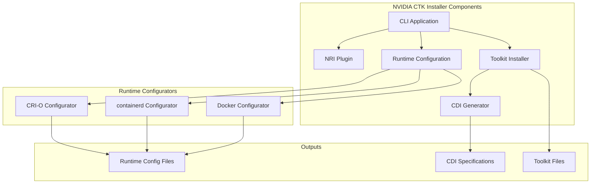
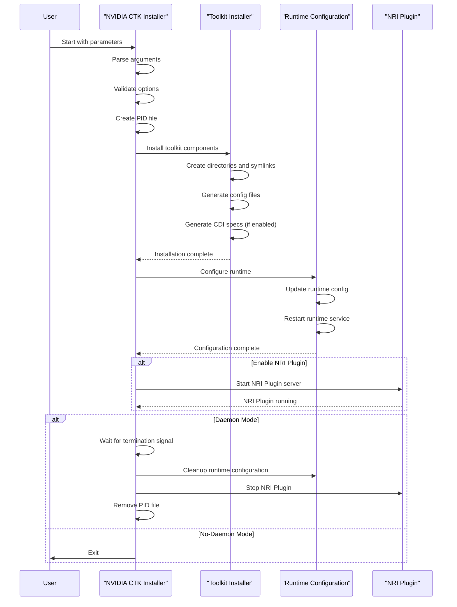
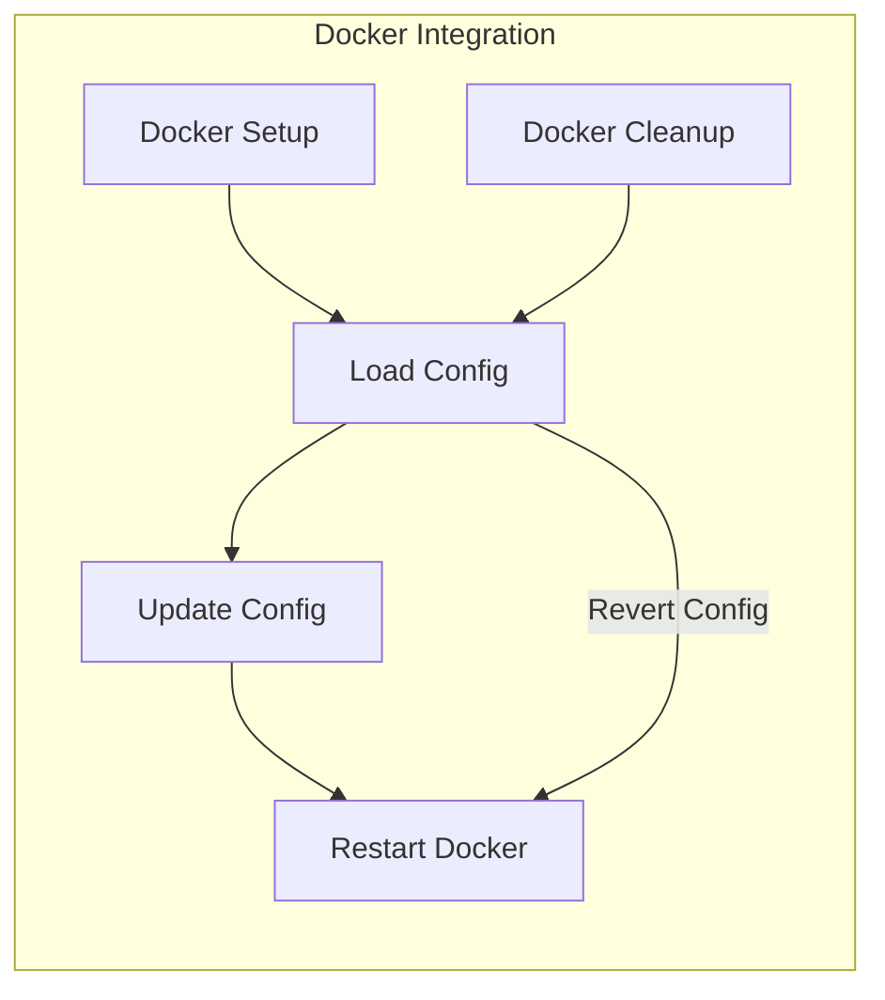
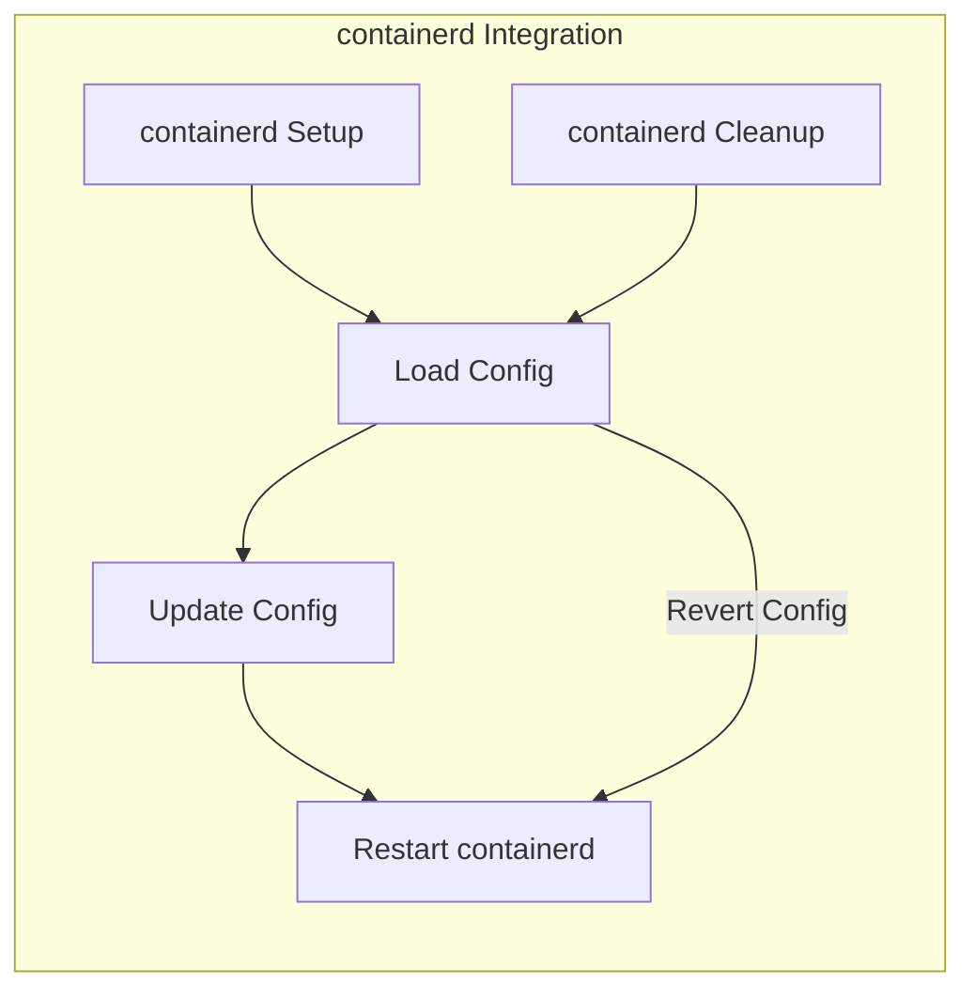
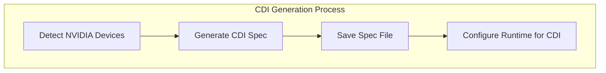
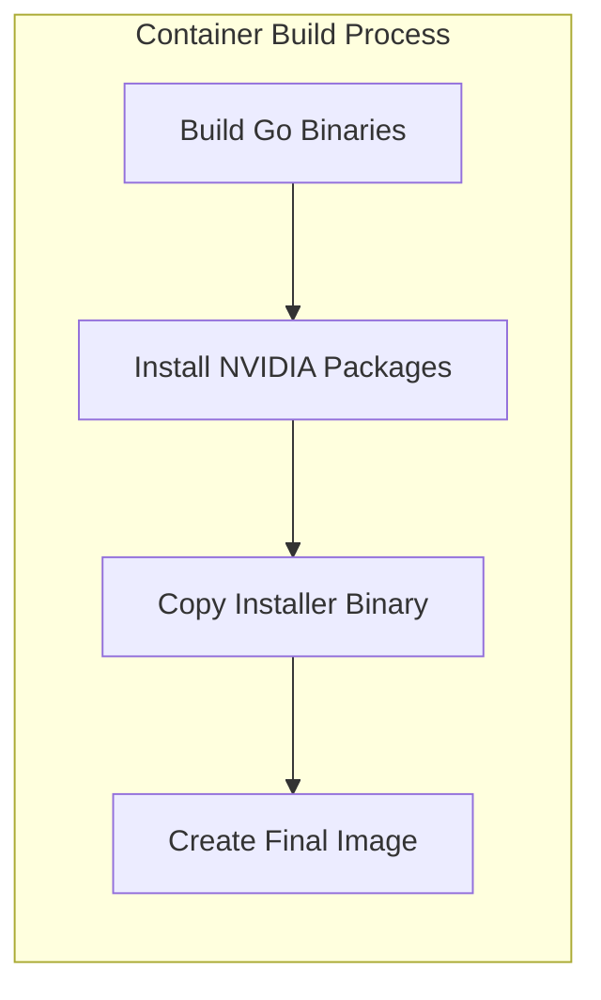
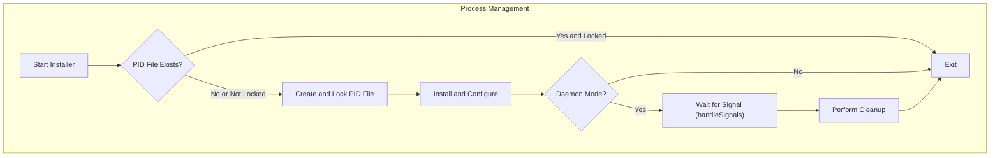

<!-- source: DeepWiki mcp.deepwiki.com · repo NVIDIA/nvidia-container-toolkit · page 2.5 NVIDIA CTK Installer · fetched 2026-10-26 -->

# NVIDIA CTK Installer

<details>
<summary>Relevant source files</summary>

The following files were used as context for generating this wiki page:

- [cmd/nvidia-ctk-installer/container/container.go](cmd/nvidia-ctk-installer/container/container.go)
- [cmd/nvidia-ctk-installer/container/runtime/containerd/config_test.go](cmd/nvidia-ctk-installer/container/runtime/containerd/config_test.go)
- [cmd/nvidia-ctk-installer/container/runtime/containerd/containerd.go](cmd/nvidia-ctk-installer/container/runtime/containerd/containerd.go)
- [cmd/nvidia-ctk-installer/container/runtime/crio/config_test.go](cmd/nvidia-ctk-installer/container/runtime/crio/config_test.go)
- [cmd/nvidia-ctk-installer/container/runtime/crio/crio.go](cmd/nvidia-ctk-installer/container/runtime/crio/crio.go)
- [cmd/nvidia-ctk-installer/container/runtime/docker/docker.go](cmd/nvidia-ctk-installer/container/runtime/docker/docker.go)
- [cmd/nvidia-ctk-installer/container/runtime/nri/plugin.go](cmd/nvidia-ctk-installer/container/runtime/nri/plugin.go)
- [cmd/nvidia-ctk-installer/container/runtime/nri/plugin_test.go](cmd/nvidia-ctk-installer/container/runtime/nri/plugin_test.go)
- [cmd/nvidia-ctk-installer/container/runtime/runtime.go](cmd/nvidia-ctk-installer/container/runtime/runtime.go)
- [cmd/nvidia-ctk-installer/main.go](cmd/nvidia-ctk-installer/main.go)
- [cmd/nvidia-ctk-installer/main_test.go](cmd/nvidia-ctk-installer/main_test.go)
- [cmd/nvidia-ctk-installer/toolkit/installer/directory.go](cmd/nvidia-ctk-installer/toolkit/installer/directory.go)
- [cmd/nvidia-ctk-installer/toolkit/installer/executables.go](cmd/nvidia-ctk-installer/toolkit/installer/executables.go)
- [cmd/nvidia-ctk-installer/toolkit/installer/executables_test.go](cmd/nvidia-ctk-installer/toolkit/installer/executables_test.go)
- [cmd/nvidia-ctk-installer/toolkit/installer/installer.go](cmd/nvidia-ctk-installer/toolkit/installer/installer.go)
- [cmd/nvidia-ctk-installer/toolkit/installer/installer_test.go](cmd/nvidia-ctk-installer/toolkit/installer/installer_test.go)
- [cmd/nvidia-ctk-installer/toolkit/installer/libraries.go](cmd/nvidia-ctk-installer/toolkit/installer/libraries.go)
- [cmd/nvidia-ctk-installer/toolkit/installer/options.go](cmd/nvidia-ctk-installer/toolkit/installer/options.go)
- [cmd/nvidia-ctk-installer/toolkit/toolkit.go](cmd/nvidia-ctk-installer/toolkit/toolkit.go)
- [cmd/nvidia-ctk/runtime/configure/configure_test.go](cmd/nvidia-ctk/runtime/configure/configure_test.go)
- [pkg/config/engine/config.go](pkg/config/engine/config.go)
- [pkg/config/engine/containerd/config_drop_in.go](pkg/config/engine/containerd/config_drop_in.go)
- [pkg/config/engine/containerd/config_drop_in_test.go](pkg/config/engine/containerd/config_drop_in_test.go)

</details>


The NVIDIA CTK Installer is a tool designed to simplify the installation and configuration of the NVIDIA Container Toolkit and its integration with container runtimes. It provides an automated way to set up container runtimes like Docker, containerd, and CRI-O to use NVIDIA GPUs in containers.

For information about the NVIDIA CTK CLI, see [NVIDIA CTK CLI](#2.3).

## Overview

The NVIDIA CTK Installer automates the process of installing the NVIDIA Container Toolkit components and configuring container runtimes to use NVIDIA GPUs. It can run as a one-time setup tool or as a daemon that monitors the system and cleans up on termination.



Sources: [cmd/nvidia-ctk-installer/main.go:51-280](), [cmd/nvidia-ctk-installer/container/runtime/runtime.go:16-205]()

## Installation Modes

The NVIDIA CTK Installer can operate in two modes:

1. **One-time setup mode**: Installs the toolkit and configures the runtime, then exits
2. **Daemon mode**: Installs the toolkit, configures the runtime, monitors the system, and performs cleanup on termination



Sources: [cmd/nvidia-ctk-installer/main.go:176-219]()

## Key Components

### CLI Application

The CLI application provides the main entry point for the installer. It processes command-line arguments, validates the configuration, and coordinates the installation and setup processes. The `main` function in `cmd/nvidia-ctk-installer/main.go` initializes the CLI application and handles its execution [cmd/nvidia-ctk-installer/main.go:69-81](). The `NewApp` function constructs the `cli.Command` structure [cmd/nvidia-ctk-installer/main.go:90-96]().

Sources: [cmd/nvidia-ctk-installer/main.go:52-146]()

### Toolkit Installer

The Toolkit Installer handles the actual installation of the NVIDIA Container Toolkit components. It:

1. Creates necessary directories and symlinks
2. Installs the toolkit executables by creating shell wrappers for `nvidia-ctk`, `nvidia-cdi-hook`, `nvidia-container-cli`, `nvidia-container-runtime`, and `nvidia-container-runtime-hook` [cmd/nvidia-ctk-installer/toolkit/installer/executables.go:43-80](). The `wrapper` struct defines the properties for these shell wrappers [cmd/nvidia-ctk-installer/toolkit/installer/executables.go:145-150]().
3. Generates configuration files
4. Optionally generates CDI specifications

Sources: [cmd/nvidia-ctk-installer/toolkit/toolkit_test.go:17-218](), [cmd/nvidia-ctk-installer/toolkit/options.go:17-40](), [cmd/nvidia-ctk-installer/toolkit/installer/executables.go:43-80]()

### Runtime Configuration

The Runtime Configuration component configures container runtimes to use the NVIDIA Container Toolkit. It supports three main runtimes:

1. **Docker**: Updates Docker's daemon.json to include NVIDIA runtimes
2. **containerd**: Updates containerd's config.toml to include NVIDIA runtimes
3. **CRI-O**: Either updates CRI-O's configuration or installs a hook

The `Options` struct in `cmd/nvidia-ctk-installer/container/container.go` defines common options for configuring container runtimes [cmd/nvidia-ctk-installer/container/container.go:40-60](). The `Configure` method applies these options to a given engine configuration [cmd/nvidia-ctk-installer/container/container.go:63-68]().

Sources: [cmd/nvidia-ctk-installer/container/runtime/runtime.go:17-205](), [cmd/nvidia-ctk-installer/container/container.go:17-183]()

### NRI Plugin

The NRI Plugin (`cmd/nvidia-ctk-installer/container/runtime/nri/plugin.go`) provides a mechanism for injecting CDI devices into containers through the Containerd NRI (Node Resource Interface). When enabled, the installer starts an NRI plugin server that listens for container creation requests. The `Plugin` struct implements the `stub.Plugin` interface [cmd/nvidia-ctk-installer/container/runtime/nri/plugin.go:48-59](). The `CreateContainer` method handles container creation requests and injects CDI devices based on annotations [cmd/nvidia-ctk-installer/container/runtime/nri/plugin.go:71-78](). The `parseCDIDevices` function extracts CDI device names from pod and container annotations [cmd/nvidia-ctk-installer/container/runtime/nri/plugin.go:104-120]().

Sources: [cmd/nvidia-ctk-installer/container/runtime/nri/plugin.go:16-198]()

## Command-Line Options

The NVIDIA CTK Installer provides a variety of command-line options to customize its behavior. Here are the most important options:

| Option | Description | Default | Source |
|--------|-------------|---------|--------|
| `--no-daemon` | Terminate immediately after setup | `false` | [cmd/nvidia-ctk-installer/main.go:114-120]() |
| `--no-runtime-config` | Disables configuration of a container runtime | `false` | [cmd/nvidia-ctk-installer/main.go:121-128]() |
| `--enable-nri-plugin` | Enable the NRI Plugin server | `false` | [cmd/nvidia-ctk-installer/main.go:129-136]() |
| `--nri-plugin-index` | Plugin index to register to NRI | `10` | [cmd/nvidia-ctk-installer/main.go:138-149]() |
| `--nri-socket` | Path to the NRI socket file | `/var/run/nri/nri.sock` | [cmd/nvidia-ctk-installer/main.go:150-156]() |
| `--nri-namespace` | Kubernetes namespace the NRI plugin is running in | `""` | [cmd/nvidia-ctk-installer/main.go:157-161]() |
| `--nri-management-cdi-device-namespaces` | List of Kubernetes namespaces allowed to receive management CDI devices | `[]` | [cmd/nvidia-ctk-installer/main.go:164-169]() |
| `--runtime` | Container runtime to configure (docker, containerd, crio) | `docker` | [cmd/nvidia-ctk-installer/main.go:171-178]() |
| `--toolkit-install-dir` | Directory where toolkit will be installed | `/usr/local/nvidia` | [cmd/nvidia-ctk-installer/main.go:180-188]() |
| `--toolkit-source-root` | Folder where toolkit artifacts can be found | `/artifacts/{{ .ToolkitPackageType }}` | [cmd/nvidia-ctk-installer/main.go:190-195]() |
| `--toolkit-package-type` | Package type to use for the toolkit (deb, rpm, auto, "") | `auto` | [cmd/nvidia-ctk-installer/main.go:196-202]() |
| `--pid-file` | Path to the toolkit PID file | `/run/nvidia/toolkit/toolkit.pid` | [cmd/nvidia-ctk-installer/main.go:204-209]() |
| `--cdi-enabled` | Enable the generation of a CDI specification | `false` | [cmd/nvidia-ctk-installer/toolkit/toolkit.go:171-176]() |
| `--cdi-output-dir` | Directory where CDI output files are written | `/var/run/cdi` | [cmd/nvidia-ctk-installer/toolkit/toolkit.go:177-182]() |
| `--config` | Path to the runtime config file | Runtime-specific | [cmd/nvidia-ctk-installer/container/runtime/runtime.go:50-55]() |
| `--drop-in-config` | Path to the NVIDIA-specific drop-in config file | Runtime-specific | [cmd/nvidia-ctk-installer/container/runtime/runtime.go:56-61]() |
| `--socket` | Path to the runtime socket file | Runtime-specific | [cmd/nvidia-ctk-installer/container/runtime/runtime.go:78-83]() |
| `--restart-mode` | How the runtime should be restarted (signal, systemd, none) | Runtime-specific | [cmd/nvidia-ctk-installer/container/runtime/runtime.go:84-89]() |
| `--runtime-name` | Name of the `nvidia` runtime | `nvidia` | [cmd/nvidia-ctk-installer/container/runtime/runtime.go:105-110]() |
| `--set-as-default` | Set the `nvidia` runtime as the default runtime | `true` | [cmd/nvidia-ctk-installer/container/runtime/runtime.go:112-117]() |

Sources: [cmd/nvidia-ctk-installer/main.go:98-142](), [cmd/nvidia-ctk-installer/container/runtime/runtime.go:48-111](), [cmd/nvidia-ctk-installer/toolkit/toolkit.go:83-202]()

## Container Runtime Integration

### Docker Integration

For Docker, the installer:

1. Updates the Docker daemon configuration file (`/etc/docker/daemon.json`)
2. Adds NVIDIA runtime entries
3. Optionally sets the NVIDIA runtime as the default runtime
4. Optionally enables CDI support
5. Restarts the Docker daemon



Sources: [cmd/nvidia-ctk-installer/container/runtime/runtime.go:166-177]()

### containerd Integration

For containerd, the installer:

1. Updates the containerd configuration file (`/etc/containerd/config.toml`) or a drop-in configuration file (`/etc/containerd/conf.d/99-nvidia.toml`) [pkg/config/engine/containerd/config_drop_in.go:65-88]().
2. Adds NVIDIA runtime entries.
3. Configures container annotations for CDI if enabled [cmd/nvidia-ctk-installer/container/runtime/containerd/containerd.go:143-151]().
4. Optionally sets the NVIDIA runtime as the default runtime.
5. Restarts the containerd service.

The `ConfigWithDropIn` struct manages both the top-level containerd configuration and a separate drop-in configuration [pkg/config/engine/containerd/config_drop_in.go:32-36](). This allows for modular configuration updates.



Sources: [cmd/nvidia-ctk-installer/container/runtime/containerd/containerd.go:17-184](), [pkg/config/engine/containerd/config_drop_in.go:32-36]()

### CRI-O Integration

For CRI-O, the installer supports two configuration modes:

1. **Hook mode**: Installs a hook file in the CRI-O hooks directory [cmd/nvidia-ctk-installer/container/runtime/crio/crio.go:120-127]().
2. **Config mode**: Updates the CRI-O configuration file, potentially using a drop-in file [cmd/nvidia-ctk-installer/container/runtime/crio/crio.go:132-145]().

```mermaid
flowchart LR
    subgraph "CRI-O Integration"
        setup["CRI-O Setup"]
        mode{"Config Mode?"}
        hook["Create Hook File"]
        conf["Update Config File"]
        restart["Restart CRI-O"]
        cleanup["CRI-O Cleanup"]
    end

    setup --> mode
    mode -->|"hook"| hook
    mode -->|"config"| conf
    conf --> restart
    cleanup --> mode
    mode -->|"hook"| |"Remove Hook File"| cleanup
    mode -->|"config"| |"Revert Config"| restart
```

Sources: [cmd/nvidia-ctk-installer/container/runtime/crio/crio.go:17-210]()

## CDI Support

The Container Device Interface (CDI) is a specification for exposing devices to containers. The NVIDIA CTK Installer can generate CDI specifications for NVIDIA GPUs, which allows container runtimes that support CDI to use NVIDIA GPUs without additional configuration.

When CDI support is enabled:

1. The installer detects NVIDIA devices on the system
2. It generates CDI specifications in the specified output directory
3. It configures the container runtime to use CDI (if supported)



Sources: [cmd/nvidia-ctk-installer/main_test.go:108-170](), [cmd/nvidia-ctk-installer/toolkit/toolkit_test.go:66-113]()

## Containerized Deployment

The NVIDIA CTK Installer can also be deployed as a container, which is useful for Kubernetes or other containerized environments. The project provides Dockerfiles for both Ubuntu and Red Hat Universal Base Image 8 (UBI8) based containers.



Sources: [deployments/container/Dockerfile.ubuntu:15-99](), [deployments/container/Dockerfile.ubi8:15-91]()

## Process Management

The NVIDIA CTK Installer uses a PID file to ensure that only one instance is running at a time. When running in daemon mode, it also handles signals for graceful termination and cleanup. The `handleSignals` function in `cmd/nvidia-ctk-installer/main.go` sets up signal handling for `SIGINT` and `SIGTERM` [cmd/nvidia-ctk-installer/main.go:221-279]().



Sources: [cmd/nvidia-ctk-installer/main.go:221-279]()

## Runtime Discovery

The installer can automatically discover the paths to the low-level runtimes (runc, crun, etc.) used by the container runtimes. This information is used to properly configure the toolkit to intercept these runtimes. The `GetLowlevelRuntimePaths` function in `cmd/nvidia-ctk-installer/container/runtime/crio/crio.go` and `cmd/nvidia-ctk-installer/container/runtime/containerd/containerd.go` are examples of how these paths are retrieved from the runtime configurations [cmd/nvidia-ctk-installer/container/runtime/crio/crio.go:216-221](), [cmd/nvidia-ctk-installer/container/runtime/containerd/containerd.go:166-171]().

Sources: [cmd/nvidia-ctk-installer/main.go:186-195](), [cmd/nvidia-ctk-installer/container/runtime/runtime.go:193-204](), [cmd/nvidia-ctk-installer/container/runtime/crio/crio.go:216-221](), [cmd/nvidia-ctk-installer/container/runtime/containerd/containerd.go:166-171]()

## Error Handling and Logging

The NVIDIA CTK Installer provides detailed error messages and logs to help diagnose issues during installation and configuration. It also validates the configuration options before proceeding with the installation to catch potential issues early. The `main` function includes error handling for the CLI execution [cmd/nvidia-ctk-installer/main.go:75-78](). The `Validate` methods in `cmd/nvidia-ctk-installer/container/runtime/runtime.go` and `cmd/nvidia-ctk-installer/container/runtime/crio/crio.go` perform option validation [cmd/nvidia-ctk-installer/container/runtime/runtime.go:140-174](), [cmd/nvidia-ctk-installer/container/runtime/crio/crio.go:95-103]().

Sources: [cmd/nvidia-ctk-installer/main.go:147-174](), [cmd/nvidia-ctk-installer/container/runtime/runtime.go:140-174](), [cmd/nvidia-ctk-installer/container/runtime/crio/crio.go:95-103]()

## Summary

The NVIDIA CTK Installer is a flexible tool for installing and configuring the NVIDIA Container Toolkit and container runtimes. It supports multiple container runtimes, can generate CDI specifications, and can run in both one-time setup and daemon modes. The containerized deployment option makes it easy to use in Kubernetes and other containerized environments.

---

