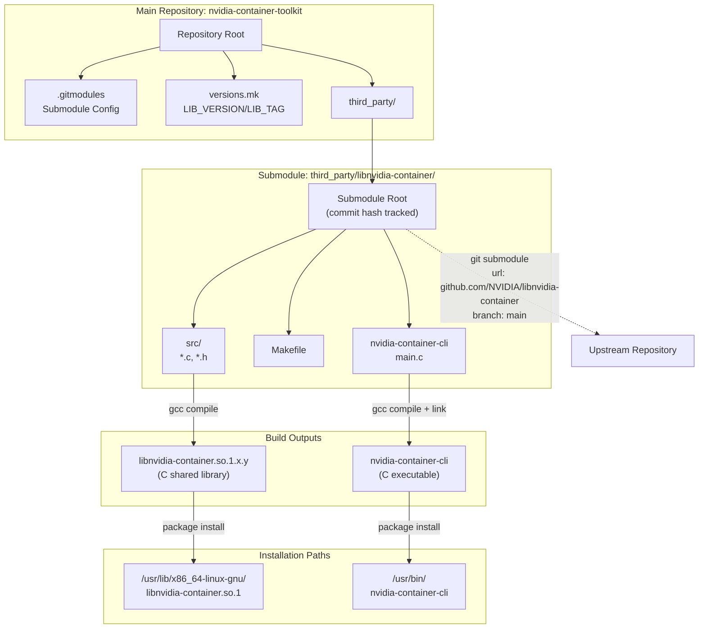
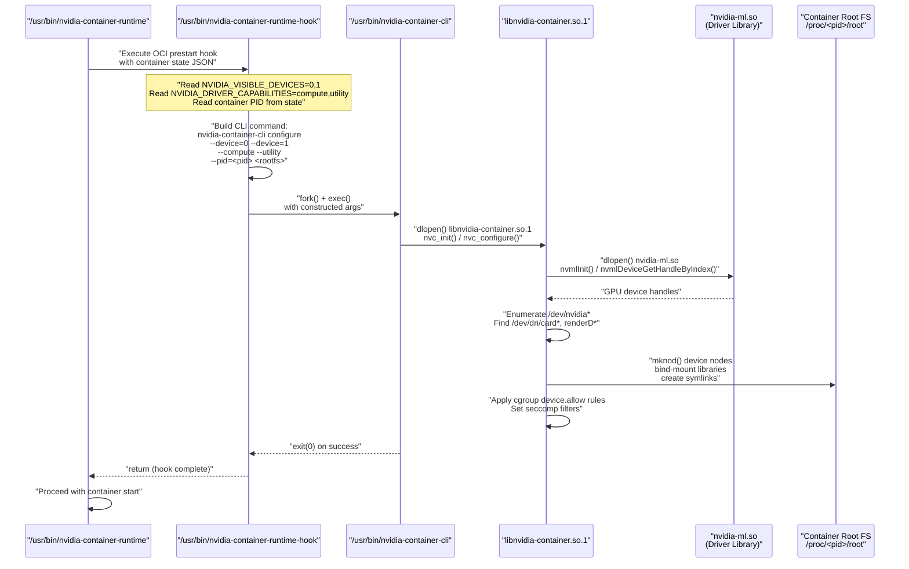
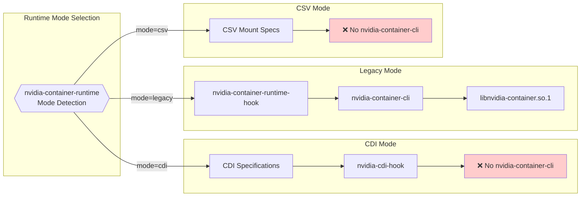
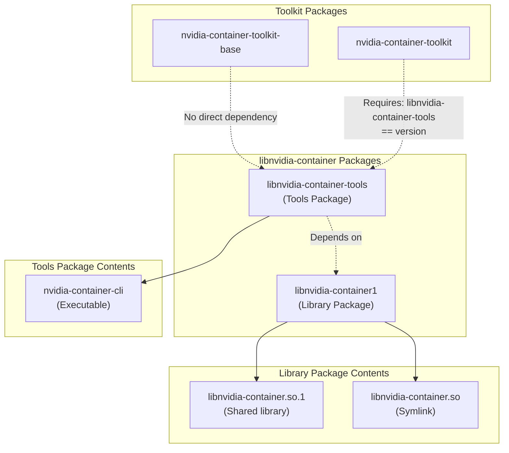
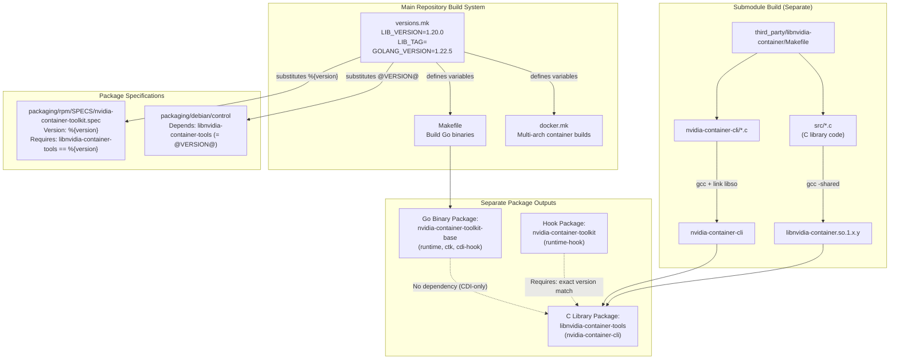
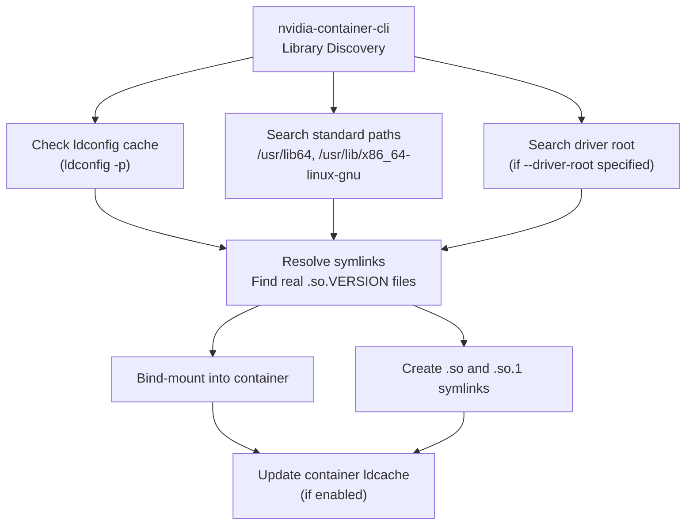

<!-- source: DeepWiki mcp.deepwiki.com · repo NVIDIA/nvidia-container-toolkit · page 2.6 libnvidia-container · fetched 2026-10-26 -->

# libnvidia-container

<details>
<summary>Relevant source files</summary>

The following files were used as context for generating this wiki page:

- [.gitmodules](.gitmodules)
- [CHANGELOG.md](CHANGELOG.md)
- [Makefile](Makefile)
- [cmd/nvidia-container-runtime-hook/container_config.go](cmd/nvidia-container-runtime-hook/container_config.go)
- [cmd/nvidia-container-runtime-hook/container_config_test.go](cmd/nvidia-container-runtime-hook/container_config_test.go)
- [cmd/nvidia-container-runtime-hook/hook_config.go](cmd/nvidia-container-runtime-hook/hook_config.go)
- [cmd/nvidia-container-runtime-hook/hook_config_test.go](cmd/nvidia-container-runtime-hook/hook_config_test.go)
- [cmd/nvidia-container-runtime-hook/main.go](cmd/nvidia-container-runtime-hook/main.go)
- [deployments/systemd/90-nvidia-container-toolkit.preset](deployments/systemd/90-nvidia-container-toolkit.preset)
- [docker/Dockerfile.devel](docker/Dockerfile.devel)
- [internal/config/image/builder.go](internal/config/image/builder.go)
- [internal/config/image/capabilities.go](internal/config/image/capabilities.go)
- [internal/config/image/cuda_image.go](internal/config/image/cuda_image.go)
- [internal/config/image/cuda_image_test.go](internal/config/image/cuda_image_test.go)
- [internal/config/image/devices.go](internal/config/image/devices.go)
- [internal/config/image/privileged.go](internal/config/image/privileged.go)
- [packaging/debian/control](packaging/debian/control)
- [packaging/debian/nvidia-container-toolkit-base.maintscript](packaging/debian/nvidia-container-toolkit-base.maintscript)
- [packaging/debian/prepare](packaging/debian/prepare)
- [packaging/rpm/SPECS/nvidia-container-toolkit.spec](packaging/rpm/SPECS/nvidia-container-toolkit.spec)
- [versions.mk](versions.mk)

</details>


## Purpose and Scope

This page documents the **libnvidia-container** library and its integration into the NVIDIA Container Toolkit. The library provides low-level GPU device configuration capabilities through the `nvidia-container-cli` command-line tool. This page covers the submodule structure, package dependencies, build integration, and how the toolkit invokes libnvidia-container functionality.

For information about the high-level runtime wrapper that orchestrates container GPU access, see [NVIDIA Container Runtime](#2.1). For details on the legacy hook that invokes libnvidia-container, see [NVIDIA Container Runtime Hook](#2.2).

## Overview

**libnvidia-container** is a C library and command-line utility that handles the low-level operations required to enable NVIDIA GPU access within Linux containers. It is maintained as a separate project at `https://github.com/NVIDIA/libnvidia-container` and integrated into the NVIDIA Container Toolkit as a Git submodule.

### Core Responsibilities

The library performs these essential operations:
- Mounting GPU device nodes (e.g., `/dev/nvidia0`, `/dev/nvidiactl`) into containers
- Injecting NVIDIA driver libraries (e.g., `libcuda.so`, `libnvidia-ml.so`) into container filesystems
- Configuring cgroup device permissions for GPU access
- Managing NVIDIA persistence daemon and fabric manager sockets
- Handling GSP firmware files for newer GPU architectures
- Applying security policies via seccomp filters

Sources: [CHANGELOG.md:14-208]()

## Submodule Integration

### Repository Structure and File Layout



**Submodule Directory Structure**

The git submodule at `third_party/libnvidia-container/` contains the complete libnvidia-container repository, including:

| Directory/File | Purpose |
|----------------|---------|
| `src/` | C source files implementing the library |
| `Makefile` | Build configuration for compiling C code |
| `nvidia-container-cli/` | CLI tool implementation |
| `mk/` | Build system helpers and architecture detection |
| `deps/` | Third-party dependencies (e.g., seccomp) |

The submodule tracks a specific commit from the upstream repository, allowing the toolkit to pin to tested versions while still receiving updates through submodule advancement.

Sources: [.gitmodules:1-4]()

The submodule configuration specifies tracking of the `main` branch:

```
[submodule "third_party/libnvidia-container"]
    path = third_party/libnvidia-container
    url = https://github.com/NVIDIA/libnvidia-container.git
    branch = main
```

Sources: [.gitmodules:1-4]()

### Version Synchronization

The toolkit enforces strict version matching between the main toolkit and libnvidia-container components. Package specifications require exact version equality:

**RPM Package Dependency:**
```
Requires: libnvidia-container-tools == %{version}-%{release}
```

**Debian Package Dependency:**
```
Depends: libnvidia-container-tools (= @VERSION@), libnvidia-container-tools (<< 2.0.0)
```

This ensures that the C library's capabilities match the expectations of the Go-based runtime components.

Sources: [packaging/rpm/SPECS/nvidia-container-toolkit.spec:39](), [packaging/debian/control:13]()

## nvidia-container-cli Tool

### Command Structure

The `nvidia-container-cli` executable is the primary interface to libnvidia-container functionality. It provides these subcommands:

| Command | Purpose |
|---------|---------|
| `configure` | Mount devices and libraries into a container's root filesystem |
| `list` | Query available NVIDIA devices and libraries |
| `info` | Display NVIDIA driver and device information |

### Configure Command Flags

The `configure` command accepts numerous flags to control GPU resource injection. The `nvidia-container-runtime-hook` constructs these flags based on container environment variables and configuration [cmd/nvidia-container-runtime-hook/main.go:91-147]().

| Flag | Purpose | Example |
|------|---------|---------|
| `--device` | Specify GPU device indices | `--device=0 --device=1` |
| `--compute` | Enable compute libraries | `--compute` |
| `--utility` | Enable utility libraries (nvidia-smi) | `--utility` |
| `--video` | Enable video encode/decode libraries | `--video` |
| `--graphics` | Enable graphics libraries | `--graphics` |
| `--display` | Enable display libraries | `--display` |
| `--no-cntlibs` | Skip container library mounting | `--no-cntlibs` |
| `--cuda-compat-mode` | Configure CUDA compatibility mode | `--cuda-compat-mode=ldconfig` |
| `--no-gsp-firmware` | Skip GSP firmware injection | `--no-gsp-firmware` |
| `--no-fabricmanager` | Skip fabric manager socket | `--no-fabricmanager` |
| `--no-persistenced` | Skip persistence daemon socket | `--no-persistenced` |
| `--no-create-imex-channels` | Skip IMEX channel creation | `--no-create-imex-channels` |

Sources: [CHANGELOG.md:99](), [CHANGELOG.md:198-200](), [CHANGELOG.md:245](), [CHANGELOG.md:255-259](), [cmd/nvidia-container-runtime-hook/main.go:91-147]()

## Integration with NVIDIA Container Toolkit

### Invocation in Legacy Mode

**Title:** nvidia-container-cli Invocation Flow in Legacy Mode



**Invocation Details**

The hook executable at `/usr/bin/nvidia-container-runtime-hook` performs these steps:

1.  **Parse OCI State**: Reads container state JSON from stdin to extract container PID and bundle path [cmd/nvidia-container-runtime-hook/container_config.go:80-99]().
2.  **Build Command**: Constructs `nvidia-container-cli configure` with flags derived from environment variables [cmd/nvidia-container-runtime-hook/main.go:91-147]():
    -   `NVIDIA_VISIBLE_DEVICES=0,1` → `--device=0 --device=1`
    -   `NVIDIA_DRIVER_CAPABILITIES=compute,utility` → `--compute --utility`
    -   Container PID → `--pid=<pid>`
    -   Container rootfs → final positional argument
3.  **Execute CLI**: Spawns `nvidia-container-cli` process with constructed arguments using `syscall.Exec` [cmd/nvidia-container-runtime-hook/main.go:154]().
4.  **CLI Operation**: The CLI tool dynamically loads `libnvidia-container.so.1`, which:
    -   Queries GPU devices via NVML
    -   Mounts device nodes into container namespace
    -   Bind-mounts driver libraries
    -   Configures cgroup permissions

This architecture allows the Go-based hook to remain simple (argument construction and process execution) while delegating complex C-level operations to the external CLI tool.

Sources: [cmd/nvidia-container-runtime-hook/main.go:91-147](), [cmd/nvidia-container-runtime-hook/main.go:154](), [cmd/nvidia-container-runtime-hook/container_config.go:80-99]()

### Conditional Invocation

The toolkit only invokes libnvidia-container in **legacy mode**. Other modes handle device injection differently:



The `nvidia-container-runtime-hook` explicitly checks if the resolved runtime mode is "legacy" before proceeding with `nvidia-container-cli` invocation [cmd/nvidia-container-runtime-hook/hook_config.go:126-131]().

Sources: [CHANGELOG.md:81-82](), [CHANGELOG.md:571-572](), [cmd/nvidia-container-runtime-hook/hook_config.go:126-131]()

## Package Structure

### Two-Package Model

libnvidia-container is distributed as two separate packages:



**Key Dependency Rule:**
- The `nvidia-container-toolkit` package (which includes the legacy hook) **requires** `libnvidia-container-tools` with exact version matching [packaging/rpm/SPECS/nvidia-container-toolkit.spec:39](), [packaging/debian/control:13]().
- The `nvidia-container-toolkit-base` package (which provides CDI-mode components) does **not** require libnvidia-container-tools [packaging/rpm/SPECS/nvidia-container-toolkit.spec:98-104](), [packaging/debian/control:19-25]().
- This allows CDI-only installations to avoid the C library dependency.

Sources: [packaging/rpm/SPECS/nvidia-container-toolkit.spec:39](), [packaging/rpm/SPECS/nvidia-container-toolkit.spec:98-104](), [packaging/debian/control:13](), [packaging/debian/control:19-25]()

### Version Matching Requirements

The changelog shows that version synchronization is enforced and critical:

```
## v1.18.0-rc.1
- Require matching version of libnvidia-container-tools

## Changes in libnvidia-container
- Require version match between libnvidia-container-tools and libnvidia-container1
```

Recent releases require:
```
libnvidia-container-tools == %{version}-%{release}
libnvidia-container-tools < 2.0.0
```

This prevents version mismatches where the CLI tool might attempt to use library features not yet available or where breaking changes have occurred.

Sources: [CHANGELOG.md:78](), [CHANGELOG.md:194](), [versions.mk:15-17]()

## Build System Integration

### Version Coordination

**Title:** Build Coordination Between Toolkit and libnvidia-container



**Key Build Characteristics**

| Aspect | Details |
|--------|---------|
| **Version Source** | `versions.mk` defines `LIB_VERSION` and `LIB_TAG` variables [versions.mk:16-17]() |
| **Build Separation** | Go binaries and C library are built independently [Makefile:68](), [Makefile:74]() |
| **Version Enforcement** | RPM spec uses `Requires: libnvidia-container-tools == %{version}-%{release}` [packaging/rpm/SPECS/nvidia-container-toolkit.spec:39]() |
| **Submodule Updates** | Git submodule commit hash is manually advanced to pin specific libnvidia-container versions |
| **Multi-arch Support** | Both Go and C components support amd64, arm64, ppc64le architectures |

**Version Variable Flow**

The build system uses these version variables:

```makefile
# versions.mk
LIB_VERSION := 1.20.0
LIB_TAG :=
```

These are substituted into:
- `packaging/rpm/SPECS/nvidia-container-toolkit.spec` as `%{version}` and `%{release}` [packaging/rpm/SPECS/nvidia-container-toolkit.spec:2-3]()
- `packaging/debian/control` as `@VERSION@` placeholder [packaging/debian/control:13]()
- Package metadata to ensure exact version matching at installation time

This ensures that the Go runtime components and C library components are always version-synchronized, preventing incompatibilities between the hook (which invokes the CLI) and the CLI itself.

Sources: [versions.mk:16-17](), [Makefile:19](), [packaging/rpm/SPECS/nvidia-container-toolkit.spec:2-3](), [packaging/rpm/SPECS/nvidia-container-toolkit.spec:39](), [packaging/debian/control:13]()

## Capabilities and Features

### Device and Library Categories

libnvidia-container organizes NVIDIA resources into capability categories that map to command-line flags:

| Capability | Libraries/Components | CLI Flag |
|------------|---------------------|----------|
| **Compute** | `libcuda.so`, `libnvidia-ml.so`, `libnvvm.so`, `libnvidia-gpucomp.so`, `libnvidia-nvvm70.so`, `libnvidia-tileiras.so` | `--compute` |
| **Utility** | `nvidia-smi`, `nvidia-debugdump`, `nvidia-persistenced` | `--utility` |
| **Video** | `libnvidia-encode.so`, `libnvidia-decode.so` | `--video` |
| **Graphics** | `libGL.so`, `libGLX.so`, `libEGL.so`, `libGLESv*.so` | `--graphics` |
| **Display** | `libvdpau.so`, `libva.so` | `--display` |

Sources: [CHANGELOG.md:16](), [CHANGELOG.md:89](), [CHANGELOG.md:195](), [CHANGELOG.md:387](), [CHANGELOG.md:523]()

### Advanced Features

#### CGgroup Version Support

```
## v1.8.0-rc.1
[libnvidia-container] Add support for cgroupv2
```

The library detects and supports both cgroup v1 and v2 hierarchies for device permission management.

Sources: [CHANGELOG.md:608]()

#### Security Features

```
## v1.20.0-rc.1
- Update SECURITY.md
```

libnvidia-container applies seccomp filters to restrict system calls available during container configuration, reducing attack surface.

Sources: [CHANGELOG.md:22]()

#### CUDA Compatibility Mode

```
## v1.19.0-rc.1
- Use enable-cuda-compat hook when ldcache does not exist
```

The `--cuda-compat-mode` flag controls how CUDA forward compatibility libraries are handled [cmd/nvidia-container-runtime-hook/hook_config.go:96-106]():
- `ldconfig`: Uses `ldconfig` to manage compatibility libraries.
- `mount`: Mounts compatibility libraries directly.
- `disabled`: Disables CUDA compatibility mode.
- `hook`: Uses the `enable-cuda-compat` hook.

Sources: [CHANGELOG.md:97-98](), [CHANGELOG.md:139](), [cmd/nvidia-container-runtime-hook/hook_config.go:96-106]()

#### Library Filtering

```
## v1.18.0-rc.1
[libnvidia-container] Add no-cntlibs CLI option to nvidia-container-cli
```

The `--no-cntlibs` option prevents mounting libraries from the container itself, forcing all NVIDIA libraries to come from the host. This is useful when container images bundle their own NVIDIA libraries that should be ignored.

Sources: [CHANGELOG.md:203]()

#### Platform-Specific Firmware

```
## v1.14.0-rc.2
[libnvidia-container] Include Shared Compiler Library (libnvidia-gpucomp.so) in the list of compute libraries
```

Modern GPUs require GSP (GPU System Processor) firmware files. The library automatically discovers and mounts files matching `gsp*.bin`:

```
## v1.13.0-rc.1
[libnvidia-container] Include all gsp*.bin firmware files if present
```

Sources: [CHANGELOG.md:387](), [CHANGELOG.md:477]()

### Library Version Resolution

The library uses multiple strategies to locate NVIDIA driver libraries:



Key behaviors:
- Follows symlink chains to find the real library file with version number (e.g., `libcuda.so.535.104.05`)
- Creates necessary `.so` and `.so.MAJOR` symlinks in the container
- Updates the container's `ld.so.cache` to make libraries discoverable

Sources: [CHANGELOG.md:61](), [CHANGELOG.md:575]()

## Configuration and Extensibility

### Command-Line Options Evolution

The CHANGELOG tracks the addition of new configuration flags over time:

**Recent Additions (v1.20.0-rc.1):**
```
- Add libnvidia-nvvm70.so library to CDI spec
```

**v1.19.0-rc.2:**
```
- Add libnvidia-tileiras.so to the list of compute libs
```

**v1.17.0:**
```
[libnvidia-container] Add no-create-imex-channels command line option
```

**v1.16.2:**
```
[libnvidia-container] Add no-gsp-firmware command line option
[libnvidia-container] Add no-fabricmanager command line option
[libnvidia-container] Add no-persistenced command line option
[libnvidia-container] Skip directories and symlinks when mounting libraries
```

These flags provide fine-grained control over what resources are injected into containers.

Sources: [CHANGELOG.md:16](), [CHANGELOG.md:89](), [CHANGELOG.md:245](), [CHANGELOG.md:255-259]()

### WSL2 Support

```
## v1.20.0-rc.1
- [wsl2] discover all .so, .bin, and .dll files at nvidia driver store path

## v1.15.0
[libnvidia-container] Use D3DKMTEnumAdapters3 to enumerate adapters on WSL2 if available
```

On WSL2 systems, libnvidia-container uses Windows driver stack enumeration APIs and handles DriverStore layout differently than native Linux.

Sources: [CHANGELOG.md:11](), [CHANGELOG.md:304]()

### Tegra Platform Support

```
## v1.19.0-rc.1
- Add enable-cuda-compat on Tegra-based systems

## v1.10.0-rc.2
[libnvidia-container] Update jetpack-specific CLI option to only load Base CSV files by default
```

Tegra-based systems (NVIDIA Jetson) require special handling, including:
- Different device node paths
- CSV-based mount specifications
- Platform identification via sysfs

Sources: [CHANGELOG.md:128](), [CHANGELOG.md:574](), [CHANGELOG.md:586](), [CHANGELOG.md:590]()

## Changelog Tracking

The main repository's CHANGELOG.md includes a dedicated section for libnvidia-container changes in each release:

```
## v1.20.0-rc.1

### Changes in libnvidia-container
- refactor: Use version script instead of linker script for library symbols

## v1.19.0-rc.2

### Changes in libnvidia-container
- Add tooling to auto-bump golang version
- Allow GOLANG_VERSION to be overridden
```

This structure shows that while libnvidia-container is a separate repository and submodule, its changes are coordinated with toolkit releases. Each toolkit version includes specific libnvidia-container commits or features.

Sources: [CHANGELOG.md:14-208]()

## Summary

**libnvidia-container** is the foundational C library that enables GPU access in containers by:
- Mounting GPU device nodes from the host into container namespaces
- Injecting NVIDIA driver libraries into container filesystems
- Managing cgroup device permissions
- Handling platform-specific requirements (WSL2, Tegra, modern GPU firmware)

Within the NVIDIA Container Toolkit architecture:
- It is integrated as a **Git submodule** at `third_party/libnvidia-container` [.gitmodules:1-4]()
- It is distributed as **two packages**: `libnvidia-container1` (library) and `libnvidia-container-tools` (CLI) [packaging/rpm/SPECS/nvidia-container-toolkit.spec:39](), [packaging/debian/control:13]()
- It is invoked via the `nvidia-container-cli` executable [cmd/nvidia-container-runtime-hook/main.go:91-147]()
- It is **only used in legacy mode** - CDI and CSV modes bypass it entirely [cmd/nvidia-container-runtime-hook/hook_config.go:126-131]()
- Version matching between toolkit and libnvidia-container packages is **strictly enforced** [packaging/rpm/SPECS/nvidia-container-toolkit.spec:39](), [packaging/debian/control:13]()

The library's separation from the Go-based toolkit components allows for:
- Independent development and release cycles
- Platform-specific C code for low-level device operations
- Optional installation (CDI-only deployments don't require it)
- Cross-language integration (C library, Go runtime wrapper)

Sources: [CHANGELOG.md:14-208](), [.gitmodules:1-4](), [packaging/rpm/SPECS/nvidia-container-toolkit.spec:39](), [packaging/debian/control:13](), [cmd/nvidia-container-runtime-hook/main.go:91-147](), [cmd/nvidia-container-runtime-hook/hook_config.go:126-131]()

---

