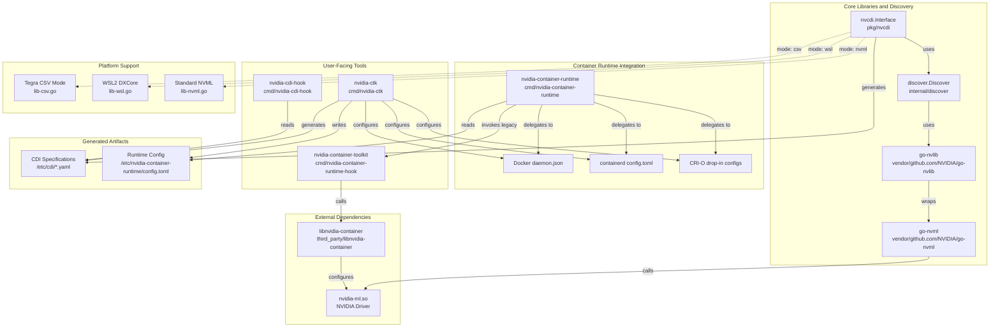
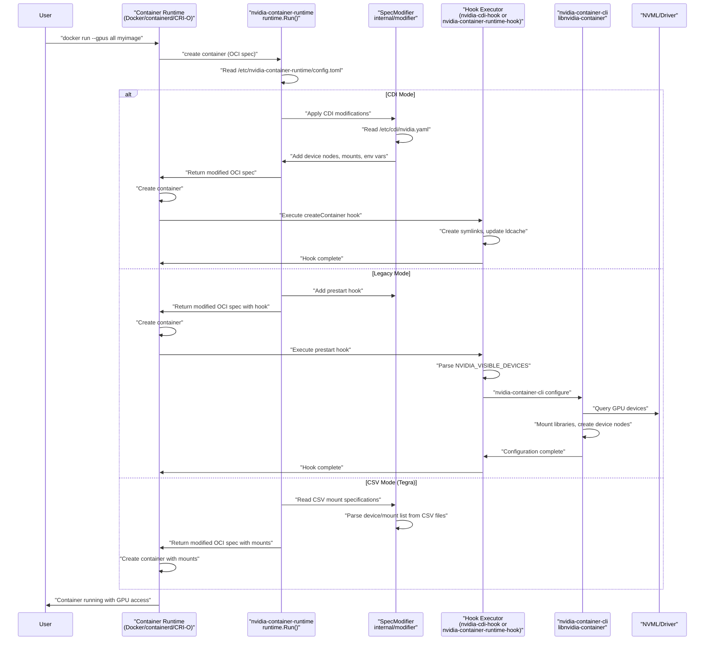
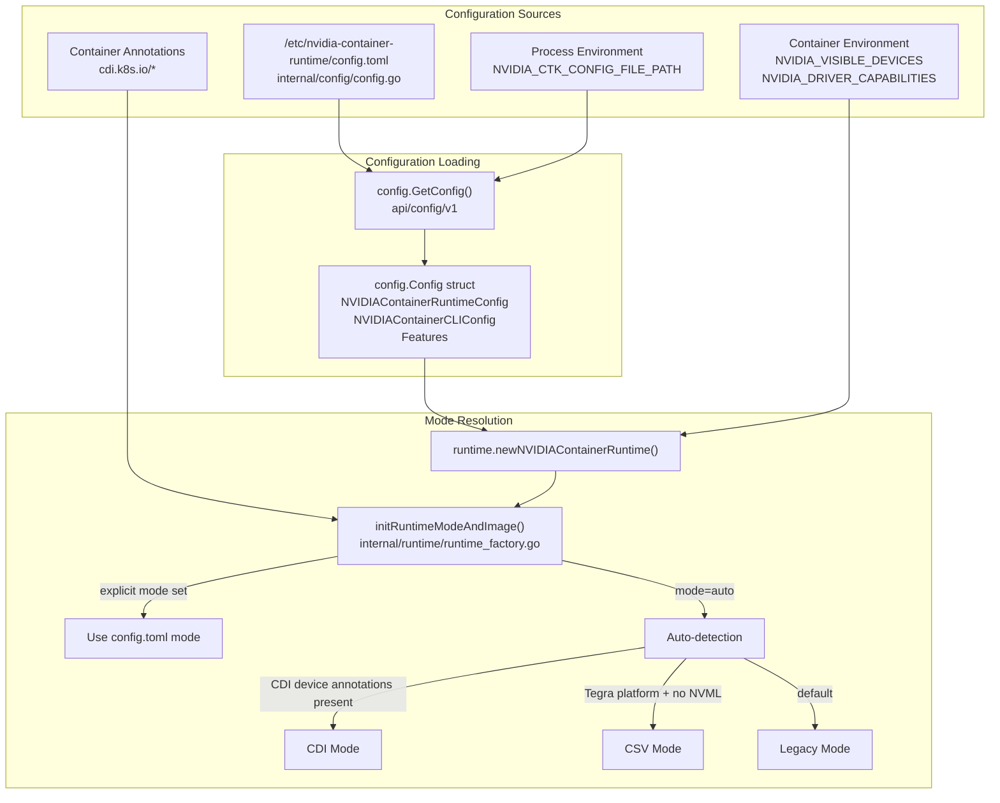
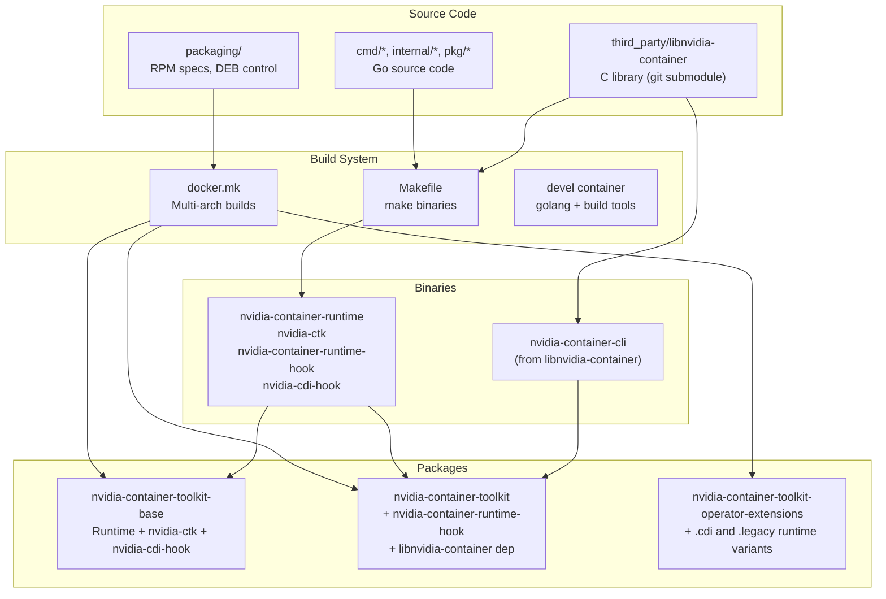
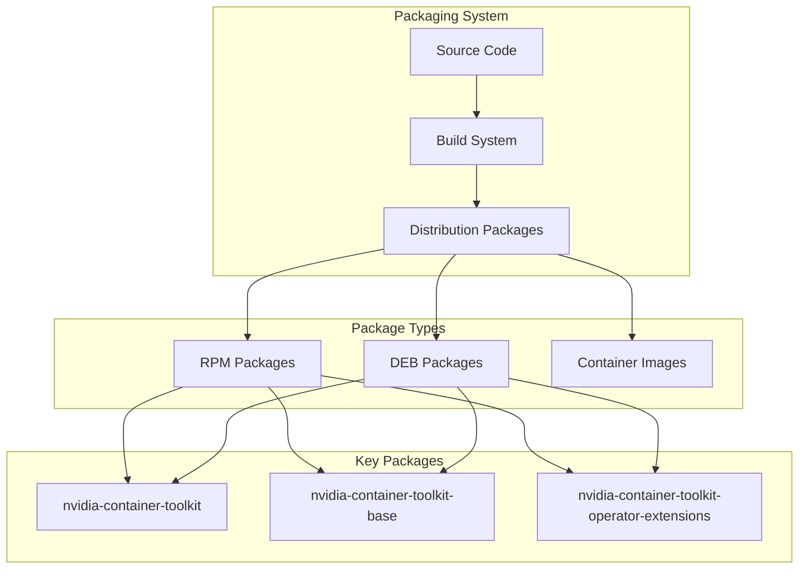

<!-- source: DeepWiki mcp.deepwiki.com · repo NVIDIA/nvidia-container-toolkit · page 3 Architecture · fetched 2026-10-26 -->

# Architecture

<details>
<summary>Relevant source files</summary>

The following files were used as context for generating this wiki page:

- [internal/discover/cache.go](internal/discover/cache.go)
- [internal/discover/compat_libs.go](internal/discover/compat_libs.go)
- [internal/discover/discover.go](internal/discover/discover.go)
- [internal/discover/discover_mock.go](internal/discover/discover_mock.go)
- [internal/discover/envvar.go](internal/discover/envvar.go)
- [internal/discover/first-valid.go](internal/discover/first-valid.go)
- [internal/discover/list.go](internal/discover/list.go)
- [internal/discover/none.go](internal/discover/none.go)
- [internal/edits/envvar.go](internal/edits/envvar.go)
- [internal/modifier/cdi.go](internal/modifier/cdi.go)
- [internal/modifier/cdi_test.go](internal/modifier/cdi_test.go)
- [internal/modifier/csv.go](internal/modifier/csv.go)
- [internal/modifier/gated.go](internal/modifier/gated.go)
- [internal/modifier/graphics.go](internal/modifier/graphics.go)
- [internal/modifier/graphics_test.go](internal/modifier/graphics_test.go)
- [internal/oci/options.go](internal/oci/options.go)
- [internal/oci/runtime.go](internal/oci/runtime.go)
- [internal/oci/runtime_low_level.go](internal/oci/runtime_low_level.go)
- [internal/oci/runtime_mock.go](internal/oci/runtime_mock.go)
- [internal/oci/runtime_modifier.go](internal/oci/runtime_modifier.go)
- [internal/oci/runtime_modifier_test.go](internal/oci/runtime_modifier_test.go)
- [internal/oci/runtime_path.go](internal/oci/runtime_path.go)
- [internal/oci/runtime_path_test.go](internal/oci/runtime_path_test.go)
- [internal/oci/runtime_syscall_exec.go](internal/oci/runtime_syscall_exec.go)
- [internal/oci/spec.go](internal/oci/spec.go)
- [internal/oci/spec_file.go](internal/oci/spec_file.go)
- [internal/oci/spec_file_test.go](internal/oci/spec_file_test.go)
- [internal/oci/spec_test.go](internal/oci/spec_test.go)
- [internal/platform-support/dgpu/by-path-hooks.go](internal/platform-support/dgpu/by-path-hooks.go)
- [internal/runtime/runtime.go](internal/runtime/runtime.go)
- [internal/runtime/runtime_factory.go](internal/runtime/runtime_factory.go)
- [internal/runtime/runtime_factory_test.go](internal/runtime/runtime_factory_test.go)
- [internal/test/test.go](internal/test/test.go)
- [pkg/lookup/path.go](pkg/lookup/path.go)

</details>


The NVIDIA Container Toolkit enables GPU support in containerized environments through a modular architecture that discovers GPU resources, modifies container specifications, and integrates with multiple container runtimes. This page provides an architectural overview of the toolkit's design patterns and major components, serving as context for the detailed subsystem pages.

## System Architecture Overview

The toolkit architecture consists of multiple layers, from user-facing executables down to low-level GPU management:

**Overall System Architecture**



The architecture separates concerns between device discovery (generation time via `nvidia-ctk cdi generate`) and device injection (runtime via CDI or legacy hooks). The `nvidia-container-runtime` acts as an OCI runtime wrapper that modifies container specifications before delegating to the actual low-level runtime (`runc` or `crun`).

Sources:
- [cmd/nvidia-ctk/main.go]()
- [cmd/nvidia-container-runtime/main.go]()
- [cmd/nvidia-container-runtime-hook/main.go]()
- [pkg/nvcdi/api.go]()
- [internal/discover/discover.go]()

## Core Architectural Components

The toolkit consists of four primary user-facing executables and several supporting libraries:

### User-Facing Executables

| Component | Location | Purpose |
|-----------|----------|---------|
| `nvidia-container-runtime` | [cmd/nvidia-container-runtime/main.go]() | OCI runtime wrapper that modifies specs via `internal/runtime/runtime.go` |
| `nvidia-ctk` | [cmd/nvidia-ctk/main.go]() | CLI tool for configuration (`runtime configure`) and CDI generation (`cdi generate`) |
| `nvidia-container-runtime-hook` | [cmd/nvidia-container-runtime-hook/main.go]() | Legacy prestart hook that invokes `nvidia-container-cli` from `libnvidia-container` |
| `nvidia-cdi-hook` | [cmd/nvidia-cdi-hook/main.go]() | CDI lifecycle hooks: `update-ldcache`, `create-symlinks`, `chmod` |

### Core Internal Packages

| Package | Responsibility | Key Types |
|---------|---------------|-----------|
| `pkg/nvcdi` | CDI specification generation | `nvcdilib`, `Interface` (API), mode-specific `lib-*.go` implementations |
| `internal/runtime` | Runtime factory and OCI spec modification | `Runtime`, `runtime.newNVIDIAContainerRuntime()` [internal/runtime/runtime_factory.go:33-67]() |
| `internal/modifier` | Mode-specific OCI spec modifiers | `SpecModifier` [internal/oci/spec.go:26-30](), `cdiModifier`, `tegraCSVModifier`, `legacyModifier` |
| `internal/discover` | Resource discovery (devices, mounts, hooks) | `Discover` interface [internal/discover/discover.go:49-54](), `charDevices`, `mounts`, `driverLibraries` |
| `internal/config` | Configuration loading and management | `Config`, `FeatureFlags`, `config.New()` |

### External Go Module Dependencies

| Package | Source | Usage |
|---------|--------|-------|
| `go-nvml` | [vendor/github.com/NVIDIA/go-nvml]() | NVML Go bindings: `nvml.Init()`, `nvml.DeviceGetCount()` |
| `go-nvlib` | [vendor/github.com/NVIDIA/go-nvlib]() | Device abstractions and helpers |
| `container-device-interface` | [vendor/tags.cncf.io/container-device-interface]() | CDI spec types and validation |

The `nvidia-container-runtime` serves as the primary entry point, creating a `Runtime` instance via `runtimeFactory` which applies a chain of `SpecModifier` instances to transform the OCI spec before delegating to the low-level runtime. See [2.1 NVIDIA Container Runtime](page://2.1) for detailed runtime behavior.

Sources:
- [cmd/nvidia-container-runtime/main.go]()
- [cmd/nvidia-ctk/main.go]()
- [cmd/nvidia-container-runtime-hook/main.go]()
- [cmd/nvidia-cdi-hook/main.go]()
- [internal/runtime/runtime_factory.go]()
- [pkg/nvcdi/api.go]()
- [internal/modifier/cdi.go]()
- [internal/discover/discover.go]()
- [internal/config/config.go]()
- [internal/oci/spec.go:26-30]()

## Runtime Execution Flow

The following sequence diagram illustrates how the toolkit processes a container creation request. The flow varies based on the configured runtime mode (CDI, Legacy, or CSV):

**Container Runtime Execution Flow with GPU Access**



The runtime flow begins with `nvidia-container-runtime` reading configuration from [/etc/nvidia-container-runtime/config.toml](), then using `runtime.newSpecModifier()` [internal/runtime/runtime_factory.go:70-85]() to create a chain of modifiers appropriate for the configured mode. The modifiers transform the OCI spec by adding device nodes, mounts, environment variables, and hooks. The modified spec is then passed to the low-level runtime (`runc` or `crun`).

Mode selection and behavior is covered in detail in [3.1 Runtime Modes](page://3.1).

Sources:
- [internal/runtime/runtime.go]()
- [internal/runtime/runtime_factory.go]()
- [internal/modifier/cdi.go]()
- [internal/modifier/csv.go]()
- [cmd/nvidia-container-runtime-hook/main.go]()

## Major Subsystems

The toolkit architecture consists of several interconnected subsystems, each documented in detail in dedicated sub-pages:

### Runtime Modes and Selection

The toolkit supports multiple operational modes: **CDI** (Container Device Interface, default), **Legacy** (prestart hook-based), **CSV** (Tegra file-based), and **JIT-CDI** (just-in-time CDI generation). The `newNVIDIAContainerRuntime` function in [internal/runtime/runtime_factory.go:33-67]() creates mode-specific `oci.Runtime` implementations. Mode selection is determined by:

- Explicit configuration in `config.toml`: `nvidia-container-runtime.mode`
- Auto-detection via `initRuntimeModeAndImage()` [internal/runtime/runtime_factory.go:87-130](): checks for Tegra platforms, CDI annotations, and NVML availability
- Environment variables and container image annotations

See [3.1 Runtime Modes](page://3.1) for complete details on mode selection, behavior differences, and when each mode is used.

### Container Device Interface (CDI)

CDI provides a standardized, declarative method for device injection. The `nvcdi` package ([pkg/nvcdi]()) generates CDI specifications through the following workflow:

1.  **Discovery Phase**: `nvidia-ctk cdi generate` invokes discoverers to find GPUs (via NVML), device nodes (via sysfs), libraries (via ldcache), and firmware files. The `newCDIModifier` function [internal/modifier/cdi.go:43-78]() is responsible for creating the CDI modifier.
2.  **Specification Generation**: The `nvcdi.New()` function [internal/modifier/cdi.go:190-203]() creates an in-memory CDI spec.
3.  **Persistence**: Specs are written to `/etc/cdi/` or `/var/run/cdi/` as YAML files.
4.  **Runtime Consumption**: Container runtimes read these specs when CDI device names are requested (e.g., `nvidia.com/gpu=0`).

See [3.2 Container Device Interface (CDI)](page://3.2) for CDI spec structure, generation workflow, and runtime consumption.

### Resource Discovery System

The discovery subsystem ([internal/discover]()) identifies resources needed for GPU containers. The `Discover` interface [internal/discover/discover.go:49-54]() defines three methods:

- `Devices() ([]Device, error)`: Discovers device nodes like `/dev/nvidia0`, `/dev/nvidiactl`
- `Mounts() ([]Mount, error)`: Discovers driver libraries, firmware files, and config files
- `Hooks() ([]Hook, error)`: Discovers required lifecycle hooks

Discovery implementations include `charDevices` (device nodes), `mounts` (library paths), `driverLibraries` (driver .so files), and platform-specific discoverers for Tegra (`csvDiscoverer`) and WSL2 (`wslDiscoverer`). The `Merge` function [internal/discover/list.go:29-39]() allows combining multiple discoverers.

See [3.3 Resource Discovery System](page://3.3) for discoverer types, discovery modes, and implementation details.

### OCI Spec Modification System

The modifier system ([internal/modifier]()) transforms OCI specs to enable GPU access. The `oci.SpecModifier` interface [internal/oci/spec.go:26-30]() defines a single method: `Modify(*specs.Spec) error`. Key modifier implementations:

- `newCDIModifier` [internal/modifier/cdi.go:43-78](): Applies CDI device edits from `/etc/cdi/` specifications.
- `newCSVModifier` [internal/modifier/csv.go:31-44](): Reads CSV files and adds mounts for Tegra platforms.
- `legacyModifier`: Adds prestart hook to invoke `nvidia-container-runtime-hook`.
- `newGraphicsModifier` [internal/modifier/graphics.go:29-62](): Adds graphics-related modifications.
- `newFeatureGatedModifier` [internal/modifier/gated.go:36-61](): Conditionally adds specialized devices (GDS, MOFED, NVSwitch, IMEX).

Modifiers are composed using `oci.SpecModifiers` [internal/oci/spec.go:34]() to create a modification pipeline. See [3.4 OCI Spec Modification System](page://3.4) for modifier chaining and implementation details.

### Container Runtime Integration

The toolkit integrates with containerd, CRI-O, and Docker by modifying their configuration files. The `nvidia-ctk runtime configure` command:

-   **containerd**: Updates `/etc/containerd/config.toml` to add `nvidia` runtime under `plugins."io.containerd.grpc.v1.cri".containerd.runtimes`
-   **CRI-O**: Creates drop-in config files in `/etc/crio/crio.conf.d/` defining the `nvidia` runtime
-   **Docker**: Modifies `/etc/docker/daemon.json` to add `nvidia` to the `runtimes` section

See [3.5 Container Runtime Integration](page://3.5) for configuration format details and runtime-specific integration patterns.

### Device Interface and NVML

The toolkit uses NVML (NVIDIA Management Library) through the `go-nvml` Go bindings ([vendor/github.com/NVIDIA/go-nvml]()). The `nvml` package provides:

-   Device enumeration: `nvml.Init()`, `nvml.DeviceGetCount()`, `nvml.DeviceGetHandleByIndex()`
-   MIG support: `nvml.DeviceGetMigDeviceHandleByIndex()`, `nvml.DeviceGetMaxMigDeviceCount()`
-   Device properties: `nvml.DeviceGetUUID()`, `nvml.DeviceGetPciInfo()`

The `go-nvlib` abstraction layer ([vendor/github.com/NVIDIA/go-nvlib]()) provides higher-level device management functions.

See [3.6 Device Interface and NVML](page://3.6) for NVML usage patterns and GPU enumeration details.

### Hook System

The hook system provides container lifecycle hooks for runtime operations. Hooks are implemented in [cmd/nvidia-cdi-hook]() and discovered by [internal/discover]():

-   `update-ldcache`: Updates the container's dynamic linker cache
-   `create-symlinks`: Creates `.so` symlinks for driver libraries
-   `chmod`: Modifies permissions on device nodes
-   `create-dev-char-symlinks`: Creates `/dev/char` symlinks for device access

The `Hook` struct in [internal/discover/discover.go:39-44]() defines hook discovery. CDI specs reference hooks by path (e.g., `/usr/bin/nvidia-cdi-hook update-ldcache`). The `NewCUDACompatHookDiscoverer` [internal/discover/compat_libs.go:19-21]() creates a discoverer for the `enable-cuda-compat` hook.

See [3.7 Hook System](page://3.7) for hook types, execution timing, and implementation details.

### Platform-Specific Support

The toolkit adapts to different platforms through mode-specific implementations:

-   **Standard Linux (x86/ARM)**: Uses `lib-nvml.go` with NVML for GPU discovery
-   **Tegra/Jetson**: Uses `lib-csv.go` to read CSV mount specifications
-   **WSL2**: Uses `lib-wsl.go` with DXCore API integration for Windows driver interaction

Platform detection occurs in `initRuntimeModeAndImage()` [internal/runtime/runtime_factory.go:87-130](), checking for Tegra via `/sys/devices/soc0/family` and WSL via Windows driver presence.

See [3.8 Platform-Specific Support](page://3.8) for platform detection logic and implementation differences.

Sources:
- [internal/runtime/runtime_factory.go]()
- [pkg/nvcdi/api.go]()
- [internal/discover/discover.go]()
- [internal/modifier/cdi.go]()
- [internal/modifier/csv.go]()
- [internal/modifier/graphics.go]()
- [internal/modifier/gated.go]()
- [internal/oci/spec.go:26-30]()
- [internal/discover/compat_libs.go:19-21]()

## Configuration System

The toolkit's behavior is controlled through a layered configuration system that combines static configuration files, environment variables, container annotations, and feature flags:

**Configuration Flow and Mode Resolution**



### Configuration Structure

The `config.Config` struct ([api/config/v1/config.go]()) contains:

-   `NVIDIAContainerRuntimeConfig`: Runtime mode, hook paths, CDI settings, low-level runtime list
-   `NVIDIAContainerCLIConfig`: Configuration for `nvidia-container-cli` (root path, debug settings)
-   `NVIDIACTKConfig`: Path to `nvidia-ctk` binary for hook execution
-   `Features`: Feature flags controlling optional behavior

### Configuration File Format

The configuration file at `/etc/nvidia-container-runtime/config.toml` uses TOML format:

```toml
[nvidia-container-runtime]
mode = "auto"  # or "cdi", "legacy", "csv"
runtimes = ["runc", "crun"]

[nvidia-container-runtime.modes.cdi]
default-kind = "nvidia.com/gpu"
spec-dirs = ["/etc/cdi", "/var/run/cdi"]

[nvidia-container-cli]
root = "/run/nvidia/driver"
debug = "/var/log/nvidia-container-toolkit.log"
```

See [4 Configuration](page://4) and [4.1 Configuration File Format](page://4.1) for complete configuration reference.

Sources:
- [api/config/v1/config.go]()
- [internal/config/image/cuda_image.go]()
- [internal/runtime/runtime_factory.go:87-130]()
- [internal/runtime/runtime.go:46-49]()

## Key Interfaces and Abstractions

The toolkit architecture relies on several key interfaces that enable modularity and testability. These interfaces define contracts between subsystems:

### Runtime Interface

```go
type Runtime interface {
    Run([]string) error
}
```

**Location**: [internal/oci/runtime.go]()

**Implementations**:
-   `modifyingRuntimeWrapper` [internal/oci/runtime_modifier.go:20-24](): Main runtime wrapper that modifies OCI specs before delegating to low-level runtime.
-   `lowLevelRuntime` [internal/oci/runtime_syscall_exec.go:20-24](): Delegates to `runc` or `crun` via `syscall.Exec()`.

**Usage**: Created by `runtime.newNVIDIAContainerRuntime()` [internal/runtime/runtime_factory.go:33-67](), this wraps the low-level runtime and applies spec modifications via `SpecModifier` before execution.

### SpecModifier Interface

```go
type SpecModifier interface {
    Modify(*specs.Spec) error
}
```

**Location**: [internal/oci/spec.go:26-30]()

**Implementations**:
-   `cdi.cdiModifier` [internal/modifier/cdi/cdi.go:29-32](): Applies CDI device specifications.
-   `csv.csvModifier` [internal/modifier/csv/csv.go:29-32](): Adds mounts from CSV files.
-   `legacyModifier`: Injects prestart hook.
-   `graphicsModifier`: Adds graphics capabilities.
-   `gatedModifier`: Conditionally adds specialized devices.
-   `oci.SpecModifiers` [internal/oci/spec.go:34]() for combining multiple modifiers.

**Composition**: Multiple modifiers are composed using `oci.SpecModifiers` [internal/oci/spec.go:34]() to create a modification pipeline that transforms the OCI spec.

### Discover Interface

```go
type Discover interface {
    Devices() ([]Device, error)
    EnvVars() ([]EnvVar, error)
    Mounts() ([]Mount, error)
    Hooks() ([]Hook, error)
}
```

**Location**: [internal/discover/discover.go:49-54]()

**Implementations**:
-   `charDevices`: Discovers character device nodes.
-   `mounts`: Generic mount discovery.
-   `driverLibraries`: Discovers driver .so files via ldcache.
-   `csvDiscoverer`: Tegra-specific CSV-based discovery.
-   `wslDiscoverer`: WSL2-specific discovery.
-   `discover.None` [internal/discover/none.go:17-19]() for no discovery.
-   `discover.list` [internal/discover/list.go:24]() for merging multiple discoverers.

**Composition**: The `Merge()` function [internal/discover/list.go:29-39]() combines multiple discoverers into a single `Discover` instance.

### NVCDI Interface

```go
type Interface interface {
    GetSpec() (spec.Interface, error)
    GetCommonEdits() (*cdi.ContainerEdits, error)
    GetAllDeviceSpecs() ([]specs.Device, error)
    GetGPUDeviceSpecs(int, string) ([]specs.Device, error)
    GetMIGDeviceSpecs(int, int, string) ([]specs.Device, error)
}
```

**Location**: [pkg/nvcdi/api.go]()

**Implementations**: Mode-specific libraries in [pkg/nvcdi]()):
-   `lib-nvml.go`: Standard NVML-based GPU discovery.
-   `lib-csv.go`: Tegra CSV-based discovery.
-   `lib-wsl.go`: WSL2 DXCore integration.
-   `lib-management.go`: Management container mode.

**Usage**: Invoked by `nvidia-ctk cdi generate` to produce CDI specifications. The `GetSpec()` method returns a complete CDI spec with devices, mounts, hooks, and environment variables.

Sources:
- [internal/oci/runtime.go]()
- [internal/oci/spec.go:26-30]()
- [internal/discover/discover.go:49-54]()
- [pkg/nvcdi/api.go]()
- [internal/oci/runtime_modifier.go:20-24]()
- [internal/oci/runtime_syscall_exec.go:20-24]()
- [internal/runtime/runtime_factory.go:33-67]()
- [internal/modifier/cdi/cdi.go:29-32]()
- [internal/modifier/csv/csv.go:29-32]()
- [internal/discover/none.go:17-19]()
- [internal/discover/list.go:24]()
- [internal/discover/list.go:29-39]()

## Build System and Packaging

The toolkit uses a Makefile-based build system supporting native and containerized builds. The build process compiles Go binaries, integrates the `libnvidia-container` submodule, and creates distribution packages.

**Build and Package Flow**



### Build Targets

The [Makefile]() defines build targets:

| Target | Command | Description |
|--------|---------|-------------|
| `binaries` | `make binaries` | Builds all executables (alias for `cmds`) |
| `cmds` | `make cmds` | Builds individual commands from [cmd]() |
| `cmd-<name>` | `make cmd-nvidia-ctk` | Builds specific command binary |
| `docker-build` | `make docker-build` | Containerized build using [docker/Dockerfile.devel]() |

Go binaries are built with linker flags in [Makefile:68]() to embed version information:

```makefile
go build -ldflags "-s -w -X $(CLI_VERSION_PACKAGE).version=$(CLI_VERSION)"
```

### Package Structure

Three package layers enable flexible deployment:

1.  **nvidia-container-toolkit-base**: Core components ([packaging/rpm/SPECS/nvidia-container-toolkit.spec:82-121]())
    -   `nvidia-container-runtime`: OCI runtime wrapper
    -   `nvidia-ctk`: CLI tool
    -   `nvidia-cdi-hook`: CDI lifecycle hooks
    -   Systemd services: `nvidia-cdi-refresh.service`, `nvidia-cdi-refresh.path`

2.  **nvidia-container-toolkit**: Main package ([packaging/rpm/SPECS/nvidia-container-toolkit.spec:1-74]())
    -   Includes `-base` package
    -   Adds `nvidia-container-runtime-hook`: Legacy hook
    -   Requires `libnvidia-container-tools` (provides `nvidia-container-cli`)

3.  **nvidia-container-toolkit-operator-extensions**: Kubernetes operator support ([packaging/rpm/SPECS/nvidia-container-toolkit.spec:124-135]())
    -   `nvidia-container-runtime.cdi`: CDI mode-specific runtime
    -   `nvidia-container-runtime.legacy`: Legacy mode-specific runtime

The base package can function independently, while the main package provides backward compatibility for systems using the legacy hook-based approach.

Sources:
- [Makefile]()
- [versions.mk]()
- [docker/docker.mk]()
- [docker/Dockerfile.devel]()
- [packaging/rpm/SPECS/nvidia-container-toolkit.spec]()
- [packaging/debian/control]()

## Platform Support

The toolkit adapts to different hardware platforms through specialized mode implementations. Platform detection and mode selection occurs in `initRuntimeModeAndImage()` [internal/runtime/runtime_factory.go:87-130]():

| Platform | Detection Method | Default Mode | Implementation |
|----------|-----------------|--------------|----------------|
| Standard x86/ARM Linux | NVML library available | CDI or Legacy | `lib-nvml.go` using NVML API |
| Tegra/Jetson (NVIDIA embedded) | `/sys/devices/soc0/family` contains "Tegra" | CSV | `lib-csv.go` reading CSV mount files |
| WSL2 (Windows Subsystem for Linux) | Windows driver presence, `/proc/version` contains "microsoft" | WSL | `lib-wsl.go` with DXCore API |
| Grace Hopper (ARM + GPU) | Platform detection via NVML | CDI | `lib-nvml.go` with coherent device annotations |

### Platform-Specific Implementation Details

**Standard Linux (NVML mode)**: The default implementation in [pkg/nvcdi/lib-nvml.go]() uses NVML to enumerate GPUs and MIG devices. It discovers:
-   GPU devices via `nvml.DeviceGetCount()` and `nvml.DeviceGetHandleByIndex()`
-   Driver libraries via ldcache and filesystem search
-   Firmware files (GSP firmware, Vulkan ICDs)

**Tegra/Jetson (CSV mode)**: The Tegra implementation in [pkg/nvcdi/lib-csv.go]() reads CSV files that define mount specifications. CSV files are located in directories specified by `NVIDIA_REQUIRE_JETPACK_HOST_MOUNTS` environment variable or default paths.

**WSL2 (WSL mode)**: The WSL implementation in [pkg/nvcdi/lib-wsl.go]() integrates with the Windows NVIDIA driver via DXCore. It uses `D3DKMTEnumAdapters3` to enumerate GPUs and mounts the Windows driver's `DriverStore` into containers.

See [3.8 Platform-Specific Support](page://3.8) for detailed implementation differences and platform detection logic.

Sources:
- [internal/runtime/runtime_factory.go:87-130]()
- [pkg/nvcdi/lib-nvml.go]()
- [pkg/nvcdi/lib-csv.go]()
- [pkg/nvcdi/lib-wsl.go]()

## External Dependencies

The toolkit relies on external components for container runtime integration and low-level GPU management:

### Container Runtimes

| Runtime | Integration Point | Configuration File |
|---------|------------------|-------------------|
| containerd | Runtime plugin | `/etc/containerd/config.toml` |
| CRI-O | Runtime configuration | `/etc/crio/crio.conf.d/*.conf` |
| Docker | Daemon configuration | `/etc/docker/daemon.json` |
| runc | Low-level OCI runtime | Invoked via `syscall.Exec()` |
| crun | Alternative OCI runtime | Invoked via `syscall.Exec()` |

The `nvidia-container-runtime` acts as a shim that wraps these low-level runtimes. Runtime selection is configured in [api/config/v1/config.go]() via the `nvidia-container-runtime.runtimes` config option. The `oci.NewLowLevelRuntime` function [internal/oci/runtime_low_level.go:26-35]() is responsible for creating the low-level runtime.

### Libraries and Submodules

| Component | Location | Purpose |
|-----------|----------|---------|
| **libnvidia-container** | [third_party/libnvidia-container]() (git submodule) | C library providing `nvidia-container-cli` for legacy mode device setup |
| **go-nvml** | [vendor/github.com/NVIDIA/go-nvml]() | Go bindings for NVML (NVIDIA Management Library) API |
| **go-nvlib** | [vendor/github.com/NVIDIA/go-nvlib]() | Higher-level GPU device abstractions and helpers |
| **container-device-interface** | [vendor/tags.cncf.io/container-device-interface]() | CDI specification types and validation |
| **runtime-spec** | [vendor/github.com/opencontainers/runtime-spec]() | OCI runtime specification types (`specs.Spec`) |

### libnvidia-container Integration

The `libnvidia-container` submodule is critical for legacy mode operation. It provides:

-   `nvidia-container-cli`: Command-line tool invoked by [cmd/nvidia-container-runtime-hook/main.go]()
-   Device node creation and permission management
-   Driver library mounting into container rootfs
-   Cgroup device controller configuration

The CLI is invoked with commands like:
```bash
nvidia-container-cli configure --device=0 --compute /path/to/rootfs
```

This executes in [cmd/nvidia-container-runtime-hook/main.go:91-155]() via `syscall.Exec()`.

Sources:
- [third_party/libnvidia-container]()
- [vendor/github.com/NVIDIA/go-nvml]()
- [vendor/github.com/NVIDIA/go-nvlib]()
- [cmd/nvidia-container-runtime-hook/main.go]()
- [api/config/v1/config.go]()
- [go.mod]()
- [internal/oci/runtime_low_level.go:26-35]()

## Versioning and Releases

The toolkit uses semantic versioning defined in [versions.mk](). The current version is `1.18.0-rc.6` as of this writing:

```
LIB_VERSION := 1.18.0
LIB_TAG := rc.6
PACKAGE_VERSION := $(LIB_VERSION)~$(LIB_TAG)
```

Version information is embedded into binaries via linker flags in the [Makefile:68]() to [internal/info/version.go]() which defines version variables accessible at runtime.

```makefile
go build -ldflags "-s -w -X $(CLI_VERSION_PACKAGE).gitCommit=$(GIT_COMMIT) -X $(CLI_VERSION_PACKAGE).version=$(CLI_VERSION)"
```

Release notes are maintained in [CHANGELOG.md]() with entries for each version documenting changes, bug fixes, and new features.

Sources:
- [versions.mk]()
- [CHANGELOG.md]()
- [Makefile:68]()
- [internal/info/version.go]()

## Packaging and Distribution

The NVIDIA Container Toolkit is packaged for multiple Linux distributions:



The packaging system creates:
-   RPM packages for RHEL-based distributions
-   DEB packages for Debian-based distributions
-   Container images for containerized deployments

Sources:
- [packaging/rpm/SPECS/nvidia-container-toolkit.spec:1-106]()
- [packaging/debian/control:1-31]()
- [packaging/debian/nvidia-container-toolkit.install]()
- [packaging/debian/nvidia-container-toolkit.postinst]()
- [packaging/debian/nvidia-container-toolkit.postrm]()

## Version and Release Management

The toolkit maintains a versioning system for releases, with the current version being defined in `versions.mk`:

```
LIB_VERSION := 1.18.0
```

The version number follows semantic versioning conventions, and changes to the toolkit are documented in `CHANGELOG.md`.

Sources:
- [versions.mk:15-17]()
- [CHANGELOG.md:1-542]()

---

