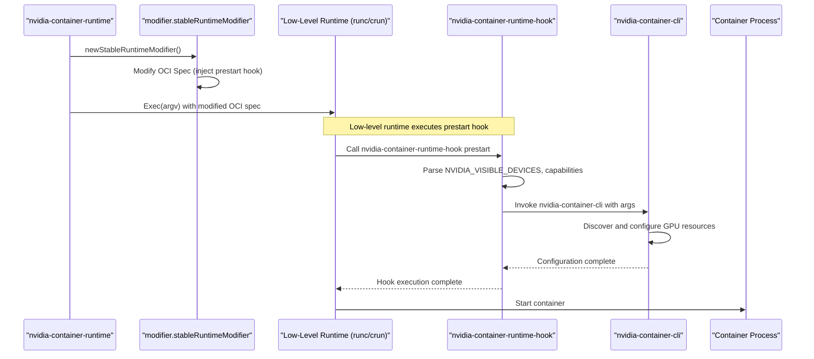
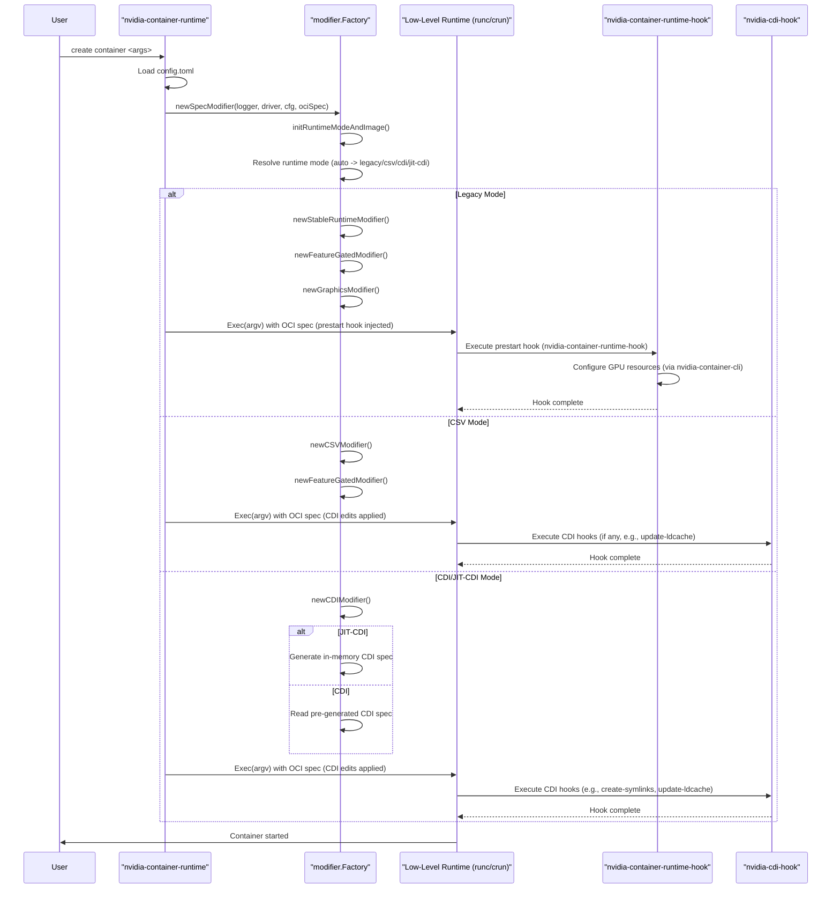

<!-- source: DeepWiki mcp.deepwiki.com · repo NVIDIA/nvidia-container-toolkit · page 3.1 Runtime Modes · fetched 2026-10-26 -->

# Runtime Modes

<details>
<summary>Relevant source files</summary>

The following files were used as context for generating this wiki page:

- [internal/discover/compat_libs.go](internal/discover/compat_libs.go)
- [internal/info/auto.go](internal/info/auto.go)
- [internal/info/auto_test.go](internal/info/auto_test.go)
- [internal/modifier/cdi.go](internal/modifier/cdi.go)
- [internal/modifier/cdi_test.go](internal/modifier/cdi_test.go)
- [internal/modifier/csv.go](internal/modifier/csv.go)
- [internal/modifier/csv_test.go](internal/modifier/csv_test.go)
- [internal/modifier/discover_test.go](internal/modifier/discover_test.go)
- [internal/modifier/factory.go](internal/modifier/factory.go)
- [internal/modifier/gated.go](internal/modifier/gated.go)
- [internal/modifier/graphics.go](internal/modifier/graphics.go)
- [internal/modifier/graphics_test.go](internal/modifier/graphics_test.go)
- [internal/modifier/hook_remover.go](internal/modifier/hook_remover.go)
- [internal/modifier/mode.go](internal/modifier/mode.go)
- [internal/modifier/stable.go](internal/modifier/stable.go)
- [internal/modifier/stable_test.go](internal/modifier/stable_test.go)
- [internal/runtime/runtime.go](internal/runtime/runtime.go)
- [internal/runtime/runtime_factory.go](internal/runtime/runtime_factory.go)
- [internal/runtime/runtime_factory_test.go](internal/runtime/runtime_factory_test.go)
- [pkg/nvcdi/gated.go](pkg/nvcdi/gated.go)
- [pkg/nvcdi/mode.go](pkg/nvcdi/mode.go)
- [pkg/nvcdi/transform/deduplicate.go](pkg/nvcdi/transform/deduplicate.go)
- [pkg/nvcdi/transform/merged-device.go](pkg/nvcdi/transform/merged-device.go)
- [pkg/nvcdi/transform/remove.go](pkg/nvcdi/transform/remove.go)
- [pkg/nvcdi/transform/sorter.go](pkg/nvcdi/transform/sorter.go)
- [pkg/nvcdi/transform/sorter_test.go](pkg/nvcdi/transform/sorter_test.go)
- [vendor/github.com/NVIDIA/go-nvlib/pkg/nvlib/info/api.go](vendor/github.com/NVIDIA/go-nvlib/pkg/nvlib/info/api.go)
- [vendor/github.com/NVIDIA/go-nvlib/pkg/nvlib/info/property-extractor.go](vendor/github.com/NVIDIA/go-nvlib/pkg/nvlib/info/property-extractor.go)
- [vendor/github.com/NVIDIA/go-nvlib/pkg/nvlib/info/property-extractor_mock.go](vendor/github.com/NVIDIA/go-nvlib/pkg/nvlib/info/property-extractor_mock.go)
- [vendor/github.com/NVIDIA/go-nvlib/pkg/nvlib/info/resolver.go](vendor/github.com/NVIDIA/go-nvlib/pkg/nvlib/info/resolver.go)

</details>


This page explains the different operational modes of the NVIDIA Container Runtime and how mode detection and selection works. The runtime mode determines how GPU resources are injected into containers and which mechanisms are used for device discovery and configuration.

## Overview of Runtime Modes

The NVIDIA Container Runtime supports four primary operational modes:

| Mode | Description | Primary Use Case |
|------|-------------|-----------------|
| `auto` | Automatically selects the appropriate mode based on platform and container configuration | Default setting for most deployments |
| `legacy` | Injects a prestart hook that invokes `nvidia-container-runtime-hook` | Backward compatibility, standard GPU deployments |
| `csv` | Uses CSV files for device and mount specifications | NVIDIA Jetson/Tegra platforms without NVML |
| `cdi` | Uses pre-generated Container Device Interface specifications | Modern standards-compliant container deployments |
| `jit-cdi` | Generates CDI specifications on-demand at container creation time | Dynamic CDI specification generation |

The mode is configured in the `nvidia-container-runtime.mode` configuration option, which defaults to `"auto"`.
Sources: [api/config/v1/config.go:116-133](), [internal/info/auto.go:27-47]()

## Mode Resolution Process

When the runtime mode is set to `"auto"` (the default), the NVIDIA Container Runtime performs mode detection at container creation time. The resolution process is implemented in the `initRuntimeModeAndImage()` function [internal/runtime/runtime_factory.go:88-130]() and follows this logic:

**Diagram: Runtime Mode Resolution Flow**
```mermaid
flowchart TD
    subgraph "nvidia-container-runtime"
        A[newNVIDIAContainerRuntime()] --> B[initRuntimeModeAndImage()]
        B --> C{Is mode "auto"?}
        C -- No --> D[Use configured mode]
        C -- Yes --> E[modeResolver.ResolveRuntimeMode()]
    end

    subgraph "modeResolver.ResolveRuntimeMode()"
        E --> F{image.OnlyFullyQualifiedCDIDevices()?}
        F -- Yes --> G[CDIRuntimeMode]
        F -- No --> H[nvinfo.ResolvePlatform()]
        H -- info.PlatformNVML --> I[JitCDIRuntimeMode]
        H -- info.PlatformWSL --> I
        H -- info.PlatformTegra --> J[CSVRuntimeMode]
        H -- Other --> I
    end

    G --> K[Return resolved mode]
    J --> K
    I --> K
    D --> K
```
Sources: [internal/runtime/runtime_factory.go:88-130](), [internal/info/auto.go:111-136]()

The mode resolver uses the following decision criteria:

1.  **Explicit Configuration**: If `nvidia-container-runtime.mode` is set to a specific mode (not `"auto"`), that mode is used directly [internal/info/auto.go:112-114]().
2.  **CDI Annotation Detection**: If `image.OnlyFullyQualifiedCDIDevices()` returns true, indicating that only fully qualified CDI devices are requested (e.g., `nvidia.com/gpu=0`), then `CDIRuntimeMode` is selected [internal/info/auto.go:120-122]().
3.  **Platform Detection**: The `nvinfo.ResolvePlatform()` function determines the underlying platform:
    *   If `info.PlatformNVML` or `info.PlatformWSL`, `JitCDIRuntimeMode` is selected [internal/info/auto.go:130-131]().
    *   If `info.PlatformTegra`, `CSVRuntimeMode` is selected [internal/info/auto.go:132-133]().
4.  **Default Fallback**: If no other conditions are met, the `defaultMode` of the `modeResolver` is used, which is `JitCDIRuntimeMode` by default [internal/info/auto.go:89](), [internal/info/auto.go:135-136]().

Sources: [internal/runtime/runtime_factory.go:118-130](), [internal/info/auto.go:111-136]()

### Container Image Analysis

The runtime creates an `image.CUDA` object from the OCI specification, which extracts configuration from:

-   Container environment variables (e.g., `NVIDIA_VISIBLE_DEVICES`, `NVIDIA_DRIVER_CAPABILITIES`)
-   Container annotations (e.g., CDI device annotations)
-   Volume mounts (for legacy device specification methods)

This image object is passed to the mode resolver to determine the appropriate runtime behavior.
Sources: [internal/runtime/runtime_factory.go:98-106]()

## Mode Implementation Architecture

Each runtime mode is implemented through a specialized `oci.SpecModifier` that transforms the OCI runtime specification before passing it to the low-level runtime. The modifier selection and creation happens in the `newSpecModifier()` function [internal/runtime/runtime_factory.go:70-84]().

**Diagram: Runtime Mode Modifier Architecture**
```mermaid
flowchart TD
    subgraph "newSpecModifier()"
        A[initRuntimeModeAndImage()] --> B{Resolved Mode?}
        B -- legacy --> C[newStableRuntimeModifier()]
        B -- csv --> D[newCSVModifier()]
        B -- cdi / jit-cdi --> E[newCDIModifier()]
    end

    subgraph "Modifier Factory (modifier.New())"
        C --> F[modifier.WithRuntimeMode(LegacyRuntimeMode)]
        D --> G[modifier.WithRuntimeMode(CSVRuntimeMode)]
        E --> H[modifier.WithRuntimeMode(CDIRuntimeMode)]
        H --> I[modifier.WithRuntimeMode(JitCDIRuntimeMode)]
    end

    subgraph "Common Modifiers"
        J[modifier.NewHookRemover()]
        K[modifier.NewGraphicsModifier()]
        L[modifier.NewFeatureGatedModifier()]
    end

    F --> M[modifier.List]
    G --> M
    H --> M
    I --> M
    J --> M
    K --> M
    L --> M
    M --> N[Return oci.SpecModifier]
```
Sources: [internal/runtime/runtime_factory.go:70-84](), [internal/modifier/factory.go:30-40]()

The modifier list is applied in order when a container is created with the `create` subcommand.

Sources: [internal/runtime/runtime_factory.go:66-103](), [internal/runtime/runtime_factory.go:105-116]()

### Modifier Types by Mode

Different runtime modes support different sets of modifiers:

| Mode | Supported Modifiers | Description |
|------|---------------------|-------------|
| `cdi`, `jit-cdi` | `nvidia-hook-remover`, `mode` | Removes legacy hooks, applies CDI modifications |
| `csv` | `nvidia-hook-remover`, `feature-gated`, `mode` | Removes legacy hooks, applies CSV mounts, feature-gated devices |
| `legacy` | `feature-gated`, `graphics`, `mode` | Full legacy hook injection with all features |

The `nvidia-hook-remover` modifier ensures that any existing `nvidia-container-runtime-hook` or `nvidia-container-toolkit` prestart hooks are removed from the OCI spec, preventing duplicate GPU configuration attempts.
Sources: [internal/modifier/hook_remover.go:20-22]()

## Legacy Mode

Legacy mode is the traditional runtime mode that provides backward compatibility with earlier versions of the NVIDIA Container Runtime. In this mode, the runtime injects a prestart hook into the OCI specification that invokes the `nvidia-container-runtime-hook` binary.

**Diagram: Legacy Mode Container Creation Flow**

Sources: [internal/modifier/stable.go:30-70]()

### Key Characteristics

-   **Hook Path**: The path to `nvidia-container-runtime-hook` is configured via `nvidia-container-runtime-hook.path` (default: `"nvidia-container-runtime-hook"`) [api/config/v1/config.go:134-136]().
-   **Dynamic Discovery**: GPU devices and libraries are discovered at container creation time by the hook.
-   **Full Feature Support**: Supports all NVIDIA driver capabilities (compute, graphics, video, utility, display).
-   **CUDA Compatibility**: Handles CUDA forward compatibility libraries based on `nvidia-container-runtime.modes.legacy.cuda-compat-mode` setting [api/config/v1/config.go:140-142]().
-   **Modifiers**: Applies `feature-gated`, `graphics`, and `mode` modifiers.

### Configuration Options

```toml
[nvidia-container-runtime-hook]
path = "nvidia-container-runtime-hook"
skip-mode-detection = false

[nvidia-container-runtime.modes.legacy]
cuda-compat-mode = "ldconfig"  # Options: "disabled", "hook", "ldconfig", "mount"
```

The `cuda-compat-mode` setting controls how CUDA forward compatibility libraries are made discoverable in containers:
-   `"ldconfig"`: Adds compat lib folders to ldconfig invocation (default).
-   `"hook"`: Uses a container lifecycle hook to configure compat libraries [internal/modifier/gated.go:69-97]().
-   `"mount"`: Mounts compat library folders directly.
-   `"disabled"`: Disables CUDA compat handling.

Sources: [internal/info/auto.go:30-34](), [api/config/v1/config.go:134-142](), [internal/modifier/gated.go:69-97]()

## CSV Mode

CSV mode is designed for NVIDIA Jetson and Tegra-based systems where NVML (NVIDIA Management Library) is not available. Instead of querying GPUs dynamically, this mode reads device and mount specifications from CSV (Comma-Separated Values) files.

### How CSV Mode Works

1.  The runtime reads mount specification files from a configured directory [internal/modifier/cdi.go:178-181]().
2.  These CSV files define the devices, mounts, and environment variables needed for GPU access.
3.  The runtime applies these specifications directly to the OCI spec without invoking NVML.

**Diagram: CSV Mode Configuration Flow**
```mermaid
flowchart TD
    subgraph "nvidia-container-runtime"
        A[Container Create] --> B[newCSVModifier()]
        B --> C[checkRequirements()]
        C -- Requirements Met --> D[newAutomaticCDISpecModifier()]
    end

    subgraph "newAutomaticCDISpecModifier()"
        D --> E[csv.GetFileList(MountSpecPath)]
        E --> F[cdiModeIdentfiersFromDevices()]
        F --> G[nvcdi.New(WithMode(ModeCSV))]
        G --> H[Generate in-memory CDI spec]
        H --> I[Apply CDI edits to OCI spec]
    end

    I --> J[Modified OCI Spec]
```
Sources: [internal/modifier/csv.go:31-44](), [internal/modifier/cdi.go:175-203]()

### Configuration

```toml
[nvidia-container-runtime.modes.csv]
mount-spec-path = "/etc/nvidia-container-runtime/host-files-for-container.d"
```

The mount specification path contains CSV files that define the GPU resources available on the system. These files are typically generated during system setup or driver installation on Tegra platforms.
Sources: [api/config/v1/config.go:144-146]()

### Key Characteristics

-   **Platform-Specific**: Primarily used on Tegra/Jetson platforms without NVML [internal/info/auto.go:132-133]().
-   **Static Configuration**: Device specifications are predefined in CSV files.
-   **Feature-Gated Support**: Supports feature-gated modifiers for GDS, MOFED, NVSWITCH, and GDRCOPY.
-   **No CUDA Compat Hook**: The enable-cuda-compat hook is explicitly disabled in CSV mode [internal/modifier/gated.go:65-67]().
-   **Modifiers**: Applies `nvidia-hook-remover`, `feature-gated`, and `mode` modifiers.

Sources: [internal/info/auto.go:35-39](), [internal/modifier/gated.go:65-67]()

## CDI Mode

CDI (Container Device Interface) mode uses pre-generated CDI specifications to inject GPU resources into containers. This is the modern, standards-based approach for container device management.

### How CDI Mode Works

CDI mode relies on CDI specification files that have been generated ahead of time (typically by running `nvidia-ctk cdi generate`). When a container requests a CDI device (e.g., via annotations like `cdi.k8s.io/device=nvidia.com/gpu=0`), the container runtime reads the corresponding CDI specification and applies the defined device nodes, mounts, hooks, and environment variables.

**Diagram: CDI Mode Specification Resolution**
```mermaid
flowchart LR
    subgraph "Container Runtime"
        A[Container with CDI annotation] --> B[nvidia-container-runtime]
        B --> C[newCDIModifier()]
    end

    subgraph "newCDIModifier()"
        C --> D[newCDIDeviceRequestor()]
        D --> E[deviceRequestor.DeviceRequests()]
        E --> F{Are devices automatic (runtime.nvidia.com/gpu)?}
        F -- Yes --> G[newJitCDIModifier()]
        F -- No --> H[cdi.New(WithDevices, WithSpecDirs)]
    end

    subgraph "cdi.New()"
        H --> I[Read CDI specs from SpecDirs]
        I --> J[Parse CDI Device Spec]
        J --> K[Apply ContainerEdits]
    end

    subgraph "newJitCDIModifier()"
        G --> L[newAutomaticCDISpecModifier()]
        L --> M[nvcdi.New(WithMode(ModeNvml/ModeWsl/ModeCSV))]
        M --> N[Generate in-memory CDI spec]
        N --> O[Apply CDI edits to OCI spec]
    end

    K --> P[Modified OCI Spec]
    O --> P
```
Sources: [internal/modifier/cdi.go:43-77](), [internal/modifier/cdi.go:81-86]()

### Configuration

```toml
[nvidia-container-runtime.modes.cdi]
default-kind = "nvidia.com/gpu"
annotation-prefixes = ["cdi.k8s.io/"]
spec-dirs = ["/etc/cdi", "/var/run/cdi"]
```
Sources: [api/config/v1/config.go:148-152]()

### Key Characteristics

-   **Pre-generated Specifications**: CDI specs must be created before container creation using `nvidia-ctk cdi generate` (for non-JIT CDI).
-   **Standards-Based**: Follows the CDI specification for device injection.
-   **Minimal Runtime Overhead**: No device discovery at container creation time (for non-JIT CDI).
-   **Annotation-Driven**: Devices are requested via container annotations [internal/modifier/cdi_test.go:87-121]().
-   **Modifiers**: Only applies `nvidia-hook-remover` and `mode` modifiers.

### JIT-CDI Mode Variant

The `jit-cdi` (Just-In-Time CDI) mode is a variant that generates CDI specifications on-demand at container creation time rather than requiring pre-generated specifications. This mode provides the benefits of CDI while maintaining the dynamic behavior of legacy mode. This is handled by `newJitCDIModifier()` [internal/modifier/cdi.go:81-86]() which calls `newAutomaticCDISpecModifier()` [internal/modifier/cdi.go:175-203]() to generate the CDI spec in-memory.
Sources: [internal/info/auto.go:44-47](), [internal/modifier/cdi.go:81-86](), [internal/modifier/cdi.go:175-203]()

## Feature-Gated Device Support

All runtime modes support feature-gated device injection for specialized hardware through environment variables. These are implemented through the `modifier.NewFeatureGatedModifier()`:

| Environment Variable | Feature | Description |
|---------------------|---------|-------------|
| `NVIDIA_GDS=enabled` | GPUDirect Storage | Injects GDS device nodes (`/dev/nvidia-fs*`) |
| `NVIDIA_MOFED=enabled` | Mellanox OFED | Injects Infiniband device nodes |
| `NVIDIA_NVSWITCH=enabled` | NVSwitch | Injects NVSwitch device nodes (`/dev/nvidia-nvswitch*`) |
| `NVIDIA_GDRCOPY=enabled` | GDRCopy | Injects GDRCopy device node (`/dev/gdrdrv`) |

The feature-gated modifier is applied in `legacy` and `csv` modes. It creates discoverers for each enabled feature and merges their device nodes and mounts into the container specification.
Sources: [internal/modifier/gated.go:36-49](), [internal/modifier/cdi.go:133-147]()

## Runtime Configuration

The runtime mode can be configured in the `/etc/nvidia-container-runtime/config.toml` file:

```toml
[nvidia-container-runtime]
mode = "auto"  # Options: "auto", "legacy", "csv", "cdi", "jit-cdi"

[nvidia-container-runtime.modes.cdi]
default-kind = "nvidia.com/gpu"
annotation-prefixes = ["cdi.k8s.io/"]
spec-dirs = ["/etc/cdi", "/var/run/cdi"]

[nvidia-container-runtime.modes.csv]
mount-spec-path = "/etc/nvidia-container-runtime/host-files-for-container.d"

[nvidia-container-runtime.modes.legacy]
cuda-compat-mode = "ldconfig"
```
Sources: [api/config/v1/config.go:116-152]()

### Mode Override

The runtime mode can also be overridden programmatically or through mode-specific runtime binaries:

-   **Config File**: Set `nvidia-container-runtime.mode` in `config.toml`.
-   **Mode-Specific Binaries**: Use `nvidia-container-runtime.cdi` or `nvidia-container-runtime.legacy` (available in the `operator-extensions` package).
-   **Runtime API**: Pass `WithModeOverride()` option when creating the runtime [internal/runtime/api.go:28-33]().

Sources: [internal/runtime/runtime.go:66-67]()

## Runtime Execution Flow

The complete flow from runtime invocation to container start depends on the selected mode:

**Diagram: Complete Runtime Execution by Mode**

Sources: [internal/runtime/runtime.go:34-91](), [internal/runtime/runtime_factory.go:33-64]()

## Best Practices

1.  **Default to Auto Mode**: In most cases, using the default `auto` mode is recommended as it correctly detects the appropriate mode based on your system configuration.

2.  **Explicit Mode Selection**: Specify an explicit mode when:
    -   You need to override the automatic detection.
    -   You're troubleshooting issues with the toolkit.
    -   You have a specialized use case (e.g., management containers).

3.  **CSV Mode for Jetson**: When working with NVIDIA Jetson platforms, ensure CSV mode is being selected, as it's required for proper operation.

4.  **Management Mode for Admin Containers**: Use management mode for containers that need to administer or manage GPUs, as it provides full access to GPU resources.

---

