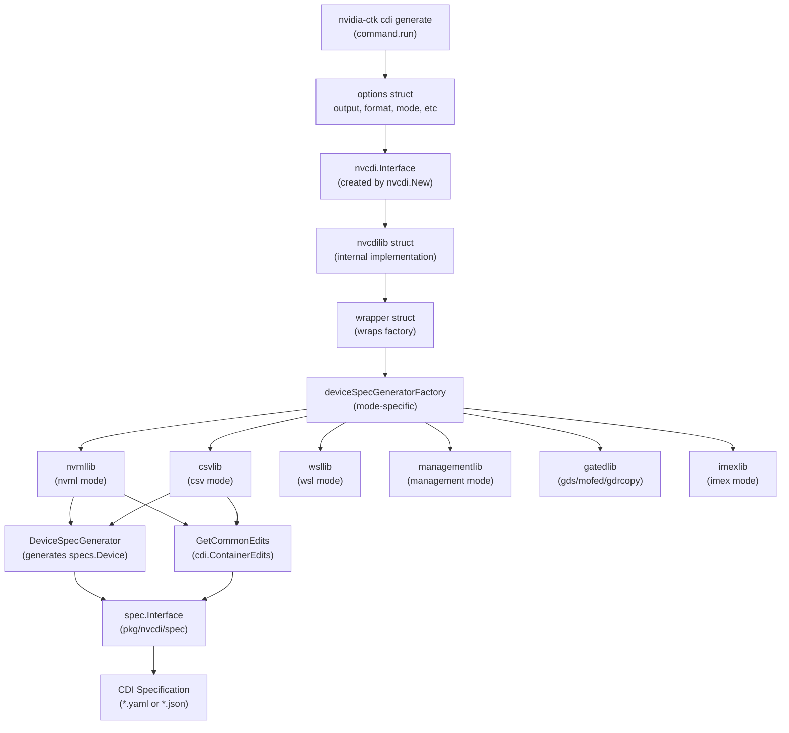
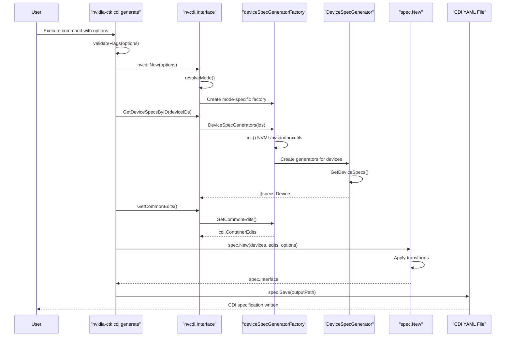
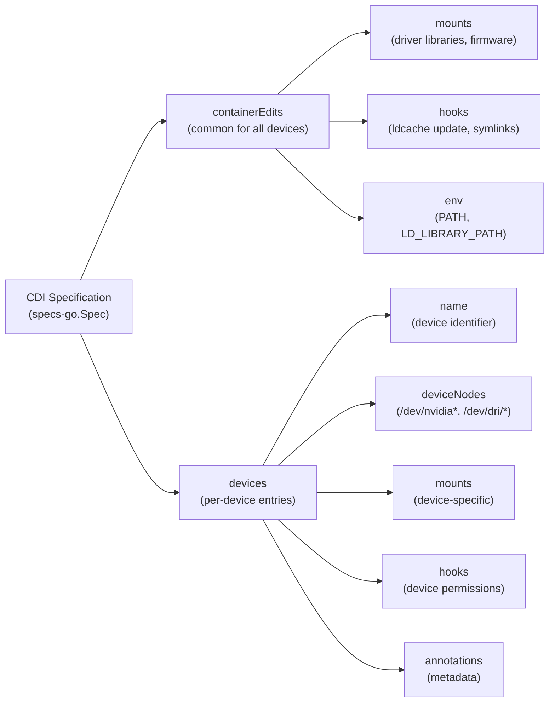
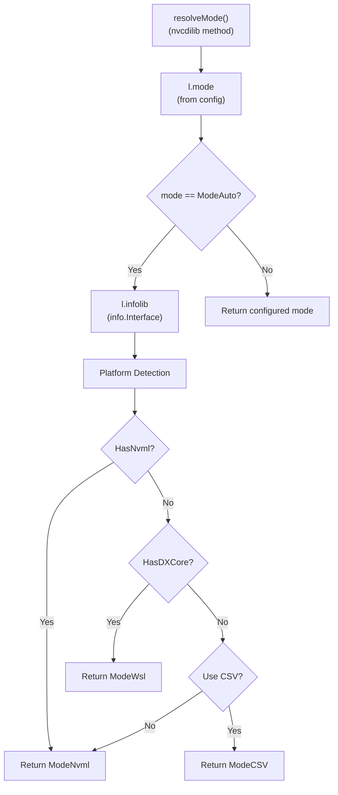
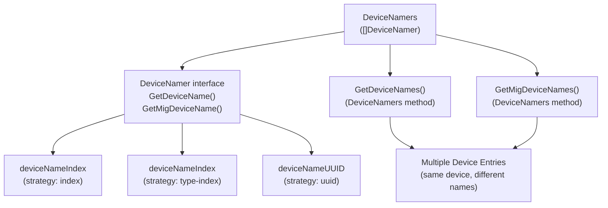
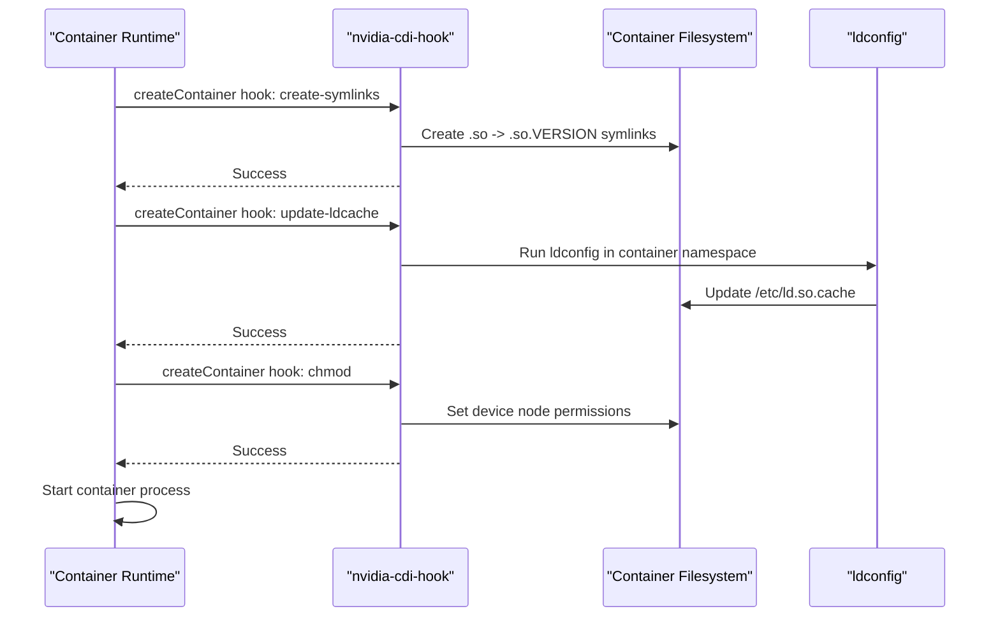
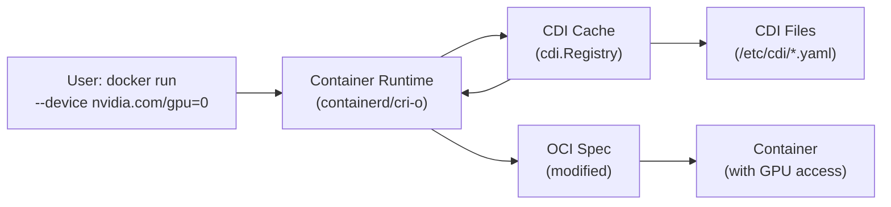
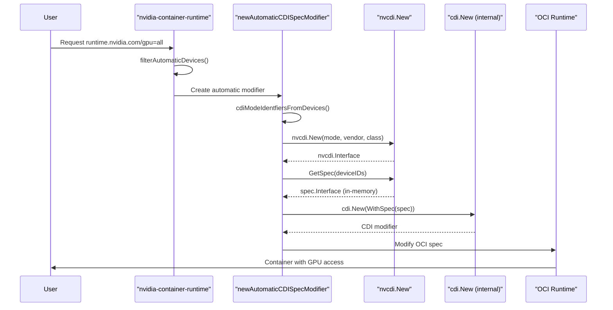
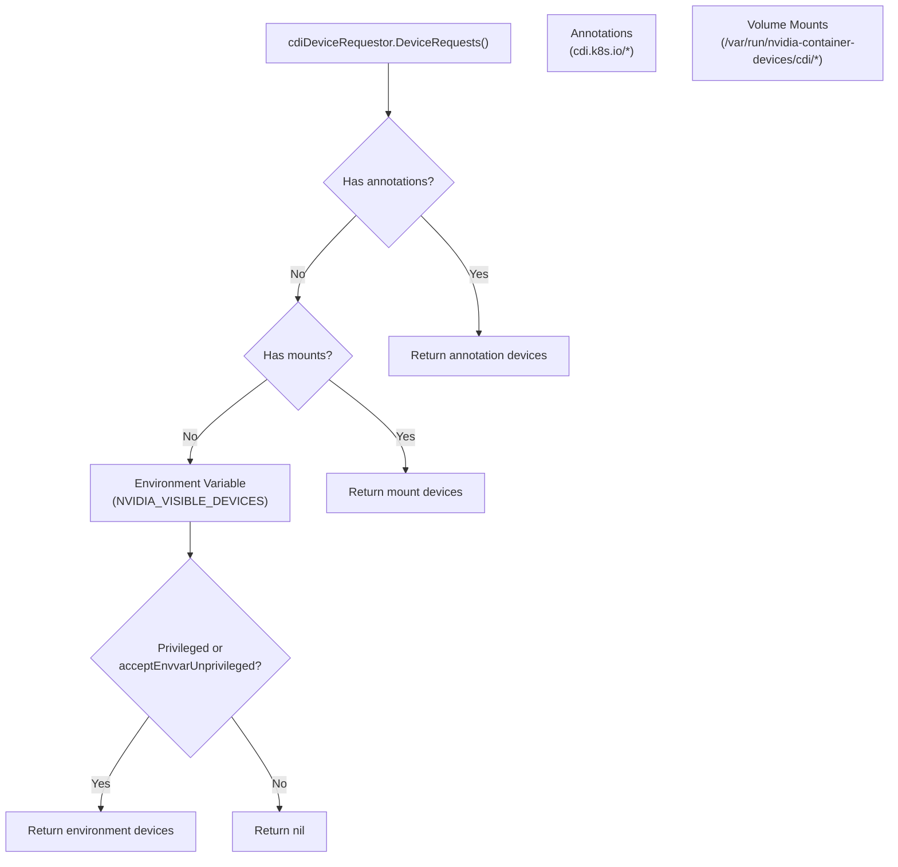

<!-- source: DeepWiki mcp.deepwiki.com · repo NVIDIA/nvidia-container-toolkit · page 3.2 Container Device Interface (CDI) · fetched 2026-10-26 -->

# Container Device Interface (CDI)

<details>
<summary>Relevant source files</summary>

The following files were used as context for generating this wiki page:

- [cmd/nvidia-ctk/cdi/generate/generate.go](cmd/nvidia-ctk/cdi/generate/generate.go)
- [internal/modifier/cdi/builder.go](internal/modifier/cdi/builder.go)
- [internal/modifier/cdi/registry.go](internal/modifier/cdi/registry.go)
- [internal/modifier/cdi/spec.go](internal/modifier/cdi/spec.go)
- [pkg/nvcdi/api.go](pkg/nvcdi/api.go)
- [pkg/nvcdi/common-nvml.go](pkg/nvcdi/common-nvml.go)
- [pkg/nvcdi/driver-nvml.go](pkg/nvcdi/driver-nvml.go)
- [pkg/nvcdi/full-gpu-nvml.go](pkg/nvcdi/full-gpu-nvml.go)
- [pkg/nvcdi/lib-csv.go](pkg/nvcdi/lib-csv.go)
- [pkg/nvcdi/lib-imex.go](pkg/nvcdi/lib-imex.go)
- [pkg/nvcdi/lib-imex_test.go](pkg/nvcdi/lib-imex_test.go)
- [pkg/nvcdi/lib-nvml.go](pkg/nvcdi/lib-nvml.go)
- [pkg/nvcdi/lib-wsl.go](pkg/nvcdi/lib-wsl.go)
- [pkg/nvcdi/lib.go](pkg/nvcdi/lib.go)
- [pkg/nvcdi/management.go](pkg/nvcdi/management.go)
- [pkg/nvcdi/mig-device-nvml.go](pkg/nvcdi/mig-device-nvml.go)
- [pkg/nvcdi/options.go](pkg/nvcdi/options.go)
- [pkg/nvcdi/spec/api.go](pkg/nvcdi/spec/api.go)
- [pkg/nvcdi/spec/builder.go](pkg/nvcdi/spec/builder.go)
- [pkg/nvcdi/spec/set-minimum-version.go](pkg/nvcdi/spec/set-minimum-version.go)
- [pkg/nvcdi/spec/spec.go](pkg/nvcdi/spec/spec.go)
- [pkg/nvcdi/spec/spec_test.go](pkg/nvcdi/spec/spec_test.go)
- [pkg/nvcdi/transform/deduplicate_test.go](pkg/nvcdi/transform/deduplicate_test.go)
- [pkg/nvcdi/transform/edits.go](pkg/nvcdi/transform/edits.go)
- [pkg/nvcdi/transform/merged-device_test.go](pkg/nvcdi/transform/merged-device_test.go)
- [pkg/nvcdi/transform/simplify.go](pkg/nvcdi/transform/simplify.go)
- [pkg/nvcdi/transform/simplify_test.go](pkg/nvcdi/transform/simplify_test.go)
- [pkg/nvcdi/wrapper.go](pkg/nvcdi/wrapper.go)
- [vendor/tags.cncf.io/container-device-interface/pkg/cdi/cache.go](vendor/tags.cncf.io/container-device-interface/pkg/cdi/cache.go)
- [vendor/tags.cncf.io/container-device-interface/pkg/cdi/container-edits.go](vendor/tags.cncf.io/container-device-interface/pkg/cdi/container-edits.go)
- [vendor/tags.cncf.io/container-device-interface/pkg/cdi/container-edits_unix.go](vendor/tags.cncf.io/container-device-interface/pkg/cdi/container-edits_unix.go)
- [vendor/tags.cncf.io/container-device-interface/pkg/cdi/doc.go](vendor/tags.cncf.io/container-device-interface/pkg/cdi/doc.go)
- [vendor/tags.cncf.io/container-device-interface/pkg/cdi/oci.go](vendor/tags.cncf.io/container-device-interface/pkg/cdi/oci.go)
- [vendor/tags.cncf.io/container-device-interface/pkg/cdi/spec-dirs.go](vendor/tags.cncf.io/container-device-interface/pkg/cdi/spec-dirs.go)
- [vendor/tags.cncf.io/container-device-interface/pkg/cdi/spec.go](vendor/tags.cncf.io/container-device-interface/pkg/cdi/spec.go)
- [vendor/tags.cncf.io/container-device-interface/specs-go/config.go](vendor/tags.cncf.io/container-device-interface/specs-go/config.go)
- [vendor/tags.cncf.io/container-device-interface/specs-go/version.go](vendor/tags.cncf.io/container-device-interface/specs-go/version.go)

</details>


## Purpose and Scope

This document describes the Container Device Interface (CDI) support in the NVIDIA Container Toolkit, including CDI specification generation, the structure of generated specifications, runtime consumption of CDI specs, and the various discovery modes supported. For information about runtime modes and when CDI mode is selected, see [Runtime Modes](#3.1). For information about runtime integration with container runtimes, see [Container Runtime Integration](#3.5).

CDI is a standardized mechanism for container runtimes to make devices available to containers. The NVIDIA Container Toolkit implements CDI to expose NVIDIA GPUs and related devices through declarative YAML/JSON specifications rather than runtime hooks.

## Overview

The NVIDIA Container Toolkit provides two primary ways to work with CDI:

1. **Pre-generated CDI specifications**: CDI specs are generated ahead of time using `nvidia-ctk cdi generate` and stored on disk at `/etc/cdi/` or `/var/run/cdi/`. Container runtimes read these specifications directly.

2. **Just-in-time (JIT) CDI mode**: CDI specs are generated automatically at container creation time when devices with vendor `runtime.nvidia.com` are requested. This eliminates the need for pre-generation and automatic updates.

The toolkit supports CDI specification version 0.7.0 and generates specifications that describe device nodes, library mounts, hooks, and environment variables needed for GPU containers.

**Sources**: [CHANGELOG.md:307-311](), [CHANGELOG.md:323-324](), [pkg/nvcdi/api.go:1-96]()

## CDI Specification Generation Architecture

The following diagram shows the architecture of CDI specification generation, mapping high-level concepts to concrete code types:



**Sources**: [cmd/nvidia-ctk/cdi/generate/generate.go:84-256](), [pkg/nvcdi/lib.go:66-161](), [pkg/nvcdi/wrapper.go:30-44]()

### Generation Flow

The CDI specification generation process follows this flow:



**Sources**: [cmd/nvidia-ctk/cdi/generate/generate.go:305-318](), [cmd/nvidia-ctk/cdi/generate/generate.go:359-464](), [pkg/nvcdi/wrapper.go:46-97]()

## CDI Specification Structure

A generated CDI specification is a YAML or JSON file conforming to the CDI specification format. The toolkit generates specifications with the following structure:

### File Naming and Location

CDI specifications are stored at:
- `/etc/cdi/nvidia.yaml` (default for standard GPU devices)
- `/etc/cdi/nvidia.coherent.yaml` (for coherent devices, if enabled)
- `/etc/cdi/nvidia.noncoherent.yaml` (for non-coherent devices, if enabled)
- `/var/run/cdi/` (runtime-generated specs)

The base filename is determined by the vendor and class: `<vendor>-<class>.yaml` (e.g., `nvidia.com-gpu.yaml` becomes `nvidia.yaml`).

**Sources**: [cmd/nvidia-ctk/cdi/generate/generate.go:337-357](), [pkg/nvcdi/spec/spec.go:1-145]()

### Specification Components



### Common Edits

The `containerEdits` section contains resources common to all devices:

- **Mounts**: Driver libraries (e.g., `libnvidia-ml.so.1`, `libcuda.so.555.42.06`), firmware files (`gsp*.bin`), IPC sockets (`/var/run/nvidia-persistenced/socket`)
- **Hooks**: 
  - `createContainer` hooks for creating `.so` symlinks
  - `createContainer` hooks for updating `ldcache`
  - `createContainer` hooks for enabling CUDA compatibility
  - `createContainer` hooks for disabling device node modification
- **Environment Variables**: `PATH`, `LD_LIBRARY_PATH`, `NVIDIA_VISIBLE_DEVICES=void`, `NVIDIA_CTK_LIBCUDA_DIR`

**Sources**: [pkg/nvcdi/lib-nvml.go:37-47](), [pkg/nvcdi/driver-nvml.go:33-75](), [pkg/nvcdi/driver-nvml.go:77-126]()

### Device Entries

Each device in the specification has:

- **name**: Device identifier (e.g., `0`, `GPU-12345`, `gpu0`, `0:1` for MIG)
- **containerEdits.deviceNodes**: Device nodes to inject (e.g., `/dev/nvidia0`, `/dev/nvidia-caps/nvidia-cap1`)
- **containerEdits.mounts**: Device-specific mounts (rare)
- **containerEdits.hooks**: Device-specific permission hooks
- **annotations**: Metadata such as `gpu.nvidia.com/coherent=true`

**Sources**: [pkg/nvcdi/full-gpu-nvml.go:82-109](), [pkg/nvcdi/mig-device-nvml.go:90-111]()

### Example Structure

```yaml
cdiVersion: 0.7.0
kind: nvidia.com/gpu
devices:
  - name: "0"
    containerEdits:
      deviceNodes:
        - path: /dev/nvidia0
        - path: /dev/nvidia-caps/nvidia-cap1
      hooks:
        - hookName: createContainer
          path: /usr/bin/nvidia-cdi-hook
          args: ["nvidia-cdi-hook", "chmod", "--mode", "755", "--path", "/dev/nvidia0"]
    annotations:
      gpu.nvidia.com/coherent: "false"
  - name: "all"
    containerEdits:
      deviceNodes:
        - path: /dev/nvidia0
        - path: /dev/nvidia1
        # ... all device nodes
containerEdits:
  mounts:
    - hostPath: /usr/lib/x86_64-linux-gnu/libnvidia-ml.so.1
      containerPath: /usr/lib/x86_64-linux-gnu/libnvidia-ml.so.1
    - hostPath: /lib/firmware/nvidia/555.42.06/gsp_ga10x.bin
      containerPath: /lib/firmware/nvidia/555.42.06/gsp_ga10x.bin
  hooks:
    - hookName: createContainer
      path: /usr/bin/nvidia-cdi-hook
      args: ["nvidia-cdi-hook", "create-symlinks", "--link", "..."]
    - hookName: createContainer
      path: /usr/bin/nvidia-cdi-hook
      args: ["nvidia-cdi-hook", "update-ldcache", "--folder", "..."]
  env:
    - NVIDIA_VISIBLE_DEVICES=void
    - NVIDIA_CTK_LIBCUDA_DIR=/usr/lib/x86_64-linux-gnu
```

**Sources**: [pkg/nvcdi/spec/spec.go:1-145]()

## Discovery Modes

The toolkit supports multiple discovery modes for different platforms and use cases. The mode is specified via the `--mode` flag or automatically detected in `auto` mode.

| Mode | Description | Factory Type | Primary Use Case |
|------|-------------|--------------|------------------|
| `nvml` | NVML-based discovery | `nvmllib` | Standard Linux systems with NVIDIA driver |
| `csv` | CSV file-based discovery | `csvlib` | Tegra/Jetson platforms |
| `wsl` | DXCore-based discovery | `wsllib` | WSL2 on Windows |
| `management` | All device nodes | `managementlib` | Management/monitoring containers |
| `gds` | GDS (GPUDirect Storage) devices | `gatedlib` | High-performance storage |
| `mofed` | MOFED InfiniBand devices | `gatedlib` | High-performance networking |
| `gdrcopy` | GDRCopy devices | `gatedlib` | GPU-CPU memory transfers |
| `nvswitch` | NVSwitch devices | `gatedlib` | Multi-GPU systems |
| `imex` | IMEX channels | `imexlib` | Inter-process communication |

**Sources**: [pkg/nvcdi/lib.go:115-145](), [pkg/nvcdi/mode.go:1-126]()

### Mode Resolution Architecture



**Sources**: [pkg/nvcdi/mode.go:1-126](), [internal/info/auto.go:1-100]()

### NVML Mode

NVML mode uses the NVIDIA Management Library to discover GPUs and MIG devices. This is the standard mode for most Linux systems.

**Key Types**:
- `nvmllib` ([pkg/nvcdi/lib-nvml.go:31]()) (implements `deviceSpecGeneratorFactory`)
- `fullGPUDeviceSpecGenerator` ([pkg/nvcdi/full-gpu-nvml.go:34-41]()) (generates specs for full GPUs)
- `migDeviceSpecGenerator` ([pkg/nvcdi/mig-device-nvml.go:30-34]()) (generates specs for MIG devices)

**Discovery Process**:
1. Initialize NVML via `l.nvmllib.Init()` [pkg/nvcdi/lib-nvml.go:214]()
2. Query devices via `l.devicelib.VisitDevices()` [pkg/nvcdi/lib-nvml.go:115]() and `l.devicelib.VisitMigDevices()` [pkg/nvcdi/lib-nvml.go:134]()
3. Create device discoverers via `dgpu.NewForDevice()` [pkg/nvcdi/full-gpu-nvml.go:162]() and `dgpu.NewForMigDevice()` [pkg/nvcdi/mig-device-nvml.go:126]()
4. Generate driver library and firmware discoverers via `newDriverVersionDiscoverer()` [pkg/nvcdi/driver-nvml.go:38]()

**Sources**: [pkg/nvcdi/lib-nvml.go:33-260](), [pkg/nvcdi/full-gpu-nvml.go:35-190](), [pkg/nvcdi/mig-device-nvml.go:31-146]()

### CSV Mode

CSV mode reads mount specifications from CSV files, used on Tegra/Jetson platforms where NVML is not available.

**Default CSV Files**:
- `/etc/nvidia-container-runtime/host-files-for-container.d/*.csv`

**Discovery Process**:
1. Parse CSV files listing libraries, binaries, and device nodes [pkg/nvcdi/lib-csv.go:180]()
2. Create mount specifications from parsed entries [pkg/nvcdi/lib-csv.go:180]()
3. Apply ignore patterns to filter unwanted entries [pkg/nvcdi/lib-csv.go:42]()

**Sources**: [pkg/nvcdi/lib-csv.go:1-150](), [internal/platform-support/tegra/csv:1-100]()

### Management Mode

Management mode exposes all NVIDIA device nodes without filtering, intended for management containers that need access to all GPUs.

**Key Characteristics**:
- No NVML device enumeration
- Discovers all `/dev/nvidia*` devices via glob patterns [pkg/nvcdi/management.go:97-108]()
- Vendor set to `management.nvidia.com` by default [pkg/nvcdi/options.go:145]()
- Disables CUDA compatibility and device modification hooks [pkg/nvcdi/options.go:116-119]()

**Sources**: [pkg/nvcdi/management.go:1-149](), [pkg/nvcdi/lib.go:122-128]()

## Device Naming Strategies

The toolkit supports multiple strategies for naming devices in CDI specifications. The strategy is specified via `--device-name-strategy` and can be specified multiple times to generate duplicate devices with different names.

| Strategy | GPU Name Format | MIG Name Format | Example |
|----------|----------------|----------------|---------|
| `index` | `<index>` | `<gpu_index>:<mig_index>` | `0`, `1:0` |
| `type-index` | `gpu<index>` | `mig<gpu_index>:<mig_index>` | `gpu0`, `mig1:0` |
| `uuid` | `<uuid>` | `<uuid>` | `GPU-12345-abcde`, `MIG-67890-fghij` |

**Default**: `[index, uuid]` - devices are generated with both index and UUID names. [cmd/nvidia-ctk/cdi/generate/generate.go:151]()

**Sources**: [pkg/nvcdi/namer.go:1-150](), [cmd/nvidia-ctk/cdi/generate/generate.go:146-152]()

### Device Namer Architecture



**Sources**: [pkg/nvcdi/namer.go:32-150]()

## CDI Hooks

CDI hooks are executables invoked during container lifecycle events. The NVIDIA Container Toolkit uses the `nvidia-cdi-hook` binary for all CDI hooks.

### Hook Types

| Hook Name | Purpose | Implementation |
|-----------|---------|----------------|
| `create-symlinks` | Create `.so.*` symlinks for libraries | `CreateSymlinksHook` |
| `update-ldcache` | Update container's ldcache | `UpdateLDCacheHook` |
| `enable-cuda-compat` | Enable CUDA forward compatibility | `EnableCudaCompatHook` |
| `disabled-device-node-modification` | Prevent device node creation | `DisableDeviceNodeModificationHook` |
| `chmod` | Set device node permissions | Device-specific hook |

**Sources**: [pkg/nvcdi/api.go:48-73](), [internal/discover/hooks.go:1-200]()

### Hook Execution Flow



**Sources**: [cmd/nvidia-cdi-hook:1-50](), [internal/discover/symlinks.go:1-150]()

### Hook Configuration

Hooks can be disabled or explicitly enabled via configuration:

```go
nvcdi.New(
    nvcdi.WithDisabledHooks("update-ldcache"),
    nvcdi.WithEnabledHooks("create-symlinks"),
)
```

The special hook name `"all"` can be used to disable all hooks.

**Sources**: [pkg/nvcdi/options.go:160-177](), [cmd/nvidia-ctk/cdi/generate/generate.go:214-230]()

## Runtime CDI Consumption

Container runtimes consume CDI specifications in two ways:

### 1. Static CDI Specifications

Pre-generated specifications stored on disk are read by the container runtime. The `nvidia-container-runtime` in CDI mode reads these files from standard CDI directories.



**Sources**: [internal/modifier/cdi/spec.go:40-70]()

### 2. Just-in-Time (JIT) CDI Mode

When devices with vendor `runtime.nvidia.com` are requested, the runtime generates CDI specifications on-the-fly.



**Sources**: [internal/modifier/cdi/spec.go:43-70](), [internal/modifier/cdi/spec.go:70]()

### Device Request Resolution

Device requests can come from multiple sources, resolved in priority order:

1. **Annotations**: Kubernetes CDI annotations (e.g., `cdi.k8s.io/nvidia-gpu=0`)
2. **Volume Mounts**: Mount requests to `/var/run/nvidia-container-devices/cdi/<vendor>/<class>/<device>`
3. **Environment Variables**: `NVIDIA_VISIBLE_DEVICES` (requires privileges or explicit config)



**Sources**: [internal/config/image/cuda_image.go:253-292](), [internal/modifier/cdi/spec.go:70]()

## Gated Modes

Gated modes expose specialized devices that require explicit enabling via environment variables or mode selection.

### GDS (GPUDirect Storage)

Enabled when `NVIDIA_GDS=enabled` or `mode=gds`:
- Discovers `/dev/nvidia-fs*` device nodes
- Used for direct GPU-to-storage transfers

### MOFED (InfiniBand)

Enabled when `NVIDIA_MOFED=enabled` or `mode=mofed`:
- Discovers InfiniBand devices in `/dev/infiniband/`
- Used for GPU-to-GPU communication over InfiniBand

### GDRCopy

Enabled when `NVIDIA_GDRCOPY=enabled` or `mode=gdrcopy`:
- Discovers `/dev/gdrdrv` device node
- Used for fast GPU-to-CPU memory copies

### NVSwitch

Enabled when `NVIDIA_NVSWITCH=enabled` or `mode=nvswitch`:
- Discovers `/dev/nvidia-nvswitch*` device nodes
- Used in multi-GPU NVSwitch systems

**Sources**: [internal/modifier/cdi/spec.go:70](), [pkg/nvcdi/lib-gated.go:1-150]()

## IMEX Channels

IMEX (Inter-process Memory Export) channels enable shared memory between processes.

### IMEX Mode

IMEX mode generates CDI specifications for IMEX channel devices:
- Device class: `imex-channel` [pkg/nvcdi/options.go:157]()
- Device nodes: `/dev/nvidia-caps-imex-channels/channel*`
- Discoverable via `mode=imex` or when `NVIDIA_IMEX_CHANNELS` is set

### Channel Naming

IMEX channels can be requested:
- By name: `channel0`, `channel1`, etc.
- Via environment variable: `NVIDIA_IMEX_CHANNELS=channel0,channel1`
- Via volume mounts: `/var/run/nvidia-container-devices/imex/channel0`
- Via mode specification: `mode=imex,id=channel0`

**Sources**: [pkg/nvcdi/lib-imex.go:1-135](), [internal/config/image/cuda_image.go:416-467]()

## Feature Flags

The CDI library supports several feature flags to control generation behavior:

| Feature Flag | Default | Description |
|-------------|---------|-------------|
| `enable-explicit-driver-libraries` | Off | Include explicit list of graphics libraries |
| `disable-nvsandboxutils` | Off | Disable use of libnvidia-sandboxutils |
| `enable-coherent-annotations` | Off | Add coherent/non-coherent annotations to devices |
| `disable-multiple-csv-devices` | Off | Disable handling of multiple CSV devices |

Feature flags are specified via:
- CLI: `--feature-flag=enable-explicit-driver-libraries` [cmd/nvidia-ctk/cdi/generate/generate.go:232-237]()
- API: `nvcdi.WithFeatureFlags("enable-explicit-driver-libraries")` [pkg/nvcdi/options.go:272-277]()

**Sources**: [pkg/nvcdi/api.go:75-96](), [pkg/nvcdi/options.go:179-194]()

## Coherent Device Annotation

When the `enable-coherent-annotations` feature flag is enabled, devices are annotated with their coherence capability and split into separate specifications:

- `/etc/cdi/nvidia.yaml` - All devices
- `/etc/cdi/nvidia.coherent.yaml` - Only coherent devices (class: `gpu.coherent`)
- `/etc/cdi/nvidia.noncoherent.yaml` - Only non-coherent devices (class: `gpu.noncoherent`)

Coherence is determined by checking if the device has ATS (Address Translation Services) addressing mode enabled. [pkg/nvcdi/full-gpu-nvml.go:125]()

**Sources**: [cmd/nvidia-ctk/cdi/generate/generate.go:432-461](), [pkg/nvcdi/full-gpu-nvml.go:115-136]()

## Systemd Service Integration

The toolkit includes a systemd service to automatically refresh CDI specifications:

- **Service**: `nvidia-cdi-refresh.service` - Regenerates CDI specs on demand
- **Path Unit**: `nvidia-cdi-refresh.path` - Monitors for driver changes and triggers refresh
- **Configuration**: `/etc/nvidia-container-toolkit/nvidia-cdi-refresh.env` - Environment variables for CDI generation

The service is installed and enabled by the `nvidia-container-toolkit-base` package.

**Sources**: [packaging/rpm/SPECS/nvidia-container-toolkit.spec:97-111](), [CHANGELOG.md:107-108]()

---

