<!-- source: DeepWiki mcp.deepwiki.com · repo NVIDIA/nvidia-container-toolkit · page 3.3 Resource Discovery System · fetched 2026-10-26 -->

# Resource Discovery System

<details>
<summary>Relevant source files</summary>

The following files were used as context for generating this wiki page:

- [internal/discover/cache.go](internal/discover/cache.go)
- [internal/discover/char_devices.go](internal/discover/char_devices.go)
- [internal/discover/discover.go](internal/discover/discover.go)
- [internal/discover/discover_mock.go](internal/discover/discover_mock.go)
- [internal/discover/envvar.go](internal/discover/envvar.go)
- [internal/discover/first-valid.go](internal/discover/first-valid.go)
- [internal/discover/gds.go](internal/discover/gds.go)
- [internal/discover/graphics.go](internal/discover/graphics.go)
- [internal/discover/graphics_test.go](internal/discover/graphics_test.go)
- [internal/discover/ipc.go](internal/discover/ipc.go)
- [internal/discover/ipc_test.go](internal/discover/ipc_test.go)
- [internal/discover/list.go](internal/discover/list.go)
- [internal/discover/mofed.go](internal/discover/mofed.go)
- [internal/discover/mounts-to-container-path.go](internal/discover/mounts-to-container-path.go)
- [internal/discover/mounts-to-container-path_test.go](internal/discover/mounts-to-container-path_test.go)
- [internal/discover/mounts.go](internal/discover/mounts.go)
- [internal/discover/mounts_test.go](internal/discover/mounts_test.go)
- [internal/discover/none.go](internal/discover/none.go)
- [internal/discover/symlinks_test.go](internal/discover/symlinks_test.go)
- [internal/edits/envvar.go](internal/edits/envvar.go)
- [internal/edits/hook.go](internal/edits/hook.go)
- [internal/edits/mount.go](internal/edits/mount.go)
- [internal/ldcache/ldcache.go](internal/ldcache/ldcache.go)
- [internal/ldcache/ldcache_mock.go](internal/ldcache/ldcache_mock.go)
- [internal/lookup/root/cuda_test.go](internal/lookup/root/cuda_test.go)
- [internal/lookup/root/options.go](internal/lookup/root/options.go)
- [internal/lookup/root/root.go](internal/lookup/root/root.go)
- [internal/lookup/root/version.go](internal/lookup/root/version.go)
- [internal/platform-support/dgpu/by-path-hooks.go](internal/platform-support/dgpu/by-path-hooks.go)
- [pkg/lookup/device.go](pkg/lookup/device.go)
- [pkg/lookup/device_test.go](pkg/lookup/device_test.go)
- [pkg/lookup/dir.go](pkg/lookup/dir.go)
- [pkg/lookup/executable.go](pkg/lookup/executable.go)
- [pkg/lookup/executable_test.go](pkg/lookup/executable_test.go)
- [pkg/lookup/factory.go](pkg/lookup/factory.go)
- [pkg/lookup/factory_test.go](pkg/lookup/factory_test.go)
- [pkg/lookup/file.go](pkg/lookup/file.go)
- [pkg/lookup/ldcache.go](pkg/lookup/ldcache.go)
- [pkg/lookup/ldcache_test.go](pkg/lookup/ldcache_test.go)
- [pkg/lookup/library.go](pkg/lookup/library.go)
- [pkg/lookup/merge.go](pkg/lookup/merge.go)
- [pkg/lookup/null.go](pkg/lookup/null.go)
- [pkg/lookup/symlinks.go](pkg/lookup/symlinks.go)
- [pkg/lookup/symlinks/symlink.go](pkg/lookup/symlinks/symlink.go)
- [pkg/nvcdi/device-wsl.go](pkg/nvcdi/device-wsl.go)
- [pkg/nvcdi/driver-wsl_test.go](pkg/nvcdi/driver-wsl_test.go)
- [pkg/nvcdi/workarounds-device-folder-permissions.go](pkg/nvcdi/workarounds-device-folder-permissions.go)

</details>


The Resource Discovery System is a foundational component of the NVIDIA Container Toolkit that enables the detection and exposure of GPU resources and related components to containers. It provides a flexible framework for identifying devices, files, and other resources required by containerized applications that utilize NVIDIA GPUs.

This document describes the architecture and functionality of the resource discovery system. For information about Container Device Interface (CDI) integration, which builds upon the discoveries made by this system, see [Container Device Interface (CDI)](#3.2).

## Core Architecture

The Resource Discovery System is built around a unified discovery interface that abstracts the process of finding various resources on the host system. This modularity allows specialized discoverers to handle different resource types while presenting them through a common interface.

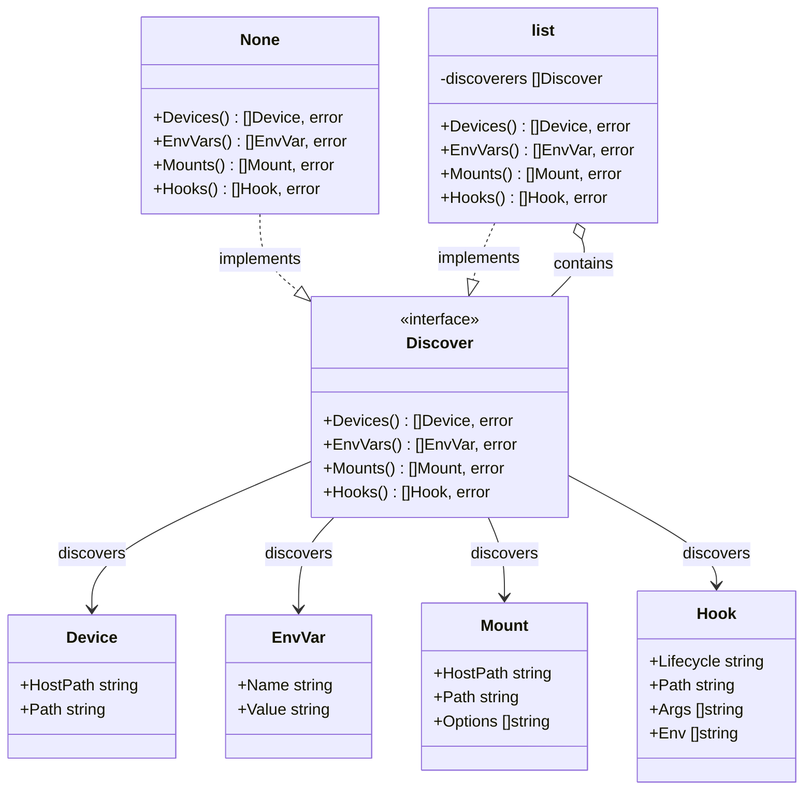

Sources: [internal/discover/discover.go:20-46](), [internal/discover/none.go:17-38](), [internal/discover/list.go:17-82]()

### The Discover Interface

The core of the system is the `Discover` interface, which defines four primary methods for resource discovery:

1. `Devices()` - Returns a list of character devices (such as GPU devices)
2. `EnvVars()` - Returns a list of environment variables to be set in the container.
3. `Mounts()` - Returns a list of filesystem mounts (such as libraries and configuration files)
4. `Hooks()` - Returns a list of hooks (such as symlink creation scripts)

Each discovered resource contains the necessary information for exposing it to a container, including both the host path and the path within the container.

### Discoverer Types

The system implements various specialized discoverers for different resource types:

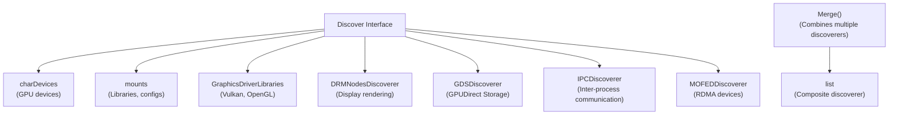

Sources: [internal/discover/char_devices.go:17-62](), [internal/discover/mounts.go:17-113](), [internal/discover/graphics.go:17-441](), [internal/discover/gds.go:17-80](), [internal/discover/ipc.go:17-78](), [internal/discover/mofed.go:17-33]()

## Resource Location Process

The discovery process relies on locators that find resources at specific paths or using patterns. The `lookup` package provides various locator implementations.

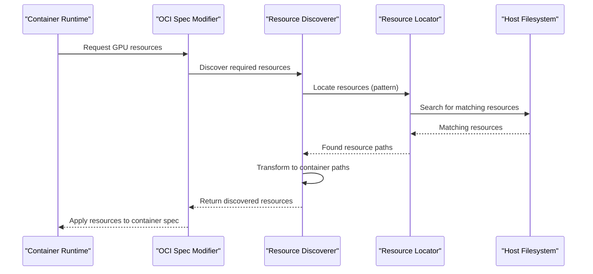

Sources: [internal/lookup/file.go:17-205](), [internal/discover/mounts.go:45-113]()

### Locator System

Locators are responsible for finding resources on the filesystem. Different locator types specialize in finding different kinds of resources:

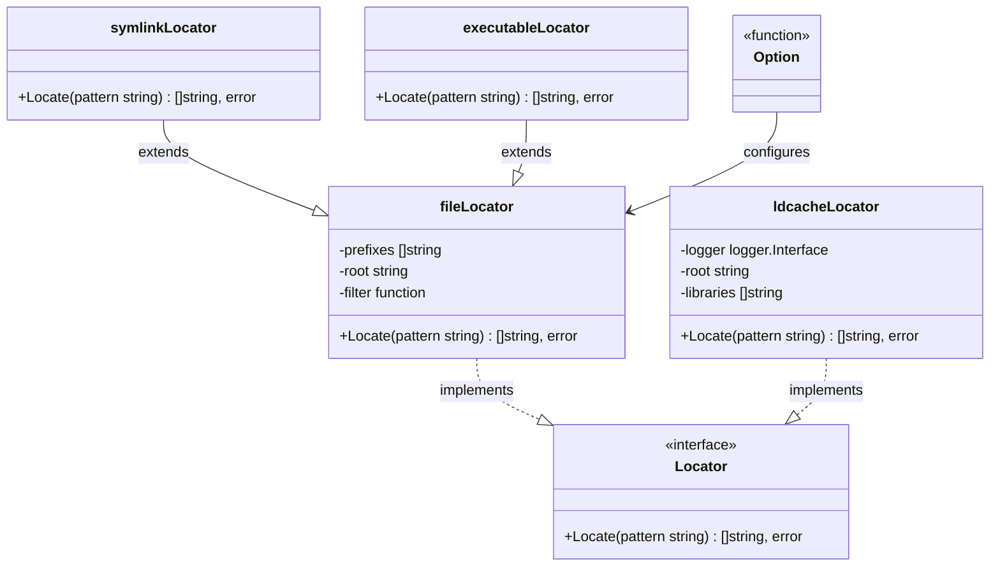

Sources: [internal/lookup/file.go:28-190](), [pkg/lookup/symlinks.go:17-112](), [pkg/lookup/executable.go:17-86](), [pkg/lookup/device.go:17-37](), [pkg/lookup/dir.go:17-46](), [pkg/lookup/ldcache.go:29-88]()

The locator system uses a flexible builder pattern with options to configure search parameters:

- `WithRoot` - Sets the root path for searches
- `WithSearchPaths` - Sets additional search paths
- `WithFilter` - Sets a filter function to validate candidates
- `WithCount` - Limits the number of results
- `WithOptional` - Makes the resource optional

### Resource Filtering 

The discovery system includes filtering capabilities to select specific resources based on various criteria:

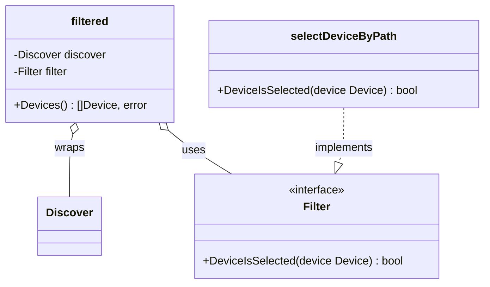

Sources: [internal/discover/filter.go:17-62](), [internal/discover/graphics.go:423-441]()

## Specialized Discoverers

### GPU Device Discovery

The system discovers GPU devices and related resources using a combination of specialized discoverers:

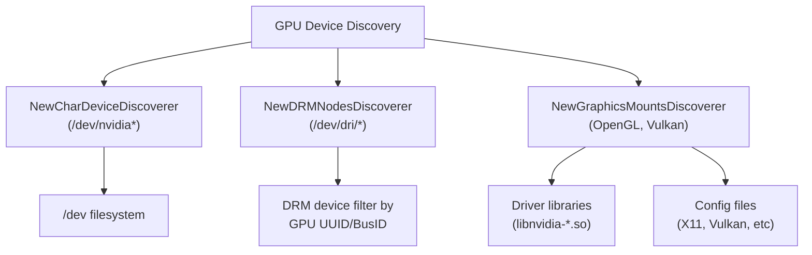

Sources: [internal/discover/graphics.go:34-74](), [internal/discover/char_devices.go:28-62]()

### Graphics Discovery

The graphics discovery system identifies libraries, configuration files, and device nodes required for graphics functionality:

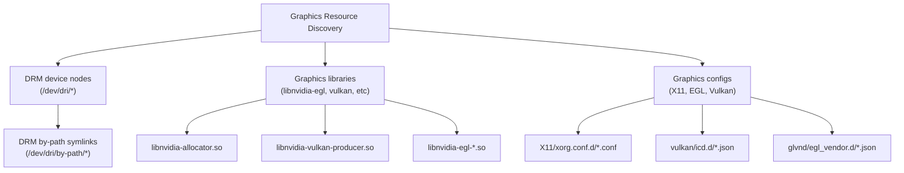

Sources: [internal/discover/graphics.go:77-147](), [internal/discover/graphics.go:282-359]()

## Integration with nvcdi Package

The Resource Discovery System is orchestrated through the `nvcdi` package, which provides a high-level interface for CDI spec generation.

### nvcdi Library Architecture

```mermaid
graph TD
    subgraph "nvcdi Package"
        NCDILib["nvcdilib struct"]
        Factory["deviceSpecGeneratorFactory"]
        Wrapper["wrapper struct"]
    end
    
    subgraph "Discovery Layer"
        DriverDisc["NewDriverDiscoverer()"]
        CommonDisc["newCommonNVMLDiscoverer()"]
        DeviceDisc["newFullGPUDiscoverer()"]
    end
    
    subgraph "Resource Discovery"
        CharDev["CharDeviceDiscoverer"]
        Mounts["MountsDiscoverer"]
        Graphics["GraphicsMountsDiscoverer"]
        Firmware["FirmwareDiscoverer"]
    end
    
    NCDILib --> Factory
    Factory -->|"nvmllib"| NVML["NVML-based discovery"]
    Factory -->|"csvlib"| CSV["CSV-based discovery"]
    Factory -->|"managementlib"| Mgmt["Management discovery"]
    Factory -->|"wsllib"| WSL["WSL2 discovery"]
    
    NVML --> DriverDisc
    NVML --> CommonDisc
    NVML --> DeviceDisc
    
    DriverDisc --> Mounts
    DriverDisc --> Firmware
    CommonDisc --> CharDev
    CommonDisc --> Graphics
    DeviceDisc --> CharDev
    
    Wrapper --> Factory
    Wrapper -->|GetSpec()| CDISpec["CDI Specification"]
```

Sources: [pkg/nvcdi/lib.go:34-161](), [pkg/nvcdi/wrapper.go:30-119]()

### Discovery Workflow

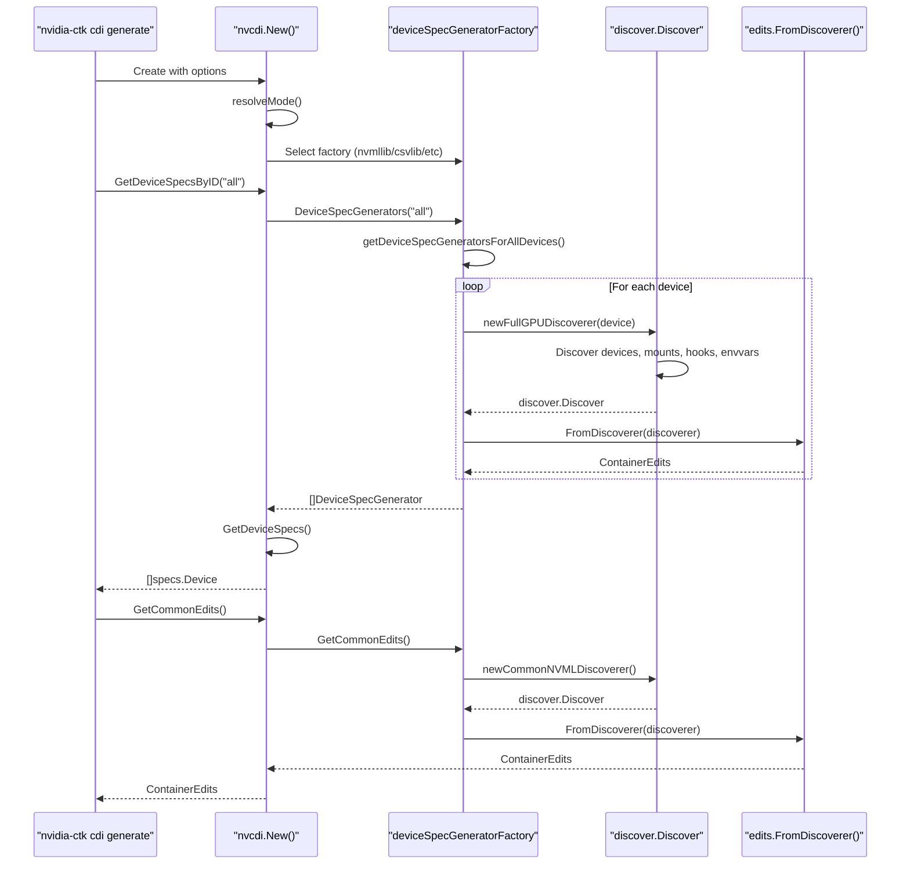

Sources: [cmd/nvidia-ctk/cdi/generate/generate.go:289-443](), [pkg/nvcdi/lib-nvml.go:36-145]()

### Mode Resolution

The `nvcdi` library automatically selects the appropriate discovery mode:

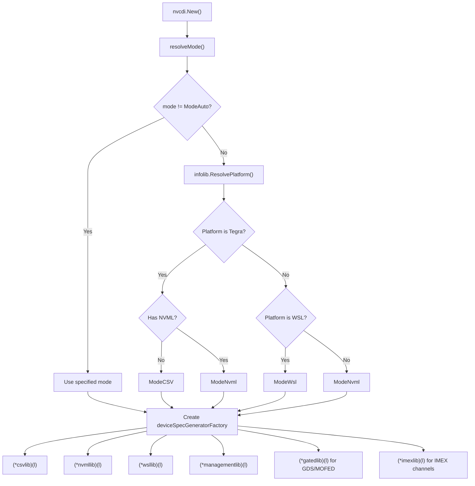

Sources: [pkg/nvcdi/lib.go:115-161](), [pkg/nvcdi/mode.go:1-100]()

## Integration with OCI Spec Modifiers

The discovery system integrates with OCI spec modifiers to inject resources into containers:

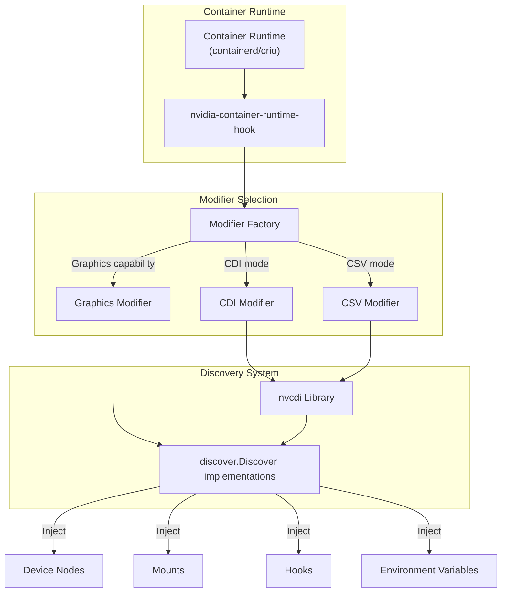

Sources: [internal/modifier/graphics.go:30-65](), [internal/modifier/csv.go:35-75](), [internal/modifier/cdi.go:1-217]()

### Mode Detection System

The discovery system works with different operational modes that are auto-detected based on the platform:

- `legacy` - Traditional NVIDIA Container Runtime mode for x86_64 with NVML
- `csv` - CSV-based mode primarily used on Jetson/Tegra platforms
- `cdi` - Container Device Interface mode for modern container runtimes

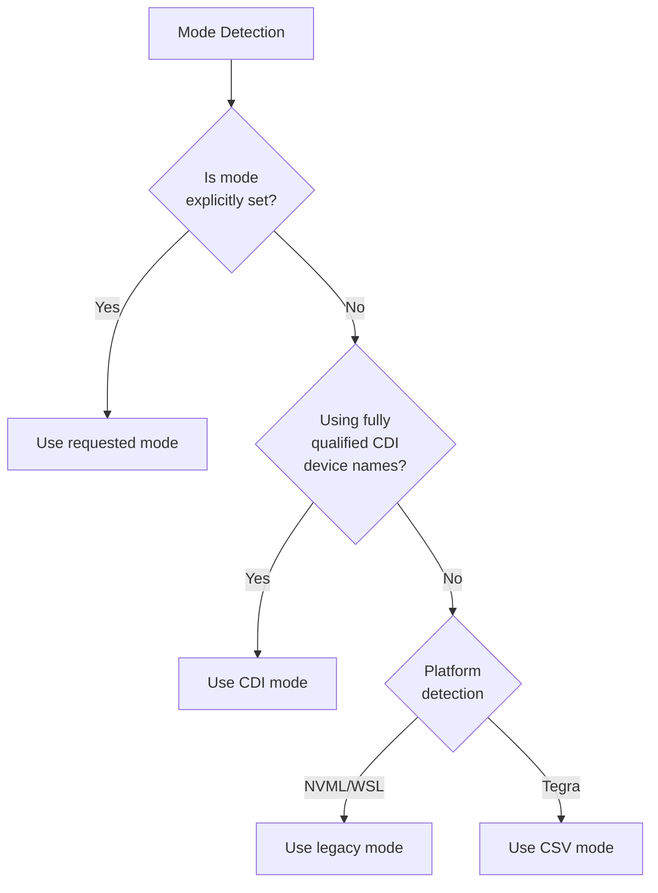

Sources: [internal/info/auto.go:17-56](), [internal/info/auto_test.go:17-240]()

## Driver Component Discovery

The discovery system includes specialized discoverers for various NVIDIA driver components. These discoverers are orchestrated through the `nvcdi` package to provide comprehensive resource discovery.

### Driver Library Discovery

Driver libraries are discovered using a two-phase approach:

1. **Version-suffixed libraries** - Libraries matching the driver version pattern (e.g., `libnvidia-*.so.535.86.10`)
2. **Explicit libraries** - Core libraries without version suffixes

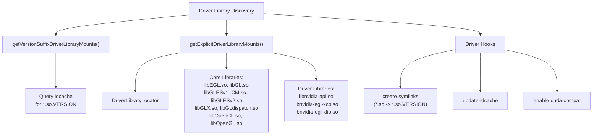

Sources: [pkg/nvcdi/driver-nvml.go:33-179]()

The library discovery process uses the `root.Driver` abstraction to locate libraries relative to the driver root:

| Component | Purpose | Example Pattern |
|-----------|---------|-----------------|
| Version Libraries | Driver-versioned libraries | `*.so.535.86.10` |
| Explicit Libraries | Core GL/GLES libraries | `libEGL.so`, `libGL.so` |
| XOrg Libraries | X11 display drivers | `nvidia_drv.so`, `libglxserver_nvidia.so.*` |
| Driver Tools | CUDA compatibility | CUDA Forward Compatibility libs |

Sources: [pkg/nvcdi/driver-nvml.go:78-179]()

### Firmware Discovery

GSP (GPU System Processor) firmware files are discovered using a hierarchical search of firmware paths:

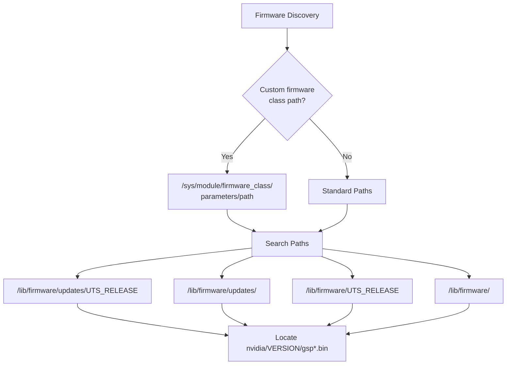

Sources: [pkg/nvcdi/driver-nvml.go:189-240]()

The firmware discovery uses the `NewDriverFirmwareDiscoverer` function which:
- Determines the UTS release from the running kernel
- Searches standard firmware paths plus any custom paths
- Locates all GSP firmware files matching the driver version

### Binary Discovery

NVIDIA driver binaries are discovered for injection into containers:

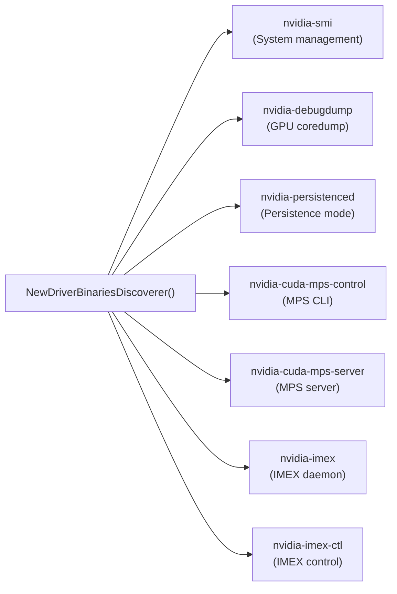

Sources: [pkg/nvcdi/driver-nvml.go:242-258]()

### IPC Socket Discovery

Inter-process communication sockets for NVIDIA services are discovered:

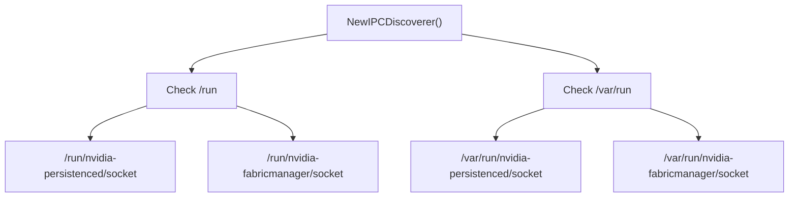

Sources: [internal/discover/ipc.go:35-63]()

## NVML Integration

The discovery system integrates with NVIDIA Management Library (NVML) to query GPU information and enumerate devices.

### NVML Library Initialization

The `nvcdi` library manages NVML initialization:

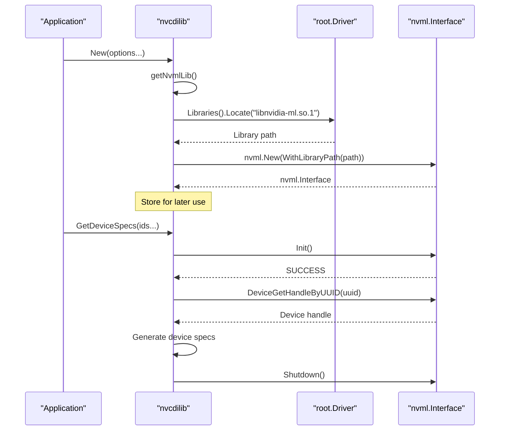

Sources: [pkg/nvcdi/lib.go:222-232](), [pkg/nvcdi/lib-nvml.go:212-236]()

The NVML library is located dynamically using the driver library locator, allowing it to work with non-standard driver installations.

### Nvsandboxutils Integration

For advanced device queries, the system optionally uses `libnvidia-sandboxutils`:

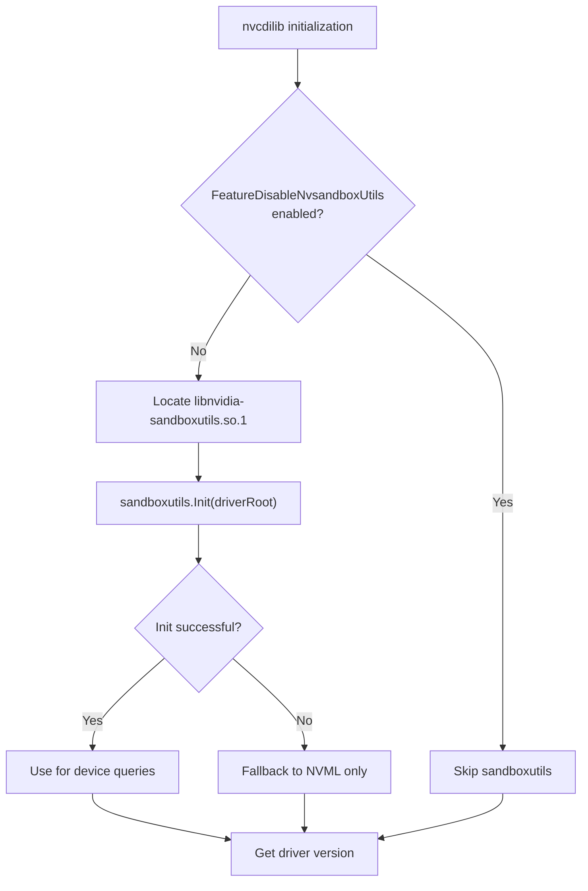

Sources: [pkg/nvcdi/lib.go:232]()

The sandboxutils library provides additional device information and is used when available, but the system gracefully falls back to NVML-only operation if it's not available or disabled.

## Platform-Specific Discovery

Different platforms require specialized discovery approaches.

### Management Container Discovery

Management containers (used for driver installation or system administration) use a simplified discovery approach that doesn't rely on NVML:

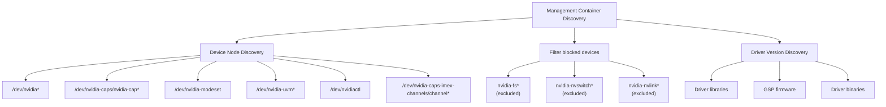

Sources: [pkg/nvcdi/management.go:95-149]()

Management containers disable certain hooks by default:
- `enable-cuda-compat` - Forward compatibility not needed
- `disable-device-node-modification` - Device nodes already created

### CSV Mode Discovery (Tegra/Jetson)

On Tegra-based platforms, discovery uses CSV (Comma-Separated Values) mount specification files:

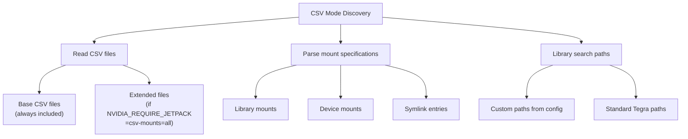

Sources: [pkg/nvcdi/lib-csv.go:19-87](), [internal/modifier/csv.go:35-75]()

CSV mode bypasses NVML entirely and relies on pre-defined mount specifications that describe which files and devices should be exposed to the container.

### WSL2 Discovery

Windows Subsystem for Linux 2 uses a specialized discovery approach:

```mermaid
graph TD
    WSLDiscovery["WSL2 Discovery"]
    
    WSLDiscovery --> DXGDevice["DXG Device Discovery"]
    DXGDevice --> DXGDev["/dev/dxg"]
    
    WSLDiscovery --> DriverDiscovery["WSL Driver Discovery"]
    DriverDiscovery --> DriverLib["libnvdxgdmal.so.1"]
    DriverDiscovery --> D3DKMT["D3DKMTEnumAdapters3 API"]
    
    WSLDiscovery --> DriverStore["DriverStore components"]
    DriverStore --> CuBins["nvcubins.bin"]
```

Sources: [pkg/nvcdi/lib-wsl.go:19-58]()

WSL2 discovery adapts to the Windows-based driver installation while maintaining compatibility with the Linux container interface.

## Device Spec Generation

The discovery system feeds into CDI device specification generation through device spec generators.

### Full GPU Device Specs

```mermaid
graph TD
    FullGPU["fullGPUDeviceSpecGenerator"]
    
    FullGPU --> DeviceDiscovery["Device Node Discovery"]
    DeviceDiscovery --> MainDevice["/dev/nvidia0"]
    DeviceDiscovery --> Capabilities["/dev/nvidia-caps/*"]
    
    FullGPU --> Naming["Device Name Generation"]
    Naming --> Index["By index: '0'"]
    Naming --> UUID["By UUID: 'GPU-...'"]
    Naming --> TypeIndex["By type-index: 'gpu0'"]
    
    FullGPU --> Annotations["Device Annotations"]
    Annotations --> Coherent["gpu.nvidia.com/coherent"]
    
    FullGPU --> Hooks["Device Hooks"]
    Hooks --> Permissions["chmod hooks<br/>(device permissions)"]
```

Sources: [pkg/nvcdi/full-gpu-nvml.go:35-187]()

### MIG Device Specs

Multi-Instance GPU (MIG) devices have specialized discovery:

```mermaid
graph TD
    MIGDevice["migDeviceSpecGenerator"]
    
    MIGDevice --> Parent["Get parent GPU"]
    Parent --> ParentUUID["Parent GPU UUID"]
    
    MIGDevice --> MIGInfo["MIG Device Info"]
    MIGInfo --> MIGUUID["MIG device UUID"]
    MIGInfo --> MIGIndex["MIG device index"]
    
    MIGDevice --> Naming["MIG Device Names"]
    Naming --> IndexName["'0:0' (parent:mig)"]
    Naming --> UUIDName["'MIG-...'"]
    
    MIGDevice --> Capabilities["MIG Capabilities Device"]
    Capabilities --> CapDevice["/dev/nvidia-caps/nvidia-cap1"]
```

Sources: [pkg/nvcdi/mig-device-nvml.go:19-146]()

MIG devices reference their parent GPU and expose only the specific compute instance capabilities.

## Resource Types and Components

### Device Resources

| Device Type | Pattern | Purpose |
|-------------|---------|---------|
| GPU devices | `/dev/nvidia[0-9]+` | Main GPU device nodes |
| NVIDIA CTL | `/dev/nvidiactl` | Control device |
| UVM | `/dev/nvidia-uvm*` | Unified Virtual Memory |
| Modeset | `/dev/nvidia-modeset` | Display modeset operations |
| Capabilities | `/dev/nvidia-caps/*` | MIG and other capabilities |
| DRM nodes | `/dev/dri/card*`, `/dev/dri/renderD*` | Direct Rendering Manager |
| IMEX channels | `/dev/nvidia-caps-imex-channels/channel*` | Inter-GPU communication |

Sources: [internal/discover/char_devices.go:28-62](), [pkg/nvcdi/management.go:98-110]()

### Mount Resources

| Resource Category | Examples | Discoverer |
|-------------------|----------|------------|
| Driver Libraries | `libnvidia-*.so.*` | `NewDriverLibraryDiscoverer` |
| Graphics Libraries | `libnvidia-egl-*.so`, `libGL.so` | `NewGraphicsMountsDiscoverer` |
| Config Files | `glvnd/egl_vendor.d/*.json` | `NewMounts` with config locator |
| Firmware | `nvidia/VERSION/gsp*.bin` | `NewDriverFirmwareDiscoverer` |
| Vulkan ICDs | `vulkan/icd.d/nvidia_icd.json` | `newVulkanConfigsDiscover` |
| X11 Configs | `X11/xorg.conf.d/*.conf` | `NewMounts` with config locator |

Sources: [pkg/nvcdi/driver-nvml.go:33-286](), [internal/discover/graphics.go:51-108]()

### Hook Resources

| Hook Name | Purpose | When Used |
|-----------|---------|-----------|
| `create-symlinks` | Create library symlinks | Graphics, driver libraries |
| `update-ldcache` | Update LD cache | After library injection |
| `enable-cuda-compat` | Enable CUDA Forward Compatibility | When compat libs present |
| `create-dev-char-symlinks` | Create `/dev/char` symlinks | Device node discovery |
| `disabled-device-node-modification` | Prevent device node creation by apps | Driver/management mode |

Sources: [pkg/nvcdi/api.go:47-73](), [internal/discover/hooks.go:1-100]()

## Conclusion

The Resource Discovery System provides a flexible and extensible framework for identifying and exposing GPU resources to containers. Its modular design allows for different discovery strategies based on the platform and requirements, ensuring compatibility across various deployment scenarios.

Sources: [internal/discover/discover.go:17-46](), [internal/lookup/file.go:17-205](), [internal/discover/graphics.go:17-441]()

---

