<!-- source: DeepWiki mcp.deepwiki.com · repo NVIDIA/nvidia-container-toolkit · page 3.4 OCI Spec Modification System · fetched 2026-10-26 -->

# OCI Spec Modification System

Relevant source files

The following files were used as context for generating this wiki page:

- [internal/discover/compat_libs.go](internal/discover/compat_libs.go)
- [internal/edits/edits.go](internal/edits/edits.go)
- [internal/edits/edits_test.go](internal/edits/edits_test.go)
- [internal/modifier/cdi.go](internal/modifier/cdi.go)
- [internal/modifier/cdi_test.go](internal/modifier/cdi_test.go)
- [internal/modifier/csv.go](internal/modifier/csv.go)
- [internal/modifier/csv_test.go](internal/modifier/csv_test.go)
- [internal/modifier/discover.go](internal/modifier/discover.go)
- [internal/modifier/discover_test.go](internal/modifier/discover_test.go)
- [internal/modifier/factory.go](internal/modifier/factory.go)
- [internal/modifier/gated.go](internal/modifier/gated.go)
- [internal/modifier/graphics.go](internal/modifier/graphics.go)
- [internal/modifier/graphics_test.go](internal/modifier/graphics_test.go)
- [internal/modifier/hook_remover.go](internal/modifier/hook_remover.go)
- [internal/modifier/list.go](internal/modifier/list.go)
- [internal/modifier/mode.go](internal/modifier/mode.go)
- [internal/modifier/stable.go](internal/modifier/stable.go)
- [internal/modifier/stable_test.go](internal/modifier/stable_test.go)
- [internal/oci/options.go](internal/oci/options.go)
- [internal/oci/runtime.go](internal/oci/runtime.go)
- [internal/oci/runtime_low_level.go](internal/oci/runtime_low_level.go)
- [internal/oci/runtime_mock.go](internal/oci/runtime_mock.go)
- [internal/oci/runtime_modifier.go](internal/oci/runtime_modifier.go)
- [internal/oci/runtime_modifier_test.go](internal/oci/runtime_modifier_test.go)
- [internal/oci/runtime_path.go](internal/oci/runtime_path.go)
- [internal/oci/runtime_path_test.go](internal/oci/runtime_path_test.go)
- [internal/oci/runtime_syscall_exec.go](internal/oci/runtime_syscall_exec.go)
- [internal/oci/spec.go](internal/oci/spec.go)
- [internal/oci/spec_file.go](internal/oci/spec_file.go)
- [internal/oci/spec_file_test.go](internal/oci/spec_file_test.go)
- [internal/oci/spec_test.go](internal/oci/spec_test.go)
- [internal/runtime/runtime.go](internal/runtime/runtime.go)
- [internal/runtime/runtime_factory.go](internal/runtime/runtime_factory.go)
- [internal/runtime/runtime_factory_test.go](internal/runtime/runtime_factory_test.go)
- [internal/test/test.go](internal/test/test.go)
- [pkg/lookup/path.go](pkg/lookup/path.go)
- [pkg/nvcdi/transform/deduplicate.go](pkg/nvcdi/transform/deduplicate.go)
- [pkg/nvcdi/transform/merged-device.go](pkg/nvcdi/transform/merged-device.go)
- [pkg/nvcdi/transform/remove.go](pkg/nvcdi/transform/remove.go)
- [pkg/nvcdi/transform/sorter.go](pkg/nvcdi/transform/sorter.go)
- [pkg/nvcdi/transform/sorter_test.go](pkg/nvcdi/transform/sorter_test.go)

## Purpose and Scope

The OCI Spec Modification System is responsible for transforming OCI runtime specifications to enable GPU access in containers. This system bridges between GPU resource discovery (see [Resource Discovery System](#3.3)) and the final container configuration by applying appropriate modifications based on the selected runtime mode (see [Runtime Modes](#3.1)). The modifications include adding device nodes, mount points, environment variables, and lifecycle hooks to the OCI spec.

For information about CDI specification generation and consumption, see [Container Device Interface (CDI)](#3.2). For container lifecycle hook execution, see [Hook System](#3.7).

---

## System Architecture

The modification system follows a factory pattern where different modifiers are created based on runtime mode and image configuration, then combined into a modification pipeline that transforms the OCI spec before container creation.

### Modifier Factory Flow

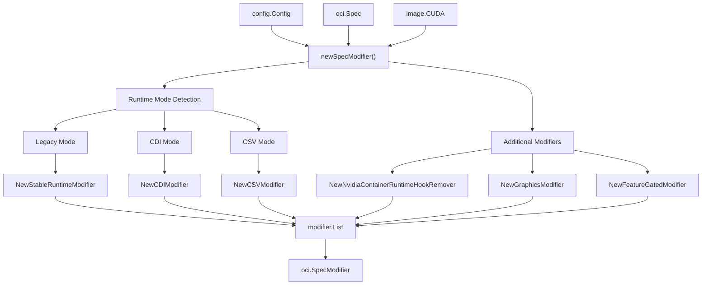

**Sources:** [internal/runtime/runtime_factory.go:70-84]()

---

## Core Modifier Interface

All modifiers implement the `oci.SpecModifier` interface, which requires a single `Modify(*specs.Spec) error` method. Modifiers can be composed using `oci.SpecModifiers` (which is an alias for `[]oci.SpecModifier`) to create modification pipelines. [internal/oci/spec.go:34-37]()

### Modifier Hierarchy

| Modifier Type | Purpose | Runtime Modes | Source File |
|--------------|---------|---------------|-------------|
| `stableRuntimeModifier` | Injects nvidia-container-runtime-hook | Legacy | [internal/modifier/stable.go]() |
| `cdiModifier` | Applies CDI device specifications | CDI, JIT-CDI | [internal/modifier/cdi.go]() |
| `csvModifier` | Applies CSV mount specifications | CSV | [internal/modifier/csv.go]() |
| `graphicsModifier` | Adds graphics-related resources | Legacy | [internal/modifier/graphics.go]() |
| `featureGatedModifier` | Adds optional feature devices | Legacy, CSV | [internal/modifier/gated.go]() |
| `nvidiaContainerRuntimeHookRemover` | Removes legacy hooks | All | [internal/modifier/hook_remover.go]() |

**Sources:** [internal/modifier/stable.go:31-36](), [internal/modifier/cdi.go:40-81](), [internal/modifier/csv.go:35-75](), [internal/modifier/graphics.go:29-62](), [internal/modifier/gated.go:36-61](), [internal/modifier/hook_remover.go:31-36]()

---

## Modifier Creation Pipeline

### Mode-Specific Modifier Selection

The system determines which modifiers to apply based on the runtime mode using the `supportedModifierTypes` function: [internal/modifier/factory.go:107]()

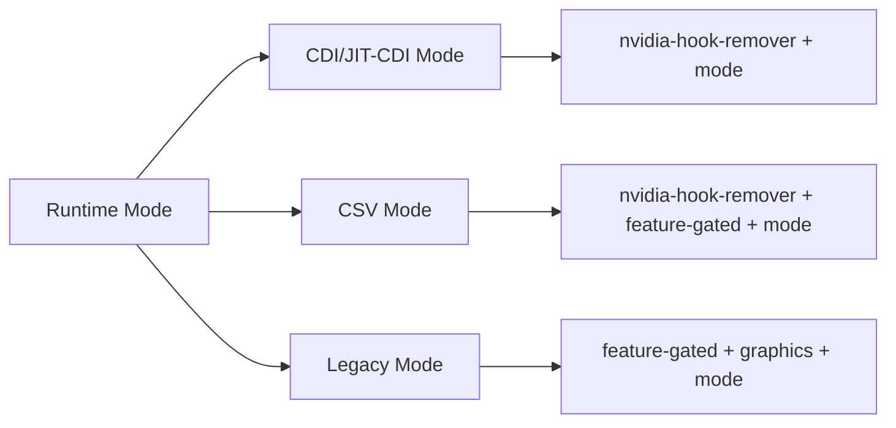

**Sources:** [internal/modifier/mode.go:10-30]()

### Modifier Construction Sequence

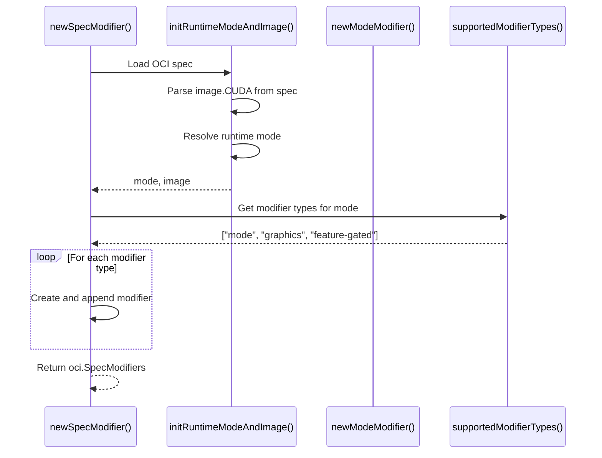

**Sources:** [internal/runtime/runtime_factory.go:70-84](), [internal/runtime/runtime_factory.go:87-130]()

---

## CDI Mode Modification

CDI mode uses pre-generated or runtime-generated CDI specifications to modify the OCI spec. The system supports two CDI variants: standard CDI (using specs from `/etc/cdi`) and JIT-CDI (generating specs in-memory).

### CDI Device Request Resolution

The `cdiDeviceRequestor` struct and its `DeviceRequests` method are central to resolving device requests from the container image configuration. [internal/modifier/cdi.go:93-124]()

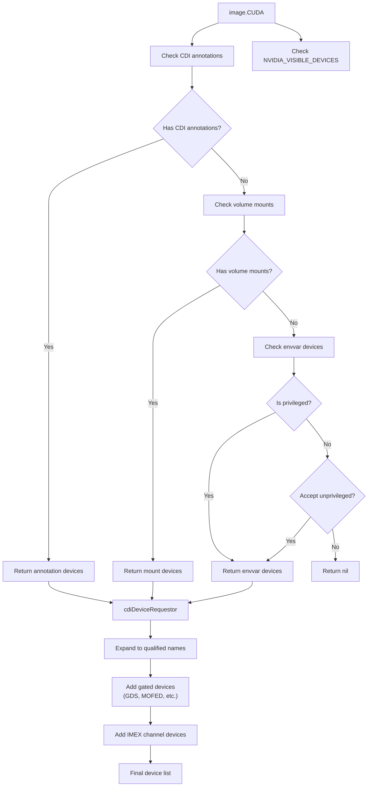

**Sources:** [internal/modifier/cdi.go:93-124](), [internal/modifier/cdi.go:126-147](), [internal/modifier/cdi.go:149-158](), [internal/modifier/cdi_test.go:29-216]()

### Automatic CDI Specification Generation

For devices with the `runtime.nvidia.com` vendor prefix, the system generates CDI specifications in-memory rather than reading from disk. This is handled by `newAutomaticCDISpecModifier`. [internal/modifier/cdi.go:175-227]()

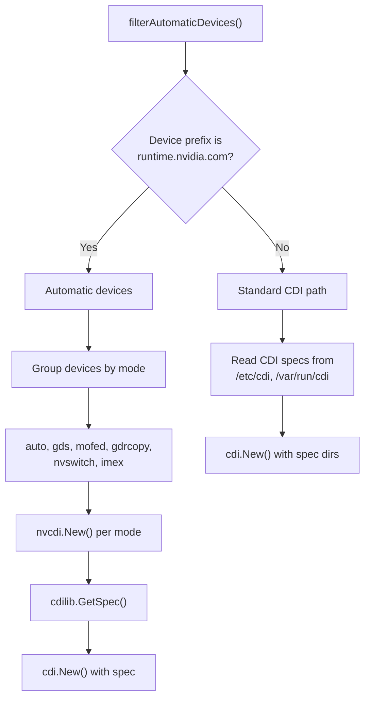

**Sources:** [internal/modifier/cdi.go:161-173](), [internal/modifier/cdi.go:175-227]()

---

## CSV Mode Modification

CSV mode uses mount specifications from CSV files to modify the OCI spec. This mode is primarily used for Tegra platforms where devices are defined in CSV format. The `newCSVModifier` function creates this modifier. [internal/modifier/csv.go:29-44]()

### CSV Modifier Creation Flow

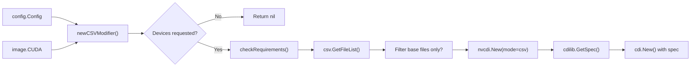

**Sources:** [internal/modifier/csv.go:29-44](), [internal/modifier/csv.go:46-76]()

---

## Graphics Modifier

The graphics modifier injects resources required for graphics workloads, including DRM device nodes, graphics libraries, and configuration files. This is created by `newGraphicsModifier`. [internal/modifier/graphics.go:27-62]()

### Graphics Resource Discovery and Injection

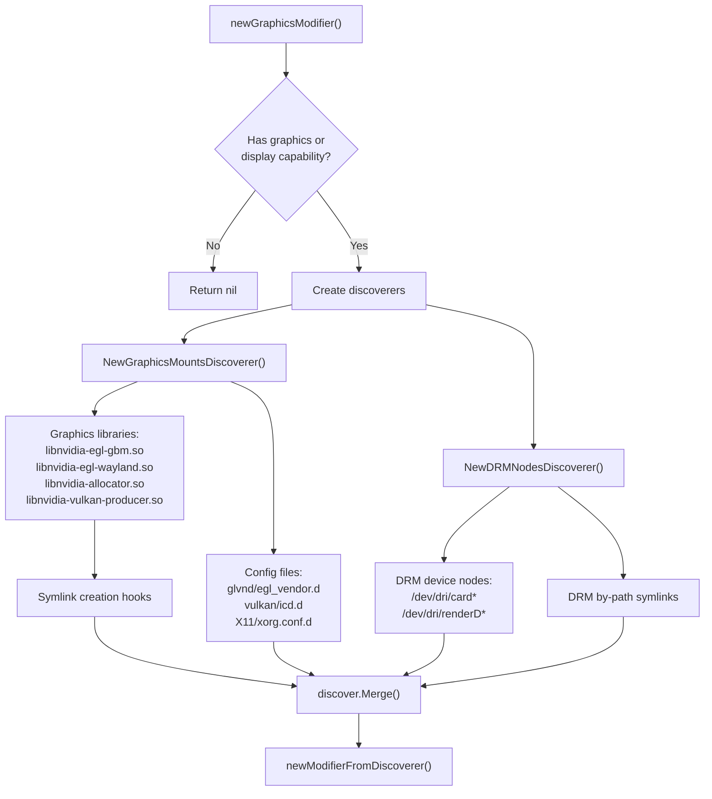

**Sources:** [internal/modifier/graphics.go:27-62]()

### DRM Device Filtering

DRM device discovery includes filtering to match only the requested GPUs. The `requiresGraphicsModifier` function determines if the modifier is needed. [internal/modifier/graphics.go:64-76]()

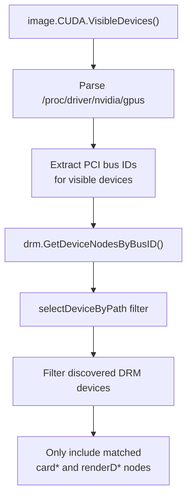

**Sources:** [internal/modifier/graphics.go:64-76]()

---

## Feature-Gated Modifier

The feature-gated modifier adds resources for optional features that are enabled via environment variables. This is created by `newFeatureGatedModifier`. [internal/modifier/gated.go:36-61]()

### Feature Gate Detection and Resource Addition

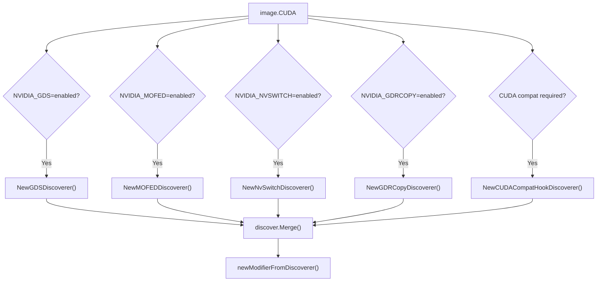

**Sources:** [internal/modifier/gated.go:36-61]()

### CUDA Compatibility Mode Handling

The CUDA compatibility hook is conditional on both feature flags and runtime mode. The `getCudaCompatModeModifier` function handles this logic. [internal/modifier/gated.go:63-97]()

| Runtime Mode | Feature Flag | Hook Behavior |
|-------------|--------------|---------------|
| CDI | N/A | Hook included if not disabled by feature flag |
| CSV | Any | Hook not supported |
| Legacy | `hook` | Hook included with ldcache update hook |
| Legacy | `ldconfig` | Not included (handled by nvidia-container-cli) |
| Legacy | `mount` | Not included (handled by nvidia-container-cli) |

**Sources:** [internal/modifier/gated.go:63-97]()

---

## Discoverer-to-Modifier Bridge

Many modifiers are created from discoverers using the `newModifierFromDiscoverer` pattern. This bridges the discovery system (see [Resource Discovery System](#3.3)) with the modification system.

### Modification Application Pattern

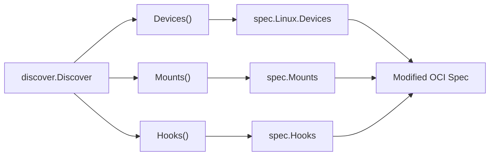

The `newModifierFromDiscoverer` function creates a modifier that applies all discovered resources to the OCI spec: [internal/modifier/discover.go:29-44]()

1. **Devices**: Appends to `spec.Linux.Devices`
2. **Mounts**: Appends to `spec.Mounts`
3. **Hooks**: Appends to appropriate hook arrays (prestart, create-runtime, create-container)

**Sources:** [internal/modifier/discover.go:29-44]()

---

## Hook Removal Modifier

The `nvidiaContainerRuntimeHookRemover` is applied in all modes to remove any legacy hooks that may have been injected by Docker or other container runtimes. This ensures clean slate modification regardless of prior injections. This is created by `newNvidiaContainerRuntimeHookRemover`. [internal/modifier/hook_remover.go:29-34]()

### Hook Patterns Removed

- Hooks with path containing `nvidia-container-runtime-hook`
- Hooks with path containing `nvidia-container-toolkit`
- Only removes from `prestart` hook array

This modifier is always added first in the modifier list to ensure legacy hooks don't interfere with mode-specific modifications.

**Sources:** [internal/modifier/hook_remover.go:36-60]()

---

## Mode-Specific Modification Patterns

### Legacy Mode

Legacy mode adds a single prestart hook that will be executed before container start. This hook then calls `nvidia-container-cli` to perform the actual GPU resource injection.

**Sources:** [internal/modifier/mode.go:27]()

### CDI Mode

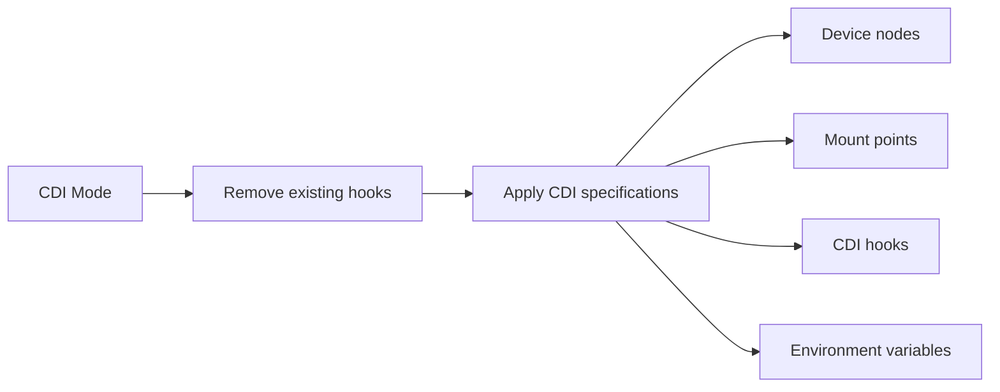

CDI mode applies modifications declaratively from CDI specifications. The CDI specs themselves contain the complete list of devices, mounts, hooks, and environment variables needed.

**Sources:** [internal/modifier/mode.go:25]()

### CSV Mode

CSV mode internally converts CSV mount specifications to CDI format for consistent application.

**Sources:** [internal/modifier/mode.go:26]()

---

## Configuration Impact on Modification

Several configuration options affect modifier behavior:

| Configuration Option | Impact | Default |
|---------------------|--------|---------|
| `mode` | Determines which modifiers are created | `auto` (resolved to `cdi`, `legacy`, or `csv`) |
| `supported-driver-capabilities` | Filters allowed driver capabilities | `compute,compat32,graphics,utility,video,display,ngx` |
| `nvidia-ctk-path` | Path for nvidia-ctk used in hooks | `/usr/bin/nvidia-ctk` |
| `features.disable-cuda-compat-lib-hook` | Disables CUDA compat hook in feature-gated modifier | `false` |
| `features.allow-cuda-compat-libs-from-container` | Allows container-provided CUDA compat libs | `false` |

**Sources:** [internal/runtime/runtime_factory.go:70-84]()

---

## Modification Execution Context

Modifications are applied within the `nvidia-container-runtime` execution flow:

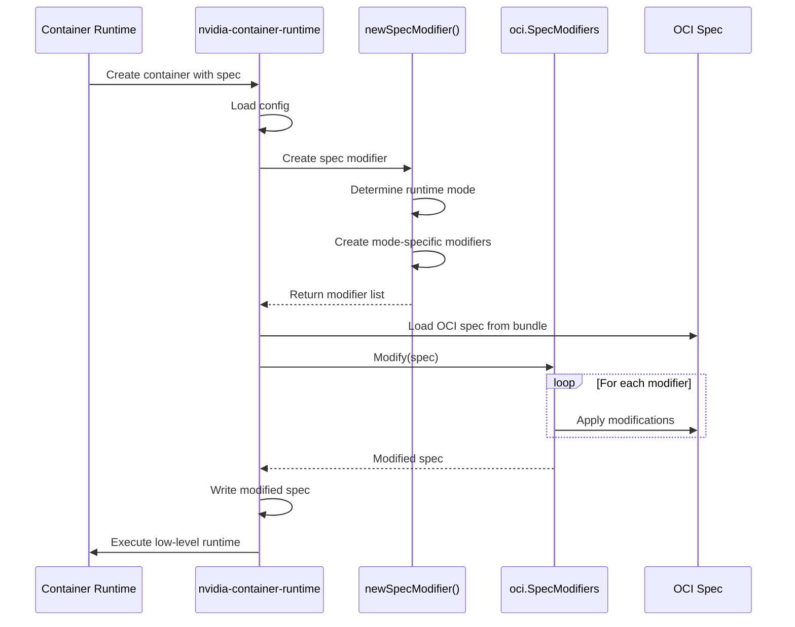

**Sources:** [internal/runtime/runtime_factory.go:32-64]()

---

