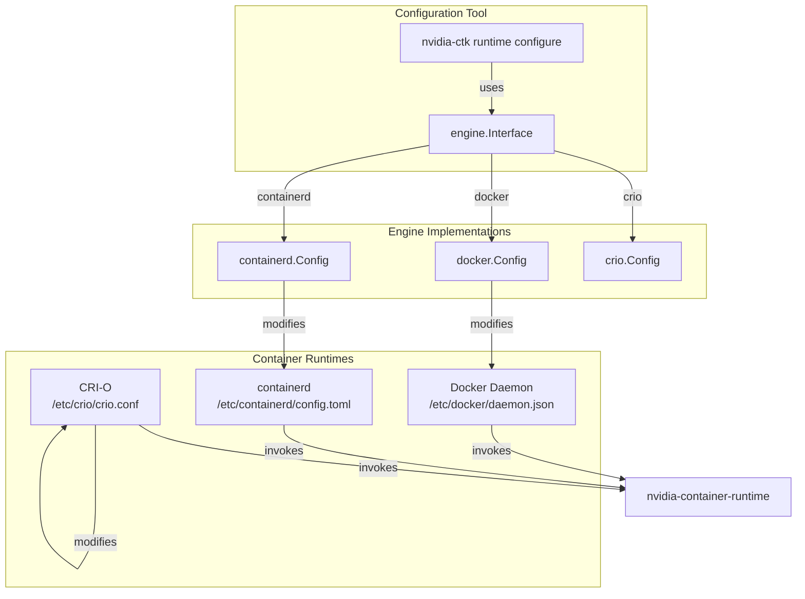
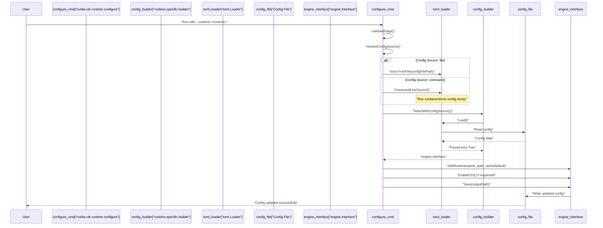
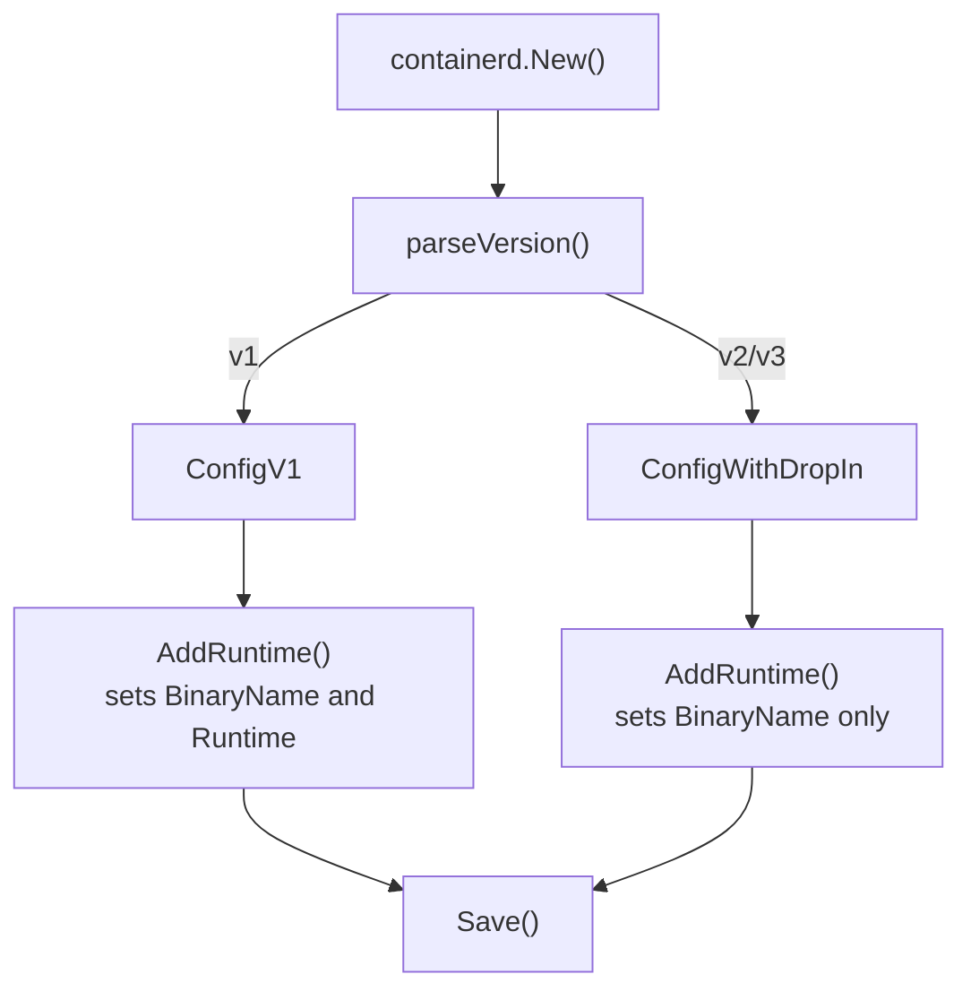
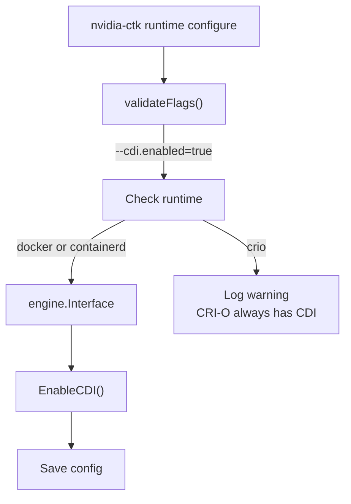

<!-- source: DeepWiki mcp.deepwiki.com · repo NVIDIA/nvidia-container-toolkit · page 3.5 Container Runtime Integration · fetched 2026-10-26 -->

# Container Runtime Integration

<details>
<summary>Relevant source files</summary>

The following files were used as context for generating this wiki page:

- [cmd/nvidia-ctk-installer/container/container.go](cmd/nvidia-ctk-installer/container/container.go)
- [cmd/nvidia-ctk-installer/container/runtime/containerd/config_test.go](cmd/nvidia-ctk-installer/container/runtime/containerd/config_test.go)
- [cmd/nvidia-ctk-installer/container/runtime/containerd/containerd.go](cmd/nvidia-ctk-installer/container/runtime/containerd/containerd.go)
- [cmd/nvidia-ctk-installer/container/runtime/crio/config_test.go](cmd/nvidia-ctk-installer/container/runtime/crio/config_test.go)
- [cmd/nvidia-ctk-installer/container/runtime/crio/crio.go](cmd/nvidia-ctk-installer/container/runtime/crio/crio.go)
- [cmd/nvidia-ctk-installer/container/runtime/docker/docker.go](cmd/nvidia-ctk-installer/container/runtime/docker/docker.go)
- [cmd/nvidia-ctk-installer/container/runtime/runtime.go](cmd/nvidia-ctk-installer/container/runtime/runtime.go)
- [cmd/nvidia-ctk/runtime/configure/configure.go](cmd/nvidia-ctk/runtime/configure/configure.go)
- [cmd/nvidia-ctk/runtime/configure/configure_test.go](cmd/nvidia-ctk/runtime/configure/configure_test.go)
- [pkg/config/engine/api.go](pkg/config/engine/api.go)
- [pkg/config/engine/config.go](pkg/config/engine/config.go)
- [pkg/config/engine/containerd/config.go](pkg/config/engine/containerd/config.go)
- [pkg/config/engine/containerd/config_drop_in.go](pkg/config/engine/containerd/config_drop_in.go)
- [pkg/config/engine/containerd/config_drop_in_test.go](pkg/config/engine/containerd/config_drop_in_test.go)
- [pkg/config/engine/containerd/config_test.go](pkg/config/engine/containerd/config_test.go)
- [pkg/config/engine/containerd/config_v1.go](pkg/config/engine/containerd/config_v1.go)
- [pkg/config/engine/containerd/config_v1_test.go](pkg/config/engine/containerd/config_v1_test.go)
- [pkg/config/engine/containerd/containerd.go](pkg/config/engine/containerd/containerd.go)
- [pkg/config/engine/containerd/option.go](pkg/config/engine/containerd/option.go)
- [pkg/config/engine/crio/crio.go](pkg/config/engine/crio/crio.go)
- [pkg/config/engine/crio/crio_test.go](pkg/config/engine/crio/crio_test.go)
- [pkg/config/engine/crio/option.go](pkg/config/engine/crio/option.go)
- [pkg/config/engine/docker/docker.go](pkg/config/engine/docker/docker.go)
- [pkg/config/engine/docker/option.go](pkg/config/engine/docker/option.go)

</details>


This page documents how the NVIDIA Container Toolkit integrates with various container runtimes (Docker, containerd, and CRI-O) to enable GPU access for containers. For information about the Container Device Interface (CDI) integration specifically, see [Container Device Interface (CDI)](#3.2).

## Overview

The NVIDIA Container Toolkit integrates with container runtimes by modifying their configuration files to register the `nvidia-container-runtime` as an available runtime handler. The `nvidia-ctk runtime configure` command automates this process across Docker, containerd, and CRI-O.



The integration is built around the `engine.Interface` abstraction defined in [pkg/config/engine/api.go:31-41](), which provides a common API for runtime configuration regardless of the specific container engine.

Sources:
- [cmd/nvidia-ctk/runtime/configure/configure.go:98-111]()
- [pkg/config/engine/api.go:31-41]()
- [pkg/config/engine/docker/docker.go:32-36]()
- [pkg/config/engine/containerd/containerd.go:32-55]()
- [pkg/config/engine/crio/crio.go:27-31]()

## Configuration Process

The `nvidia-ctk runtime configure` command implements a two-step process: loading the existing runtime configuration and modifying it to add NVIDIA runtime support. The command uses the `configureConfigFile` method from [cmd/nvidia-ctk/runtime/configure/configure.go:291-353]().



The configuration loading supports two modes via the `--config-source` flag:
- **file mode** (default): Reads the config from the specified file path using `toml.FromFile()`
- **command mode**: Executes the runtime's config command (e.g., `containerd config dump`) to retrieve the current configuration

Sources:
- [cmd/nvidia-ctk/runtime/configure/configure.go:291-353]()
- [cmd/nvidia-ctk/runtime/configure/configure.go:355-376]()
- [pkg/config/engine/containerd/containerd.go:74-152]()
- [pkg/config/engine/crio/crio.go:52-92]()
- [pkg/config/toml/source.go:23-65]()

### Command Line Options

The `nvidia-ctk runtime configure` command provides extensive control over the configuration process through the `config` struct defined in [cmd/nvidia-ctk/runtime/configure/configure.go:75-96]():

| Option | Description | Default Value |
|--------|-------------|---------------|
| `--runtime` | Target runtime engine (docker, containerd, crio) | `docker` |
| `--config` | Path to the runtime config file | Runtime-specific default paths |
| `--drop-in-config` | Path to NVIDIA-specific config file (containerd/CRI-O only) | `/etc/containerd/conf.d/99-nvidia.toml` or `/etc/crio/crio.conf.d/99-nvidia.toml` |
| `--executable-path` | Path to runtime executable for config extraction | Empty (searches PATH) |
| `--config-source` | Config source: `file` or `command` | `file` |
| `--nvidia-runtime-name` | Name of the NVIDIA runtime to add | `nvidia` |
| `--nvidia-runtime-path` | Path to the NVIDIA runtime executable | `nvidia-container-runtime` |
| `--nvidia-set-as-default` | Set the NVIDIA runtime as the default | `false` |
| `--cdi.enabled` | Enable CDI support (Docker/containerd only) | `false` |
| `--dry-run` | Update config but write to stdout instead of disk | `false` |

#### Default Configuration Paths

When `--config` is not specified, the command uses these default paths:

```go
// From cmd/nvidia-ctk/runtime/configure/configure.go:45-47
defaultContainerdConfigFilePath = "/etc/containerd/config.toml"
defaultCrioConfigFilePath       = "/etc/crio/crio.conf"
defaultDockerConfigFilePath     = "/etc/docker/daemon.json"
```

#### Drop-In Configuration Support

For containerd and CRI-O, the toolkit can create separate drop-in configuration files instead of modifying the main config. This is controlled by the `--drop-in-config` flag and is useful in managed environments where the main config is system-controlled. The default paths for drop-in configurations are defined as:

```go
// From cmd/nvidia-ctk/runtime/configure/configure.go:49-50
defaultContainerdDropInConfigFilePath = "/etc/containerd/conf.d/99-nvidia.toml"
defaultCrioDropInConfigFilePath       = "/etc/crio/crio.conf.d/99-nvidia.toml"
```

Sources:
- [cmd/nvidia-ctk/runtime/configure/configure.go:75-96]()
- [cmd/nvidia-ctk/runtime/configure/configure.go:45-50]()
- [cmd/nvidia-ctk/runtime/configure/configure.go:247-278]()

## Runtime-Specific Integration

### Docker Integration

For Docker, the toolkit modifies the `/etc/docker/daemon.json` configuration file (by default) to:

1. Add an entry for the NVIDIA runtime in the `runtimes` section
2. Optionally set it as the default runtime
3. Enable CDI support if requested

Example configuration:

```json
{
  "runtimes": {
    "nvidia": {
      "path": "/usr/bin/nvidia-container-runtime",
      "args": []
    }
  },
  "default-runtime": "nvidia",
  "features": {
    "cdi": true
  }
}
```

The `docker.Config` type, defined as `map[string]any` in [pkg/config/engine/docker/docker.go:34](), implements the `engine.Interface` [pkg/config/engine/docker/docker.go:36](). The `AddRuntime` method [pkg/config/engine/docker/docker.go:68-95]() handles adding the runtime entry, while `EnableCDI` [pkg/config/engine/docker/docker.go:106-122]() manages the `features.cdi` flag.

Sources:
- [pkg/config/engine/docker/docker.go:67-122]()
- [cmd/nvidia-ctk/runtime/configure/configure.go:36-46]()
- [pkg/config/engine/docker/docker.go:34]()
- [pkg/config/engine/docker/docker.go:36]()

### containerd Integration

For containerd, the toolkit creates a `Config` struct [pkg/config/engine/containerd/containerd.go:32-36]() that handles multiple configuration versions. The integration process:

1. **Version Detection**: Parses the `version` field from the config file [pkg/config/engine/containerd/containerd.go:154-174]()
2. **Plugin Name Resolution**: Determines the CRI runtime plugin name based on version:
   - v1: `cri`
   - v2: `io.containerd.grpc.v1.cri`
   - v3+: `io.containerd.cri.v1.runtime`
3. **Runtime Addition**: Calls `AddRuntime()` to inject the NVIDIA runtime configuration
4. **Drop-In Config Support**: For v2+, can write to a separate file (e.g., `/etc/containerd/conf.d/99-nvidia.toml`)

#### Configuration Version Support

The containerd integration uses a builder pattern with version-specific handling. The `New` function [pkg/config/engine/containerd/containerd.go:75-152]() creates a `containerd.Config` instance. For version 1 configs, it returns a `ConfigV1` type [pkg/config/engine/containerd/containerd.go:121](), which has specific logic for older containerd versions. For other versions, it uses a `ConfigWithDropIn` wrapper [pkg/config/engine/containerd/containerd.go:149]() to manage drop-in files.



#### Runtime Options Inheritance

The `GetDefaultRuntimeOptions()` method [pkg/config/engine/containerd/config.go:35-52]() copies runtime settings from existing runtimes to ensure consistency:

1. Checks the current default runtime first
2. Falls back to `runc` or `crun` runtime options
3. Uses sensible defaults if no existing runtime is found

Example configuration (for containerd v2):

```toml
version = 2
[plugins."io.containerd.grpc.v1.cri"]
  enable_cdi = true
  default_runtime_name = "nvidia"
  [plugins."io.containerd.grpc.v1.cri".containerd.runtimes.nvidia]
    runtime_type = "io.containerd.runc.v2"
    runtime_root = ""
    runtime_engine = ""
    privileged_without_host_devices = false
    [plugins."io.containerd.grpc.v1.cri".containerd.runtimes.nvidia.options]
      BinaryName = "/usr/bin/nvidia-container-runtime"
```

Sources:
- [pkg/config/engine/containerd/containerd.go:74-152]()
- [pkg/config/engine/containerd/containerd.go:154-185]()
- [pkg/config/engine/containerd/config.go:26-83]()
- [pkg/config/engine/containerd/config.go:35-52]()
- [pkg/config/engine/containerd/config_v1.go:26-68]()
- [pkg/config/engine/containerd/containerd.go:121]()
- [pkg/config/engine/containerd/containerd.go:149]()

### CRI-O Integration

For CRI-O, the toolkit creates a `Config` struct [pkg/config/engine/crio/crio.go:27-31]() that wraps a TOML tree. The integration uses a dual-config approach with source and destination configurations [pkg/config/engine/crio/crio.go:52-92]().

#### Configuration Structure

CRI-O uses the `engine.Config` wrapper that maintains both a source config (read from the system) and a destination config (where modifications are written):

```go
// From pkg/config/engine/crio/crio.go:80-89
cfg := &engine.Config{
    Source: &Config{
        Tree:   sourceConfig,
        Logger: b.logger,
    },
    Destination: &Config{
        Tree:   destinationConfig,
        Logger: b.logger,
    },
}
```

This allows for drop-in config files (e.g., `/etc/crio/crio.conf.d/99-nvidia.toml`) that override the main configuration. The `crio.Config` type implements the `engine.Interface` [pkg/config/engine/crio/crio.go:50]().

#### Runtime Addition Process

The `AddRuntime()` method [pkg/config/engine/crio/crio.go:94-138]() performs these steps:

1. **Copy Options**: Calls `GetDefaultRuntimeOptions()` [pkg/config/engine/crio/crio.go:105-116]() to copy settings from the current default runtime or `runc`
2. **Set Runtime Path**: Sets the `runtime_path` to the NVIDIA runtime executable
3. **Set Runtime Type**: Always sets `runtime_type` to `oci`
4. **Handle Default Runtime**: Updates or removes the `default_runtime` setting based on the `setAsDefault` flag

Example configuration with drop-in file:

```toml
# /etc/crio/conf.d/99-nvidia.toml
[crio.runtime]
default_runtime = "nvidia"

[crio.runtime.runtimes.nvidia]
runtime_path = "/usr/bin/nvidia-container-runtime"
runtime_type = "oci"
```

#### CDI Support

The `EnableCDI()` method [pkg/config/engine/crio/crio.go:222-223]() is a no-op for CRI-O since it is always enabled where supported by the CRI-O version.

Sources:
- [pkg/config/engine/crio/crio.go:52-92]()
- [pkg/config/engine/crio/crio.go:94-138]()
- [pkg/config/engine/crio/crio.go:105-116]()
- [pkg/config/engine/crio/crio.go:222-223]()
- [pkg/config/engine/crio/crio.go:50]()

## Runtime Configuration Validation

The `validateFlags()` method [cmd/nvidia-ctk/runtime/configure/configure.go:193-278]() performs extensive validation of command-line options:

### Path Validation

For containerd and CRI-O, the NVIDIA runtime path must be absolute:

```go
// From cmd/nvidia-ctk/runtime/configure/configure.go:213-221
switch config.runtime {
case "containerd", "crio":
    if config.nvidiaRuntime.path == defaultNVIDIARuntimeExecutable {
        config.nvidiaRuntime.path = defaultNVIDIARuntimeExpecutablePath
    }
    if !filepath.IsAbs(config.nvidiaRuntime.path) {
        return fmt.Errorf("the NVIDIA runtime path %q is not an absolute path", config.nvidiaRuntime.path)
    }
}
```

### Config Source Validation

The `--config-source` flag is validated to ensure it's either `file` or `command`:

```go
// From cmd/nvidia-ctk/runtime/configure/configure.go:235-245
switch config.configSource {
case configSourceCommand:
    if config.runtime == "docker" {
        m.logger.Warningf("A %v Config Source is not supported for %v; using %v", config.configSource, config.runtime, configSourceFile)
        config.configSource = configSourceFile
    }
case configSourceFile:
    break
default:
    return fmt.Errorf("unrecognized Config Source: %v", config.configSource)
}
```

Docker does not support the `command` config source since it doesn't provide a config dump command.

### Drop-In Config Validation

Drop-in configs are only supported for containerd and CRI-O:

```go
// From cmd/nvidia-ctk/runtime/configure/configure.go:258-276
if config.dropInConfigPath == runtimeSpecificDefault {
    switch config.runtime {
    case "containerd":
        config.dropInConfigPath = defaultContainerdDropInConfigFilePath
    case "crio":
        config.dropInConfigPath = defaultCrioDropInConfigFilePath
    case "docker":
        config.dropInConfigPath = ""
    }
}

if config.dropInConfigPath != "" && config.runtime == "docker" {
    return fmt.Errorf("runtime %v does not support drop-in configs", config.runtime)
}
```

Sources:
- [cmd/nvidia-ctk/runtime/configure/configure.go:193-278]()
- [cmd/nvidia-ctk/runtime/configure/configure.go:213-221]()
- [cmd/nvidia-ctk/runtime/configure/configure.go:235-245]()
- [cmd/nvidia-ctk/runtime/configure/configure.go:258-276]()

## Container Device Interface (CDI) Support

The NVIDIA Container Toolkit can leverage the Container Device Interface (CDI) in supported runtimes (Docker and containerd). The `EnableCDI()` method is part of the `engine.Interface` API [pkg/config/engine/api.go:35]().

### Runtime-Specific CDI Implementation

#### Docker CDI Support

Docker's `EnableCDI()` method [pkg/config/engine/docker/docker.go:106-122]() sets the `features.cdi` field:

```go
// From pkg/config/engine/docker/docker.go:106-122
func (c *Config) EnableCDI() {
    if c == nil {
        return
    }
    config := *c

    features, ok := config["features"].(map[string]bool)
    if !ok {
        features = make(map[string]bool)
    }
    features["cdi"] = true

    config["features"] = features

    *c = config
}
```

#### containerd CDI Support

containerd's `EnableCDI()` method [pkg/config/engine/containerd/config.go:119-124]() sets the `enable_cdi` field in the CRI plugin configuration:

```go
// From pkg/config/engine/containerd/config.go:119-124
func (c *Config) EnableCDI() {
    config := *c.Tree
    config.SetPath([]string{"plugins", c.CRIRuntimePluginName, "enable_cdi"}, true)
    *c.Tree = config
}
```

#### CRI-O CDI Support

CRI-O's `EnableCDI()` method [pkg/config/engine/crio/crio.go:222-223]() is a no-op because CDI is always enabled in CRI-O where supported by the version.

### CDI Configuration Flow



The CDI flag is validated in [cmd/nvidia-ctk/runtime/configure/configure.go:223-228]() to ensure it's only used with Docker and containerd.

Sources:
- [pkg/config/engine/docker/docker.go:106-122]()
- [pkg/config/engine/containerd/config.go:119-124]()
- [pkg/config/engine/crio/crio.go:222-223]()
- [cmd/nvidia-ctk/runtime/configure/configure.go:223-228]()
- [cmd/nvidia-ctk/runtime/configure/configure.go:333-335]()

## Conclusion

The NVIDIA Container Toolkit's runtime integration provides a seamless way to expose NVIDIA GPUs to containers across different container runtimes. By configuring these runtimes and injecting hooks, it ensures proper GPU access while maintaining compatibility with the OCI specification and container runtime APIs.

The integration approach adapts to the specific requirements and configuration formats of each container runtime, making it easy to use NVIDIA GPUs with Docker, containerd, or CRI-O.

---

