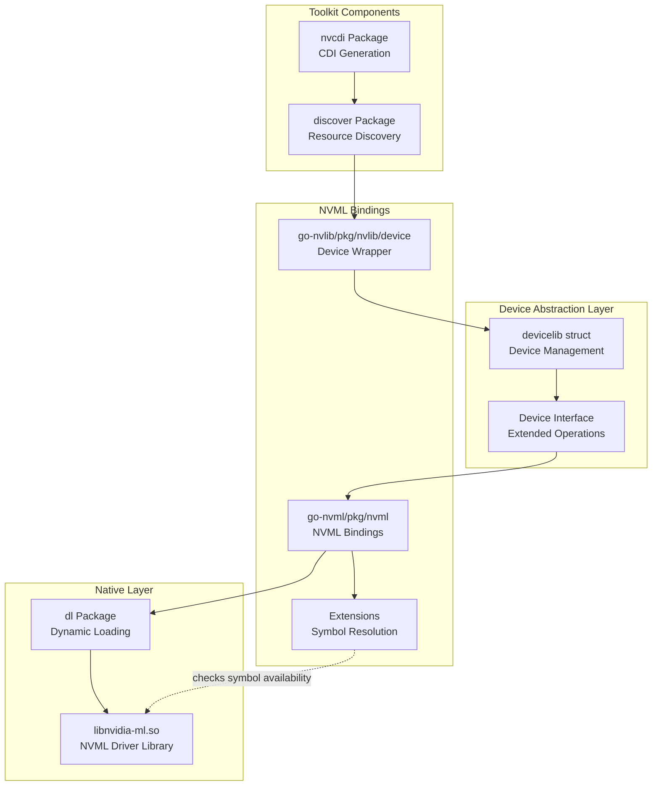
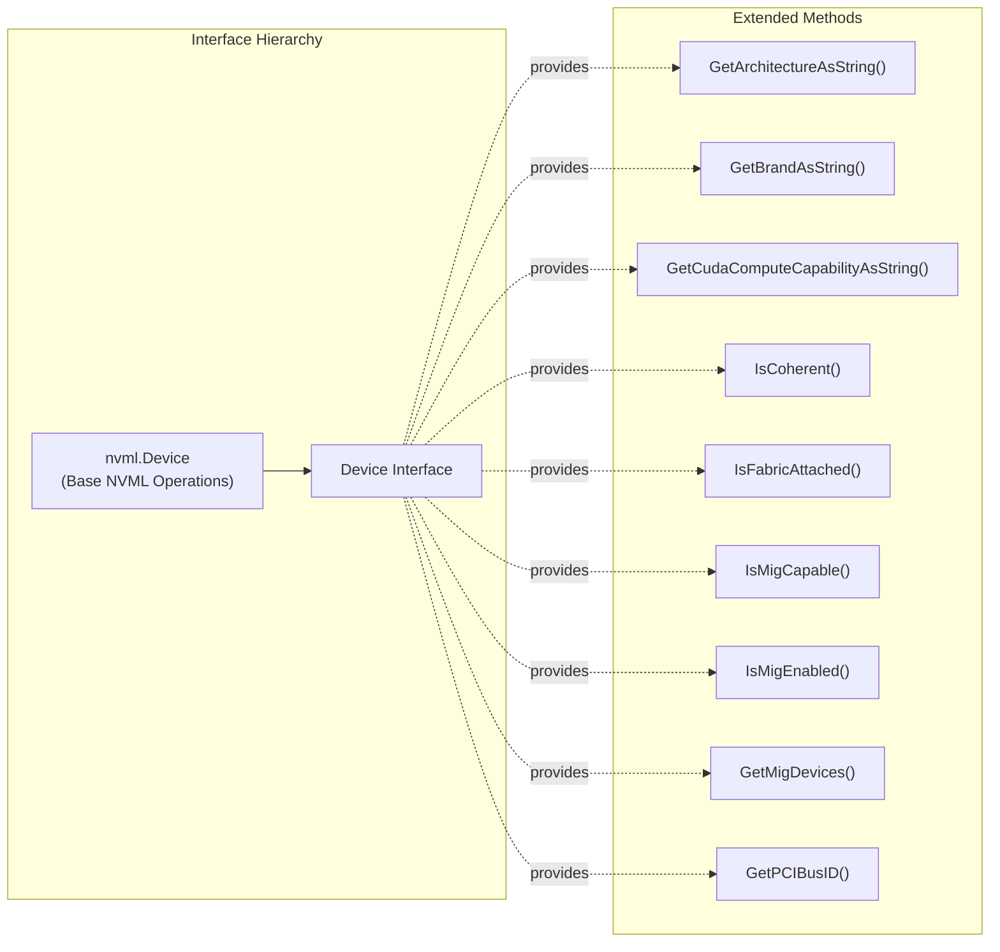
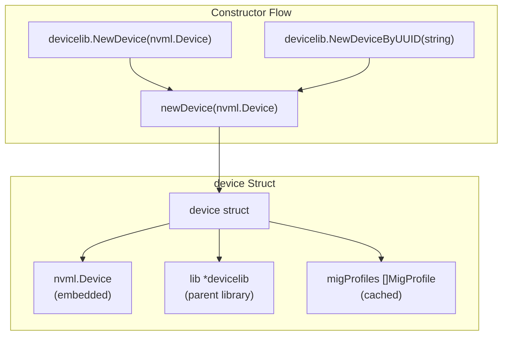
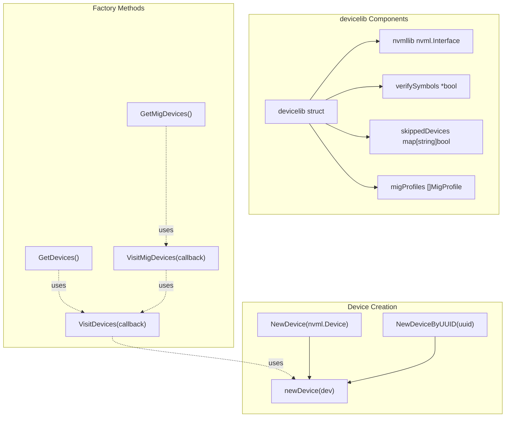
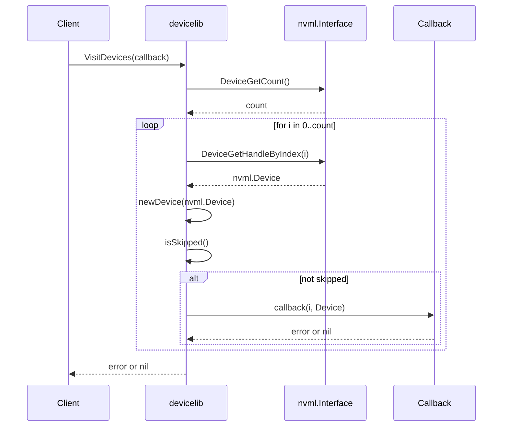
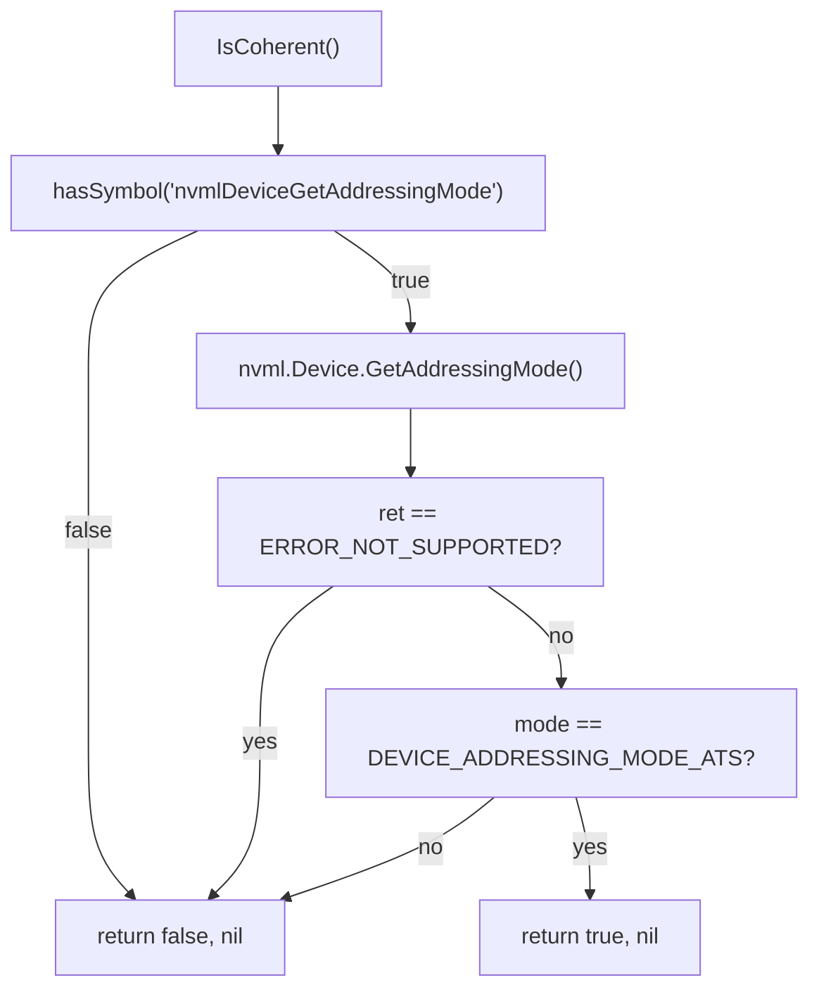
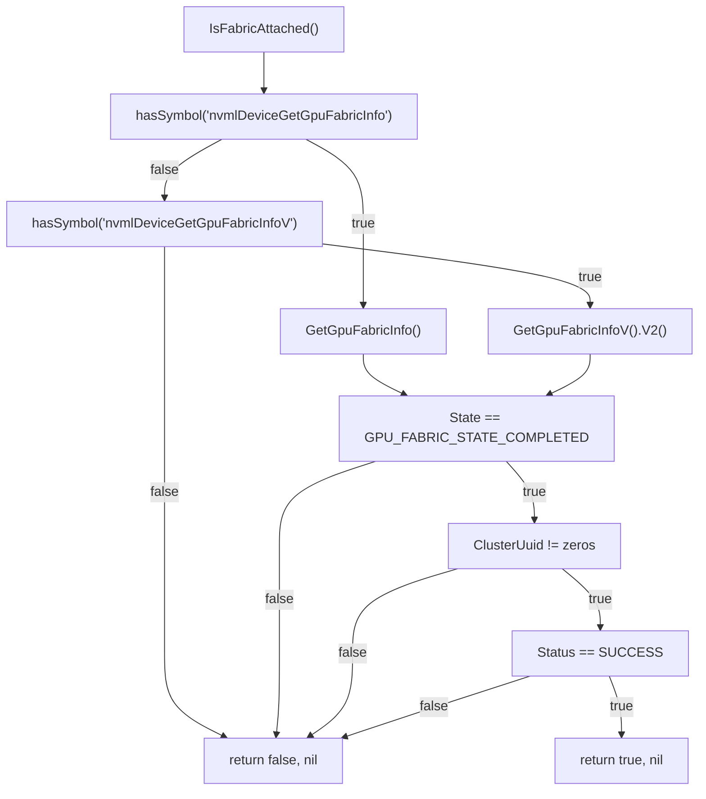
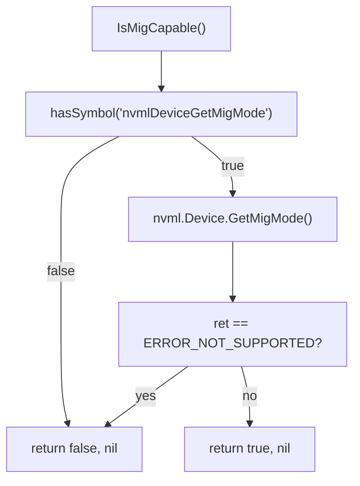
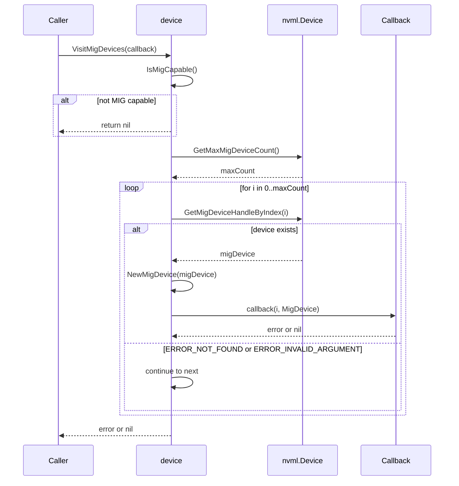
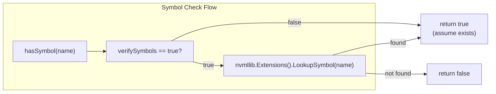

<!-- source: DeepWiki mcp.deepwiki.com · repo NVIDIA/nvidia-container-toolkit · page 3.6 Device Interface and NVML · fetched 2026-10-26 -->

# Device Interface and NVML

<details>
<summary>Relevant source files</summary>

The following files were used as context for generating this wiki page:

- [go.mod](go.mod)
- [go.sum](go.sum)
- [internal/info/proc/devices/builder.go](internal/info/proc/devices/builder.go)
- [internal/info/proc/devices/devices.go](internal/info/proc/devices/devices.go)
- [internal/info/proc/devices/devices_mock.go](internal/info/proc/devices/devices_mock.go)
- [internal/info/proc/devices/devices_test.go](internal/info/proc/devices/devices_test.go)
- [internal/nvsandboxutils/gen/nvsandboxutils/generateapi.go](internal/nvsandboxutils/gen/nvsandboxutils/generateapi.go)
- [internal/nvsandboxutils/lib.go](internal/nvsandboxutils/lib.go)
- [internal/nvsandboxutils/mock/interface.go](internal/nvsandboxutils/mock/interface.go)
- [internal/nvsandboxutils/zz_generated.api.go](internal/nvsandboxutils/zz_generated.api.go)
- [internal/platform-support/dgpu/dgpu.go](internal/platform-support/dgpu/dgpu.go)
- [internal/platform-support/dgpu/dgpu_test.go](internal/platform-support/dgpu/dgpu_test.go)
- [internal/platform-support/dgpu/nvml.go](internal/platform-support/dgpu/nvml.go)
- [internal/platform-support/dgpu/nvml_test.go](internal/platform-support/dgpu/nvml_test.go)
- [internal/platform-support/dgpu/nvsandboxutils.go](internal/platform-support/dgpu/nvsandboxutils.go)
- [internal/platform-support/dgpu/nvsandboxutils_test.go](internal/platform-support/dgpu/nvsandboxutils_test.go)
- [internal/platform-support/dgpu/options.go](internal/platform-support/dgpu/options.go)
- [internal/platform-support/tegra/tegra_test.go](internal/platform-support/tegra/tegra_test.go)
- [internal/requirements/constraints/constraints.go](internal/requirements/constraints/constraints.go)
- [internal/requirements/constraints/property.go](internal/requirements/constraints/property.go)
- [vendor/github.com/NVIDIA/go-nvlib/pkg/nvlib/device/device.go](vendor/github.com/NVIDIA/go-nvlib/pkg/nvlib/device/device.go)
- [vendor/github.com/NVIDIA/go-nvlib/pkg/nvlib/device/mig_profile.go](vendor/github.com/NVIDIA/go-nvlib/pkg/nvlib/device/mig_profile.go)
- [vendor/github.com/NVIDIA/go-nvlib/pkg/nvpci/mock.go](vendor/github.com/NVIDIA/go-nvlib/pkg/nvpci/mock.go)
- [vendor/github.com/NVIDIA/go-nvlib/pkg/nvpci/nvpci.go](vendor/github.com/NVIDIA/go-nvlib/pkg/nvpci/nvpci.go)
- [vendor/github.com/NVIDIA/go-nvlib/pkg/nvpci/nvpci_mock.go](vendor/github.com/NVIDIA/go-nvlib/pkg/nvpci/nvpci_mock.go)
- [vendor/github.com/NVIDIA/go-nvlib/pkg/nvpci/resources.go](vendor/github.com/NVIDIA/go-nvlib/pkg/nvpci/resources.go)
- [vendor/github.com/NVIDIA/go-nvlib/pkg/pciids/pciids.go](vendor/github.com/NVIDIA/go-nvlib/pkg/pciids/pciids.go)
- [vendor/github.com/NVIDIA/go-nvml/pkg/nvml/const.go](vendor/github.com/NVIDIA/go-nvml/pkg/nvml/const.go)
- [vendor/github.com/NVIDIA/go-nvml/pkg/nvml/device.go](vendor/github.com/NVIDIA/go-nvml/pkg/nvml/device.go)
- [vendor/github.com/NVIDIA/go-nvml/pkg/nvml/gpm.go](vendor/github.com/NVIDIA/go-nvml/pkg/nvml/gpm.go)
- [vendor/github.com/NVIDIA/go-nvml/pkg/nvml/mock/device.go](vendor/github.com/NVIDIA/go-nvml/pkg/nvml/mock/device.go)
- [vendor/github.com/NVIDIA/go-nvml/pkg/nvml/mock/interface.go](vendor/github.com/NVIDIA/go-nvml/pkg/nvml/mock/interface.go)
- [vendor/github.com/NVIDIA/go-nvml/pkg/nvml/nvml.go](vendor/github.com/NVIDIA/go-nvml/pkg/nvml/nvml.go)
- [vendor/github.com/NVIDIA/go-nvml/pkg/nvml/nvml.h](vendor/github.com/NVIDIA/go-nvml/pkg/nvml/nvml.h)
- [vendor/github.com/NVIDIA/go-nvml/pkg/nvml/system.go](vendor/github.com/NVIDIA/go-nvml/pkg/nvml/system.go)
- [vendor/github.com/NVIDIA/go-nvml/pkg/nvml/types_gen.go](vendor/github.com/NVIDIA/go-nvml/pkg/nvml/types_gen.go)
- [vendor/github.com/NVIDIA/go-nvml/pkg/nvml/zz_generated.api.go](vendor/github.com/NVIDIA/go-nvml/pkg/nvml/zz_generated.api.go)
- [vendor/modules.txt](vendor/modules.txt)

</details>


## Purpose and Scope

This page documents the device interface abstraction layer used by the NVIDIA Container Toolkit to interact with GPU devices. It covers the `go-nvlib` library that provides the `Device` interface, the `go-nvml` bindings that wrap the NVIDIA Management Library (NVML), and how these components enable GPU device discovery, querying, and management.

For information about how discovered devices are used to generate CDI specifications, see [Resource Discovery System](#3.3). For details on the discovery backends that use these interfaces, see [Platform-Specific Support](#3.8).

## Architecture Overview

The device interface system is organized in three layers that progressively abstract the low-level NVML API:



**Sources**: [vendor/github.com/NVIDIA/go-nvlib/pkg/nvlib/device/device.go:1-598](), [go.mod:6-7]()

## Device Interface

The `Device` interface extends the base `nvml.Device` interface with additional methods specific to container toolkit operations:



The `Device` interface is defined at [vendor/github.com/NVIDIA/go-nvlib/pkg/nvlib/device/device.go:28-43]() and includes the following key methods:

| Method | Return Type | Purpose |
|--------|-------------|---------|
| `GetArchitectureAsString()` | `string, error` | Returns GPU architecture (e.g., "Hopper", "Ampere") |
| `GetBrandAsString()` | `string, error` | Returns product brand (e.g., "Tesla", "GeForce") |
| `GetCudaComputeCapabilityAsString()` | `string, error` | Returns compute capability version (e.g., "8.0") |
| `GetAddressingModeAsString()` | `string, error` | Returns addressing mode ("ATS", "HMM", "None") |
| `GetPCIBusID()` | `string, error` | Returns normalized PCI bus ID |
| `IsCoherent()` | `bool, error` | Checks if device supports coherent system memory access |
| `IsFabricAttached()` | `bool, error` | Checks if device is attached to a GPU fabric |
| `IsMigCapable()` | `bool, error` | Checks if device supports MIG partitioning |
| `IsMigEnabled()` | `bool, error` | Checks if MIG mode is currently enabled |
| `GetMigDevices()` | `[]MigDevice, error` | Returns list of configured MIG devices |
| `VisitMigDevices()` | `error` | Iterates over MIG devices with callback |

**Sources**: [vendor/github.com/NVIDIA/go-nvlib/pkg/nvlib/device/device.go:28-43]()

## Device Implementation

The `device` struct implements the `Device` interface and wraps an `nvml.Device`:



The implementation provides string conversion for enumerated types. For example, `GetArchitectureAsString()` converts NVML architecture constants to readable names:

| NVML Constant | String Value |
|--------------|--------------|
| `nvml.DEVICE_ARCH_KEPLER` | "Kepler" |
| `nvml.DEVICE_ARCH_MAXWELL` | "Maxwell" |
| `nvml.DEVICE_ARCH_PASCAL` | "Pascal" |
| `nvml.DEVICE_ARCH_VOLTA` | "Volta" |
| `nvml.DEVICE_ARCH_TURING` | "Turing" |
| `nvml.DEVICE_ARCH_AMPERE` | "Ampere" |
| `nvml.DEVICE_ARCH_HOPPER` | "Hopper" |
| `nvml.DEVICE_ARCH_BLACKWELL` | "Blackwell" |

**Sources**: [vendor/github.com/NVIDIA/go-nvlib/pkg/nvlib/device/device.go:45-101](), [vendor/github.com/NVIDIA/go-nvlib/pkg/nvlib/device/device.go:74-101]()

## Device Library (devicelib)

The `devicelib` struct manages device instances and provides factory methods:



The `devicelib` tracks which devices should be skipped during enumeration using the `skippedDevices` map. This allows filtering out specific device models from discovery.

**Sources**: [vendor/github.com/NVIDIA/go-nvlib/pkg/nvlib/device/device.go:45-49](), [vendor/github.com/NVIDIA/go-nvlib/pkg/nvlib/device/device.go:461-492]()

## Device Discovery and Enumeration

Device enumeration follows a visitor pattern that iterates through all available devices:



The enumeration process:

1.  **Query device count** - Calls `nvmllib.DeviceGetCount()` to get the total number of devices
2.  **Iterate by index** - For each device index from 0 to count-1:
    -   Calls `nvmllib.DeviceGetHandleByIndex(i)` to get the NVML device handle
    -   Wraps it in a `device` struct via `newDevice()`
    -   Checks if the device name is in the `skippedDevices` map
    -   If not skipped, invokes the callback function with the device
3.  **Error handling** - Returns immediately on any error from NVML or the callback

**Sources**: [vendor/github.com/NVIDIA/go-nvlib/pkg/nvlib/device/device.go:461-492](), [vendor/github.com/NVIDIA/go-nvlib/pkg/nvlib/device/device.go:448-459]()

## Device Properties and Capabilities

### Architecture and Brand Detection

The `GetArchitectureAsString()` and `GetBrandAsString()` methods map NVML enumeration constants to human-readable strings. This abstraction simplifies device identification in CDI specifications.

Implementation at [vendor/github.com/NVIDIA/go-nvlib/pkg/nvlib/device/device.go:74-101]():
- Calls `d.GetArchitecture()` from the embedded `nvml.Device`
- Uses a switch statement to map constants to strings
- Returns an error for unrecognized values

Implementation at [vendor/github.com/NVIDIA/go-nvlib/pkg/nvlib/device/device.go:104-151]():
- Calls `d.GetBrand()` from the embedded `nvml.Device`
- Maps brand constants like `nvml.BRAND_TESLA`, `nvml.BRAND_QUADRO`, etc.
- Handles deprecated constants (e.g., `BRAND_NVIDIA_VGAMING`)

**Sources**: [vendor/github.com/NVIDIA/go-nvlib/pkg/nvlib/device/device.go:74-151]()

### Coherent Memory Detection

The `IsCoherent()` method determines if a device supports coherent access to system memory:



The detection logic:
1.  Checks if the `nvmlDeviceGetAddressingMode` symbol exists (driver version check) [vendor/github.com/NVIDIA/go-nvlib/pkg/nvlib/device/device.go:219-221]()
2.  Calls `GetAddressingMode()` on the device [vendor/github.com/NVIDIA/go-nvlib/pkg/nvlib/device/device.go:223]()
3.  Returns `false` if not supported by the device [vendor/github.com/NVIDIA/go-nvlib/pkg/nvlib/device/device.go:224-225]()
4.  Returns `true` only if addressing mode is `DEVICE_ADDRESSING_MODE_ATS` [vendor/github.com/NVIDIA/go-nvlib/pkg/nvlib/device/device.go:231-233]()

This information is used to annotate devices in CDI specifications for workloads requiring coherent memory access.

**Sources**: [vendor/github.com/NVIDIA/go-nvlib/pkg/nvlib/device/device.go:219-235]()

### GPU Fabric Detection

The `IsFabricAttached()` method checks if a device is attached to a GPU fabric (e.g., NVLink):



The method supports two NVML API versions and validates three conditions:
1.  Fabric state is `GPU_FABRIC_STATE_COMPLETED` [vendor/github.com/NVIDIA/go-nvlib/pkg/nvlib/device/device.go:279-280]()
2.  Cluster UUID is not all zeros [vendor/github.com/NVIDIA/go-nvlib/pkg/nvlib/device/device.go:281-282]()
3.  Status is `SUCCESS` [vendor/github.com/NVIDIA/go-nvlib/pkg/nvlib/device/device.go:283-284]()

**Sources**: [vendor/github.com/NVIDIA/go-nvlib/pkg/nvlib/device/device.go:275-310]()

## MIG Device Support

Multi-Instance GPU (MIG) support allows a single physical GPU to be partitioned into multiple isolated instances.

### MIG Capability Detection



The `IsMigCapable()` method at [vendor/github.com/NVIDIA/go-nvlib/pkg/nvlib/device/device.go:237-252]():
- Checks if the `nvmlDeviceGetMigMode` symbol exists [vendor/github.com/NVIDIA/go-nvlib/pkg/nvlib/device/device.go:238-240]()
- Attempts to call `GetMigMode()` [vendor/github.com/NVIDIA/go-nvlib/pkg/nvlib/device/device.go:242]()
- Returns `false` if the call returns `ERROR_NOT_SUPPORTED` [vendor/github.com/NVIDIA/go-nvlib/pkg/nvlib/device/device.go:243-244]()
- Returns `true` if the call succeeds (regardless of current MIG state) [vendor/github.com/NVIDIA/go-nvlib/pkg/nvlib/device/device.go:246]()

### MIG Device Enumeration

The `VisitMigDevices()` method enumerates configured MIG devices on a parent GPU:



The enumeration handles sparse MIG device indices - not all index positions may have configured devices. The implementation skips `ERROR_NOT_FOUND` and `ERROR_INVALID_ARGUMENT` errors.

**Sources**: [vendor/github.com/NVIDIA/go-nvlib/pkg/nvlib/device/device.go:312-348](), [vendor/github.com/NVIDIA/go-nvlib/pkg/nvlib/device/device.go:412-423]()

## Symbol Resolution and Version Compatibility

The `devicelib` uses symbol resolution to handle different NVML driver versions:



The `hasSymbol()` method at [vendor/github.com/NVIDIA/go-nvlib/pkg/nvlib/device/device.go:591-599]():
- If `verifySymbols` is disabled, assumes all symbols exist [vendor/github.com/NVIDIA/go-nvlib/pkg/nvlib/device/device.go:592-593]()
- Otherwise, uses `nvmllib.Extensions().LookupSymbol()` to check availability [vendor/github.com/NVIDIA/go-nvlib/pkg/nvlib/device/device.go:595-597]()
- Returns `nil` (symbol found) or an error (symbol not found)

This mechanism allows the toolkit to:
- Gracefully degrade when newer NVML APIs are unavailable
- Support multiple driver versions with a single binary
- Return default values instead of crashing on missing symbols

**Sources**: [vendor/github.com/NVIDIA/go-nvlib/pkg/nvlib/device/device.go:591-599](), [vendor/github.com/NVIDIA/go-nvlib/pkg/nvlib/device/device.go:221-222]()

## NVML Bindings (go-nvml)

The `go-nvml` package provides Go bindings to the NVML C library. Key characteristics:

| Aspect | Implementation |
|--------|----------------|
| Package | `github.com/NVIDIA/go-nvml/pkg/nvml` |
| Loading | Dynamic loading via `dl` package |
| Interface | `nvml.Interface` with all NVML functions |
| Device Handle | `nvml.Device` opaque type |
| Return Values | `nvml.Return` enumeration for error codes |
| Mock Support | `nvml.Mock` interface for testing |

The bindings provide:
-   **Type-safe wrappers** - Go functions for all NVML C APIs
-   **Error handling** - Return codes converted to Go errors where appropriate
-   **Dynamic loading** - Library loaded at runtime, not link-time
-   **Version flexibility** - Works with different NVML versions

The `go-nvml` package is vendored at [vendor/github.com/NVIDIA/go-nvml/]() and declared as a dependency in [go.mod:8](). The `nvml.Device` interface is defined in [vendor/github.com/NVIDIA/go-nvml/pkg/nvml/device.go:15-59]().

**Sources**: [go.mod:8](), [vendor/modules.txt:18-23](), [vendor/github.com/NVIDIA/go-nvml/pkg/nvml/device.go:15-59]()

## Integration with Discovery System

The Device interface integrates with the broader discovery system, specifically within the `dgpu` package for discrete GPUs.

```mermaid
graph TD
    subgraph "NVIDIA Container Toolkit"
        DGPU_DISCOVERER["dgpu.NewForDevice() / dgpu.NewForMigDevice()"]
        NVML_DGPU_DISCOVERER["newNvmlDGPUDiscoverer()"]
        NVML_MIG_DISCOVERER["newNvmlMigDiscoverer()"]
    end
    
    subgraph "go-nvlib"
        DEVLIB["device.New()"]
        DEVICE_IF["device.Device Interface"]
        MIG_DEVICE_IF["device.MigDevice Interface"]
    end
    
    subgraph "go-nvml"
        NVML_INTERFACE["nvml.Interface"]
    end
    
    DGPU_DISCOVERER --> NVML_DGPU_DISCOVERER
    DGPU_DISCOVERER --> NVML_MIG_DISCOVERER
    
    NVML_DGPU_DISCOVERER --> DEVLIB
    NVML_MIG_DISCOVERER --> DEVLIB
    
    DEVLIB --> NVML_INTERFACE
    
    NVML_DGPU_DISCOVERER -.uses.-> DEVICE_IF: "toRequiredInfo" wrapper
    NVML_MIG_DISCOVERER -.uses.-> MIG_DEVICE_IF: "toRequiredMigInfo" wrapper
    NVML_MIG_DISCOVERER -.uses.-> DEVICE_IF: "toRequiredMigInfo" wrapper for parent
```

Discovery components use the Device interface to:
1.  **Enumerate devices** - The `dgpu` package creates discoverers for `device.Device` and `device.MigDevice` instances. [internal/platform-support/dgpu/dgpu.go:32-65](), [internal/platform-support/dgpu/dgpu.go:69-114]()
2.  **Query properties** - Methods like `GetMinorNumber()` and `GetPCIBusID()` are called on the `device.Device` or `device.MigDevice` to get device-specific information. [internal/platform-support/dgpu/nvml.go:162-167](), [internal/platform-support/dgpu/nvml.go:170-175]()
3.  **Detect capabilities** - For MIG devices, `GetGpuInstanceId()` and `GetComputeInstanceId()` are used to determine placement information. [internal/platform-support/dgpu/nvml.go:190-198]()

The `toRequiredInfo` and `toRequiredMigInfo` structs act as adapters to expose the necessary methods from `device.Device` and `device.MigDevice` to the `dgpu` package's internal discoverers. [internal/platform-support/dgpu/nvml.go:158-177](), [internal/platform-support/dgpu/nvml.go:179-209]()

**Sources**: [vendor/github.com/NVIDIA/go-nvlib/pkg/nvlib/device/device.go:461-589](), [internal/platform-support/dgpu/dgpu.go:32-114](), [internal/platform-support/dgpu/nvml.go:158-209]()

---

