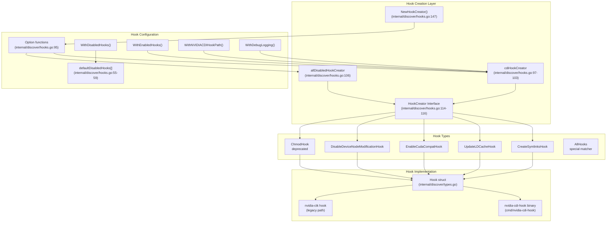
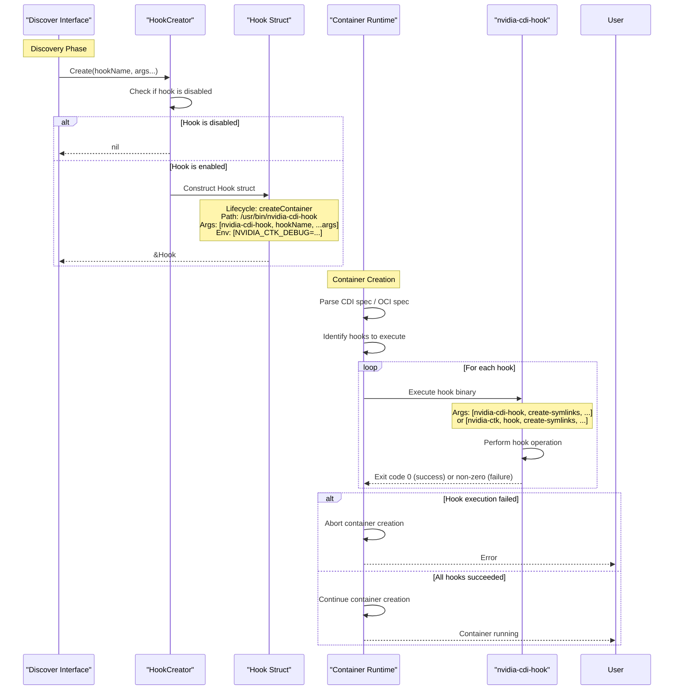
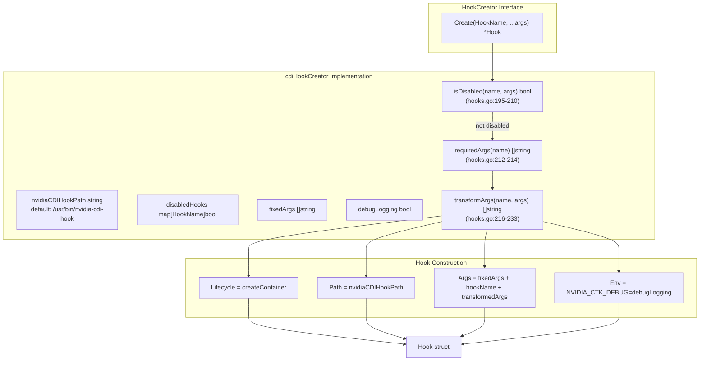
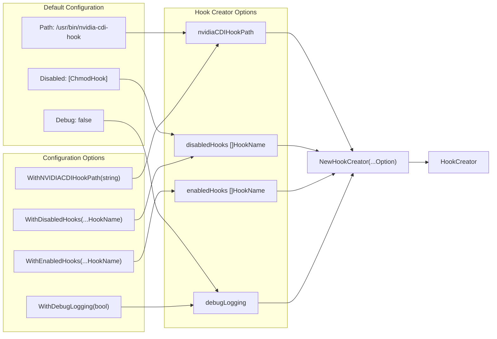
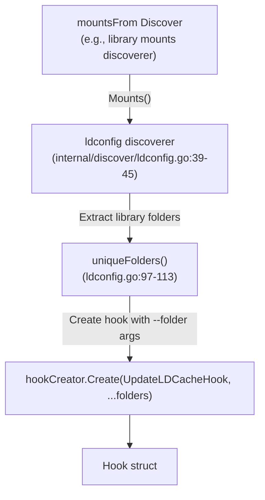
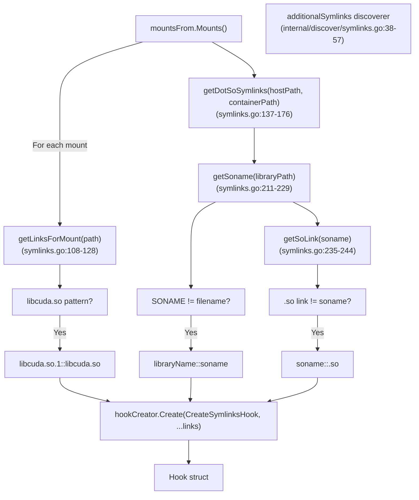
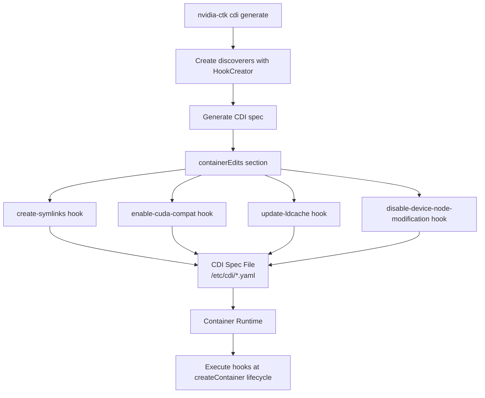
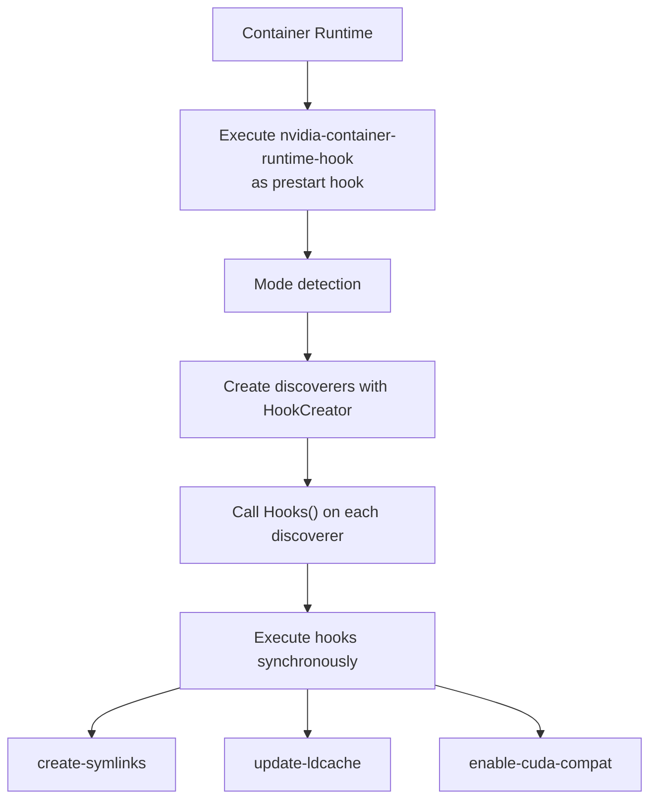

<!-- source: DeepWiki mcp.deepwiki.com · repo NVIDIA/nvidia-container-toolkit · page 3.7 Hook System · fetched 2026-10-26 -->

# Hook System

<details>
<summary>Relevant source files</summary>

The following files were used as context for generating this wiki page:

- [cmd/nvidia-cdi-hook/chmod/chmod.go](cmd/nvidia-cdi-hook/chmod/chmod.go)
- [cmd/nvidia-cdi-hook/commands/commands.go](cmd/nvidia-cdi-hook/commands/commands.go)
- [cmd/nvidia-cdi-hook/create-symlinks/container-root_linux.go](cmd/nvidia-cdi-hook/create-symlinks/container-root_linux.go)
- [cmd/nvidia-cdi-hook/create-symlinks/container_root_other.go](cmd/nvidia-cdi-hook/create-symlinks/container_root_other.go)
- [cmd/nvidia-cdi-hook/create-symlinks/create-symlinks.go](cmd/nvidia-cdi-hook/create-symlinks/create-symlinks.go)
- [cmd/nvidia-cdi-hook/create-symlinks/create-symlinks_test.go](cmd/nvidia-cdi-hook/create-symlinks/create-symlinks_test.go)
- [cmd/nvidia-cdi-hook/cudacompat/cuda-elf-header.go](cmd/nvidia-cdi-hook/cudacompat/cuda-elf-header.go)
- [cmd/nvidia-cdi-hook/cudacompat/cuda-elf-header_test.go](cmd/nvidia-cdi-hook/cudacompat/cuda-elf-header_test.go)
- [cmd/nvidia-cdi-hook/cudacompat/cudacompat.go](cmd/nvidia-cdi-hook/cudacompat/cudacompat.go)
- [cmd/nvidia-cdi-hook/cudacompat/cudacompat_test.go](cmd/nvidia-cdi-hook/cudacompat/cudacompat_test.go)
- [cmd/nvidia-cdi-hook/disable-device-node-modification/disable-device-node-modification.go](cmd/nvidia-cdi-hook/disable-device-node-modification/disable-device-node-modification.go)
- [cmd/nvidia-cdi-hook/disable-device-node-modification/disable-device-node-modification_test.go](cmd/nvidia-cdi-hook/disable-device-node-modification/disable-device-node-modification_test.go)
- [cmd/nvidia-cdi-hook/disable-device-node-modification/params_linux.go](cmd/nvidia-cdi-hook/disable-device-node-modification/params_linux.go)
- [cmd/nvidia-cdi-hook/main.go](cmd/nvidia-cdi-hook/main.go)
- [cmd/nvidia-cdi-hook/update-application-profile/minors_linux.go](cmd/nvidia-cdi-hook/update-application-profile/minors_linux.go)
- [cmd/nvidia-cdi-hook/update-application-profile/minors_other.go](cmd/nvidia-cdi-hook/update-application-profile/minors_other.go)
- [cmd/nvidia-cdi-hook/update-application-profile/update-application-profile.go](cmd/nvidia-cdi-hook/update-application-profile/update-application-profile.go)
- [cmd/nvidia-cdi-hook/update-application-profile/update-application-profile_test.go](cmd/nvidia-cdi-hook/update-application-profile/update-application-profile_test.go)
- [cmd/nvidia-cdi-hook/update-ldcache/update-ldcache.go](cmd/nvidia-cdi-hook/update-ldcache/update-ldcache.go)
- [cmd/nvidia-ctk/hook/hook.go](cmd/nvidia-ctk/hook/hook.go)
- [internal/discover/application_profile.go](internal/discover/application_profile.go)
- [internal/discover/application_profile_test.go](internal/discover/application_profile_test.go)
- [internal/discover/hooks_test.go](internal/discover/hooks_test.go)
- [internal/ldconfig/ldconfig.go](internal/ldconfig/ldconfig.go)
- [internal/ldconfig/ldconfig_linux.go](internal/ldconfig/ldconfig_linux.go)
- [internal/ldconfig/ldconfig_other.go](internal/ldconfig/ldconfig_other.go)
- [internal/ldconfig/ldconfig_test.go](internal/ldconfig/ldconfig_test.go)
- [testdata/compat/575.57.08/libcuda.so.575.57.08](testdata/compat/575.57.08/libcuda.so.575.57.08)
- [testdata/compat/590.44.01/libcuda.so.590.44.01](testdata/compat/590.44.01/libcuda.so.590.44.01)
- [testdata/compat/libcuda.invalid.json.so.99.88](testdata/compat/libcuda.invalid.json.so.99.88)
- [testdata/compat/libcuda.orin.13.2.1.so.1.1](testdata/compat/libcuda.orin.13.2.1.so.1.1)
- [vendor/github.com/Masterminds/semver/v3/.gitignore](vendor/github.com/Masterminds/semver/v3/.gitignore)
- [vendor/github.com/Masterminds/semver/v3/.golangci.yml](vendor/github.com/Masterminds/semver/v3/.golangci.yml)
- [vendor/github.com/Masterminds/semver/v3/CHANGELOG.md](vendor/github.com/Masterminds/semver/v3/CHANGELOG.md)
- [vendor/github.com/Masterminds/semver/v3/LICENSE.txt](vendor/github.com/Masterminds/semver/v3/LICENSE.txt)
- [vendor/github.com/Masterminds/semver/v3/Makefile](vendor/github.com/Masterminds/semver/v3/Makefile)
- [vendor/github.com/Masterminds/semver/v3/README.md](vendor/github.com/Masterminds/semver/v3/README.md)

</details>


## Purpose and Scope

This document describes the container lifecycle hook system used by the NVIDIA Container Toolkit. Hooks are executables that run at specific points during container creation to perform setup tasks such as creating symlinks, updating the ldcache, and enabling CUDA compatibility features.

This page focuses on the hook abstraction layer, hook types, and the hook creation mechanism. For information about how hooks are integrated into CDI specifications, see [Container Device Interface (CDI)](#3.2). For details on the discovery system that determines what resources need hooks, see [Resource Discovery System](#3.3).

## Hook System Architecture

The hook system provides a standardized way to inject custom logic into container creation workflows. Hooks are represented as executables with specific arguments that are invoked by the container runtime at defined lifecycle stages. In the NVIDIA Container Toolkit, all hooks execute at the `createContainer` lifecycle stage, which occurs after the container has been created but before it starts running.



**Hook System Architecture Overview**

Sources: [internal/discover/hooks.go:1-247]()

The system consists of four main layers:

1. **Hook Creation Layer**: Defines the `HookCreator` interface and implementations that construct hook specifications
2. **Hook Configuration**: Options for controlling which hooks are enabled/disabled and how they're configured
3. **Hook Types**: Named hook types representing different setup operations
4. **Hook Implementation**: The actual `Hook` struct and the binaries that execute hook logic

## Hook Types

The toolkit defines five primary hook types, each serving a specific purpose in container setup:

| Hook Name | Purpose | Status | Added |
|-----------|---------|--------|-------|
| `create-symlinks` | Creates symlinks for libraries and binaries in the container | Active | Core feature |
| `update-ldcache` | Updates the dynamic linker cache to discover injected libraries | Active | Core feature |
| `enable-cuda-compat` | Enables CUDA Forward Compatibility when container driver differs from host | Active | v1.17.5 |
| `disable-device-node-modification` | Prevents libnvidia-ml.so from creating device nodes in the container | Active | v1.17.8 |
| `chmod` | Sets file permissions on specified paths | Deprecated | Legacy |

Sources: [internal/discover/hooks.go:29-51](), [CHANGELOG.md:77-139]()

### CreateSymlinksHook

The `CreateSymlinksHook` creates symlinks in the container filesystem. This is essential for ensuring that libraries are accessible at expected paths. Common use cases include:

- Creating `libcuda.so` → `libcuda.so.1` symlinks for applications that incorrectly assume `libcuda.so` exists
- Creating `libGLX_indirect.so.0` → `libGLX_nvidia.so.VERSION` for indirect GLX support
- Creating SONAME symlinks for driver libraries (e.g., `libcuda.so.1` → `libcuda.so.999.88.77`)

The hook is invoked with `--link` arguments specifying symlink pairs in the format `target::link`. The `createLink` function [cmd/nvidia-cdi-hook/create-symlinks/create-symlinks.go:123-136]() handles the creation of symbolic links within the container root, ensuring existing links are updated or removed if they point to a different target. The `linkExists` function [cmd/nvidia-cdi-hook/create-symlinks/create-symlinks.go:138-151]() checks if a symlink already exists and points to the correct target.

Sources: [cmd/nvidia-cdi-hook/create-symlinks/create-symlinks.go:1-152](), [internal/discover/symlinks.go:1-244](), [internal/discover/hooks.go:37]()

### UpdateLDCacheHook

The `UpdateLDCacheHook` updates `/etc/ld.so.cache` in the container to ensure that dynamically injected libraries can be discovered by the dynamic linker. This hook:

- Scans all mounted library paths
- Groups libraries by directory
- Invokes `ldconfig` (or the path specified by `--ldconfig-path`) with `--folder` arguments for each unique directory
- Creates `/etc/ld.so.conf.d` entries to ensure injected libraries are preferred over container libraries

The `ldconfig.NewRunner` function [internal/ldconfig/ldconfig.go:70-87]() creates an `exec.Cmd` to run `ldconfig` in a re-executed process, providing namespace isolation. The `ldconfig.NewFromArgs` function [internal/ldconfig/ldconfig.go:109-140]() parses arguments to configure the `Ldconfig` struct, which then calls `UpdateLDCache` [internal/ldconfig/ldconfig.go:142-145]() to perform the cache update. The `updateLdCacheHandler` [cmd/nvidia-cdi-hook/update-ldcache/update-ldcache.go:131-134]() is registered as a reexec handler to execute the `ldconfig` update.

Sources: [cmd/nvidia-cdi-hook/update-ldcache/update-ldcache.go:1-149](), [internal/ldconfig/ldconfig.go:1-182](), [internal/discover/ldconfig.go:1-106](), [internal/discover/hooks.go:48]()

### EnableCudaCompatHook

The `EnableCudaCompatHook` enables CUDA Forward Compatibility when the container uses a different CUDA driver version than the host. This hook:

- Compares the host driver version (passed as `--host-driver-version`) with the container's expected driver version
- If a compatibility layer is needed, configures the container to load the appropriate compatibility libraries
- Is automatically disabled for management containers (containers used to manage the toolkit itself)

The `cudacompat.command.run` function [cmd/nvidia-cdi-hook/cudacompat/cudacompat.go:112-144]() determines if compatibility libraries are needed by comparing host and container CUDA/driver versions using `useCompatLibraries` [cmd/nvidia-cdi-hook/cudacompat/cudacompat.go:192-217](). It reads ELF headers from `libcuda.so` files using `GetCUDACompatElfHeaderFromReader` [cmd/nvidia-cdi-hook/cudacompat/cuda-elf-header.go:53-96]() to extract version information. If compatibility is required, it creates an `ld.so.conf.d` file to include the CUDA compat path.

Sources: [cmd/nvidia-cdi-hook/cudacompat/cudacompat.go:1-290](), [cmd/nvidia-cdi-hook/cudacompat/cuda-elf-header.go:1-163](), [internal/discover/hooks.go:45](), [CHANGELOG.md:131-139]()

### DisableDeviceNodeModificationHook

The `DisableDeviceNodeModificationHook` prevents NVIDIA libraries (particularly `libnvidia-ml.so` and `nvidia-smi`) from creating device nodes in the container. This is important for:

- Containers without sufficient privileges to create device nodes
- Ensuring device nodes are only created on the host by the toolkit
- Preventing permission issues in rootless container scenarios

Sources: [internal/discover/hooks.go:42](), [CHANGELOG.md:101-102]()

## Hook Lifecycle and Execution



**Hook Lifecycle and Execution Flow**

Sources: [internal/discover/hooks.go:180-193]()

### Hook Execution Order

Hooks are executed in the order they appear in the CDI specification or OCI runtime spec. The toolkit ensures a specific ordering for its generated hooks:

1. `create-symlinks` - Executed first to establish library paths
2. `enable-cuda-compat` - Executed after symlinks to enable compatibility features
3. `update-ldcache` - Executed after symlinks and compatibility setup to refresh the cache
4. `disable-device-node-modification` - Executed last to prevent device node creation

This ordering is important because later hooks may depend on the effects of earlier hooks (e.g., `update-ldcache` needs symlinks to be created first).

Sources: [cmd/nvidia-ctk/cdi/generate/generate_test.go:88-123](), [CHANGELOG.md:135]()

## Hook Creation System

The `HookCreator` interface provides a factory pattern for creating hooks with consistent configuration:



**Hook Creation Process**

Sources: [internal/discover/hooks.go:180-233]()

### HookCreator Implementation Details

The `cdiHookCreator` implements the `HookCreator` interface with the following logic:

**Disabled Hook Checking** [internal/discover/hooks.go:195-210]():
- Checks the `disabledHooks` map for the specific hook name
- If `AllHooks` is disabled and the hook isn't explicitly enabled, the hook is disabled
- Hooks requiring arguments (`CreateSymlinksHook`, `ChmodHook`) are disabled if no arguments are provided

**Argument Transformation** [internal/discover/hooks.go:216-233]():
- For `CreateSymlinksHook`: Converts each argument to `--link <arg>` format
- For `ChmodHook`: Adds `--mode 755` prefix and converts arguments to `--path <arg>` format
- For other hooks: Arguments are passed through unchanged

**Fixed Arguments** [internal/discover/hooks.go:240-246]():
- If the hook binary is `nvidia-ctk`, the fixed args are `["nvidia-ctk", "hook"]`
- If the hook binary is `nvidia-cdi-hook`, the fixed args are `["nvidia-cdi-hook"]`
- This allows the same `HookCreator` to work with both binary paths

### Special Hook Creator: allDisabledHookCreator

When all hooks are disabled (via `WithDisabledHooks(AllHooks)`) and no hooks are explicitly enabled, the system returns an `allDisabledHookCreator` which always returns `nil` for any hook creation request. This optimization avoids unnecessary hook processing when hooks are globally disabled.

Sources: [internal/discover/hooks.go:106-111](), [internal/discover/hooks.go:162-164]()

## Hook Configuration

Hooks can be configured through the `HookCreator` options pattern:



**Hook Configuration Options**

Sources: [internal/discover/hooks.go:95-178]()

### Disabling Hooks

Hooks can be disabled in several ways:

1. **Default Disabled Hooks** [internal/discover/hooks.go:55-59](): The `ChmodHook` is disabled by default as it was a workaround for older versions of crun that has since been fixed.

2. **Explicit Disabling** [internal/discover/hooks.go:126-129](): Use `WithDisabledHooks()` to explicitly disable specific hooks or all hooks via `AllHooks`.

3. **CDI Generation Time** [cmd/nvidia-ctk/cdi/generate/generate_test.go:144-229](): The `nvidia-ctk cdi generate` command accepts `--disabled-hooks` flags to disable hooks in generated CDI specifications.

### Enabling Hooks

Hooks that are disabled by default can be explicitly enabled using `WithEnabledHooks()`. This is useful for enabling deprecated hooks like `ChmodHook` in environments that still require them.

Sources: [internal/discover/hooks.go:133-137](), [cmd/nvidia-ctk/cdi/generate/generate_test.go:366-449]()

### Debug Logging

When `WithDebugLogging(true)` is set, all generated hooks include `NVIDIA_CTK_DEBUG=true` in their environment variables. This causes the `nvidia-cdi-hook` binary to emit detailed debug logs during execution.

Sources: [internal/discover/hooks.go:118-122](), [internal/discover/hooks.go:191](), [CHANGELOG.md:106]()

## Hook Integration with Discoverers

Hooks are typically created by discoverers that implement the `Discover` interface. Several discoverers in the toolkit create hooks as part of their discovery process:

### LDCache Update Hook Discoverer

The `ldconfig` discoverer wraps another discoverer and creates an `UpdateLDCacheHook` based on the mounts discovered:



**LDCache Update Hook Creation**

Sources: [internal/discover/ldconfig.go:28-65]()

The ldconfig discoverer:
1. Calls `Mounts()` on its wrapped discoverer to get all mounts
2. Filters mounts to find library files using `isLibName()` [internal/discover/ldconfig.go:80-94]()
3. Extracts unique parent directories using `uniqueFolders()` [internal/discover/ldconfig.go:97-106]()
4. Creates a hook with `--folder` arguments for each unique directory
5. If an explicit `ldconfigPath` is configured, adds `--ldconfig-path` argument

### Symlink Hook Discoverer

The `additionalSymlinks` discoverer creates symlinks for driver libraries:



**Symlink Hook Creation**

Sources: [internal/discover/symlinks.go:1-244]()

The symlink discoverer:
1. Gets all mounts from the wrapped discoverer
2. For each mount, checks if special symlinks are needed (e.g., `libcuda.so`)
3. Reads the ELF SONAME from each library file
4. Creates symlink pairs: `libraryName::soname` and `soname::.so`
5. Only creates symlinks if the corresponding symlinks exist on the host
6. Invokes `hookCreator.Create(CreateSymlinksHook, ...links)` with all symlink pairs

### WSL Driver Store Hook

On WSL2 systems, a special hook creates a symlink for `nvidia-smi`:

Sources: [pkg/nvcdi/driver-wsl.go:93-127]()

The `nvidiaSMISimlinkHook` discoverer:
1. Finds the `nvidia-smi` binary in the driver store mounts
2. Creates a symlink from `/usr/bin/nvidia-smi` to the driver store location
3. This is necessary because WSL2 uses the driver store path unchanged, so a symlink is needed for standard locations

## Hook Execution in Different Modes

The hook system behaves differently depending on the runtime mode:

### CDI Mode

In CDI mode, hooks are specified in the CDI specification file and executed by the container runtime:



**Hook Execution in CDI Mode**

Sources: [cmd/nvidia-ctk/cdi/generate/generate_test.go:67-141](), [CHANGELOG.md:18-19]()

In CDI mode:
- Hooks are generated at CDI spec generation time
- Hooks are specified in the `containerEdits.hooks` section of the CDI spec
- The container runtime reads the CDI spec and executes hooks automatically
- Hook configuration (enabled/disabled hooks) is determined at spec generation time
- All hooks execute as the `createContainer` lifecycle hook

### Legacy Mode

In legacy mode, the `nvidia-container-runtime-hook` binary is invoked as a prestart hook, and it creates and executes hooks dynamically:



**Hook Execution in Legacy Mode**

Sources: [CHANGELOG.md:137](), [internal/discover/hooks.go:1-247]()

In legacy mode:
- Hooks are created dynamically when the runtime hook executes
- The runtime hook calls `Hooks()` on each discoverer to get hook specifications
- Hooks are executed synchronously by the runtime hook itself
- Hook configuration comes from the runtime configuration file
- All hook logic runs in the context of the runtime hook process

## Hook Testing

The hook system includes comprehensive tests that verify hook creation and execution:

Sources: [internal/discover/ldconfig_test.go:32-147](), [cmd/nvidia-ctk/cdi/generate/generate_test.go:34-492]()

### Unit Tests

The `internal/discover/ldconfig_test.go` file tests:
- Hook creation with various mount configurations
- Correct argument construction for `update-ldcache` hook
- Handling of mount errors
- Filtering of non-library files

### Integration Tests

The `cmd/nvidia-ctk/cdi/generate/generate_test.go` file tests:
- Complete CDI spec generation with hooks
- Hook disabling via `--disabled-hooks` flag
- Hook enabling via `--enabled-hooks` flag
- Correct hook ordering in generated specs
- Hook argument formatting

Example test case showing hook disabling [cmd/nvidia-ctk/cdi/generate/generate_test.go:144-229]():
- Tests that `enable-cuda-compat` hook can be disabled
- Verifies that other hooks remain enabled
- Checks that the generated CDI spec omits the disabled hook

## Examples

### Creating a Hook Creator

```go
// Create a basic hook creator with default settings
hookCreator := discover.NewHookCreator()

// Create a hook creator with custom configuration
hookCreator := discover.NewHookCreator(
    discover.WithNVIDIACDIHookPath("/custom/path/nvidia-cdi-hook"),
    discover.WithDisabledHooks(discover.EnableCudaCompatHook),
    discover.WithDebugLogging(true),
)

// Create a hook creator that disables all hooks
hookCreator := discover.NewHookCreator(
    discover.WithDisabledHooks(discover.AllHooks),
)
```

Sources: [internal/discover/hooks.go:147-178]()

### Creating Hooks

```go
// Create a symlink hook
symlinkHook := hookCreator.Create(
    discover.CreateSymlinksHook,
    "libcuda.so.1::/usr/lib/libcuda.so",
    "libnvidia-ml.so.1::/usr/lib/libnvidia-ml.so",
)

// Create an ldcache update hook
ldcacheHook := hookCreator.Create(
    discover.UpdateLDCacheHook,
    "--folder", "/usr/lib",
    "--folder", "/usr/local/lib",
)

// Create a hook with no arguments
disableDeviceNodeHook := hookCreator.Create(
    discover.DisableDeviceNodeModificationHook,
)
```

Sources: [internal/discover/hooks.go:180-193]()

### Integrating Hooks in a Discoverer

```go
type customDiscoverer struct {
    logger      logger.Interface
    hookCreator discover.HookCreator
    mounts      []discover.Mount
}

func (d *customDiscoverer) Hooks() ([]discover.Hook, error) {
    // Extract unique folders from mounts
    folders := extractUniqueFolders(d.mounts)
    
    // Create hook arguments
    args := []string{}
    for _, folder := range folders {
        args = append(args, "--folder", folder)
    }
    
    // Create the hook
    hook := d.hookCreator.Create(discover.UpdateLDCacheHook, args...)
    
    // Return as a slice
    return hook.Hooks()
}
```

Sources: [internal/discover/ldconfig.go:48-65]()

---

