<!-- source: DeepWiki mcp.deepwiki.com · repo NVIDIA/nvidia-container-toolkit · page 3.8 Platform-Specific Support · fetched 2026-10-26 -->

# Platform-Specific Support

<details>
<summary>Relevant source files</summary>

The following files were used as context for generating this wiki page:

- [cmd/nvidia-ctk-installer/toolkit/toolkit_test.go](cmd/nvidia-ctk-installer/toolkit/toolkit_test.go)
- [cmd/nvidia-ctk/cdi/generate/generate_test.go](cmd/nvidia-ctk/cdi/generate/generate_test.go)
- [internal/cuda/cuda.go](internal/cuda/cuda.go)
- [internal/devices/devices.go](internal/devices/devices.go)
- [internal/devices/devices_mock.go](internal/devices/devices_mock.go)
- [internal/devices/devices_tests.go](internal/devices/devices_tests.go)
- [internal/discover/hooks.go](internal/discover/hooks.go)
- [internal/discover/ldconfig.go](internal/discover/ldconfig.go)
- [internal/discover/ldconfig_test.go](internal/discover/ldconfig_test.go)
- [internal/discover/symlinks.go](internal/discover/symlinks.go)
- [internal/dxcore/api.go](internal/dxcore/api.go)
- [internal/dxcore/dxcore.c](internal/dxcore/dxcore.c)
- [internal/dxcore/dxcore.go](internal/dxcore/dxcore.go)
- [internal/dxcore/dxcore.h](internal/dxcore/dxcore.h)
- [internal/edits/device.go](internal/edits/device.go)
- [internal/edits/device_test.go](internal/edits/device_test.go)
- [internal/platform-support/tegra/csv.go](internal/platform-support/tegra/csv.go)
- [internal/platform-support/tegra/csv_test.go](internal/platform-support/tegra/csv_test.go)
- [internal/platform-support/tegra/filter.go](internal/platform-support/tegra/filter.go)
- [internal/platform-support/tegra/filter_test.go](internal/platform-support/tegra/filter_test.go)
- [internal/platform-support/tegra/mount_specs.go](internal/platform-support/tegra/mount_specs.go)
- [internal/platform-support/tegra/options.go](internal/platform-support/tegra/options.go)
- [internal/platform-support/tegra/symlinks.go](internal/platform-support/tegra/symlinks.go)
- [internal/platform-support/tegra/tegra.go](internal/platform-support/tegra/tegra.go)
- [pkg/nvcdi/driver-wsl.go](pkg/nvcdi/driver-wsl.go)
- [pkg/nvcdi/lib-csv_test.go](pkg/nvcdi/lib-csv_test.go)
- [testdata/lookup/rootfs-thor-dgpu/dev/nvmap](testdata/lookup/rootfs-thor-dgpu/dev/nvmap)
- [testdata/lookup/rootfs-thor-dgpu/usr/lib/aarch64-linux-gnu/nvidia/libcuda.so.1.1](testdata/lookup/rootfs-thor-dgpu/usr/lib/aarch64-linux-gnu/nvidia/libcuda.so.1.1)
- [testdata/lookup/rootfs-thor-dgpu/usr/lib/aarch64-linux-gnu/nvidia/libnvidia-ml.so.1](testdata/lookup/rootfs-thor-dgpu/usr/lib/aarch64-linux-gnu/nvidia/libnvidia-ml.so.1)

</details>


This page documents the platform-specific implementations in the NVIDIA Container Toolkit that enable GPU access on non-standard platforms. The toolkit provides specialized support for Tegra/Jetson embedded systems (using CSV-based discovery), WSL2 environments (using DXCore integration), and standard x86_64 Linux systems (using NVML-based discovery).

For information about runtime modes and mode selection, see [Runtime Modes](#3.1). For the general resource discovery system, see [Resource Discovery System](#3.3).

## Overview

The NVIDIA Container Toolkit adapts its device discovery and resource injection mechanisms based on the target platform. Different platforms expose GPU resources differently and require platform-specific logic:

- **Standard Linux**: Uses NVML library for device enumeration and discovery
- **Tegra/Jetson**: Uses CSV files to define required device nodes, libraries, and configurations
- **WSL2**: Uses DXCore integration for GPU access on Windows Subsystem for Linux

The platform-specific support is primarily implemented in CDI spec generation (mode `csv`) and runtime modification. The toolkit automatically selects the appropriate discovery mechanism based on configuration and available resources.

Sources: [internal/platform-support/tegra/tegra.go:1-77](), [pkg/nvcdi/lib-csv.go:1-400]()

## Platform Architecture

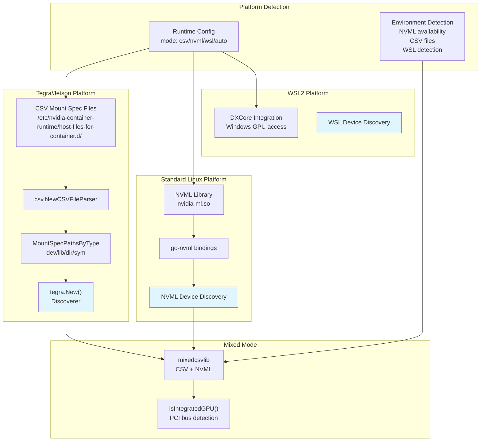

Sources: [pkg/nvcdi/lib-csv.go:38-83](), [internal/platform-support/tegra/tegra.go:27-77]()

## Tegra/Jetson Platform Support

### CSV-Based Discovery Architecture

Tegra and Jetson platforms use CSV (Comma-Separated Values) files to define the GPU resources required by containers. This approach is necessary because these embedded platforms do not provide NVML libraries and have custom driver installations.

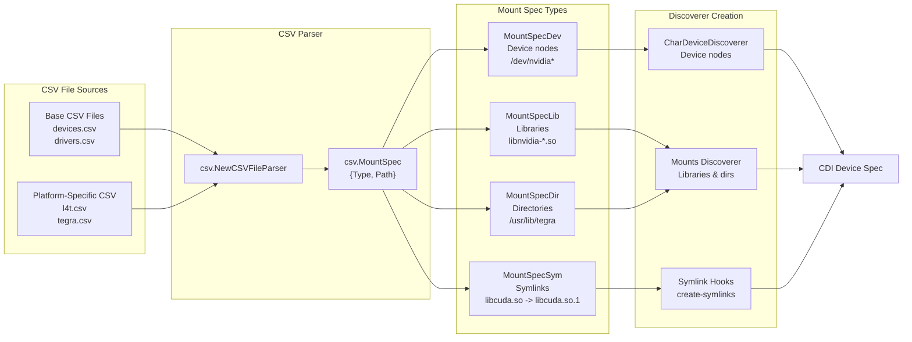

Sources: [internal/platform-support/tegra/csv.go:28-112](), [internal/platform-support/tegra/tegra.go:27-77](), [pkg/nvcdi/lib-csv.go:64-156]()

### CSV File Format and Mount Specifications

CSV files define four types of mount specifications that describe resources needed for GPU containers:

| Mount Spec Type | CSV Type | Description | Example Path |
|----------------|----------|-------------|--------------|
| `MountSpecDev` | `dev` | Character device nodes | `/dev/nvidia0`, `/dev/nvhost-ctrl` |
| `MountSpecLib` | `lib` | Shared libraries | `/usr/lib/aarch64-linux-gnu/tegra/libcuda.so.1.1` |
| `MountSpecDir` | `dir` | Directories | `/usr/lib/aarch64-linux-gnu/tegra` |
| `MountSpecSym` | `sym` | Symbolic links | `/usr/lib/libcuda.so -> libcuda.so.1` |

The CSV parser in [internal/platform-support/tegra/csv.go:103-112]() loads files from the configured mount spec path (default: `/etc/nvidia-container-runtime/host-files-for-container.d/`). Each line specifies a type and path:

```
dev, /dev/nvidia0
lib, /usr/lib/tegra/libcuda.so.1.1.123
sym, /usr/lib/libcuda.so
```

Sources: [internal/platform-support/tegra/csv.go:84-112](), [internal/platform-support/tegra/mount_specs.go:20-156]()

### Mount Specification Transformation System

The toolkit provides a transformation pipeline for filtering and modifying mount specifications:

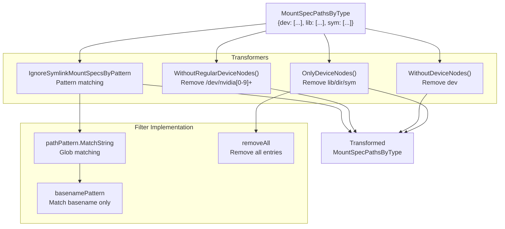

The transformation system is defined in [internal/platform-support/tegra/mount_specs.go:65-156]() and [internal/platform-support/tegra/filter.go:1-148](). Key transformers:

- **`OnlyDeviceNodes()`**: Keeps only device node specifications, removing libraries and symlinks
- **`WithoutDeviceNodes()`**: Removes device nodes, keeping other resources
- **`WithoutRegularDeviceNodes()`**: Removes regular GPU device nodes (`/dev/nvidia[0-9]+`) while keeping control devices
- **`IgnoreSymlinkMountSpecsByPattern(patterns...)`**: Filters symlinks by glob patterns (supports `**/pattern` for basename matching)

Sources: [internal/platform-support/tegra/mount_specs.go:65-156](), [internal/platform-support/tegra/filter.go:17-148]()

### Tegra Discoverer Implementation

The `tegra.New()` function creates a discoverer that processes CSV mount specifications:

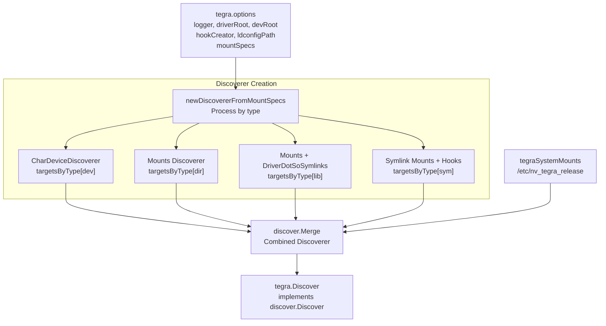

Key implementation details from [internal/platform-support/tegra/tegra.go:27-77]():

1. **Device Discovery**: Uses `discover.NewCharDeviceDiscoverer` for device nodes in `devRoot`
2. **Directory Mounts**: Uses `lookup.NewDirectoryLocator` to validate directories exist
3. **Library Handling**: Adds `.so` symlinks via `discover.WithDriverDotSoSymlinks`
4. **Symlink Creation**: Creates hooks via `createCSVSymlinkHooks` to establish symlinks in container
5. **System Files**: Always includes `/etc/nv_tegra_release` to identify Tegra platform

Sources: [internal/platform-support/tegra/tegra.go:27-77](), [internal/platform-support/tegra/csv.go:28-80]()

### Symlink Hook System

The Tegra platform requires creating symlinks in the container filesystem. This is handled by the `symlinkHook` discoverer:

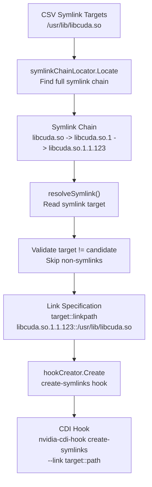

The implementation in [internal/platform-support/tegra/symlinks.go:19-93]() creates hooks that execute `nvidia-cdi-hook create-symlinks` with link specifications. Each specification follows the format `target::linkpath`, where:
- `target`: The file the symlink should point to
- `linkpath`: The path where the symlink should be created

Sources: [internal/platform-support/tegra/symlinks.go:19-93](), [internal/platform-support/tegra/csv.go:69-70]()

### Mixed CSV Mode with NVML

When NVML is available on Tegra platforms, the toolkit uses a hybrid approach combining CSV files with NVML device enumeration:

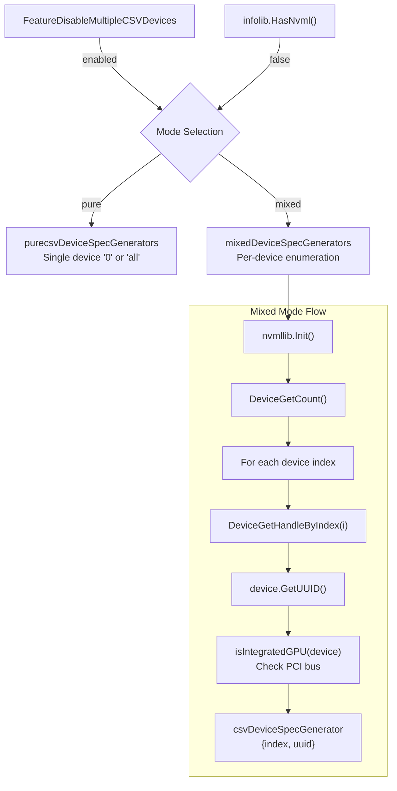

The mixed mode implementation in [pkg/nvcdi/lib-csv.go:168-279]() enables:

1. **Multi-device Support**: Enumerates individual devices instead of treating all as one
2. **UUID Assignment**: Each device gets a proper UUID from NVML
3. **Integrated GPU Detection**: Identifies integrated GPUs via PCI bus information
4. **Device-Specific Specs**: Creates separate CDI device specs per GPU

The `isIntegratedGPU` function in [pkg/nvcdi/lib-csv.go:286-309]() checks:
- PCI Domain == 0
- PCI Bus == 1  
- PCI Device == 0
- Or device name contains known integrated GPU patterns (via `info.IsIntegratedGPUName`)

Sources: [pkg/nvcdi/lib-csv.go:48-83](), [pkg/nvcdi/lib-csv.go:168-279](), [pkg/nvcdi/lib-csv.go:286-309]()

### CSV Modifier for Runtime Integration

The CSV modifier integrates CSV-based discovery into the OCI runtime flow:

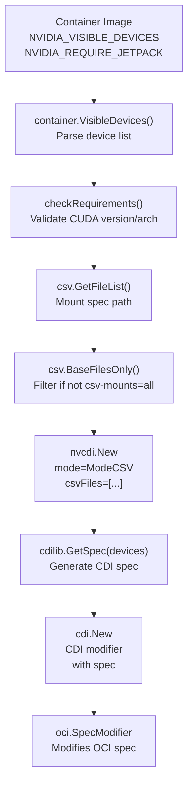

Key steps in [internal/modifier/csv.go:33-76]():

1. **Device Validation**: Ensures `NVIDIA_VISIBLE_DEVICES` is set and not empty/void
2. **Requirements Check**: Validates CUDA version and compute capability if `NVIDIA_DISABLE_REQUIRE` is not set
3. **CSV File Selection**: Loads all CSV files unless `NVIDIA_REQUIRE_JETPACK=csv-mounts=all` is set (then uses base files only)
4. **CDI Library Creation**: Constructs `nvcdi.Interface` in CSV mode with selected CSV files
5. **Spec Generation**: Calls `cdilib.GetSpec(devices)` to generate CDI specifications
6. **Modifier Creation**: Wraps CDI spec in a modifier that can modify OCI runtime specs

Sources: [internal/modifier/csv.go:33-76](), [internal/modifier/csv.go:78-87]()

## WSL2 Platform Support

WSL2 (Windows Subsystem for Linux 2) support enables GPU access from Linux containers running on Windows. The toolkit integrates with Windows' DXCore API for GPU enumeration and access.

### WSL2 Architecture

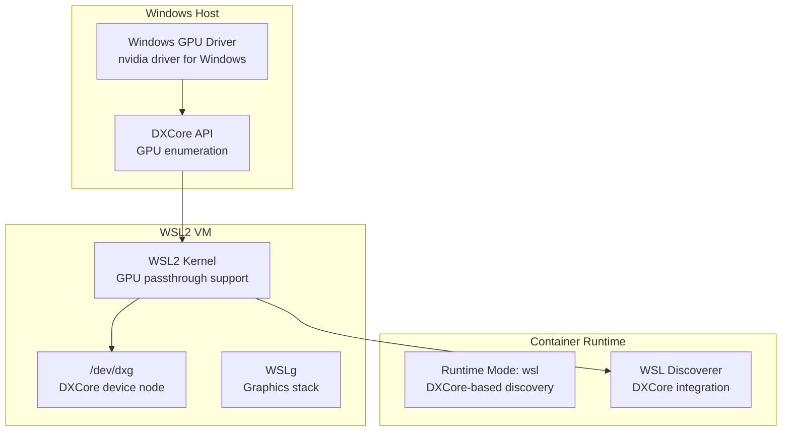

The `wsllib` struct in [pkg/nvcdi/driver-wsl.go:50-51]() implements the logic for WSL2. The `newWSLDriverDiscoverer` function in [pkg/nvcdi/driver-wsl.go:50-123]() is responsible for creating the discoverer for WSL2 drivers.

Key steps in WSL2 driver discovery:
1. **DXCore Initialization**: Calls `dxcore.Init()` to initialize the DXCore API [pkg/nvcdi/driver-wsl.go:51-52]().
2. **Driver Store Path Discovery**: Retrieves driver store paths using `dxcore.GetDriverStorePaths()` [pkg/nvcdi/driver-wsl.go:60-60](). The NVIDIA-specific driver store path is then identified by locating `libcuda.so.1.1` within these paths [pkg/nvcdi/driver-wsl.go:125-143]().
3. **DXCore Library Mounts**: Creates a `discover.Mounts` discoverer for `libdxcore.so` [pkg/nvcdi/driver-wsl.go:75-86]().
4. **Required Driver Store Mounts**: Creates another `discover.Mounts` discoverer for essential NVIDIA driver files like `libcuda.so.1.1`, `libnvidia-ml.so.1`, `nvidia-smi`, etc., located in the identified NVIDIA driver store path [pkg/nvcdi/driver-wsl.go:88-99]().
5. **Additional Driver Store Mounts**: Discovers other `.so`, `.bin`, and `.dll` files in the driver store that are not explicitly listed as required [pkg/nvcdi/driver-wsl.go:145-192]().
6. **`nvidia-smi` Symlink Hook**: A special `nvidiaSMISimlinkHook` is created to symlink the `nvidia-smi` binary from its driver store location to `/usr/bin/nvidia-smi` in the container [pkg/nvcdi/driver-wsl.go:194-226](). This is necessary because the driver store path is mounted unchanged.
7. **LDCache Update Hook**: An `UpdateLDCacheHook` is created to ensure that the newly mounted libraries are discoverable within the container [pkg/nvcdi/driver-wsl.go:113-113]().

Sources: [pkg/nvcdi/driver-wsl.go:50-123](), [pkg/nvcdi/driver-wsl.go:125-143](), [pkg/nvcdi/driver-wsl.go:145-192](), [pkg/nvcdi/driver-wsl.go:194-226](), [internal/dxcore/api.go:1-20]()

## Standard Linux Platform Support

Standard x86_64 Linux systems use NVML (NVIDIA Management Library) for device discovery. This is documented in detail in [Resource Discovery System](#3.3) and is not covered extensively here as it is the default mode.

The key difference from platform-specific implementations:
- Uses `nvmllib` interface to NVML
- Enumerates devices via `DeviceGetCount()` and `DeviceGetHandleByIndex()`
- Queries device properties via NVML API calls
- Does not require CSV files or platform-specific discovery

Sources: [pkg/nvcdi/lib-nvml.go]() (referenced but not provided), High-level diagrams

## Graphics Platform Support

Graphics support is largely platform-agnostic but integrates with platform-specific device discovery:

### DRM Device Node Discovery

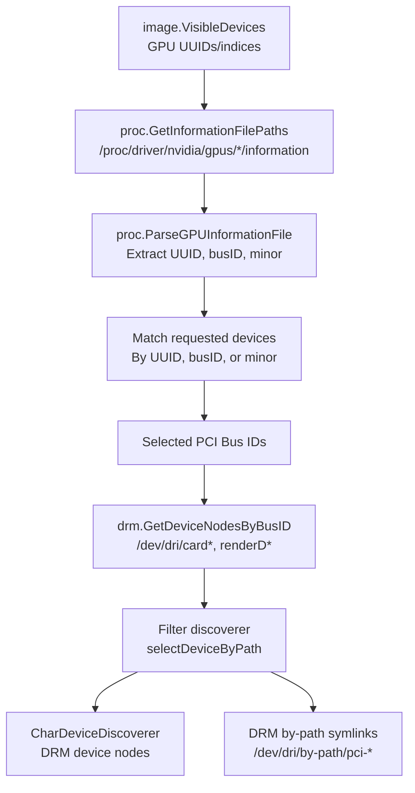

The DRM device discovery in [internal/discover/graphics.go:354-414]() follows this process:

1. **Parse GPU Information**: Reads `/proc/driver/nvidia/gpus/*/information` files
2. **Match Devices**: Compares requested device IDs (UUID, bus ID, or minor number) against parsed information
3. **Get DRM Nodes**: For each matched PCI bus ID, calls `drm.GetDeviceNodesByBusID()` to find corresponding DRM device nodes
4. **Filter Discovery**: Uses `selectDeviceByPath` filter to include only matched DRM nodes
5. **Create Symlinks**: Generates hooks to create `/dev/dri/by-path/` symlinks

Sources: [internal/discover/graphics.go:354-414](), [internal/discover/graphics.go:273-352]()

### Graphics Libraries and Configurations

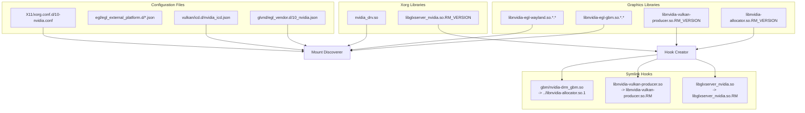

The graphics library discovery in [internal/discover/graphics.go:110-230]() handles:

1. **EGL Libraries**: `libnvidia-egl-gbm.so` and `libnvidia-egl-wayland.so` with version patterns
2. **Allocator/Producer**: Libraries for Wayland/GBM integration
3. **Xorg Libraries**: Search in multiple paths including `xorg/modules/{drivers,extensions}`
4. **Configuration Files**: EGL vendor configs, Vulkan ICD files, Xorg configs
5. **Symlink Creation**: Hooks to create necessary symlinks (e.g., `gbm/nvidia-drm_gbm.so -> ../libnvidia-allocator.so.1`)

The Vulkan config discovery uses a `lookup.First` locator that searches both the standard config paths and the driver root, supporting GKE installations where configs are at `{{ .driverRoot }}/vulkan`.

Sources: [internal/discover/graphics.go:51-108](), [internal/discover/graphics.go:110-230]()

## Platform Selection and Integration

### Mode-Based Platform Selection

The platform-specific implementation is selected based on the runtime mode configuration:

| Mode | Platform | Discovery Method | Primary Use Case |
|------|----------|-----------------|------------------|
| `nvml` | Standard Linux | NVML library | x86_64 servers with standard NVIDIA drivers |
| `csv` | Tegra/Jetson | CSV files | ARM embedded systems (Jetson, Orin) |
| `wsl` | WSL2 | DXCore | Windows Subsystem for Linux 2 |
| `auto` | Auto-detect | Detects available discovery | Automatic platform detection |

The mode is configured in `/etc/nvidia-container-runtime/config.toml` under `[nvidia-container-runtime.modes]`. The selection logic in the modifier creation checks the mode and creates the appropriate discoverer.

Sources: [internal/modifier/csv.go:33-76](), [pkg/nvcdi/lib-csv.go:48-83]()

### Platform-Specific Configuration Options

Each platform supports specific configuration options:

**CSV Mode** ([internal/platform-support/tegra/options.go:26-77]()):
```toml
[nvidia-container-runtime.modes.csv]
mount-spec-path = "/etc/nvidia-container-runtime/host-files-for-container.d"
```

**Tegra Options** ([internal/platform-support/tegra/options.go:26-77]()):
- `driverRoot`: Root path for driver files
- `devRoot`: Root path for device nodes (defaults to `driverRoot`)
- `librarySearchPaths`: Custom library search paths
- `ldconfigPath`: Path to ldconfig for cache updates

**Mixed CSV Features**:
- Automatic detection of integrated GPUs
- Per-device CDI spec generation
- UUID assignment from NVML

Sources: [internal/platform-support/tegra/options.go:20-77](), [pkg/nvcdi/lib-csv.go:48-83]()

### CSV Ignore Patterns

CSV mode supports filtering symlink mount specifications by patterns to avoid conflicts:

```go
// Example: Ignore .so and .so.[0-9] symlinks
csvIgnorePatterns = []string{"*.so", "*.so.[0-9]"}

// Example: Ignore all .so files in any directory
csvIgnorePatterns = []string{"**/*.so"}
```

The pattern matching in [internal/platform-support/tegra/filter.go:26-61]() supports:
- Simple globs: `*.so` matches `libcuda.so`
- Basename globs: `**/pattern` matches basename only
- Multiple patterns combined with OR logic

Sources: [internal/platform-support/tegra/filter.go:26-61](), [pkg/nvcdi/lib-csv.go:317-318]()

## Platform-Specific CDI Generation

The CDI specification generation varies by platform:

### CSV Device Spec Generation

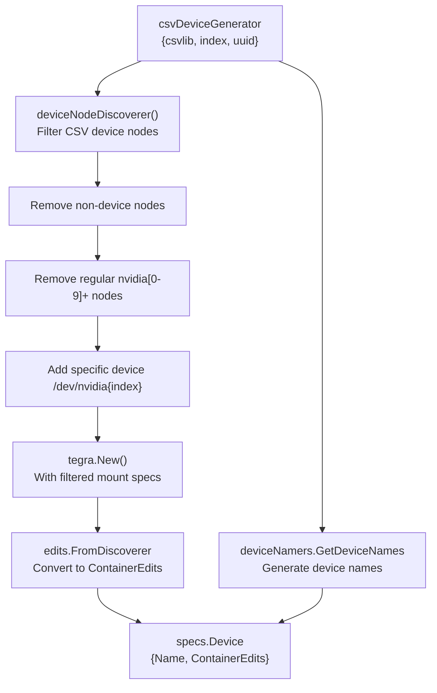

The `csvDeviceSpecGenerator` in [pkg/nvcdi/lib-csv.go:98-156]() creates CDI device specifications by:

1. **Filtering Mount Specs**: Applies transformations to keep only device-related entries
2. **Device Node Selection**: Removes regular GPU nodes, adds the specific device node for this device index
3. **Creating Discoverer**: Constructs a Tegra discoverer with the filtered mount specs
4. **Generating Edits**: Converts discovered resources to CDI `ContainerEdits` using `edits.FromDiscoverer` [pkg/nvcdi/lib-csv.go:149-149](). The `edits.device` struct in [internal/edits/device.go:30-33]() converts discovered devices to CDI `ContainerEdits` and `specs.DeviceNode` [internal/edits/device.go:36-65](). It also handles adding additional GIDs if the device node is not world-readable/writable [internal/edits/device.go:121-137]().
5. **Device Naming**: Uses configured device namers to generate device names
6. **Building Spec**: Combines name and edits into a `specs.Device`

Sources: [pkg/nvcdi/lib-csv.go:98-156](), [pkg/nvcdi/lib-csv.go:124-156](), [internal/edits/device.go:30-33](), [internal/edits/device.go:36-65](), [internal/edits/device.go:121-137]()

### Common Edits for CSV Mode

The common edits (applied to all devices) exclude device nodes and include only shared resources:

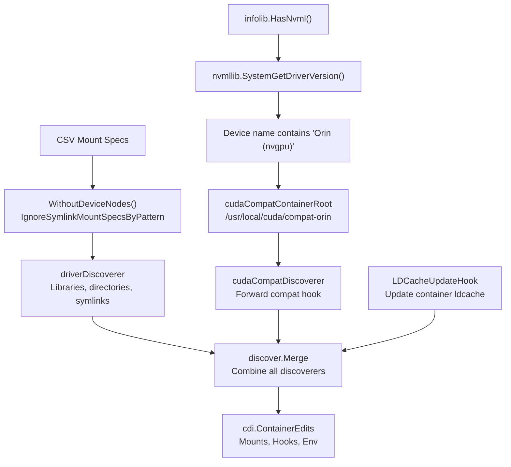

The common edits generation in [pkg/nvcdi/lib-csv.go:158-346]() includes:

1. **Driver Libraries**: All libraries and directories from CSV (excluding device nodes)
2. **CUDA Compatibility**: Forward compatibility hook with driver version (if NVML available)
3. **Orin Support**: Special compatibility root path for Orin-based systems
4. **LDCache Update**: Hook to update the container's library cache after mounting libraries. The `NewLDCacheUpdateHook` function in [internal/discover/ldconfig.go:27-36]() creates a discoverer for this purpose. It identifies library folders from mounts [internal/discover/ldconfig.go:60-70]() and generates an `UpdateLDCacheHook` [internal/discover/ldconfig.go:56-58]().

Sources: [pkg/nvcdi/lib-csv.go:158-346](), [pkg/nvcdi/lib-csv.go:348-399](), [internal/discover/ldconfig.go:27-36](), [internal/discover/ldconfig.go:56-58](), [internal/discover/ldconfig.go:60-70]()

## Platform-Specific Testing

The codebase includes extensive tests for platform-specific implementations:

### CSV Discoverer Tests

The test suite in [internal/platform-support/tegra/csv_test.go:30-212]() validates:

- **Symlink Resolution**: Verifies symlinks are resolved to their targets
- **Mount Deduplication**: Ensures duplicate mounts are handled correctly
- **Ignore Patterns**: Tests filtering of symlink mounts by glob patterns
- **Hook Generation**: Validates `create-symlinks` hooks are generated correctly

Sources: [internal/platform-support/tegra/csv_test.go:30-212]()

### Filter Tests

The filter tests in [internal/platform-support/tegra/filter_test.go:25-57]() verify:

- **Glob Matching**: Tests `*.so` and `*.so.[0-9]` patterns
- **Basename Patterns**: Validates `**/*.so` matches any path
- **Multiple Patterns**: Ensures OR logic works correctly

Sources: [internal/platform-support/tegra/filter_test.go:25-57]()

### CDI Generation Tests

The `TestGenerateSpec` function in [cmd/nvidia-ctk/cdi/generate/generate_test.go:37-173]() includes test cases for CDI spec generation, covering:
- Invalid device IDs [cmd/nvidia-ctk/cdi/generate/generate_test.go:54-74]()
- Default spec generation [cmd/nvidia-ctk/cdi/generate/generate_test.go:75-173]()
- Disabling specific hooks [cmd/nvidia-ctk/cdi/generate/generate_test.go:174-230]()

The `TestDeviceSpecGenerators` function in [pkg/nvcdi/lib-csv_test.go:43-168]() specifically tests the CSV-based device spec generation for Tegra/Jetson platforms, including:
- Single Orin CSV device [pkg/nvcdi/lib-csv_test.go:64-113]()
- Custom container compatibility root [pkg/nvcdi/lib-csv_test.go:115-168]()
- Thor device with dGPU [pkg/nvcdi/lib-csv_test.go:170-219]()

Sources: [cmd/nvidia-ctk/cdi/generate/generate_test.go:37-173](), [pkg/nvcdi/lib-csv_test.go:43-168]()

### LDCache Update Hook Tests

The `TestLDCacheUpdateHook` function in [internal/discover/ldconfig_test.go:32-148]() validates the `LDCacheUpdateHook` behavior:
- Handling empty mounts [internal/discover/ldconfig_test.go:43-45]()
- Propagating mount errors [internal/discover/ldconfig_test.go:46-49]()
- Correctly identifying library folders and adding them to hook arguments [internal/discover/ldconfig_test.go:50-76]()
- Ignoring host paths for library discovery [internal/discover/ldconfig_test.go:77-94]()
- Passing explicit `ldconfigPath` to the hook [internal/discover/ldconfig_test.go:95-111]()

Sources: [internal/discover/ldconfig_test.go:32-148]()

## Summary

The NVIDIA Container Toolkit's platform-specific support enables GPU access across diverse hardware and software environments:

- **Tegra/Jetson**: CSV-based discovery for ARM embedded systems without NVML
- **WSL2**: DXCore integration for Windows Subsystem for Linux 2
- **Standard Linux**: NVML-based discovery for x86_64 servers
- **Graphics**: Platform-agnostic support for DRM, Vulkan, and X11

The architecture uses a consistent discoverer pattern with platform-specific implementations selected by runtime mode configuration. The CSV mode provides particular flexibility with mount specification transformations, symlink hooks, and optional NVML integration for enhanced device enumeration.

Sources: [internal/platform-support/tegra/tegra.go:1-77](), [pkg/nvcdi/lib-csv.go:1-400](), [internal/discover/graphics.go:1-435](), [internal/modifier/csv.go:1-87]()

---

