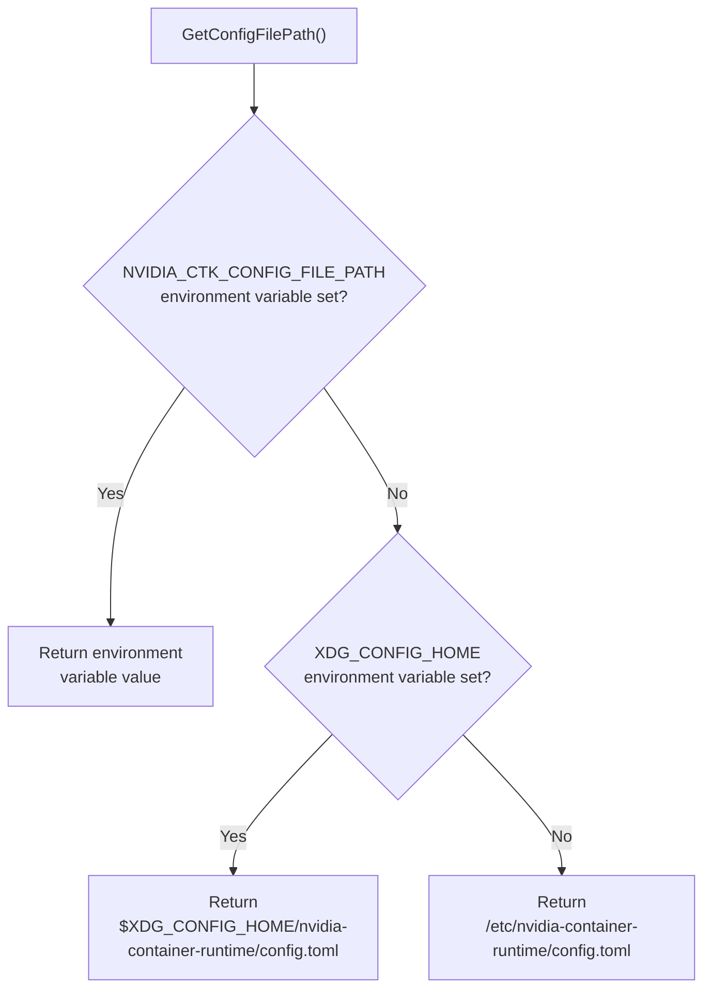
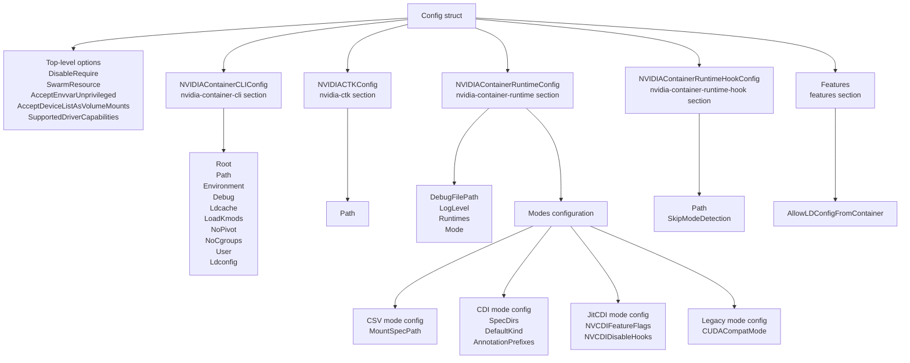
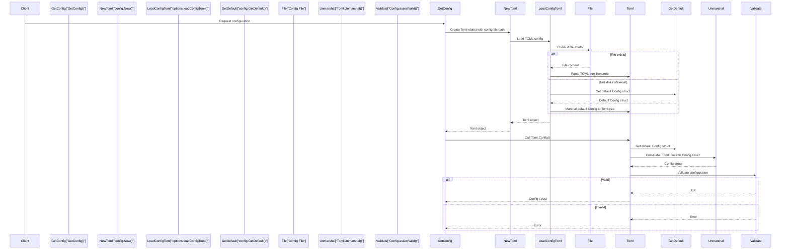
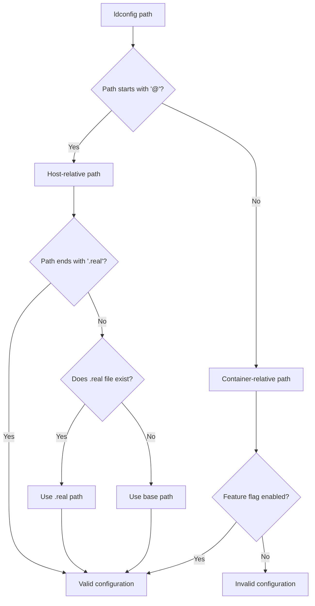
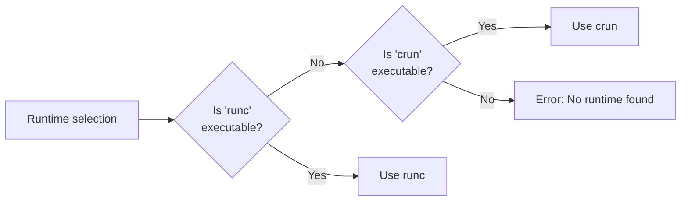
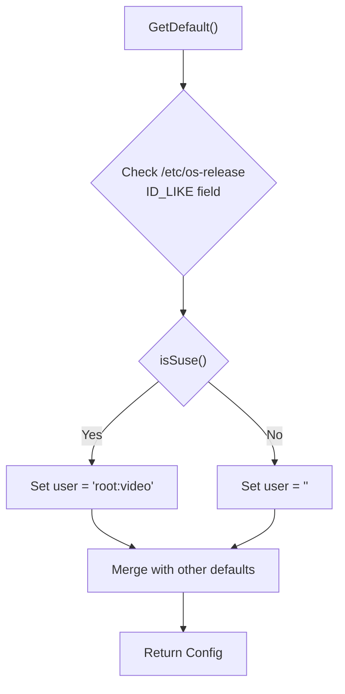
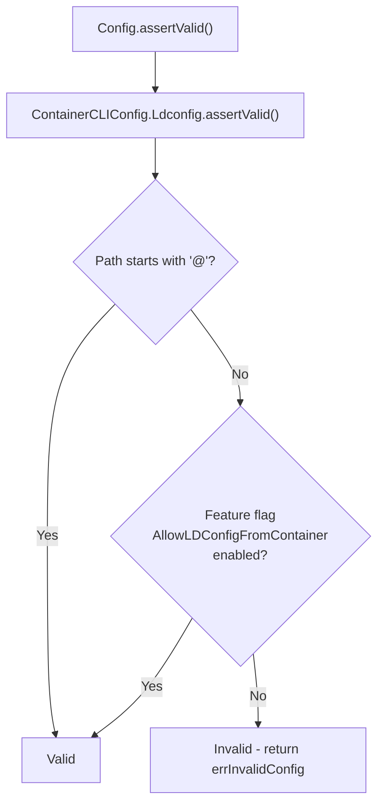
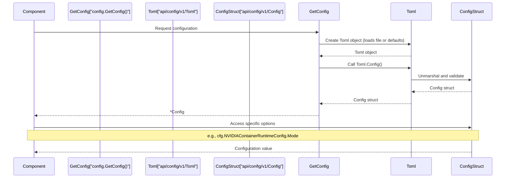

<!-- source: DeepWiki mcp.deepwiki.com · repo NVIDIA/nvidia-container-toolkit · page 4 Configuration · fetched 2026-10-26 -->

# Configuration

<details>
<summary>Relevant source files</summary>

The following files were used as context for generating this wiki page:

- [api/config/v1/cli.go](api/config/v1/cli.go)
- [api/config/v1/cli_test.go](api/config/v1/cli_test.go)
- [api/config/v1/config.go](api/config/v1/config.go)
- [api/config/v1/config_test.go](api/config/v1/config_test.go)
- [api/config/v1/features.go](api/config/v1/features.go)
- [api/config/v1/hook.go](api/config/v1/hook.go)
- [api/config/v1/runtime.go](api/config/v1/runtime.go)
- [api/config/v1/toml.go](api/config/v1/toml.go)
- [api/config/v1/toml_test.go](api/config/v1/toml_test.go)
- [api/config/v1/toolkit-cli.go](api/config/v1/toolkit-cli.go)
- [cmd/nvidia-ctk/cdi/generate/config.go](cmd/nvidia-ctk/cdi/generate/config.go)
- [internal/test/to/to.go](internal/test/to/to.go)
- [pkg/config/engine/docker/docker_test.go](pkg/config/engine/docker/docker_test.go)
- [pkg/config/toml/list.go](pkg/config/toml/list.go)
- [pkg/config/toml/source-map.go](pkg/config/toml/source-map.go)
- [pkg/config/toml/source.go](pkg/config/toml/source.go)
- [pkg/config/toml/toml.go](pkg/config/toml/toml.go)

</details>


This page documents the configuration system for the NVIDIA Container Toolkit, including configuration file locations, format, structure, and all available options. The configuration controls runtime behavior, mode selection, device discovery, and integration with container runtimes.

For information about how to use the `nvidia-ctk config` command to manage configuration, see [NVIDIA CTK CLI](#2.3). For details about runtime mode selection and behavior, see [Runtime Modes](#3.1).

## Configuration File Location

The toolkit uses a TOML configuration file located at `/etc/nvidia-container-runtime/config.toml` by default. The configuration file path can be customized through environment variables.

### Configuration Discovery Process



**Sources:** [api/config/v1/config.go:78-88]()

The configuration file path is resolved in the following order:
1. **`NVIDIA_CTK_CONFIG_FILE_PATH`** environment variable - Direct override of config file path [api/config/v1/config.go:34]()
2. **`XDG_CONFIG_HOME`** environment variable - Uses `${XDG_CONFIG_HOME}/nvidia-container-runtime/config.toml` [api/config/v1/config.go:37]()
3. **Default location** - `/etc/nvidia-container-runtime/config.toml` [api/config/v1/config.go:82]()

## Configuration Structure

The configuration is organized into multiple sections, each controlling different aspects of the toolkit's behavior.

### Configuration Hierarchy



**Sources:** [api/config/v1/config.go:59-75](), [api/config/v1/runtime.go:21-62](), [api/config/v1/cli.go:25-47](), [api/config/v1/hook.go:19-26]()

### Configuration Loading Process



**Sources:** [api/config/v1/config.go:90-101](), [api/config/v1/toml.go:79-109](), [api/config/v1/toml.go:155-164]()

## Configuration File Format

The configuration file uses TOML format with hierarchical sections. The file is typically located at `/etc/nvidia-container-runtime/config.toml`.

### Example Configuration File

```toml
#accept-nvidia-visible-devices-as-volume-mounts = false
#accept-nvidia-visible-devices-envvar-when-unprivileged = true
disable-require = false
supported-driver-capabilities = "compat32,compute,display,graphics,ngx,utility,video"
#swarm-resource = "DOCKER_RESOURCE_GPU"

[nvidia-container-cli]
#debug = "/var/log/nvidia-container-toolkit.log"
environment = []
#ldcache = "/etc/ld.so.cache"
ldconfig = "OVERRIDDEN" # This value is overridden for testing purposes
load-kmods = true
#no-cgroups = false
#path = "/usr/bin/nvidia-container-cli"
#root = "/run/nvidia/driver"
#user = "root:video"

[nvidia-container-runtime]
#debug = "/var/log/nvidia-container-runtime.log"
log-level = "info"
mode = "auto"
runtimes = ["runc", "crun"]

[nvidia-container-runtime.modes]

[nvidia-container-runtime.modes.cdi]
annotation-prefixes = ["cdi.k8s.io/"]
default-kind = "nvidia.com/gpu"
spec-dirs = ["/etc/cdi", "/var/run/cdi"]

[nvidia-container-runtime.modes.csv]
mount-spec-path = "/etc/nvidia-container-runtime/host-files-for-container.d"

[nvidia-container-runtime.modes.legacy]
cuda-compat-mode = "ldconfig"

[nvidia-container-runtime-hook]
path = "nvidia-container-runtime-hook"
skip-mode-detection = false

[nvidia-ctk]
path = "nvidia-ctk"
```

**Sources:** [api/config/v1/toml_test.go:43-88]()

## Top-Level Configuration Options

Top-level configuration options control global behavior across all toolkit components.

| Option | Type | Default | Description |
|--------|------|---------|-------------|
| `disable-require` | boolean | `false` | Disables all `NVIDIA_REQUIRE_*` constraint checking |
| `swarm-resource` | string | `"DOCKER_RESOURCE_GPU"` | Docker Swarm resource name for GPU resources |
| `accept-nvidia-visible-devices-envvar-when-unprivileged` | boolean | `true` | Allows unprivileged containers to use `NVIDIA_VISIBLE_DEVICES` |
| `accept-nvidia-visible-devices-as-volume-mounts` | boolean | `false` | Allows device specification via volume mounts |
| `supported-driver-capabilities` | string | `"compat32,compute,display,graphics,ngx,utility,video"` | Comma-separated list of supported driver capabilities |

**Sources:** [api/config/v1/config.go:62-66](), [api/config/v1/config.go:103-140]()

### Driver Capabilities

The `supported-driver-capabilities` option defines which NVIDIA driver features can be exposed to containers. Valid values include:

- **`compute`** - CUDA and OpenCL support
- **`compat32`** - 32-bit library support
- **`display`** - X11 display support
- **`graphics`** - OpenGL and Vulkan support
- **`ngx`** - NGX library support
- **`utility`** - nvidia-smi and NVML support
- **`video`** - Video Codec SDK support

**Sources:** [api/config/v1/toml_test.go:49]()

## nvidia-container-cli Configuration

The `[nvidia-container-cli]` section configures the low-level `nvidia-container-cli` tool from libnvidia-container, which performs GPU device setup.

| Option | Type | Default | Description |
|--------|------|---------|-------------|
| `root` | string | `""` | Root directory for driver files (defaults to runtime detection) |
| `path` | string | `""` | Path to nvidia-container-cli executable |
| `environment` | string[] | `[]` | Additional environment variables for nvidia-container-cli |
| `debug` | string | `""` | Debug log file path |
| `ldcache` | string | `""` | Path to ld.so.cache file |
| `load-kmods` | boolean | `true` | Automatically load kernel modules |
| `no-pivot` | boolean | `false` | Disable pivot root operation |
| `no-cgroups` | boolean | `false` | Disable cgroup management |
| `user` | string | `""` (SUSE: `"root:video"`) | User:group for device access |
| `ldconfig` | string | `"@/sbin/ldconfig"` | Path to ldconfig binary (host-relative with `@` prefix) |

**Sources:** [api/config/v1/cli.go:25-47](), [api/config/v1/config.go:108-112](), [api/config/v1/config.go:158-163]()

### ldconfig Path Handling

The `ldconfig` option has special handling for path resolution:



**Sources:** [api/config/v1/cli.go:56-89](), [api/config/v1/cli.go:59-67]()

Paths starting with `@` are treated as host-relative and are normalized to handle systems where `/sbin/ldconfig` is a wrapper around `/sbin/ldconfig.real`. Container-relative paths (without `@` prefix) are only allowed when the `features.allow-ldconfig-from-container` feature flag is enabled.

## nvidia-ctk Configuration

The `[nvidia-ctk]` section configures the nvidia-ctk CLI tool path.

| Option | Type | Default | Description |
|--------|------|---------|-------------|
| `path` | string | `"nvidia-ctk"` | Path to nvidia-ctk executable |

**Sources:** [api/config/v1/config.go:69](), [api/config/v1/config.go:113-115]()

The path is resolved using the following logic:
- If an absolute path is provided, it is used directly
- If a relative path or executable name is provided, it is searched in `PATH`
- If not found, defaults to `/usr/bin/nvidia-ctk`

**Sources:** [api/config/v1/config.go:201-273]()

## nvidia-container-runtime Configuration

The `[nvidia-container-runtime]` section controls the behavior of the nvidia-container-runtime wrapper.

### Runtime Options

| Option | Type | Default | Description |
|--------|------|---------|-------------|
| `debug` | string | `"/dev/null"` | Debug log file path for runtime |
| `log-level` | string | `"info"` | Logging level (`trace`, `debug`, `info`, `warn`, `error`, `fatal`, `panic`) |
| `runtimes` | string[] | `["runc", "crun"]` | Ordered list of candidate low-level runtimes |
| `mode` | string | `"auto"` | Runtime mode (`auto`, `legacy`, `csv`, `cdi`) |

**Sources:** [api/config/v1/runtime.go:22-30](), [api/config/v1/config.go:116-120]()

### Low-Level Runtime Selection

The `runtimes` option specifies an ordered list of low-level OCI runtime candidates. The first runtime found in the system is used:



**Sources:** [api/config/v1/config.go:119]()

### Runtime Modes Configuration

The `[nvidia-container-runtime.modes]` subsection provides mode-specific configuration options.

#### CDI Mode Configuration

The `[nvidia-container-runtime.modes.cdi]` section configures CDI (Container Device Interface) mode behavior.

| Option | Type | Default | Description |
|--------|------|---------|-------------|
| `default-kind` | string | `"nvidia.com/gpu"` | Default CDI device kind for constructing fully-qualified device names |
| `annotation-prefixes` | string[] | `["cdi.k8s.io/"]` | Allowed prefixes for CDI annotation-based device injection |
| `spec-dirs` | string[] | `["/etc/cdi", "/var/run/cdi"]` | Directories to search for CDI specification files |

**Sources:** [api/config/v1/runtime.go:40-47](), [api/config/v1/config.go:125-129]()

#### JIT-CDI Mode Configuration

The `[nvidia-container-runtime.modes.jit-cdi]` section configures just-in-time CDI generation.

| Option | Type | Default | Description |
|--------|------|---------|-------------|
| `nvcdi-feature-flags` | `nvcdi.FeatureFlag`[] | `[]` | List of nvcdi feature flags to enable |
| `nvcdi-disable-hooks` | `nvcdi.HookName`[] | `[]` | List of nvcdi hooks to disable |

**Sources:** [api/config/v1/runtime.go:49-54]()

#### CSV Mode Configuration

The `[nvidia-container-runtime.modes.csv]` section configures CSV (Comma-Separated Values) mode for Tegra platforms.

| Option | Type | Default | Description |
|--------|------|---------|-------------|
| `mount-spec-path` | string | `"/etc/nvidia-container-runtime/host-files-for-container.d"` | Directory containing CSV mount specification files |
| `compat-container-root` | string | `""` | Specifies the compat root used when the standard CUDA compat libraries should not be used. |

**Sources:** [api/config/v1/runtime.go:54-61](), [api/config/v1/config.go:122-124]()

#### Legacy Mode Configuration

The `[nvidia-container-runtime.modes.legacy]` section configures legacy hook-based mode behavior.

| Option | Type | Default | Description |
|--------|------|---------|-------------|
| `cuda-compat-mode` | string | `"ldconfig"` | CUDA Forward Compatibility library handling mode |

**Sources:** [api/config/v1/runtime.go:63-67](), [api/config/v1/config.go:130-132]()

Valid values for `cuda-compat-mode`:
- **`disabled`** - Explicitly disables the handling of CUDA Forward Compatibility. [api/config/v1/runtime.go:75-77]()
- **`ldconfig`** - Adds folders containing CUDA Forward Compat libraries to the `ldconfig` command. [api/config/v1/runtime.go:82-85]()
- **`mount`** - Mounts CUDA Forward Compat folders from the container to the container. [api/config/v1/runtime.go:86-89]()
- **`hook`** - Uses a container lifecycle hook to implement CUDA Forward Compatibility support. [api/config/v1/runtime.go:78-81]()

## nvidia-container-runtime-hook Configuration

The `[nvidia-container-runtime-hook]` section configures the legacy runtime hook behavior.

| Option | Type | Default | Description |
|--------|------|---------|-------------|
| `path` | string | `"nvidia-container-runtime-hook"` | Path to nvidia-container-runtime-hook executable |
| `skip-mode-detection` | boolean | `false` | Skip automatic mode detection in the hook |

**Sources:** [api/config/v1/hook.go:19-26](), [api/config/v1/config.go:135-137]()

## Feature Flags

The `[features]` section controls experimental and optional features.

| Feature Flag | Type | Default | Description |
|-------------|------|---------|-------------|
| `allow-ldconfig-from-container` | boolean | `false` | Allow using ldconfig from container instead of requiring host-relative path |

**Sources:** [api/config/v1/config.go:74]()

### Feature Flag Usage

Feature flags override validation rules. For example, when `allow-ldconfig-from-container` is enabled, the `nvidia-container-cli.ldconfig` path can be a container-relative path instead of requiring the `@` host-relative prefix:

```toml
[nvidia-container-cli]
ldconfig = "/sbin/ldconfig"  # Would normally be invalid

[features]
allow-ldconfig-from-container = true  # Allows the above
```

**Sources:** [api/config/v1/cli.go:59-67](), [api/config/v1/config.go:143-149]()

## Default Configuration Values

The toolkit provides sensible defaults for all configuration options. When the configuration file does not exist or specific options are omitted, defaults are used.

### Platform-Specific Defaults

Some configuration defaults vary by platform:



**Sources:** [api/config/v1/config.go:158-179]()

On SUSE-based distributions (detected via `isSuse()` [api/config/v1/config.go:166-179]()), the `nvidia-container-cli.user` defaults to `"root:video"` for proper device permissions. On other distributions, it defaults to empty string.

## Configuration Validation

Configuration is validated when loaded to ensure correctness and prevent runtime errors.

### Validation Rules



**Sources:** [api/config/v1/config.go:142-149](), [api/config/v1/cli.go:59-67]()

The primary validation rule enforces that `nvidia-container-cli.ldconfig` must be a host-relative path (prefixed with `@`) unless the `features.allow-ldconfig-from-container` feature flag is explicitly enabled. This prevents accidental use of container-provided ldconfig binaries which could lead to security issues.

## Environment Variable Overrides

The configuration system supports environment variable overrides for specific settings:

| Environment Variable | Overrides | Description |
|---------------------|-----------|-------------|
| `NVIDIA_CTK_CONFIG_FILE_PATH` | Config file path | Full path to configuration file |
| `XDG_CONFIG_HOME` | Config directory | Base directory for config file (`${XDG_CONFIG_HOME}/nvidia-container-runtime/config.toml`) |

**Sources:** [api/config/v1/config.go:34](), [api/config/v1/config.go:37](), [api/config/v1/config.go:78-88]()

These environment variables are checked during configuration file discovery and take precedence over default locations.

## Programmatic Configuration Access

Components access configuration through the `config` package API:



**Sources:** [api/config/v1/config.go:90-101]()

The `GetConfig()` function is the primary entry point for accessing configuration. It returns a fully-validated `*Config` struct that components can use to access all configuration options.

**Sources:** [api/config/v1/config.go:59-75](), [api/config/v1/config.go:90-101](), [api/config/v1/runtime.go:21-89](), [api/config/v1/cli.go:25-96](), [api/config/v1/hook.go:19-26](), [api/config/v1/toml.go:155-164]()

---

