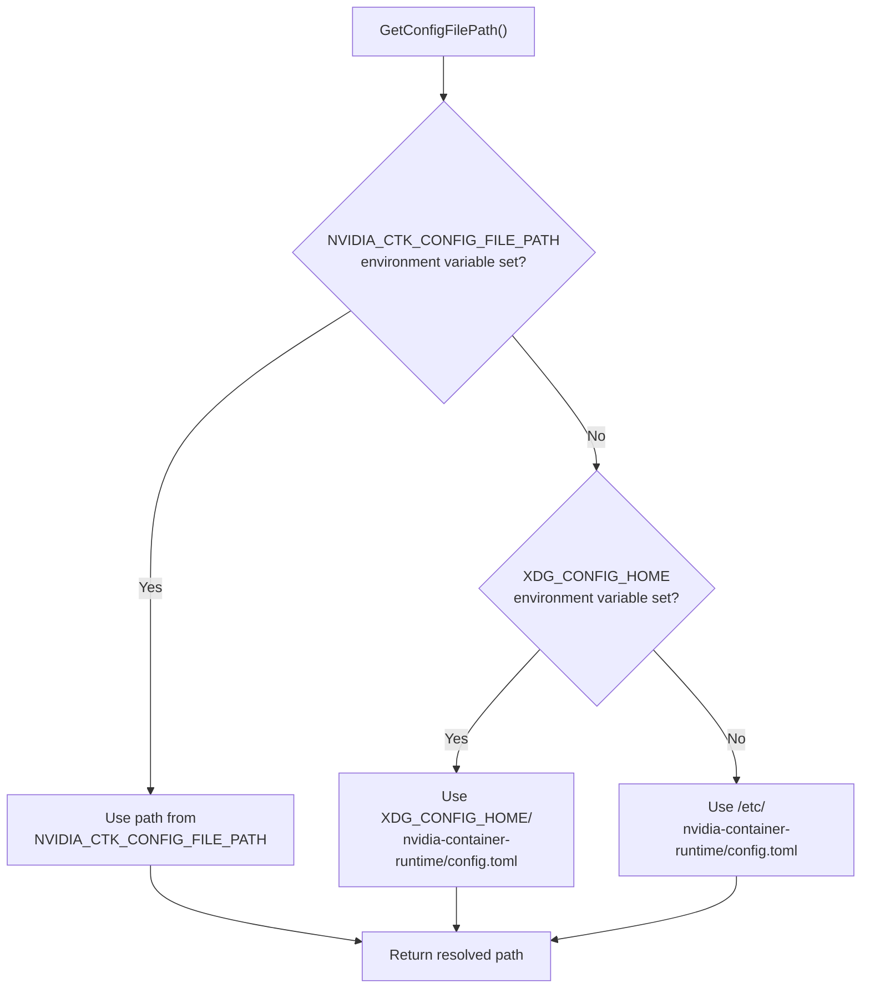
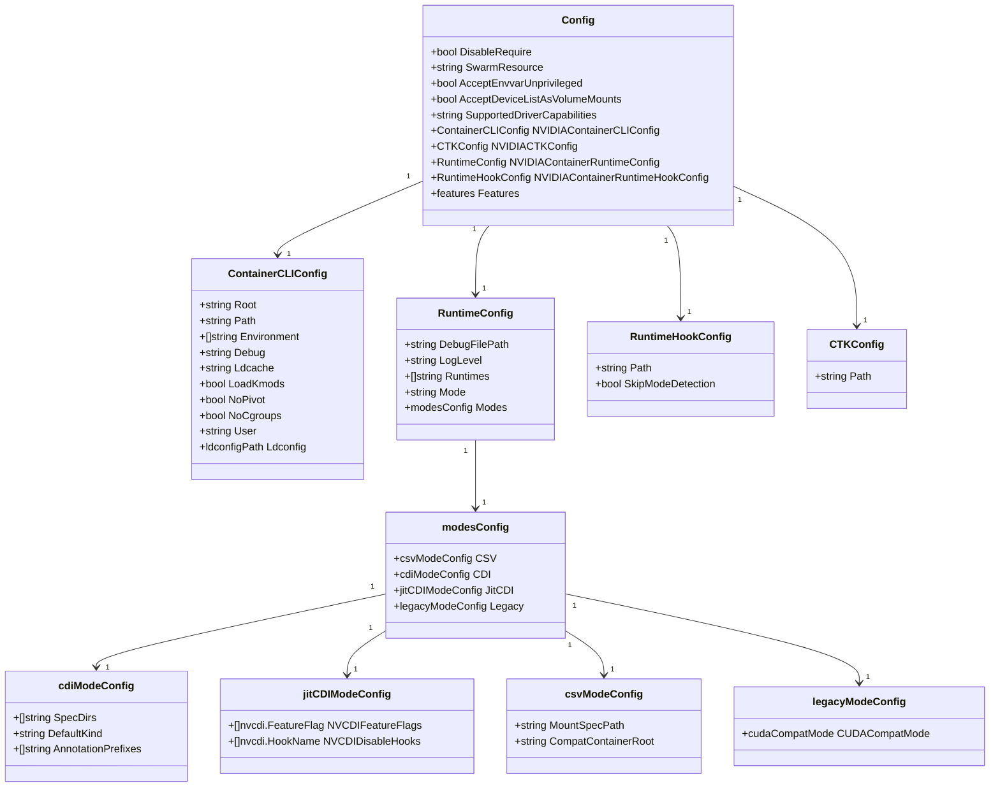
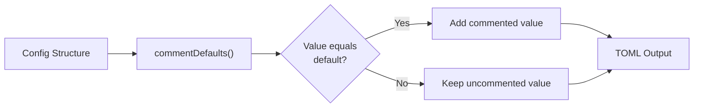
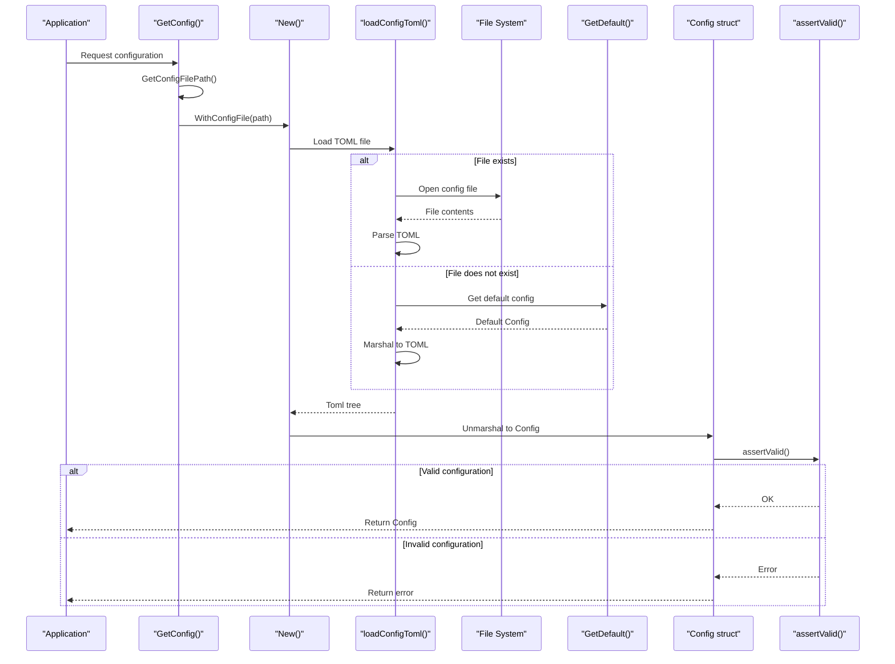

<!-- source: DeepWiki mcp.deepwiki.com · repo NVIDIA/nvidia-container-toolkit · page 4.1 Configuration File Format · fetched 2026-10-26 -->

# Configuration File Format

<details>
<summary>Relevant source files</summary>

The following files were used as context for generating this wiki page:

- [api/config/v1/cli.go](api/config/v1/cli.go)
- [api/config/v1/cli_test.go](api/config/v1/cli_test.go)
- [api/config/v1/config.go](api/config/v1/config.go)
- [api/config/v1/config_test.go](api/config/v1/config_test.go)
- [api/config/v1/features.go](api/config/v1/features.go)
- [api/config/v1/hook.go](api/config/v1/hook.go)
- [api/config/v1/runtime.go](api/config/v1/runtime.go)
- [api/config/v1/toml.go](api/config/v1/toml.go)
- [api/config/v1/toml_test.go](api/config/v1/toml_test.go)
- [api/config/v1/toolkit-cli.go](api/config/v1/toolkit-cli.go)
- [cmd/nvidia-ctk/cdi/generate/config.go](cmd/nvidia-ctk/cdi/generate/config.go)
- [internal/test/to/to.go](internal/test/to/to.go)
- [pkg/config/engine/docker/docker_test.go](pkg/config/engine/docker/docker_test.go)
- [pkg/config/toml/list.go](pkg/config/toml/list.go)
- [pkg/config/toml/source-map.go](pkg/config/toml/source-map.go)
- [pkg/config/toml/source.go](pkg/config/toml/source.go)
- [pkg/config/toml/toml.go](pkg/config/toml/toml.go)

</details>


This page documents the TOML configuration file format used by the NVIDIA Container Toolkit, including file locations, structure, default values, and format specifications. For information about specific runtime configuration options and their behavior, see [Runtime Configuration Options](#4.2). For details on feature flags that modify toolkit behavior, see [Feature Flags](#4.3).

## Overview

The NVIDIA Container Toolkit uses a TOML-based configuration file to control the behavior of its components including the NVIDIA Container Runtime, NVIDIA Container Runtime Hook, and nvidia-ctk CLI. The configuration file provides a centralized way to specify runtime modes, paths to executables, logging options, and mode-specific settings.

The configuration system is implemented primarily in the `api/config/v1` package, with the main configuration structure defined in [api/config/v1/config.go:61-75]() and TOML file handling in [api/config/v1/toml.go:29-240]().

## Configuration File Location

The toolkit uses a hierarchical approach to determine the configuration file location, with environment variables taking precedence over default paths.


**Title: Configuration File Path Resolution**
Sources: [api/config/v1/config.go:78-88]()

**Configuration File Path Resolution Priority**

| Priority | Method | Description |
|----------|--------|-------------|
| 1 | `NVIDIA_CTK_CONFIG_FILE_PATH` | Environment variable override for complete file path |
| 2 | `XDG_CONFIG_HOME` | XDG Base Directory specification: `${XDG_CONFIG_HOME}/nvidia-container-runtime/config.toml` |
| 3 | Default | System configuration directory: `/etc/nvidia-container-runtime/config.toml` |

The path resolution is implemented in [api/config/v1/config.go:78-88]() with the constants defined at [api/config/v1/config.go:33-38]().

**Sources:** [api/config/v1/config.go:33-88](), [api/config/v1/config_test.go:28-60]()

## File Format

The configuration file uses the TOML (Tom's Obvious Minimal Language) format, which provides a human-readable structure with support for sections, key-value pairs, and arrays.

### TOML Structure Example

```toml
# Top-level options
disable-require = false
supported-driver-capabilities = "compat32,compute,display,graphics,ngx,utility,video"

# Section for nvidia-container-cli configuration
[nvidia-container-cli]
root = "/run/nvidia/driver"
load-kmods = true
ldconfig = "@/sbin/ldconfig"

# Section for nvidia-container-runtime configuration
[nvidia-container-runtime]
debug = "/var/log/nvidia-container-runtime.log"
log-level = "info"
mode = "auto"
runtimes = ["runc", "crun"]

# Nested section for mode-specific configuration
[nvidia-container-runtime.modes.cdi]
default-kind = "nvidia.com/gpu"
annotation-prefixes = ["cdi.k8s.io/"]
spec-dirs = ["/etc/cdi", "/var/run/cdi"]
```

The TOML parsing and manipulation is handled by the [go-toml](https://github.com/pelletier/go-toml) library, with wrapper types defined in [api/config/v1/toml.go:29-30]().

**Sources:** [api/config/v1/toml.go:1-240](), [api/config/v1/toml_test.go:28-102]()

## Configuration Structure

The configuration is represented by the `Config` struct, which contains multiple nested configuration structures for different components.


**Title: Configuration Structure Diagram**
Sources: [api/config/v1/config.go:61-75](), [api/config/v1/cli.go:26-47](), [api/config/v1/runtime.go:20-67](), [api/config/v1/hook.go:20-26](), [api/config/v1/toolkit-cli.go:20-22]()

**TOML Section Mapping to Code Structures**

| TOML Section | Go Struct | File Location |
|--------------|-----------|---------------|
| Top-level | `Config` | [api/config/v1/config.go:61-75]() |
| `[nvidia-container-cli]` | `ContainerCLIConfig` | [api/config/v1/cli.go:26-47]() |
| `[nvidia-container-runtime]` | `RuntimeConfig` | [api/config/v1/runtime.go:20-28]() |
| `[nvidia-container-runtime.modes]` | `modesConfig` | [api/config/v1/runtime.go:31-38]() |
| `[nvidia-container-runtime.modes.cdi]` | `cdiModeConfig` | [api/config/v1/runtime.go:40-47]() |
| `[nvidia-container-runtime.modes.jit-cdi]` | `jitCDIModeConfig` | [api/config/v1/runtime.go:49-54]() |
| `[nvidia-container-runtime.modes.csv]` | `csvModeConfig` | [api/config/v1/runtime.go:56-61]() |
| `[nvidia-container-runtime.modes.legacy]` | `legacyModeConfig` | [api/config/v1/runtime.go:63-67]() |
| `[nvidia-container-runtime-hook]` | `RuntimeHookConfig` | [api/config/v1/hook.go:20-26]() |
| `[nvidia-ctk]` | `CTKConfig` | [api/config/v1/toolkit-cli.go:20-22]() |
| `[features]` | `features` | [api/config/v1/features.go:20-23]() |

**Sources:** [api/config/v1/config.go:59-75](), [api/config/v1/cli.go:26-47](), [api/config/v1/runtime.go:20-77](), [api/config/v1/hook.go:20-26](), [api/config/v1/toolkit-cli.go:20-22](), [api/config/v1/features.go:20-23]()

## Main Configuration Sections

### Top-Level Options

```toml
disable-require = false
swarm-resource = "DOCKER_RESOURCE_GPU"
accept-nvidia-visible-devices-envvar-when-unprivileged = true
accept-nvidia-visible-devices-as-volume-mounts = false
supported-driver-capabilities = "compat32,compute,display,graphics,ngx,utility,video"
```

| Field | Type | Description |
|-------|------|-------------|
| `disable-require` | `bool` | Disables NVIDIA_REQUIRE_* constraint checks |
| `swarm-resource` | `string` | Docker Swarm resource name for GPU scheduling |
| `accept-nvidia-visible-devices-envvar-when-unprivileged` | `bool` | Allow unprivileged containers to use NVIDIA_VISIBLE_DEVICES |
| `accept-nvidia-visible-devices-as-volume-mounts` | `bool` | Allow device list specification via volume mounts |
| `supported-driver-capabilities` | `string` | Comma-separated list of supported driver capabilities |

### nvidia-container-cli Section

```toml
[nvidia-container-cli]
root = "/run/nvidia/driver"
path = "/usr/bin/nvidia-container-cli"
environment = []
debug = "/var/log/nvidia-container-toolkit.log"
ldcache = "/etc/ld.so.cache"
load-kmods = true
no-pivot = false
no-cgroups = false
user = "root:video"
ldconfig = "@/sbin/ldconfig"
```

This section configures the `nvidia-container-cli` tool from libnvidia-container, which handles low-level GPU device configuration. The `ldconfig` field uses a special `@` prefix to indicate host-relative paths (see [api/config/v1/cli.go:56-89]()).

### nvidia-container-runtime Section

```toml
[nvidia-container-runtime]
debug = "/var/log/nvidia-container-runtime.log"
log-level = "info"
runtimes = ["runc", "crun"]
mode = "auto"
```

This section controls the behavior of the NVIDIA Container Runtime wrapper. The `mode` field determines which operational mode to use (see [Runtime Modes](#3.1) for details).

### nvidia-container-runtime.modes Subsections

#### CDI Mode Configuration

```toml
[nvidia-container-runtime.modes.cdi]
default-kind = "nvidia.com/gpu"
annotation-prefixes = ["cdi.k8s.io/"]
spec-dirs = ["/etc/cdi", "/var/run/cdi"]
```

#### JIT CDI Mode Configuration

```toml
[nvidia-container-runtime.modes.jit-cdi]
nvcdi-feature-flags = []
nvcdi-disable-hooks = []
```

#### CSV Mode Configuration

```toml
[nvidia-container-runtime.modes.csv]
mount-spec-path = "/etc/nvidia-container-runtime/host-files-for-container.d"
compat-container-root = ""
```

#### Legacy Mode Configuration

```toml
[nvidia-container-runtime.modes.legacy]
cuda-compat-mode = "ldconfig"
```

Supported values for `cuda-compat-mode`: `"disabled"`, `"hook"`, `"ldconfig"`, `"mount"` (see [api/config/v1/runtime.go:71-89]()).

### nvidia-container-runtime-hook Section

```toml
[nvidia-container-runtime-hook]
path = "nvidia-container-runtime-hook"
skip-mode-detection = false
```

### nvidia-ctk Section

```toml
[nvidia-ctk]
path = "nvidia-ctk"
```

**Sources:** [api/config/v1/config.go:103-140](), [api/config/v1/config_test.go:70-375]()

## Default Configuration Values

The default configuration is generated by the `GetDefault()` function and varies based on the host system. The following table shows the standard defaults:

| Configuration Path | Default Value | Platform-Specific |
|-------------------|---------------|-------------------|
| `accept-nvidia-visible-devices-envvar-when-unprivileged` | `true` | No |
| `supported-driver-capabilities` | `"compat32,compute,display,graphics,ngx,utility,video"` | No |
| `nvidia-container-cli.load-kmods` | `true` | No |
| `nvidia-container-cli.ldconfig` | `"@/sbin/ldconfig"` | No |
| `nvidia-container-cli.user` | `""` (SUSE: `"root:video"`) | Yes |
| `nvidia-container-runtime.debug` | `"/dev/null"` | No |
| `nvidia-container-runtime.log-level` | `"info"` | No |
| `nvidia-container-runtime.runtimes` | `["runc", "crun"]` | No |
| `nvidia-container-runtime.mode` | `"auto"` | No |
| `nvidia-container-runtime.modes.csv.mount-spec-path` | `"/etc/nvidia-container-runtime/host-files-for-container.d"` | No |
| `nvidia-container-runtime.modes.csv.compat-container-root` | `""` | No |
| `nvidia-container-runtime.modes.cdi.default-kind` | `"nvidia.com/gpu"` | No |
| `nvidia-container-runtime.modes.cdi.annotation-prefixes` | `["cdi.k8s.io/"]` | No |
| `nvidia-container-runtime.modes.cdi.spec-dirs` | `["/etc/cdi", "/var/run/cdi"]` | No |
| `nvidia-container-runtime.modes.jit-cdi.nvcdi-feature-flags` | `[]` | No |
| `nvidia-container-runtime.modes.jit-cdi.nvcdi-disable-hooks` | `[]` | No |
| `nvidia-container-runtime.modes.legacy.cuda-compat-mode` | `"ldconfig"` | No |
| `nvidia-container-runtime-hook.path` | `"nvidia-container-runtime-hook"` | No |
| `nvidia-ctk.path` | `"nvidia-ctk"` | No |

**Platform-Specific Defaults**

On SUSE-based distributions (detected via `/etc/os-release`), the `nvidia-container-cli.user` defaults to `"root:video"` instead of empty string. This is implemented in [api/config/v1/config.go:158-179]().

**Sources:** [api/config/v1/config.go:103-140](), [api/config/v1/config_test.go:70-106]()

## Configuration File Generation and Formatting

### Automatic Generation

The `nvidia-ctk config` command can generate a default configuration file:

```bash
nvidia-ctk config --config-file=/etc/nvidia-container-runtime/config.toml --in-place
```

This command is automatically invoked during package installation (see [packaging/rpm/SPECS/nvidia-container-toolkit.spec:93-95]()).

### Commented Default Values

When a configuration file is saved, certain default values are automatically commented out if they haven't been explicitly changed. This keeps the configuration file clean while documenting available options.


**Title: Default Value Commenting Logic**
Sources: [api/config/v1/toml.go:251-274]()

The following values are automatically commented when they match their defaults:

| Configuration Key | Commented Default |
|-------------------|-------------------|
| `swarm-resource` | `"DOCKER_RESOURCE_GPU"` |
| `accept-nvidia-visible-devices-envvar-when-unprivileged` | `true` |
| `accept-nvidia-visible-devices-as-volume-mounts` | `false` |
| `nvidia-container-cli.root` | `"/run/nvidia/driver"` |
| `nvidia-container-cli.path` | `"/usr/bin/nvidia-container-cli"` |
| `nvidia-container-cli.debug` | `"/var/log/nvidia-container-toolkit.log"` |
| `nvidia-container-cli.ldcache` | `"/etc/ld.so.cache"` |
| `nvidia-container-cli.no-cgroups` | `false` |
| `nvidia-container-cli.user` | `"root:video"` |
| `nvidia-container-runtime.debug` | `"/var/log/nvidia-container-runtime.log"` or `"/dev/null"` |

This behavior is implemented in [api/config/v1/toml.go:251-274]().

**Sources:** [api/config/v1/toml.go:142-240](), [api/config/v1/toml_test.go:28-102]()

## Configuration Loading Process


**Title: Configuration Loading Sequence**
Sources: [api/config/v1/config.go:92-101](), [api/config/v1/toml.go:32-107](), [api/config/v1/toml.go:109-135]()

**Configuration Loading Steps:**

1.  **Path Resolution**: Determine config file path using [GetConfigFilePath()](#configuration-file-location)
2.  **File Loading**: Attempt to read TOML file from resolved path ([api/config/v1/toml.go:82-99]())
3.  **Fallback to Defaults**: If file doesn't exist and not required, use defaults ([api/config/v1/toml.go:88-95]())
4.  **TOML Parsing**: Parse file contents into `toml.Tree` structure ([api/config/v1/toml.go:141-153]())
5.  **Unmarshaling**: Convert TOML tree to `Config` struct ([api/config/v1/toml.go:170-181]())
6.  **Validation**: Check configuration validity, especially ldconfig path constraints ([api/config/v1/config.go:143-149]())

**Sources:** [api/config/v1/config.go:92-101](), [api/config/v1/toml.go:32-107](), [api/config/v1/toml.go:109-135]()

## Configuration Validation

The configuration undergoes validation to ensure correctness. Key validation rules include:

### LDConfig Path Validation

The `nvidia-container-cli.ldconfig` field must be host-relative (prefixed with `@`) unless the `features.allow-ldconfig-from-container` feature flag is enabled:

```toml
# Valid: host-relative path
[nvidia-container-cli]
ldconfig = "@/sbin/ldconfig"

# Invalid by default: container path
[nvidia-container-cli]
ldconfig = "/sbin/ldconfig"

# Valid with feature flag
[features]
allow-ldconfig-from-container = true

[nvidia-container-cli]
ldconfig = "/sbin/ldconfig"
```

The validation logic is implemented in [api/config/v1/cli.go:59-67]() and checked in [api/config/v1/config.go:143-149]().

**Sources:** [api/config/v1/config.go:143-149](), [api/config/v1/cli.go:59-67](), [api/config/v1/cli_test.go:83]()

## Example Complete Configuration

Below is a complete example showing all major configuration sections with non-default values:

```toml
disable-require = false
supported-driver-capabilities = "compute,utility,video"

[nvidia-container-cli]
root = "/custom/driver/root"
load-kmods = false
ldconfig = "@/usr/sbin/ldconfig"
user = "nvidia:nvidia"

[nvidia-container-runtime]
debug = "/var/log/nvidia-runtime-debug.log"
log-level = "debug"
runtimes = ["/usr/bin/crun"]
mode = "cdi"

[nvidia-container-runtime.modes.cdi]
default-kind = "example.com/gpu"
annotation-prefixes = ["cdi.k8s.io/", "example.com/"]
spec-dirs = ["/etc/cdi", "/var/run/cdi", "/opt/cdi"]

[nvidia-container-runtime.modes.jit-cdi]
nvcdi-feature-flags = ["mig-strategy=none"]
nvcdi-disable-hooks = ["cuda"]

[nvidia-container-runtime.modes.csv]
mount-spec-path = "/custom/mount-specs"
compat-container-root = "/custom/compat/root"

[nvidia-container-runtime.modes.legacy]
cuda-compat-mode = "mount"

[nvidia-container-runtime-hook]
path = "/usr/local/bin/nvidia-container-runtime-hook"
skip-mode-detection = false

[nvidia-ctk]
path = "/usr/local/bin/nvidia-ctk"

[features]
allow-ldconfig-from-container = false
```

**Sources:** [api/config/v1/config_test.go:108-170](), [api/config/v1/config_test.go:223-292]()

---

