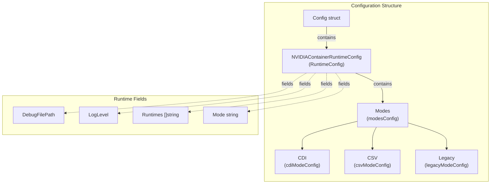
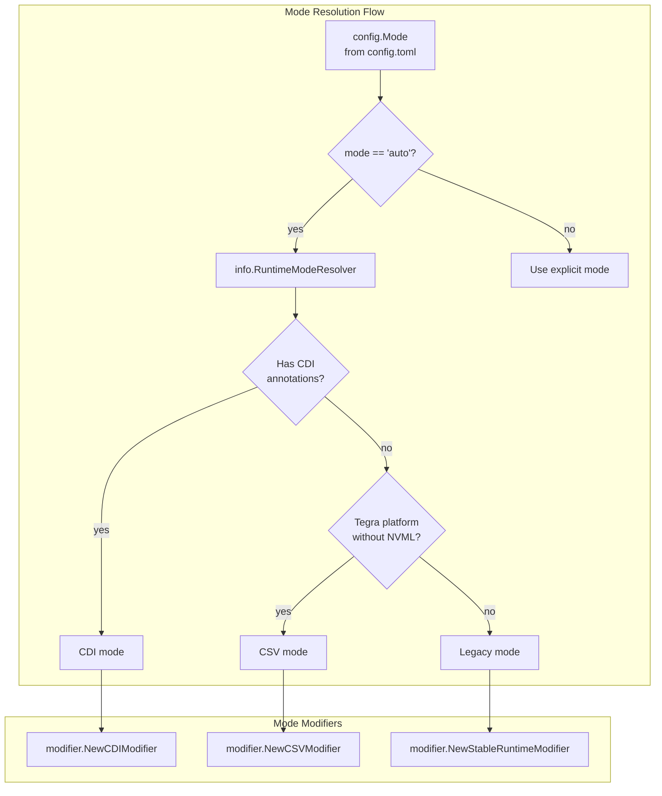
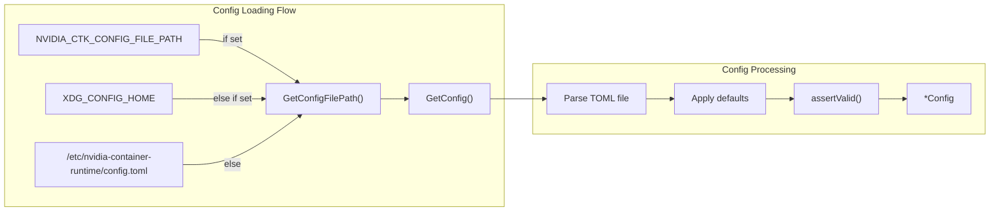

<!-- source: DeepWiki mcp.deepwiki.com · repo NVIDIA/nvidia-container-toolkit · page 4.2 Runtime Configuration Options · fetched 2026-10-26 -->

# Runtime Configuration Options

<details>
<summary>Relevant source files</summary>

The following files were used as context for generating this wiki page:

- [api/config/v1/cli.go](api/config/v1/cli.go)
- [api/config/v1/cli_test.go](api/config/v1/cli_test.go)
- [api/config/v1/config.go](api/config/v1/config.go)
- [api/config/v1/config_test.go](api/config/v1/config_test.go)
- [api/config/v1/features.go](api/config/v1/features.go)
- [api/config/v1/hook.go](api/config/v1/hook.go)
- [api/config/v1/runtime.go](api/config/v1/runtime.go)
- [api/config/v1/toml.go](api/config/v1/toml.go)
- [api/config/v1/toml_test.go](api/config/v1/toml_test.go)
- [api/config/v1/toolkit-cli.go](api/config/v1/toolkit-cli.go)
- [cmd/nvidia-container-runtime-hook/container_config.go](cmd/nvidia-container-runtime-hook/container_config.go)
- [cmd/nvidia-container-runtime-hook/container_config_test.go](cmd/nvidia-container-runtime-hook/container_config_test.go)
- [cmd/nvidia-container-runtime-hook/hook_config.go](cmd/nvidia-container-runtime-hook/hook_config.go)
- [cmd/nvidia-container-runtime-hook/hook_config_test.go](cmd/nvidia-container-runtime-hook/hook_config_test.go)
- [cmd/nvidia-container-runtime-hook/main.go](cmd/nvidia-container-runtime-hook/main.go)
- [cmd/nvidia-ctk/cdi/generate/config.go](cmd/nvidia-ctk/cdi/generate/config.go)
- [internal/config/image/builder.go](internal/config/image/builder.go)
- [internal/config/image/capabilities.go](internal/config/image/capabilities.go)
- [internal/config/image/cuda_image.go](internal/config/image/cuda_image.go)
- [internal/config/image/cuda_image_test.go](internal/config/image/cuda_image_test.go)
- [internal/config/image/devices.go](internal/config/image/devices.go)
- [internal/config/image/privileged.go](internal/config/image/privileged.go)
- [internal/test/to/to.go](internal/test/to/to.go)

</details>


This page documents the runtime configuration options available in the `nvidia-container-runtime` section of the config.toml file. These options control the behavior of the NVIDIA Container Runtime, including mode selection, logging, low-level runtime selection, and mode-specific settings.

## Overview

The `RuntimeConfig` struct in [api/config/v1/runtime.go:19-28]() defines the configuration options for the NVIDIA Container Runtime. These settings control how the runtime modifies OCI specifications to enable GPU access in containers.



Sources:
- [api/config/v1/config.go:59-75]()
- [api/config/v1/runtime.go:19-35]()

## Configuration Section

All runtime configuration options are specified in the `[nvidia-container-runtime]` section of the config.toml file:

```toml
[nvidia-container-runtime]
debug = "/var/log/nvidia-container-runtime.log"
log-level = "info"
mode = "auto"
runtimes = ["runc", "crun"]

[nvidia-container-runtime.modes]
# Mode-specific settings...
```

Sources:
- [api/config/v1/config.go:70-71]()
- [api/config/v1/runtime.go:19-28]()

## Core Runtime Options

The following table describes the main configuration fields in `RuntimeConfig`:

| Option | Type | Default | Description |
|--------|------|---------|-------------|
| `debug` | string | `/dev/null` | Path to the debug log file for the runtime. Set to `/dev/null` to disable debug logging. |
| `log-level` | string | `info` | Logging level for the runtime. Valid values: `trace`, `debug`, `info`, `warning`, `error`, `fatal`, `panic`. |
| `runtimes` | []string | `["runc", "crun"]` | Ordered list of candidate low-level OCI runtimes. The first available runtime in this list is used. |
| `mode` | string | `auto` | Runtime mode to use. Valid values: `auto`, `legacy`, `csv`, `cdi`, `jit-cdi`. |

Sources:
- [api/config/v1/runtime.go:19-28]()
- [api/config/v1/config.go:116-134]()
- [api/config/v1/config_test.go:80-98]()

## Debug and Logging Options

### Debug File Path

The `debug` option specifies where debug logs should be written. This is separate from the application's main logging output controlled by `log-level`.

```toml
[nvidia-container-runtime]
debug = "/var/log/nvidia-container-runtime.log"
```

The runtime can also accept debug configuration via command-line flags passed by the container runtime. These flags override the config file setting.

Sources:
- [api/config/v1/runtime.go:21]()
- [cmd/nvidia-container-runtime/main.go:15]()
- [cmd/nvidia-container-runtime/README.md:11-15]()

### Log Level

The `log-level` option controls the verbosity of runtime logging:

```toml
[nvidia-container-runtime]
log-level = "info"
```

Valid log levels (in order of increasing verbosity):
- `panic` - Only panic messages
- `fatal` - Fatal errors that cause exit
- `error` - Error conditions
- `warning` - Warning messages
- `info` - Informational messages (default)
- `debug` - Debug messages
- `trace` - Detailed trace messages

The log level can also be overridden by the `--debug` command-line flag, which sets the level to `debug`.

Sources:
- [api/config/v1/runtime.go:23]()
- [cmd/nvidia-container-runtime/main.go:15]()
- [cmd/nvidia-container-runtime/README.md:11-15]()

## Low-Level Runtime Selection

The `runtimes` option specifies an ordered list of candidate low-level OCI runtimes:

```toml
[nvidia-container-runtime]
runtimes = ["runc", "crun"]
```

The NVIDIA Container Runtime wraps a low-level OCI runtime (such as `runc` or `crun`) and modifies the OCI specification before passing it to the low-level runtime. The runtime selection process:

1. Iterates through the `runtimes` list in order
2. For each entry, checks if it's an absolute path or searches in `PATH`
3. Uses the first executable found

**Default Behavior:** If not specified, defaults to `["runc", "crun"]`.

**Common Values:**
- `["runc"]` - Use only runc
- `["crun"]` - Use only crun
- `["runc", "crun"]` - Prefer runc, fallback to crun
- `["/usr/local/bin/custom-runtime"]` - Use a specific runtime binary

Sources:
- [api/config/v1/runtime.go:25]()
- [api/config/v1/config.go:119]()
- [cmd/nvidia-container-runtime/main.go:15]()
- [cmd/nvidia-container-runtime/README.md:17-34]()

## Runtime Mode Selection

The `mode` option determines how the runtime injects GPU support into containers. This is the most important configuration option and affects the entire runtime behavior.



Sources:
- [api/config/v1/runtime.go:26]()
- [cmd/nvidia-container-runtime/main.go:15]()
- [cmd/nvidia-container-runtime/main.go:15]()

### Mode Values

| Mode | Description | Use Case |
|------|-------------|----------|
| `auto` | Automatically detect the appropriate mode based on platform and annotations | Default, recommended for most users |
| `legacy` | Injects a prestart hook that calls `nvidia-container-runtime-hook` | Backward compatibility, Docker `--gpus` flag |
| `csv` | Reads mount specifications from CSV files | Tegra/embedded systems without NVML |
| `cdi` | Uses pre-generated CDI specifications | Modern, standards-based approach |
| `jit-cdi` | Generates CDI specifications at container creation time | Experimental, dynamic CDI generation |

Sources:
- [api/config/v1/runtime.go:26]()
- [cmd/nvidia-container-runtime/main.go:15]()
- [cmd/nvidia-container-runtime/README.md:36-58]()

### Auto Mode Detection

When `mode = "auto"`, the runtime uses the following logic to select a mode:

1. **Check for CDI annotations**: If the OCI spec contains CDI device annotations (e.g., `cdi.k8s.io/`), use CDI mode
2. **Check for Tegra without NVML**: If running on a Tegra platform and NVML is not available, use CSV mode
3. **Default to Legacy mode**: Otherwise, use legacy mode for maximum compatibility

The mode resolution is performed by `info.RuntimeModeResolver` in [cmd/nvidia-container-runtime/main.go:15]().

Sources:
- [cmd/nvidia-container-runtime/main.go:15]()
- [cmd/nvidia-container-runtime/README.md:40-42]()

## Mode-Specific Configuration

The `modes` subsection contains configuration specific to each runtime mode:

```toml
[nvidia-container-runtime.modes]

[nvidia-container-runtime.modes.cdi]
# CDI mode settings

[nvidia-container-runtime.modes.csv]
# CSV mode settings

[nvidia-container-runtime.modes.legacy]
# Legacy mode settings
```

Sources:
- [api/config/v1/runtime.go:30-35]()
- [api/config/v1/config.go:121-133]()

### CDI Mode Configuration

The `cdiModeConfig` struct in [api/config/v1/runtime.go:37-44]() defines CDI-specific settings:

```toml
[nvidia-container-runtime.modes.cdi]
default-kind = "nvidia.com/gpu"
annotation-prefixes = ["cdi.k8s.io/"]
spec-dirs = ["/etc/cdi", "/var/run/cdi"]
```

| Option | Type | Default | Description |
|--------|------|---------|-------------|
| `default-kind` | string | `nvidia.com/gpu` | Default device kind for constructing fully-qualified CDI device names |
| `annotation-prefixes` | []string | `["cdi.k8s.io/"]` | Allowed prefixes for CDI annotation-based device injection |
| `spec-dirs` | []string | `["/etc/cdi", "/var/run/cdi"]` | Directories to search for CDI specification files |

**Annotation Prefixes:** CDI devices can be requested via OCI annotations. Only annotations with the specified prefixes are processed. This provides security by preventing arbitrary CDI device injection.

**Spec Directories:** The runtime searches these directories for CDI JSON/YAML files. The default directories follow the CDI specification standard.

Sources:
- [api/config/v1/runtime.go:37-44]()
- [api/config/v1/config.go:125-129]()
- [api/config/v1/config_test.go:89-93, 122-125]()

### CSV Mode Configuration

The `csvModeConfig` struct in [api/config/v1/runtime.go:46-48]() defines CSV-specific settings:

```toml
[nvidia-container-runtime.modes.csv]
mount-spec-path = "/etc/nvidia-container-runtime/host-files-for-container.d"
```

| Option | Type | Default | Description |
|--------|------|---------|-------------|
| `mount-spec-path` | string | `/etc/nvidia-container-runtime/host-files-for-container.d` | Directory containing CSV files that define device and mount specifications |

**CSV Files:** Each CSV file in this directory defines devices and mounts to inject into containers. This mode is primarily used on Tegra platforms where NVML is not available.

Sources:
- [api/config/v1/runtime.go:46-48]()
- [api/config/v1/config.go:122-124]()
- [cmd/nvidia-container-runtime/README.md:48-58]()

### Legacy Mode Configuration

The `legacyModeConfig` struct in [api/config/v1/runtime.go:50-54]() defines legacy-specific settings:

```toml
[nvidia-container-runtime.modes.legacy]
cuda-compat-mode = "ldconfig"
```

| Option | Type | Default | Description |
|--------|------|---------|-------------|
| `cuda-compat-mode` | cudaCompatMode | `ldconfig` | How to handle CUDA Forward Compatibility libraries |

**CUDA Compat Mode Values:**

| Value | Description |
|-------|-------------|
| `disabled` | Explicitly disable CUDA Forward Compatibility handling |
| `ldconfig` | Add CUDA compat folders to ldconfig (default) |
| `mount` | Mount CUDA compat folders from container |
| `hook` | Use a container lifecycle hook for CUDA compat support |

The CUDA compatibility mode determines how CUDA Forward Compatibility libraries are made discoverable within containers. The `hook` mode is only supported when using the NVIDIA Container Runtime (not when using just the hook).

Sources:
- [api/config/v1/runtime.go:50-76]()
- [api/config/v1/config.go:130-132]()
- [cmd/nvidia-container-runtime-hook/hook_config.go:95-113]()

## Runtime Path Resolution

The runtime needs to locate executable binaries for hooks and other components. Path resolution is handled by helper functions in [api/config/v1/config.go:201-273]() and [api/config/v1/cli.go:19-26]().

### NVIDIA CTK Path

The `nvidia-ctk` binary is used for CDI hooks and other operations. The path is resolved as follows:

1. If an absolute path is specified in `nvidia-ctk.path`, use it directly
2. If a relative name is specified, search for it in `PATH`
3. If not found, fall back to `/usr/bin/nvidia-ctk`

```toml
[nvidia-ctk]
path = "nvidia-ctk"  # Resolved via PATH lookup
# OR
path = "/usr/local/bin/nvidia-ctk"  # Absolute path used directly
```

Sources:
- [api/config/v1/config.go:201-214]()
- [api/config/v1/toolkit-cli.go:19-22]()
- [cmd/nvidia-ctk/cdi/generate/config.go:29-31]()

### NVIDIA CDI Hook Path

For CDI hooks, a separate resolution function is used that can handle both `nvidia-ctk` and `nvidia-cdi-hook`:

```toml
[nvidia-ctk]
path = "nvidia-cdi-hook"  # Preferred for CDI mode
```

The resolution logic checks if the basename is `nvidia-ctk` and applies appropriate resolution.

Sources:
- [api/config/v1/config.go:216-235]()
- [api/config/v1/toolkit-cli.go:19-22]()

### NVIDIA Container Runtime Hook Path

For legacy mode, the hook binary path is resolved:

```toml
[nvidia-container-runtime-hook]
path = "nvidia-container-runtime-hook"
```

The resolution follows the same pattern: absolute paths are used directly, relative names are searched in `PATH`, with a fallback to `/usr/bin/nvidia-container-runtime-hook`.

Sources:
- [api/config/v1/config.go:237-245]()
- [api/config/v1/hook.go:19-26]()
- [cmd/nvidia-container-runtime-hook/main.go:41-55]()

## Configuration Loading and Validation

The runtime loads configuration at startup using the functions in [api/config/v1/config.go:90-101]().

### Configuration Resolution

Configuration is resolved from the following sources (in order of precedence):

1. **Environment variable override**: `NVIDIA_CTK_CONFIG_FILE_PATH` can specify an alternate config file path
2. **XDG Config Home**: If `XDG_CONFIG_HOME` is set, uses `${XDG_CONFIG_HOME}/nvidia-container-runtime/config.toml`
3. **Default path**: `/etc/nvidia-container-runtime/config.toml`



Sources:
- [api/config/v1/config.go:77-101]()
- [api/config/v1/toml.go:56-86]()

### Configuration Validation

The `assertValid()` method in [api/config/v1/config.go:142-149]() validates the configuration before use. Currently, it primarily validates the `ldconfig` path setting based on feature flags.

Sources:
- [api/config/v1/config.go:142-149]()
- [api/config/v1/config_test.go:397-447]()

## Example Configurations

### Minimal Configuration

```toml
[nvidia-container-runtime]
mode = "auto"
```

This minimal configuration uses all defaults and automatically detects the appropriate mode.

### Production Configuration with Debug Logging

```toml
[nvidia-container-runtime]
debug = "/var/log/nvidia-container-runtime.log"
log-level = "debug"
mode = "cdi"
runtimes = ["runc"]

[nvidia-container-runtime.modes.cdi]
default-kind = "nvidia.com/gpu"
annotation-prefixes = ["cdi.k8s.io/", "nvidia.com/"]
spec-dirs = ["/etc/cdi", "/var/run/cdi"]
```

This configuration enables debug logging, explicitly uses CDI mode, and customizes CDI settings.

### Legacy Mode with Custom Runtime

```toml
[nvidia-container-runtime]
log-level = "info"
mode = "legacy"
runtimes = ["/usr/local/bin/crun"]

[nvidia-container-runtime.modes.legacy]
cuda-compat-mode = "hook"

[nvidia-container-runtime-hook]
path = "/opt/nvidia/bin/nvidia-container-runtime-hook"
```

This configuration uses legacy mode with a custom low-level runtime and hook path.

### CSV Mode for Tegra

```toml
[nvidia-container-runtime]
mode = "csv"
runtimes = ["runc"]

[nvidia-container-runtime.modes.csv]
mount-spec-path = "/etc/nvidia-container-runtime/host-files-for-container.d"
```

This configuration is suitable for Tegra platforms using CSV mount specifications.

Sources:
- [api/config/v1/config.go:104-140]()
- [api/config/v1/config_test.go:69-374]()

## Automation with nvidia-ctk-installer

The `nvidia-ctk-installer` provides a higher-level automation that:

1. Installs the NVIDIA Container Toolkit components
2. Configures the runtime to use the NVIDIA Container Runtime
3. Optionally runs as a daemon to monitor and cleanup on termination

This is particularly useful for containerized installations or automated deployments.

The installer supports the same runtime configuration options as `nvidia-ctk runtime configure` but handles the complete installation process as well.

Sources:
- [cmd/nvidia-ctk-installer/main.go:57-219]()
- [cmd/nvidia-ctk-installer/container/runtime/runtime.go:167-204]()

---

