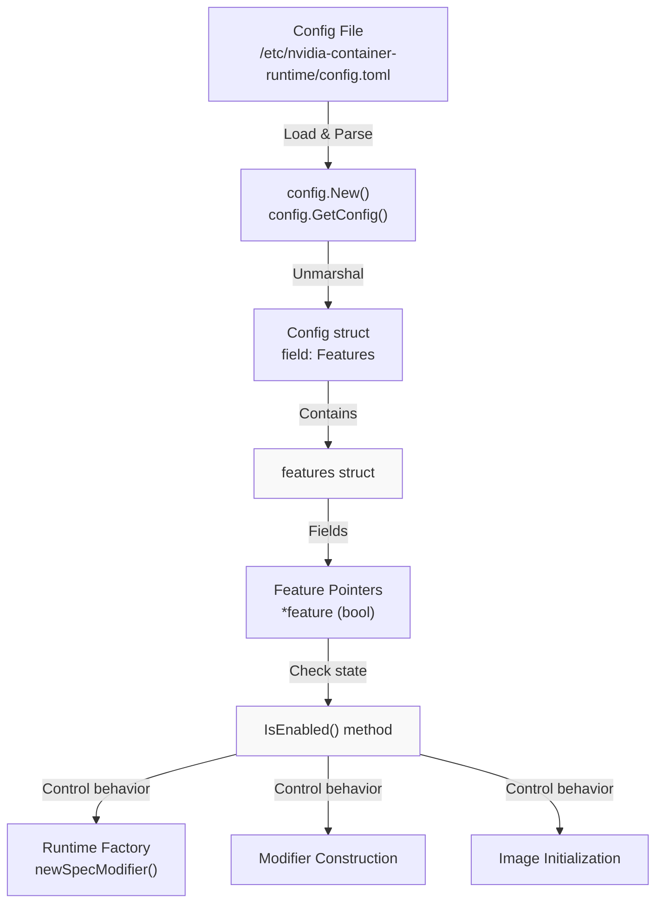
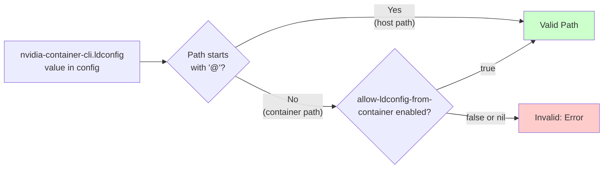
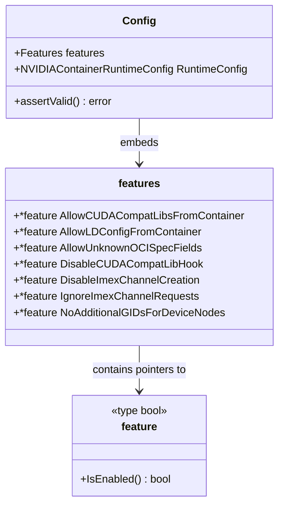
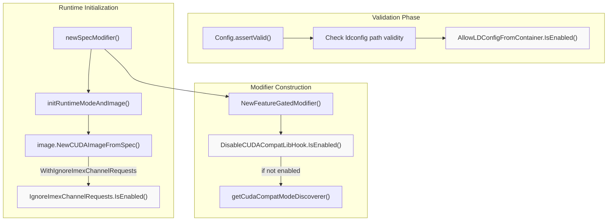

<!-- source: DeepWiki mcp.deepwiki.com · repo NVIDIA/nvidia-container-toolkit · page 4.3 Feature Flags · fetched 2026-10-26 -->

# Feature Flags

<details>
<summary>Relevant source files</summary>

The following files were used as context for generating this wiki page:

- [api/config/v1/cli.go](api/config/v1/cli.go)
- [api/config/v1/cli_test.go](api/config/v1/cli_test.go)
- [api/config/v1/config.go](api/config/v1/config.go)
- [api/config/v1/config_test.go](api/config/v1/config_test.go)
- [api/config/v1/features.go](api/config/v1/features.go)
- [api/config/v1/hook.go](api/config/v1/hook.go)
- [api/config/v1/runtime.go](api/config/v1/runtime.go)
- [api/config/v1/toml.go](api/config/v1/toml.go)
- [api/config/v1/toml_test.go](api/config/v1/toml_test.go)
- [api/config/v1/toolkit-cli.go](api/config/v1/toolkit-cli.go)
- [cmd/nvidia-ctk/cdi/generate/config.go](cmd/nvidia-ctk/cdi/generate/config.go)
- [internal/test/to/to.go](internal/test/to/to.go)
- [pkg/nvcdi/gated.go](pkg/nvcdi/gated.go)
- [pkg/nvcdi/mode.go](pkg/nvcdi/mode.go)

</details>


Feature flags in the NVIDIA Container Toolkit provide fine-grained control over optional functionality and experimental features. They allow users to enable or disable specific behaviors without requiring code changes or multiple configuration files. This document describes the feature flag system, available flags, and their effects on runtime behavior.

For information about general runtime configuration options such as mode selection and runtime paths, see [Runtime Configuration Options](#4.2). For the overall configuration file structure, see [Configuration File Format](#4.1).

## Overview

Feature flags are boolean configuration options that control optional or experimental functionality in the toolkit. They are defined in the `[features]` section of the configuration file and are implemented as nullable boolean pointers, allowing explicit differentiation between "not set" (nil), "enabled" (true), and "disabled" (false).

The feature flag system follows these principles:
- **Opt-in by default**: Most features are disabled unless explicitly enabled
- **Explicit enabling**: Flags must be set to `true` to enable; unset or `nil` values are treated as disabled
- **Independent control**: Each flag controls a specific, well-defined behavior
- **No side effects**: Enabling one flag does not implicitly enable or disable others

Sources: [api/config/v1/features.go:19-56]()

## Configuration Format

Feature flags are configured in the `[features]` section of the TOML configuration file at `/etc/nvidia-container-runtime/config.toml`:

```toml
[features]
allow-ldconfig-from-container = true
disable-cuda-compat-lib-hook = false
ignore-imex-channel-requests = true
```

Each flag is specified as a key-value pair where the key is the kebab-case feature name and the value is a boolean. Unset flags default to disabled.

Sources: [api/config/v1/config.go:73-75](), [api/config/v1/config_test.go:173-179]()

## Feature Flag Architecture



**Feature Flag Data Flow**

The configuration system loads feature flags from the TOML file and unmarshals them into the `features` struct within the main `Config` struct. Each feature is represented as a pointer to a `feature` type (which is a boolean alias). The `IsEnabled()` method provides a safe way to check if a feature is explicitly enabled, returning `false` for `nil` or `false` values.

Sources: [api/config/v1/config.go:59-75](), [api/config/v1/features.go:19-56](), [api/config/v1/toml.go:109-119]()

## Available Feature Flags

### allow-ldconfig-from-container

**Purpose:** Allows the toolkit to use `ldconfig` binaries from within the container rather than requiring a host-rooted path.

**Default:** Disabled (false)

**Behavior:**
- When **disabled** (default): The `nvidia-container-cli.ldconfig` configuration value must be a host-relative path starting with `@` (e.g., `@/sbin/ldconfig`). Non-host paths are rejected with an error during config validation.
- When **enabled**: Both host-relative paths (starting with `@`) and container-relative paths (without `@`) are accepted.

**Use Case:** This flag is useful in environments where the host `ldconfig` is unavailable or incompatible, allowing the container to provide its own `ldconfig` binary. However, this introduces security considerations as it allows containers to control library cache generation.

**Validation:** Config validation at [api/config/v1/config.go:142-149]() checks this flag to determine if non-host ldconfig paths are permitted.



Sources: [api/config/v1/features.go:24-27](), [api/config/v1/cli.go:59-67](), [api/config/v1/config_test.go:173-220]()

### disable-cuda-compat-lib-hook

**Purpose:** Disables the injection of the CUDA compatibility library hook that processes forward compatibility libraries.

**Default:** Disabled (false, meaning the hook is active)

**Behavior:**
- When **disabled** (default): The toolkit injects a hook to discover and configure CUDA compatibility libraries from `/usr/local/cuda-compat` and similar paths. This hook enables containers to use newer CUDA versions than the host driver supports.
- When **enabled**: The CUDA compatibility library hook is skipped entirely. No automatic discovery or mounting of CUDA compatibility libraries occurs.

**Interaction with Legacy Mode:** In legacy mode, the CUDA compatibility behavior is controlled by the `nvidia-container-runtime.modes.legacy.cuda-compat-mode` configuration option, which can be set to:
- `ldconfig` (default): Add compat paths to ldconfig
- `mount`: Mount compat libraries directly
- `hook`: Use the hook mechanism (only works in legacy mode, not when invoked via `--gpus`)
- `disabled`: Disable all CUDA compat handling

This feature flag provides an override mechanism across all modes.

Sources: [api/config/v1/features.go:28-33](), [pkg/nvcdi/gated.go:60-70]()

### ignore-imex-channel-requests

**Purpose:** Configures the toolkit to ignore IMEX channel requests specified via environment variables or volume mounts.

**Default:** Disabled (false)

**Behavior:**
- When **disabled** (default): The toolkit processes `NVIDIA_IMEX_CHANNELS` environment variables and IMEX channel volume mount requests, providing access to inter-GPU communication channels.
- When **enabled**: All IMEX channel requests are ignored, preventing containers from requesting or receiving access to IMEX channels through standard mechanisms.

**Use Case:** This flag is important in multi-tenant or security-sensitive environments where IMEX channel access should be tightly controlled. By enabling this flag, orchestration systems can prevent containers from bypassing access controls by simply setting environment variables.

**Implementation:** This flag is passed to the image parser during initialization, affecting how container specifications are interpreted.

Sources: [api/config/v1/features.go:37-44]()

### disable-imex-channel-creation

**Purpose:** Prevents the implicit creation of IMEX channels when invoking `nvidia-container-cli`.

**Default:** Disabled (false)

**Behavior:**
- When **disabled** (default): If a container requests IMEX channels that don't exist, the toolkit may attempt to create them automatically when invoking the low-level `nvidia-container-cli`.
- When **enabled**: Requested IMEX channels must already exist; no automatic creation occurs.

**Difference from ignore-imex-channel-requests:** While `ignore-imex-channel-requests` prevents the toolkit from processing IMEX channel requests at all, `disable-imex-channel-creation` allows requests to be processed but prevents automatic creation of non-existent channels.

Sources: [api/config/v1/features.go:34-36]()

### allow-cuda-compat-libs-from-container

**Purpose:** Allows CUDA compatibility libraries from the container to override certain driver library mounts from the host.

**Default:** Disabled (false)

**Behavior:**
- When **disabled** (default): Host driver libraries take precedence; container-provided CUDA compatibility libraries do not override host mounts.
- When **enabled**: Container-provided CUDA compatibility libraries can override specific host driver library mounts, allowing containers to supply newer compatibility shims.

**Interaction:** This flag is related to but distinct from `disable-cuda-compat-lib-hook`. When `allow-cuda-compat-libs-from-container` is enabled, the hook mechanism described by `disable-cuda-compat-lib-hook` is effectively replaced by container-sourced libraries.

Sources: [api/config/v1/features.go:21-23]()

### no-additional-gids-for-device-nodes

**Purpose:** Disables the injection of additional GIDs for a device node when the node is not readable and writeable by the user.

**Default:** Disabled (false)

**Behavior:**
- When **disabled** (default): The toolkit may add supplementary group IDs to the container process if a device node is not accessible by the container's primary user/group. This ensures device access.
- When **enabled**: No additional GIDs are injected for device nodes, even if the device is otherwise inaccessible. This might lead to permission errors if the container user lacks direct access.

**Use Case:** This flag can be used in highly restricted environments where the container's group membership must be strictly controlled and no automatic additions are desired.

Sources: [api/config/v1/features.go:50-53]()

### allow-unknown-oci-spec-fields

**Purpose:** Allows the `nvidia-container-runtime` to ignore unknown fields when loading the OCI spec associated with a container.

**Default:** Disabled (false)

**Behavior:**
- When **disabled** (default): If the OCI spec contains fields not recognized by the `nvidia-container-runtime`, an error will be returned, and the container creation will fail.
- When **enabled**: Unknown fields in the OCI spec are silently dropped, allowing the container creation to proceed.

**Use Case:** This flag can be useful for compatibility with OCI runtimes or tools that might add custom or experimental fields to the OCI spec that the NVIDIA Container Runtime does not explicitly understand.

Sources: [api/config/v1/features.go:28-33]()

## Implementation Details

### Feature Type Definition



The `feature` type is defined as a boolean alias at [api/config/v1/features.go:55](), and the `features` struct contains pointers to `feature` instances. This design allows distinguishing between:
- **nil**: Feature not specified in configuration
- **false**: Feature explicitly disabled
- **true**: Feature explicitly enabled

The `IsEnabled()` method at [api/config/v1/features.go:57-63]() safely checks the state:

```go
func (f *feature) IsEnabled() bool {
    if f != nil {
        return bool(*f)
    }
    return false
}
```

This ensures that unspecified and explicitly-disabled features both result in disabled behavior, while only explicitly-enabled features return `true`.

Sources: [api/config/v1/features.go:19-63]()

### Feature Flag Usage Patterns



**Feature Flag Consumption Points**

Feature flags are consumed at three main points in the toolkit lifecycle:

1.  **Configuration Validation** ([api/config/v1/config.go:142-149]()):
    -   `AllowLDConfigFromContainer` is checked to validate ldconfig path configuration
    -   Invalid configurations are rejected before runtime begins

2.  **Runtime Initialization**:
    -   `IgnoreImexChannelRequests` is passed to image parser construction.
    -   Affects how container specifications are interpreted for IMEX channel requests.

3.  **Modifier Construction** ([pkg/nvcdi/gated.go:60-70]()):
    -   `DisableCUDACompatLibHook` controls whether the CUDA compatibility hook discoverer is created.
    -   Affects which discoverers are included in the final modifier chain.

Sources: [api/config/v1/config.go:142-149](), [pkg/nvcdi/gated.go:60-70]()

## Configuration Validation

The `assertValid()` method at [api/config/v1/config.go:142-149]() validates the configuration, including feature-flag-dependent validation:

```go
func (c *Config) assertValid() error {
    err := c.NVIDIAContainerCLIConfig.Ldconfig.assertValid(
        c.Features.AllowLDConfigFromContainer.IsEnabled()
    )
    if err != nil {
        return errors.Join(err, errInvalidConfig)
    }
    return nil
}
```

The `ldconfigPath.assertValid()` method at [api/config/v1/cli.go:59-67]() implements the actual validation logic:

| Condition | AllowLDConfigFromContainer | Result |
|-----------|----------------------------|--------|
| Path starts with `@` (host path) | Any | Valid |
| Path doesn't start with `@` (container path) | `true` | Valid |
| Path doesn't start with `@` (container path) | `false` or `nil` | Error |

Sources: [api/config/v1/config.go:142-149](), [api/config/v1/cli.go:59-67]()

## Feature Flags in Different Runtime Modes

Feature flags interact differently with runtime modes:

| Feature Flag | Legacy Mode | CSV Mode | CDI Mode |
|--------------|-------------|----------|----------|
| `allow-ldconfig-from-container` | Affects ldconfig validation | Affects ldconfig validation | Affects ldconfig validation |
| `disable-cuda-compat-lib-hook` | Disables hook if explicitly set; otherwise controlled by `cuda-compat-mode` | Disables hook | Disables hook |
| `ignore-imex-channel-requests` | Affects image parsing | Affects image parsing | Affects image parsing |
| `disable-imex-channel-creation` | Affects nvidia-container-cli invocation | Affects nvidia-container-cli invocation | N/A (CDI specs pre-generated) |
| `allow-cuda-compat-libs-from-container` | Affects library mount priority | Affects library mount priority | Affects CDI spec generation |
| `no-additional-gids-for-device-nodes` | Affects device node permissions | Affects device node permissions | Affects CDI spec generation |
| `allow-unknown-oci-spec-fields` | Affects OCI spec parsing | Affects OCI spec parsing | Affects OCI spec parsing |

**Note:** In CSV mode, the CUDA compatibility hook is explicitly skipped regardless of feature flag settings, as CSV mode does not support the hook mechanism.

Sources: [api/config/v1/runtime.go:36-54]()

## Testing and Examples

The test suite at [api/config/v1/config_test.go:397-447]() demonstrates feature flag validation:

```toml
# Example: Enabling ldconfig from container
[nvidia-container-cli]
ldconfig = "/foo/bar/ldconfig"

[features]
allow-ldconfig-from-container = true
```

Without the feature flag, the above configuration would fail validation. With the flag enabled, the non-host ldconfig path is accepted.

Additional test cases at [api/config/v1/toml_test.go:233-260]() demonstrate TOML serialization and deserialization of feature flags.

Sources: [api/config/v1/config_test.go:397-447](), [api/config/v1/toml_test.go:233-260]()

## Summary

Feature flags provide controlled access to optional and experimental functionality in the NVIDIA Container Toolkit. They are:
- Configured in the `[features]` section of the TOML config file
- Implemented as nullable boolean pointers for explicit state tracking
- Checked using the `IsEnabled()` method throughout the codebase
- Used to control validation, runtime initialization, and modifier construction
- Independent of each other, with well-defined individual behaviors

The feature flag system allows administrators to fine-tune toolkit behavior without code changes, enabling use cases ranging from security hardening (`ignore-imex-channel-requests`) to compatibility workarounds (`allow-ldconfig-from-container`).

---

