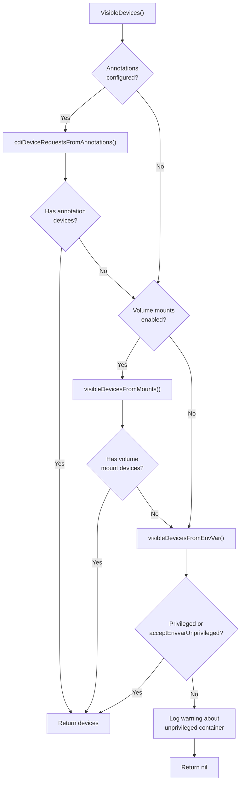

<!-- source: DeepWiki mcp.deepwiki.com · repo NVIDIA/nvidia-container-toolkit · page 4.4 Environment Variables · fetched 2026-10-26 -->

# Environment Variables

Relevant source files

The following files were used as context for generating this wiki page:

- [cmd/nvidia-container-runtime-hook/container_config.go](cmd/nvidia-container-runtime-hook/container_config.go)
- [cmd/nvidia-container-runtime-hook/container_config_test.go](cmd/nvidia-container-runtime-hook/container_config_test.go)
- [cmd/nvidia-container-runtime-hook/hook_config.go](cmd/nvidia-container-runtime-hook/hook_config.go)
- [cmd/nvidia-container-runtime-hook/hook_config_test.go](cmd/nvidia-container-runtime-hook/hook_config_test.go)
- [cmd/nvidia-container-runtime-hook/main.go](cmd/nvidia-container-runtime-hook/main.go)
- [cmd/nvidia-ctk/system/create-dev-char-symlinks/existing_linux.go](cmd/nvidia-ctk/system/create-dev-char-symlinks/existing_linux.go)
- [cmd/nvidia-ctk/system/create-dev-char-symlinks/existing_other.go](cmd/nvidia-ctk/system/create-dev-char-symlinks/existing_other.go)
- [internal/config/image/builder.go](internal/config/image/builder.go)
- [internal/config/image/capabilities.go](internal/config/image/capabilities.go)
- [internal/config/image/cuda_image.go](internal/config/image/cuda_image.go)
- [internal/config/image/cuda_image_test.go](internal/config/image/cuda_image_test.go)
- [internal/config/image/devices.go](internal/config/image/devices.go)
- [internal/config/image/privileged.go](internal/config/image/privileged.go)
- [internal/requirements/constants.go](internal/requirements/constants.go)
- [internal/requirements/constraints/binary.go](internal/requirements/constraints/binary.go)
- [internal/requirements/constraints/constants.go](internal/requirements/constraints/constants.go)
- [internal/requirements/constraints/constraint_mock.go](internal/requirements/constraints/constraint_mock.go)
- [internal/requirements/constraints/constraints_test.go](internal/requirements/constraints/constraints_test.go)
- [internal/requirements/constraints/factory_test.go](internal/requirements/constraints/factory_test.go)
- [internal/requirements/constraints/logical.go](internal/requirements/constraints/logical.go)
- [internal/requirements/constraints/logical_test.go](internal/requirements/constraints/logical_test.go)
- [internal/requirements/constraints/property_mock.go](internal/requirements/constraints/property_mock.go)

This page documents the environment variables used by the NVIDIA Container Toolkit to control GPU device access, driver capabilities, and runtime behavior. These variables are typically set in container images or at container runtime to configure which NVIDIA resources are made available inside containers.

For information about runtime mode selection and general configuration, see [Runtime Configuration Options](#4.2). For details on feature flags that control toolkit behavior, see [Feature Flags](#4.3).

## Overview

The NVIDIA Container Toolkit uses environment variables as the primary mechanism for containers to request GPU resources. These variables are read from the container's process environment and interpreted by the runtime to determine which devices, libraries, and capabilities to inject into the container.

The environment variable processing is implemented primarily in the `internal/config/image` package, with the `CUDA` struct [internal/config/image/cuda_image.go:43-56]() serving as the central abstraction for accessing and interpreting these variables.

## Device Visibility Variables

### NVIDIA_VISIBLE_DEVICES

The primary environment variable for specifying which GPU devices should be visible inside the container.

**Variable:** `NVIDIA_VISIBLE_DEVICES`

**Constant:** `EnvVarNvidiaVisibleDevices` [internal/config/image/cuda_image.go:88-90]()

**Accepted Values:**
- `all` - Make all GPUs visible (default for legacy images)
- `none` - GPU visible but with empty device list
- `void` or empty string - No GPU support
- Comma-separated list of device identifiers (e.g., `0,1`, `GPU-12345`, `MIG-UUID`)
- Fully-qualified CDI device names (e.g., `nvidia.com/gpu=0`)

**Processing:** The `VisibleDevices()` method [internal/config/image/cuda_image.go:258-292]() implements the resolution logic with the following priority:
1. CDI annotations (if configured)
2. Volume mount requests (if enabled via `acceptDeviceListAsVolumeMounts`)
3. Environment variables (if privileged or `acceptEnvvarUnprivileged` is true)

**Sources:** [internal/config/image/cuda_image.go:88-90](), [internal/config/image/cuda_image.go:258-292](), [internal/config/image/cuda_image.go:326-333]()

### Docker Swarm Resource Variables

Alternative environment variables that can override `NVIDIA_VISIBLE_DEVICES` in Docker Swarm environments.

**Configuration:** `swarm-resource` in config.toml [cmd/nvidia-container-runtime-hook/hook_config.go:86-102]()

**Common Variables:**
- `DOCKER_RESOURCE_GPUS` - Docker Swarm GPU resource allocation
- `DOCKER_RESOURCE_GPUS_ADDITIONAL` - Additional GPU resource allocation

**Usage:** When configured, these variables take precedence over `NVIDIA_VISIBLE_DEVICES`. Multiple comma-separated variable names are supported.

**Processing:** The `preferredVisibleDeviceEnvVars` field [internal/config/image/cuda_image.go:56]() stores configured alternative variable names, and `visibleEnvVars()` [internal/config/image/cuda_image.go:239-251]() selects which variables to use.

**Sources:** [internal/config/image/cuda_image.go:239-251](), [cmd/nvidia-container-runtime-hook/hook_config.go:86-102]()

### Device Visibility Resolution Flow

**Sources:** [internal/config/image/cuda_image.go:258-292]()

## Driver Capabilities

### NVIDIA_DRIVER_CAPABILITIES

Specifies which NVIDIA driver capabilities to enable in the container. Driver capabilities control which driver libraries and device files are mounted into the container.

**Variable:** `NVIDIA_DRIVER_CAPABILITIES`

**Constant:** `EnvVarNvidiaDriverCapabilities` [internal/config/image/cuda_image.go:181-191]()

**Supported Capabilities:**
- `compute` - CUDA and OpenCL compute libraries
- `utility` - nvidia-smi and utility libraries
- `graphics` - OpenGL and Vulkan graphics libraries
- `video` - Video encoding/decoding libraries
- `display` - Display and X11 libraries
- `ngx` - NGX AI libraries
- `compat32` - 32-bit compatibility libraries
- `all` - All supported capabilities

**Default Value:** `utility,compute` (defined as `DefaultDriverCapabilities` [internal/config/image/capabilities.go:46]())

**Processing:** The `GetDriverCapabilities()` method [internal/config/image/cuda_image.go:182-191]() parses the comma-separated list and returns a `DriverCapabilities` map. For legacy images (with `CUDA_VERSION` but no `NVIDIA_REQUIRE_CUDA`), all supported capabilities are enabled by default [cmd/nvidia-container-runtime-hook/container_config.go:151-175]().

**Sources:** [internal/config/image/cuda_image.go:181-191](), [cmd/nvidia-container-runtime-hook/container_config.go:151-175](), [internal/config/image/capabilities.go:46]()

## Requirements System

### NVIDIA_REQUIRE_* Variables

Environment variables with the `NVIDIA_REQUIRE_` prefix specify requirements that must be satisfied before the container can run with GPU access.

**Prefix:** `NVIDIA_REQUIRE_` (constant: `NvidiaRequirePrefix`)

**Common Variables:**
- `NVIDIA_REQUIRE_CUDA` - CUDA version requirement (e.g., `cuda>=11.0`)
- `NVIDIA_REQUIRE_BRAND` - GPU brand requirement (e.g., `brand=tesla`)
- `NVIDIA_REQUIRE_ARCH` - GPU architecture requirement

**Excluded Variables:**
- `NVIDIA_REQUIRE_JETPACK` - Ignored by requirements system [internal/config/image/cuda_image.go:121]()
- `NVIDIA_REQUIRE_JETPACK_HOST_MOUNTS` - Ignored by requirements system [internal/config/image/cuda_image_test.go:170-173]()

**Processing:** The `GetRequirements()` method [internal/config/image/cuda_image.go:113-134]() collects all environment variables with the `NVIDIA_REQUIRE_` prefix (except Jetpack-related ones) and returns them as a list of requirement strings that are passed to `nvidia-container-cli`.

**Sources:** [internal/config/image/cuda_image.go:113-134](), [internal/config/image/cuda_image.go:121](), [internal/config/image/cuda_image_test.go:170-173]()

### NVIDIA_DISABLE_REQUIRE

Disables all requirement checks when set to a boolean true value.

**Variable:** `NVIDIA_DISABLE_REQUIRE`

**Constant:** `EnvVarNvidiaDisableRequire` [internal/config/image/cuda_image.go:139]()

**Processing:** The `HasDisableRequire()` method [internal/config/image/cuda_image.go:138-146]() checks if this variable is set to a true boolean value. When enabled, `GetRequirements()` returns an empty list.

**Sources:** [internal/config/image/cuda_image.go:138-146](), [internal/config/image/cuda_image.go:139]()

### CUDA_VERSION (Legacy)

For legacy images (those with `CUDA_VERSION` but no `NVIDIA_REQUIRE_CUDA`), this variable is used to automatically generate a CUDA version requirement.

**Variable:** `CUDA_VERSION`

**Constant:** `EnvVarCudaVersion` [internal/config/image/cuda_image.go:99]()

**Processing:** The `IsLegacy()` method [internal/config/image/cuda_image.go:98-105]() determines if an image is legacy. For legacy images, `GetRequirements()` automatically adds a `cuda>=X.Y` requirement based on the major.minor version parsed from `CUDA_VERSION` [internal/config/image/cuda_image.go:125-133]().

**Sources:** [internal/config/image/cuda_image.go:98-105](), [internal/config/image/cuda_image.go:125-133](), [internal/config/image/cuda_image.go:99]()

## MIG Device Configuration

### NVIDIA_MIG_CONFIG_DEVICES

Specifies MIG (Multi-Instance GPU) devices that should be configured. Only available in privileged containers.

**Variable:** `NVIDIA_MIG_CONFIG_DEVICES`

**Constant:** `EnvVarNvidiaMigConfigDevices` [internal/config/image/cuda_image.go:139]()

**Processing:** The `getMigConfigDevices()` function [cmd/nvidia-container-runtime-hook/container_config.go:135-137]() retrieves the value. The `getNvidiaConfig()` method [cmd/nvidia-container-runtime-hook/container_config.go:186-192]() validates that the container is privileged before allowing MIG configuration.

**Sources:** [cmd/nvidia-container-runtime-hook/container_config.go:135-137](), [cmd/nvidia-container-runtime-hook/container_config.go:186-192](), [internal/config/image/cuda_image.go:139]()

### NVIDIA_MIG_MONITOR_DEVICES

Specifies MIG devices that should be monitored. Only available in privileged containers.

**Variable:** `NVIDIA_MIG_MONITOR_DEVICES`

**Constant:** `EnvVarNvidiaMigMonitorDevices` [internal/config/image/cuda_image.go:143]()

**Processing:** Similar to `NVIDIA_MIG_CONFIG_DEVICES`, the `getMigMonitorDevices()` function [cmd/nvidia-container-runtime-hook/container_config.go:139-141]() retrieves the value, and privilege validation is enforced [cmd/nvidia-container-runtime-hook/container_config.go:194-200]().

**Sources:** [cmd/nvidia-container-runtime-hook/container_config.go:139-141](), [cmd/nvidia-container-runtime-hook/container_config.go:194-200](), [internal/config/image/cuda_image.go:143]()

## IMEX Channels

### NVIDIA_IMEX_CHANNELS

Specifies IMEX (Inter-Process Memory Exchange) channels to allocate for the container.

**Variable:** `NVIDIA_IMEX_CHANNELS`

**Constant:** `EnvVarNvidiaImexChannels` [internal/config/image/cuda_image.go:147]()

**Processing:** The `ImexChannelRequests()` method [internal/config/image/cuda_image.go:416-448]() returns the list of requested IMEX channels. Similar to device visibility, it checks volume mounts first (if enabled), then falls back to the environment variable (if privileged or `acceptEnvvarUnprivileged` is true).

**Special Handling:** A value of `all` is treated as no specific channels requested and returns nil [internal/config/image/cuda_image.go:452-456]().

**Feature Flag:** Can be disabled by the `ignoreImexChannelRequests` field [internal/config/image/cuda_image.go:54]() in the `CUDA` struct.

**Sources:** [internal/config/image/cuda_image.go:416-448](), [internal/config/image/cuda_image.go:450-457](), [internal/config/image/cuda_image.go:54](), [internal/config/image/cuda_image.go:147]()

## Gated Device Features

These environment variables enable discovery and mounting of specialized NVIDIA devices in CDI mode.

### NVIDIA_GDS

Enables GPU Direct Storage (GDS) device discovery.

**Variable:** `NVIDIA_GDS`

**Constant:** `EnvVarNvidiaGDS` [internal/config/image/cuda_image.go:151]()

**Value:** Must be set to `enabled`

**Processing:** In CDI mode, the `gatedDevices` type [internal/modifier/cdi.go:118-138]() checks this variable and adds `mode=gds` to the CDI device requests.

**Sources:** [internal/modifier/cdi.go:124-126](), [internal/config/image/cuda_image.go:151]()

### NVIDIA_MOFED

Enables MOFED Infiniband device discovery.

**Variable:** `NVIDIA_MOFED`

**Constant:** `EnvVarNvidiaMOFED` [internal/config/image/cuda_image.go:155]()

**Value:** Must be set to `enabled`

**Processing:** Adds `mode=mofed` to CDI device requests [internal/modifier/cdi.go:127-129]().

**Sources:** [internal/modifier/cdi.go:127-129](), [internal/config/image/cuda_image.go:155]()

### NVIDIA_GDRCOPY

Enables GDRCopy device discovery.

**Variable:** `NVIDIA_GDRCOPY`

**Constant:** `EnvVarNvidiaGDRCopy` [internal/config/image/cuda_image.go:159]()

**Value:** Must be set to `enabled`

**Processing:** Adds `mode=gdrcopy` to CDI device requests [internal/modifier/cdi.go:130-132]().

**Sources:** [internal/modifier/cdi.go:130-132](), [internal/config/image/cuda_image.go:159]()

### NVIDIA_NVSWITCH

Enables NVSwitch device discovery.

**Variable:** `NVIDIA_NVSWITCH`

**Constant:** `EnvVarNvidiaNVSwitch` [internal/config/image/cuda_image.go:163]()

**Value:** Must be set to `enabled`

**Processing:** Adds `mode=nvswitch` to CDI device requests [internal/modifier/cdi.go:133-135]().

**Sources:** [internal/modifier/cdi.go:133-135](), [internal/config/image/cuda_image.go:163]()

## Configuration Variables

### NVIDIA_CTK_CONFIG_FILE_PATH

Overrides the default configuration file path for nvidia-ctk tools.

**Variable:** `NVIDIA_CTK_CONFIG_FILE_PATH`

**Processing:** This environment variable is checked by `getConfigFilePath()` [cmd/nvidia-container-runtime-hook/hook_config.go:42-44]() to determine the configuration file to load.

**Sources:** [cmd/nvidia-container-runtime-hook/hook_config.go:42-44]()

## Environment Variable to Code Entity Mapping

The following diagram shows how environment variables map to code structures and processing functions in the toolkit:

```mermaid
graph TB
    subgraph "Environment Variables"
        NVD["NVIDIA_VISIBLE_DEVICES"]
        NVDC["NVIDIA_DRIVER_CAPABILITIES"]
        NVR["NVIDIA_REQUIRE_*"]
        NVDR["NVIDIA_DISABLE_REQUIRE"]
        CV["CUDA_VERSION"]
        NVMCD["NVIDIA_MIG_CONFIG_DEVICES"]
        NVMMD["NVIDIA_MIG_MONITOR_DEVICES"]
        NVIC["NVIDIA_IMEX_CHANNELS"]
        NVGDS["NVIDIA_GDS"]
        NVMOFED["NVIDIA_MOFED"]
        NVGDRCOPY["NVIDIA_GDRCOPY"]
        NVNVSWITCH["NVIDIA_NVSWITCH"]
        DSR["DOCKER_RESOURCE_GPUS"]
    end
    
    subgraph "CUDA Image Struct (internal/config/image/cuda_image.go)"
        EnvMap["env map[string]string"]
        Mounts["mounts []specs.Mount"]
        Annotations["annotations map[string]string"]
        IsPriv["isPrivileged bool"]
        AcceptVolMounts["acceptDeviceListAsVolumeMounts bool"]
        AcceptUnpriv["acceptEnvvarUnprivileged bool"]
        PreferredEnvVars["preferredVisibleDeviceEnvVars []string"]
        IgnoreImex["ignoreImexChannelRequests bool"]
    end
    
    subgraph "Processing Methods (internal/config/image/cuda_image.go)"
        VD["VisibleDevices()"]
        GDC["GetDriverCapabilities()"]
        GR["GetRequirements()"]
        HDR["HasDisableRequire()"]
        IL["IsLegacy()"]
        ICR["ImexChannelRequests()"]
        GMCD["getMigConfigDevices()"]
        GMMD["getMigMonitorDevices()"]
        GDSD["gatedDevices()"]
    end
    
    subgraph "Output Structures"
        DevList["[]string devices"]
        CapMap["DriverCapabilities"]
        ReqList["[]string requirements"]
        NvidiaConf["nvidiaConfig struct (cmd/nvidia-container-runtime-hook/container_config.go)"]
    end
    
    NVD --> EnvMap
    NVDC --> EnvMap
    NVR --> EnvMap
    NVDR --> EnvMap
    CV --> EnvMap
    NVMCD --> EnvMap
    NVMMD --> EnvMap
    NVIC --> EnvMap
    NVGDS --> EnvMap
    NVMOFED --> EnvMap
    NVGDRCOPY --> EnvMap
    NVNVSWITCH --> EnvMap
    DSR --> PreferredEnvVars
    
    EnvMap --> VD
    Mounts --> VD
    Annotations --> VD
    IsPriv --> VD
    AcceptVolMounts --> VD
    AcceptUnpriv --> VD
    PreferredEnvVars --> VD
    
    EnvMap --> GDC
    EnvMap --> GR
    EnvMap --> HDR
    EnvMap --> IL
    EnvMap --> ICR
    EnvMap --> GMCD
    EnvMap --> GMMD
    EnvMap --> GDSD
    IgnoreImex --> ICR
    
    VD --> DevList
    GDC --> CapMap
    GR --> ReqList
    IL --> GR
    HDR --> GR
    
    DevList --> NvidiaConf
    CapMap --> NvidiaConf
    ReqList --> NvidiaConf
    GMCD --> NvidiaConf
    GMMD --> NvidiaConf
    ICR --> NvidiaConf
    GDSD --> NvidiaConf
```

**Sources:** [internal/config/image/cuda_image.go:43-56](), [internal/config/image/cuda_image.go:258-292](), [cmd/nvidia-container-runtime-hook/container_config.go:16-26]()

## Environment Variable Priority and Resolution

The toolkit uses a specific priority order when resolving device requests from multiple sources:

| Priority | Source | Configuration Requirement | Privilege Requirement |
|----------|--------|---------------------------|----------------------|
| 1 | CDI Annotations | `annotation-prefixes` configured | None |
| 2 | Volume Mounts | `accept-device-list-as-volume-mounts=true` | None |
| 3 | Preferred Env Vars | `swarm-resource` configured | Privileged or `accept-envvar-unprivileged=true` |
| 4 | NVIDIA_VISIBLE_DEVICES | Default | Privileged or `accept-envvar-unprivileged=true` |

**Privileged Container Detection:** A container is considered privileged if it has the `CAP_SYS_ADMIN` capability in its bounding capability set [internal/config/image/privileged.go:36-47]().

**Unprivileged Access Control:** When `accept-nvidia-visible-devices-envvar-unprivileged` is false (default for security), environment variable-based device requests from unprivileged containers are ignored and a warning is logged [internal/config/image/cuda_image.go:286-289]().

**Sources:** [internal/config/image/cuda_image.go:258-292](), [internal/config/image/privileged.go:36-47]()

## Legacy Image Behavior

Legacy images are those with a `CUDA_VERSION` environment variable but no `NVIDIA_REQUIRE_CUDA` variable [internal/config/image/cuda_image.go:98-105]().

**Special Behaviors for Legacy Images:**

1. **Device Visibility:** If `NVIDIA_VISIBLE_DEVICES` is not set, defaults to `all` [internal/config/image/cuda_image.go:168-171]()
2. **Driver Capabilities:** If `NVIDIA_DRIVER_CAPABILITIES` is not set, all supported capabilities are enabled instead of just the default set [cmd/nvidia-container-runtime-hook/container_config.go:160-163]()
3. **Requirements:** A `cuda>=X.Y` requirement is automatically generated from the `CUDA_VERSION` value [internal/config/image/cuda_image.go:125-133]()

**Sources:** [internal/config/image/cuda_image.go:98-105](), [internal/config/image/cuda_image.go:168-171](), [cmd/nvidia-container-runtime-hook/container_config.go:160-163]()

---

