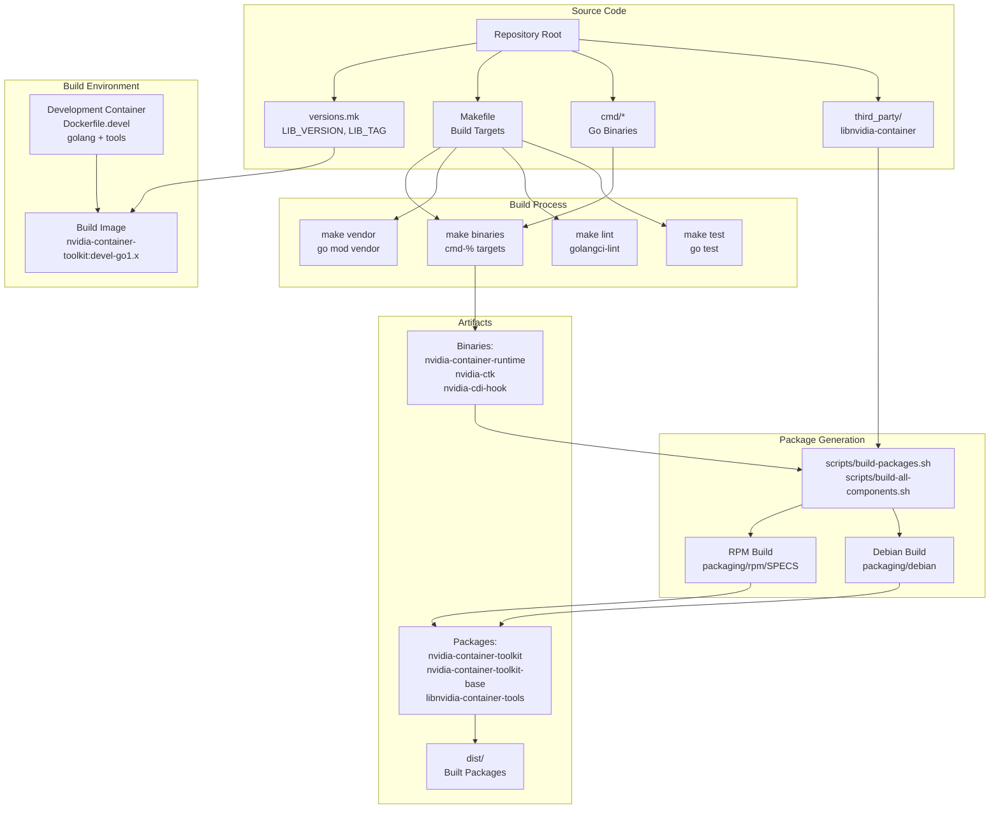
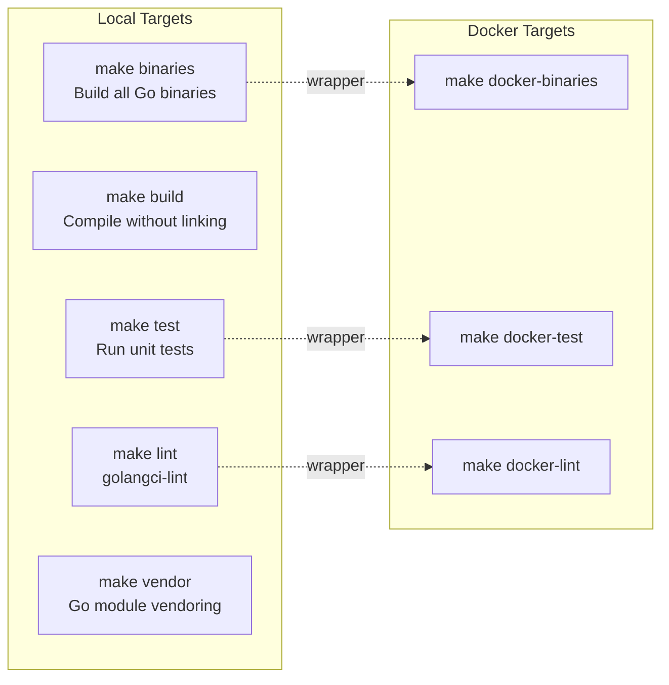
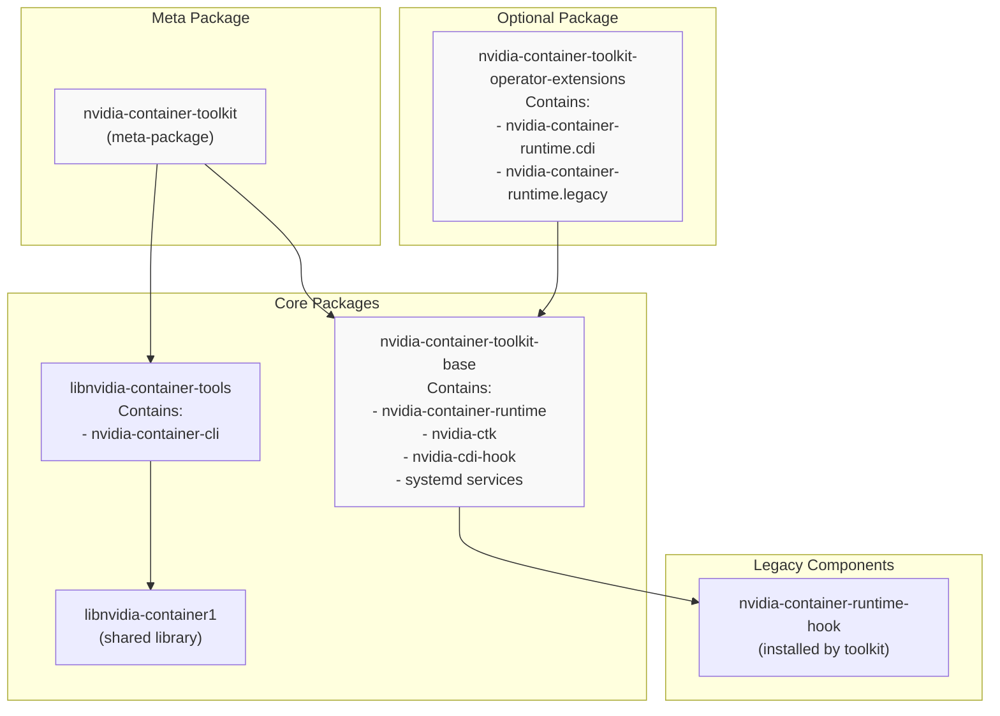
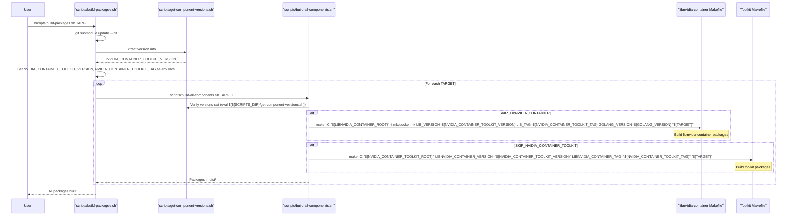
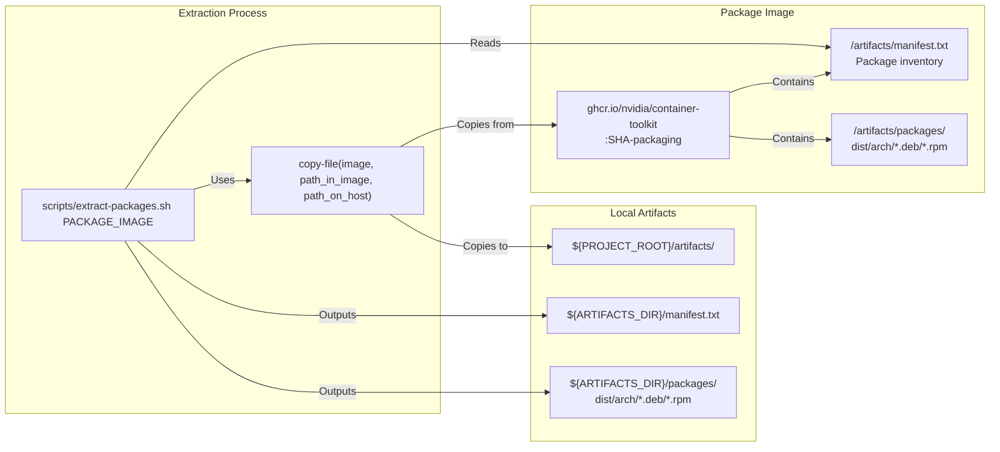
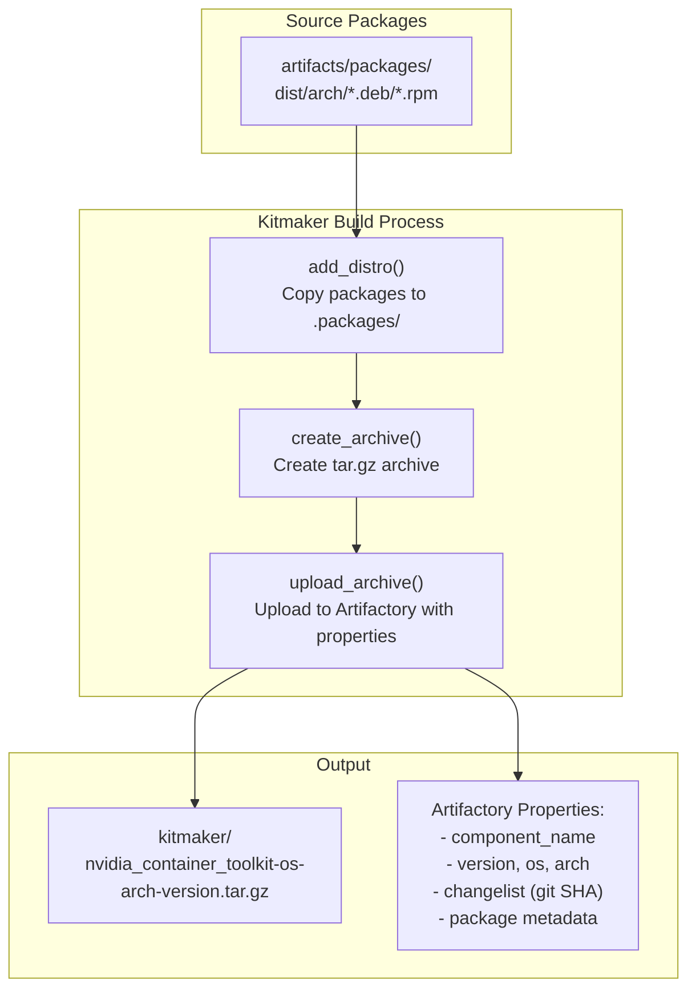

<!-- source: DeepWiki mcp.deepwiki.com · repo NVIDIA/nvidia-container-toolkit · page 5 Building and Packaging · fetched 2026-10-26 -->

# Building and Packaging

<details>
<summary>Relevant source files</summary>

The following files were used as context for generating this wiki page:

- [.nvidia-ci.yml](.nvidia-ci.yml)
- [DEVELOPMENT.md](DEVELOPMENT.md)
- [README.md](README.md)
- [deployments/systemd/nvidia-cdi-refresh.env](deployments/systemd/nvidia-cdi-refresh.env)
- [deployments/systemd/nvidia-cdi-refresh.service](deployments/systemd/nvidia-cdi-refresh.service)
- [deployments/udev/99-nvidia-cdi-refresh.rules](deployments/udev/99-nvidia-cdi-refresh.rules)
- [docker/Dockerfile.debian](docker/Dockerfile.debian)
- [docker/Dockerfile.opensuse-leap](docker/Dockerfile.opensuse-leap)
- [docker/Dockerfile.rpm-yum](docker/Dockerfile.rpm-yum)
- [docker/Dockerfile.ubuntu](docker/Dockerfile.ubuntu)
- [docker/docker.mk](docker/docker.mk)
- [packaging/debian/nvidia-container-toolkit-base.install](packaging/debian/nvidia-container-toolkit-base.install)
- [packaging/debian/nvidia-container-toolkit-base.postinst](packaging/debian/nvidia-container-toolkit-base.postinst)
- [packaging/debian/rules](packaging/debian/rules)
- [scripts/Dockerfile.sign.deb](scripts/Dockerfile.sign.deb)
- [scripts/Dockerfile.sign.rpm](scripts/Dockerfile.sign.rpm)
- [scripts/build-all-components.sh](scripts/build-all-components.sh)
- [scripts/build-packages.sh](scripts/build-packages.sh)
- [scripts/extract-packages.sh](scripts/extract-packages.sh)
- [scripts/get-component-versions.sh](scripts/get-component-versions.sh)
- [scripts/packages-sign-all.sh](scripts/packages-sign-all.sh)
- [scripts/release-kitmaker-artifactory.sh](scripts/release-kitmaker-artifactory.sh)
- [scripts/release-packages-artifactory.sh](scripts/release-packages-artifactory.sh)
- [scripts/release-packages.sh](scripts/release-packages.sh)
- [scripts/utils.sh](scripts/utils.sh)
- [tests/e2e/nvidia-cdi-refresh_test.go](tests/e2e/nvidia-cdi-refresh_test.go)

</details>


This document describes the build system, package structure, and release processes for the NVIDIA Container Toolkit. It covers how to build binaries from source, generate distribution packages (RPM and DEB), and release them through various distribution channels.

For information about installing and deploying pre-built packages, see [Package Structure](#5.2). For CI/CD pipeline details, see [Release Process](#5.4) and [CI/CD Pipeline](#6.2). For development workflows and testing, see [Development Environment](#6.1).

## Overview

The NVIDIA Container Toolkit uses a Makefile-based build system with Docker containerization for reproducible multi-platform builds. The build process compiles Go binaries, bundles them with `libnvidia-container` (included as a git submodule), and generates both RPM and Debian packages for multiple Linux distributions and architectures.

### Build Architecture



**Sources**: [Makefile:1-171](), [versions.mk:1-39](), [docker/Dockerfile.devel:1-27](), [scripts/build-packages.sh:1-44]()

### Version Management

The toolkit version is managed through a centralized version file that controls versioning for all components:

| Variable | File | Purpose |
|----------|------|---------|
| `LIB_VERSION` | [versions.mk:16]() | Semantic version (e.g., `1.19.0`) |
| `LIB_TAG` | [versions.mk:17]() | Optional tag for RC builds (e.g., `rc.1`) |
| `PACKAGE_VERSION` | [versions.mk:21]() | Combined version with tilde separator (e.g., `1.19.0~rc.1`) |
| `GOLANG_VERSION` | [versions.mk:24]() | Go compiler version extracted by script |
| `GIT_COMMIT` | [versions.mk:29]() | Full git commit SHA for build traceability |

The version information is extracted by [scripts/get-component-versions.sh:1-41]() and used throughout the build system.

**Sources**: [versions.mk:15-39](), [scripts/get-component-versions.sh:33-41]()

## Build Targets and Commands

### Primary Build Targets

The main Makefile provides several build targets that can be invoked directly or within a Docker container:



**Sources**: [Makefile:41-133]()

### Binary Compilation

Individual command binaries are built using the `cmd-%` pattern target:

```
# Build all binaries
make binaries

# Build specific binary
make cmd-nvidia-ctk

# Build with custom output location
PREFIX=/custom/path make cmd-nvidia-container-runtime
```

The build process injects version information at compile time through linker flags:

```bash
# From Makefile:68
go build -ldflags "-s -w '-extldflags=$(EXTLDFLAGS)' \
    -X $(CLI_VERSION_PACKAGE).gitCommit=$(GIT_COMMIT) \
    -X $(CLI_VERSION_PACKAGE).version=$(CLI_VERSION)" \
    $(COMMAND_BUILD_OPTIONS) $(MODULE)/cmd/$(*)
```

Key linker flags:
- `-s -w`: Strip symbol table and DWARF debugging info for smaller binaries
- `-extldflags`: Export dynamic symbols for plugin loading
- `-X`: Inject version variables into `github.com/NVIDIA/nvidia-container-toolkit/internal/info` package

**Sources**: [Makefile:56-68](), [Makefile:50-53]()

### Docker-Based Builds

Docker-based builds ensure reproducible builds across different development environments. The `docker.mk` file defines targets for building and running within Docker containers. For details, see [Build System](#5.1).

```
# Build the development image
make .build-image

# Run builds in container
make docker-binaries

# Interactive shell in build container
make .shell
```

The Docker wrapper runs commands in a containerized environment with mounted caches.

**Sources**: [Makefile:136-170](), [docker/Dockerfile.devel:14-27]()

## Package Structure and Dependencies

The NVIDIA Container Toolkit is distributed as a set of packages, each serving a specific purpose and having defined dependencies. This modular approach allows for flexible installation and integration. For details, see [Package Structure](#5.2).

### Package Hierarchy

The toolkit is distributed as multiple packages with specific dependency relationships:



**Sources**: [packaging/rpm/SPECS/nvidia-container-toolkit.spec:1-135](), [packaging/debian/control:1-32]()

### Package Details

#### `nvidia-container-toolkit` (Meta Package)

This is the primary package users install. It has no files itself but depends on:
- `nvidia-container-toolkit-base` (same version)
- `libnvidia-container-tools` (same version, < 2.0.0)

**Sources**: [packaging/rpm/SPECS/nvidia-container-toolkit.spec:1-29](), [packaging/debian/control:11-17]()

#### `nvidia-container-toolkit-base`

The base package contains the core runtime and CLI tools:

| File | Installation Path | Purpose |
|------|------------------|---------|
| `nvidia-container-runtime` | `/usr/bin/` | OCI runtime wrapper |
| `nvidia-ctk` | `/usr/bin/` | CLI tool for configuration |
| `nvidia-cdi-hook` | `/usr/bin/` | CDI lifecycle hooks |
| `nvidia-cdi-refresh.service` | `/etc/systemd/system/` | Systemd service for CDI spec generation |
| `nvidia-cdi-refresh.path` | `/etc/systemd/system/` | Systemd path unit for monitoring |

The post-install script generates default configuration and enables systemd services. For more details on the contents and installation layout, see [Package Structure](#5.2).

**Sources**: [packaging/rpm/SPECS/nvidia-container-toolkit.spec:82-121](), [packaging/debian/control:19-25](), [deployments/systemd/nvidia-cdi-refresh.service:15-45]()

#### `libnvidia-container-tools`

This package provides the low-level `nvidia-container-cli` tool, which is built from the [third_party/libnvidia-container]() submodule. This tool is responsible for the actual GPU device and library mounting within containers.

**Sources**: [packaging/rpm/SPECS/nvidia-container-toolkit.spec:27](), [CHANGELOG.md:23-24]()

#### `nvidia-container-toolkit-operator-extensions`

This is an optional package primarily used for Kubernetes GPU Operator integration. It provides mode-specific runtime executables:
- `nvidia-container-runtime.cdi`: A runtime hardcoded to operate in CDI mode.
- `nvidia-container-runtime.legacy`: A runtime hardcoded to operate in legacy mode.

This package is typically not published to standard repositories but is used in containerized operator deployments.

**Sources**: [packaging/rpm/SPECS/nvidia-container-toolkit.spec:122-135](), [packaging/debian/control:27-31]()

### Post-Install Hooks

Both RPM and Debian packages include post-installation scripts to configure the toolkit and integrate with the system.

#### RPM Post-Install

The RPM spec includes sophisticated post-install logic:

1.  **Package Upgrade Handling** ([packaging/rpm/SPECS/nvidia-container-toolkit.spec:52-55]()): Backs up `nvidia-container-runtime-hook` during upgrades to prevent file loss.
2.  **Post-Transaction** ([packaging/rpm/SPECS/nvidia-container-toolkit.spec:57-63]()): Restores backup and creates a symlink `nvidia-container-toolkit` → `nvidia-container-runtime-hook`.
3.  **Base Package Post-Install** ([packaging/rpm/SPECS/nvidia-container-toolkit.spec:93-111]()):
    -   Generates default configuration at `/etc/nvidia-container-runtime/config.toml`.
    -   Enables and starts systemd services for CDI specification generation, such as `nvidia-cdi-refresh.service` and `nvidia-cdi-refresh.path`.
    -   Only runs if systemd is in a `running` or `degraded` state.

**Sources**: [packaging/rpm/SPECS/nvidia-container-toolkit.spec:51-111]()

#### Debian Post-Install

The Debian package uses simpler hooks:
-   [packaging/debian/nvidia-container-toolkit.postinst:1-28](): Creates a symlink.
-   [packaging/debian/nvidia-container-toolkit.postrm:1-24](): Cleans up the symlink on package purge.

**Sources**: [packaging/debian/nvidia-container-toolkit.postinst:9-14](), [packaging/debian/nvidia-container-toolkit.postrm:9-10]()

## Component Build Process

The toolkit's build process involves coordinating the compilation of multiple components, including the main toolkit and its `libnvidia-container` submodule. For a detailed explanation of how to build the toolkit from source, refer to [Build System](#5.1).

### Building All Components

The toolkit includes external components as submodules. The build script coordinates building all pieces:



**Sources**: [scripts/build-packages.sh:22-44](), [scripts/build-all-components.sh:28-71]()

### Default Build Targets

The [scripts/utils.sh:18-27]() file defines the standard build targets, which specify the combinations of Linux distributions and architectures for which packages are built:

```bash
all=(
    centos7-aarch64
    centos7-x86_64
    centos8-aarch64
    centos8-ppc64le
    centos8-x86_64
    ubuntu18.04-amd64
    ubuntu18.04-arm64
    ubuntu18.04-ppc64le
)
```

Each target follows the pattern `distribution-architecture` and controls which packages are built.

**Sources**: [scripts/utils.sh:15-27](), [scripts/build-packages.sh:28-32]()

### Environment Variable Overrides

For local development and testing, several environment variables can be used to override default paths and skip certain build steps:

| Variable | Purpose | Default |
|----------|---------|---------|
| `LIBNVIDIA_CONTAINER_ROOT` | Path to `libnvidia-container` source | `third_party/libnvidia-container` |
| `NVIDIA_CONTAINER_TOOLKIT_ROOT` | Path to toolkit source | Repository root |
| `DIST_DIR` | Output directory for packages | `dist/` |
| `SKIP_LIBNVIDIA_CONTAINER` | Skip building `libnvidia-container` | unset |
| `SKIP_NVIDIA_CONTAINER_TOOLKIT` | Skip building toolkit | unset |

**Sources**: [scripts/build-all-components.sh:46-48](), [DEVELOPMENT.md:30-33]()

## Distribution and Release

The NVIDIA Container Toolkit packages and container images are released through a structured process involving extraction, signing, and publishing to various distribution channels. For a comprehensive overview of the CI/CD pipelines and publishing mechanisms, see [Release Process](#5.4) and [Container Images](#5.3).

### Package Extraction

Packages are built inside container images and then extracted for distribution. The `scripts/extract-packages.sh` script handles this process.



The extraction script uses `regctl` (if available) or falls back to `docker run` to copy files from the package image. The `skip-for-release-candidate` function ([scripts/extract-packages.sh:41-56]()) determines which packages to skip for release candidates.

**Sources**: [scripts/extract-packages.sh:58-100](), [scripts/utils.sh:84-103](), [scripts/extract-packages.sh:41-56]()

### Release to Package Repositories

The [scripts/release-packages.sh:1-224]() script handles releasing packages to the official repositories:

1.  **Package Selection**: Extracts packages from the staging image.
2.  **Repository Sync**: Copies packages to the `gh-pages` branch of the `libnvidia-container` repository.
3.  **Package Signing**:
    -   DEB: Uses `apt-ftparchive` and GPG signing ([scripts/packages-sign-all.sh:10-32]()).
    -   RPM: Uses `rpmsign` and `createrepo` ([scripts/packages-sign-all.sh:34-47]()).
4.  **Commit**: Creates git commits with package additions and signatures.

**Sources**: [scripts/release-packages.sh:44-224](), [scripts/packages-sign-all.sh:1-112]()

### Kitmaker Distribution

For OEM partners, packages are bundled into Kitmaker archives, which are then uploaded to Artifactory.



The Kitmaker script creates separate archives for different architectures:
-   `x86_64`: Standard Intel/AMD platforms.
-   `sbsa`: ARM Server Base System Architecture.
-   `aarch64`: Generic ARM64 (often a duplicate of sbsa for compatibility).

**Sources**: [scripts/release-kitmaker-artifactory.sh:76-223]()

### Package Signing Infrastructure

Package signing uses containerized signing tools to ensure consistent signing environments. This process is critical for verifying the authenticity and integrity of the distributed packages.

**RPM Signing Container** ([scripts/Dockerfile.sign.rpm:1-3]()):
-   Base: CentOS Stream 9
-   Tools: `createrepo`, `rpm-sign`, `pinentry`

**DEB Signing Container** ([scripts/Dockerfile.sign.deb:1-4]()):
-   Base: Ubuntu 18.04
-   Tools: `apt-utils`, `gpg`, `xz-utils`

The signing process requires:
-   `MASTER_KEY_PATH`: Path to GPG master key.
-   `SUB_KEY_PATH`: Path to GPG sub-key.
-   `GPG_LOCAL_USER`: GPG key identifier.

**Sources**: [scripts/release-packages.sh:187-221](), [scripts/Dockerfile.sign.rpm:1-3](), [scripts/Dockerfile.sign.deb:1-4]()

## Build System Integration

### Multi-Architecture Support

The build system supports multiple architectures through Docker buildx and platform-specific targets defined in `docker/docker.mk`.

```bash
# Architecture mapping for Debian packages
ubuntu*)
    dst_arch=${arch//ppc64le/ppc64el}  # Debian uses ppc64el instead of ppc64le
```

The `docker.mk` file defines how different architectures (`amd64`, `x86_64`, `arm64`, `aarch64`, `ppc64le`) are mapped to specific build targets and base images. For more details on multi-platform builds, see [Build System](#5.1).

**Sources**: [scripts/release-packages.sh:107](), [scripts/utils.sh:18-27](), [docker/docker.mk:19-78]()

### Dependency Management

Go module dependencies are managed through the standard Go toolchain, ensuring consistent and reproducible builds.

```bash
# Update all go.mod files
make mod-tidy

# Vendor dependencies
make mod-vendor

# Verify modules
make mod-verify
```

The `vendor` target processes all `go.mod` files in the repository, excluding test data and third-party code.

**Sources**: [Makefile:93-114]()

### Version Extraction

The [scripts/get-component-versions.sh:28-41]() script parses [versions.mk]() to extract version information, which is then used across the entire build and packaging process:

```bash
# Extract LIB_VERSION
nvidia_container_toolkit_version=$(grep -m 1 "^LIB_VERSION := " ${versions_makefile} | ...)

# Extract LIB_TAG (optional)
nvidia_container_toolkit_tag=$(grep -m 1 "^LIB_TAG .= " ${versions_makefile} | ...)

# Combine with tilde separator for package version
nvidia_container_toolkit_version_tag="${nvidia_container_toolkit_version}${nvidia_container_toolkit_tag:+~${nvidia_container_toolkit_tag}}"
```

The script outputs environment variables that can be sourced by other build scripts:
-   `NVIDIA_CONTAINER_TOOLKIT_VERSION`: Base version.
-   `NVIDIA_CONTAINER_TOOLKIT_TAG`: Release tag (if any).
-   `NVIDIA_CONTAINER_TOOLKIT_PACKAGE_VERSION`: Combined version with dash separator.

**Sources**: [scripts/get-component-versions.sh:33-41](), [scripts/build-all-components.sh:50-54]()

---

This overview of the building and packaging system provides the foundation for understanding how the NVIDIA Container Toolkit is compiled, packaged, and distributed. For detailed information on specific subsystems, see the child pages: [Build System](#5.1), [Package Structure](#5.2), [Container Images](#5.3), and [Release Process](#5.4).

---

