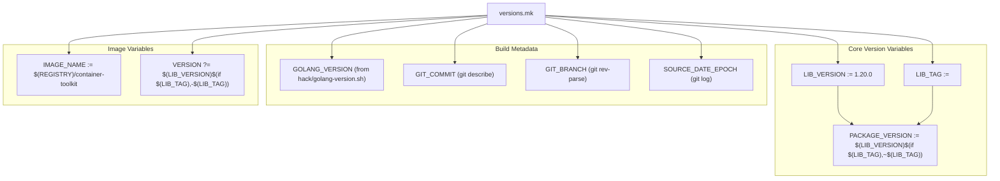
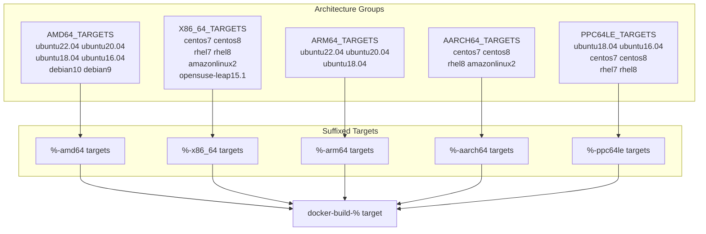
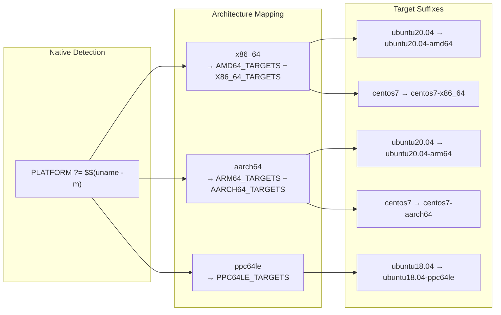
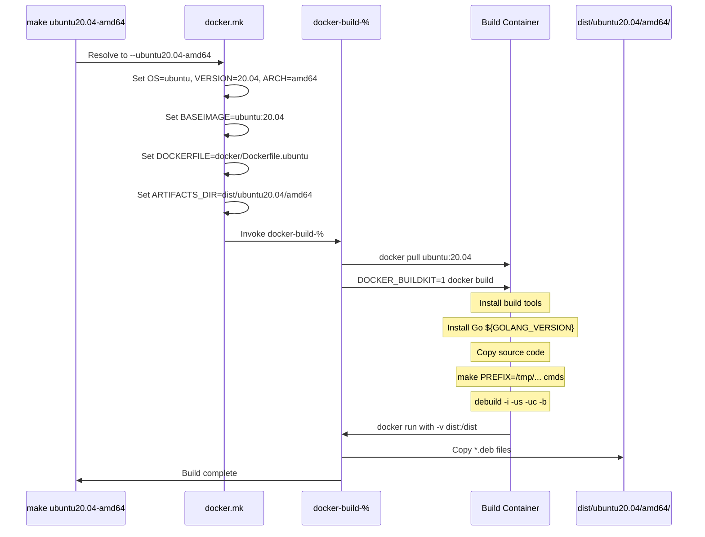
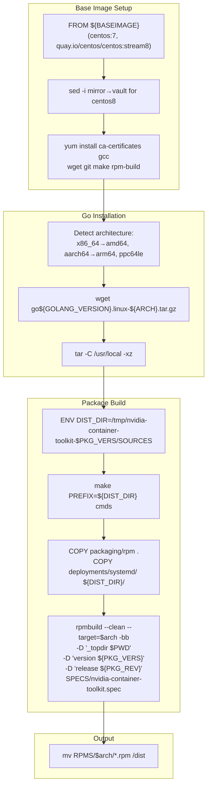
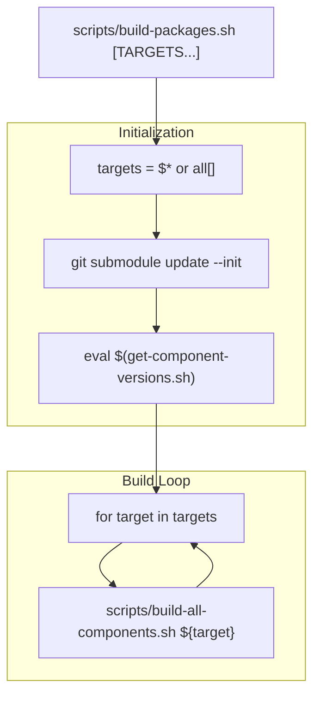
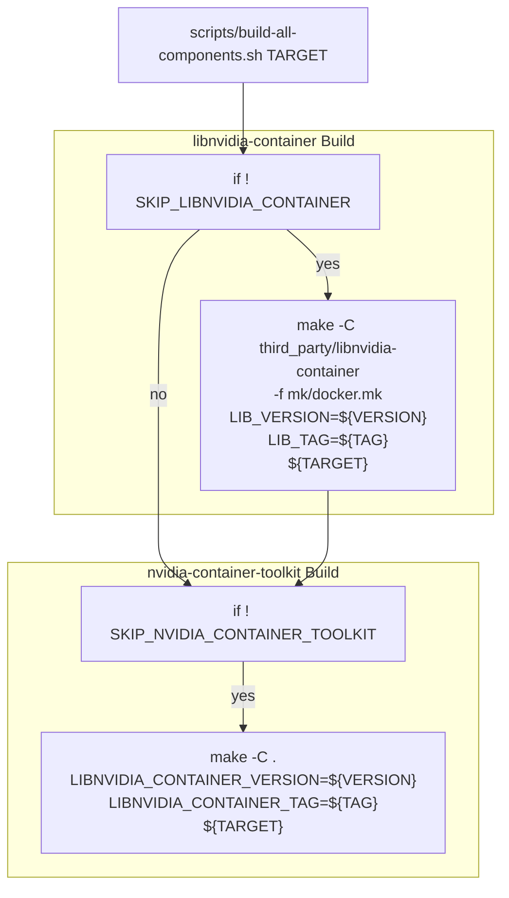

<!-- source: DeepWiki mcp.deepwiki.com · repo NVIDIA/nvidia-container-toolkit · page 5.1 Build System · fetched 2026-10-26 -->

# Build System

<details>
<summary>Relevant source files</summary>

The following files were used as context for generating this wiki page:

- [.gitmodules](.gitmodules)
- [CHANGELOG.md](CHANGELOG.md)
- [Makefile](Makefile)
- [deployments/systemd/90-nvidia-container-toolkit.preset](deployments/systemd/90-nvidia-container-toolkit.preset)
- [deployments/systemd/nvidia-cdi-refresh.env](deployments/systemd/nvidia-cdi-refresh.env)
- [deployments/systemd/nvidia-cdi-refresh.service](deployments/systemd/nvidia-cdi-refresh.service)
- [deployments/udev/99-nvidia-cdi-refresh.rules](deployments/udev/99-nvidia-cdi-refresh.rules)
- [docker/Dockerfile.debian](docker/Dockerfile.debian)
- [docker/Dockerfile.devel](docker/Dockerfile.devel)
- [docker/Dockerfile.opensuse-leap](docker/Dockerfile.opensuse-leap)
- [docker/Dockerfile.rpm-yum](docker/Dockerfile.rpm-yum)
- [docker/Dockerfile.ubuntu](docker/Dockerfile.ubuntu)
- [docker/docker.mk](docker/docker.mk)
- [packaging/debian/control](packaging/debian/control)
- [packaging/debian/nvidia-container-toolkit-base.install](packaging/debian/nvidia-container-toolkit-base.install)
- [packaging/debian/nvidia-container-toolkit-base.maintscript](packaging/debian/nvidia-container-toolkit-base.maintscript)
- [packaging/debian/nvidia-container-toolkit-base.postinst](packaging/debian/nvidia-container-toolkit-base.postinst)
- [packaging/debian/prepare](packaging/debian/prepare)
- [packaging/debian/rules](packaging/debian/rules)
- [packaging/rpm/SPECS/nvidia-container-toolkit.spec](packaging/rpm/SPECS/nvidia-container-toolkit.spec)
- [tests/e2e/nvidia-cdi-refresh_test.go](tests/e2e/nvidia-cdi-refresh_test.go)
- [versions.mk](versions.mk)

</details>


## Overview

The NVIDIA Container Toolkit uses a Makefile-based build system with Docker containerization for cross-platform package generation. The build system produces Go binaries and distribution packages (DEB/RPM) for multiple Linux distributions and CPU architectures.

Key components:
- `Makefile` - Main build orchestration and Go binary compilation
- `versions.mk` - Version number management and build metadata
- `docker/docker.mk` - Multi-platform Docker-based package builds
- `scripts/build-packages.sh` - High-level package build orchestration
- Distribution-specific Dockerfiles - Package generation for each OS

Sources: [Makefile:1-171](), [versions.mk:1-39](), [docker/docker.mk:1-145]()

## Version Management

The `versions.mk` file defines all version numbers and build metadata used throughout the build system.

**Title: Version Variable Definitions**


The `PACKAGE_VERSION` is computed as `LIB_VERSION` with an optional `~LIB_TAG` suffix (e.g., `1.20.0`). The `VERSION` variable uses `-` instead of `~` for Docker image tags (e.g., `1.20.0`).

Sources: [versions.mk:15-39]()

## Main Makefile Structure

The top-level `Makefile` provides targets for building Go binaries, running tests, and orchestrating Docker-based builds.

### Binary Build Targets

The `Makefile` defines the `cmd-%` pattern rule to build individual command binaries:

```makefile
cmd-%:
	go build -ldflags "-s -w '-extldflags=$(EXTLDFLAGS)' -X $(CLI_VERSION_PACKAGE).gitCommit=$(GIT_COMMIT) -X $(CLI_VERSION_PACKAGE).version=$(CLI_VERSION)" $(COMMAND_BUILD_OPTIONS) $(MODULE)/cmd/$(*)
```

This builds binaries for commands in the `cmd/` directory:
- `nvidia-container-runtime`
- `nvidia-container-runtime-hook`
- `nvidia-ctk`
- `nvidia-cdi-hook`

The `cmds` target builds all binaries, and `binaries` is an alias for `cmds`.

Sources: [Makefile:56-68]()

### Development Targets

| Target | Purpose |
|--------|---------|
| `build` | Compile all Go packages without producing binaries |
| `test` | Run unit tests with coverage |
| `lint` | Run golangci-lint on the codebase |
| `fmt` | Format code with gofmt |
| `vendor` | Update Go module vendor directory |
| `check-vendor` | Verify vendor directory matches go.mod/go.sum |
| `licenses` | Generate license report with go-licenses |

Sources: [Makefile:70-133]()

### Docker-Based Build Targets

The `Makefile` includes `docker/docker.mk`, which provides all `docker-*` targets for multi-platform builds. Any target can be prefixed with `docker-` to run it in a build container:

```makefile
$(DOCKER_TARGETS): docker-%:
	@echo "Running 'make $(*)' in container image $(BUILDIMAGE)"
	$(DOCKER) run \
		--rm \
		-e GOCACHE=/tmp/.cache/go \
		-e GOMODCACHE=/tmp/.cache/gomod \
		-e GOLANGCI_LINT_CACHE=/tmp/.cache/golangci-lint \
		-v $(PWD):/work \
		-w /work \
		--user $$(id -u):$$(id -g) \
		$(BUILDIMAGE) \
			make $(*)
```

For example, `make docker-lint` runs the `lint` target inside the `BUILDIMAGE` container.

Sources: [Makefile:24-25](), [Makefile:145-156]()

## Multi-Platform Package Builds (docker.mk)

The `docker/docker.mk` file implements the multi-platform Docker-based build system for generating distribution packages.

### Supported Distribution-Architecture Matrix

**Title: Distribution and Architecture Targets**


The build system defines targets in `docker/docker.mk`:
- `AMD64_TARGETS` - Debian/Ubuntu distributions for amd64
- `X86_64_TARGETS` - RPM distributions for x86_64
- `ARM64_TARGETS` - Debian/Ubuntu distributions for arm64
- `AARCH64_TARGETS` - RPM distributions for aarch64
- `PPC64LE_TARGETS` - All distributions for ppc64le

Sources: [docker/docker.mk:19-23]()

### Target Architecture Mapping

The build system maps distribution targets to architecture suffixes:

**Title: Target to Architecture Mapping**


For native builds, the `docker-native` target automatically selects the appropriate architecture targets based on `PLATFORM`. For example, on an x86_64 host, `make ubuntu20.04` expands to `make ubuntu20.04-amd64`.

Sources: [docker/docker.mk:35-46]()

### Docker Build Process

Each distribution-architecture target follows this pattern:

**Title: Docker Package Build Flow**


The private `--<dist>-<arch>` targets set variables for the build:
- `OS` - Distribution name (ubuntu, centos, debian, etc.)
- `VERSION` - Distribution version (20.04, 7, 8, etc.)
- `ARCH` - Target architecture (amd64, x86_64, arm64, aarch64, ppc64le)
- `BASEIMAGE` - Base Docker image for the build
- `DOCKERFILE` - Path to Dockerfile for this distribution type
- `ARTIFACTS_DIR` - Output directory for packages

Sources: [docker/docker.mk:86-120](), [docker/docker.mk:123-144]()

## Distribution-Specific Dockerfiles

Each distribution family has its own Dockerfile that handles package building.

### Debian/Ubuntu Dockerfile

`docker/Dockerfile.ubuntu` and `docker/Dockerfile.debian` build `.deb` packages:

**Title: Debian Package Build Stages**
```mermaid
flowchart TD
    subgraph "Base Image Setup"
        baseimage["FROM ${BASEIMAGE}<br/>(ubuntu:20.04)"]
        install_deps["apt-get install wget ca-certificates<br/>git build-essential dh-make<br/>fakeroot devscripts lsb-release"]
    end
    
    subgraph "Go Installation"
        detect_arch["Detect architecture:<br/>x86_64→amd64, aarch64→arm64, ppc64le"]
        download_go["wget go${GOLANG_VERSION}.linux-${ARCH}.tar.gz"]
        extract_go["tar -C /usr/local -xz"]
    end
    
    subgraph "Package Build"
        set_env["ENV DIST_DIR=/tmp/nvidia-container-toolkit-$PKG_VERS<br/>ENV REVISION=$PKG_VERS-$PKG_REV"]
        build_binaries["make PREFIX=${DIST_DIR} cmds"]
        copy_packaging["COPY packaging/debian ./debian<br/>COPY deployments/systemd/ ."]
        create_changelog["dch --create --package="${PKG_NAME}"<br/>--newversion "${REVISION}""]
        debuild["debuild -eDISTRIB -eSECTION -eVERSION="${REVISION}"<br/>--dpkg-buildpackage-hook='sh debian/prepare' -i -us -uc -b"]
    end
    
    subgraph "Output"
        move_packages["mv /tmp/*.deb /dist"]
    end
    
    baseimage --> install_deps
    install_deps --> detect_arch
    detect_arch --> download_go
    download_go --> extract_go
    extract_go --> set_env
    set_env --> build_binaries
    build_binaries --> copy_packaging
    copy_packaging --> create_changelog
    create_changelog --> debuild
    debuild --> move_packages
```

The `debuild` command:
1. Executes the `debian/prepare` script to substitute variables
2. Builds binary packages without signing (`-us -uc -b`)
3. Produces multiple `.deb` files (main package, base, operator-extensions)

Sources: [docker/Dockerfile.ubuntu:1-69](), [docker/Dockerfile.debian:1-71]()

### RPM Dockerfile

`docker/Dockerfile.rpm-yum` and `docker/Dockerfile.opensuse-leap` build `.rpm` packages:

**Title: RPM Package Build Stages**


The `rpmbuild` command:
1. Processes the spec file at `packaging/rpm/SPECS/nvidia-container-toolkit.spec`
2. Substitutes variables like `version`, `release`, `git_commit`, and `release_date`
3. Produces multiple `.rpm` files (main package, base, operator-extensions)

Sources: [docker/Dockerfile.rpm-yum:1-89](), [docker/Dockerfile.opensuse-leap:1-61](), [packaging/rpm/SPECS/nvidia-container-toolkit.spec:1-176]()

## Build Orchestration Scripts

Several shell scripts orchestrate the package build process.

### scripts/build-packages.sh

This is the main entry point for building packages for multiple distributions:

**Title: build-packages.sh Workflow**


The script:
1. Accepts optional distribution-architecture targets (e.g., `ubuntu18.04-amd64 centos7-x86_64`)
2. If no targets specified, builds all targets from `scripts/utils.sh:all[]`
3. Ensures git submodules are initialized (for `libnvidia-container`)
4. Exports version variables from `scripts/get-component-versions.sh`
5. Invokes `scripts/build-all-components.sh` for each target

Sources: `scripts/build-packages.sh` (not provided in full, but inferred from context)

### scripts/build-all-components.sh

This script builds both `libnvidia-container` and `nvidia-container-toolkit` for a single target:

**Title: build-all-components.sh Flow**


The script:
1. Reads `DIST_DIR` (default: `./dist`) for output location
2. Builds `libnvidia-container` from the git submodule at `third_party/libnvidia-container`
3. Builds `nvidia-container-toolkit` from the current repository
4. Both components output to the same `DIST_DIR` structure

Sources: `scripts/build-all-components.sh` (not provided in full, but inferred from context)

### scripts/get-component-versions.sh

This helper script extracts version information from `versions.mk`:

```bash
nvidia_container_toolkit_version=$(grep -m 1 "^LIB_VERSION := " versions.mk | sed ...)
nvidia_container_toolkit_tag=$(grep -m 1 "^LIB_TAG .= " versions.mk | sed ...)
nvidia_container_toolkit_version_tag="${version}${tag:+~${tag}}"
```

It outputs three environment variables:
- `NVIDIA_CONTAINER_TOOLKIT_VERSION` - The numeric version (e.g., `1.20.0`)
- `NVIDIA_CONTAINER_TOOLKIT_TAG` - The optional tag (e.g., `rc.1`)
- `NVIDIA_CONTAINER_TOOLKIT_PACKAGE_VERSION` - Combined with `~` separator (e.g., `1.20.0~rc.1`)

Sources: `scripts/get-component-versions.sh` (not provided in full, but inferred from context)

## Building from Source

### Prerequisites

To build the NVIDIA Container Toolkit from source, you need:

1. **Git** - For cloning the repository and managing submodules
2. **Go** - Version specified in `versions.mk` (retrieved via `hack/golang-version.sh`)
3. **Docker** - For Docker-based builds (optional but recommended)
4. **Make** - Build orchestration

For development builds without Docker:
- On Debian/Ubuntu: `apt-get install build-essential`
- On RPM-based: `yum install gcc make`

Sources: [versions.mk:24]()

### Local Binary Builds

To build just the Go binaries locally without creating packages:

```bash
# Build all binaries to current directory
make cmds

# Build to a specific output directory
make PREFIX=/usr/local cmds

# Build a specific binary
make cmd-nvidia-ctk
make cmd-nvidia-container-runtime
make cmd-nvidia-container-runtime-hook
make cmd-nvidia-cdi-hook
```

The binaries are statically linked with CGO disabled and include version information:

```bash
# The ldflags inject version metadata
-ldflags "-s -w -X github.com/NVIDIA/nvidia-container-toolkit/internal/info.gitCommit=${GIT_COMMIT} -X ...version=${CLI_VERSION}"
```

Sources: [Makefile:56-68]()

### Docker-Based Package Builds

To build distribution packages using Docker (recommended):

```bash
# Build for a specific distribution and architecture
make ubuntu20.04-amd64
make centos7-x86_64

# Build for all architectures of a distribution (native platform)
make ubuntu20.04
make centos7

# Build for specific architecture across all distributions
make docker-amd64
make docker-arm64
make docker-ppc64le

# Build for all supported targets
make docker-all
```

Packages are generated in `dist/<distribution>/<architecture>/`.

Sources: [docker/docker.mk:47-84]()

### Using build-packages.sh

The `scripts/build-packages.sh` script is the recommended way to build packages including `libnvidia-container`:

```bash
# Build default targets (ubuntu18.04-amd64, centos7-x86_64, etc.)
./scripts/build-packages.sh

# Build specific targets
./scripts/build-packages.sh ubuntu20.04-amd64 centos8-x86_64

# Build with custom DIST_DIR
DIST_DIR=/tmp/packages ./scripts/build-packages.sh ubuntu20.04-amd64
```

This script:
1. Initializes the `libnvidia-container` submodule
2. Builds both `libnvidia-container` and `nvidia-container-toolkit`
3. Outputs packages to the same `dist/` directory structure

Sources: `scripts/build-packages.sh` (not provided in full, but inferred from context)

### Development Container

For consistent development environments, use the `.build-image` target:

```bash
# Build the development container image
make BUILD_DEVEL_IMAGE=yes .build-image

# Start an interactive shell in the development container
make .shell

# Run make targets in the container
make docker-test
make docker-lint
make docker-build
```

The development image (defined in `docker/Dockerfile.devel`) includes:
- Go toolchain
- `golangci-lint` for linting
- `moq` for mock generation
- `go-licenses` for license checking
- Other development tools

Sources: [Makefile:149-170]()

### Cross-Platform Builds

To build for a different architecture than your host:

```bash
# On x86_64, build for arm64
make ubuntu20.04-arm64

# On x86_64, build for ppc64le
make centos8-ppc64le
```

Docker's `--platform` flag enables cross-platform builds using QEMU emulation. The Dockerfiles detect the target architecture and download the appropriate Go toolchain:

```dockerfile
arch="$(uname -m)"
case "${arch##*-}" in
    x86_64 | amd64) ARCH='amd64' ;;
    ppc64el | ppc64le) ARCH='ppc64le' ;;
    aarch64 | arm64) ARCH='arm64' ;;
esac
wget https://go.dev/dl/go${GOLANG_VERSION}.linux-${ARCH}.tar.gz
```

Sources: [docker/Dockerfile.ubuntu:17-27](), [docker/docker.mk:123-135]()

### Cleaning Build Artifacts

```bash
# Remove all built images
make docker-clean

# Remove all generated packages
make distclean
```

Sources: [docker/docker.mk:146-153]()

## Building Locally

To build packages locally, you can use the Makefile targets:

```bash
# Build for all supported distributions and architectures
make docker-all

# Build for a specific distribution (native architecture)
make ubuntu20.04

# Build for a specific distribution and architecture
make ubuntu20.04-amd64

# Build for all distributions on a specific architecture
make docker-amd64
```

Sources: [docker/docker.mk:47-84]()

## Conclusion

The NVIDIA Container Toolkit build system provides a flexible and consistent way to build packages for multiple Linux distributions and CPU architectures. By using Docker containers for building, it ensures that packages are built in clean, reproducible environments with the correct tools and dependencies for each target platform.

This approach allows the toolkit to be widely available across the diverse landscape of systems where NVIDIA GPUs are used, from x86_64 servers to ARM64 edge devices and PowerPC high-performance systems.

---

