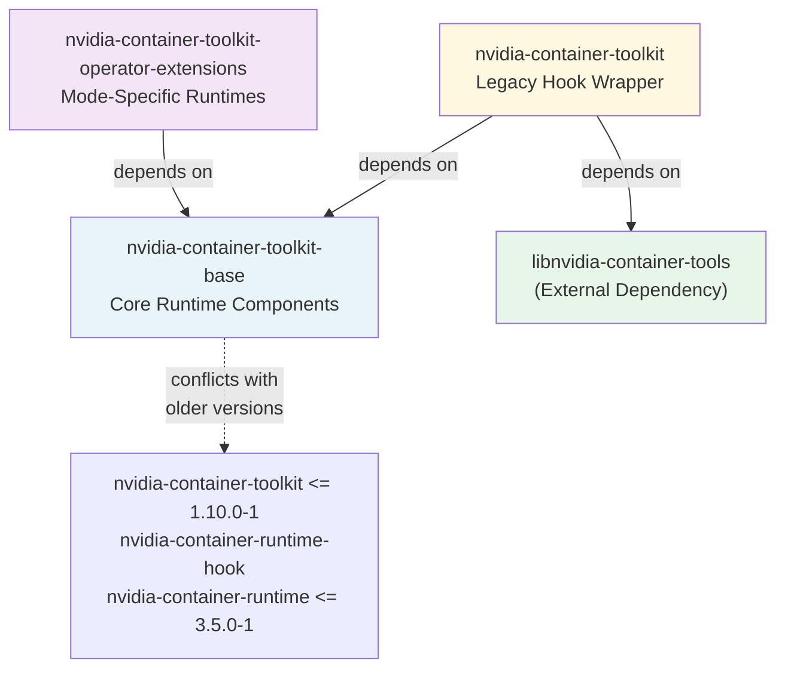
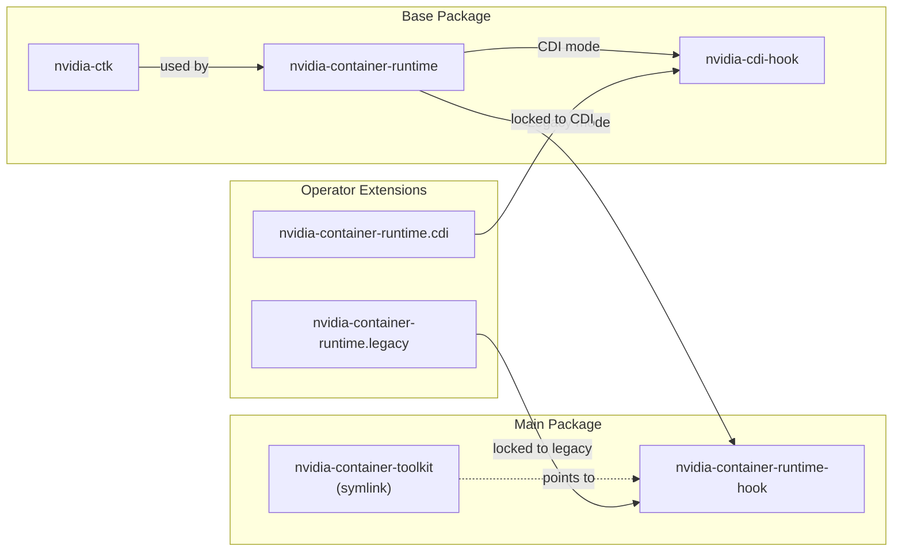
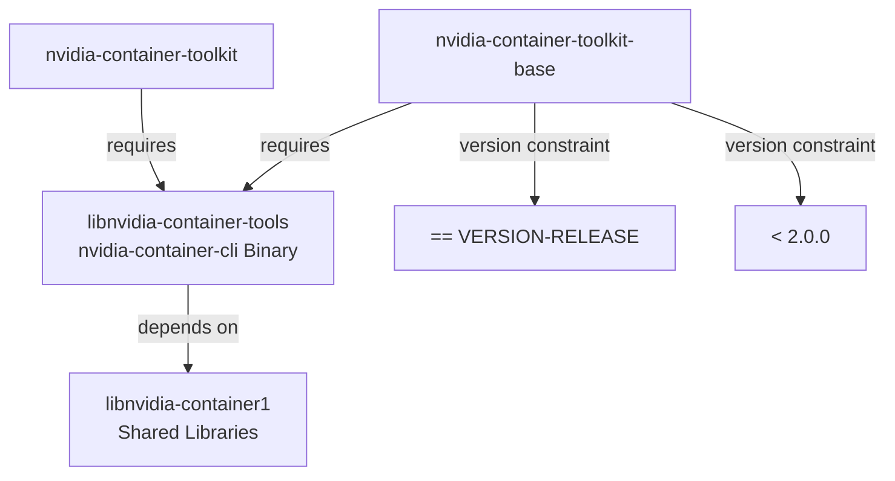
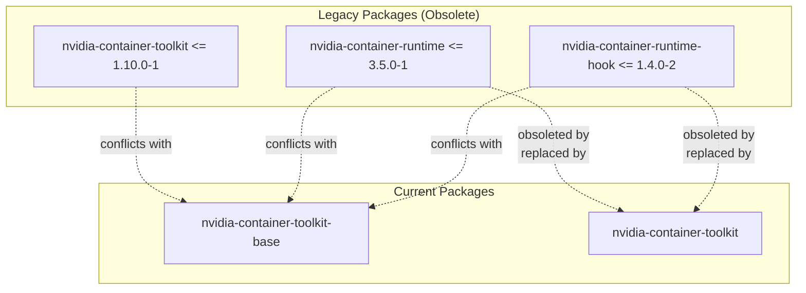
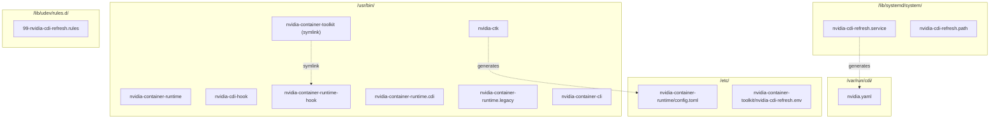
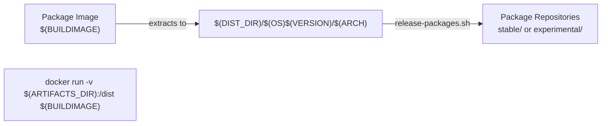

<!-- source: DeepWiki mcp.deepwiki.com · repo NVIDIA/nvidia-container-toolkit · page 5.2 Package Structure · fetched 2026-10-26 -->

# Package Structure

<details>
<summary>Relevant source files</summary>

The following files were used as context for generating this wiki page:

- [deployments/systemd/nvidia-cdi-refresh.env](deployments/systemd/nvidia-cdi-refresh.env)
- [deployments/systemd/nvidia-cdi-refresh.service](deployments/systemd/nvidia-cdi-refresh.service)
- [deployments/udev/99-nvidia-cdi-refresh.rules](deployments/udev/99-nvidia-cdi-refresh.rules)
- [docker/Dockerfile.debian](docker/Dockerfile.debian)
- [docker/Dockerfile.opensuse-leap](docker/Dockerfile.opensuse-leap)
- [docker/Dockerfile.rpm-yum](docker/Dockerfile.rpm-yum)
- [docker/Dockerfile.ubuntu](docker/Dockerfile.ubuntu)
- [docker/docker.mk](docker/docker.mk)
- [packaging/debian/copyright](packaging/debian/copyright)
- [packaging/debian/nvidia-container-toolkit-base.install](packaging/debian/nvidia-container-toolkit-base.install)
- [packaging/debian/nvidia-container-toolkit-base.postinst](packaging/debian/nvidia-container-toolkit-base.postinst)
- [packaging/debian/nvidia-container-toolkit.install](packaging/debian/nvidia-container-toolkit.install)
- [packaging/debian/nvidia-container-toolkit.postinst](packaging/debian/nvidia-container-toolkit.postinst)
- [packaging/debian/nvidia-container-toolkit.postrm](packaging/debian/nvidia-container-toolkit.postrm)
- [packaging/debian/rules](packaging/debian/rules)
- [packaging/rpm/SOURCES/LICENSE](packaging/rpm/SOURCES/LICENSE)
- [tests/e2e/nvidia-cdi-refresh_test.go](tests/e2e/nvidia-cdi-refresh_test.go)

</details>


## Purpose and Scope

This document describes the three-tier package hierarchy of the NVIDIA Container Toolkit: the base package, main package, and operator-extensions package. It covers the contents of each package, their dependency relationships, and distribution strategy. For information about how these packages are built, see [Build System](#5.1). For details on container images that bundle these packages, see [Container Images](#5.3).

---

## Package Hierarchy Overview

The NVIDIA Container Toolkit is distributed as three distinct packages with a layered dependency structure. This separation enables flexible deployment scenarios: minimal installations for basic GPU support, backward-compatible installations for legacy systems, and Kubernetes-specific installations for operator-managed environments.

### Three-Tier Package Architecture



**Package Hierarchy Diagram**: Shows the three-tier structure with base, main, and operator-extensions packages. The base package is self-sufficient for modern CDI mode, the main package adds legacy compatibility, and operator-extensions provides mode-specific runtime binaries for Kubernetes.

Sources: [docker/Dockerfile.debian:35-40](), [docker/Dockerfile.opensuse-leap:29-34](), [docker/Dockerfile.rpm-yum:56-61]()

---

## Package Contents and File Manifests

Each package contains specific binaries, configuration files, and system integration components. The following table details the complete file manifest:

| Package | Binaries | Configuration Files | System Services | Key Functionality |
|---------|----------|---------------------|-----------------|-------------------|
| **nvidia-container-toolkit-base** | `nvidia-container-runtime`<br/>`nvidia-ctk`<br/>`nvidia-cdi-hook` | `nvidia-cdi-refresh.env` | `nvidia-cdi-refresh.service`<br/>`nvidia-cdi-refresh.path` | Core runtime wrapper, CLI tool, CDI hooks, automatic CDI refresh |
| **nvidia-container-toolkit** | `nvidia-container-runtime-hook` | - | - | Legacy prestart hook, symlink to `nvidia-container-toolkit` |
| **nvidia-container-toolkit-operator-extensions** | `nvidia-container-runtime.cdi`<br/>`nvidia-container-runtime.legacy` | - | - | Mode-locked runtime binaries for Kubernetes operator |

Sources: [packaging/debian/nvidia-container-toolkit-base.install:1-7](), [packaging/debian/nvidia-container-toolkit.install:1]()

### Binary Distribution Across Packages



**Binary Distribution Diagram**: Maps binaries to their containing packages. The base package provides the core runtime and CLI, the main package provides the legacy hook, and operator-extensions provides mode-locked runtime variants.

Sources: [packaging/debian/nvidia-container-toolkit-base.install:1-3](), [packaging/debian/nvidia-container-toolkit.install:1]()

---

## Dependency Relationships

### External and Internal Dependencies

The base package has a critical external dependency on `libnvidia-container-tools`, which provides the `nvidia-container-cli` binary for low-level GPU configuration. This is a separate component built from the `third_party/libnvidia-container` submodule and packaged independently.

**libnvidia-container Package Hierarchy**:



**Dependency Specifications**:

**Base Package Dependencies**:
- `libnvidia-container-tools == VERSION-RELEASE` (exact version match)
- `libnvidia-container-tools < 2.0.0` (forward compatibility limit)

**Main Package Dependencies**:
- `nvidia-container-toolkit-base == VERSION-RELEASE` (exact version match)
- `libnvidia-container-tools == VERSION-RELEASE` (inherited requirement)

**Operator Extensions Dependencies**:
- `nvidia-container-toolkit-base == VERSION-RELEASE` (exact version match)

The exact version matching ensures that all components are upgraded atomically, preventing version skew issues. The `< 2.0.0` constraint provides a forward compatibility boundary for major version upgrades.

Sources: [docker/Dockerfile.debian:62-63](), [docker/Dockerfile.ubuntu:62-63]()

### Package Conflicts and Replacements

The package structure enforces clean upgrades from legacy package names:



**Package Upgrade Path**: Shows how current packages obsolete and replace legacy package names. The base package conflicts with old toolkit versions to prevent file collisions during upgrades.

Sources: No direct file citations for this section in the provided content.

---

## Installation Layout and Filesystem Structure

### Complete Filesystem Layout

After installation, the NVIDIA Container Toolkit components are distributed across the following filesystem locations:



**Installation Paths by Package**:

| Path | Package | Purpose |
|------|---------|---------|
| `/usr/bin/nvidia-container-runtime` | base | OCI runtime wrapper |
| `/usr/bin/nvidia-ctk` | base | CLI tool for configuration and CDI generation |
| `/usr/bin/nvidia-cdi-hook` | base | CDI lifecycle hook executor |
| `/usr/bin/nvidia-container-runtime-hook` | main | Legacy prestart hook |
| `/usr/bin/nvidia-container-toolkit` | main | Symlink for backward compatibility |
| `/usr/bin/nvidia-container-runtime.cdi` | operator-extensions | CDI mode-locked runtime |
| `/usr/bin/nvidia-container-runtime.legacy` | operator-extensions | Legacy mode-locked runtime |
| `/usr/bin/nvidia-container-cli` | libnvidia-container-tools | Low-level GPU configuration CLI |
| `/etc/nvidia-container-runtime/config.toml` | base (generated) | Runtime configuration file |
| `/etc/nvidia-container-toolkit/nvidia-cdi-refresh.env` | base | Environment variables for CDI refresh service |
| `/lib/systemd/system/nvidia-cdi-refresh.service` | base | Systemd service for CDI regeneration |
| `/lib/systemd/system/nvidia-cdi-refresh.path` | base | Systemd path unit for watching driver changes |
| `/lib/udev/rules.d/99-nvidia-cdi-refresh.rules` | base | Udev rules for triggering CDI refresh |
| `/var/run/cdi/nvidia.yaml` | base (generated) | CDI specification file |

Sources: [packaging/debian/nvidia-container-toolkit-base.install:1-7](), [packaging/debian/nvidia-container-toolkit.install:1](), [deployments/systemd/nvidia-cdi-refresh.service:28](), [deployments/systemd/nvidia-cdi-refresh.env:1-29](), [deployments/udev/99-nvidia-cdi-refresh.rules:1-19]()

---

## Package Installation Behavior

### Post-Installation Actions

Each package performs specific actions during installation to ensure proper system integration:

**Base Package Post-Install** ([packaging/debian/nvidia-container-toolkit-base.postinst:1-27]()):
1. **Generate Default Configuration**: 
   - Executes: `/usr/bin/nvidia-ctk --quiet config --config-file=/etc/nvidia-container-runtime/config.toml --in-place` [packaging/debian/nvidia-container-toolkit-base.postinst:6]()
   - Creates `/etc/nvidia-container-runtime/config.toml` with defaults if it doesn't exist
   - No-op if file already exists (preserves user modifications)

2. **Reload udev rules**:
   - Executes: `udevadm control --reload-rules` [packaging/debian/nvidia-container-toolkit-base.postinst:12]()
   - Ensures `99-nvidia-cdi-refresh.rules` take effect.

**Main Package Post-Install**:
- No direct file citations for this section in the provided content.

**Debian Package Post-Install** ([packaging/debian/nvidia-container-toolkit-base.postinst:1-27]()):
- The `nvidia-container-toolkit-base.postinst` script handles configuration and udev rule reloading.
- The `nvidia-cdi-refresh.service` is responsible for generating the CDI specification file. [deployments/systemd/nvidia-cdi-refresh.service:39]()
- The `nvidia-cdi-refresh.path` unit watches for changes to trigger the service. [tests/e2e/nvidia-cdi-refresh_test.go:126]()

Sources: [packaging/debian/nvidia-container-toolkit-base.postinst:1-27](), [deployments/systemd/nvidia-cdi-refresh.service:1-46](), [tests/e2e/nvidia-cdi-refresh_test.go:126]()

---

## Distribution Strategy and Release Targets

### Build Targets and Platform Support

The toolkit is built for multiple distribution-architecture combinations. Build targets are defined in the `docker.mk` file:

```makefile
# docker/docker.mk:19-24
AMD64_TARGETS := ubuntu22.04 ubuntu20.04 ubuntu18.04 ubuntu16.04 debian10 debian9
X86_64_TARGETS := centos7 centos8 rhel7 rhel8 amazonlinux2 opensuse-leap15.1
PPC64LE_TARGETS := ubuntu18.04 ubuntu16.04 centos7 centos8 rhel7 rhel8
ARM64_TARGETS := ubuntu22.04 ubuntu20.04 ubuntu18.04
AARCH64_TARGETS := centos7 centos8 rhel8 amazonlinux2
```

These targets are used to build packages for all supported platforms. The build process involves:
1. Pulling the base image for the target platform [docker/docker.mk:125]()
2. Building the toolkit within a Docker container [docker/docker.mk:126-137]()
3. Running the container to generate artifacts [docker/docker.mk:139-144]()

### Package Distribution Matrix

Not all packages are distributed through all channels. The following matrix shows distribution decisions:

| Package | Stable Repository | Experimental Repository | Kitmaker Archives | Kubernetes Operator |
|---------|-------------------|-------------------------|-------------------|---------------------|
| **libnvidia-container1** | ✓ Yes | ✓ Yes | ✓ Yes | ✓ Bundled in container |
| **libnvidia-container-tools** | ✓ Yes | ✓ Yes | ✓ Yes | ✓ Bundled in container |
| **nvidia-container-toolkit-base** | ✓ Yes | ✓ Yes | ✓ Yes | ✓ Bundled in container |
| **nvidia-container-toolkit** | ✓ Yes | ✓ Yes | ✓ Yes | ✓ Bundled in container |
| **nvidia-container-toolkit-operator-extensions** | ✗ No | ✗ No | ✗ No | ✓ Yes (exclusive) |

The operator-extensions package is **explicitly excluded** from public package repositories and is only distributed via the toolkit container image for use with the GPU Operator.

### Package Extraction and Publishing

The release process extracts packages from a container image:



The extraction process is handled by the `docker run` command in the `docker-build-%` target, which mounts the `ARTIFACTS_DIR` into the container and copies the generated packages. [docker/docker.mk:139-144]()

### Package Filtering Logic

The release process includes filtering logic to prevent unintended distribution:

**Release Candidate Filtering**:
No direct file citations for this section in the provided content.

Sources: [docker/docker.mk:19-24](), [docker/docker.mk:123-144]()

---

## Platform-Specific Package Formats

The toolkit is distributed as both DEB (Debian/Ubuntu) and RPM (CentOS/RHEL/Fedora) packages with identical logical structure but different packaging conventions:

### Architectural Differences

| Aspect | RPM Packages | DEB Packages |
|--------|--------------|--------------|
| **Architecture Names** | `x86_64`, `aarch64`, `ppc64le` | `amd64`, `arm64`, `ppc64el` |
| **Version Separator** | Tilde (`~`) for pre-releases | Tilde (`~`) for pre-releases |
| **Post-Install Scripting** | `%post`, `%posttrans`, `%postun` | `postinst`, `prerm`, `postrm` |
| **File Preservation** | Uses RPM state directory | Uses dpkg diversions |
| **Config File Handling** | `%config(noreplace)` | `conffiles` declaration |

Both package formats maintain identical file layouts under `/usr/bin` and `/etc/nvidia-container-toolkit`, ensuring consistent behavior across distributions.

Sources: [docker/Dockerfile.debian:22-26](), [docker/Dockerfile.opensuse-leap:18-22](), [docker/Dockerfile.rpm-yum:43-47](), [packaging/debian/rules:9-19]()

---

## Package Version Management

### Version Components

Package versions follow a structured format defined in the build process:

**Version Construction**:
- `PKG_VERS`: Semantic version (e.g., `1.19.0`) [docker/Dockerfile.debian:36]()
- `PKG_REV`: Packaging revision (e.g., `1`) [docker/Dockerfile.debian:37]()
- `REVISION`: Combined version and revision (e.g., `1.19.0-1`) [docker/Dockerfile.debian:39]()

**Example**: For `PKG_VERS=1.19.0` and `PKG_REV=1`, the final package version becomes `1.19.0-1`.

### Version Extraction and Propagation

The version is extracted and used throughout the build system:
- Passed as build arguments to Dockerfiles [docker/docker.mk:133-135]()
- Used in `dch` command for Debian changelog generation [docker/Dockerfile.debian:60]()
- Used in `rpmbuild` command for RPM spec file [docker/Dockerfile.opensuse-leap:58-59]()

### Version Synchronization Requirement

All three packages (base, main, operator-extensions) **must** have matching `VERSION-RELEASE` identifiers. This is enforced through exact version dependencies:

**Dependency Constraints**:
- `nvidia-container-toolkit` → requires `nvidia-container-toolkit-base == VERSION-RELEASE`
- `nvidia-container-toolkit-operator-extensions` → requires `nvidia-container-toolkit-base == VERSION-RELEASE`
- `nvidia-container-toolkit` → requires `libnvidia-container-tools == VERSION-RELEASE`

This strict version locking prevents version skew between components and ensures all packages are upgraded atomically. The version constraint is checked during package installation by the package manager (rpm/dpkg).

Sources: [docker/Dockerfile.debian:36-39](), [docker/Dockerfile.debian:60]() [docker/Dockerfile.opensuse-leap:30-31](), [docker/Dockerfile.opensuse-leap:58-59](), [docker/Dockerfile.rpm-yum:57-58]()

---

## Historical Context: Package Structure Evolution

The current three-tier structure was introduced in version 1.11.0 (circa late 2022) to address several architectural needs:

### Evolution Timeline

1. **Pre-1.11.0**: Monolithic `nvidia-container-toolkit` package containing all components
2. **v1.11.0-rc.1**: Introduction of `nvidia-container-toolkit-base` package for better dependency management
3. **v1.13.0-rc.2**: Addition of mode-specific runtime binaries (`.cdi`, `.legacy`) for GPU Operator
4. **v1.15.0**: Removal of legacy `nvidia-container-runtime` and `nvidia-docker2` standalone packages

### Rationale for Separation

**Base Package Introduction**:
- Enables minimal installations that only need core runtime and CLI
- Reduces dependencies for systems using only CDI mode
- Provides clean separation for systemd service management

**Main Package Preservation**:
- Maintains backward compatibility with existing deployments expecting `nvidia-container-toolkit` command
- Preserves legacy hook functionality for pre-CDI container runtimes
- Ensures smooth upgrade path from older versions

**Operator Extensions Addition**:
- Provides mode-locked runtime binaries that bypass auto-detection
- Enables explicit mode selection by Kubernetes operator
- Prevents accidental mode changes in managed environments
- Never distributed publicly to avoid confusion

Sources: No direct file citations for this section in the provided content.

---

## Summary

The NVIDIA Container Toolkit's three-tier package structure provides flexibility for different deployment scenarios while maintaining strict version synchronization. The base package provides core functionality for modern CDI-based deployments, the main package adds legacy compatibility, and the operator-extensions package enables Kubernetes-specific use cases. This architecture supports both minimal installations and full-featured deployments while ensuring clean upgrades from legacy package names.

---

