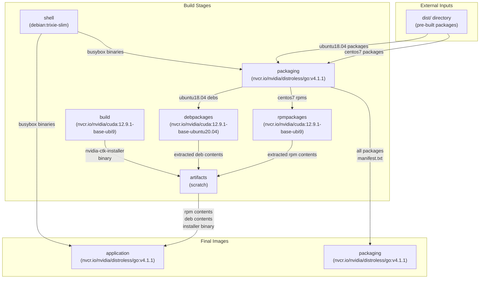
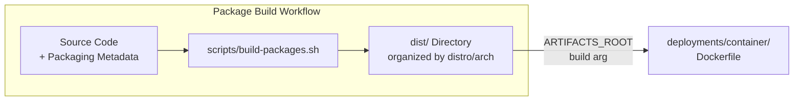
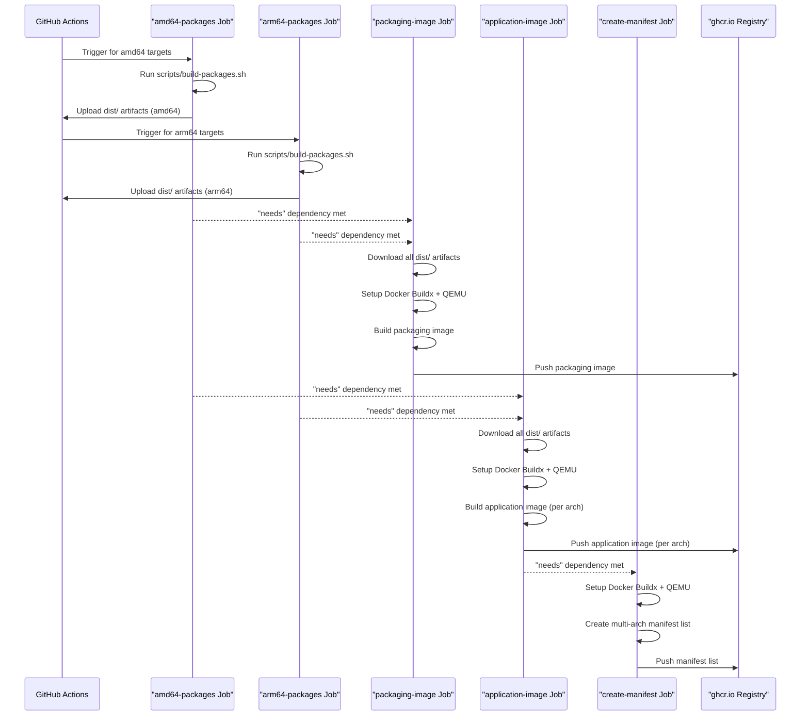

<!-- source: DeepWiki mcp.deepwiki.com · repo NVIDIA/nvidia-container-toolkit · page 5.3 Container Images · fetched 2026-10-26 -->

# Container Images

<details>
<summary>Relevant source files</summary>

The following files were used as context for generating this wiki page:

- [.dockerignore](.dockerignore)
- [.github/workflows/code_scanning.yaml](.github/workflows/code_scanning.yaml)
- [.github/workflows/e2e.yaml](.github/workflows/e2e.yaml)
- [.github/workflows/golang.yaml](.github/workflows/golang.yaml)
- [.github/workflows/image.yaml](.github/workflows/image.yaml)
- [cmd/nvidia-ctk-installer/container/runtime/nri/plugin.go](cmd/nvidia-ctk-installer/container/runtime/nri/plugin.go)
- [cmd/nvidia-ctk-installer/container/runtime/nri/plugin_test.go](cmd/nvidia-ctk-installer/container/runtime/nri/plugin_test.go)
- [cmd/nvidia-ctk-installer/main.go](cmd/nvidia-ctk-installer/main.go)
- [cmd/nvidia-ctk-installer/main_test.go](cmd/nvidia-ctk-installer/main_test.go)
- [deployments/container/Dockerfile](deployments/container/Dockerfile)
- [deployments/container/Dockerfile.rpmrebuild](deployments/container/Dockerfile.rpmrebuild)
- [deployments/container/Makefile](deployments/container/Makefile)
- [deployments/container/multi-arch.mk](deployments/container/multi-arch.mk)
- [deployments/container/native-only.mk](deployments/container/native-only.mk)
- [scripts/repackage-rpms.sh](scripts/repackage-rpms.sh)
- [tests/e2e/infra/driver-branch-580.yaml](tests/e2e/infra/driver-branch-580.yaml)
- [tests/e2e/infra/driver-branch-595.yaml](tests/e2e/infra/driver-branch-595.yaml)

</details>


This document describes the container images produced by the NVIDIA Container Toolkit build system. It covers the multi-stage Dockerfile structure, the distinction between `application` and `packaging` images, package extraction and bundling, multi-architecture build support, and how these images are used for toolkit installation.

For information about the overall build system and Makefile structure, see [Build System](#5.1). For details on the package hierarchy and installation layout, see [Package Structure](#5.2).

---

## Image Types

The toolkit produces two primary container image variants, each serving a distinct purpose in the distribution and installation pipeline.

### Application Image

The `application` image serves as the GPU Operator operand and contains the toolkit installation binaries. This image is tagged without suffix and is the default target for builds.

**Contents:**
- Extracted deb packages from `ubuntu18.04` for both amd64 and arm64 architectures
- Extracted rpm packages from `centos7` for x86_64 and aarch64 architectures
- `nvidia-ctk-installer` binary (also symlinked as `nvidia-toolkit` for backward compatibility)

**Base Image:** `nvcr.io/nvidia/distroless/go:v4.1.1` [deployments/container/Dockerfile:171]()

**Entrypoint:** `/work/nvidia-ctk-installer` [deployments/container/Dockerfile:187]()

The application image is designed for daemonset-based installation in Kubernetes environments, particularly with the NVIDIA GPU Operator. When run, the installer binary detects the host distribution and installs the appropriate packages.

### Packaging Image

The `packaging` image contains all built packages for distribution purposes, including the manifest of packages and build metadata.

**Contents:**
- Complete set of deb packages for `ubuntu18.04` across all architectures
- Complete set of rpm packages for `centos7` across all architectures
- `manifest.txt` file listing all package paths and build variables

**Base Image:** `nvcr.io/nvidia/distroless/go:v4.1.1` [deployments/container/Dockerfile:69]()

This image is used for extracting packages in CI/CD pipelines and for archiving complete release artifacts.

**Sources:** [deployments/container/Dockerfile:1-210](), [deployments/container/Makefile:42-70]()

---

## Multi-Stage Build Architecture

The container build uses a multi-stage Dockerfile to separate concerns and optimize the final image size. Each stage has a specific responsibility in the build pipeline.



**Sources:** [deployments/container/Dockerfile:19-210]()

### Build Stage Details

#### build Stage

Compiles the `nvidia-ctk-installer` binary from Go source code.

**Key Operations:**
- Installs Go toolchain matching `GOLANG_VERSION` argument [deployments/container/Dockerfile:28-39]()
- Copies source code into `/build` [deployments/container/Dockerfile:49]()
- Builds `nvidia-ctk-installer` with version metadata [deployments/container/Dockerfile:54]()
- Outputs binary to `/artifacts/bin`

**Build Command:**
```bash
make PREFIX=/artifacts/bin cmd-nvidia-ctk-installer
```

**Sources:** [deployments/container/Dockerfile:19-54]()

#### shell Stage

Builds a static busybox layout for the distroless base images. This provides essential shell utilities (`sh`, `rm`, `ln`, `sleep`, `cat`, etc.) that are required by init-container wrappers and lifecycle hooks, which would otherwise be missing in a distroless image.

**Key Operations:**
- Installs `busybox-static` on a `debian:trixie-slim` base [deployments/container/Dockerfile:60-61]()
- Copies the `busybox` binary to `/busybox` [deployments/container/Dockerfile:63]()
- Creates symlinks for common commands in `/busybox` [deployments/container/Dockerfile:64]()

**Sources:** [deployments/container/Dockerfile:58-65]()

#### packaging Stage

Aggregates all packages and generates a manifest.

**Manifest Contents:**
- Image build epoch timestamp
- All environment variables from build (prefixed with `#`)
- Absolute paths to all `.deb` and `.rpm` files

**Manifest Generation:**
```bash
echo "#IMAGE_EPOCH=$(date '+%s')" > /artifacts/manifest.txt && \
    env | sed 's/^/#/g' >> /artifacts/manifest.txt && \
    find /artifacts/packages -iname '*.deb' -o -iname '*.rpm' >> /artifacts/manifest.txt
```
[deployments/container/Dockerfile:90-93]()

**Sources:** [deployments/container/Dockerfile:69-111]()

#### debpackages and rpmpackages Stages

Extract package contents for direct file access in the application image.

**Extraction Logic:**

For deb packages:
```bash
for p in $(ls /deb-packages/${ARCH}/*.deb); do
    dpkg-deb -xv $p /artifacts/deb/;
done
```
[deployments/container/Dockerfile:132-134]()

For rpm packages:
```bash
for p in $(ls /rpm-packages/${ARCH}/*.rpm); do
    rpm2cpio $p | cpio -idmv -D /artifacts/rpm;
done
```
[deployments/container/Dockerfile:155-157]()

Architecture detection uses `TARGETARCH` build argument to select appropriate packages [deployments/container/Dockerfile:128-131](), [deployments/container/Dockerfile:151-154]().

**Sources:** [deployments/container/Dockerfile:114-161]()

#### artifacts Stage

Intermediate scratch-based stage that collects:
- Extracted RPM contents at `/artifacts/rpm`
- Extracted deb contents at `/artifacts/deb`
- `nvidia-ctk-installer` binary at `/artifacts/build`

**Sources:** [deployments/container/Dockerfile:163-172]()

---

## Package Integration

The container images integrate pre-built packages from the `dist/` directory, which are created by the package build system.

### Package Build Process



**Sources:** [.github/workflows/image.yaml:47-51](), [.github/workflows/image.yaml:81-85]()

### Package Distribution Layout

The `dist/` directory is organized by distribution and architecture:

```
dist/
├── ubuntu18.04/
│   ├── amd64/
│   │   ├── nvidia-container-toolkit_*.deb
│   │   ├── nvidia-container-toolkit-base_*.deb
│   │   ├── libnvidia-container1_*.deb
│   │   └── libnvidia-container-tools_*.deb
│   └── arm64/
│       └── (same packages)
└── centos7/
    ├── x86_64/
    │   ├── nvidia-container-toolkit-*.rpm
    │   ├── nvidia-container-toolkit-base-*.rpm
    │   ├── libnvidia-container1-*.rpm
    │   └── libnvidia-container-tools-*.rpm
    └── aarch64/
        └── (same packages)
```

**Configuration:**

The default distributions for package extraction are set in the Makefile:
- `PACKAGE_DIST_DEB = ubuntu18.04` [deployments/container/Makefile:99]()
- `PACKAGE_DIST_RPM = centos7` [deployments/container/Makefile:101]()

These distributions are chosen for maximum compatibility across different Linux distributions.

**Sources:** [deployments/container/Makefile:99-101](), [deployments/container/Dockerfile:125-126](), [deployments/container/Dockerfile:148-149]()

---

## Multi-Architecture Support

Container images are built for multiple architectures using Docker Buildx when `BUILD_MULTI_ARCH_IMAGES=true`.

### Architecture Configuration

| Target Architecture | Package Architecture | Notes |
|-------------------|---------------------|-------|
| `linux/amd64` | `amd64` (deb), `x86_64` (rpm) | Standard x86-64 |
| `linux/arm64` | `arm64` (deb), `aarch64` (rpm) | ARM 64-bit (Graviton, etc.) |
| `linux/ppc64le` | `ppc64le` | PowerPC (not in packaging image) |

### Build Mode Selection

The build system supports two modes controlled by the `BUILD_MULTI_ARCH_IMAGES` flag:

**Native-Only Mode** (default):
```makefile
PUSH_ON_BUILD ?= false
ARCH ?= $(shell uname -m)
DOCKER_BUILD_PLATFORM_OPTIONS = --platform=linux/$(ARCH)
```
[deployments/container/native-only.mk:15-17]()

Builds only for the current host architecture. Used for local development and PR builds.

**Multi-Architecture Mode**:
```makefile
PUSH_ON_BUILD ?= false
DOCKER_BUILD_OPTIONS = --output=type=image,push=$(PUSH_ON_BUILD)
DOCKER_BUILD_PLATFORM_OPTIONS = --platform=linux/amd64,linux/arm64
```
[deployments/container/multi-arch.mk:15-17]()

Builds for both amd64 and arm64 simultaneously using Buildx. Used for main branch and release builds.

**Sources:** [deployments/container/native-only.mk:1-25](), [deployments/container/multi-arch.mk:1-22](), [deployments/container/Makefile:15-59]()

### Architecture Detection in Dockerfile

The Dockerfile contains architecture detection logic to select the correct Go binary and packages:

```dockerfile
RUN set -eux; \
    arch="$(uname -m)"; \
    case "${arch##*-}" in \
        x86_64 | amd64) ARCH='amd64' ;; \
        ppc64el | ppc64le) ARCH='ppc64le' ;; \
        aarch64 | arm64) ARCH='arm64' ;; \
        *) echo "unsupported architecture" ; exit 1 ;; \
    esac; \
    wget -nv -O - https://go.dev/dl/go${GOLANG_VERSION}.linux-${ARCH}.tar.gz \
    | tar -C /usr/local -xz
```
[deployments/container/Dockerfile:29-39]()

This pattern appears in both the build stage and package extraction stages to ensure correct binaries are used.

**Sources:** [deployments/container/Dockerfile:29-39](), [deployments/container/Dockerfile:128-131](), [deployments/container/Dockerfile:151-154]()

---

## Build System Integration

The container build integrates with the GitHub Actions CI/CD pipeline and uses several build-time arguments for versioning and configuration.

### Build Arguments

```mermaid
graph TD
    subgraph "Build Arguments"
        ARTIFACTS_ROOT["ARTIFACTS_ROOT<br/>Path to dist/ directory"]
        GOLANG_VERSION["GOLANG_VERSION<br/>Go toolchain version"]
        PACKAGE_VERSION["PACKAGE_VERSION<br/>Toolkit version"]
        VERSION["VERSION<br/>Image tag version"]
        GIT_COMMIT["GIT_COMMIT<br/>Full commit hash"]
        GIT_COMMIT_SHORT["GIT_COMMIT_SHORT<br/>8-char commit hash"]
        GIT_BRANCH["GIT_BRANCH<br/>Branch name"]
        SOURCE_DATE_EPOCH["SOURCE_DATE_EPOCH<br/>Build timestamp"]
        BUILD_TIMESTAMP["BUILD_TIMESTAMP<br/>Build timestamp (formatted)"]
        GOPROXY["GOPROXY<br/>Go module proxy"]
    end

    subgraph "Usage in Build"
        BUILD_STAGE["build stage:<br/>Go compilation"]
        PACKAGING_STAGE["packaging stage:<br/>manifest.txt"]
        LABELS["Image labels:<br/>version, git info"]
    end

    GOLANG_VERSION --> BUILD_STAGE
    GOPROXY --> BUILD_STAGE
    GIT_COMMIT --> BUILD_STAGE
    PACKAGE_VERSION --> BUILD_STAGE

    ARTIFACTS_ROOT --> PACKAGING_STAGE
    GIT_COMMIT --> PACKAGING_STAGE
    GIT_COMMIT_SHORT --> PACKAGING_STAGE
    GIT_BRANCH --> PACKAGING_STAGE
    SOURCE_DATE_EPOCH --> PACKAGING_STAGE
    BUILD_TIMESTAMP --> PACKAGING_STAGE

    VERSION --> LABELS
    GIT_COMMIT --> LABELS
    BUILD_TIMESTAMP --> LABELS
```



**Sources:** [deployments/container/Makefile:76-95](), [deployments/container/Dockerfile:16-17](), [deployments/container/Dockerfile:82-89]()

### GitHub Actions Workflow

The image build workflow coordinates package building and image creation:



**Workflow Structure:**

1. **`amd64-packages` and `arm64-packages` Jobs:**
   - Run in parallel for each architecture matrix target (e.g., `ubuntu18.04-amd64`, `centos7-x86_64`) [.github/workflows/image.yaml:26-32](), [.github/workflows/image.yaml:61-67]().
   - Execute `./scripts/build-packages.sh` to build packages for the specific target [.github/workflows/image.yaml:47-51](), [.github/workflows/image.yaml:81-85]().
   - Upload generated packages as artifacts [.github/workflows/image.yaml:53-59](), [.github/workflows/image.yaml:87-93]().

2. **`packaging-image` Job:**
   - Depends on `amd64-packages` and `arm64-packages` [.github/workflows/image.yaml:101-103]().
   - Downloads all package artifacts from previous jobs [.github/workflows/image.yaml:120-125]().
   - Sets up Docker Buildx and QEMU for multi-arch support [.github/workflows/image.yaml:112-119]().
   - Builds the `packaging` image using `make -f deployments/container/Makefile build-packaging` [.github/workflows/image.yaml:145]().
   - Logs in to GitHub Container Registry and pushes the image [.github/workflows/image.yaml:127-132]().

3. **`application-image` Job:**
   - Runs in a matrix for `amd64` and `arm64` architectures [.github/workflows/image.yaml:150-154]().
   - Depends on `amd64-packages` and `arm64-packages` [.github/workflows/image.yaml:159-161]().
   - Downloads all package artifacts [.github/workflows/image.yaml:178-183]().
   - Sets up Docker Buildx and QEMU [.github/workflows/image.yaml:170-177]().
   - Builds the `application` image for the specific architecture using `make -f deployments/container/Makefile build-application` [.github/workflows/image.yaml:203]().
   - Logs in to GitHub Container Registry and pushes the image [.github/workflows/image.yaml:185-190]().

4. **`create-manifest` Job:**
   - Depends on `application-image` [.github/workflows/image.yaml:208-210]().
   - Sets up Docker Buildx and QEMU [.github/workflows/image.yaml:220-227]().
   - Logs in to GitHub Container Registry [.github/workflows/image.yaml:229-234]().
   - Creates a multi-architecture manifest list for the `application` image, combining the `amd64` and `arm64` images into a single tag [.github/workflows/image.yaml:235-239]().

**Sources:** [.github/workflows/image.yaml:1-239]()

### Build Targets

The Makefile defines multiple build targets for different image types:

| Target | Description | Image Tag Suffix |
|--------|-------------|------------------|
| `build-application` | Application image (default) | (none) |
| `build-packaging` | Packaging image | `-packaging` |
| `push-application` | Build and push application | (none) |
| `push-packaging` | Build and push packaging | `-packaging` |

**Packaging Target Configuration:**

The packaging target uses special overrides to build a single-arch image containing all packages:

```makefile
%-packaging: INTERMEDIATE_TARGET := --target=packaging
%-packaging: IMAGE_TAG = $(IMAGE_VERSION)-packaging
%-packaging: OUT_IMAGE_TAG = $(IMAGE_VERSION)-packaging
```
[deployments/container/Makefile:68-70]()

And in multi-arch mode, packaging builds only for amd64:
```makefile
build-packaging: DOCKER_BUILD_PLATFORM_OPTIONS = --platform=linux/amd64
```
[deployments/container/multi-arch.mk:22]()

**Sources:** [deployments/container/Makefile:42-106](), [deployments/container/multi-arch.mk:22]()

---

## Image Usage Patterns

### GPU Operator Integration

The application image is designed as a Kubernetes daemonset operand for the NVIDIA GPU Operator:

**Deployment Flow:**
1. GPU Operator creates daemonset with toolkit container
2. Container runs with `/work/nvidia-ctk-installer` as entrypoint [deployments/container/Dockerfile:187]()
3. Installer detects host OS distribution
4. Installer copies appropriate packages from `/artifacts/rpm` or `/artifacts/deb` to host [cmd/nvidia-ctk-installer/main.go:191-202]()
5. Installer runs package manager on host to install toolkit
6. Installer configures container runtimes using `nvidia-ctk runtime configure` [cmd/nvidia-ctk-installer/main.go:123-128]()

**Environment Variables:**

The application image sets specific environment variables to prevent GPU access during installation:

```dockerfile
ENV NVIDIA_DISABLE_REQUIRE="true"
ENV NVIDIA_VISIBLE_DEVICES=void
ENV NVIDIA_DRIVER_CAPABILITIES=utility
```
[deployments/container/Dockerfile:179-181]()

This ensures the installer container doesn't attempt to use GPUs during the installation process.

**Backward Compatibility Symlink:**

A symlink provides compatibility with older GPU Operator versions:

```dockerfile
RUN ["/busybox/ln", "-s", "/work/nvidia-ctk-installer", "/work/nvidia-toolkit"]
```
[deployments/container/Dockerfile:186]()

Early versions of the GPU Operator expected the binary to be named `nvidia-toolkit`.

**Sources:** [deployments/container/Dockerfile:174-209](), [cmd/nvidia-ctk-installer/main.go:103-106]()

### Package Extraction for Testing

The packaging image enables extraction of all built packages:

```bash
# Extract all packages from packaging image
docker create --name toolkit-packages ghcr.io/nvidia/container-toolkit:v1.16.0-packaging
docker cp toolkit-packages:/artifacts/packages ./packages
docker rm toolkit-packages

# Extracted structure:
# packages/
# ├── ubuntu18.04/
# │   ├── amd64/*.deb
# │   └── arm64/*.deb
# └── centos7/
#     ├── x86_64/*.rpm
#     └── aarch64/*.rpm
```

**Test Verification:**

The Makefile includes tests to verify package image contents:

```makefile
test-packaging:
	@echo "Testing package image contents"
	@$(DOCKER) run --rm $(IMAGE) test -d "/artifacts/packages/centos7/aarch64" || echo "Missing centos7/aarch64"
	@$(DOCKER) run --rm $(IMAGE) test -d "/artifacts/packages/centos7/x86_64" || echo "Missing centos7/x86_64"
	@$(DOCKER) run --rm $(IMAGE) test -d "/artifacts/packages/ubuntu18.04/amd64" || echo "Missing ubuntu18.04/amd64"
	@$(DOCKER) run --rm $(IMAGE) test -d "/artifacts/packages/ubuntu18.04/arm64" || echo "Missing ubuntu18.04/arm64"
```
[deployments/container/Makefile:117-123]()

**Sources:** [deployments/container/Makefile:115-123]()

### Local Development Usage

For local development and testing, the images can be built without pushing:

```bash
# Build native architecture only (faster for development)
make -f deployments/container/Makefile build-application

# Build multi-architecture images
BUILD_MULTI_ARCH_IMAGES=true make -f deployments/container/Makefile build-application

# Build and immediately push (used in CI)
PUSH_ON_BUILD=true make -f deployments/container/Makefile build-application
```

**Environment Overrides:**

| Variable | Default | Purpose |
|----------|---------|---------|
| `IMAGE_NAME` | (derived from VERSION) | Override image repository |
| `IMAGE_TAG` | (derived from VERSION) | Override image tag |
| `VERSION` | (from versions.mk) | Toolkit version |
| `GOPROXY` | `https://proxy.golang.org,direct` | Go module proxy |
| `DOCKER` | `docker` | Docker executable |

**Sources:** [deployments/container/Makefile:15-40](), [deployments/container/native-only.mk:15-25]()

---

## Package Distribution Selection

The container build uses specific package distributions optimized for compatibility:

### Ubuntu 18.04 for Debian Packages

**Rationale:** Ubuntu 18.04 packages provide broad compatibility across Ubuntu and Debian distributions due to conservative library dependencies.

**Supported Distributions:**
- Ubuntu 18.04, 20.04, 22.04
- Debian 9, 10, 11
- Other Debian-based distributions

**Architecture Variants:** `amd64`, `arm64`, `ppc64le` (limited)

### CentOS 7 for RPM Packages

**Rationale:** CentOS 7 packages offer maximum compatibility with RHEL, CentOS, Rocky Linux, and AlmaLinux due to stable ABI guarantees.

**Supported Distributions:**
- CentOS 7, 8
- RHEL 7, 8, 9
- Rocky Linux 8, 9
- AlmaLinux 8, 9
- Amazon Linux 2
- OpenSUSE Leap 15.x

**Architecture Variants:** `x86_64`, `aarch64`, `ppc64le`

**Special Handling:** RPM digest update is required because CentOS 7 builds produce SHA-1 digests but modern systems expect SHA-256. The `rpmrebuild` tool is used in the `deployments/container/Dockerfile.rpmrebuild` to update these digests.

**Sources:** [deployments/container/Makefile:99-101](), [deployments/container/Dockerfile:125-126](), [deployments/container/Dockerfile:148-149](), [deployments/container/Dockerfile.rpmrebuild:1-27]()

---

## Build Optimization

The Dockerfile includes several optimizations to reduce build time and image size:

### Cache-Friendly Layer Ordering

Dependencies are installed before copying source code to maximize layer reuse:

```dockerfile
FROM nvcr.io/nvidia/cuda:12.9.1-base-ubi9 AS build
RUN rm -f /etc/yum.repos.d/cuda.repo && rm -f /etc/ld.so.conf.d/nvidia.conf
RUN dnf install -y \
    wget make git gcc \
     && \
    rm -rf /var/cache/yum/*
ARG GOLANG_VERSION=x.x.x
RUN # ... download and extract Go
WORKDIR /build
COPY . .
RUN make PREFIX=/artifacts/bin cmd-nvidia-ctk-installer
```
[deployments/container/Dockerfile:19-54]()

**Sources:** [deployments/container/Dockerfile:19-54]()

### Distroless Base for Final Images

Both application and packaging images use `nvcr.io/nvidia/distroless/go:v4.1.1` as the base, which:
- Provides minimal attack surface
- Includes only busybox and Go runtime dependencies
- Reduces final image size significantly compared to full OS images

**Sources:** [deployments/container/Dockerfile:69](), [deployments/container/Dockerfile:171]()

### Package Cache Cleanup

All package manager operations include cache cleanup:

```dockerfile
RUN dnf install -y \
    wget make git gcc \
     && \
    rm -rf /var/cache/yum/*
```
[deployments/container/Dockerfile:23-26]()

This pattern appears in all package build Dockerfiles to minimize layer size.

**Sources:** [deployments/container/Dockerfile:23-26]()

### Build Argument Defaults

Critical build arguments have defaults to enable partial builds:

```dockerfile
ARG GOLANG_VERSION=x.x.x
ARG VERSION="N/A"
```
[deployments/container/Dockerfile:16-17]()

This allows the Dockerfile to be used independently of the full build system for testing.

**Sources:** [deployments/container/Dockerfile:16-17](), [deployments/container/Dockerfile:52-53]()

---

