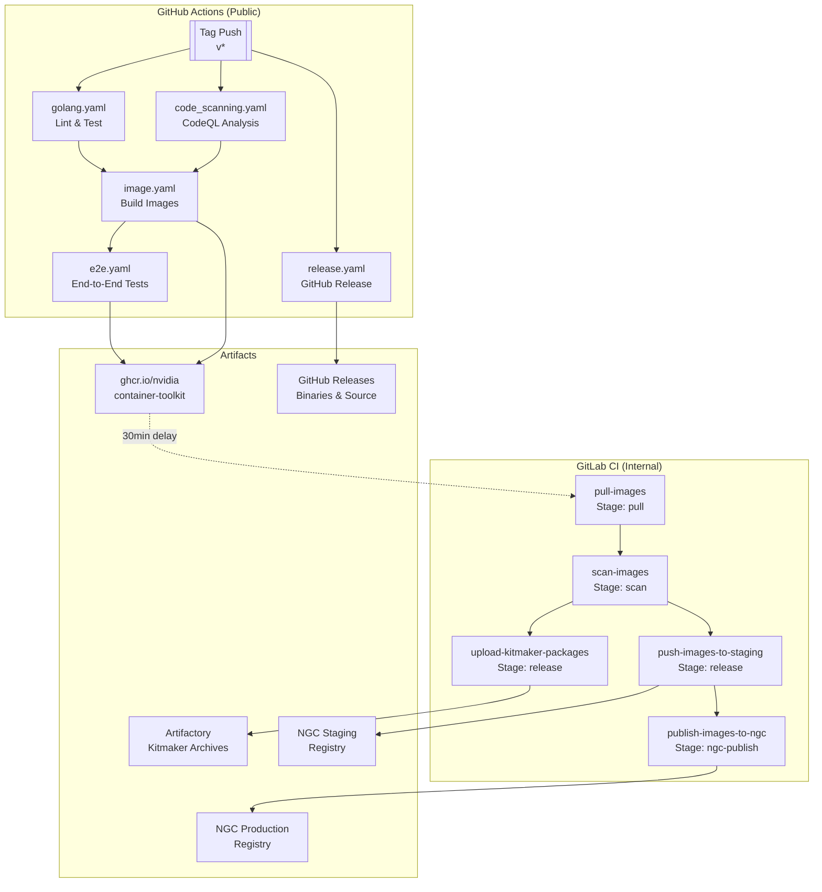
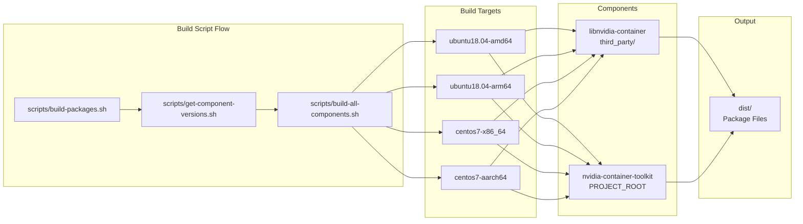
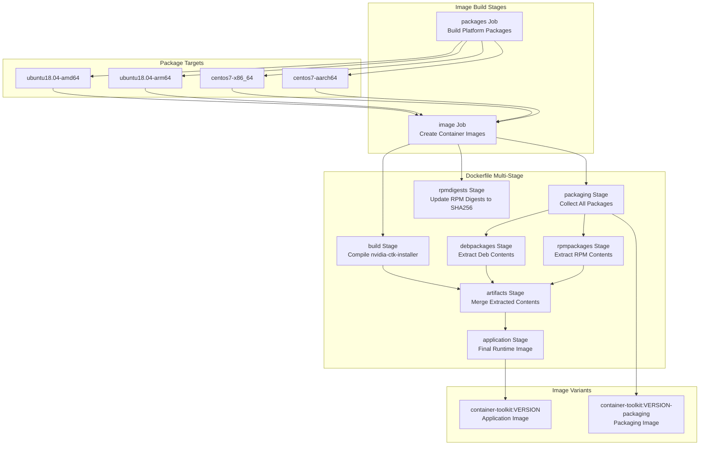
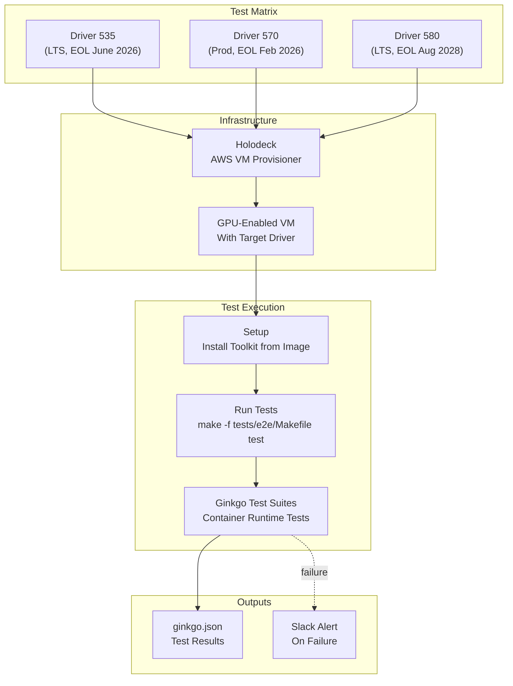
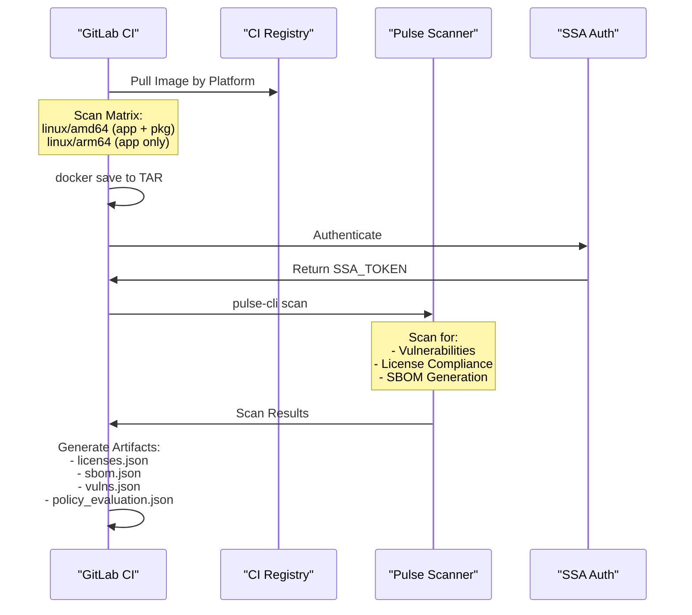
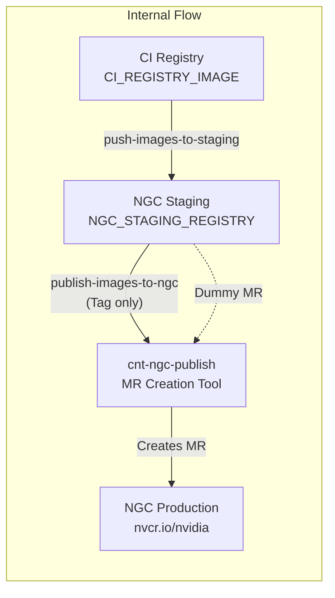
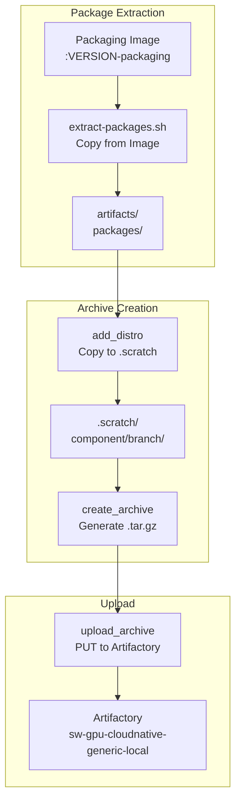

<!-- source: DeepWiki mcp.deepwiki.com · repo NVIDIA/nvidia-container-toolkit · page 5.4 Release Process · fetched 2026-10-26 -->

# Release Process

<details>
<summary>Relevant source files</summary>

The following files were used as context for generating this wiki page:

- [.github/workflows/release.yaml](.github/workflows/release.yaml)
- [.nvidia-ci.yml](.nvidia-ci.yml)
- [DEVELOPMENT.md](DEVELOPMENT.md)
- [README.md](README.md)
- [RELEASE.md](RELEASE.md)
- [hack/create-release.sh](hack/create-release.sh)
- [hack/generate-changelog.sh](hack/generate-changelog.sh)
- [hack/prepare-artifacts.sh](hack/prepare-artifacts.sh)
- [hack/prepare-release.sh](hack/prepare-release.sh)
- [hack/pull-packages.sh](hack/pull-packages.sh)
- [scripts/Dockerfile.sign.deb](scripts/Dockerfile.sign.deb)
- [scripts/Dockerfile.sign.rpm](scripts/Dockerfile.sign.rpm)
- [scripts/build-all-components.sh](scripts/build-all-components.sh)
- [scripts/build-packages.sh](scripts/build-packages.sh)
- [scripts/extract-packages.sh](scripts/extract-packages.sh)
- [scripts/get-component-versions.sh](scripts/get-component-versions.sh)
- [scripts/packages-sign-all.sh](scripts/packages-sign-all.sh)
- [scripts/release-kitmaker-artifactory.sh](scripts/release-kitmaker-artifactory.sh)
- [scripts/release-packages-artifactory.sh](scripts/release-packages-artifactory.sh)
- [scripts/release-packages.sh](scripts/release-packages.sh)
- [scripts/utils.sh](scripts/utils.sh)

</details>


This document describes the end-to-end release process for the NVIDIA Container Toolkit, including CI/CD pipelines, package building, image creation, testing, security scanning, and distribution to multiple channels. For information about building packages locally during development, see [Build System](#5.1). For details on package structure and dependencies, see [Package Structure](#5.2). For container image creation and usage, see [Container Images](#5.3).

## Overview

The release process orchestrates building multi-architecture packages (deb/rpm), creating container images, running comprehensive tests, performing security scans, and publishing artifacts to multiple distribution channels including GitHub Releases, NGC Registry, Artifactory (Kitmaker), and standard package repositories.

The process operates across two CI/CD systems:
- **GitHub Actions (Public)**: Builds packages, creates images, runs E2E tests
- **GitLab CI (Internal)**: Pulls artifacts, performs security scanning, publishes to NGC

Sources: [.nvidia-ci.yml:1-291](), [.github/workflows/ci.yaml:1-55]()

## Release Pipeline Architecture

### Dual Pipeline Overview



**Diagram: Dual CI/CD Pipeline Architecture**

The release process spans two CI/CD systems that work in sequence. GitHub Actions handles public builds and testing, publishing images to `ghcr.io/nvidia/container-toolkit`. GitLab CI then pulls these artifacts with a 30-minute delay (to ensure availability), performs internal security scanning, and publishes to production channels including NGC Registry and Artifactory.

Sources: [.nvidia-ci.yml:51-68](), [.nvidia-ci.yml:113-142](), [.github/workflows/ci.yaml:17-54](), [.github/workflows/release.yaml:18-38]()

### Pipeline Trigger Rules

| Trigger Type | GitHub Actions | GitLab CI |
|-------------|----------------|-----------|
| Tag push (`v*`) | ✓ Runs release workflow | ✓ Runs full pipeline |
| Push to `main` | ✓ Runs CI pipeline | ✓ Runs full pipeline |
| Push to `release-*` | ✓ Runs CI pipeline | ✓ Runs full pipeline |
| Pull request | ✓ Runs validation only | ✗ Skipped |
| Manual trigger | ✓ Via workflow_dispatch | ✓ Via web UI |

Sources: [.nvidia-ci.yml:51-67](), [.github/workflows/release.yaml:18-21](), [.github/workflows/ci.yaml:17-23]()

## Build Process

### Package Building

The package build process creates native packages for multiple Linux distributions and architectures. The `build-packages.sh` script orchestrates building both `nvidia-container-toolkit` components and the `libnvidia-container` dependency.



**Diagram: Package Build Orchestration**

The build process uses a hierarchy of scripts. The top-level `build-packages.sh` [scripts/build-packages.sh:39-40]() invokes `get-component-versions.sh` [scripts/build-packages.sh:37]() to extract version information from `versions.mk`, then calls `build-all-components.sh` [scripts/build-packages.sh:43]() for each target platform. Each target builds both the external `libnvidia-container` dependency [scripts/build-all-components.sh:59-65]() and the toolkit components [scripts/build-all-components.sh:67-72](), outputting packages to the `dist/` directory [scripts/build-all-components.sh:41]().

Sources: [scripts/build-packages.sh:1-44](), [scripts/build-all-components.sh:1-71](), [scripts/get-component-versions.sh:1-41]()

### Version Management

Version information is extracted from `versions.mk` and propagated throughout the build:

```bash
# scripts/get-component-versions.sh extracts:
NVIDIA_CONTAINER_TOOLKIT_VERSION  # e.g., "1.14.0"
NVIDIA_CONTAINER_TOOLKIT_TAG      # e.g., "rc.1"
NVIDIA_CONTAINER_TOOLKIT_PACKAGE_VERSION  # e.g., "1.14.0-rc.1"
```

These variables are exported and used by:
- Package build systems (`make` targets)
- Container image builds (`PACKAGE_VERSION` build arg)
- Artifact manifests (`manifest.txt` in packaging images)

Sources: [scripts/get-component-versions.sh:33-41](), [scripts/build-all-components.sh:50-54]()

### Container Image Creation

Container images are built in multiple stages, creating both application and packaging variants:



**Diagram: Container Image Build Flow**

The image build process first creates native packages for all target platforms in parallel GitHub Actions jobs [deployments/container/Makefile:42-95](). These packages are collected and passed to a multi-stage Dockerfile [deployments/container/Dockerfile:1-210]() that:
1. Builds the `nvidia-ctk-installer` binary [deployments/container/Dockerfile:10-17]()
2. Updates RPM digests to SHA256 (for modern compatibility) [deployments/container/Dockerfile:19-26]()
3. Creates a packaging stage with all raw packages [deployments/container/Dockerfile:28-35]()
4. Extracts deb and rpm contents separately [deployments/container/Dockerfile:37-50]()
5. Merges extracted contents into an artifacts stage [deployments/container/Dockerfile:52-60]()
6. Produces the final application image [deployments/container/Dockerfile:62-70]()

Two image variants are produced: the application image (used by GPU Operator) and the packaging image (contains all raw packages for distribution).

Sources: [.github/workflows/image.yaml:29-123](), [deployments/container/Dockerfile:1-210](), [deployments/container/Makefile:42-95]()

### Multi-Architecture Image Builds

Multi-architecture images are built conditionally based on the branch:

| Branch Pattern | Multi-Arch | Platforms |
|----------------|------------|-----------|
| `main` | Yes | `linux/amd64`, `linux/arm64` |
| `release-*` | Yes | `linux/amd64`, `linux/arm64` |
| Pull requests | No | Native only |

The build system uses Docker Buildx when `BUILD_MULTI_ARCH_IMAGES=true`:

```makefile
# deployments/container/Makefile
BUILDX =
ifeq ($(BUILD_MULTI_ARCH_IMAGES),true)
BUILDX = buildx
endif

DOCKER_BUILD_PLATFORM_OPTIONS = --platform=linux/amd64,linux/arm64
```

For packaging images, only `linux/amd64` is built to optimize build time, as the packaging image contains packages for all architectures in its filesystem.

Sources: [deployments/container/Makefile:19-22](), [deployments/container/multi-arch.mk:15-22](), [.github/workflows/ci.yaml:47]()

## Testing and Validation

### End-to-End Testing

E2E tests validate the toolkit across multiple NVIDIA driver versions using AWS infrastructure:



**Diagram: E2E Test Execution Flow**

E2E tests run against three driver branches to ensure compatibility across LTS and production driver releases [.github/workflows/e2e.yaml:40-43](). The Holodeck action provisions AWS VMs with specific driver versions, then the toolkit is installed from the built container image. Ginkgo test suites validate functionality, with results archived and Slack notifications sent on failures.

Sources: [.github/workflows/e2e.yaml:38-115](), [.github/workflows/ci.yaml:49-54]()

The test matrix is optimized for pull requests by running only against driver 535:

```yaml
# .github/workflows/e2e.yaml
strategy:
  matrix:
    ispr:
      - ${{ github.ref_name != 'main' && !startsWith( github.ref_name, 'release-' ) }}
    driver_branch:
      - 535  # LTS
      - 570  # Production
      - 580  # LTS
    exclude:
      - ispr: true
        driver_branch: 570
      - ispr: true
        driver_branch: 580
```

Sources: [.github/workflows/e2e.yaml:40-55]()

### Security Scanning

The GitLab CI pipeline performs security scanning using Pulse (NVIDIA's internal scanning tool):



**Diagram: Security Scanning Process**

The scan runs in parallel for each platform combination [.nvidia-ci.yml:160-164](). Images are pulled from the internal CI registry [.nvidia-ci.yml:171](), saved as tar archives [.nvidia-ci.yml:172](), and scanned using `pulse-cli` [.nvidia-ci.yml:180](). The scanner authenticates with SSA (NVIDIA's auth service) [.nvidia-ci.yml:176-178]() and produces multiple artifacts including vulnerability reports, license information, and software bill of materials (SBOM) [.nvidia-ci.yml:183-188]().

Sources: [.nvidia-ci.yml:154-190]()

Scan configuration:

| Variable | Value | Purpose |
|----------|-------|---------|
| `PULSE_IMAGE` | (Internal image) | Scanner container |
| `CONTAINER_POLICY` | (Policy ID) | Compliance policy |
| `NSPECT_ID` | (Project ID) | Scanner project |
| `SSA_CLIENT_ID` / `SSA_CLIENT_SECRET` | (Credentials) | Authentication |

The scan is marked as `allow_failure: true` [.nvidia-ci.yml:168]() to avoid blocking releases on scanner issues, but results are always archived for review.

Sources: [.nvidia-ci.yml:168]()

## Distribution Channels

### Channel Overview

Release artifacts are distributed through four primary channels:

| Channel | Content | Access | Target Users |
|---------|---------|--------|--------------|
| GitHub Releases | Source tarballs, binaries | Public | Open source users, developers |
| NGC Registry | Container images | Public (pull), Internal (push) | Kubernetes users, GPU Operator |
| Artifactory (Kitmaker) | Package archives | Internal | OEM partners, Kitmaker builds |
| Package Repositories | Deb/RPM packages | Public | System administrators, package managers |

Sources: [.nvidia-ci.yml:192-291](), [scripts/release-kitmaker-artifactory.sh:1-223](), [scripts/release-packages.sh:1-224]()

### NGC Publishing Pipeline

Images are published to NGC through a multi-stage process:



**Diagram: NGC Publishing Flow**

Images are first pushed from the internal CI registry to NGC staging [.nvidia-ci.yml:213-239](). For tagged releases, the `publish-images-to-ngc` job uses the `cnt-ngc-publish` tool to create a merge request in the NGC publishing repository [.nvidia-ci.yml:242-291](). This MR triggers internal approval workflows before final publication to the production NGC registry.

Sources: [.nvidia-ci.yml:213-291]()

The `cnt-ngc-publish` tool is configured via:

```yaml
# .nvidia-ci.yml
variables:
  IN_IMAGE_TAG: "${CI_COMMIT_SHORT_SHA}"
  OUT_IMAGE_TAG: "${CI_COMMIT_TAG}"
  VERSION_FILE: "build-info-${CI_PIPELINE_ID}.txt"
  PROJECT_NAME: "nvidia-container-toolkit"
```

The version file maps staging tags to production tags:

```
# Example VERSION_FILE contents
abc12345 v1.14.0
abc12345-packaging v1.14.0-packaging
```

Sources: [.nvidia-ci.yml:242-264]()

### Kitmaker Artifactory Release

Kitmaker archives bundle packages for OEM integration:



**Diagram: Kitmaker Archive Creation and Upload**

The process extracts packages from the packaging image [scripts/extract-packages.sh:103](), organizes them into Kitmaker-compatible directory structures in a scratch area [scripts/release-kitmaker-artifactory.sh:88-95](), creates compressed archives [scripts/release-kitmaker-artifactory.sh:107](), and uploads them to Artifactory with metadata properties [scripts/release-kitmaker-artifactory.sh:177-186]().

Sources: [scripts/release-kitmaker-artifactory.sh:76-214](), [scripts/extract-packages.sh:58-106](), [.nvidia-ci.yml:192-211]()

Archive naming and structure:

```
nvidia_container_toolkit-linux-x86_64-1.14.0.2024.01.15.1234567890.tar.gz
└── nvidia_container_toolkit/
    └── .packages/
        ├── libnvidia-container*.rpm
        ├── nvidia-container-toolkit*.rpm
        └── ...
```

The archive version includes a timestamp suffix for uniqueness:

```bash
# scripts/release-kitmaker-artifactory.sh
version="${VERSION%~rc.*}"
version_suffix=$(date -r "${IMAGE_EPOCH}" '+%Y.%m.%d.%s')
kitmaker_version="${VERSION%~rc.*}.${version_suffix}"
```

Sources: [scripts/release-kitmaker-artifactory.sh:194-196]()

Artifactory properties attached to each archive:

| Property | Example | Description |
|----------|---------|-------------|
| `component_name` | `nvidia_container_toolkit` | Component identifier |
| `version` | `1.14.0.2024.01.15.1234567890` | Full Kitmaker version |
| `os` | `linux` | Operating system |
| `arch` | `x86_64` / `sbsa` / `aarch64` | Architecture |
| `platform` | `linux-x86_64` | Combined OS-arch |
| `changelist` | `abc12345` | Git commit short SHA |
| `branch` | `main` | Git branch |
| `package.version` | `1.14.0` | Base package version |
| `CI_PIPELINE_ID` | `12345` | GitLab CI pipeline ID |

Sources: [scripts/release-kitmaker-artifactory.sh:154-174]()

### Package Repository Release

Public package repositories (apt/yum) are updated through a manual process documented in `scripts/release-packages.sh`:

```bash
GPG_LOCAL_USER="GPG_USER" \
MASTER_KEY_PATH=/path/to/gpg-master.key \
SUB_KEY_PATH=/path/to/gpg-subkey.key \
    ./scripts/release-packages.sh PACKAGE_REPO_ROOT [SHA]
```

The script:
1. Pulls the packaging image for the specified SHA [scripts/release-packages.sh:48-50]()
2. Extracts packages to a cache directory [scripts/release-packages.sh:59-62]()
3. Copies packages to the `libnvidia-container` repository (gh-pages branch) [scripts/release-packages.sh:161-174]()
4. Signs packages using GPG keys [scripts/release-packages.sh:192-219]():
   - Debian: Creates `Packages`, `Packages.xz`, and signed `InRelease` [scripts/packages-sign-all.sh:21-31]()
   - RPM: Signs individual packages and creates signed repository metadata [scripts/packages-sign-all.sh:34-47]()
5. Creates commits for review before pushing [scripts/release-packages.sh:179-185](), [scripts/release-packages.sh:215-216]()

Sources: [scripts/release-packages.sh:1-224](), [DEVELOPMENT.md:40-61]()

Package signing is performed in Docker containers to ensure reproducibility:

```bash
# scripts/release-packages.sh
docker build -t nvidia/toolkit-deb-pkg-signer \
    -f ${SCRIPTS_DIR}/Dockerfile.sign.deb ${SCRIPTS_DIR}

docker build -t nvidia/toolkit-rpm-pkg-signer \
    -f ${SCRIPTS_DIR}/Dockerfile.sign.rpm ${SCRIPTS_DIR}
```

Sources: [scripts/release-packages.sh:72-80](), [scripts/Dockerfile.sign.deb:1-4](), [scripts/Dockerfile.sign.rpm:1-3]()

The signing containers execute `scripts/packages-sign-all.sh` [scripts/release-packages.sh:205-209](), which:
- For deb: Uses `apt-ftparchive` and `gpg --clearsign` with SHA512 digests [scripts/packages-sign-all.sh:21-31]()
- For rpm: Uses `rpmsign --addsign` and signs `repomd.xml` with GPG [scripts/packages-sign-all.sh:34-47]()

Sources: [scripts/packages-sign-all.sh:10-47]()

### GitHub Release Creation

GitHub releases are created by the `release.yaml` workflow when a tag is pushed:

```yaml
# .github/workflows/release.yaml
on:
  push:
    tags:
      - v*
```

The workflow executes two scripts:
1. `hack/prepare-artifacts.sh` - Prepares release artifacts
2. `hack/create-release.sh` - Creates the GitHub release using `gh` CLI

Sources: [.github/workflows/release.yaml:18-38]()

## Version and Tag Management

### Version Scheme

The toolkit uses semantic versioning with optional pre-release tags:

```
LIB_VERSION := 1.14.0
LIB_TAG ?= rc.1
```

This produces:
- Package version: `1.14.0~rc.1` (deb) / `1.14.0-rc.1` (rpm)
- Git tag: `v1.14.0-rc.1`
- Image tag: `1.14.0-rc.1`

Sources: [scripts/get-component-versions.sh:35-37]()

### Release vs. Release Candidate

The release type affects which packages are published:

```bash
# scripts/extract-packages.sh
function skip-for-release-candidate() {
    # Always skip operator-extensions packages
    if [[ "${package_name/"nvidia-container-toolkit-operator-extensions"/}" != "${package_name}" ]]; then
        return 0
    fi
    
    # For rc or patch releases (not X.Y.0), skip packages
    local is_non_patch_full_release=1
    if [[ "${VERSION/rc./}" != "${VERSION}" ]]; then
        is_non_patch_full_release=0
    fi
    if [[ "${VERSION%.0}" == "${VERSION}" ]]; then
        is_non_patch_full_release=0
    fi
    return 1
}
```

This logic ensures:
- RC releases: Minimal package set
- Patch releases (X.Y.Z where Z>0): Minimal package set  
- Major/minor releases (X.Y.0): Full package set

Sources: [scripts/extract-packages.sh:41-56]()

### Image Tag Variants

Multiple image tags are created:

| Tag Pattern | Example | Purpose |
|-------------|---------|---------|
| `VERSION` | `1.14.0` | Application image |
| `VERSION-packaging` | `1.14.0-packaging` | Packaging image with all packages |
| `SHA` | `abc12345` | Staging/testing image |
| `SHA-packaging` | `abc12345-packaging` | Staging packaging image |
| `devel` | `devel` | Latest from `main` branch |

Sources: [.nvidia-ci.yml:33-40](), [deployments/container/Makefile:68-70]()

## Manual Release Procedures

### Publishing Package Repositories

After automated builds complete, manual steps are required to publish packages to public repositories:

1. Clone the package repository on the `gh-pages` branch:
   ```bash
   git clone -b gh-pages https://github.com/nvidia/libnvidia-container.git pkg-repo
   cd pkg-repo
   ```

2. Run the release script:
   ```bash
   export GPG_LOCAL_USER="your-gpg-key-id"
   export MASTER_KEY_PATH=/path/to/master.key
   export SUB_KEY_PATH=/path/to/sub.key
   
   ../nvidia-container-toolkit/scripts/release-packages.sh $(pwd) abc12345
   ```

3. Review the generated commits:
   ```bash
   git log -3 --oneline
   # Should show:
   # - Add packages for NVIDIA Container Toolkit X.Y.Z [stable|experimental] release
   # - fixup! (deb signing)
   # - fixup! (rpm signing)
   ```

4. Squash fixup commits:
   ```bash
   git rebase -i origin/gh-pages
   ```

5. Push to publish:
   ```bash
   git push origin gh-pages
   ```

Sources: [DEVELOPMENT.md:40-61](), [scripts/release-packages.sh:223-224]()

### Emergency Hotfix Process

For urgent fixes between releases:

1. Create a hotfix branch from the release tag:
   ```bash
   git checkout -b hotfix-v1.14.1 v1.14.0
   ```

2. Apply and test the fix

3. Update version in `versions.mk`:
   ```makefile
   LIB_VERSION := 1.14.1
   LIB_TAG ?=
   ```

4. Create and push the tag:
   ```bash
   git tag -a v1.14.1 -m "Hotfix release v1.14.1"
   git push origin v1.14.1
   ```

5. The automated pipeline will trigger from the tag

6. Merge back to release branch and main:
   ```bash
   git checkout release-1.14
   git merge --no-ff hotfix-v1.14.1
   git checkout main
   git merge --no-ff hotfix-v1.14.1
   ```

This process is not explicitly documented in the repository but follows standard Git flow practices adapted for the dual-pipeline architecture.

### Verifying Release Artifacts

After automated distribution, verify artifacts are available:

**NGC Images:**
```bash
docker pull nvcr.io/nvidia/container-toolkit:1.14.0
docker pull nvcr.io/nvidia/container-toolkit:1.14.0-packaging
```

**GitHub Registry:**
```bash
docker pull ghcr.io/nvidia/container-toolkit:1.14.0
```

**Package Repositories:**
```bash
# Debian/Ubuntu
curl -fsSL https://nvidia.github.io/libnvidia-container/stable/deb/amd64/Packages | grep nvidia-container-toolkit

# RHEL/CentOS
curl -fsSL https://nvidia.github.io/libnvidia-container/stable/rpm/x86_64/repodata/repomd.xml
```

**Kitmaker Artifactory:**
```bash
# Requires internal authentication
curl -H "X-JFrog-Art-Api: $ARTIFACTORY_TOKEN" \
  https://urm.nvidia.com/artifactory/sw-gpu-cloudnative-generic-local/kitmaker/main/nvidia_container_toolkit/
```

Sources: [.nvidia-ci.yml:41-43](), [scripts/release-kitmaker-artifactory.sh:40-41]()

---

