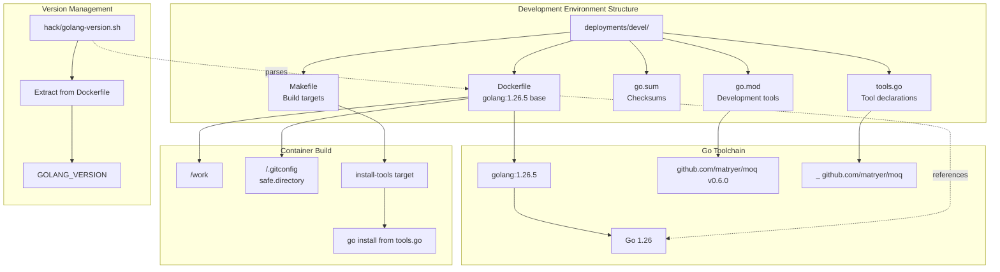
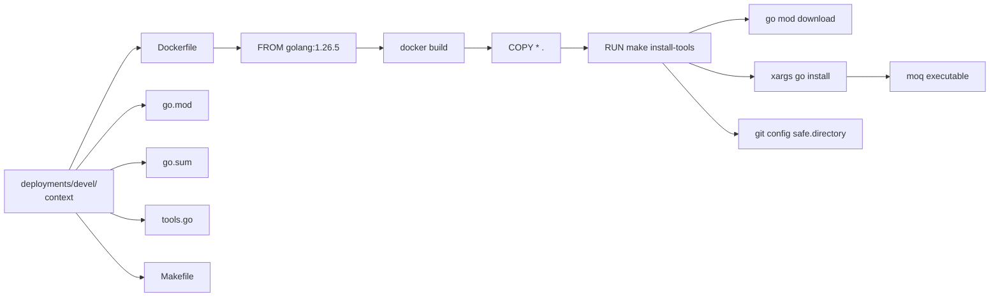
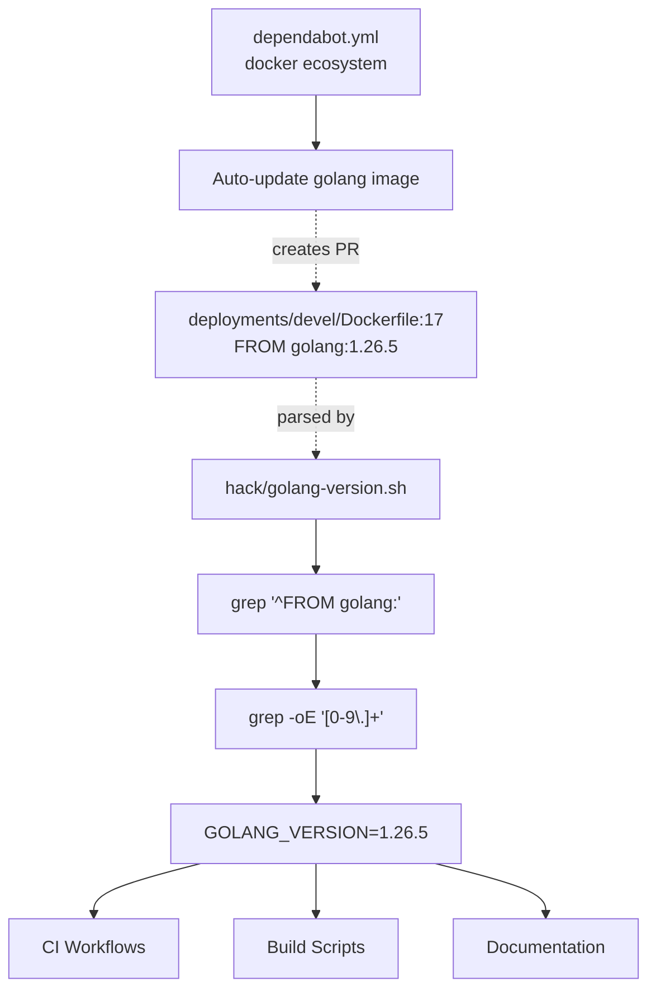
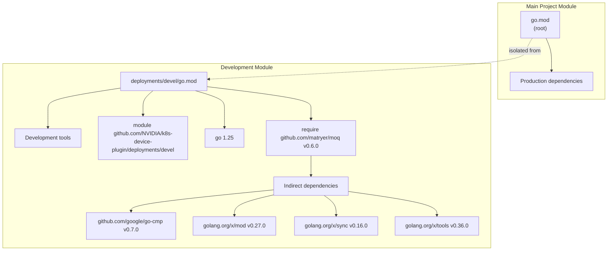
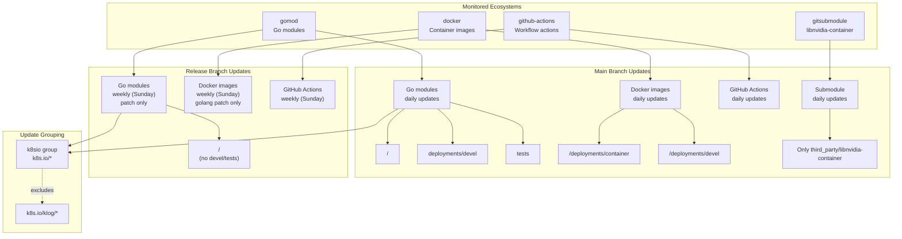
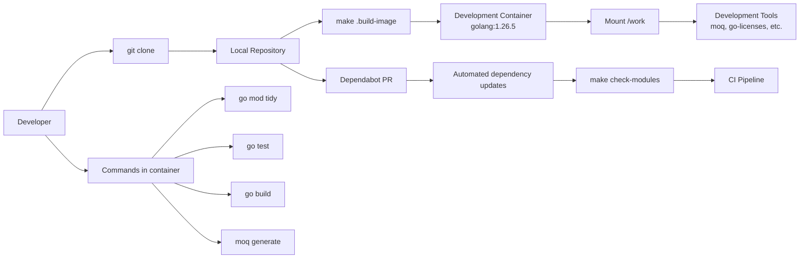

<!-- source: DeepWiki mcp.deepwiki.com · repo NVIDIA/nvidia-container-toolkit · page 6 Development · fetched 2026-10-26 -->

# Development

<details>
<summary>Relevant source files</summary>

The following files were used as context for generating this wiki page:

- [.github/dependabot.yml](.github/dependabot.yml)
- [.github/workflows/ci.yaml](.github/workflows/ci.yaml)
- [.github/workflows/third-party-notices-check.yaml](.github/workflows/third-party-notices-check.yaml)
- [.gitignore](.gitignore)
- [THIRD_PARTY_NOTICES.md](THIRD_PARTY_NOTICES.md)
- [deployments/devel/Dockerfile](deployments/devel/Dockerfile)
- [deployments/devel/Makefile](deployments/devel/Makefile)
- [deployments/devel/go.mod](deployments/devel/go.mod)
- [deployments/devel/go.sum](deployments/devel/go.sum)
- [deployments/devel/tools.go](deployments/devel/tools.go)
- [hack/generate-third-party-notices.sh](hack/generate-third-party-notices.sh)
- [hack/golang-version.sh](hack/golang-version.sh)

</details>


This document describes the development workflows, tools, and environment setup for the NVIDIA Container Toolkit codebase. It covers the development container, tooling installation, Go version management, and dependency automation. For build system details and packaging, see [Building and Packaging](#5). For CI/CD pipeline architecture and testing infrastructure, see [CI/CD Pipeline](#6.2) and [Testing Strategy](#6.3).

## Development Environment Architecture

The toolkit uses a containerized development environment to ensure consistency across developer machines and CI systems. The development setup is defined in [deployments/devel/](https://github.com/NVIDIA/nvidia-container-toolkit/tree/main/deployments/devel) and provides Go toolchain management, development tools, and build environment configuration.



**Sources:** [deployments/devel/Dockerfile:1-27](), [deployments/devel/go.mod:1-13](), [deployments/devel/tools.go:1-26](), [deployments/devel/Makefile:1-43](), [hack/golang-version.sh:1-22]()

## Development Container

The development container is defined in [deployments/devel/Dockerfile:1-27]() and provides a standardized environment for building and testing the toolkit.

### Container Specifications

| Component | Configuration |
|-----------|--------------|
| Base Image | `golang:1.26.5` |
| Working Directory | `/work` |
| Go Version | 1.26.5 |
| Git Configuration | Safe directory `/work` |
| Tool Installation | Via `make install-tools` |

The Dockerfile serves dual purposes:
1. **Development Container**: Used by developers for local builds and testing
2. **Version Pinning**: Serves as the authoritative source for the Go version used across all CI/CD pipelines

**Key Features:**

- **Go Version Management**: The Dockerfile pins the exact Go version (`golang:1.26.5` at [deployments/devel/Dockerfile:17]()), which is parsed by [hack/golang-version.sh:20]() for use in build scripts
- **Tool Pre-installation**: The container runs `make install-tools` at [deployments/devel/Dockerfile:22]() to install development dependencies
- **Git Integration**: Configures `/work` as a safe directory at [deployments/devel/Dockerfile:26]() to enable git commands within the container

### Building the Development Image



The build target is defined in [deployments/devel/Makefile:30-36]() as `.build-image`:

```
.build-image:
    $(DOCKER) build \
        --progress=plain \
        --tag $(BUILDIMAGE) \
        -f $(DOCKERFILE_DEVEL) \
        $(DOCKERFILE_CONTEXT)
```

**Sources:** [deployments/devel/Dockerfile:1-27](), [deployments/devel/Makefile:30-36]()

## Development Tools

Development tools are declared using the Go build tags pattern at [deployments/devel/tools.go:1-26](). This file uses the `//go:build tools` tag to prevent tools from being included in production builds while ensuring they are tracked in `go.mod`.

### Tool Declaration Pattern

```mermaid
graph TB
    ToolsGo["tools.go<br/>//go:build tools"]
    
    ToolsGo --> BuildTag["//go:build tools<br/>+build tools"]
    ToolsGo --> BlankImport["_ github.com/matryer/moq"]
    
    GoMod["go.mod"]
    BlankImport --> GoMod
    GoMod --> Dependency["require github.com/matryer/moq v0.6.0"]
    
    MakeTarget["make install-tools"]
    MakeTarget --> CatTools["cat tools.go"]
    CatTools --> GrepUnder["grep _"]
    GrepUnder --> AwkExtract["awk -F'\"' '{print $$2}'"]
    AwkExtract --> XargsInstall["xargs go install"]
    
    XargsInstall --> InstalledBinary["$GOPATH/bin/moq"]
```

### Current Development Tools

| Tool | Version | Purpose |
|------|---------|---------|
| `github.com/google/go-licenses/v2` | v2.0.1 | License management and generation of `THIRD_PARTY_NOTICES.md` |
| `github.com/matryer/moq` | v0.6.0 | Mock generation for Go interfaces |

The tool installation process at [deployments/devel/Makefile:19-21]() extracts import paths from `tools.go` and installs them:

```
install-tools: download
    @echo Installing tools from tools.go
    @cat tools.go | grep _ | awk -F'"' '{print $$2}' | xargs -tI % go install %
```

**Sources:** [deployments/devel/tools.go:1-26](), [deployments/devel/go.mod:1-13](), [deployments/devel/Makefile:19-21]()

## Go Version Management

The toolkit uses a single-source-of-truth approach for Go version management, where the version is defined in the Dockerfile and extracted programmatically.



### Version Extraction Script

The [hack/golang-version.sh:16-22]() script extracts the Go version from the Dockerfile:

```bash
DOCKERFILE_ROOT=${SCRIPTS_DIR}/../deployments/devel
GOLANG_VERSION=$(grep -E "^FROM golang:.*$" ${DOCKERFILE_ROOT}/Dockerfile | grep -oE "[0-9\.]+")
echo $GOLANG_VERSION
```

This approach ensures:
- **Single Source of Truth**: Version defined once in [deployments/devel/Dockerfile:17]()
- **Automated Updates**: Dependabot manages version updates through Docker ecosystem at [.github/dependabot.yml:24-34]()
- **Consistent CI/CD**: All build systems use the same extracted version
- **Version Documentation**: Comments in Dockerfile explain the version management strategy at [deployments/devel/Dockerfile:15-16]()

**Sources:** [hack/golang-version.sh:1-22](), [deployments/devel/Dockerfile:15-17](), [.github/dependabot.yml:24-34]()

## Module Management

The development directory maintains its own Go module separate from the main project at [deployments/devel/go.mod:1-13](). This isolation prevents development tools from polluting the production dependency tree.

### Module Structure



### Module Operations

The [deployments/devel/Makefile:38-43]() provides targets for module management:

| Target | Command | Purpose |
|--------|---------|---------|
| `modules` | `go mod tidy && go mod verify` | Clean and verify dependencies |
| `check-modules` | `git diff --quiet HEAD -- go.mod go.sum` | Verify no uncommitted module changes |
| `download` | `go mod download` | Download module dependencies |

**Sources:** [deployments/devel/go.mod:1-13](), [deployments/devel/go.sum:1-13](), [deployments/devel/Makefile:38-43]()

## Dependency Automation with Dependabot

The toolkit uses GitHub Dependabot for automated dependency updates, configured in [.github/dependabot.yml:1-121](). Dependabot monitors multiple package ecosystems and creates pull requests for updates.

### Dependabot Configuration Architecture



### Configuration Details

**Main Branch** ([.github/dependabot.yml:6-54]()):
- **Go Modules**: Daily updates for root, `deployments/devel`, and `tests` directories
- **Docker Images**: Daily updates for CUDA images and Golang version
- **GitHub Actions**: Daily updates for workflow files
- **Git Submodules**: Daily updates for `third_party/libnvidia-container` only
- **Labels**: `dependencies`, `libnvidia-container` (for submodules)

**Release Branches** ([.github/dependabot.yml:56-111]()):
- **Go Modules**: Weekly (Sunday) updates, patch versions only, excludes dev/test directories
- **Docker Images**: Weekly (Sunday) updates, Golang patch versions only
- **GitHub Actions**: Weekly (Sunday) updates
- **Version Restrictions**: Ignores major and minor version updates at [.github/dependabot.yml:72-75]()

### Dependency Grouping

The configuration defines a `k8sio` group at [.github/dependabot.yml:18-22]() that batches Kubernetes dependencies:
- **Includes**: All `k8s.io/*` packages
- **Excludes**: `k8s.io/klog/*` (managed separately)

This grouping reduces PR volume by bundling related Kubernetes updates into single pull requests.

**Sources:** [.github/dependabot.yml:1-121]()

## Development Workflow Integration



The development workflow leverages:
1. **Containerized Builds**: Consistent environment via [deployments/devel/Dockerfile:1-27]()
2. **Tool Automation**: Pre-installed development tools via [deployments/devel/Makefile:19-21]()
3. **Version Consistency**: Single-source Go version from [hack/golang-version.sh:1-22]()
4. **Dependency Automation**: Dependabot PRs from [.github/dependabot.yml:1-121]()
5. **Module Verification**: Pre-commit checks via [deployments/devel/Makefile:42-43]()

**Sources:** [deployments/devel/Dockerfile:1-27](), [deployments/devel/Makefile:1-43](), [.github/dependabot.yml:1-121](), [hack/golang-version.sh:1-22]()

---

