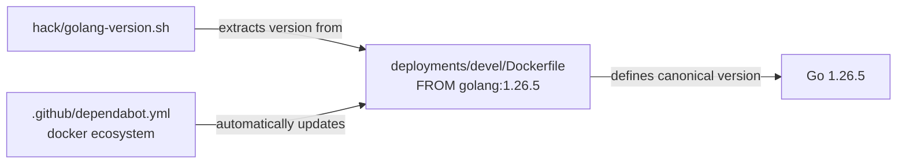
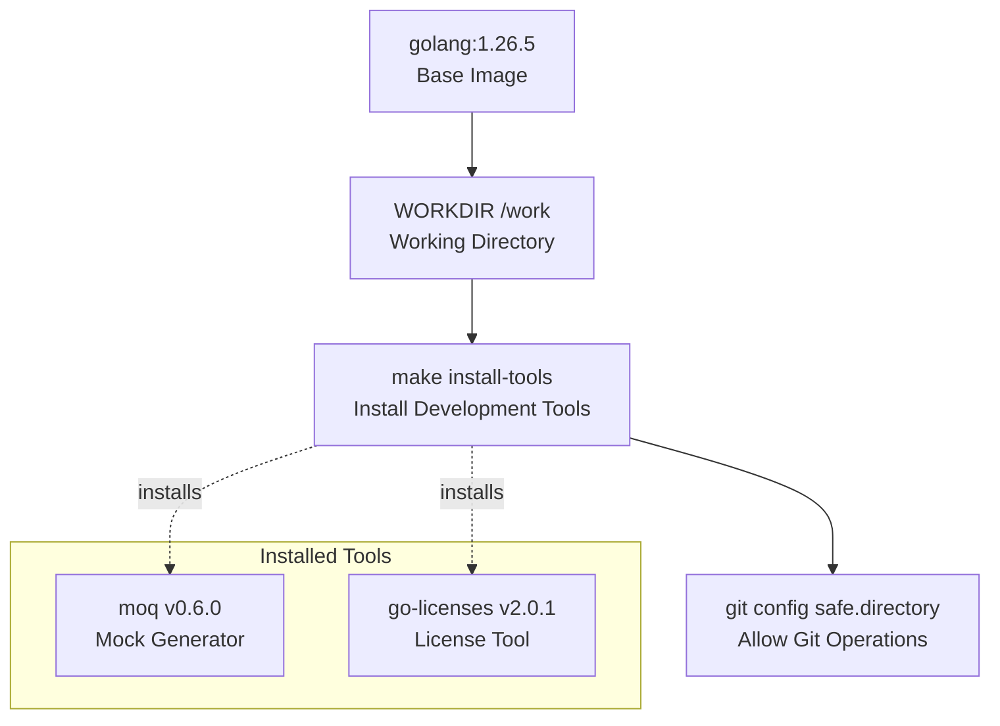
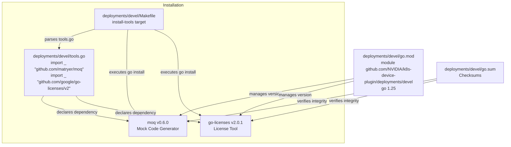
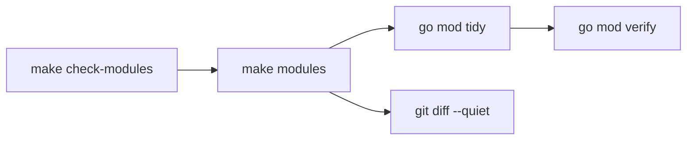
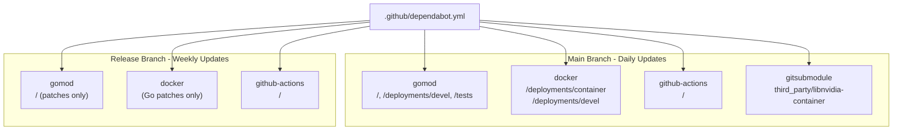
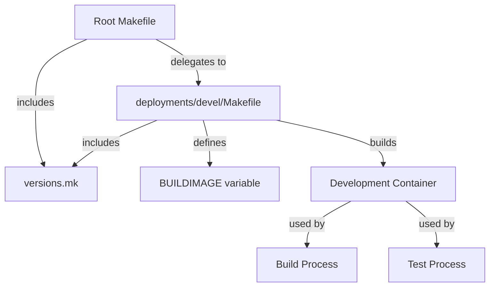

<!-- source: DeepWiki mcp.deepwiki.com · repo NVIDIA/nvidia-container-toolkit · page 6.1 Development Environment · fetched 2026-10-26 -->

# Development Environment

<details>
<summary>Relevant source files</summary>

The following files were used as context for generating this wiki page:

- [.github/dependabot.yml](.github/dependabot.yml)
- [.github/workflows/ci.yaml](.github/workflows/ci.yaml)
- [.github/workflows/third-party-notices-check.yaml](.github/workflows/third-party-notices-check.yaml)
- [.gitignore](.gitignore)
- [.golangci.yml](.golangci.yml)
- [THIRD_PARTY_NOTICES.md](THIRD_PARTY_NOTICES.md)
- [deployments/devel/Dockerfile](deployments/devel/Dockerfile)
- [deployments/devel/Makefile](deployments/devel/Makefile)
- [deployments/devel/go.mod](deployments/devel/go.mod)
- [deployments/devel/go.sum](deployments/devel/go.sum)
- [deployments/devel/tools.go](deployments/devel/tools.go)
- [hack/generate-third-party-notices.sh](hack/generate-third-party-notices.sh)
- [hack/golang-version.sh](hack/golang-version.sh)

</details>


This page provides instructions for setting up a development environment for contributing to the NVIDIA Container Toolkit. It covers Go version requirements, the development container image, development tools, and common development workflows.

For information about the build system and compilation process, see [Build System](#5.1). For testing strategies and test execution, see [Testing Strategy](#6.3). For CI/CD pipeline configuration, see [CI/CD Pipeline](#6.2).

## Overview

The NVIDIA Container Toolkit provides two primary approaches for development:

1. **Container-based development** using the `devel` Docker image (recommended)
2. **Local development** with Go installed directly on the host

The container-based approach ensures consistency across development environments and includes all necessary tools pre-installed. The local approach is suitable for developers who prefer direct host development.

**Sources**: [deployments/devel/Dockerfile:1-27](), [deployments/devel/Makefile:1-43]()

## Go Version Requirements

The toolkit specifies its Go version requirement in the development container Dockerfile. This version is managed by Dependabot and represents the minimum supported Go version for the project.


**Diagram: Go Version Management Flow**

The canonical Go version is defined at [deployments/devel/Dockerfile:17]() using the base image `FROM golang:1.26.5`. This version can be extracted programmatically using the script at [hack/golang-version.sh:1-22](), which parses the Dockerfile and outputs the version number.

### Version Management

Dependabot automatically monitors and updates the Go version:
- Monitors the Docker base image in [deployments/devel/Dockerfile]()
- Creates pull requests for new Go versions on the `main` branch daily [deployments/devel/Dockerfile:17](), [.github/dependabot.yml:31-34]()
- On release branches, only applies patch-level updates weekly [deployments/devel/Dockerfile:17](), [.github/dependabot.yml:95-101]()

**Sources**: [deployments/devel/Dockerfile:15-17](), [hack/golang-version.sh:16-22](), [.github/dependabot.yml:24-34](), [.github/dependabot.yml:83-101]()

## Development Container Image

The development container provides a pre-configured environment with Go and all required development tools installed. This is the recommended approach for consistent development across different platforms.

### Container Structure


**Diagram: Development Container Image Build Steps**

The development container is defined by:
- **Dockerfile**: [deployments/devel/Dockerfile:1-27]()
- **Base image**: `golang:1.26.5` providing the Go toolchain [deployments/devel/Dockerfile:17]()
- **Working directory**: `/work` where the source code is mounted [deployments/devel/Dockerfile:19]()
- **Tools installation**: Executed via `make install-tools` during image build [deployments/devel/Dockerfile:22]()
- **Git configuration**: Safe directory configuration to allow Git operations inside the container [deployments/devel/Dockerfile:25-26]()

### Building the Development Image

The development image is built using the Makefile target:

```makefile
.build-image:
	$(DOCKER) build \
		--progress=plain \
		--tag $(BUILDIMAGE) \
		-f $(DOCKERFILE_DEVEL) \
		$(DOCKERFILE_CONTEXT)
```

| Makefile Variable | Purpose | Default/Source |
|------------------|---------|----------------|
| `DOCKER` | Docker CLI command | `docker` |
| `BUILDIMAGE` | Tag for the built image | Defined in `versions.mk` |
| `DOCKERFILE_DEVEL` | Path to Dockerfile | `deployments/devel/Dockerfile` |
| `DOCKERFILE_CONTEXT` | Build context directory | `deployments/devel` |

The build process copies the development module files ([deployments/devel/go.mod](), [deployments/devel/go.sum](), [deployments/devel/tools.go]()) into the image and installs all tools listed in `tools.go`.

**Sources**: [deployments/devel/Dockerfile:1-27](), [deployments/devel/Makefile:27-36]()

### Using the Development Container

To use the development container for building and testing:

1. The container mounts the repository root at `/work` [deployments/devel/Dockerfile:19]()
2. All source code changes on the host are immediately visible in the container
3. Git operations are permitted via the safe directory configuration at [deployments/devel/Dockerfile:26]()

The safe directory configuration (`git config --file=/.gitconfig --add safe.directory /work`) is necessary because the container runs as root while the repository may be owned by a different user on the host.

**Sources**: [deployments/devel/Dockerfile:19-26]()

## Development Tools

Development tools are managed through a dedicated Go module in the `deployments/devel` directory. This approach uses the Go toolchain's built-in dependency management for development-time tools.

### Tools Module Structure


**Diagram: Development Tools Module and Installation**

### Registered Tools

The file [deployments/devel/tools.go:1-26]() uses the `tools` build tag to declare tool dependencies without affecting production builds:

```go
//go:build tools
// +build tools

/**
# Copyright 2024 NVIDIA CORPORATION
#
# Licensed under the Apache License, Version 2.0 (the "License");
# you may not use this file except in compliance with the License.
# You may obtain a copy of the License at
#
#     http://www.apache.org/licenses/LICENSE-2.0
#
# Unless required by applicable law or agreed to in writing, software
# distributed under the License is distributed on an "AS IS" BASIS,
# WITHOUT WARRANTIES OR CONDITIONS OF ANY KIND, either express or implied.
# See the License for the specific language governing permissions and
# limitations under the License.
**/

package main

// Define the tooling required to build the device plugin.
import (
	_ "github.com/google/go-licenses/v2"
	_ "github.com/matryer/moq"
)
```

| Tool | Version | Purpose |
|------|---------|---------|
| `github.com/google/go-licenses/v2` | v2.0.1 | Generates third-party notices [hack/generate-third-party-notices.sh:146]() |
| `github.com/matryer/moq` | v0.6.0 | Mock code generation for interfaces |

### Installing Tools

The Makefile provides targets for tool management:

```makefile
download:
	@echo Download go.mod dependencies
	@go mod download

install-tools: download
	@echo Installing tools from tools.go
	@cat tools.go | grep _ | awk -F'"' '{print $$2}' | xargs -tI % go install %
```

The `install-tools` target:
1. Runs `go mod download` to download all module dependencies [deployments/devel/Makefile:16-17]()
2. Parses `tools.go` to extract import paths [deployments/devel/Makefile:19]()
3. Installs each tool using `go install` [deployments/devel/Makefile:19]()

This approach ensures tools are versioned and managed consistently across all development environments.

**Sources**: [deployments/devel/tools.go:1-26](), [deployments/devel/go.mod:1-12](), [deployments/devel/Makefile:15-21]()

## Local Development Setup

For developers preferring to work directly on the host without containers:

### Prerequisites

1. **Go Installation**: Install Go 1.26.5 or later
   - Download from https://go.dev/dl/
   - Verify with `go version`

2. **Docker Installation**: Required for building container images and running integration tests
   - Install Docker Engine or Docker Desktop
   - Verify with `docker --version`

3. **Git Configuration**: Ensure Git is installed and configured
   - Required for dependency management and version control

### Environment Setup

1. **Clone Repository**:
   ```bash
   git clone https://github.com/NVIDIA/nvidia-container-toolkit
   cd nvidia-container-toolkit
   ```

2. **Install Development Tools**:
   ```bash
   cd deployments/devel
   make install-tools
   cd ../..
   ```

3. **Verify Installation**:
   ```bash
   moq --version  # Should show v0.6.0 or later
   go-licenses --version # Should show v2.0.1 or later
   ```

**Sources**: [deployments/devel/Dockerfile:17](), [deployments/devel/Makefile:15-21]()

## Module Management

The development environment includes targets for managing Go module dependencies:

### Module Operations


**Diagram: Go Module Management Workflow**

| Makefile Target | Commands | Purpose |
|----------------|----------|---------|
| `modules` | `go mod tidy; go mod verify` | Update and verify module dependencies [deployments/devel/Makefile:38-40]() |
| `check-modules` | `modules; git diff --quiet` | Verify modules are synchronized with git [deployments/devel/Makefile:42-43]() |

The `modules` target at [deployments/devel/Makefile:38-40]():
- Runs `go mod tidy` to add missing and remove unused dependencies
- Runs `go mod verify` to check downloaded dependencies

The `check-modules` target at [deployments/devel/Makefile:42-43]():
- Runs the `modules` target
- Checks if `go.mod` and `go.sum` have uncommitted changes
- Used in CI to ensure modules are properly maintained

**Sources**: [deployments/devel/Makefile:38-43]()

## Dependency Updates

Dependabot automates dependency updates across multiple package ecosystems:

### Monitored Ecosystems


**Diagram: Dependabot Dependency Update Configuration**

### Configuration Details

**Main Branch** ([.github/dependabot.yml:7-54]()):
- **Go modules**: Daily updates for `/`, `/deployments/devel`, `/tests` [deployments/devel/go.mod:1-12](), [.github/dependabot.yml:7-15]()
- **Docker images**: Daily updates for container and devel Dockerfiles [deployments/devel/Dockerfile:1-27](), [.github/dependabot.yml:25-31]()
- **GitHub Actions**: Daily updates for workflow files [.github/dependabot.yml:37-42]()
- **Git submodules**: Daily updates for `third_party/libnvidia-container` [.github/dependabot.yml:45-55]()
- **Labels**: `dependencies` (and `libnvidia-container` for submodules) [.github/dependabot.yml:16-17](), [.github/dependabot.yml:53-54]()

**Release Branches** ([.github/dependabot.yml:57-111]()):
- **Go modules**: Weekly updates (Sunday), patch versions only [.github/dependabot.yml:57-77]()
- **Docker images**: Weekly updates (Sunday), Go patches only [.github/dependabot.yml:84-101]()
- **GitHub Actions**: Weekly updates (Sunday) [.github/dependabot.yml:104-111]()
- **Labels**: `dependencies`, `maintenance` [.github/dependabot.yml:69-70](), [.github/dependabot.yml:101-102](), [.github/dependabot.yml:110-111]()
- **Ignored**: Development and test dependencies [.github/dependabot.yml:61-63]()

### Dependency Groups

The configuration groups related Kubernetes dependencies:

```yaml
groups:
  k8sio:
    patterns:
    - k8s.io/*
    exclude-patterns:
    - k8s.io/klog/*
```
This ensures all `k8s.io/*` packages (except `k8s.io/klog/*`) are updated together in a single pull request [deployments/devel/go.mod:28](), [.github/dependabot.yml:19-23](), [.github/dependabot.yml:78-82]().

**Sources**: [.github/dependabot.yml:1-121]()

## Common Development Tasks

### Building the Development Image

```bash
cd deployments/devel
make .build-image
```

### Installing or Updating Tools

```bash
cd deployments/devel
make install-tools
```

### Verifying Module Integrity

```bash
cd deployments/devel
make check-modules
```

This verifies that `go.mod` and `go.sum` are properly synchronized and committed.

### Extracting Go Version

```bash
./hack/golang-version.sh
```

This script extracts the Go version from the development Dockerfile for use in other scripts or CI pipelines.

**Sources**: [deployments/devel/Makefile:30-43](), [hack/golang-version.sh:1-22]()

## Integration with Build System

The development environment integrates with the main build system:


**Diagram: Development Environment Integration with Build System**

The development Makefile includes `versions.mk` at [deployments/devel/Makefile:25]() to share version variables with the main build system. The `BUILDIMAGE` variable defines the tag for the development container, which is used throughout the build process.

**Sources**: [deployments/devel/Makefile:24-36]()

---

