<!-- source: DeepWiki mcp.deepwiki.com · repo NVIDIA/nvidia-container-toolkit · page 6.2 CI/CD Pipeline · fetched 2026-10-26 -->

# CI/CD Pipeline

<details>
<summary>Relevant source files</summary>

The following files were used as context for generating this wiki page:

- [.dockerignore](.dockerignore)
- [.github/scripts/add-labels-from-comment.js](.github/scripts/add-labels-from-comment.js)
- [.github/scripts/backport.js](.github/scripts/backport.js)
- [.github/scripts/extract-branches.js](.github/scripts/extract-branches.js)
- [.github/workflows/cherrypick.yml](.github/workflows/cherrypick.yml)
- [.github/workflows/code_scanning.yaml](.github/workflows/code_scanning.yaml)
- [.github/workflows/e2e.yaml](.github/workflows/e2e.yaml)
- [.github/workflows/golang.yaml](.github/workflows/golang.yaml)
- [.github/workflows/image.yaml](.github/workflows/image.yaml)
- [.nvidia-ci.yml](.nvidia-ci.yml)
- [DEVELOPMENT.md](DEVELOPMENT.md)
- [README.md](README.md)
- [deployments/container/Dockerfile](deployments/container/Dockerfile)
- [deployments/container/Dockerfile.rpmrebuild](deployments/container/Dockerfile.rpmrebuild)
- [deployments/container/Makefile](deployments/container/Makefile)
- [deployments/container/multi-arch.mk](deployments/container/multi-arch.mk)
- [deployments/container/native-only.mk](deployments/container/native-only.mk)
- [scripts/Dockerfile.sign.deb](scripts/Dockerfile.sign.deb)
- [scripts/Dockerfile.sign.rpm](scripts/Dockerfile.sign.rpm)
- [scripts/build-all-components.sh](scripts/build-all-components.sh)
- [scripts/build-packages.sh](scripts/build-packages.sh)
- [scripts/extract-packages.sh](scripts/extract-packages.sh)
- [scripts/get-component-versions.sh](scripts/get-component-versions.sh)
- [scripts/packages-sign-all.sh](scripts/packages-sign-all.sh)
- [scripts/release-kitmaker-artifactory.sh](scripts/release-kitmaker-artifactory.sh)
- [scripts/release-packages-artifactory.sh](scripts/release-packages-artifactory.sh)
- [scripts/release-packages.sh](scripts/release-packages.sh)
- [scripts/repackage-rpms.sh](scripts/repackage-rpms.sh)
- [scripts/utils.sh](scripts/utils.sh)
- [tests/e2e/infra/driver-branch-580.yaml](tests/e2e/infra/driver-branch-580.yaml)
- [tests/e2e/infra/driver-branch-595.yaml](tests/e2e/infra/driver-branch-595.yaml)

</details>


## Purpose and Scope
This document describes the continuous integration and continuous deployment (CI/CD) pipeline for the NVIDIA Container Toolkit. The pipeline automates the build, test, scan, and release processes for packages and container images across multiple distributions and architectures. It covers both the GitLab CI/CD implementation and GitHub Actions workflows used in the project.

For information about the release process, see [Package Structure](#5.2). For information on development environments, see [Testing Strategy](#6.3).

Sources: [deployments/container/Dockerfile:1-14](), [.nvidia-ci.yml:1-13](), [.github/workflows/e2e.yaml:1-13]()

## Pipeline Architecture

### GitHub Actions Pipeline Stages
The GitHub Actions CI pipeline defined in `.github/workflows/ci.yaml` orchestrates multiple workflow stages:

**Pipeline Stages (GitHub Actions)**

| Stage | Workflow File | Jobs |
|-------|---------------|------|
| Code Scanning | `code_scanning.yaml` | `analyze` (CodeQL) |
| Golang Checks | `golang.yaml` | `check`, `test`, `build` |
| Image Building | `image.yaml` | `packages`, `image` |
| E2E Testing | `e2e.yaml` | `e2e-tests` (Holodeck) |

#### GitHub Actions CI Pipeline Flow

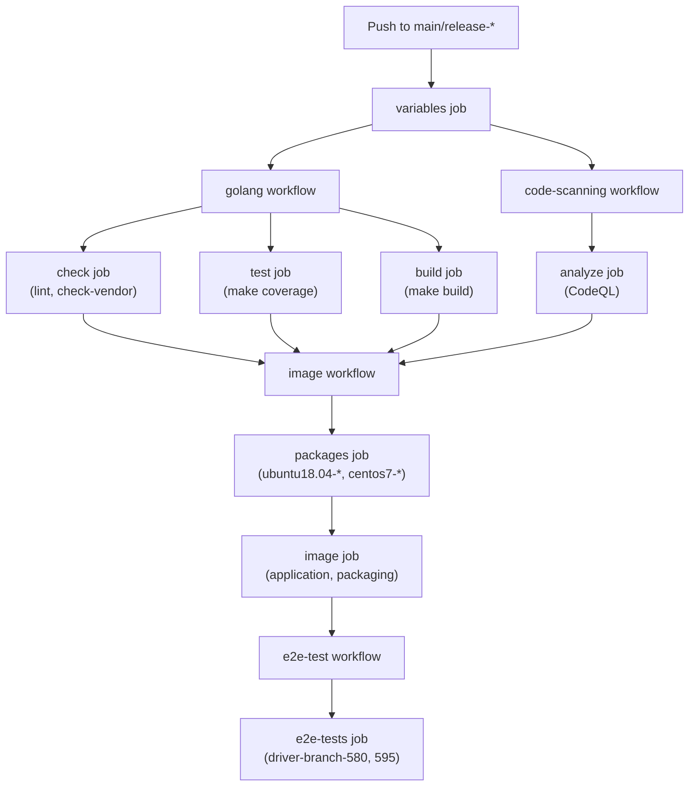

Sources: [.github/workflows/e2e.yaml:38-46](), [.github/workflows/golang.yaml:28-114](), [.github/workflows/image.yaml:27-237]()

### Internal GitLab Pipeline Stages
The internal GitLab CI pipeline defined in `.nvidia-ci.yml` handles security scanning, release, and publishing:

**Pipeline Stages (GitLab)**

| Stage | Jobs | Purpose |
|-------|------|---------|
| `pull` | `pull-images` | Copy images from GitHub Container Registry to internal registry |
| `scan` | `scan-images` | Security scanning with Pulse/SSA |
| `release` | `upload-kitmaker-packages`, `push-images-to-staging` | Upload to Artifactory and NGC staging |
| `ngc-publish` | `publish-images-to-ngc`, `publish-images-dummy` | Create NGC merge requests for production |

#### Internal CI Pipeline Flow

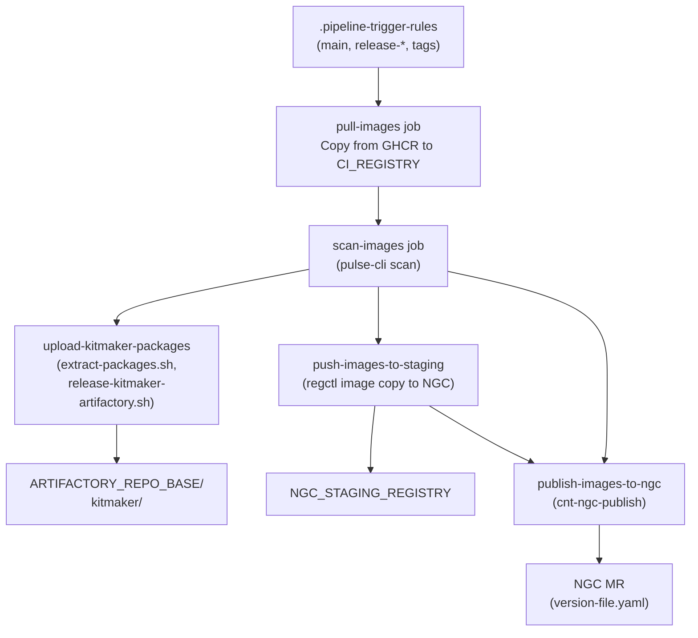

Sources: [.nvidia-ci.yml:45-67](), [.nvidia-ci.yml:113-142](), [.nvidia-ci.yml:154-190](), [.nvidia-ci.yml:192-230](), [.nvidia-ci.yml:232-291]()

### Dual CI Environment Architecture
The toolkit uses two CI systems that coordinate through shared container registries:

#### Integration Between GitHub Actions and GitLab CI

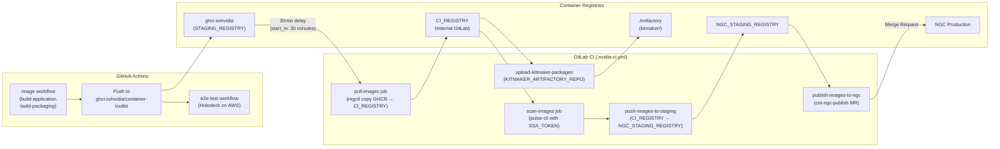

Sources: [.nvidia-ci.yml:113-142](), [.nvidia-ci.yml:154-190](), [.nvidia-ci.yml:192-230](), [.nvidia-ci.yml:232-291]()

## Package Building

### GitHub Actions Package Matrix
The `packages` job in `.github/workflows/image.yaml` builds packages for multiple distributions and architectures using a matrix strategy:

**Package Build Matrix**

| Job Target | Distribution | Architecture |
|------------|--------------|--------------|
| `ubuntu18.04-amd64` | Ubuntu 18.04 | amd64 |
| `centos7-x86_64` | CentOS 7 | x86_64 |
| `ubuntu18.04-arm64` | Ubuntu 18.04 | arm64 |
| `centos7-aarch64` | CentOS 7 | aarch64 |

#### Package Build Process Flow

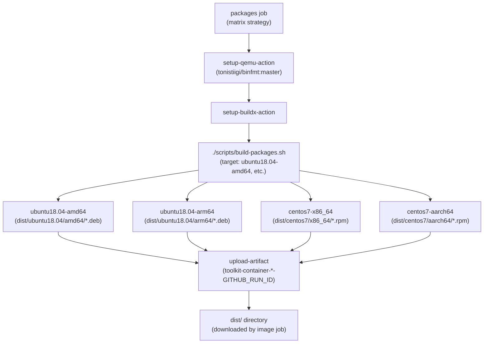

Sources: [.github/workflows/image.yaml:27-70](), [scripts/build-packages.sh:28-44]()

### Build Script Execution
The `build-packages.sh` script orchestrates package building for each target:

| Build Argument | Example Value | Purpose |
|----------------|---------------|---------|
| Target | `ubuntu18.04-amd64` | Specifies distribution and architecture |
| Output | `$GITHUB_WORKSPACE/dist/` | Package output directory |
| Compression | `compression-level: 0` | Artifact upload optimization |

The `build-all-components.sh` script is called by `build-packages.sh` for each target [scripts/build-packages.sh:43](). It builds `libnvidia-container` and `nvidia-container-toolkit` packages, placing them in the `DIST_DIR` [scripts/build-all-components.sh:59-73]().

Sources: [.github/workflows/image.yaml:54-59](), [scripts/build-packages.sh:28-44](), [scripts/build-all-components.sh:40-76]()

### Package Artifact Structure
After the `packages` job completes, artifacts are uploaded with the following structure:

```
dist/
├── ubuntu18.04/
│   ├── amd64/
│   │   ├── libnvidia-container*.deb
│   │   ├── nvidia-container-toolkit*.deb
│   │   └── nvidia-container-toolkit-operator-extensions*.deb
│   └── arm64/
│       └── *.deb
└── centos7/
    ├── x86_64/
    │   ├── libnvidia-container*.rpm
    │   ├── nvidia-container-toolkit*.rpm
    │   └── nvidia-container-toolkit-operator-extensions*.rpm
    └── aarch64/
        └── *.rpm
```

The `image` job downloads these artifacts using `download-artifact` with pattern `toolkit-container-*-${{ github.run_id }}` and merges them into a single `dist/` directory before building container images [.github/workflows/image.yaml:121-126]().

Sources: [.github/workflows/image.yaml:121-126](), [scripts/release-packages.sh:127-131]()

## Image Building

### Container Image Types
The `image` job builds two container image variants using a matrix strategy:

**Image Build Targets**

| Target | Dockerfile Stage | Output Tag | Contents |
|--------|------------------|------------|----------|
| `application` | `application` | `${VERSION}` | Installer binary + extracted packages |
| `packaging` | `packaging` | `${VERSION}-packaging` | All DEB/RPM packages + manifest.txt |

#### Container Image Build Flow

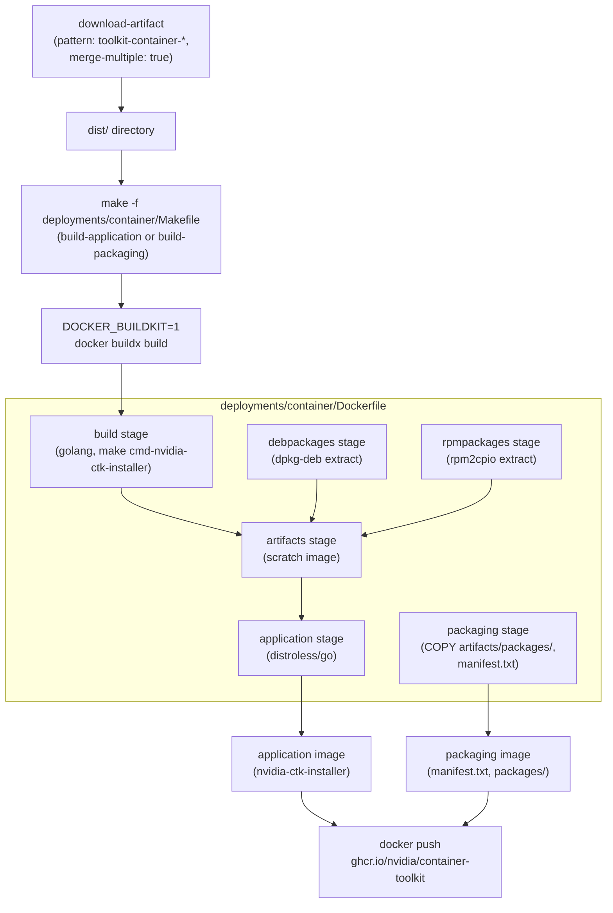

Sources: [.github/workflows/image.yaml:121-147](), [.github/workflows/image.yaml:180-206](), [deployments/container/Dockerfile:19-181](), [deployments/container/Makefile:68-96]()

### Dockerfile Multi-Stage Build
The `Dockerfile` uses multiple stages to construct the final images:

**Dockerfile Stages**

| Stage Name | Base Image | Purpose | Build Args |
|------------|------------|---------|------------|
| `build` | `nvcr.io/nvidia/cuda:12.9.1-base-ubi9` | Compile `nvidia-ctk-installer` | `GOLANG_VERSION`, `VERSION`, `GIT_COMMIT` |
| `shell` | `debian:trixie-slim` | Build static busybox layout | None |
| `packaging` | `nvcr.io/nvidia/distroless/go:v4.1.1` | Package all DEB/RPM files | `ARTIFACTS_ROOT`, `PACKAGE_VERSION` |
| `debpackages` | `nvcr.io/nvidia/cuda:12.9.1-base-ubuntu20.04` | Extract DEB packages | `PACKAGE_DIST_DEB`, `TARGETARCH` |
| `rpmpackages` | `nvcr.io/nvidia/cuda:12.9.1-base-ubi9` | Extract RPM packages | `PACKAGE_DIST_RPM`, `TARGETARCH` |
| `artifacts` | `scratch` | Collect extracted packages | None |
| `application` | `nvcr.io/nvidia/distroless/go:v4.1.1` | Final installer image | `VERSION` |

Sources: [deployments/container/Dockerfile:19-203]()

### Multi-Architecture Build Configuration
The Makefile supports both single-arch and multi-arch builds based on the `BUILD_MULTI_ARCH_IMAGES` variable:

**Build Mode Selection**

| Mode | File | Platforms | Push Behavior |
|------|------|-----------|---------------|
| Single-arch | `native-only.mk` | `linux/$(ARCH)` (detected) | Push if `PUSH_ON_BUILD=true` |
| Multi-arch | `multi-arch.mk` | `linux/amd64,linux/arm64` | Always push with buildx |

#### Multi-Architecture Build Process

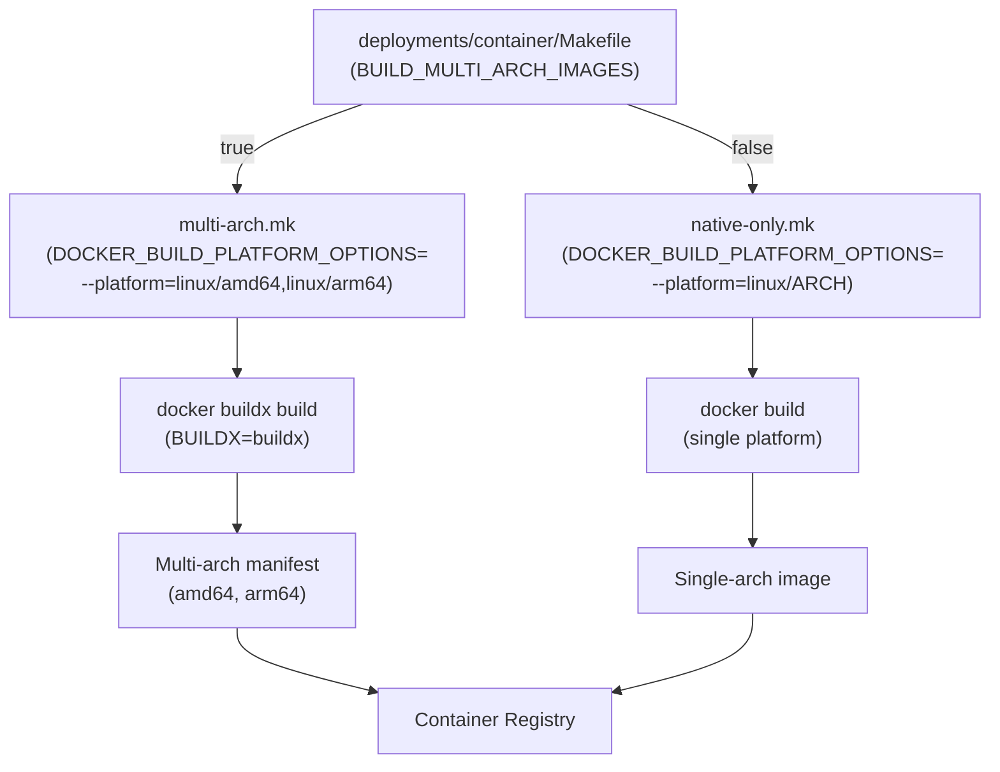

In GitHub Actions, `BUILD_MULTI_ARCH_IMAGES` is set to `true` for `main` and `release-*` branches.

Sources: [deployments/container/Makefile:15-59](), [deployments/container/native-only.mk:15-25](), [deployments/container/multi-arch.mk:15-22]()

## Testing

### Test Job Categories
The CI pipeline executes three types of testing:

**Testing Jobs**

| Workflow | Job | Test Type | Trigger |
|----------|-----|-----------|---------|
| `golang.yaml` | `test` | Unit tests (`make coverage`) | All pushes/PRs |
| `golang.yaml` | `check` | Linting (`golangci-lint`) | All pushes/PRs |
| `e2e.yaml` | `e2e-tests` | End-to-end tests (Holodeck) | After image build |

#### Test Execution Flow

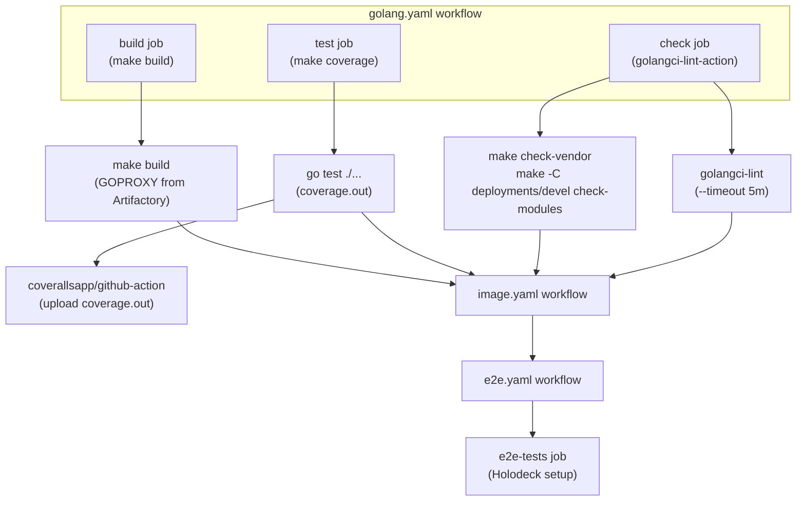

Sources: [.github/workflows/golang.yaml:28-114]()

### End-to-End Testing with Holodeck
The `e2e-tests` job provisions GPU infrastructure on AWS and executes integration tests:

**E2E Test Matrix**

| Driver Branch | Instance Type | Skipped on PR |
|---------------|---------------|---------------|
| 580 | g4dn.xlarge | No |
| 595 | g4dn.xlarge | Yes |

#### Holodeck-Based E2E Test Flow

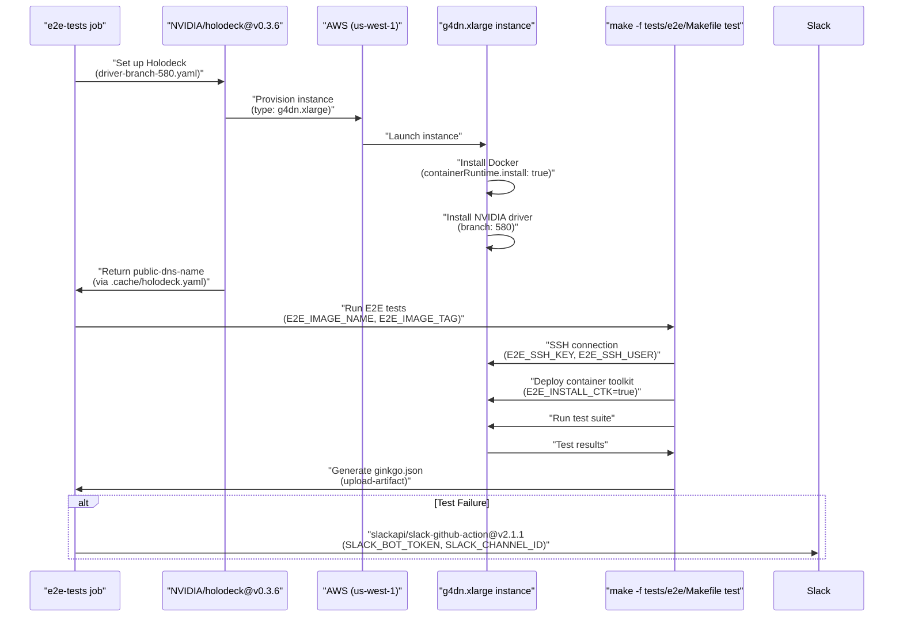

**Holodeck Configuration Files**

| File | Driver Branch | NVIDIA Driver | Container Runtime |
|------|---------------|---------------|-------------------|
| `tests/e2e/infra/driver-branch-580.yaml` | 580 | `branch: 580` | Docker |
| `tests/e2e/infra/driver-branch-595.yaml` | 595 | `branch: 595` | Docker |

Sources: [.github/workflows/e2e.yaml:38-115](), [tests/e2e/infra/driver-branch-580.yaml:1-31](), [tests/e2e/infra/driver-branch-595.yaml:1-31]()

## Security Scanning

### Code Scanning with CodeQL
The `code_scanning.yaml` workflow runs GitHub CodeQL analysis on Go code:

**CodeQL Configuration**

| Property | Value |
|----------|-------|
| Workflow | `.github/workflows/code_scanning.yaml` |
| Job | `analyze` |
| Languages | `go` |
| Build Mode | `manual` (run `make build`) |
| Trigger | All PRs to `main`/`release-*` |

#### CodeQL Analysis Flow

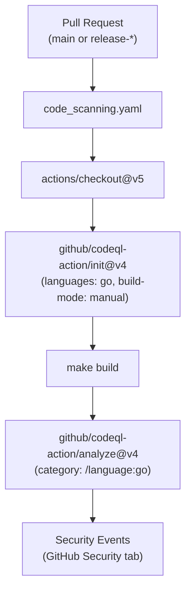

Sources: [.github/workflows/code_scanning.yaml:15-49]()

### Container Image Scanning with Pulse
The GitLab `scan-images` job performs vulnerability scanning using NVIDIA's Pulse tool:

**Pulse Scanning Configuration**

| Property | Value |
|----------|-------|
| Job | `scan-images` |
| Tool | `pulse-cli` |
| Matrix | `TAG_SUFFIX: ["", "-packaging"]`, `PLATFORM: ["linux/amd64", "linux/arm64"]` |
| Authentication | `SSA_TOKEN` (from `SSA_CLIENT_ID`, `SSA_CLIENT_SECRET`) |
| Policy | `CONTAINER_POLICY` |

#### Pulse Scan Process

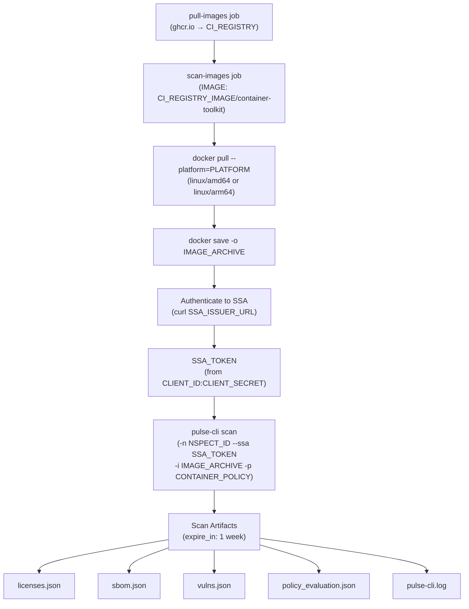

Sources: [.nvidia-ci.yml:154-190]()

## Release Process

### Release Jobs and Targets
The GitLab CI pipeline includes multiple release jobs that publish artifacts to different registries:

**Release Job Matrix**

| Job | Stage | Purpose | Output Registry |
|-----|-------|---------|-----------------|
| `upload-kitmaker-packages` | `release` | Extract and upload packages | `KITMAKER_ARTIFACTORY_REPO` |
| `push-images-to-staging` | `release` | Copy images to NGC staging | `NGC_STAGING_REGISTRY` |
| `publish-images-to-ngc` | `ngc-publish` | Create NGC production MR | NGC Production (via MR) |
| `publish-images-dummy` | `ngc-publish` | Test publishing workflow | `dl/container-dev/ngc-automation` |

#### Release Pipeline Flow

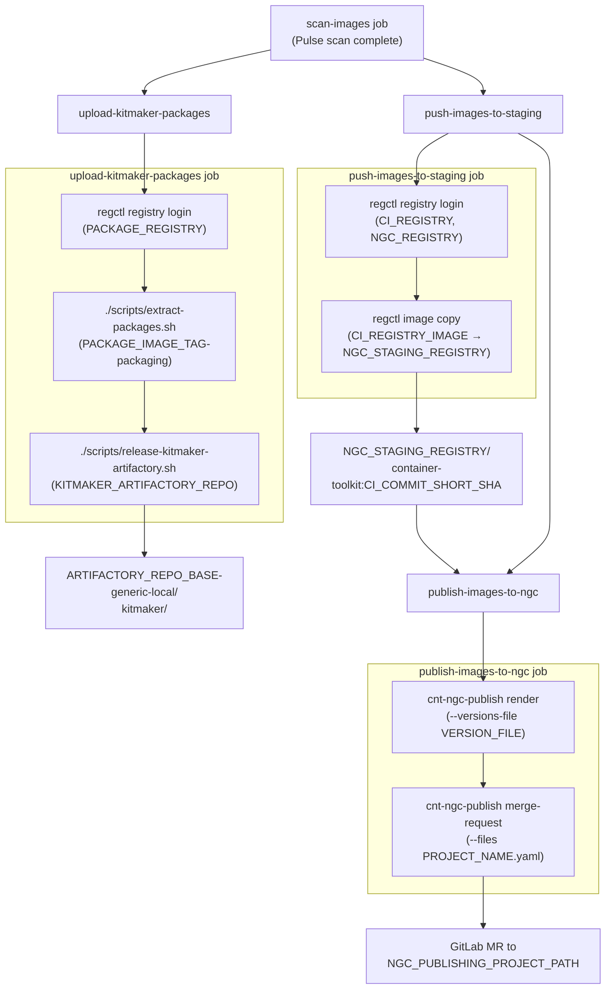

Sources: [.nvidia-ci.yml:192-230](), [.nvidia-ci.yml:232-291]()

### Package Extraction and Upload Process
The `upload-kitmaker-packages` job extracts packages from the packaging container image and uploads them to Artifactory:

**Package Upload Variables**

| Variable | Example Value | Purpose |
|----------|---------------|---------|
| `PACKAGE_IMAGE_NAME` | `${CI_REGISTRY_IMAGE}/container-toolkit` | Source image |
| `PACKAGE_IMAGE_TAG` | `${CI_COMMIT_SHORT_SHA}-packaging` | Packaging image tag |
| `KITMAKER_ARTIFACTORY_REPO` | `${ARTIFACTORY_REPO_BASE}-generic-local/kitmaker` | Upload destination |
| `ARTIFACTS_DIR` | `${CI_PROJECT_DIR}/artifacts` | Local extraction directory |

#### Package Upload Script Flow

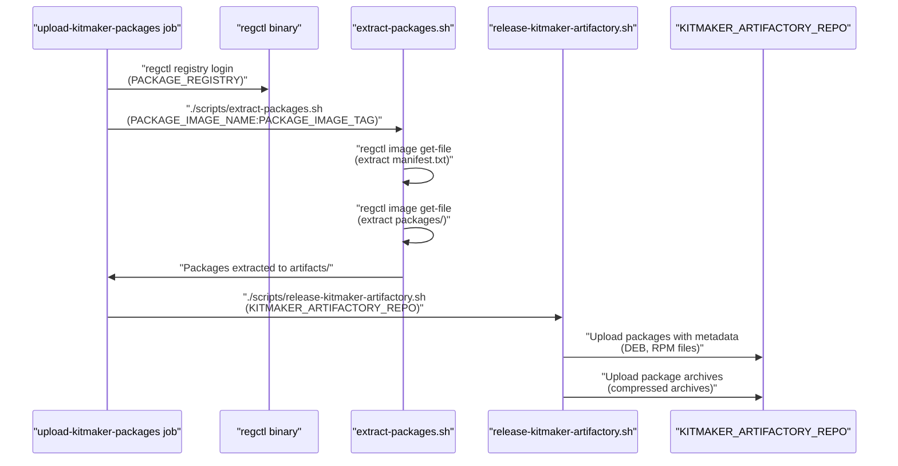

The `extract-packages.sh` script reads the `manifest.txt` file from the packaging image (which contains absolute paths to all DEB and RPM files) and extracts them using `regctl image get-file` [scripts/extract-packages.sh:88-100](). The `release-kitmaker-artifactory.sh` script then creates kitmaker archives and uploads them to Artifactory [scripts/release-kitmaker-artifactory.sh:99-190]().

Sources: [.nvidia-ci.yml:192-211](), [scripts/extract-packages.sh:37-106](), [scripts/release-kitmaker-artifactory.sh:48-214]()

## NGC Publishing with Merge Requests

The `publish-images-to-ngc` job creates a merge request to promote images from NGC staging to production:

**NGC Publishing Configuration**

| Variable | Value | Purpose |
|----------|-------|---------|
| `CNT_NGC_PUBLISH_IMAGE` | Custom publish image | Container with `cnt-ngc-publish` tool |
| `NGC_PUBLISHING_PROJECT_PATH` | Target NGC project | MR destination (overridable) |
| `IN_IMAGE_TAG` | `${CI_COMMIT_SHORT_SHA}` | Staging image tag |
| `OUT_IMAGE_TAG` | `${CI_COMMIT_TAG}` | Production image tag |
| `PROJECT_NAME` | `nvidia-container-toolkit` | NGC project name |

#### NGC Publishing Workflow

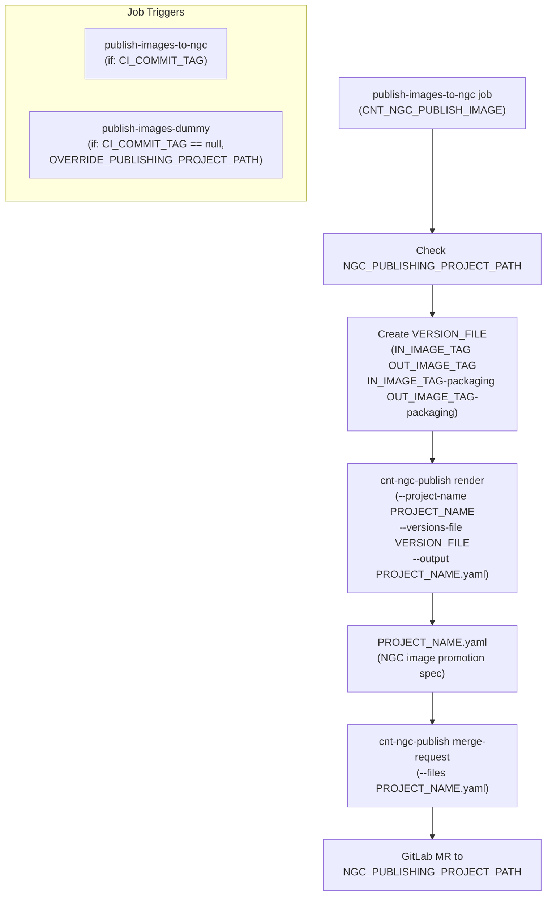

The `publish-images-dummy` job tests the publishing workflow on non-tag commits by creating a dummy MR to `dl/container-dev/ngc-automation` with a test tag `publish-${CI_COMMIT_SHORT_SHA}`.

Sources: [.nvidia-ci.yml:232-291]()

## Pipeline Trigger Rules

### GitHub Actions Triggers
The main CI workflow (`.github/workflows/ci.yaml`) triggers on:

```yaml
on:
  push:
    branches:
      - "pull-request/[0-9]+"
      - main
      - release-*
```

Each workflow has specific trigger rules:

| Workflow | Trigger |
|----------|---------|
| `ci.yaml` | Push to `main`, `release-*`, `pull-request/*` |
| `code_scanning.yaml` | All PRs to `main`/`release-*` |
| `e2e.yaml` | Called by `ci.yaml` (workflow_call) |
| `image.yaml` | Called by `ci.yaml` (workflow_call) |
| `golang.yaml` | Called by `ci.yaml` (workflow_call) |

Sources: [.github/workflows/cherrypick.yml:17-23](), [.github/workflows/code_scanning.yaml:17-25](), [.github/workflows/e2e.yaml:18-19](), [.github/workflows/golang.yaml:18-25](), [.github/workflows/image.yaml:18-19]()

### GitLab CI Triggers
The `.nvidia-ci.yml` pipeline defines `.pipeline-trigger-rules` for internal CI:

**GitLab Trigger Rules**

```yaml
.pipeline-trigger-rules:
  rules:
    - if: $CI_PIPELINE_SOURCE == "web"        # Manual trigger
    - if: $CI_COMMIT_BRANCH == "main"         # main branch
    - if: $CI_COMMIT_BRANCH =~ /^release-.*$/ # release-* branches
    - if: $CI_COMMIT_TAG && $CI_COMMIT_TAG != "" # Git tags
```

The workflow also includes MR-triggered pipelines:

```yaml
workflow:
  rules:
    - if: $CI_PIPELINE_SOURCE == 'merge_request_event'
    - !reference [.pipeline-trigger-rules, rules]
```

Sources: [.nvidia-ci.yml:51-67]()

## Conclusion
The NVIDIA Container Toolkit CI/CD pipeline provides a comprehensive automation system for building, testing, scanning, and releasing packages and container images across multiple distributions and architectures. The dual GitLab CI and GitHub Actions implementation enables both internal and community-facing development workflows while ensuring quality and security standards are maintained.

---

