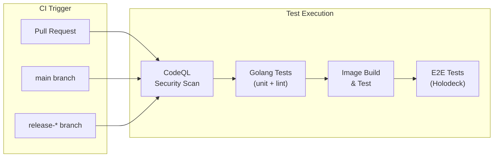
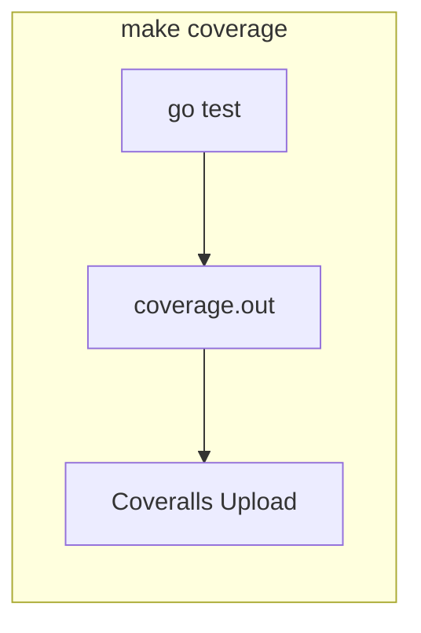
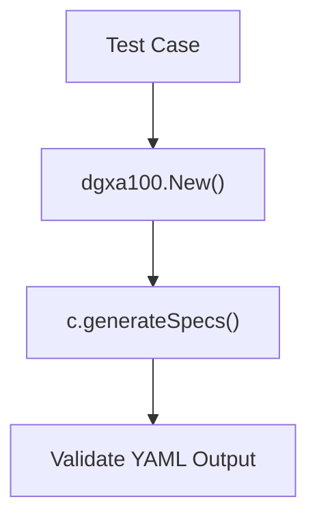
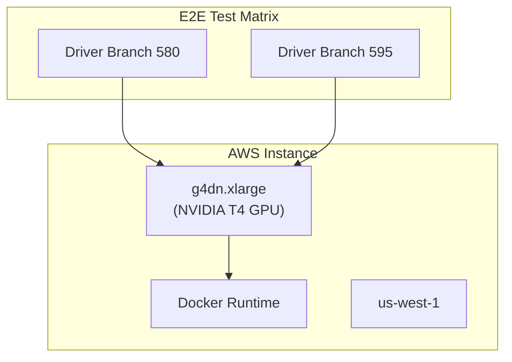
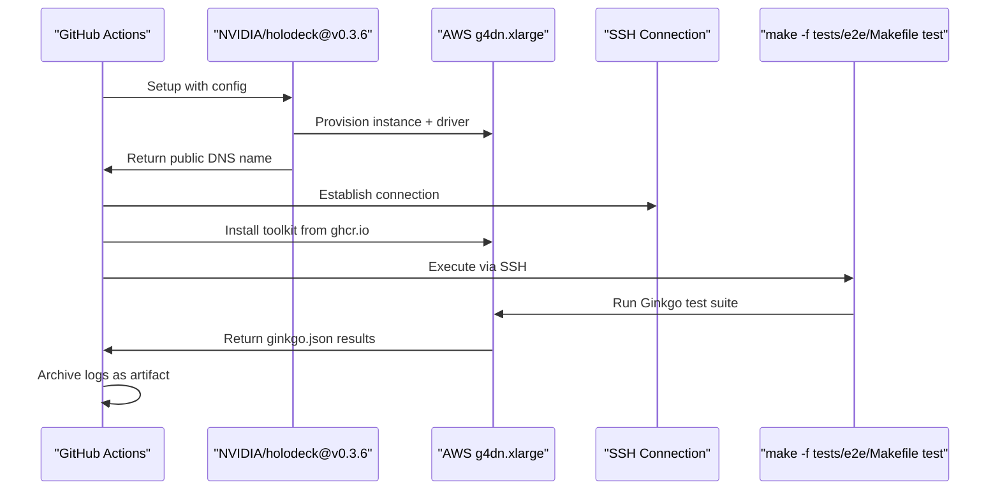
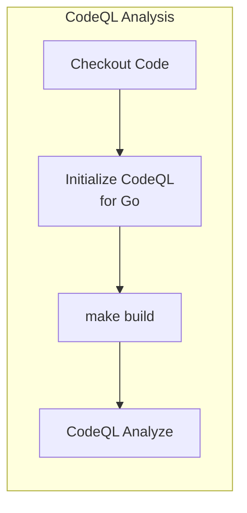
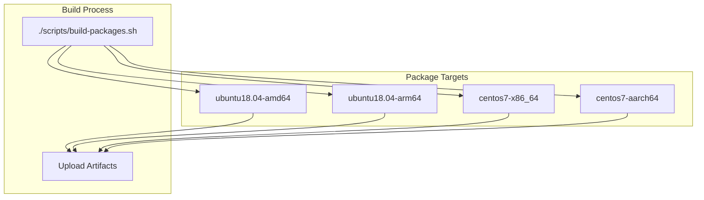
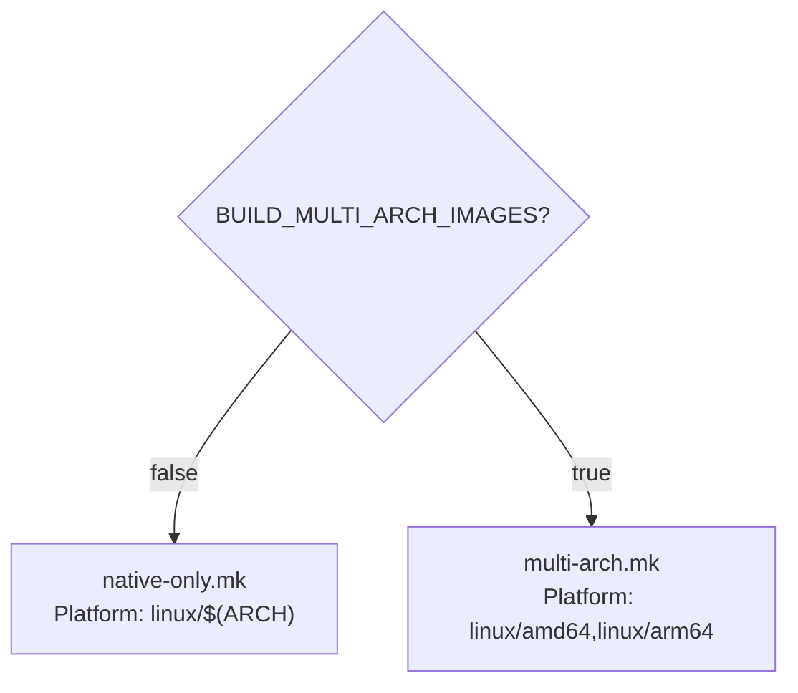
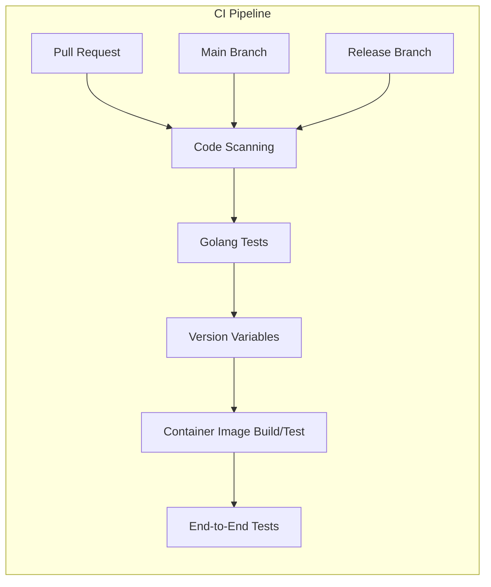

<!-- source: DeepWiki mcp.deepwiki.com · repo NVIDIA/nvidia-container-toolkit · page 6.3 Testing Strategy · fetched 2026-10-26 -->

# Testing Strategy

<details>
<summary>Relevant source files</summary>

The following files were used as context for generating this wiki page:

- [.dockerignore](.dockerignore)
- [.github/workflows/code_scanning.yaml](.github/workflows/code_scanning.yaml)
- [.github/workflows/e2e.yaml](.github/workflows/e2e.yaml)
- [.github/workflows/golang.yaml](.github/workflows/golang.yaml)
- [.github/workflows/image.yaml](.github/workflows/image.yaml)
- [deployments/container/Dockerfile](deployments/container/Dockerfile)
- [deployments/container/Dockerfile.rpmrebuild](deployments/container/Dockerfile.rpmrebuild)
- [deployments/container/Makefile](deployments/container/Makefile)
- [deployments/container/multi-arch.mk](deployments/container/multi-arch.mk)
- [deployments/container/native-only.mk](deployments/container/native-only.mk)
- [deployments/systemd/nvidia-cdi-refresh.env](deployments/systemd/nvidia-cdi-refresh.env)
- [deployments/systemd/nvidia-cdi-refresh.service](deployments/systemd/nvidia-cdi-refresh.service)
- [deployments/udev/99-nvidia-cdi-refresh.rules](deployments/udev/99-nvidia-cdi-refresh.rules)
- [docker/Dockerfile.debian](docker/Dockerfile.debian)
- [docker/Dockerfile.opensuse-leap](docker/Dockerfile.opensuse-leap)
- [docker/Dockerfile.rpm-yum](docker/Dockerfile.rpm-yum)
- [docker/Dockerfile.ubuntu](docker/Dockerfile.ubuntu)
- [docker/docker.mk](docker/docker.mk)
- [packaging/debian/nvidia-container-toolkit-base.install](packaging/debian/nvidia-container-toolkit-base.install)
- [packaging/debian/nvidia-container-toolkit-base.postinst](packaging/debian/nvidia-container-toolkit-base.postinst)
- [packaging/debian/rules](packaging/debian/rules)
- [scripts/repackage-rpms.sh](scripts/repackage-rpms.sh)
- [tests/e2e/Makefile](tests/e2e/Makefile)
- [tests/e2e/e2e_test.go](tests/e2e/e2e_test.go)
- [tests/e2e/infra/driver-branch-580.yaml](tests/e2e/infra/driver-branch-580.yaml)
- [tests/e2e/infra/driver-branch-595.yaml](tests/e2e/infra/driver-branch-595.yaml)
- [tests/e2e/installer.go](tests/e2e/installer.go)
- [tests/e2e/nvidia-cdi-refresh_test.go](tests/e2e/nvidia-cdi-refresh_test.go)
- [tests/e2e/nvidia-container-cli_test.go](tests/e2e/nvidia-container-cli_test.go)
- [tests/e2e/nvidia-container-toolkit_test.go](tests/e2e/nvidia-container-toolkit_test.go)
- [tests/e2e/runner.go](tests/e2e/runner.go)
- [tests/go.mod](tests/go.mod)
- [tests/go.sum](tests/go.sum)
- [tests/vendor/github.com/onsi/ginkgo/v2/CHANGELOG.md](tests/vendor/github.com/onsi/ginkgo/v2/CHANGELOG.md)
- [tests/vendor/github.com/onsi/ginkgo/v2/core_dsl.go](tests/vendor/github.com/onsi/ginkgo/v2/core_dsl.go)
- [tests/vendor/github.com/onsi/ginkgo/v2/decorator_dsl.go](tests/vendor/github.com/onsi/ginkgo/v2/decorator_dsl.go)
- [tests/vendor/github.com/onsi/ginkgo/v2/internal/group.go](tests/vendor/github.com/onsi/ginkgo/v2/internal/group.go)
- [tests/vendor/github.com/onsi/ginkgo/v2/internal/node.go](tests/vendor/github.com/onsi/ginkgo/v2/internal/node.go)
- [tests/vendor/github.com/onsi/ginkgo/v2/internal/suite.go](tests/vendor/github.com/onsi/ginkgo/v2/internal/suite.go)
- [tests/vendor/github.com/onsi/ginkgo/v2/reporters/default_reporter.go](tests/vendor/github.com/onsi/ginkgo/v2/reporters/default_reporter.go)
- [tests/vendor/github.com/onsi/ginkgo/v2/types/types.go](tests/vendor/github.com/onsi/ginkgo/v2/types/types.go)
- [tests/vendor/github.com/onsi/ginkgo/v2/types/version.go](tests/vendor/github.com/onsi/ginkgo/v2/types/version.go)
- [tests/vendor/modules.txt](tests/vendor/modules.txt)

</details>


This document describes the testing approach used in the NVIDIA Container Toolkit project, including unit tests, end-to-end tests with Holodeck on AWS GPU instances, and security scanning with CodeQL.

For information about the CI/CD pipeline that orchestrates these tests, see page 6.2. For development environment setup, see page 6.1.

## Testing Layers

The toolkit employs a multi-layered testing approach:

| Test Layer | Framework | Location | Coverage |
|------------|-----------|----------|----------|
| Unit Tests | Go testing | `*_test.go` files | Individual functions and packages |
| E2E Tests | Ginkgo | `tests/e2e/` | Full system on GPU hardware |
| Security Scanning | CodeQL | `.github/workflows/code_scanning.yaml` | Static code analysis |
| Package Testing | Docker | `deployments/container/Makefile` | Container image validation |

### Testing Flow in CI Pipeline



Sources: [.github/workflows/e2e.yaml:38-49](), [.github/workflows/golang.yaml:28-114]()

## Unit Testing

### Go Test Framework

Unit tests use the standard Go testing package and are located in `*_test.go` files throughout the codebase. Tests verify individual functions, methods, and package-level logic.

**Test Execution via Makefile**



Sources: [.github/workflows/golang.yaml:75-84]()

### Key Test Files

| Test File | Purpose |
|-----------|---------|
| `tests/e2e/nvidia-container-toolkit_test.go` | E2E tests for `nvidia-container-toolkit` |
| `tests/e2e/nvidia-container-cli_test.go` | E2E tests for `nvidia-container-cli` |
| `tests/e2e/nvidia-cdi-refresh_test.go` | E2E tests for `nvidia-cdi-refresh` service |
| `tests/e2e/e2e_test.go` | E2E test suite setup and teardown |

**Example: CDI Generation Testing with Mock NVML**

The CDI generation tests in `cmd/nvidia-ctk/cdi/generate/generate_test.go` use a mock NVML server to simulate GPU hardware without requiring physical devices.



The mock overrides driver version and device count to match test fixtures in `testdata/lookup/`.

**Test Execution Environment**

Tests that require filesystem access use the `__NVCT_TESTING_DEVICES_ARE_FILES` environment variable to treat device nodes as regular files during testing.

Sources: [tests/e2e/nvidia-container-toolkit_test.go:32-142](), [tests/e2e/nvidia-container-cli_test.go:32-111](), [tests/e2e/nvidia-cdi-refresh_test.go:32-142]()

## End-to-End Testing with Holodeck

E2E tests validate the complete toolkit functionality on real AWS GPU instances using the Holodeck infrastructure provisioning tool.

### Holodeck Infrastructure Configuration

**Driver Branch Testing**

E2E tests run against multiple NVIDIA driver branches to ensure compatibility:



Configuration files specify the test environment:
- [tests/e2e/infra/driver-branch-580.yaml:1-31]() - Driver 580 configuration
- [tests/e2e/infra/driver-branch-595.yaml:1-31]() - Driver 595 configuration

Sources: [.github/workflows/e2e.yaml:40-49](), [tests/e2e/infra/driver-branch-580.yaml:1-31](), [tests/e2e/infra/driver-branch-595.yaml:1-31]()

### E2E Workflow Execution



Sources: [.github/workflows/e2e.yaml:67-101]()

### Test Environment Variables

The E2E workflow uses specific environment variables to configure the test execution:

| Variable | Value | Purpose |
|----------|-------|---------|
| `E2E_INSTALL_CTK` | `"true"` | Install toolkit in test environment |
| `E2E_IMAGE_NAME` | `ghcr.io/nvidia/container-toolkit` | Image to test |
| `E2E_IMAGE_TAG` | `${{ inputs.version }}` | Version to test |
| `E2E_SSH_USER` | `"ubuntu"` | SSH user for instance access |
| `E2E_SSH_HOST` | From Holodeck | Instance hostname |
| `E2E_SSH_KEY` | Secret | SSH private key |

Sources: [.github/workflows/e2e.yaml:82-92]()

### Ginkgo Test Results

Test results are collected in `ginkgo.json` format and archived as GitHub Actions artifacts [.github/workflows/e2e.yaml:96-101](). This allows reviewing test output after workflow completion.

**PR vs. Main Branch Testing**

Pull requests run E2E tests only against driver branch 580 to reduce test time, while main and release branches test both driver branches [.github/workflows/e2e.yaml:42-49]().

Sources: [.github/workflows/e2e.yaml:81-101]()

### Slack Notifications

Failed E2E tests trigger Slack notifications to alert the team [.github/workflows/e2e.yaml:103-114]().

Sources: [.github/workflows/e2e.yaml:103-114]()

## Security Scanning with CodeQL

The project uses GitHub's CodeQL static analysis tool to identify security vulnerabilities and code quality issues.

### CodeQL Workflow



Sources: [.github/workflows/code_scanning.yaml:27-49]()

### Analysis Configuration

The CodeQL workflow:
- **Language**: Go [.github/workflows/code_scanning.yaml:41]()
- **Build Mode**: Manual (requires explicit `make build`) [.github/workflows/code_scanning.yaml:42]()
- **Trigger**: Pull requests and workflow calls [.github/workflows/code_scanning.yaml:17-25]()
- **Timeout**: 360 minutes [.github/workflows/code_scanning.yaml:31]()

The analysis runs with `security-events: write` permission to upload findings to GitHub Security [.github/workflows/code_scanning.yaml:33]().

Sources: [.github/workflows/code_scanning.yaml:15-49]()

## Package and Image Testing

Container images are tested to ensure correct packaging across architectures and distributions.

### Multi-Architecture Package Building

**Build Matrix**



For pull requests, only `ubuntu18.04-amd64` and `centos7-x86_64` are built to reduce CI time [.github/workflows/image.yaml:38-44]()

Sources: [.github/workflows/image.yaml:29-71]()

### Container Image Build

Images are built using multi-stage Dockerfiles:

**Dockerfile Stages**

| Stage | Purpose | Base Image |
|-------|---------|------------|
| `build` | Compile `nvidia-ctk-installer` | `nvcr.io/nvidia/cuda:12.9.1-base-ubi9` |
| `packaging` | Collect all packages | `nvcr.io/nvidia/distroless/go:v4.1.1` |
| `debpackages` | Extract DEB packages | `nvcr.io/nvidia/cuda:12.9.1-base-ubuntu20.04` |
| `rpmpackages` | Extract RPM packages | `nvcr.io/nvidia/cuda:12.9.1-base-ubi9` |
| `application` | Final runtime image | `nvcr.io/nvidia/distroless/go:v4.1.1` |

Sources: [deployments/container/Dockerfile:19-182](), [.github/workflows/image.yaml:94-206]()

### Test Execution Commands

The packaging image includes a manifest file listing all packages:

**Packaging Test**

The test verifies package directories exist [deployments/container/Makefile:115-123]():
```
docker run --rm $(IMAGE) test -d "/artifacts/packages/centos7/aarch64"
docker run --rm $(IMAGE) test -d "/artifacts/packages/centos7/x86_64"
docker run --rm $(IMAGE) test -d "/artifacts/packages/ubuntu18.04/amd64"
docker run --rm $(IMAGE) test -d "/artifacts/packages/ubuntu18.04/arm64"
```

Sources: [deployments/container/Makefile:115-123]()

### Build Configuration

**Platform Selection**



Native-only builds use the host architecture [deployments/container/native-only.mk:15-25](), while multi-arch builds target both amd64 and arm64 [deployments/container/multi-arch.mk:15-22]().

Sources: [deployments/container/Makefile:15-59](), [deployments/container/native-only.mk:15-25](), [deployments/container/multi-arch.mk:15-22]()

## CI Pipeline Integration

The testing framework is integrated into the CI pipeline to ensure that all code changes are properly tested before being merged.

### CI Pipeline Structure



Sources: [.github/workflows/e2e.yaml:18-23](), [.github/workflows/golang.yaml:18-26]()

### Testing Triggers

Tests are automatically triggered on:
1. Pull requests to the `main` or `release-*` branches
2. Direct pushes to the `main` branch
3. Direct pushes to `release-*` branches

For pull requests, a reduced set of tests is run to provide faster feedback. Complete multi-architecture builds and end-to-end tests are performed when changes are merged to `main` or `release-*` branches.

Sources: [.github/workflows/e2e.yaml:18-23](), [.github/workflows/golang.yaml:18-26]()

## Best Practices for Adding Tests

When adding new features or fixing bugs in the NVIDIA Container Toolkit, you should consider the following testing best practices:

1. **Write unit tests** for new functionality to ensure it works as expected
2. **Add integration tests** for interactions between components
3. **Update container image tests** if the packaging changes
4. **Extend end-to-end tests** for new features that affect how containers access GPUs

Tests should cover:
- Normal operation with valid inputs
- Error handling with invalid inputs
- Edge cases and boundary conditions
- Compatibility with different runtimes and platforms

## Conclusion

The testing framework for the NVIDIA Container Toolkit provides comprehensive coverage across multiple layers, from unit tests to end-to-end tests on real hardware. This ensures that the toolkit functions correctly across different container runtimes, Linux distributions, and hardware platforms.

The automated CI pipeline runs these tests for every code change, providing rapid feedback to developers and maintaining the quality and reliability of the toolkit.

---

