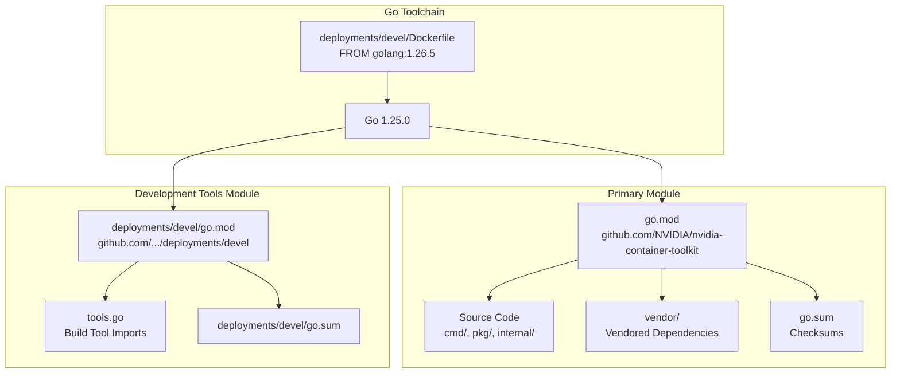
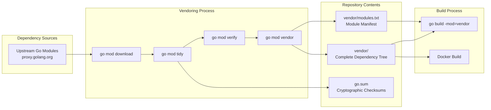
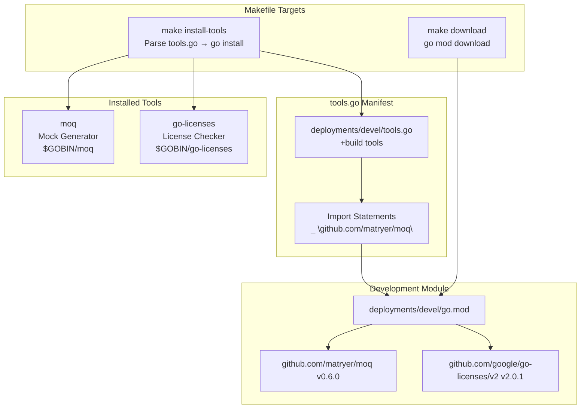
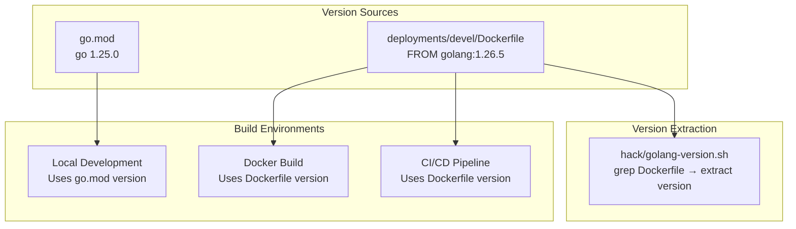
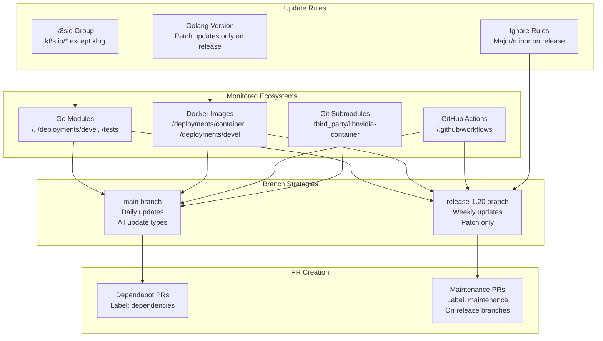
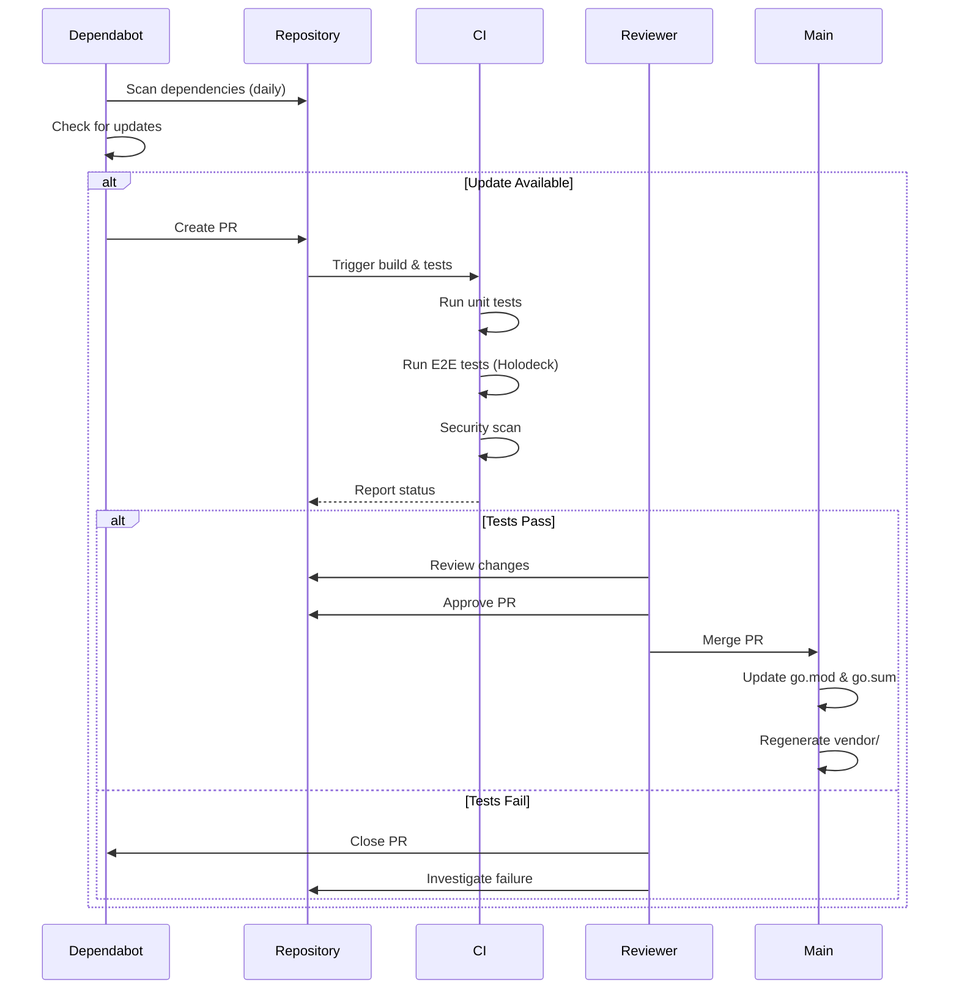
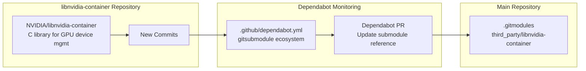
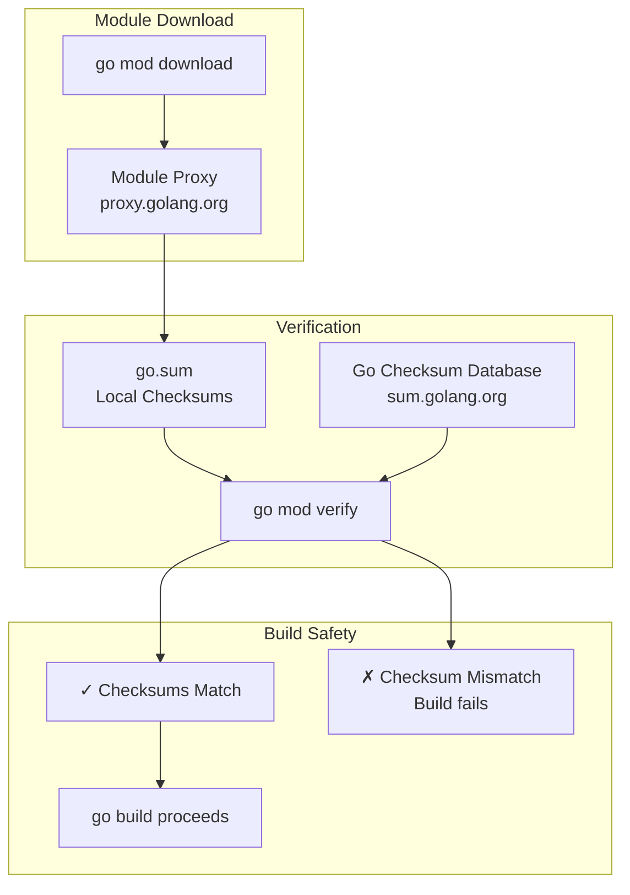

<!-- source: DeepWiki mcp.deepwiki.com · repo NVIDIA/nvidia-container-toolkit · page 6.4 Dependency Management · fetched 2026-10-26 -->

# Dependency Management

<details>
<summary>Relevant source files</summary>

The following files were used as context for generating this wiki page:

- [.github/dependabot.yml](.github/dependabot.yml)
- [.github/workflows/ci.yaml](.github/workflows/ci.yaml)
- [.github/workflows/third-party-notices-check.yaml](.github/workflows/third-party-notices-check.yaml)
- [.gitignore](.gitignore)
- [THIRD_PARTY_NOTICES.md](THIRD_PARTY_NOTICES.md)
- [deployments/devel/Dockerfile](deployments/devel/Dockerfile)
- [deployments/devel/Makefile](deployments/devel/Makefile)
- [deployments/devel/go.mod](deployments/devel/go.mod)
- [deployments/devel/go.sum](deployments/devel/go.sum)
- [deployments/devel/tools.go](deployments/devel/tools.go)
- [go.mod](go.mod)
- [go.sum](go.sum)
- [hack/generate-third-party-notices.sh](hack/generate-third-party-notices.sh)
- [hack/golang-version.sh](hack/golang-version.sh)
- [vendor/github.com/NVIDIA/go-nvlib/pkg/nvlib/device/device.go](vendor/github.com/NVIDIA/go-nvlib/pkg/nvlib/device/device.go)
- [vendor/github.com/NVIDIA/go-nvlib/pkg/nvlib/device/mig_profile.go](vendor/github.com/NVIDIA/go-nvlib/pkg/nvlib/device/mig_profile.go)
- [vendor/github.com/NVIDIA/go-nvlib/pkg/nvpci/mock.go](vendor/github.com/NVIDIA/go-nvlib/pkg/nvpci/mock.go)
- [vendor/github.com/NVIDIA/go-nvlib/pkg/nvpci/nvpci.go](vendor/github.com/NVIDIA/go-nvlib/pkg/nvpci/nvpci.go)
- [vendor/github.com/NVIDIA/go-nvlib/pkg/nvpci/nvpci_mock.go](vendor/github.com/NVIDIA/go-nvlib/pkg/nvpci/nvpci_mock.go)
- [vendor/github.com/NVIDIA/go-nvlib/pkg/nvpci/resources.go](vendor/github.com/NVIDIA/go-nvlib/pkg/nvpci/resources.go)
- [vendor/github.com/NVIDIA/go-nvlib/pkg/pciids/pciids.go](vendor/github.com/NVIDIA/go-nvlib/pkg/pciids/pciids.go)
- [vendor/modules.txt](vendor/modules.txt)

</details>


This document describes the Go module management, dependency vendoring, and automated dependency update mechanisms used in the NVIDIA Container Toolkit. For information about the build system and compilation process, see [Build System](#5.1). For CI/CD pipeline details, see [CI/CD Pipeline](#6.2).

## Overview

The project uses **Go modules** for dependency management with a **multi-module structure**: a primary module for the toolkit itself and a separate module for development tooling. Dependencies are **vendored** into the repository for reproducible builds, and **Dependabot** automates dependency updates across Go modules, Docker images, GitHub Actions, and Git submodules.

Sources: [go.mod:1-27](), [deployments/devel/go.mod:1-8](), [.github/dependabot.yml:1-121]()

---

## Module Structure

The project maintains two separate Go modules with distinct purposes:



**Primary Module Structure:**
- **Module Path:** `github.com/NVIDIA/nvidia-container-toolkit` [go.mod:1]()
- **Go Version:** `1.25.0` [go.mod:3]()
- **Location:** Repository root
- **Purpose:** Runtime dependencies for all executables

**Development Tools Module:**
- **Module Path:** `github.com/NVIDIA/k8s-device-plugin/deployments/devel` [deployments/devel/go.mod:1]()
- **Go Version:** `1.25` [deployments/devel/go.mod:3]()
- **Location:** `deployments/devel/`
- **Purpose:** Build-time tooling (mock generation, linters, etc.)

Sources: [go.mod:1-3](), [deployments/devel/go.mod:1-3](), [deployments/devel/Dockerfile:17]()

---

## Primary Dependencies

The main module's direct dependencies provide core functionality:

| Dependency | Version | Purpose |
|------------|---------|---------|
| `github.com/Masterminds/semver/v3` | `v3.5.0` | Semantic versioning parsing and comparison |
| `github.com/NVIDIA/go-nvlib` | `v0.12.0` | GPU device abstraction layer |
| `github.com/NVIDIA/go-nvml` | `v0.13.3-1` | NVML Go bindings for GPU management |
| `github.com/containerd/nri` | `v0.12.1` | Containerd NRI (Node Resource Interface) client library |
| `github.com/cyphar/filepath-securejoin` | `v0.7.0` | Secure filepath joining |
| `github.com/google/uuid` | `v1.6.0` | UUID generation and parsing |
| `github.com/moby/sys/mountinfo` | `v0.7.2` | Linux mount information parsing |
| `github.com/moby/sys/reexec` | `v0.1.0` | Re-execution of current binary |
| `github.com/moby/sys/symlink` | `v0.3.0` | Symlink utilities |
| `github.com/opencontainers/cgroups` | `v0.0.7` | Cgroups management |
| `github.com/opencontainers/runc` | `v1.4.3` | OCI runtime utilities |
| `github.com/opencontainers/runtime-spec` | `v1.3.0` | OCI runtime specification |
| `github.com/pelletier/go-toml` | `v1.9.5` | TOML configuration parsing |
| `github.com/prometheus/procfs` | `v0.21.1` | Process filesystem utilities |
| `github.com/sirupsen/logrus` | `v1.9.4` | Structured logging |
| `github.com/stretchr/testify` | `v1.11.1` | Testing framework |
| `github.com/urfave/cli-altsrc/v3` | `v3.1.0` | CLI config file support |
| `github.com/urfave/cli/v3` | `v3.10.1` | CLI framework |
| `golang.org/x/sys` | `v0.47.0` | System call interfaces |
| `tags.cncf.io/container-device-interface` | `v1.1.0` | CDI specification library |
| `tags.cncf.io/container-device-interface/specs-go` | `v1.1.0` | CDI spec Go types |

Sources: [go.mod:5-27](), [vendor/modules.txt:1-177]()

---

## Vendoring Strategy

Dependencies are vendored to ensure reproducible builds and reduce reliance on external package registries.



**Vendor Directory Structure:**
- **Path:** `vendor/`
- **Contents:** Complete source code for all transitive dependencies
- **Manifest:** `vendor/modules.txt` lists all vendored modules with versions and import paths
- **Verification:** `go.sum` contains cryptographic checksums for all modules

**Makefile Targets for Module Management:**

```bash
# From deployments/devel/Makefile
modules:
	go mod tidy
	go mod verify

check-modules: modules
	git diff --quiet HEAD -- go.mod go.sum
```

These targets ensure `go.mod` and `go.sum` are synchronized and committed changes are tracked.

Sources: [vendor/modules.txt:1-177](), [go.sum:1-86](), [deployments/devel/Makefile:38-43]()

---

## Development Tools Management

Build-time tools are isolated in a separate module to avoid polluting the primary module's dependency tree.



**`tools.go` Pattern:**

The `tools.go` file uses blank imports to declare tool dependencies without importing them into production code:

```go
//go:build tools
// +build tools

package main

// Define the tooling required to build the device plugin.
import (
    _ "github.com/google/go-licenses/v2"
    _ "github.com/matryer/moq"
)
```
[deployments/devel/tools.go:1-26]()

**Installation Process:**

The Makefile extracts tool imports and installs them:

```bash
install-tools: download
	@echo Installing tools from tools.go
	@cat tools.go | grep _ | awk -F'"' '{print $$2}' | xargs -tI % go install %
```
[deployments/devel/Makefile:19-22]()

This approach:
- Keeps tool versions in version control
- Prevents tools from affecting production dependencies
- Enables reproducible builds with consistent tooling

Sources: [deployments/devel/tools.go:1-26](), [deployments/devel/go.mod:1-8](), [deployments/devel/Makefile:15-22]()

---

## Go Version Management

The Go toolchain version is managed consistently across build environments:



**Version Specifications:**

- **go.mod:** Declares minimum Go version (`1.25.0`) [go.mod:3]()
- **Dockerfile:** Pins exact Go version for container builds (`1.26.5`) [deployments/devel/Dockerfile:17]()
- **Extraction Script:** `hack/golang-version.sh` parses the Dockerfile to extract the version

**Version Extraction Script:**

```bash
GOLANG_VERSION=$(grep -E "^FROM golang:.*$" ${DOCKERFILE_ROOT}/Dockerfile | grep -oE "[0-9\.]+")
```
[hack/golang-version.sh:1-22]()

This enables automated tooling to reference the canonical Go version from the Dockerfile.

Sources: [go.mod:3](), [deployments/devel/Dockerfile:17](), [hack/golang-version.sh:1-22]()

---

## Dependabot Automation

Dependabot monitors and automatically updates dependencies across multiple ecosystems:



**Configuration Structure:**

### Main Branch (Daily Updates)

| Ecosystem | Directories | Schedule | Labels |
|-----------|-------------|----------|---------|
| `gomod` | `/`, `/deployments/devel`, `/tests` | Daily | `dependencies` |
| `docker` | `/deployments/container`, `/deployments/devel` | Daily | `dependencies` |
| `github-actions` | `/` | Daily | `dependencies` |
| `gitsubmodule` | `/` (libnvidia-container only) | Daily | `dependencies`, `libnvidia-container` |

**Example Configuration:**

```yaml
- package-ecosystem: "gomod"
  target-branch: main
  directories:
    - "/"
    - "deployments/devel"
    - "tests"
  schedule:
    interval: "daily"
  labels:
    - dependencies
  groups:
    k8sio:
      patterns:
        - k8s.io/*
      exclude-patterns:
        - k8s.io/klog/*
```
[.github/dependabot.yml:7-24]()

### Release Branch (Weekly Updates)

Release branches (e.g., `release-1.20`) receive more conservative updates:

| Constraint | Configuration |
|------------|--------------|
| **Schedule** | Weekly (Sundays) |
| **Labels** | `dependencies`, `maintenance` |
| **Update Types** | Patch only (no major/minor) |
| **Golang Version** | Patch updates only to Go toolchain |

**Ignore Rules for Release Branches:**

```yaml
ignore:
  - dependency-name: "*"
    update-types:
      - version-update:semver-major
      - version-update:semver-minor

  - dependency-name: "*golang*"
    update-types:
      - version-update:semver-major
      - version-update:semver-minor
```
[.github/dependabot.yml:71-76](), [.github/dependabot.yml:94-99]()

### Dependency Grouping

**k8s.io Package Group:**

Kubernetes dependencies are grouped together to reduce PR noise:

```yaml
groups:
  k8sio:
    patterns:
      - k8s.io/*
    exclude-patterns:
      - k8s.io/klog/*
```
[.github/dependabot.yml:19-23]()

This creates a single PR for all `k8s.io` package updates (except `klog`), simplifying review and testing.

Sources: [.github/dependabot.yml:1-121]()

---

## Dependency Update Workflow

The typical workflow for updating dependencies:



**Manual Update Process:**

When updating dependencies manually:

1. **Update go.mod:**
   ```bash
   go get github.com/NVIDIA/go-nvml@latest
   ```

2. **Tidy and verify:**
   ```bash
   cd deployments/devel
   make modules  # Runs go mod tidy && go mod verify
   ```
   [deployments/devel/Makefile:38-40]()

3. **Regenerate vendor directory:**
   ```bash
   go mod vendor
   ```

4. **Verify changes:**
   ```bash
   make check-modules  # Ensures go.mod/go.sum are clean
   ```
   [deployments/devel/Makefile:42-43]()

Sources: [deployments/devel/Makefile:38-43]()

---

## Submodule Management

The project includes `libnvidia-container` as a Git submodule, which Dependabot also monitors:



**Dependabot Configuration:**

```yaml
  - package-ecosystem: "gitsubmodule"
    target-branch: main
    directory: "/"
    allow:
    - dependency-name: "third_party/libnvidia-container"
    schedule:
      interval: "daily"
    labels:
    - dependencies
    - libnvidia-container
```
[.github/dependabot.yml:44-55]()

This configuration:
- Checks daily for new commits in `libnvidia-container`
- Only allows updates to the specified submodule
- Tags PRs with both `dependencies` and `libnvidia-container` labels

Sources: [.github/dependabot.yml:44-55]()

---

## Security and Verification

Go modules include cryptographic verification to ensure dependency integrity:

### `go.sum` Structure

The `go.sum` file contains SHA-256 checksums for all modules:

```
github.com/NVIDIA/go-nvlib v0.12.0 h1:LICVlUGlDnpbwQv64rOZQn11xQae1J+c+dvH9CCi7jc=
github.com/NVIDIA/go-nvlib v0.12.0/go.mod h1:J5M/QPIJJtaipjdONqevSnfgBlkW49uVWX5cFOoQpoA=
```
[go.sum:5-6]()

Each line includes:
- **Module path and version**
- **Hash type:** `h1:` prefix indicates SHA-256
- **Base64-encoded checksum:** Verifies module contents

### Verification Process



**Verification Command:**

```bash
go mod verify
# Output: all modules verified
```

This ensures:
- Downloaded modules match expected checksums
- No tampering has occurred
- Reproducible builds across environments

Sources: [go.sum:1-86](), [deployments/devel/Makefile:38-40]()

---

## Key Files Reference

| File Path | Purpose |
|-----------|---------|
| `go.mod` | Primary module declaration with runtime dependencies |
| `go.sum` | Cryptographic checksums for all modules |
| `vendor/` | Vendored dependency source code |
| `vendor/modules.txt` | Manifest of vendored modules |
| `deployments/devel/go.mod` | Development tools module |
| `deployments/devel/tools.go` | Build tool import declarations |
| `deployments/devel/Makefile` | Module management targets |
| `.github/dependabot.yml` | Automated dependency update configuration |
| `hack/golang-version.sh` | Go version extraction utility |

Sources: [go.mod:1-27](), [go.sum:1-86](), [vendor/modules.txt:1-177](), [deployments/devel/go.mod:1-8](), [deployments/devel/tools.go:1-26](), [deployments/devel/Makefile:1-43](), [.github/dependabot.yml:1-121](), [hack/golang-version.sh:1-22]()

---

