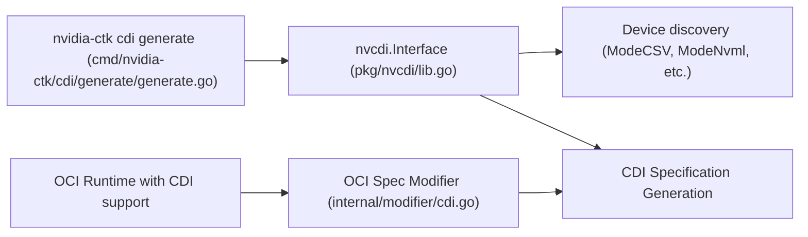
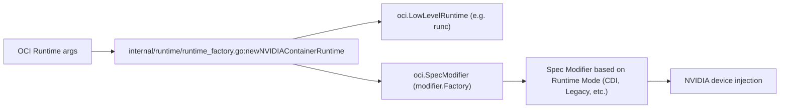
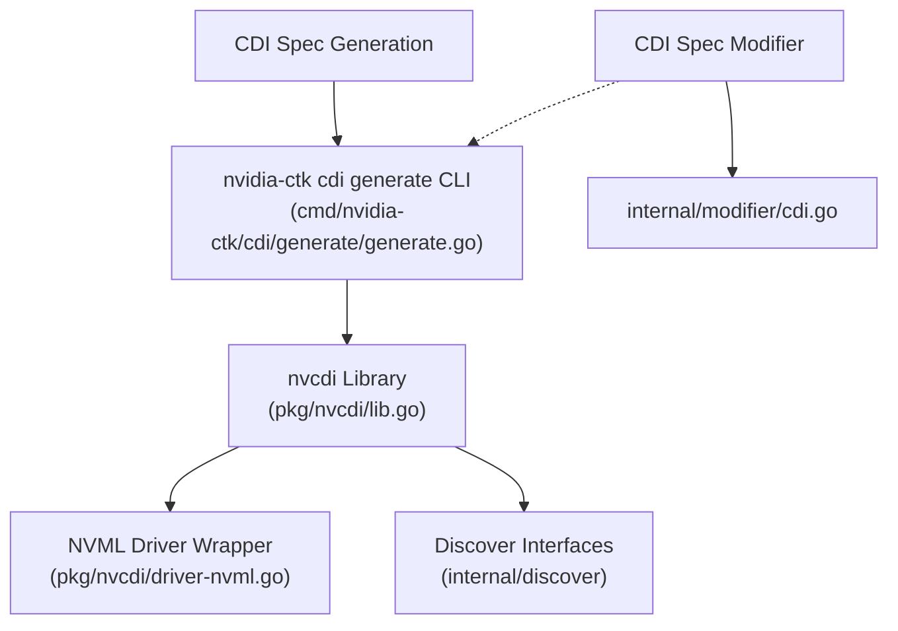
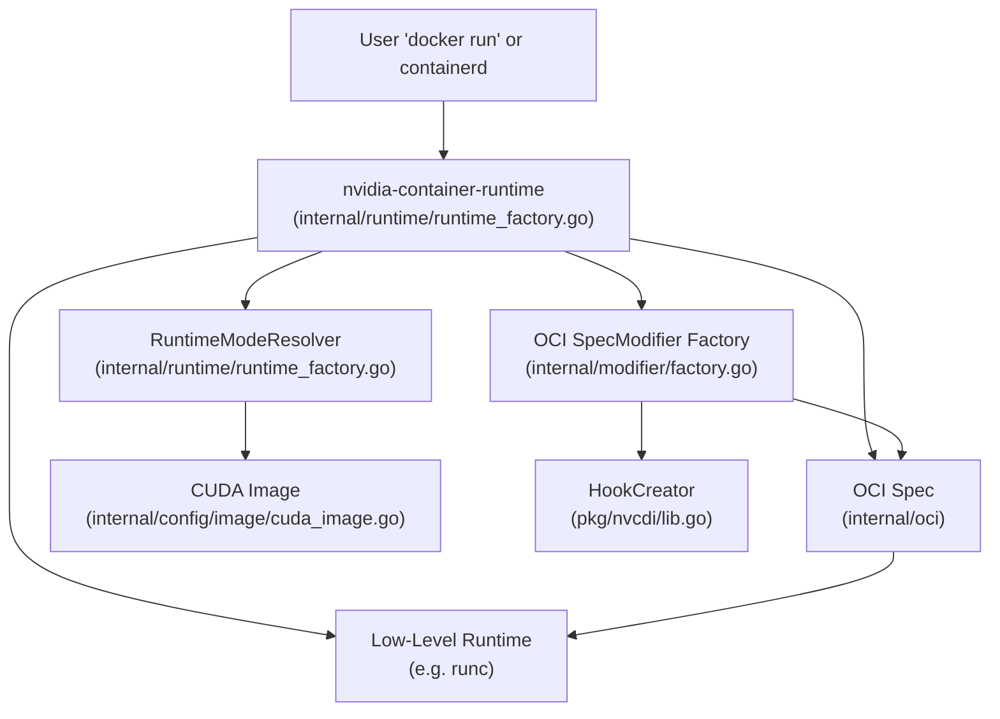

<!-- source: DeepWiki mcp.deepwiki.com · repo NVIDIA/nvidia-container-toolkit · page 7 Glossary · fetched 2026-10-26 -->

# Glossary

Relevant source files

The following files were used as context for generating this wiki page:

- [.gitmodules](.gitmodules)
- [CHANGELOG.md](CHANGELOG.md)
- [Makefile](Makefile)
- [api/config/v1/cli.go](api/config/v1/cli.go)
- [api/config/v1/cli_test.go](api/config/v1/cli_test.go)
- [api/config/v1/config.go](api/config/v1/config.go)
- [api/config/v1/config_test.go](api/config/v1/config_test.go)
- [api/config/v1/features.go](api/config/v1/features.go)
- [api/config/v1/hook.go](api/config/v1/hook.go)
- [api/config/v1/runtime.go](api/config/v1/runtime.go)
- [api/config/v1/toml.go](api/config/v1/toml.go)
- [api/config/v1/toml_test.go](api/config/v1/toml_test.go)
- [api/config/v1/toolkit-cli.go](api/config/v1/toolkit-cli.go)
- [cmd/nvidia-container-runtime-hook/container_config.go](cmd/nvidia-container-runtime-hook/container_config.go)
- [cmd/nvidia-container-runtime-hook/container_config_test.go](cmd/nvidia-container-runtime-hook/container_config_test.go)
- [cmd/nvidia-container-runtime-hook/hook_config.go](cmd/nvidia-container-runtime-hook/hook_config.go)
- [cmd/nvidia-container-runtime-hook/hook_config_test.go](cmd/nvidia-container-runtime-hook/hook_config_test.go)
- [cmd/nvidia-container-runtime-hook/main.go](cmd/nvidia-container-runtime-hook/main.go)
- [cmd/nvidia-ctk/cdi/generate/config.go](cmd/nvidia-ctk/cdi/generate/config.go)
- [cmd/nvidia-ctk/cdi/generate/generate.go](cmd/nvidia-ctk/cdi/generate/generate.go)
- [deployments/systemd/90-nvidia-container-toolkit.preset](deployments/systemd/90-nvidia-container-toolkit.preset)
- [docker/Dockerfile.devel](docker/Dockerfile.devel)
- [go.mod](go.mod)
- [go.sum](go.sum)
- [internal/config/image/builder.go](internal/config/image/builder.go)
- [internal/config/image/capabilities.go](internal/config/image/capabilities.go)
- [internal/config/image/cuda_image.go](internal/config/image/cuda_image.go)
- [internal/config/image/cuda_image_test.go](internal/config/image/cuda_image_test.go)
- [internal/config/image/devices.go](internal/config/image/devices.go)
- [internal/config/image/privileged.go](internal/config/image/privileged.go)
- [internal/discover/compat_libs.go](internal/discover/compat_libs.go)
- [internal/modifier/cdi.go](internal/modifier/cdi.go)
- [internal/modifier/cdi_test.go](internal/modifier/cdi_test.go)
- [internal/modifier/csv.go](internal/modifier/csv.go)
- [internal/modifier/gated.go](internal/modifier/gated.go)
- [internal/modifier/graphics.go](internal/modifier/graphics.go)
- [internal/modifier/graphics_test.go](internal/modifier/graphics_test.go)
- [internal/platform-support/tegra/csv.go](internal/platform-support/tegra/csv.go)
- [internal/platform-support/tegra/csv_test.go](internal/platform-support/tegra/csv_test.go)
- [internal/platform-support/tegra/filter.go](internal/platform-support/tegra/filter.go)
- [internal/platform-support/tegra/filter_test.go](internal/platform-support/tegra/filter_test.go)
- [internal/platform-support/tegra/mount_specs.go](internal/platform-support/tegra/mount_specs.go)
- [internal/platform-support/tegra/options.go](internal/platform-support/tegra/options.go)
- [internal/platform-support/tegra/symlinks.go](internal/platform-support/tegra/symlinks.go)
- [internal/platform-support/tegra/tegra.go](internal/platform-support/tegra/tegra.go)
- [internal/runtime/runtime.go](internal/runtime/runtime.go)
- [internal/runtime/runtime_factory.go](internal/runtime/runtime_factory.go)
- [internal/runtime/runtime_factory_test.go](internal/runtime/runtime_factory_test.go)
- [internal/test/to/to.go](internal/test/to/to.go)
- [packaging/debian/control](packaging/debian/control)
- [packaging/debian/nvidia-container-toolkit-base.maintscript](packaging/debian/nvidia-container-toolkit-base.maintscript)
- [packaging/debian/prepare](packaging/debian/prepare)
- [packaging/rpm/SPECS/nvidia-container-toolkit.spec](packaging/rpm/SPECS/nvidia-container-toolkit.spec)
- [pkg/nvcdi/api.go](pkg/nvcdi/api.go)
- [pkg/nvcdi/common-nvml.go](pkg/nvcdi/common-nvml.go)
- [pkg/nvcdi/driver-nvml.go](pkg/nvcdi/driver-nvml.go)
- [pkg/nvcdi/full-gpu-nvml.go](pkg/nvcdi/full-gpu-nvml.go)
- [pkg/nvcdi/lib-csv.go](pkg/nvcdi/lib-csv.go)
- [pkg/nvcdi/lib-nvml.go](pkg/nvcdi/lib-nvml.go)
- [pkg/nvcdi/lib-wsl.go](pkg/nvcdi/lib-wsl.go)
- [pkg/nvcdi/lib.go](pkg/nvcdi/lib.go)
- [pkg/nvcdi/management.go](pkg/nvcdi/management.go)
- [pkg/nvcdi/mig-device-nvml.go](pkg/nvcdi/mig-device-nvml.go)
- [pkg/nvcdi/options.go](pkg/nvcdi/options.go)
- [vendor/github.com/NVIDIA/go-nvlib/pkg/nvlib/device/device.go](vendor/github.com/NVIDIA/go-nvlib/pkg/nvlib/device/device.go)
- [vendor/github.com/NVIDIA/go-nvlib/pkg/nvlib/device/mig_profile.go](vendor/github.com/NVIDIA/go-nvlib/pkg/nvlib/device/mig_profile.go)
- [vendor/github.com/NVIDIA/go-nvlib/pkg/nvpci/mock.go](vendor/github.com/NVIDIA/go-nvlib/pkg/nvpci/mock.go)
- [vendor/github.com/NVIDIA/go-nvlib/pkg/nvpci/nvpci.go](vendor/github.com/NVIDIA/go-nvlib/pkg/nvpci/nvpci.go)
- [vendor/github.com/NVIDIA/go-nvlib/pkg/nvpci/nvpci_mock.go](vendor/github.com/NVIDIA/go-nvlib/pkg/nvpci/nvpci_mock.go)
- [vendor/github.com/NVIDIA/go-nvlib/pkg/nvpci/resources.go](vendor/github.com/NVIDIA/go-nvlib/pkg/nvpci/resources.go)
- [vendor/github.com/NVIDIA/go-nvlib/pkg/pciids/pciids.go](vendor/github.com/NVIDIA/go-nvlib/pkg/pciids/pciids.go)
- [vendor/modules.txt](vendor/modules.txt)
- [versions.mk](versions.mk)

This glossary provides definitions and detailed explanations of key terms, components, concepts, and jargon specific to the NVIDIA Container Toolkit codebase. It is designed to aid onboarding engineers in understanding the implementation, core architecture, data flows, and domain-specific terminology within the code. Each entry includes pointers to relevant source files and lines within the repository for further technical reference.

---

## Container Device Interface (CDI)

**Definition:**  
The Container Device Interface (CDI) is a Kubernetes and OCI-compatible specification for exposing hardware devices to containers. Within the NVIDIA Container Toolkit, CDI is supported by generating CDI specifications that declare device nodes, environment settings, mounts, and hooks to enable NVIDIA GPU usage in containers.

**Implementation Details:**  
- The `nvidia-ctk cdi generate` command builds CDI specs dynamically based on discovered NVIDIA devices and driver libraries.
- The CDI specs can be consumed at runtime by CDI-enabled runtimes or injected manually using CDI hooks.
- The `pkg/nvcdi` package provides the core implementation of CDI spec generation. The `nvcdilib` struct encapsulates this functionality, supporting multiple modes for device discovery (e.g., CSV, NVML, JIT CDI).
- The `cmd/nvidia-ctk/cdi/generate/generate.go` file contains the CLI command for CDI spec generation, handling flags, device discovery modes, output formats, and hook inclusion.
- CDI modifiers (`internal/modifier/cdi.go`) apply container spec modifications based on the selected CDI devices. The modifiers can be automatic (runtime generated) or static (from on-disk specs).

**Code Pointers:**  
- Command implementation: `cmd/nvidia-ctk/cdi/generate/generate.go:1-11338`  
- Core library: `pkg/nvcdi/lib.go:1-233`  
- CDI Spec modifier: `internal/modifier/cdi.go:1-260`  

**Relation Diagram:**

---

## NVIDIA Container Runtime

**Definition:**  
A runtime component that acts as an OCI runtime wrapper to enable GPU support in containers by modifying the runtime spec and injecting NVIDIA devices and codecs.

**Implementation Details:**  
- The `nvidia-container-runtime` binary intercepts OCI hooks to modify container specifications and add device nodes for NVIDIA GPUs.
- It integrates with low-level runtimes like `runc`.
- Creates the modified runtime environment based on inspected container spec and configuration.
- Management of runtime modes including legacy, CDI, and others is handled.
- Uses driver discovery and device interface abstractions.

**Code Pointers:**  
- Factory for runtime creation and configuration in `internal/runtime/runtime_factory.go:1-131`  
- Wrapper and low-level runtime integration in `internal/runtime/runtime.go` (not provided in snippet)

**Relation Diagram:**

---

## Runtime Modes

**Definition:**  
The toolkit supports different runtime modes dictating how NVIDIA GPUs are exposed to containers. Key modes include:

- **Legacy:** Old style NVIDIA runtime device injection.
- **CDI:** Uses Container Device Interface specifications.
- **CSV:** Custom device discovery for Tegra/Jetrson devices.
- **Auto:** Automatically determines mode based on system config.

**Implementation Details:**  
- Modes are resolved dynamically in `internal/runtime/runtime_factory.go:initRuntimeModeAndImage`.
- The image object (`image.CUDA`) representing the container is inspected to determine the mode.
- Different mode-specific spec modifiers and device discovery are applied accordingly.

**Code Pointers:**  
- Mode resolver in `internal/runtime/runtime_factory.go:92-130`  
- Nvcdi modes selected in `pkg/nvcdi/lib.go:51-105`

---

## Device Interface and NVML

**Definition:**  
The interface used to discover and interact with NVIDIA GPU devices within the host is abstracted via a Device Interface. NVML (NVIDIA Management Library) is a primary source for GPU device information.

**Implementation Details:**  
- The `pkg/nvcdi/lib.go` file constructs a `nvcdilib` that wraps NVML and sandbox utilities.
- NVML is accessed via Go bindings (`github.com/NVIDIA/go-nvml`).
- Functions initialize NVML, query driver versions, and discover devices for CDI spec generation.
- The `nvmllib` implements NVML interface used for discovery, version queries, and firmware enumeration.

**Code Pointers:**  
- NVML interface usage in `pkg/nvcdi/lib.go:120-138`  
- NVML Driver discoverer in `pkg/nvcdi/driver-nvml.go:1-232`  

---

## NVIDIA CTK CLI

**Definition:**  
`nvidia-ctk` is a comprehensive command line tool used to interact with various facets of the NVIDIA Container Toolkit, including CDI spec generation, runtime configuration, system inspection, and hook control.

**Implementation Details:**  
- The CLI command entries are implemented as subcommands under packages such as `cmd/nvidia-ctk/cdi/generate`.
- The `generate` command supports options for format, output location, CDI mode, device strategies, and hook configuration.
- Internally uses the `nvcdi` library for CDI spec generation.
- Supports feature flags and environment variable overrides to customize behavior.

**Code Pointers:**  
- CLI command building and options in `cmd/nvidia-ctk/cdi/generate/generate.go:1-11338`

---

## Hook System

**Definition:**  
Hooks are lifecycle scripts or binaries invoked during container creation to set up symlinks, update cache, or perform system-specific GPU setup tasks.

**Implementation Details:**  
- The toolkit installs `nvidia-cdi-hook` for CDI lifecycle events.
- Hooks like `enable-cuda-compat`, `update-ldcache`, and `disable-device-node-modification` are discovered and applied as needed.
- Hook creation and invocation use the `discover.HookCreator` interface, configured by the runtime.

**Code Pointers:**  
- Hook creation in `pkg/nvcdi/lib.go:46-73`  
- Hook discovery in `pkg/nvcdi/driver-nvml.go:115-117`  
- Hook usage in `internal/modifier/cdi.go:40-130`  

---

## GPU Device Discovery

**Definition:**  
A set of mechanisms for detecting NVIDIA GPU devices, driver libraries, IPC sockets, firmwares, and related resources on the host system.

**Implementation Details:**  
- Driver and firmware files, IPC sockets, and binaries are discovered via layered discoverers (`discover.Discover` interface).
- Discovery sources include NVML queries, static paths, CSV files (for Tegra), and sandbox utilities.
- The discoverers aggregate results to form the full list of mount points, device nodes, and environment variables required for container GPU access.

**Code Pointers:**  
- Driver and library discovery in `pkg/nvcdi/driver-nvml.go:33-132`  
- Discovery package use in `pkg/nvcdi/lib.go:25-29` and `internal/runtime/runtime_factory.go:24,76`  

---

## NVIDIA Container Toolkit Base Package

**Definition:**  
A minimal package that includes the essential binaries such as NVIDIA Container Runtime and the `nvidia-ctk` CLI, used for enabling GPU support on a host system.

**Implementation Details:**  
- Represented in the packaging RPM spec as the `base` package.
- Includes binaries such as `nvidia-container-runtime`, `nvidia-ctk`, and `nvidia-cdi-hook`.
- Installs systemd units for CDI refresh and udev rules.

**Code Pointers:**  
- RPM spec file excerpt in `packaging/rpm/SPECS/nvidia-container-toolkit.spec:1-166`  

---

## Image of Concepts to Code Entities

### CDI Concept to Implementation Mapping

### Runtime Injection Flow (Natural Language to Code Entities)

---

| Term                        | Description and Source Code Location                                               |
|-----------------------------|----------------------------------------------------------------------------------|
| **CDI (Container Device Interface)** | Specification and runtime integration for device injection. [cmd/nvidia-ctk/cdi/generate/generate.go:1-504](), [pkg/nvcdi/lib.go:1-232](), [internal/modifier/cdi.go:1-260]() |
| **NVIDIA Container Runtime** | OCI runtime wrapper enabling GPU support. [internal/runtime/runtime_factory.go:1-130]() |
| **Runtime Modes**            | Different modes such as CDI, legacy, CSV determining device injection strategy. [internal/runtime/runtime_factory.go:92-130]() |
| **NVML (NVIDIA Management Library)** | GPU device and driver library discovery via Go bindings. [pkg/nvcdi/lib.go:120-138](), [pkg/nvcdi/driver-nvml.go:33-132]() |
| **nvidia-ctk CLI**           | CLI tool with subcommands for generation, configuration, and system hooks. [cmd/nvidia-ctk/cdi/generate/generate.go:1-504]() |
| **Hook System**              | Lifecycle hooks for container setup (symlinks, ldconfig). [pkg/nvcdi/lib.go:46-73](), [internal/modifier/cdi.go:40-130]() |
| **GPU Device Discovery**     | Mechanisms to discover device nodes, libraries, IPC sockets. [pkg/nvcdi/driver-nvml.go:33-132](), [internal/runtime/runtime_factory.go:24,76]() |
| **Toolkit Base Package**     | RPM package including runtime and CLI binaries. [packaging/rpm/SPECS/nvidia-container-toolkit.spec:1-166]() |

---

This glossary summarizes the main technical concepts and ties them directly to code implementation points, facilitating a quick but comprehensive orientation within the NVIDIA Container Toolkit codebase.

---

## Sources
- `cmd/nvidia-ctk/cdi/generate/generate.go:1-11338`  
- `pkg/nvcdi/lib.go:1-233`  
- `internal/modifier/cdi.go:1-260`  
- `internal/runtime/runtime_factory.go:1-131`  
- `pkg/nvcdi/driver-nvml.go:1-232`  
- `packaging/rpm/SPECS/nvidia-container-toolkit.spec:1-166`