# Page: Overview

# Overview

<details>
<summary>Relevant source files</summary>

The following files were used as context for generating this wiki page:

- [.gitmodules](.gitmodules)
- [CHANGELOG.md](CHANGELOG.md)
- [Makefile](Makefile)
- [cmd/nvidia-container-runtime/README.md](cmd/nvidia-container-runtime/README.md)
- [deployments/systemd/90-nvidia-container-toolkit.preset](deployments/systemd/90-nvidia-container-toolkit.preset)
- [docker/Dockerfile.devel](docker/Dockerfile.devel)
- [go.mod](go.mod)
- [go.sum](go.sum)
- [packaging/debian/control](packaging/debian/control)
- [packaging/debian/nvidia-container-toolkit-base.maintscript](packaging/debian/nvidia-container-toolkit-base.maintscript)
- [packaging/debian/prepare](packaging/debian/prepare)
- [packaging/rpm/SPECS/nvidia-container-toolkit.spec](packaging/rpm/SPECS/nvidia-container-toolkit.spec)
- [vendor/github.com/NVIDIA/go-nvlib/pkg/nvlib/device/device.go](vendor/github.com/NVIDIA/go-nvlib/pkg/nvlib/device/device.go)
- [vendor/github.com/NVIDIA/go-nvlib/pkg/nvlib/device/mig_profile.go](vendor/github.com/NVIDIA/go-nvlib/pkg/nvlib/device/mig_profile.go)
- [vendor/github.com/NVIDIA/go-nvlib/pkg/nvpci/mock.go](vendor/github.com/NVIDIA/go-nvlib/pkg/nvpci/mock.go)
- [vendor/github.com/NVIDIA/go-nvlib/pkg/nvpci/nvpci.go](vendor/github.com/NVIDIA/go-nvlib/pkg/nvpci/nvpci.go)
- [vendor/github.com/NVIDIA/go-nvlib/pkg/nvpci/nvpci_mock.go](vendor/github.com/NVIDIA/go-nvlib/pkg/nvpci/nvpci_mock.go)
- [vendor/github.com/NVIDIA/go-nvlib/pkg/nvpci/resources.go](vendor/github.com/NVIDIA/go-nvlib/pkg/nvpci/resources.go)
- [vendor/github.com/NVIDIA/go-nvlib/pkg/pciids/pciids.go](vendor/github.com/NVIDIA/go-nvlib/pkg/pciids/pciids.go)
- [vendor/modules.txt](vendor/modules.txt)
- [versions.mk](versions.mk)

</details>


The NVIDIA Container Toolkit is a collection of tools and libraries that enable GPU access in containerized workloads. It acts as a bridge between container runtimes (Docker, containerd, CRI-O) and NVIDIA GPU hardware, modifying container specifications to inject GPU devices, driver libraries, and required configurations.

For detailed information about specific components, see [Core Components](#2). For build and packaging details, see [Building and Packaging](#5). For development workflows, see [Development](#6).

## Purpose and Scope

The toolkit solves the fundamental problem of exposing host GPU devices and driver libraries to containers in a way that is:
- **Standards-compliant**: Supports the Container Device Interface (CDI) specification
- **Runtime-agnostic**: Works with multiple container runtimes
- **Platform-flexible**: Supports standard Linux systems (via NVML), Tegra/Jetson platforms (via CSV), and WSL2 (via DXCore)
- **Mode-adaptive**: Provides both legacy hook-based and modern CDI-based integration paths

## System Architecture

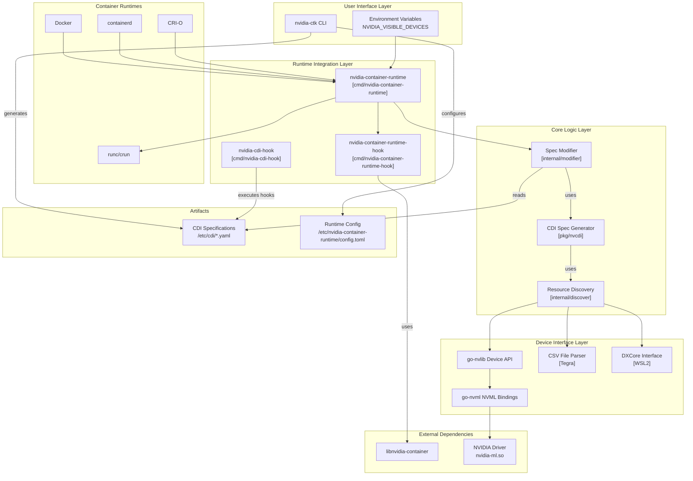

**Sources**: [CHANGELOG.md:1-728](), [versions.mk:15-39](), [Makefile:1-171]()

## Key Components

### Runtime Executables

| Component | Package Path | Purpose |
|-----------|-------------|---------|
| `nvidia-container-runtime` | [cmd/nvidia-container-runtime]() | OCI runtime wrapper that modifies container specs before delegating to low-level runtime |
| `nvidia-container-runtime-hook` | [cmd/nvidia-container-runtime-hook]() | Legacy prestart hook for dynamic GPU injection |
| `nvidia-ctk` | [cmd/nvidia-ctk]() | CLI tool for CDI generation, runtime configuration, and system management |
| `nvidia-cdi-hook` | [cmd/nvidia-cdi-hook]() | CDI lifecycle hook executor for symlinks, ldcache updates, and device setup |

### Core Libraries

| Package | Location | Purpose |
|---------|----------|---------|
| `nvcdi` | [pkg/nvcdi]() | CDI specification generation for GPU devices |
| `discover` | [internal/discover]() | Resource discovery (devices, libraries, firmware) |
| `modifier` | [internal/modifier]() | OCI specification modification logic |
| `config` | [internal/config]() | Configuration file parsing and management |

**Sources**: [packaging/rpm/SPECS/nvidia-container-toolkit.spec:1-135](), [packaging/debian/control:1-32](), [go.mod:1-43]()

## Runtime Modes

The toolkit supports multiple runtime modes configured via `/etc/nvidia-container-runtime/config.toml`:

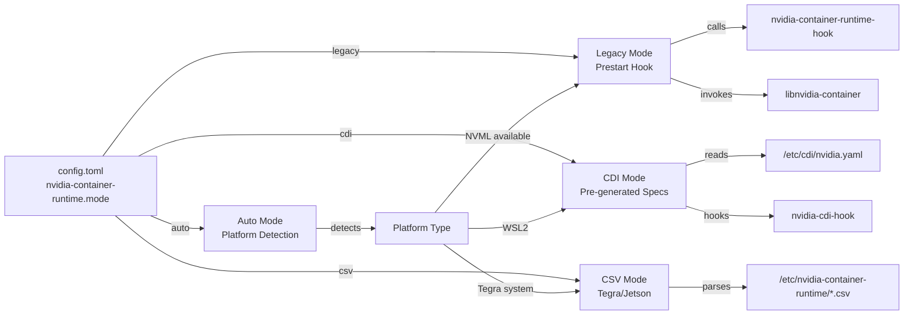

**Mode Selection Logic**:
- **legacy**: Uses `nvidia-container-runtime-hook` as OCI prestart hook, calls `nvidia-container-cli` to query devices via NVML [cmd/nvidia-container-runtime/README.md:44-47]()
- **cdi**: Reads pre-generated CDI specs from `/etc/cdi/`, modifies OCI spec declaratively
- **csv**: Reads CSV mount specifications for Tegra platforms (e.g., `/etc/nvidia-container-runtime/host-files-for-container.d/`) [cmd/nvidia-container-runtime/README.md:49-58]()
- **auto**: Automatically detects platform and selects appropriate mode [cmd/nvidia-container-runtime/README.md:40-42]()

**Sources**: [CHANGELOG.md:580-582](), [internal/config](), [cmd/nvidia-container-runtime/README.md:36-60]()

## Container Execution Flow

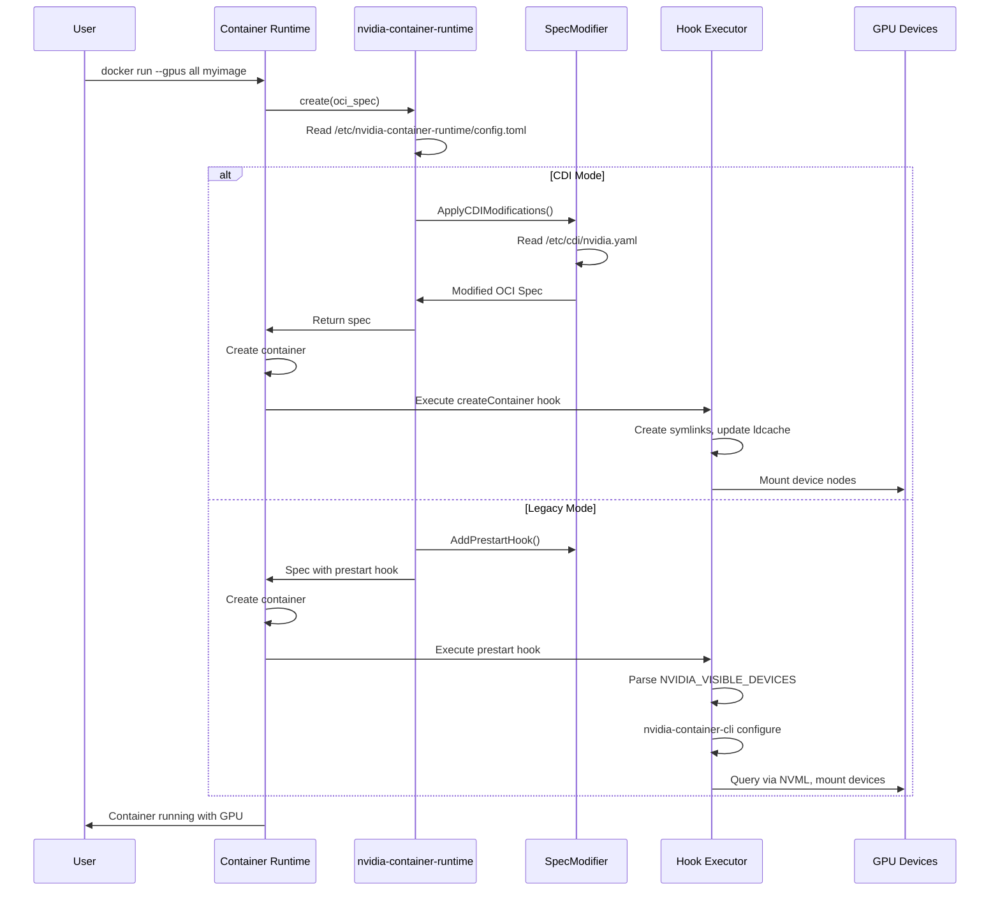

**Sources**: [cmd/nvidia-container-runtime](), [internal/modifier]()

## CDI Specification Generation

The `nvidia-ctk cdi generate` command creates standardized device specifications:

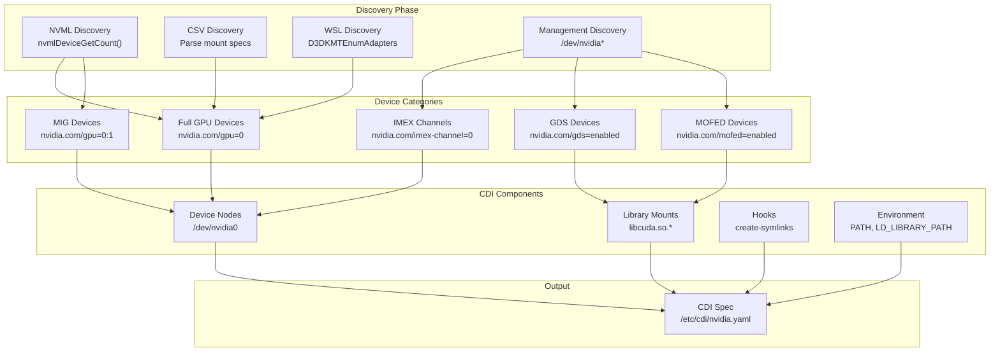

**Key Discoverers**:
- **NVML Mode**: Uses `nvmlDeviceGetHandleByIndex()` for standard GPUs [vendor/github.com/NVIDIA/go-nvlib/pkg/nvlib/device/device.go:61-66]()
- **CSV Mode**: Parses `/etc/nvidia-container-runtime/host-files-for-container.d/*.csv`
- **WSL Mode**: Uses `D3DKMTEnumAdapters3()` on Windows Subsystem for Linux
- **Management Mode**: Discovers all device nodes including `/dev/nvidia-uvm`, `/dev/nvidia-modeset`

**Sources**: [pkg/nvcdi](), [internal/discover](), [vendor/github.com/NVIDIA/go-nvlib/pkg/nvlib/device/device.go:1-598]()

## Package Structure

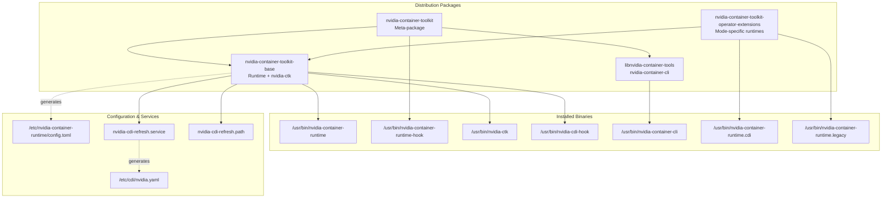

**Package Dependencies**:
- `nvidia-container-toolkit` (meta-package) requires `nvidia-container-toolkit-base` and `libnvidia-container-tools` with matching versions [packaging/debian/control:11-13]()
- `nvidia-container-toolkit-base` provides runtime and CLI tools, generates default config on install [packaging/debian/control:25-27](), [packaging/rpm/SPECS/nvidia-container-toolkit.spec:106-108]()
- `libnvidia-container-tools` provides the low-level `nvidia-container-cli` binary
- `nvidia-container-toolkit-operator-extensions` provides mode-specific runtime variants for Kubernetes GPU Operator [packaging/debian/control:30-32]()

**Post-Install Behavior**:
- Creates `/etc/nvidia-container-runtime/config.toml` if it doesn't exist [packaging/rpm/SPECS/nvidia-container-toolkit.spec:110-112]()
- Enables and starts `nvidia-cdi-refresh.path` systemd service [packaging/rpm/SPECS/nvidia-container-toolkit.spec:147-154]()
- Creates `nvidia-container-toolkit` symlink pointing to `nvidia-container-runtime-hook` [packaging/rpm/SPECS/nvidia-container-toolkit.spec:79]()

**Sources**: [packaging/rpm/SPECS/nvidia-container-toolkit.spec:1-135](), [packaging/debian/control:1-32](), [versions.mk:15-22]()

## Platform Support

The toolkit adapts to different platforms through discovery modes:

| Platform | Discovery Method | Key Components |
|----------|-----------------|----------------|
| **Standard Linux** | NVML library | `go-nvml`, `nvmlDeviceGetCount()`, `/dev/nvidia*` |
| **Tegra/Jetson** | CSV mount files | `/etc/nvidia-container-runtime/host-files-for-container.d/*.csv` |
| **WSL2** | DXCore API | `D3DKMTEnumAdapters3()`, `/dev/dxg`, `libdxcore.so` |

**Platform Detection Logic**:
- Checks for `/sys/devices/soc0/family` for Tegra systems
- Detects WSL2 via `/proc/sys/kernel/osrelease` containing "microsoft"
- Falls back to NVML if available, otherwise uses CSV mode

**Sources**: [CHANGELOG.md:481-491](), [internal/discover](), [vendor/github.com/NVIDIA/go-nvlib/pkg/nvlib/device/device.go:1-598]()

## Configuration System

Primary configuration file: `/etc/nvidia-container-runtime/config.toml` [cmd/nvidia-container-runtime/README.md:6-7]()

**Key Configuration Sections**:
```toml
[nvidia-container-runtime]
mode = "auto"  # or "legacy", "cdi", "csv"
debug = "/var/log/nvidia-container-toolkit.log"
runtimes = ["docker-runc", "runc", "crun"]

[nvidia-container-runtime.modes.cdi]
default-kind = "nvidia.com/gpu"
annotation-prefixes = ["cdi.k8s.io/"]

[nvidia-container-runtime.modes.csv]
mount-spec-path = "/etc/nvidia-container-runtime/host-files-for-container.d"

[nvidia-container-cli]
root = "/run/nvidia/driver"
```

**Configuration Sources**:
- TOML file at configurable path (default `/etc/nvidia-container-runtime/config.toml`) [cmd/nvidia-container-runtime/README.md:6-7]()
- Command-line flags override file settings
- Environment variables: `NVIDIA_VISIBLE_DEVICES` [cmd/nvidia-container-runtime/README.md:94-105](), `NVIDIA_DRIVER_CAPABILITIES`, `NVIDIA_CTK_CONFIG_FILE_PATH`

**Sources**: [internal/config](), [CHANGELOG.md:369-370](), [CHANGELOG.md:459-461](), [cmd/nvidia-container-runtime/README.md:6-105]()

## External Dependencies

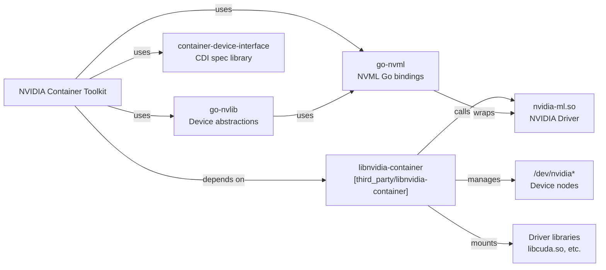

**libnvidia-container** ([third_party/libnvidia-container]()):
- C library handling low-level GPU device and library mounting
- Integrated as git submodule [CHANGELOG.md:33-34](), [.gitmodules:1-4]()
- Provides `nvidia-container-cli` executable
- Manages cgroup device permissions, library dependencies, firmware files

**Go Libraries**:
- `github.com/NVIDIA/go-nvml`: NVML bindings for device queries [go.mod:8]()
- `github.com/NVIDIA/go-nvlib`: Higher-level device abstractions [go.mod:7]()
- `tags.cncf.io/container-device-interface`: CDI spec generation and validation [go.mod:25-26]()

**Sources**: [go.mod:1-43](), [vendor/modules.txt:1-133](), [CHANGELOG.md:200-217](), [.gitmodules:1-4]()

## Build System Overview

The project uses a Docker-based build system for multi-architecture support:

**Build Targets**:
- `make binaries`: Build all executables [Makefile:56]()
- `make docker-native`: Build in Docker container [Makefile:24]()
- `make packages`: Generate `.deb` and `.rpm` packages
- `make docker-images`: Build toolkit container images

**Key Build Variables** ([versions.mk]()):
- `LIB_VERSION`: Current toolkit version (e.g., `1.20.0`) [versions.mk:16]()
- `LIB_TAG`: Release tag (e.g., `rc.1`) [versions.mk:17]()
- `GOLANG_VERSION`: Go compiler version [versions.mk:24]()
- `BUILDIMAGE`: Docker image for builds [versions.mk:27]()

**Distribution Channels**:
- GitHub Releases for binaries and packages
- NGC Registry (`nvcr.io/nvidia/`) for container images
- Artifactory for Kitmaker OEM integration
- APT/YUM repositories for package installation

**Sources**: [Makefile:1-171](), [versions.mk:1-39](), [docker/Dockerfile.devel:1-27]()

---

# Page: Core Components

# Core Components

<details>
<summary>Relevant source files</summary>

The following files were used as context for generating this wiki page:

- [.gitmodules](.gitmodules)
- [CHANGELOG.md](CHANGELOG.md)
- [Makefile](Makefile)
- [cmd/nvidia-container-runtime/main.go](cmd/nvidia-container-runtime/main.go)
- [cmd/nvidia-container-runtime/main_test.go](cmd/nvidia-container-runtime/main_test.go)
- [cmd/nvidia-ctk/README.md](cmd/nvidia-ctk/README.md)
- [cmd/nvidia-ctk/cdi/cdi.go](cmd/nvidia-ctk/cdi/cdi.go)
- [cmd/nvidia-ctk/cdi/list/list.go](cmd/nvidia-ctk/cdi/list/list.go)
- [cmd/nvidia-ctk/cdi/transform/root/root.go](cmd/nvidia-ctk/cdi/transform/root/root.go)
- [cmd/nvidia-ctk/cdi/transform/transform.go](cmd/nvidia-ctk/cdi/transform/transform.go)
- [cmd/nvidia-ctk/config/config.go](cmd/nvidia-ctk/config/config.go)
- [cmd/nvidia-ctk/config/config_test.go](cmd/nvidia-ctk/config/config_test.go)
- [cmd/nvidia-ctk/config/create-default/create-default.go](cmd/nvidia-ctk/config/create-default/create-default.go)
- [cmd/nvidia-ctk/config/flags/options.go](cmd/nvidia-ctk/config/flags/options.go)
- [cmd/nvidia-ctk/info/info.go](cmd/nvidia-ctk/info/info.go)
- [cmd/nvidia-ctk/main.go](cmd/nvidia-ctk/main.go)
- [cmd/nvidia-ctk/runtime/runtime.go](cmd/nvidia-ctk/runtime/runtime.go)
- [deployments/systemd/90-nvidia-container-toolkit.preset](deployments/systemd/90-nvidia-container-toolkit.preset)
- [docker/Dockerfile.devel](docker/Dockerfile.devel)
- [internal/info/version.go](internal/info/version.go)
- [internal/oci/spec_memory.go](internal/oci/spec_memory.go)
- [internal/oci/spec_memory_test.go](internal/oci/spec_memory_test.go)
- [internal/runtime/logger.go](internal/runtime/logger.go)
- [packaging/debian/control](packaging/debian/control)
- [packaging/debian/nvidia-container-toolkit-base.maintscript](packaging/debian/nvidia-container-toolkit-base.maintscript)
- [packaging/debian/prepare](packaging/debian/prepare)
- [packaging/rpm/SPECS/nvidia-container-toolkit.spec](packaging/rpm/SPECS/nvidia-container-toolkit.spec)
- [versions.mk](versions.mk)

</details>


The NVIDIA Container Toolkit is built from multiple executable components and libraries that work together to enable GPU support in containers. This page provides an overview of these components, their purposes, and how they interact. For architectural concepts and detailed implementation, see [Architecture](#3).

## Component Inventory

The toolkit consists of the following main executables, compiled from Go source code in the [cmd/]() directory:

| Binary | Source Location | Purpose | Detailed Documentation |
|--------|----------------|---------|------------------------|
| `nvidia-container-runtime` | [cmd/nvidia-container-runtime/]() | OCI runtime wrapper that intercepts container creation and modifies specs to inject GPU resources | [NVIDIA Container Runtime](#2.1) |
| `nvidia-container-runtime-hook` | [cmd/nvidia-container-runtime-hook/]() | Legacy OCI prestart hook that invokes `nvidia-container-cli` for dynamic GPU injection | [NVIDIA Container Runtime Hook](#2.2) |
| `nvidia-ctk` | [cmd/nvidia-ctk/]() | Multi-purpose CLI with subcommands: `cdi generate`, `runtime configure`, `system create-device-nodes`, `hook` | [NVIDIA CTK CLI](#2.3) |
| `nvidia-cdi-hook` | [cmd/nvidia-cdi-hook/]() | Implements CDI hook specification: creates symlinks, updates ldcache, handles device permissions | [NVIDIA CDI Hook](#2.4) |
| `nvidia-ctk-installer` | [cmd/nvidia-ctk-installer/]() | Installs toolkit from container images into host systems (used in toolkit-container deployment) | [NVIDIA CTK Installer](#2.5) |

The toolkit integrates with external dependencies that are critical to its operation:

| Component | Package Source | Purpose | Integration Point |
|-----------|---------------|---------|-------------------|
| `nvidia-container-cli` | `libnvidia-container-tools` package | Low-level C binary that performs device mounting, library injection, and namespace configuration | Invoked as subprocess by [cmd/nvidia-container-runtime-hook/]() |
| `libnvidia-container` | Git submodule at [third_party/libnvidia-container/]() | C library providing GPU isolation and capability enforcement via `configure`, `list`, `info` commands | Built and packaged alongside toolkit |
| `go-nvml` | Vendored Go module | NVML API bindings for querying GPU devices, driver version, MIG configuration | Used by [internal/discover/]() and [pkg/nvcdi/]() |
| `go-nvlib` | Vendored Go module | Higher-level Device interface abstraction over NVML | Used by [pkg/nvcdi/spec.go]() for CDI generation |

Sources:
- [Makefile:38-39]()
- [cmd/nvidia-container-runtime/main.go:1-15]()
- [packaging/rpm/SPECS/nvidia-container-toolkit.spec:13-22]()
- [versions.mk:15-17]()
- [cmd/nvidia-ctk/main.go:1-100]()

## Executable Interaction Flow

The following diagram illustrates how binaries collaborate during container creation. Each binary is responsible for a distinct phase of GPU injection.

**Diagram: Component Execution Flow with Code Entry Points**

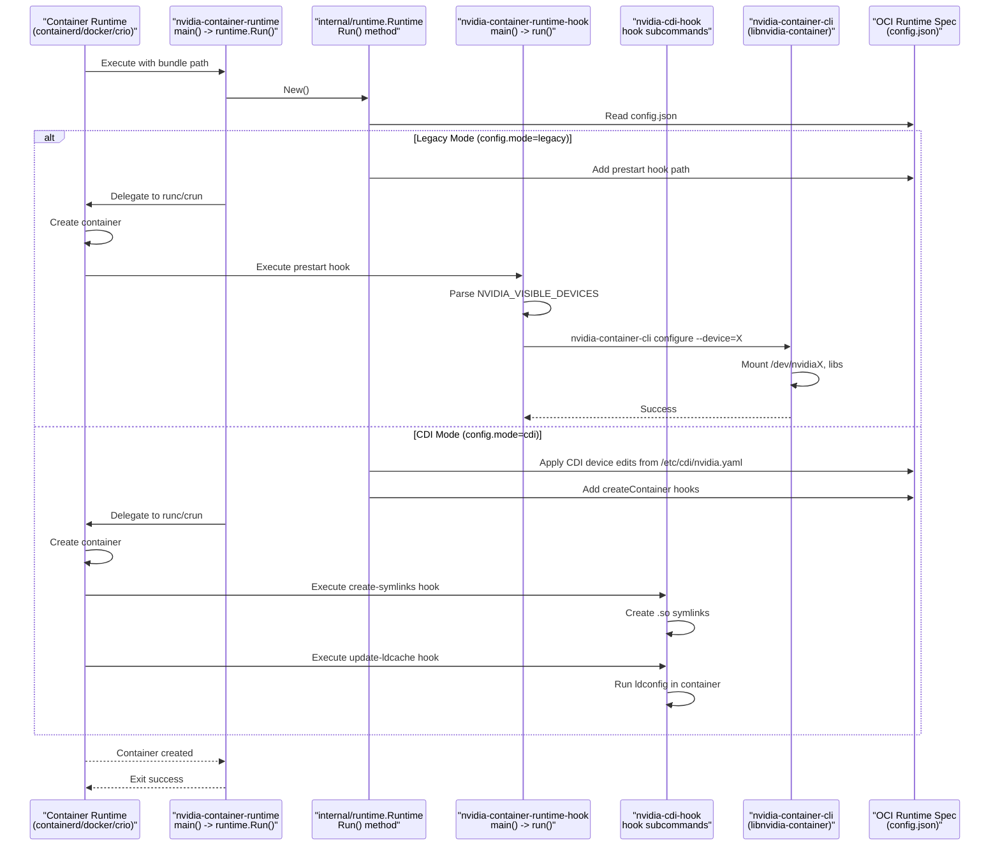

The `nvidia-container-runtime` reads the mode configuration from `/etc/nvidia-container-runtime/config.toml` (via [internal/runtime/runtime.go:10-11]()) and selects the appropriate `SpecModifier` implementation. For details on runtime modes, see [Runtime Modes](#3.1).

Sources:
- [cmd/nvidia-container-runtime/main.go:10-15]()
- [internal/runtime/runtime.go:10-11]()
- [cmd/nvidia-container-runtime/main_test.go:108-112]()
- [cmd/nvidia-container-runtime/main_test.go:119-123]()

## Build System and Binary Compilation

The toolkit uses a Makefile-based build system that compiles Go source code into static binaries. The build process is driven by `make` targets that invoke the Go compiler with specific linker flags.

**Binary Compilation Targets**

| Binary Artifact | Source Directory | Makefile Target | Build Command |
|-----------------|------------------|-----------------|---------------|
| `nvidia-container-runtime` | [cmd/nvidia-container-runtime/]() | `cmd-nvidia-container-runtime` | Invoked by [Makefile:67-68]() |
| `nvidia-container-runtime-hook` | [cmd/nvidia-container-runtime-hook/]() | `cmd-nvidia-container-runtime-hook` | Invoked by [Makefile:67-68]() |
| `nvidia-ctk` | [cmd/nvidia-ctk/]() | `cmd-nvidia-ctk` | Invoked by [Makefile:67-68]() |
| `nvidia-cdi-hook` | [cmd/nvidia-cdi-hook/]() | `cmd-nvidia-cdi-hook` | Invoked by [Makefile:67-68]() |
| `nvidia-ctk-installer` | [cmd/nvidia-ctk-installer/]() | `cmd-nvidia-ctk-installer` | Invoked by [Makefile:67-68]() |

The build uses LDFLAGS defined at [Makefile:63-68]() to inject version information and enable lazy symbol resolution:
```makefile
EXTLDFLAGS = -Wl,--export-dynamic -Wl,--unresolved-symbols=ignore-in-object-files -Wl,-z,lazy
go build -ldflags "-s -w '-extldflags=$(EXTLDFLAGS)' -X $(CLI_VERSION_PACKAGE).gitCommit=$(GIT_COMMIT)"
```

**Diagram: Build Dependency Graph**

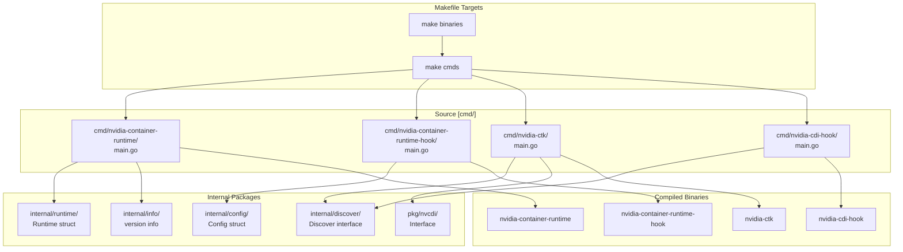

Version information is injected at build time from [versions.mk:15-17]() and Git metadata ([versions.mk:29-32]()). The `CLI_VERSION_PACKAGE` ([Makefile:54]()) points to `github.com/NVIDIA/nvidia-container-toolkit/internal/info`, which defines the version variables.

Sources:
- [Makefile:38-68]()
- [versions.mk:15-39]()
- [cmd/nvidia-container-runtime/main.go:1-15]()
- [cmd/nvidia-ctk/main.go:61-62]()
- [internal/info/version.go:1-43]()

## Library Dependencies

The toolkit depends on several libraries that provide GPU enumeration, device management, and CDI specification generation capabilities.

**Diagram: Library Dependency Structure**

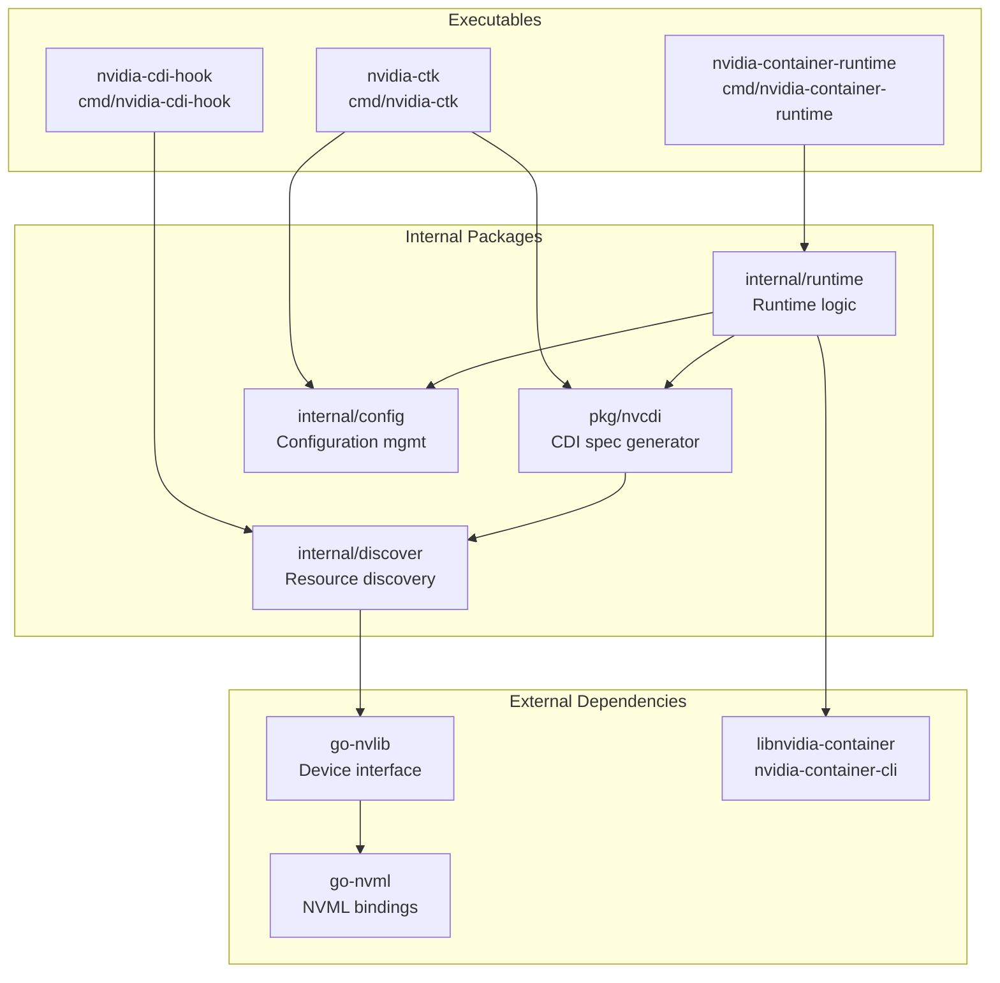

### libnvidia-container Integration

The `libnvidia-container` library is an external C library maintained in a Git submodule at [third_party/libnvidia-container/](). It provides the `nvidia-container-cli` binary, which performs:

- Device node creation: `/dev/nvidia0`, `/dev/nvidiactl`, `/dev/nvidia-uvm`
- Driver library mounting: `libcuda.so`, `libnvidia-ml.so`, driver-specific libraries
- Capability enforcement: Restricts access based on `NVIDIA_DRIVER_CAPABILITIES` (compute, graphics, utility, display)
- GPU process isolation: Uses Linux namespaces and cgroups

The `nvidia-container-runtime` (in legacy mode) or `nvidia-container-runtime-hook` invokes `nvidia-container-cli configure` as a subprocess to perform GPU injection. The CLI binary must be present at runtime and is provided by the `libnvidia-container-tools` package.

**Package requirement:** [packaging/rpm/SPECS/nvidia-container-toolkit.spec:39]() specifies `Requires: libnvidia-container-tools == %{version}-%{release}` to ensure version compatibility.

Sources:
- [third_party/libnvidia-container/]()
- [packaging/rpm/SPECS/nvidia-container-toolkit.spec:39]()

### Go Device Management Libraries

The toolkit uses vendored Go modules for GPU discovery:

| Library | Location | Purpose | Key Interfaces |
|---------|----------|---------|----------------|
| `go-nvml` | [vendor/github.com/NVIDIA/go-nvml/]() | NVML C library bindings | `nvml.Init()`, `nvml.DeviceGetCount()`, `nvml.DeviceGetHandleByIndex()` |
| `go-nvlib` | [vendor/github.com/NVIDIA/go-nvlib/]() | Device abstraction layer | `nvlib.New()`, `Device` interface with `GetUUID()`, `IsMigEnabled()` |

These libraries are managed via Go modules ([go.mod]()) and vendored using `make vendor` ([Makefile:93-114]()).

### nvcdi Package

The `pkg/nvcdi` package ([pkg/nvcdi/]()) implements the core CDI specification generation logic. It defines the `Interface` interface with methods:

```go
type Interface interface {
    GetSpec() (*specs.Spec, error)
    GetCommonEdits() (*cdi.ContainerEdits, error)
    GetAllDeviceSpecs() ([]specs.Device, error)
}
```

The package supports multiple discovery modes configured via `nvcdi.New(opts...)`:
- **NVML mode** ([pkg/nvcdi/lib.go]()): Queries GPUs via NVML API, used on standard Linux systems
- **WSL mode** ([pkg/nvcdi/wsl.go]()): Uses DXCore for GPU enumeration on Windows Subsystem for Linux
- **CSV mode** ([pkg/nvcdi/csv.go]()): Reads mount specifications from CSV files on Tegra/Jetson platforms
- **Management mode** ([pkg/nvcdi/management.go]()): Generates specs for all device nodes without filtering

Sources:
- [Makefile:93-114]()
- [pkg/nvcdi/api.go:1-50]()

## Mode-Specific Runtime Variants

The toolkit provides mode-specific runtime variants for advanced deployment scenarios, particularly in Kubernetes environments using the GPU Operator:

| Runtime Variant | Binary Name | Purpose |
|-----------------|-------------|---------|
| Default | `nvidia-container-runtime` | Auto-detects mode based on environment |
| CDI-only | `nvidia-container-runtime.cdi` | Forces CDI mode for spec-based injection |
| Legacy-only | `nvidia-container-runtime.legacy` | Forces legacy hook-based injection |

These variants are distributed in the `nvidia-container-toolkit-operator-extensions` package and allow the same codebase to be deployed with different default behaviors. The mode resolution logic is implemented in [internal/runtime/runtime.go:10-11]().

**Diagram: Runtime Mode Selection**

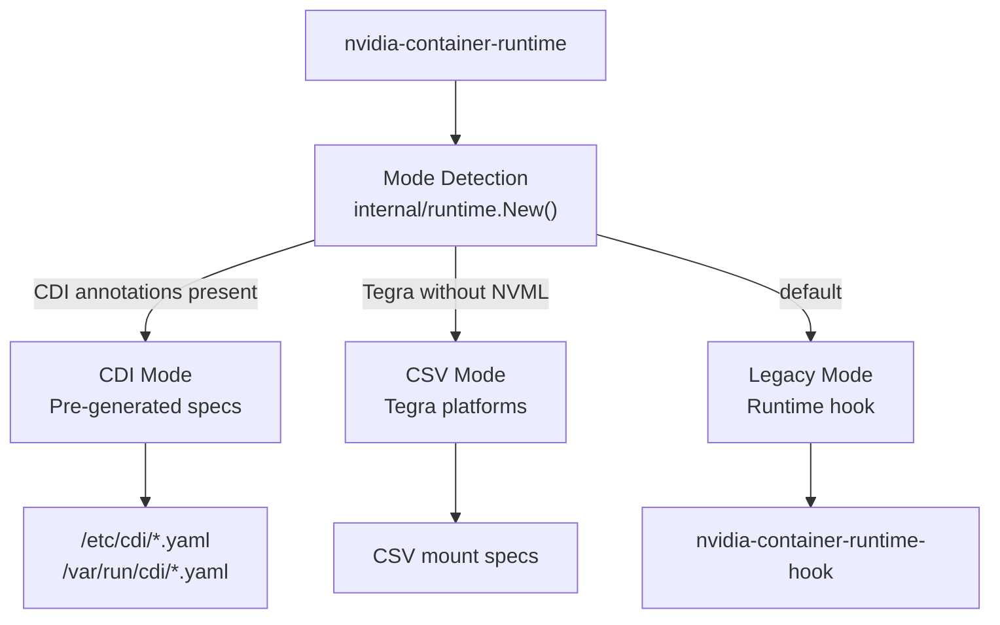

Sources:
- [packaging/rpm/SPECS/nvidia-container-toolkit.spec:170-171]()
- [CHANGELOG.md:82-83]()
- [internal/runtime/runtime.go:10-11]()

## Package Distribution Structure

The toolkit is distributed as three interconnected packages that can be installed independently or together, depending on deployment requirements.

**Diagram: Package Dependencies and Installation Hierarchy**

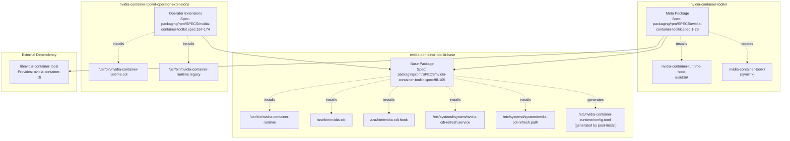

### Package Specifications

| Package | RPM Spec Location | Debian Control Location | Primary Use Case |
|---------|-------------------|-------------------------|------------------|
| `nvidia-container-toolkit-base` | [packaging/rpm/SPECS/nvidia-container-toolkit.spec:98-105]() | [packaging/debian/control:19-25]() | Core runtime and CLI; required by all installations |
| `nvidia-container-toolkit` | [packaging/rpm/SPECS/nvidia-container-toolkit.spec:1-29]() | [packaging/debian/control:11-17]() | Adds legacy hook for backward compatibility with pre-v1.11 configs |
| `nvidia-container-toolkit-operator-extensions` | [packaging/rpm/SPECS/nvidia-container-toolkit.spec:167-174]() | [packaging/debian/control:27-31]() | Mode-specific runtimes for Kubernetes GPU Operator deployments |

### Package Contents and Installation Paths

**Base Package** (`nvidia-container-toolkit-base`):
- Binaries: `/usr/bin/nvidia-container-runtime`, `/usr/bin/nvidia-ctk`, `/usr/bin/nvidia-cdi-hook`
- Systemd units: `/etc/systemd/system/nvidia-cdi-refresh.{service,path}`
- Configuration: `/etc/nvidia-container-toolkit/nvidia-cdi-refresh.env`
- Post-install script ([packaging/rpm/SPECS/nvidia-container-toolkit.spec:110-112]()): 
  - Generates default config at `/etc/nvidia-container-runtime/config.toml` via `nvidia-ctk config`
  - Enables and starts `nvidia-cdi-refresh.path` and `nvidia-cdi-refresh.service`

**Main Package** (`nvidia-container-toolkit`):
- Binaries: `/usr/bin/nvidia-container-runtime-hook`
- Symlink: `/usr/bin/nvidia-container-toolkit` → `nvidia-container-runtime-hook`
- Post-install script ([packaging/rpm/SPECS/nvidia-container-toolkit.spec:73-79]()): Creates symlink for backward compatibility

**Operator Extensions Package** (`nvidia-container-toolkit-operator-extensions`):
- Mode-specific runtimes: `/usr/bin/nvidia-container-runtime.cdi`, `/usr/bin/nvidia-container-runtime.legacy`
- These are identical binaries to `nvidia-container-runtime` but named to indicate forced mode behavior

### Version Matching Requirement

All packages require exact version match with `libnvidia-container-tools`:
```
Requires: libnvidia-container-tools == %{version}-%{release}
```
This ensures ABI compatibility between the runtime and the low-level `nvidia-container-cli` binary.

Sources:
- [packaging/rpm/SPECS/nvidia-container-toolkit.spec:1-174]()
- [packaging/debian/control:1-31]()
- [packaging/rpm/SPECS/nvidia-container-toolkit.spec:39]()
- [packaging/rpm/SPECS/nvidia-container-toolkit.spec:110-112]()
- [packaging/rpm/SPECS/nvidia-container-toolkit.spec:73-79]()

## Device Discovery System

The toolkit includes a layered discovery system that identifies NVIDIA GPUs and related resources (libraries, firmware, configuration files) on the host system for injection into containers.

**Diagram: Discovery Architecture**

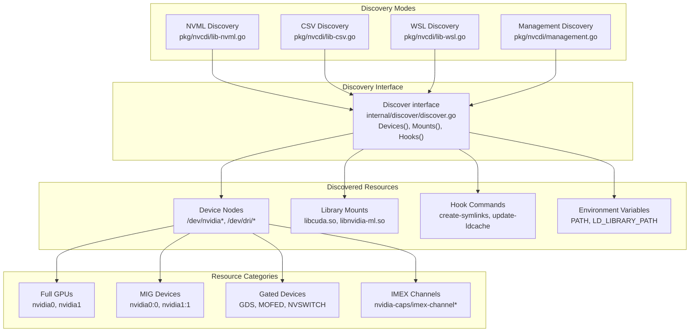

### Discovery Interface

The core abstraction is the `Discover` interface defined in [internal/discover/discover.go]():

```go
type Discover interface {
    Devices() ([]Device, error)
    Mounts() ([]Mount, error)
    Hooks() ([]Hook, error)
}
```

Each discovery mode implements this interface to return device nodes, file mounts, and hook commands that should be injected into containers.

### Discovery Modes

| Mode | Implementation | Platform | Discovery Method |
|------|----------------|----------|------------------|
| **NVML** | [pkg/nvcdi/lib-nvml.go]() | Standard Linux with NVIDIA driver | Uses NVML API to enumerate GPUs and query driver paths |
| **CSV** | [pkg/nvcdi/lib-csv.go]() | Tegra/Jetson (embedded) | Reads mount specifications from CSV files in `/etc/nvidia-container-runtime/` |
| **WSL** | [pkg/nvcdi/lib-wsl.go]() | Windows Subsystem for Linux | Uses DXCore API to detect GPU adapters |
| **Management** | [pkg/nvcdi/management.go]() | All platforms | Discovers all device nodes without filtering; used for toolkit containers |

### Device Identification

Devices can be specified using multiple identifiers, parsed by [internal/config/image/devices.go:18-127]():

- **Index**: `0`, `1`, `2` (GPU index order)
- **UUID**: `GPU-12345678-1234-1234-1234-123456789abc`
- **PCI Bus ID**: `0000:01:00.0`
- **MIG format**: `0:0` (GPU index : MIG device index), `GPU-xxx:0`

The `VisibleDevices()` function resolves device requests from:
1. `NVIDIA_VISIBLE_DEVICES` environment variable
2. Kubernetes device plugin annotations (`nvidia.com/gpu`)
3. Docker Swarm resource specifications
4. Volume mount specifications

### Gated Device Discovery

Certain devices are only discovered when explicitly requested via environment variables:

| Device Type | Environment Variable | Implementation |
|-------------|---------------------|----------------|
| GPU Direct Storage | `NVIDIA_GDS=enabled` | [internal/discover/gds.go]() |
| MOFED InfiniBand | `NVIDIA_MOFED=enabled` | [internal/discover/mofed.go]() |
| NVSwitch | `NVIDIA_NVSWITCH=enabled` | [internal/discover/nvswitch.go]() |
| GDRCopy | `NVIDIA_GDRCOPY=enabled` | [internal/discover/gdrcopy.go]() |
| IMEX Channels | `NVIDIA_IMEX_CHANNELS` (list) | [internal/discover/imex.go]() |

These gated discoveries allow specialized workloads (HPC, AI training) to access additional GPU subsystems beyond standard compute GPUs.

Sources:
- [internal/discover/discover.go:1-50]()
- [pkg/nvcdi/lib-nvml.go:1-100]()
- [pkg/nvcdi/lib-csv.go:1-100]()
- [pkg/nvcdi/lib-wsl.go:1-58]()
- [internal/config/image/devices.go:18-127]()
- [internal/discover/gds.go:1-50]()
- [internal/discover/mofed.go:1-36]()

## CUDA Image Support

The toolkit provides special handling for CUDA container images, with functionality to:
- Detect legacy CUDA images via environment variables
- Extract CUDA version requirements
- Handle CUDA-specific environment variables
- Support Docker Swarm resource specifications

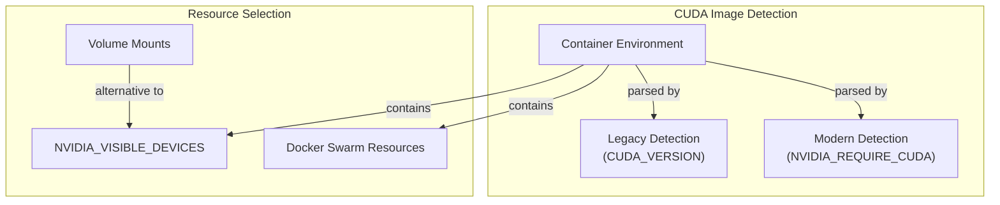

Sources:
- [internal/config/image/cuda_image.go:17-312]()
- [internal/config/image/cuda_image_test.go:17-247]()

---

# Page: NVIDIA Container Runtime

# NVIDIA Container Runtime

<details>
<summary>Relevant source files</summary>

The following files were used as context for generating this wiki page:

- [cmd/nvidia-container-runtime/README.md](cmd/nvidia-container-runtime/README.md)
- [cmd/nvidia-container-runtime/main.go](cmd/nvidia-container-runtime/main.go)
- [cmd/nvidia-container-runtime/main_test.go](cmd/nvidia-container-runtime/main_test.go)
- [internal/info/version.go](internal/info/version.go)
- [internal/oci/options.go](internal/oci/options.go)
- [internal/oci/runtime.go](internal/oci/runtime.go)
- [internal/oci/runtime_low_level.go](internal/oci/runtime_low_level.go)
- [internal/oci/runtime_mock.go](internal/oci/runtime_mock.go)
- [internal/oci/runtime_modifier.go](internal/oci/runtime_modifier.go)
- [internal/oci/runtime_modifier_test.go](internal/oci/runtime_modifier_test.go)
- [internal/oci/runtime_path.go](internal/oci/runtime_path.go)
- [internal/oci/runtime_path_test.go](internal/oci/runtime_path_test.go)
- [internal/oci/runtime_syscall_exec.go](internal/oci/runtime_syscall_exec.go)
- [internal/oci/spec.go](internal/oci/spec.go)
- [internal/oci/spec_file.go](internal/oci/spec_file.go)
- [internal/oci/spec_file_test.go](internal/oci/spec_file_test.go)
- [internal/oci/spec_memory.go](internal/oci/spec_memory.go)
- [internal/oci/spec_memory_test.go](internal/oci/spec_memory_test.go)
- [internal/oci/spec_test.go](internal/oci/spec_test.go)
- [internal/runtime/logger.go](internal/runtime/logger.go)
- [internal/test/test.go](internal/test/test.go)
- [pkg/lookup/path.go](pkg/lookup/path.go)

</details>


## Purpose and Scope

The **NVIDIA Container Runtime** (`nvidia-container-runtime`) is an OCI (Open Container Initiative) runtime wrapper that enables GPU support in containers. It acts as a shim between container runtime engines (containerd, CRI-O, Docker) and low-level OCI runtimes (runc, crun), modifying container specifications to inject NVIDIA GPU resources before delegating execution to the underlying runtime.

This document covers the architecture, execution flow, and operational modes of `nvidia-container-runtime`. For information about the legacy hook-based injection mechanism, see [NVIDIA Container Runtime Hook](#2.2). For details on CDI specification generation, see [Container Device Interface (CDI)](#3.2). For configuration options, see [Runtime Configuration Options](#4.2).

**Sources:** [cmd/nvidia-container-runtime/main.go:1-15](), [internal/runtime/runtime.go:17-91]()

---

## Architecture Overview

The NVIDIA Container Runtime implements a **wrapper pattern** around standard OCI runtimes. It intercepts container creation commands, modifies the OCI specification to include GPU resources, and then forwards the modified specification to the actual low-level runtime.

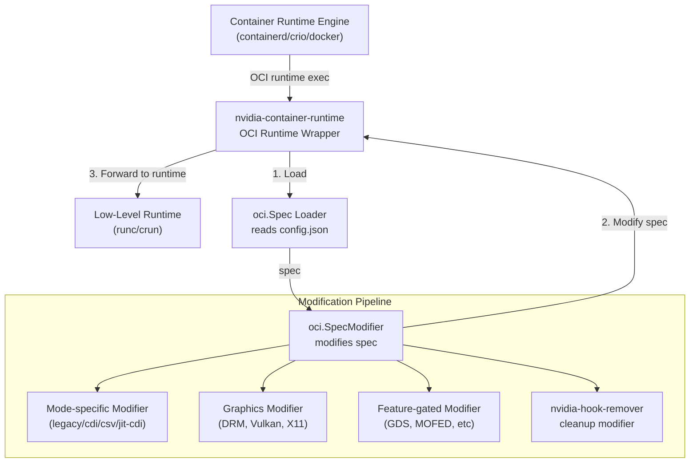

**Diagram: NVIDIA Container Runtime Architecture**

The runtime operates in distinct phases:
1. **Loading**: Reads the OCI specification from `config.json` [internal/oci/spec_file.go:60-72]()
2. **Modification**: Applies a pipeline of modifiers based on configuration and runtime mode [internal/oci/runtime_modifier.go:54-61]()
3. **Execution**: Delegates to the low-level runtime with the modified specification [internal/oci/runtime_modifier.go:63-64]()

**Sources:** [internal/runtime/runtime_factory.go:32-64](), [internal/runtime/runtime_factory.go:66-103](), [internal/oci/spec_file.go:60-72](), [internal/oci/runtime_modifier.go:54-64]()

---

## Execution Flow

### Main Entry Point

The runtime begins execution through a minimal `main()` function that delegates to the runtime library:

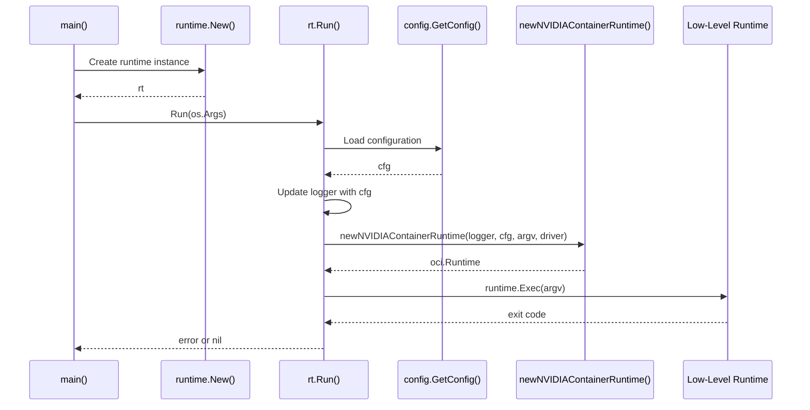

**Diagram: Runtime Execution Sequence**

**Sources:** [cmd/nvidia-container-runtime/main.go:9-15](), [internal/runtime/runtime.go:34-91]()

### Runtime Factory Pattern

The factory method constructs the runtime based on configuration and command-line arguments:

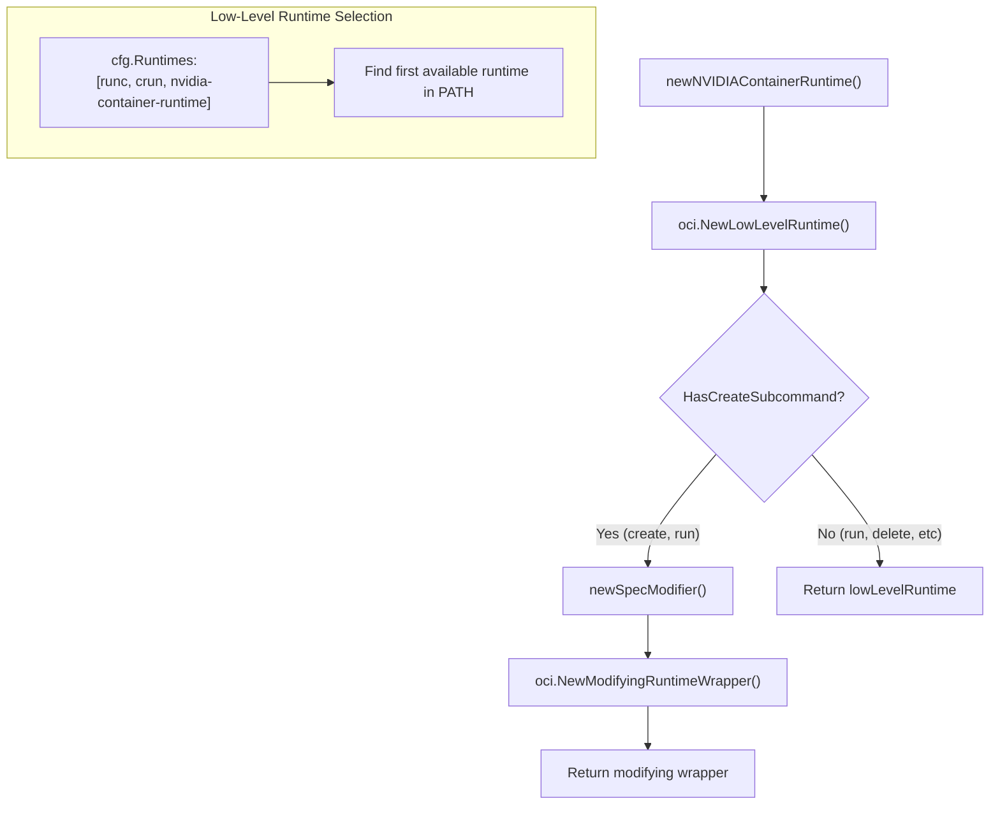

**Diagram: Runtime Factory Decision Flow**

The factory method implements a key optimization: **if the command is not a container creation command** (e.g., `delete`, `list`, `state`), no modification is needed and the low-level runtime is returned directly. [internal/oci/runtime_modifier.go:54]()

**Sources:** [internal/runtime/runtime_factory.go:32-64](), [internal/oci/runtime_low_level.go](), [internal/oci/runtime_modifier.go:54]()

---

## Runtime Modes

The NVIDIA Container Runtime supports four operational modes, each using a different mechanism to inject GPU resources:

### Mode Selection Logic

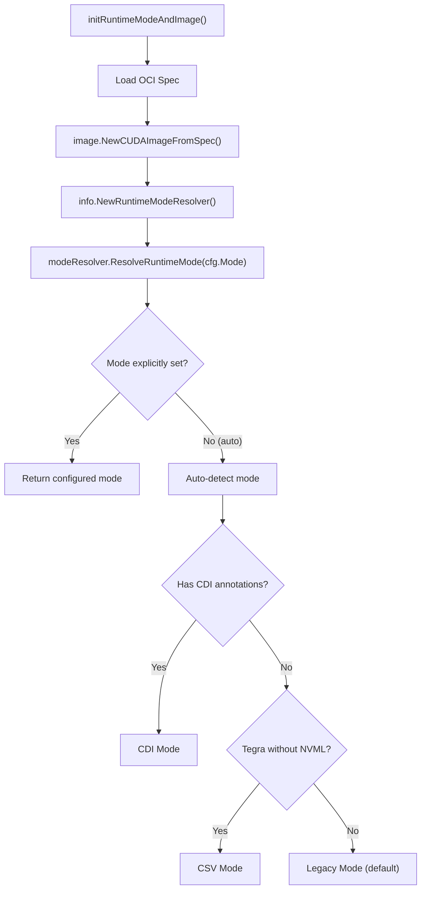

**Diagram: Runtime Mode Resolution Flow**

**Sources:** [internal/runtime/runtime_factory.go:118-130](), [internal/info/mode_resolver.go]() (referenced)

### Mode-Specific Modifiers

| Mode | Modifier Type | Device Injection | Hook Usage | Primary Use Case |
|------|---------------|------------------|------------|------------------|
| **Legacy** | `StableRuntimeModifier` | Hook-based | nvidia-container-runtime-hook | Backward compatibility |
| **CDI** | `CDIModifier` | Pre-generated specs | Minimal (hook remover) | Modern systems (default) |
| **CSV** | `CSVModifier` | File-based mounts | Feature-gated hooks | Tegra/embedded systems |
| **JIT-CDI** | `CDIModifier` (dynamic) | Just-in-time generation | CDI lifecycle hooks | Auto-generation scenarios |

**Sources:** [internal/runtime/runtime_factory.go:105-116](), [internal/modifier/stable.go](), [internal/modifier/cdi.go](), [internal/modifier/csv.go]()

### Modifier Pipeline by Mode

Different modes apply different modifier chains:

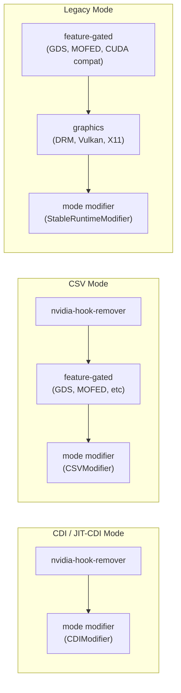

**Diagram: Modifier Pipelines by Runtime Mode**

**Key observation:** CDI mode requires the fewest modifiers because the CDI specification already contains most GPU resource declarations. Legacy mode requires the most modifiers because all resource injection happens dynamically at container creation time.

**Sources:** [internal/runtime/runtime_factory.go:130]()

---

## Component Responsibilities

### Core Runtime Components

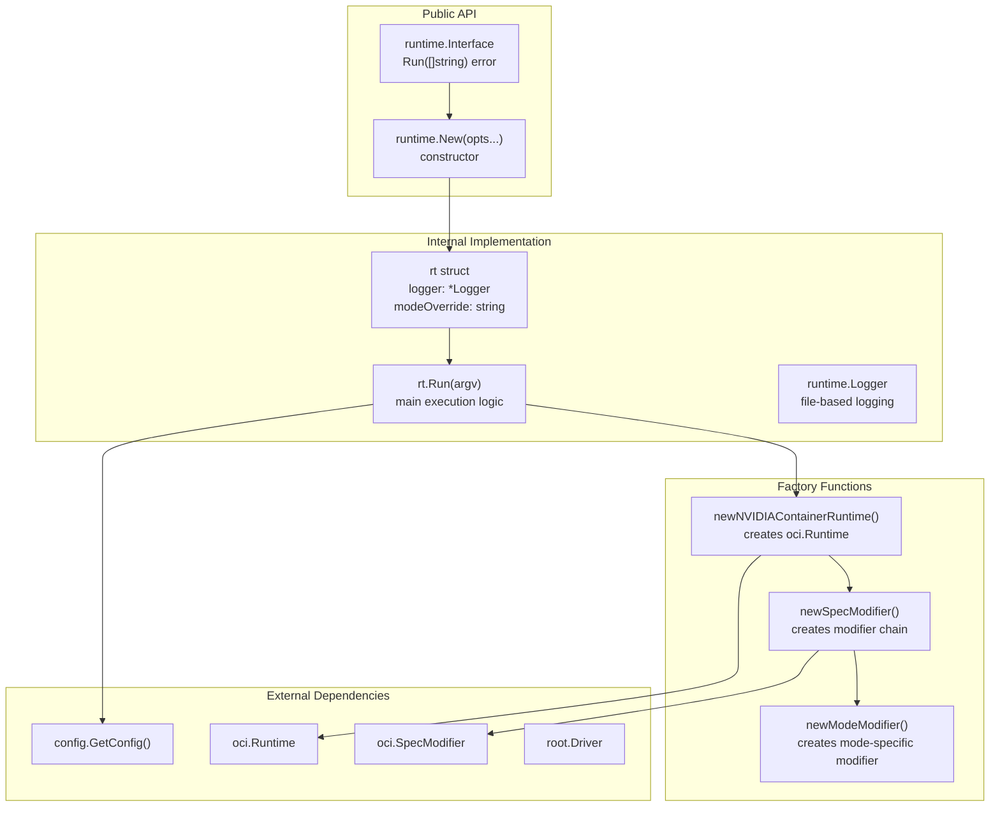

**Diagram: Component Relationships**

**Sources:** [internal/runtime/api.go:1-33](), [internal/runtime/runtime.go:17-117](), [internal/runtime/runtime_factory.go:17-130]()

### Logger Configuration

The runtime includes a sophisticated logging system that supports multiple output destinations:

| Logger Feature | Implementation | Source |
|----------------|----------------|--------|
| **File output** | `os.OpenFile()` with append mode | [internal/runtime/logger.go:161-172]() |
| **Debug mode** | Enables call stack reporting | [internal/runtime/logger.go:88-102]() |
| **Format support** | Text (default) or JSON | [internal/runtime/logger.go:104-106]() |
| **Multi-writer** | `io.MultiWriter` for multiple files | [internal/runtime/logger.go:114-118]() |
| **Argument parsing** | Extracts `--log`, `--log-format`, `--debug` | [internal/runtime/logger.go:194-254]() |

The logger is updated dynamically based on configuration and command-line flags: [internal/runtime/logger.go:49-126]()

**Sources:** [internal/runtime/logger.go:34-126](), [internal/runtime/logger.go:174-254]()

---

## Configuration Integration

### Configuration Flow

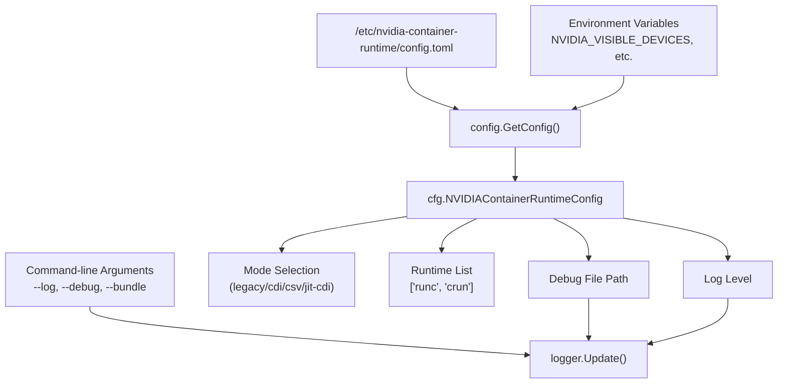

**Diagram: Configuration Sources and Usage**

### Mode Override

The runtime supports mode override through the `WithModeOverride()` option:

```mermaid
graph LR
    OperatorPkg["nvidia-container-toolkit-operator-extensions"]
    CDIBinary["nvidia-container-runtime.cdi"]
    LegacyBinary["nvidia-container-runtime.legacy"]
    MainBinary["nvidia-container-runtime"]
    
    OperatorPkg --> CDIBinary
    OperatorPkg --> LegacyBinary
    
    CDIBinary -.->|"WithModeOverride('cdi')"| RuntimeLib["runtime.New()"]
    LegacyBinary -.->|"WithModeOverride('legacy')"| RuntimeLib
    MainBinary -.->|"no override<br/>(uses config)"| RuntimeLib
```

**Diagram: Mode-Specific Runtime Binaries**

Mode-specific binaries are provided in the `operator-extensions` package for Kubernetes scenarios where the mode must be guaranteed regardless of configuration.

**Sources:** [internal/runtime/api.go:28-33](), [packaging/rpm/SPECS/nvidia-container-toolkit.spec:122-135]()

---

## Low-Level Runtime Integration

### Runtime Selection

The runtime searches for a low-level OCI runtime from a prioritized list:

1. **Configuration list**: `cfg.NVIDIAContainerRuntimeConfig.Runtimes` (e.g., `["runc", "crun"]`) [cmd/nvidia-container-runtime/README.md:23-27]()
2. **PATH lookup**: Uses `lookup.NewExecutableLocator` to find the first available binary [internal/oci/runtime_low_level.go:44-52]()
3. **Fallback**: Returns error if no runtime is found [internal/oci/runtime_low_level.go:54]()

**Default runtime list** (as of v1.18.0):
```
["runc", "crun"]
```

Note: `docker-runc` was removed from the default list in v1.18.0-rc.1.

**Sources:** [CHANGELOG.md:90](), [internal/oci/runtime_low_level.go](), [cmd/nvidia-container-runtime/README.md:23-27]()

### Command Forwarding

The runtime preserves all command-line arguments when delegating to the low-level runtime:

```mermaid
sequenceDiagram
    participant Engine as Container Engine
    participant Wrapper as nvidia-container-runtime
    participant Modifier as Spec Modifier
    participant LowLevel as runc/crun
    participant Container as Container Process
    
    Engine->>Wrapper: create --bundle /path/to/bundle ctr-id
    Wrapper->>Wrapper: Parse argv to identify bundle path
    Wrapper->>Modifier: Modify spec at /path/to/bundle/config.json
    Modifier-->>Wrapper: Spec modified in-place
    Wrapper->>LowLevel: create --bundle /path/to/bundle ctr-id<br/>(original argv)
    LowLevel->>Container: Start container with modified spec
    Container-->>LowLevel: exit code
    LowLevel-->>Wrapper: exit code
    Wrapper-->>Engine: exit code
```

**Diagram: Command Execution Flow**

**Key design principle**: The runtime modifies the specification file in-place before delegating, ensuring the low-level runtime receives exactly the same command-line arguments as the wrapper. [internal/oci/runtime_modifier.go:63-64]()

**Sources:** [internal/runtime/runtime.go:81-90](), [internal/oci/runtime_low_level.go](), [internal/oci/runtime_modifier.go:63-64]()

---

## Error Handling and Logging

### Error Propagation

The runtime uses deferred error handling to ensure proper cleanup:

```mermaid
graph TD
    RunMethod["rt.Run(argv)"]
    DeferError["defer: log error if rerr != nil"]
    PrintVersion{"--version flag?"}
    GetConfig["config.GetConfig()"]
    UpdateLogger["logger.Update()"]
    DeferReset["defer: logger.Reset()"]
    CreateRuntime["newNVIDIAContainerRuntime()"]
    Exec["runtime.Exec(argv)"]
    
    RunMethod --> DeferError
    RunMethod --> PrintVersion
    PrintVersion -->|"Yes"| PrintVersionInfo
    PrintVersion -->|"No"| GetConfig
    PrintVersionInfo --> GetConfig
    GetConfig --> UpdateLogger
    UpdateLogger --> DeferReset
    DeferReset --> CreateRuntime
    CreateRuntime --> Exec
    Exec --> Return["Return error"]
    
    DeferError -.->|"on return"| LogError["Log error to configured outputs"]
    DeferReset -.->|"on return"| CloseFiles["Close log files"]
```

**Diagram: Error Handling Flow**

**Deferred actions:**
1. **Error logging**: Any error returned is logged before function exit [internal/runtime/runtime.go:35-39]()
2. **Logger reset**: Log files are closed and logger is restored [internal/runtime/logger.go:130-159]()

**Sources:** [internal/runtime/runtime.go:34-91](), [internal/runtime/logger.go:130-159]()

---

## Testing Infrastructure

### Test Configuration

The runtime includes integration tests that verify correct OCI spec modification:

| Test Case | Purpose | Expected Behavior |
|-----------|---------|-------------------|
| `TestBadInput` | Invalid arguments | Runtime returns error |
| `TestGoodInput` | Valid create command | Hook not present (CDI default) |
| `TestDuplicateHook` | Pre-existing hook | Hook is removed by modifier |

**Test environment setup:**
- Mock `runc` binary in `tests/bin/` [cmd/nvidia-container-runtime/main_test.go:56-59]()
- Mock `nvidia-container-runtime-hook` in `tests/bin/` [cmd/nvidia-container-runtime/main_test.go:60-63]()
- Test specs in `tests/input/` [cmd/nvidia-container-runtime/main_test.go:49]()
- Bundle directory in `tests/output/bundle/` [cmd/nvidia-container-runtime/main_test.go:24]()

**Sources:** [cmd/nvidia-container-runtime/main_test.go:41-79](), [cmd/nvidia-container-runtime/main_test.go:84-241]()

### Factory Method Tests

The factory tests verify correct runtime and modifier creation for each mode:

```mermaid
graph TD
    TestFactory["TestFactoryMethod"]
    
    TestFactory --> EmptyConfig["empty config → error"]
    TestFactory --> ConfigWithRuntime["config with runtime → success"]
    TestFactory --> CSVMode["csv mode → CSVModifier"]
    TestFactory --> LegacyMode["legacy mode → StableRuntimeModifier"]
    TestFactory --> NonLegacy["non-legacy invalid mode → error"]
```

**Diagram: Factory Test Coverage**

**Sources:** [internal/runtime/runtime_factory_test.go:66-168]()

---

## Package Distribution

The NVIDIA Container Runtime is distributed in multiple packages:

### Package Hierarchy

| Package | Contents | Dependencies |
|---------|----------|--------------|
| **nvidia-container-toolkit** | `nvidia-container-runtime-hook` | `nvidia-container-toolkit-base`, `libnvidia-container-tools` |
| **nvidia-container-toolkit-base** | `nvidia-container-runtime`, `nvidia-ctk`, `nvidia-cdi-hook` | None (core package) |
| **nvidia-container-toolkit-operator-extensions** | `nvidia-container-runtime.cdi`, `nvidia-container-runtime.legacy` | `nvidia-container-toolkit-base` |

**Key packaging decisions:**
1. **Base package separation** (v1.13.0): Allows installation without the legacy hook
2. **Mode-specific binaries** (v1.13.0): Enables guaranteed mode in Kubernetes
3. **systemd integration** (v1.18.0): Auto-refresh CDI specs on driver changes

**Sources:** [packaging/rpm/SPECS/nvidia-container-toolkit.spec:1-135](), [packaging/debian/control:1-32]()

### Build Artifacts

The build system produces the following binaries:

```mermaid
graph TB
    subgraph "Source Code"
        MainGo["cmd/nvidia-container-runtime/main.go"]
        RuntimePkg["internal/runtime/*.go"]
    end
    
    subgraph "Build Process"
        GoCompile["go build with ldflags"]
        Makefile["Makefile: cmd-% target"]
    end
    
    subgraph "Binary Artifacts"
        MainBin["nvidia-container-runtime"]
        CDIBin["nvidia-container-runtime.cdi"]
        LegacyBin["nvidia-container-runtime.legacy"]
    end
    
    MainGo --> GoCompile
    RuntimePkg --> GoCompile
    Makefile --> GoCompile
    
    GoCompile --> MainBin
    GoCompile --> CDIBin
    GoCompile --> LegacyBin
    
    MainBin -.->|"no mode override"| RuntimeLib["runtime.New()"]
    CDIBin -.->|"WithModeOverride('cdi')"| RuntimeLib
    LegacyBin -.->|"WithModeOverride('legacy')"| RuntimeLib
```

**Diagram: Build Artifacts and Mode Configuration**

**Build flags:** Version and git commit information are injected via ldflags:
- `github.com/NVIDIA/nvidia-container-toolkit/internal/info.gitCommit`
- `github.com/NVIDIA/nvidia-container-toolkit/internal/info.version`

**Sources:** [Makefile:38-68](), [versions.mk:15-39]()

---

## Summary

The NVIDIA Container Runtime serves as a **transparent OCI runtime wrapper** that:

1. **Intercepts container creation** commands from container engines
2. **Modifies OCI specifications** to include GPU resources based on operational mode
3. **Delegates execution** to low-level runtimes with modified specifications
4. **Supports multiple modes** for different deployment scenarios (legacy, CDI, CSV, JIT-CDI)
5. **Provides mode-specific binaries** for guaranteed behavior in orchestrated environments

The runtime's architecture enables GPU support without requiring changes to container engines, making it compatible with Docker, containerd, CRI-O, and other OCI-compliant systems.

**Sources:** [cmd/nvidia-container-runtime/main.go:1-15](), [internal/runtime/runtime.go:17-117](), [internal/runtime/runtime_factory.go:17-130]()

---

# Page: NVIDIA Container Runtime Hook

# NVIDIA Container Runtime Hook

<details>
<summary>Relevant source files</summary>

The following files were used as context for generating this wiki page:

- [cmd/nvidia-container-runtime-hook/container_config.go](cmd/nvidia-container-runtime-hook/container_config.go)
- [cmd/nvidia-container-runtime-hook/container_config_test.go](cmd/nvidia-container-runtime-hook/container_config_test.go)
- [cmd/nvidia-container-runtime-hook/hook_config.go](cmd/nvidia-container-runtime-hook/hook_config.go)
- [cmd/nvidia-container-runtime-hook/hook_config_test.go](cmd/nvidia-container-runtime-hook/hook_config_test.go)
- [cmd/nvidia-container-runtime-hook/main.go](cmd/nvidia-container-runtime-hook/main.go)
- [internal/config/image/builder.go](internal/config/image/builder.go)
- [internal/config/image/capabilities.go](internal/config/image/capabilities.go)
- [internal/config/image/cuda_image.go](internal/config/image/cuda_image.go)
- [internal/config/image/cuda_image_test.go](internal/config/image/cuda_image_test.go)
- [internal/config/image/devices.go](internal/config/image/devices.go)
- [internal/config/image/privileged.go](internal/config/image/privileged.go)

</details>


## Overview

The **NVIDIA Container Runtime Hook** (`nvidia-container-runtime-hook`) is a legacy OCI lifecycle hook executable that configures GPU access for containers using a prestart hook approach. This component is invoked before a container starts to dynamically inject NVIDIA GPU devices, driver libraries, and capabilities into the container namespace.

**Scope**: This page documents the `nvidia-container-runtime-hook` binary, its configuration parsing, device selection logic, and invocation of `nvidia-container-cli`. For information about the NVIDIA Container Runtime that invokes this hook, see [NVIDIA Container Runtime](). For information about the modern CDI-based hook system, see [NVIDIA CDI Hook]().

**Legacy Status**: As of the toolkit's shift toward CDI-based runtime modes, this hook is primarily used in `legacy` mode. Modern deployments should prefer CDI mode or Just-In-Time CDI (`jit-cdi`) mode, which provide better performance and standards compliance.

## System Position

The runtime hook sits between the NVIDIA Container Runtime and the low-level `nvidia-container-cli` tool:

```mermaid
graph LR
    Runtime["nvidia-container-runtime"]
    Hook["nvidia-container-runtime-hook"]
    CLI["nvidia-container-cli"]
    NVML["NVML/Driver"]
    
    Runtime -->|"prestart hook"| Hook
    Hook -->|"exec with args"| CLI
    CLI -->|"query devices"| NVML
    CLI -->|"mount libs/devices"| Container["Container Namespace"]
```

**Diagram**: Position of nvidia-container-runtime-hook in the execution flow

Sources: [cmd/nvidia-container-runtime-hook/main.go:1-203]()

## Hook Invocation Lifecycle

The hook is invoked as an OCI lifecycle hook with specific commands:

```mermaid
sequenceDiagram
    participant Runtime as OCI Runtime
    participant Hook as nvidia-container-runtime-hook
    participant Stdin as Container State (stdin)
    participant Bundle as Bundle/config.json
    participant CLI as nvidia-container-cli
    
    Runtime->>Hook: Execute: prestart
    Hook->>Stdin: Read HookState JSON
    Hook->>Bundle: Load OCI Spec
    Hook->>Hook: Parse environment variables
    Hook->>Hook: Determine if GPU container
    alt GPU Container
        Hook->>Hook: Build nvidia-container-cli args
        Hook->>CLI: syscall.Exec()
        CLI->>CLI: Configure container
        CLI-->>Runtime: Success
    else No GPU Support Needed
        Hook-->>Runtime: Exit (no-op)
    end
```

**Diagram**: Hook lifecycle execution sequence

### Entry Points

The hook supports three lifecycle commands defined in [cmd/nvidia-container-runtime-hook/main.go:167-194]():

| Command | Action | Description |
|---------|--------|-------------|
| `prestart` | Executes `doPrestart()` | Configures GPU access before container start |
| `poststart` | No-op | Reserved for future use |
| `poststop` | No-op | Reserved for future use |

Only the `prestart` command performs actual work. The hook receives container state via stdin as a `HookState` struct [cmd/nvidia-container-runtime-hook/container_config.go:68-78]():

```
HookState {
    Pid: <container-pid>
    Bundle: <path-to-bundle>
    BundlePath: <legacy-path-to-bundle>
}
```

Sources: [cmd/nvidia-container-runtime-hook/main.go:167-194](), [cmd/nvidia-container-runtime-hook/container_config.go:68-78]()

## Configuration Loading

### Config File Resolution

The hook loads its configuration from a TOML file with the following precedence [cmd/nvidia-container-runtime-hook/hook_config.go:39-47]():

1. Command-line flag `--config`
2. Environment variable `NVIDIA_CTK_CONFIG_FILE_PATH`
3. Default path `/etc/nvidia-container-runtime/config.toml`

If the configuration file doesn't exist and isn't explicitly required, the hook uses default configuration values [cmd/nvidia-container-runtime-hook/hook_config.go:25-36]().

### Configuration Structure

The `hookConfig` struct wraps the toolkit configuration [cmd/nvidia-container-runtime-hook/hook_config.go:16-22]():

```mermaid
classDiagram
    class hookConfig {
        +Mutex
        +Config
        +containerConfig
        +getContainerConfig()
        +getNvidiaConfig()
        +getDriverCapabilities()
        +assertModeIsLegacy()
    }
    
    class Config {
        +NVIDIAContainerCLIConfig
        +NVIDIAContainerRuntimeConfig
        +SupportedDriverCapabilities
        +SwarmResource
        +AcceptDeviceListAsVolumeMounts
        +AcceptEnvvarUnprivileged
        +DisableRequire
        +Features
    }
    
    hookConfig --> Config
```

**Diagram**: Configuration structure for `nvidia-container-runtime-hook`

Key configuration options include:
- `SupportedDriverCapabilities`: Restricts which driver capabilities can be requested
- `SwarmResource`: Environment variable names for Docker Swarm GPU resource specifications
- `AcceptDeviceListAsVolumeMounts`: Enable device selection via volume mounts
- `AcceptEnvvarUnprivileged`: Allow `NVIDIA_VISIBLE_DEVICES` in unprivileged containers

Sources: [cmd/nvidia-container-runtime-hook/hook_config.go:16-68]()

## Container Configuration Detection

### OCI Spec Parsing

The hook reads the OCI runtime specification from the bundle path [cmd/nvidia-container-runtime-hook/container_config.go:80-100]():

```mermaid
graph TD
    State["HookState from stdin"]
    Bundle["Bundle Path"]
    ConfigJSON["config.json"]
    Spec["OCI Spec"]
    Process["Process Env"]
    Root["Root Path"]
    Caps["Capabilities"]
    
    State -->|"Bundle/BundlePath"| Bundle
    Bundle -->|"path.Join(...)"| ConfigJSON
    ConfigJSON -->|"loadSpec()"| Spec
    Spec --> Process
    Spec --> Root
    Spec --> Caps
    
    Process -->|"env vars"| Image["CUDA Image"]
    Caps -->|"isPrivileged()"| Privileged["Privileged Flag"]
```

**Diagram**: Container configuration detection flow

The `loadSpec()` function [cmd/nvidia-container-runtime-hook/container_config.go:80-100]() validates required fields:
- `spec.Version` must be present
- `spec.Process` must be present  
- `spec.Root` must be present

### Privileged Container Detection

The hook determines if a container is privileged by checking for `CAP_SYS_ADMIN` in the bounding capability set [internal/config/image/privileged.go:36-47]():

```
isPrivileged(spec) -> bool:
    for each capability in spec.Process.Capabilities.Bounding:
        if capability == "CAP_SYS_ADMIN":
            return true
    return false
```

This distinction is important because:
- Privileged containers can request MIG configuration/monitoring devices
- Unprivileged containers may be restricted from using `NVIDIA_VISIBLE_DEVICES` unless `AcceptEnvvarUnprivileged` is enabled

Sources: [cmd/nvidia-container-runtime-hook/container_config.go:131-133](), [internal/config/image/privileged.go:23-58]()

## Device Selection

### CUDA Image Abstraction

Device selection is handled through the `image.CUDA` abstraction [internal/config/image/cuda_image.go:43-56]():

```mermaid
classDiagram
    class CUDA {
        +logger
        +annotations map~string,string~
        +env map~string,string~
        +isPrivileged bool
        +mounts []specs.Mount
        +annotationsPrefixes []string
        +acceptDeviceListAsVolumeMounts bool
        +acceptEnvvarUnprivileged bool
        +preferredVisibleDeviceEnvVars []string
        +Getenv(key) string
        +HasEnvvar(key) bool
        +IsLegacy() bool
        +IsPrivileged() bool
        +VisibleDevices() []string
        +GetDriverCapabilities()
        +GetRequirements()
    }
```

**Diagram**: CUDA image interface for device selection

### Device Selection Priority

The `VisibleDevices()` method implements a priority-based selection strategy [internal/config/image/cuda_image.go:258-292]():

1. **Annotations** (highest priority): CDI device requests from Kubernetes annotations
2. **Volume Mounts**: Devices specified as `/dev/null` mounts to special paths
3. **Environment Variables**: `NVIDIA_VISIBLE_DEVICES` or preferred envvars

```mermaid
graph TD
    Start["VisibleDevices()"]
    Annotations["Check Annotations"]
    Mounts["Check Volume Mounts"]
    Envvars["Check Environment Variables"]
    Privileged["Check Privileged/AcceptUnprivileged"]
    Return["Return Device List"]
    
    Start --> Annotations
    Annotations -->|"has devices"| Return
    Annotations -->|"no devices"| Mounts
    Mounts -->|"acceptDeviceListAsVolumeMounts && has devices"| Return
    Mounts -->|"no devices"| Envvars
    Envvars -->|"has devices"| Privileged
    Privileged -->|"privileged or acceptUnprivileged"| Return
    Privileged -->|"denied"| Warning["Log Warning"]
    Warning --> ReturnNil["Return nil"]
    Envvars -->|"no devices"| ReturnNil
```

**Diagram**: Device selection priority flow

### Device Specification Formats

Devices can be specified in multiple formats:

| Format | Example | Description |
|--------|---------|-------------|
| Index | `0,1,2` | GPU indices |
| UUID | `GPU-12345678-1234-...` | Full GPU UUID |
| MIG | `MIG-GPU-12345678-...:0:1` | MIG device with GI:CI indices |
| Symbolic | `all` | All available GPUs |
| Symbolic | `none` | No GPUs (empty string in result) |
| Symbolic | `void` | No GPUs (nil result) |

The `VisibleDevices` interface [internal/config/image/devices.go:23-28]() provides methods:
- `List() []string`: Get ordered device list
- `Has(id string) bool`: Check if specific device is selected

Sources: [internal/config/image/cuda_image.go:258-292](), [internal/config/image/devices.go:1-127]()

### Volume Mount Device Specification

When `acceptDeviceListAsVolumeMounts` is enabled, devices can be specified via volume mounts [internal/config/image/cuda_image.go:358-388]():

```
Mount Pattern:
    Source: /dev/null
    Destination: /var/run/nvidia-container-devices/<device-id>

Examples:
    /var/run/nvidia-container-devices/GPU0
    /var/run/nvidia-container-devices/GPU0-MIG0/0/1
    /var/run/nvidia-container-devices/cdi/nvidia.com/gpu/0
    /var/run/nvidia-container-devices/imex/channel0
```

CDI device mounts use the prefix `/var/run/nvidia-container-devices/cdi/` and are parsed to fully-qualified CDI names [internal/config/image/cuda_image.go:390-414]().

Sources: [internal/config/image/cuda_image.go:34-38](), [internal/config/image/cuda_image.go:358-388]()

## Driver Capabilities

### Capability Selection

Driver capabilities determine which driver functionalities are available in the container. The hook implements capability selection in `getDriverCapabilities()` [cmd/nvidia-container-runtime-hook/container_config.go:151-175]():

```mermaid
graph TD
    Start["getDriverCapabilities()"]
    SupportedCaps["SupportedDriverCapabilities from config"]
    DefaultCaps["DefaultDriverCapabilities = compute,utility"]
    EnvVarSet{"NVIDIA_DRIVER_CAPABILITIES set?"}
    Legacy{"Legacy Image?"}
    EnvVarValue["Parse NVIDIA_DRIVER_CAPABILITIES"]
    
    Start --> SupportedCaps
    SupportedCaps --> DefaultCaps
    DefaultCaps --> EnvVarSet
    
    EnvVarSet -->|"No"| Legacy
    Legacy -->|"Yes"| AllCaps["Return all supported capabilities"]
    Legacy -->|"No"| DefaultIntersection["Return default ∩ supported"]
    
    EnvVarSet -->|"Yes"| EnvVarValue
    EnvVarValue --> Intersection["Return env ∩ supported"]
    Intersection --> Validate["Validate all requested are supported"]
```

**Diagram**: Driver capability selection logic

### Supported Capabilities

The toolkit defines standard driver capabilities [internal/config/image/capabilities.go:20-30]():

| Capability | Description |
|------------|-------------|
| `compute` | CUDA compute libraries |
| `compat32` | 32-bit compatibility libraries |
| `graphics` | Graphics/GLX libraries |
| `utility` | nvidia-smi and utility libraries |
| `video` | Video encode/decode libraries |
| `display` | Display/X11 libraries |
| `ngx` | NGX libraries |

Default capabilities when unspecified: `compute,utility`

Configuration can restrict capabilities via `supported-driver-capabilities`:

```toml
supported-driver-capabilities = "compute,utility,graphics"
```

Sources: [cmd/nvidia-container-runtime-hook/container_config.go:151-175](), [internal/config/image/capabilities.go:1-142]()

## Requirements Checking

### Requirement Extraction

The hook extracts requirements from environment variables prefixed with `NVIDIA_REQUIRE_` [internal/config/image/cuda_image.go:113-134]():

```
GetRequirements() []string:
    if NVIDIA_DISABLE_REQUIRE == "true":
        return []
    
    requirements = []
    for each env var with prefix "NVIDIA_REQUIRE_":
        if not NVIDIA_REQUIRE_JETPACK*:
            append requirement value
    
    if IsLegacy():
        cuda_version = parse CUDA_VERSION
        append "cuda>=" + major.minor
    
    return requirements
```

### Legacy vs Modern Images

| Image Type | Detection | Requirements Behavior |
|------------|-----------|----------------------|
| Legacy | `CUDA_VERSION` set, `NVIDIA_REQUIRE_CUDA` unset | Automatically adds `cuda>=X.Y` requirement |
| Modern | `NVIDIA_REQUIRE_CUDA` set | Uses explicit requirements only |

Example requirements from a modern image:
```
NVIDIA_REQUIRE_CUDA=cuda>=11.6
NVIDIA_REQUIRE_BRAND=brand=tesla,driver>=450
```

These requirements are passed to `nvidia-container-cli` via `--require=` flags and validated against the host driver.

Sources: [internal/config/image/cuda_image.go:98-146](), [cmd/nvidia-container-runtime-hook/container_config.go:204-217]()

## MIG Device Support

### MIG Configuration

Multi-Instance GPU (MIG) devices can be configured in privileged containers via special environment variables [cmd/nvidia-container-runtime-hook/container_config.go:135-149]():

```
NVIDIA_MIG_CONFIG_DEVICES=mig0,mig1
NVIDIA_MIG_MONITOR_DEVICES=mig0,mig1
```

The hook validates privilege requirements:

```
getMigConfigDevices(image):
    if !image.HasEnvvar(NVIDIA_MIG_CONFIG_DEVICES):
        return nil
    devices = image.Getenv(NVIDIA_MIG_CONFIG_DEVICES)
    if !privileged && devices != "":
        panic("cannot set MIG_CONFIG_DEVICES in non privileged container")
    return devices
```

MIG device values are passed to `nvidia-container-cli` via:
- `--mig-config=<devices>`
- `--mig-monitor=<devices>`

Sources: [cmd/nvidia-container-runtime-hook/container_config.go:135-149](), [cmd/nvidia-container-runtime-hook/main.go:128-133]()

## NVIDIA Container CLI Invocation

### CLI Argument Construction

The `doPrestart()` function builds the `nvidia-container-cli configure` command [cmd/nvidia-container-runtime-hook/main.go:66-156]():

```mermaid
graph TD
    Start["doPrestart()"]
    GetConfig["getHookConfig()"]
    GetContainer["getContainerConfig()"]
    CheckGPU{"nvidia != nil?"}
    AssertLegacy["assertModeIsLegacy()"]
    BuildArgs["Build CLI Arguments"]
    Exec["syscall.Exec()"]
    
    Start --> GetConfig
    GetConfig --> GetContainer
    GetContainer --> CheckGPU
    CheckGPU -->|"No"| Return["Return (no-op)"]
    CheckGPU -->|"Yes"| AssertLegacy
    AssertLegacy --> BuildArgs
    BuildArgs --> Exec
    
    BuildArgs --> GlobalOpts["--root, --load-kmods, --debug"]
    BuildArgs --> ConfigureCmd["configure"]
    BuildArgs --> CUDACompat["--cuda-compat-mode"]
    BuildArgs --> LdconfigPath["--ldconfig"]
    BuildArgs --> DeviceFlags["--device, --mig-config, --mig-monitor"]
    BuildArgs --> CapFlags["--compute, --utility, etc."]
    BuildArgs --> RequireFlags["--require"]
    BuildArgs --> PidRootfs["--pid, <rootfs>"]
```

**Diagram**: `nvidia-container-cli` argument construction

### CLI Argument Mapping

| Hook Config/State | CLI Argument | Example |
|-------------------|--------------|---------|
| `cli.Root` | `--root=` | `--root=/run/nvidia/driver` |
| `cli.LoadKmods` | `--load-kmods` | Load kernel modules if needed |
| `cli.NoPivot` | `--no-pivot` | Skip pivot_root operation |
| `cli.Debug` | `--debug=` | `--debug=/var/log/nvidia.log` |
| `cli.Ldcache` | `--ldcache=` | `--ldcache=/etc/ld.so.cache` |
| `cli.User` | `--user=` | `--user=1000:1000` |
| `cli.NoCgroups` | `--no-cgroups` | Skip cgroup device allowlisting |
| `nvidia.Devices` | `--device=` | `--device=0,1` |
| `nvidia.MigConfigDevices` | `--mig-config=` | `--mig-config=mig0` |
| `nvidia.MigMonitorDevices` | `--mig-monitor=` | `--mig-monitor=mig1` |
| `nvidia.ImexChannels` | `--imex-channel=` | `--imex-channel=0,1` |
| Capability: `compute` | `--compute` | Enable compute capability |
| Capability: `utility` | `--utility` | Enable utility capability |
| Capability: `graphics` | `--graphics` | Enable graphics capability |
| Capability: `video` | `--video` | Enable video capability |
| Capability: `display` | `--display` | Enable display capability |
| `nvidia.Requirements` | `--require=` | `--require=cuda>=11.6` |
| `container.Pid` | `--pid=` | `--pid=12345` |
| `container.Rootfs` | `<rootfs>` | `/var/lib/containerd/.../rootfs` |

### CUDA Compatibility Mode

The hook supports CUDA forward compatibility via the `--cuda-compat-mode` flag [cmd/nvidia-container-runtime-hook/hook_config.go:104-125]():

```
nvidiaContainerCliCUDACompatModeFlags():
    switch config.CUDACompatMode:
        case "ldconfig":
            return ["--cuda-compat-mode=ldconfig"]
        case "mount":
            return ["--cuda-compat-mode=mount"]
        case "disabled", "hook":
            return ["--cuda-compat-mode=disabled"]
        default:
            if !AllowCUDACompatLibsFromContainer:
                return ["--cuda-compat-mode=disabled"]
    return []
```

This controls whether CUDA compatibility libraries are discovered via ldconfig, mounted, or disabled entirely.

Sources: [cmd/nvidia-container-runtime-hook/main.go:89-156](), [cmd/nvidia-container-runtime-hook/hook_config.go:104-125]()

### Execution via syscall.Exec

After building the argument list, the hook executes `nvidia-container-cli` by replacing its own process [cmd/nvidia-container-runtime-hook/main.go:152-156]():

```go
env := append(os.Environ(), cli.Environment...)
err = syscall.Exec(args[0], args, env)
log.Panicln("exec failed:", err)
```

This `syscall.Exec()` call:
1. Replaces the hook process with `nvidia-container-cli`
2. Preserves the process PID
3. Inherits file descriptors
4. Passes combined environment variables

The CLI then configures the container namespace and exits, returning control to the container runtime.

Sources: [cmd/nvidia-container-runtime-hook/main.go:152-156]()

## Mode Detection and Legacy Status

### Mode Resolution

The hook checks if it should operate in legacy mode via `assertModeIsLegacy()` [cmd/nvidia-container-runtime-hook/hook_config.go:127-131]():

```mermaid
graph TD
    Assert["assertModeIsLegacy()"]
    SkipCheck{"SkipModeDetection?"}
    Resolver["info.NewRuntimeModeResolver()"]
    ResolveMode["ResolveRuntimeMode()"]
    CheckMode{"mode == 'legacy'?"}
    
    Assert --> SkipCheck
    SkipCheck -->|"Yes"| ReturnOK["Return nil"]
    SkipCheck -->|"No"| Resolver
    Resolver --> ResolveMode
    ResolveMode --> CheckMode
    CheckMode -->|"Yes"| ReturnOK
    CheckMode -->|"No"| Error["Return Error: Use nvidia-container-runtime instead"]
```

**Diagram**: Legacy mode assertion logic

The mode resolver considers:
- Configuration file `nvidia-container-runtime.mode` setting
- Container image characteristics (CDI devices, etc.)
- Default mode (legacy for the hook)

### Direct Hook Invocation Restriction

When mode detection is enabled (default), the hook prevents direct invocation in non-legacy scenarios [cmd/nvidia-container-runtime-hook/hook_config.go:131]():

```
Error: "invoking the NVIDIA Container Runtime Hook directly 
(e.g. specifying the docker --gpus flag) is not supported. 
Please use the NVIDIA Container Runtime 
(e.g. specify the --runtime=nvidia flag) instead"
```

This error appears when:
- The runtime is configured for CDI mode
- The container requests CDI devices
- The hook is invoked directly rather than through the runtime wrapper

To bypass this check, set in the config:

```toml
[nvidia-container-runtime-hook]
  skip-mode-detection = true
```

Sources: [cmd/nvidia-container-runtime-hook/hook_config.go:127-131]()

## Package Installation

### Debian Package

The hook is installed by the `nvidia-container-toolkit` package:

```
/usr/bin/nvidia-container-runtime-hook
```

Post-installation creates a symlink for backward compatibility:

```bash
NVIDIA_CONTAINER_RUNTIME_HOOK=/usr/bin/nvidia-container-runtime-hook
NVIDIA_CONTAINER_TOOLKIT=/usr/bin/nvidia-container-toolkit

ln -s ${NVIDIA_CONTAINER_RUNTIME_HOOK} ${NVIDIA_CONTAINER_TOOLKIT}
```

### RPM Package

Similar installation and symlink creation occurs in the RPM package:

```
%install
install -m 755 -t %{buildroot}%{_bindir} nvidia-container-runtime-hook

%posttrans
ln -sf %{_bindir}/nvidia-container-runtime-hook %{_bindir}/nvidia-container-toolkit
```

The `nvidia-container-toolkit` symlink maintains backward compatibility with earlier versions where the hook was the primary binary.

## Relationship to Other Components

### Comparison with CDI Hook

| Aspect | `nvidia-container-runtime-hook` | `nvidia-cdi-hook` |
|--------|------------------------------|-----------------|
| **Mode** | Legacy mode | CDI mode |
| **Invocation** | Prestart hook | CreateContainer/CreateRuntime hooks |
| **Device Discovery** | Dynamic via NVML | Pre-generated CDI specs |
| **Performance** | Slower (runtime NVML queries) | Faster (spec already generated) |
| **Standards** | Custom | CDI specification compliant |
| **CLI Dependency** | Requires `nvidia-container-cli` | Does not require `nvidia-container-cli` |

The CDI hook system (see [NVIDIA CDI Hook]()) is the recommended approach for modern deployments.

### Integration with NVIDIA Container Runtime

The runtime wrapper [NVIDIA Container Runtime]() determines whether to inject this hook into the OCI spec based on:
1. Runtime mode configuration
2. Container image characteristics
3. Device request format

In legacy mode, the runtime adds a prestart hook entry to the OCI spec:

```json
{
  "hooks": {
    "prestart": [{
      "path": "/usr/bin/nvidia-container-runtime-hook",
      "args": ["nvidia-container-runtime-hook", "prestart"]
    }]
  }
}
```

Sources: [cmd/nvidia-container-runtime-hook/main.go:1-203]()

---

# Page: NVIDIA CTK CLI

# NVIDIA CTK CLI

<details>
<summary>Relevant source files</summary>

The following files were used as context for generating this wiki page:

- [cmd/nvidia-cdi-hook/commands/commands.go](cmd/nvidia-cdi-hook/commands/commands.go)
- [cmd/nvidia-cdi-hook/main.go](cmd/nvidia-cdi-hook/main.go)
- [cmd/nvidia-ctk/README.md](cmd/nvidia-ctk/README.md)
- [cmd/nvidia-ctk/cdi/cdi.go](cmd/nvidia-ctk/cdi/cdi.go)
- [cmd/nvidia-ctk/cdi/generate/generate.go](cmd/nvidia-ctk/cdi/generate/generate.go)
- [cmd/nvidia-ctk/cdi/list/list.go](cmd/nvidia-ctk/cdi/list/list.go)
- [cmd/nvidia-ctk/cdi/transform/root/root.go](cmd/nvidia-ctk/cdi/transform/root/root.go)
- [cmd/nvidia-ctk/cdi/transform/transform.go](cmd/nvidia-ctk/cdi/transform/transform.go)
- [cmd/nvidia-ctk/config/config.go](cmd/nvidia-ctk/config/config.go)
- [cmd/nvidia-ctk/config/config_test.go](cmd/nvidia-ctk/config/config_test.go)
- [cmd/nvidia-ctk/config/create-default/create-default.go](cmd/nvidia-ctk/config/create-default/create-default.go)
- [cmd/nvidia-ctk/config/flags/options.go](cmd/nvidia-ctk/config/flags/options.go)
- [cmd/nvidia-ctk/hook/hook.go](cmd/nvidia-ctk/hook/hook.go)
- [cmd/nvidia-ctk/info/info.go](cmd/nvidia-ctk/info/info.go)
- [cmd/nvidia-ctk/main.go](cmd/nvidia-ctk/main.go)
- [cmd/nvidia-ctk/runtime/configure/configure.go](cmd/nvidia-ctk/runtime/configure/configure.go)
- [cmd/nvidia-ctk/runtime/runtime.go](cmd/nvidia-ctk/runtime/runtime.go)
- [cmd/nvidia-ctk/system/create-dev-char-symlinks/all.go](cmd/nvidia-ctk/system/create-dev-char-symlinks/all.go)
- [cmd/nvidia-ctk/system/create-dev-char-symlinks/create-dev-char-symlinks.go](cmd/nvidia-ctk/system/create-dev-char-symlinks/create-dev-char-symlinks.go)
- [cmd/nvidia-ctk/system/create-dev-char-symlinks/existing.go](cmd/nvidia-ctk/system/create-dev-char-symlinks/existing.go)
- [cmd/nvidia-ctk/system/create-device-nodes/create-device-nodes.go](cmd/nvidia-ctk/system/create-device-nodes/create-device-nodes.go)
- [cmd/nvidia-ctk/system/system.go](cmd/nvidia-ctk/system/system.go)
- [pkg/config/engine/api.go](pkg/config/engine/api.go)
- [pkg/config/engine/containerd/config.go](pkg/config/engine/containerd/config.go)
- [pkg/config/engine/containerd/config_test.go](pkg/config/engine/containerd/config_test.go)
- [pkg/config/engine/containerd/config_v1.go](pkg/config/engine/containerd/config_v1.go)
- [pkg/config/engine/containerd/config_v1_test.go](pkg/config/engine/containerd/config_v1_test.go)
- [pkg/config/engine/containerd/containerd.go](pkg/config/engine/containerd/containerd.go)
- [pkg/config/engine/containerd/option.go](pkg/config/engine/containerd/option.go)
- [pkg/config/engine/crio/crio.go](pkg/config/engine/crio/crio.go)
- [pkg/config/engine/crio/crio_test.go](pkg/config/engine/crio/crio_test.go)
- [pkg/config/engine/crio/option.go](pkg/config/engine/crio/option.go)
- [pkg/config/engine/docker/docker.go](pkg/config/engine/docker/docker.go)
- [pkg/config/engine/docker/option.go](pkg/config/engine/docker/option.go)
- [pkg/nvcdi/api.go](pkg/nvcdi/api.go)
- [pkg/nvcdi/common-nvml.go](pkg/nvcdi/common-nvml.go)
- [pkg/nvcdi/driver-nvml.go](pkg/nvcdi/driver-nvml.go)
- [pkg/nvcdi/full-gpu-nvml.go](pkg/nvcdi/full-gpu-nvml.go)
- [pkg/nvcdi/lib-csv.go](pkg/nvcdi/lib-csv.go)
- [pkg/nvcdi/lib-nvml.go](pkg/nvcdi/lib-nvml.go)
- [pkg/nvcdi/lib-wsl.go](pkg/nvcdi/lib-wsl.go)
- [pkg/nvcdi/lib.go](pkg/nvcdi/lib.go)
- [pkg/nvcdi/management.go](pkg/nvcdi/management.go)
- [pkg/nvcdi/mig-device-nvml.go](pkg/nvcdi/mig-device-nvml.go)
- [pkg/nvcdi/options.go](pkg/nvcdi/options.go)
- [pkg/nvcdi/transform/root/container-root.go](pkg/nvcdi/transform/root/container-root.go)
- [pkg/nvcdi/transform/root/host-root.go](pkg/nvcdi/transform/root/host-root.go)

</details>


The NVIDIA Container Toolkit CLI (`nvidia-ctk`) is a comprehensive command-line utility designed to facilitate configuration, management, and runtime integration of NVIDIA GPUs within containerized environments. It serves as the primary administrative interface to control how NVIDIA GPUs are exposed to containers, manage CDI (Container Device Interface) specifications, configure container runtimes, and manipulate toolkit settings.

This document provides a detailed technical overview of the `nvidia-ctk` CLI, covering its key subcommands, the internal implementation structure, data flows, and the underlying libraries it leverages.

---

## Overview

The `nvidia-ctk` CLI acts as a single binary exposing several subcommands, which can be classified broadly as follows:

- **cdi generate**: Generate CDI specifications for NVIDIA GPU devices.
- **runtime configure**: Configure container runtimes (Docker, containerd, CRI-O) to enable NVIDIA GPU support.
- **system**: System-level management commands, e.g., device node preparation.
- **hook**: Management of runtime hooks for NVIDIA container integration.
- **config**: View and modify NVIDIA Container Toolkit configuration files.

### High-Level Architecture

```mermaid
graph TD
    subgraph "User Interface"
        nvctk["nvidia-ctk CLI"]
    end
    
    subgraph "Command Categories"
        cdi["cdi commands"]
        runtime["runtime commands"]
        config["config commands"]
        hook["hook commands"]
        system["system commands"]
        info["info commands"]
    end
    
    subgraph "Backends"
        nvcdi["NVCDI Library"]
        configEngines["Config Engines\n(Docker, containerd, CRI-O)"]
        toolkitConfig["Toolkit Configuration"]
    end
    
    nvctk --> cdi
    nvctk --> runtime
    nvctk --> config
    nvctk --> hook
    nvctk --> system
    nvctk --> info
    
    cdi --> nvcdi
    runtime --> configEngines
    config --> toolkitConfig
```

This structure highlights how the CLI delegates specific tasks to internal libraries and configuration engines tailored for container runtime compatibility.

Sources: [cmd/nvidia-ctk/main.go:90-97]()

---

## CLI Commands Structure

The `nvidia-ctk` CLI exposes key command categories as separate subcommands. The command tree resembles the following:

```mermaid
graph TD
    nvctk["nvidia-ctk"] --> cdi["cdi"]
    nvctk --> runtime["runtime"]
    nvctk --> config["config"]
    nvctk --> hook["hook"]
    nvctk --> system["system"]
    nvctk --> info["info"]
    
    cdi --> cdiGenerate["generate"]
    runtime --> rtConfigure["configure"]
    config --> cfgDefault["default"]
    config --> cfgSet["config --set"]
```

Each command serves a distinct operational role, e.g., `cdi generate` handles CDI spec creation, while `runtime configure` manages runtime JSON/TOML configurations.

### Global CLI Options

Across all commands, the CLI supports global flags such as:

| Option      | Description                                                       |
|-------------|-------------------------------------------------------------------|
| `--debug`   | Enable debug-level logging for verbose output                     |
| `--quiet`   | Suppress all output except for errors (overrides `--debug`)       |
| `--help`    | Display help information                                          |
| `--version` | Display the version of the CLI                                    |

Sources: [cmd/nvidia-ctk/main.go:59-74]()

---

## Detailed Command Reference

### 1. CDI Generation Command (`nvidia-ctk cdi generate`)

This command generates Container Device Interface (CDI) specifications describing NVIDIA GPU devices and their required container edits (mounts, environment variables, hooks, etc.) for runtimes that support CDI.

CDI is a vendor-neutral specification facilitating pre-defined device profiles for container runtimes.

#### Implementation Overview

- The command is implemented in `cmd/nvidia-ctk/cdi/generate/generate.go`.
- It creates a `command` struct which parses CLI options and uses the NVCDI library to discover devices and generate specs.
- The NVCDI (`nvcdi`) library supports multiple discovery modes (NVML, CSV, WSL, Management, etc.).

#### Command Data Flow

```mermaid
sequenceDiagram
    participant User
    participant CLI as "nvidia-ctk cdi generate"
    participant NVCDI as "NVCDI Library"
    participant Device as "GPU & Driver Discovery"
    participant Output as "CDI Specification"
    
    User->>CLI: Invoke with CLI flags and args
    CLI->>NVCDI: Instantiate NVCDI with parsed options
    NVCDI->>Device: Perform device and driver discovery
    Device-->>NVCDI: Return discovered GPU & driver details
    NVCDI->>NVCDI: Generate device and container specs
    NVCDI-->>CLI: Return compiled CDI spec
    CLI->>Output: Write spec to file or stdout
    Output-->>User: Confirm completion
```

#### Key Options

| CLI Option             | Description                                                            |
|------------------------|------------------------------------------------------------------------|
| `--output`             | Output path for the generated spec (stdout if empty)                   |
| `--format`             | Output format (yaml or json), defaults to YAML                         |
| `--device-name-strategy` | One or more device naming strategies (`index`, `uuid`, `type-index`)     |
| `--mode`               | Discovery mode (`auto`, `nvml`, `csv`, `wsl`, and others)              |
| `--driver-root`        | NVIDIA driver root directory                                           |
| `--vendor`             | Vendor string for CDI specs (default: `nvidia.com`)                    |
| `--class`              | CDI class string (default: `gpu`)                                      |

Sources: [cmd/nvidia-ctk/cdi/generate/generate.go:94-179](), [pkg/nvcdi/lib.go:32-105]()

#### Discovery Modes Supported

| Mode        | Description                                                       |
|-------------|-------------------------------------------------------------------|
| `nvml`      | Use NVIDIA Management Library (NVML) to discover full GPUs and MIG devices |
| `csv`       | Use platform-specific CSV files to discover device specs (e.g., Tegra/Jetson)  |
| `wsl`       | Windows Subsystem for Linux mode, tailored for WSL2 GPU discovery    |
| `management`| Mode designed for management containers with specialized device node discovery |
| `gds`       | Specialized GPUDirect Storage devices                              |
| `mofed`     | Devices related to Mellanox OFED                                   |
| `auto`      | Auto-detect the best mode based on the running system configuration |

Sources: [pkg/nvcdi/lib.go:78-95](), [pkg/nvcdi/lib-csv.go:17-108](), [pkg/nvcdi/management.go:31-120]()

---

### 2. Runtime Configuration Command (`nvidia-ctk runtime configure`)

This command configures container runtimes such as Docker, containerd, and CRI-O to use the NVIDIA Container Runtime, enabling GPU support.

#### Implementation Overview

- Implemented in `cmd/nvidia-ctk/runtime/configure/configure.go`.
- Supports different runtimes through a unified interface, assembling config changes accordingly.
- Reads the current runtime configuration, adds or modifies NVIDIA runtime entries, and optionally enables CDI integration.
- Supports a `--dry-run` to preview changes without writing.

#### Runtime Config Engines

Container runtime config engines have implementations for:

- Docker (`pkg/config/engine/docker`)
- containerd (`pkg/config/engine/containerd`)
- CRI-O (`pkg/config/engine/crio`)

These implementations provide uniform methods such as `AddRuntime()`, `RemoveRuntime()`, `GetRuntimeConfig()`, and `Save()` for config file manipulation.

#### Command Data Flow

```mermaid
flowchart TD
    subgraph "nvidia-ctk runtime configure Flow"
        CLI["nvidia-ctk runtime configure"]
        ValidateFlags["Validate Flags"]
        ConfigSource["Determine Config Source"]
        LoadConfig["Load Runtime Config"]
        UpdateConfig["Update Runtime Config"]
        SaveConfig["Save Updated Config"]
    end
    
    subgraph "Container Runtimes"
        Docker["Docker Engine"]
        Containerd["containerd"]
        CriO["CRI-O"]
    end
    
    CLI --> ValidateFlags
    ValidateFlags --> ConfigSource
    ConfigSource --> LoadConfig
    LoadConfig --> UpdateConfig
    UpdateConfig --> SaveConfig
    
    SaveConfig --> Docker
    SaveConfig --> Containerd
    SaveConfig --> CriO
```

#### Key Options

| Option                  | Description                                                    |
|-------------------------|----------------------------------------------------------------|
| `--runtime`             | Target runtime to configure: `docker`, `containerd`, or `crio` |
| `--config`              | Path to the runtime's main config file                          |
| `--nvidia-runtime-name` | Name used for the NVIDIA runtime in the runtime configs        |
| `--nvidia-runtime-path` | Path to the NVIDIA Container Runtime executable                |
| `--set-as-default`      | Whether to set the NVIDIA runtime as the default runtime       |
| `--cdi.enabled`         | Enable CDI integration within the runtime                       |
| `--dry-run`             | Show configuration changes without modifying files             |

Sources: [cmd/nvidia-ctk/runtime/configure/configure.go:99-180](), [pkg/config/engine/api.go:20-46](), [pkg/config/engine/docker/docker.go:32-191](), [pkg/config/engine/containerd/containerd.go:50-178](), [pkg/config/engine/crio/crio.go:32-176]()

#### Config Engine Interface Diagram

```mermaid
classDiagram
    class Interface {
        <<interface>>
        +AddRuntime(name, path, setAsDefault)
        +DefaultRuntime()
        +EnableCDI()
        +GetRuntimeConfig(name)
        +RemoveRuntime(name)
        +Save(path)
        +String()
    }
    
    class DockerConfig {
        +AddRuntime()
        +DefaultRuntime()
        +EnableCDI()
        +GetRuntimeConfig()
        +RemoveRuntime()
        +Save()
    }
    
    class ContainerdConfig {
        +AddRuntime()
        +DefaultRuntime()
        +EnableCDI()
        +GetRuntimeConfig()
        +RemoveRuntime()
        +Save()
    }
    
    class CrioConfig {
        +AddRuntime()
        +DefaultRuntime()
        +EnableCDI()
        +GetRuntimeConfig()
        +RemoveRuntime()
        +Save()
    }
    
    Interface <|.. DockerConfig
    Interface <|.. ContainerdConfig
    Interface <|.. CrioConfig
```

---

### 3. System Commands (`nvidia-ctk system`)

The system commands facilitate lower-level host system setup tasks required for NVIDIA GPU container support, such as creating device nodes and char device symlinks, ensuring proper device nodes are present before container launch.

These utilities support preparing the host environment consistent with driver expectations.

Sources: [cmd/nvidia-ctk/system/system.go]()

---

### 4. Hook Management Commands (`nvidia-ctk hook`)

Manages the legacy container runtime hooks related to prestart injection of NVIDIA bindings in containers. This is mostly relevant when CDI hooks are not used, providing compatibility with prestart hook-based integration.

Contains commands to list, install, or manipulate hooks.

Sources: [cmd/nvidia-ctk/hook/hook.go]()

---

### 5. Configuration Management Commands (`nvidia-ctk config`)

Allows inspection and modification of the NVIDIA Container Toolkit configuration, generally stored in TOML format, e.g., `/etc/nvidia-container-runtime/config.toml`.

Features include:

- Viewing config sections and options
- Setting options in-place
- Generating default minimalist configuration files

Sources: [cmd/nvidia-ctk/config/config.go:60-142](), [cmd/nvidia-ctk/config/create-default/create-default.go:46-91]()

---

## NVCDI Library - Core CDI Spec Generation

The NVCDI (`nvcdi`) library is a foundational component within the NVIDIA Container Toolkit ecosystem for:

- Discovering NVIDIA GPU devices and associated driver components.
- Building CDI specifications that describe how to expose these devices and libraries in containers.
- Supporting multiple GPU discovery modes and specialized environments.

### Architecture Overview

```mermaid
graph TD
    subgraph "NVCDI Interface"
        Interface["Interface\n(API definition)"]
        Wrapper["Wrapper\n(Implementation selector)"]
    end
    
    subgraph "Mode Implementations"
        NVMLLib["nvmllib\n(NVML GPU discovery)"]
        CSVLib["csvlib\n(CSV/Tegra discovery)"]
        WSLLib["wsllib\n(WSL2 support)"]
        ManagementLib["managementlib\n(Management container mode)"]
        GDSLib["gdslib\n(GPUDirect Storage)"]
        MOFEDLib["mofedlib\n(Mellanox OFED)"]
    end
    
    subgraph "Discovery and Configuration"
        DeviceDiscovery["Device Discovery"]
        DriverDiscovery["Driver Discovery"]
        SpecGeneration["Specification Generation"]
    end
    
    Interface --> Wrapper
    Wrapper --> NVMLLib
    Wrapper --> CSVLib
    Wrapper --> WSLLib
    Wrapper --> ManagementLib
    Wrapper --> GDSLib
    Wrapper --> MOFEDLib
    
    NVMLLib --> DeviceDiscovery
    NVMLLib --> DriverDiscovery
    NVMLLib --> SpecGeneration
    CSVLib --> DeviceDiscovery
    WSLLib --> DeviceDiscovery
    ManagementLib --> DeviceDiscovery
    GDSLib --> DeviceDiscovery
    MOFEDLib --> DeviceDiscovery
```

The `Interface` defines the main external API to generate CDI specs. Internally, a `wrapper` dispatches calls to the appropriate implementation based on the mode set (e.g., NVML for full GPUs, CSV for Tegra devices, etc.). Each mode corresponds to a struct implementing the spec generation interface.

Sources: [pkg/nvcdi/api.go:18-47](), [pkg/nvcdi/lib.go:32-105](), [pkg/nvcdi/lib-csv.go:17-108](), [pkg/nvcdi/management.go:31-120]()

### Mode Implementations and Features

- **NVML mode (`nvmllib`)**: Uses NVIDIA’s NVML API for device enumeration, supports full GPUs, MIG devices, and provides detailed device properties. It obtains device handles, UUIDs for normalization, and generates comprehensive CDI device specs including annotations (e.g., coherence).

- **CSV mode (`csvlib`)**: Primarily targets Tegra / Jetson platforms, where device details are specified via CSV files describing driver components and device nodes. Supports pure CSV and mixed modes, enabling precise control over device node discovery.

- **Management mode (`managementlib`)**: Focused on management container runtimes. This mode discovers all device nodes in `/dev` relevant to NVIDIA, with filtering to exclude certain special nodes, without querying NVML.

- **WSL mode (`wsllib`)**: Special support for Windows Subsystem for Linux 2.

- **GDS and MOFED modes (`gdslib`, `mofedlib`)**: Specialized modes for GPUDirect Storage and Mellanox OFED devices.

### NVCDI Library Configuration Options

When constructing an NVCDI library instance (using `New()`), various options allow customization:

| Option                   | Description                                         |
|--------------------------|-----------------------------------------------------|
| `WithDeviceLib`          | Set NVIDIA GPU device discovery backend              |
| `WithDriverRoot`         | Specify the root directory of the NVIDIA driver      |
| `WithDevRoot`            | Specify root of `/dev` directory                      |
| `WithLogger`             | Logger for debug and informational output            |
| `WithMode`               | Discovery mode (auto, nvml, csv, etc.)               |
| `WithVendor`             | CDI vendor string to use (default: `nvidia.com`)    |
| `WithClass`              | CDI class string (default: `gpu`)                     |
| `WithCSVFiles`           | List of CSV files to load for CSV mode                |
| `WithDisabledHooks`      | Disable specific container hooks during discovery    |

Sources: [pkg/nvcdi/options.go:30-170](), [cmd/nvidia-ctk/cdi/generate/generate.go:40-80]()

### NVML Device Normalization and Specification

The NVML implementation normalizes device IDs, which can be provided as:

- UUID strings
- GPU indices (`0`, `1`, ...)
- MIG device indices (`<gpu_idx>:<mig_idx>`)

This normalization allows the NVCDI library to obtain the corresponding NVML device handles and generate CDI specs accordingly.

---

## Common Usage Examples

### Generating a CDI Specification for All GPUs

```bash
nvidia-ctk cdi generate --output=/etc/cdi/nvidia.yaml
```

This generates and writes a CDI specification describing all NVIDIA GPUs available on the host.

### Configuring Docker to Use the NVIDIA Runtime

```bash
nvidia-ctk runtime configure --runtime=docker --set-as-default
```

Adds the NVIDIA runtime configuration into Docker's daemon.json and sets it as the default runtime.

### Enabling CDI in containerd Configuration

```bash
nvidia-ctk runtime configure --runtime=containerd --cdi.enabled=true
```

Updates containerd's configuration to enable the NVIDIA runtime as well as CDI support.

### Modifying Toolkit Configuration

```bash
nvidia-ctk config --set nvidia-container-cli.no-cgroups=true
```

Sets the `no-cgroups` flag in the NVIDIA container CLI configuration.

---

## Configuration File Formats

- **Docker**: Uses JSON format, typically located at `/etc/docker/daemon.json`.
- **containerd**: Uses TOML format located at `/etc/containerd/config.toml`.
- **CRI-O**: Uses TOML format at `/etc/crio/crio.conf`.

Configuration changes via `nvidia-ctk runtime configure` command modify these files or add drop-in configuration files depending on runtime support.

Sources: [pkg/config/engine/docker/docker.go:1-192](), [pkg/config/engine/containerd/containerd.go:1-178](), [pkg/config/engine/crio/crio.go:1-176](), [cmd/nvidia-ctk/runtime/configure/configure.go:44-46]()

---

## Post-installation Configuration

After installation of the NVIDIA Container Toolkit packages, post-installation scripts typically invoke:

```bash
/usr/bin/nvidia-ctk --quiet config --config-file=/etc/nvidia-container-runtime/config.toml --in-place
```

This ensures that the toolkit configuration files are generated or updated accordingly to enable seamless GPU support for containers.

Sources: [packaging/debian/nvidia-container-toolkit-base.postinst:7-7]()

---

# Summary

The `nvidia-ctk` CLI is a central, versatile tool integrating multiple complex subsystems to enable GPU access in container runtimes. Its modular design delegates GPU discovery and spec generation to the NVCDI library for maximum flexibility, while runtime configuration and system management commands provide administrators with a consistent, unified interface for enabling NVIDIA GPU acceleration inside containers.

Understanding its architecture, command breakdown, and interaction with subsystems such as CDI, NVML, and container runtime configs is essential for debugging, extending, or integrating NVIDIA GPU support in modern containerized environments.

---

# References

- `cmd/nvidia-ctk/main.go` — CLI command registration and flag parsing  
- `cmd/nvidia-ctk/cdi/generate/generate.go` — Implementation of `cdi generate` command  
- `cmd/nvidia-ctk/runtime/configure/configure.go` — Implementation of `runtime configure` command  
- `pkg/nvcdi/lib.go` — Core NVCDI library constructor and wrapper  
- `pkg/nvcdi/lib-nvml.go` — NVML mode implementation for NVCDI  
- `pkg/nvcdi/lib-csv.go` — CSV mode implementation for NVCDI  
- `pkg/nvcdi/management.go` — Management mode implementation for NVCDI  
- `pkg/config/engine/docker/docker.go` — Docker runtime config engine  
- `pkg/config/engine/containerd/containerd.go` — Containerd runtime config engine  
- `pkg/config/engine/crio/crio.go` — CRI-O runtime config engine

Sources: See individual citations inline above.

---

# Page: NVIDIA CDI Hook

# NVIDIA CDI Hook

<details>
<summary>Relevant source files</summary>

The following files were used as context for generating this wiki page:

- [cmd/nvidia-cdi-hook/chmod/chmod.go](cmd/nvidia-cdi-hook/chmod/chmod.go)
- [cmd/nvidia-cdi-hook/commands/commands.go](cmd/nvidia-cdi-hook/commands/commands.go)
- [cmd/nvidia-cdi-hook/create-symlinks/container-root_linux.go](cmd/nvidia-cdi-hook/create-symlinks/container-root_linux.go)
- [cmd/nvidia-cdi-hook/create-symlinks/container_root_other.go](cmd/nvidia-cdi-hook/create-symlinks/container_root_other.go)
- [cmd/nvidia-cdi-hook/create-symlinks/create-symlinks.go](cmd/nvidia-cdi-hook/create-symlinks/create-symlinks.go)
- [cmd/nvidia-cdi-hook/create-symlinks/create-symlinks_test.go](cmd/nvidia-cdi-hook/create-symlinks/create-symlinks_test.go)
- [cmd/nvidia-cdi-hook/cudacompat/cuda-elf-header.go](cmd/nvidia-cdi-hook/cudacompat/cuda-elf-header.go)
- [cmd/nvidia-cdi-hook/cudacompat/cuda-elf-header_test.go](cmd/nvidia-cdi-hook/cudacompat/cuda-elf-header_test.go)
- [cmd/nvidia-cdi-hook/cudacompat/cudacompat.go](cmd/nvidia-cdi-hook/cudacompat/cudacompat.go)
- [cmd/nvidia-cdi-hook/cudacompat/cudacompat_test.go](cmd/nvidia-cdi-hook/cudacompat/cudacompat_test.go)
- [cmd/nvidia-cdi-hook/disable-device-node-modification/disable-device-node-modification.go](cmd/nvidia-cdi-hook/disable-device-node-modification/disable-device-node-modification.go)
- [cmd/nvidia-cdi-hook/disable-device-node-modification/disable-device-node-modification_test.go](cmd/nvidia-cdi-hook/disable-device-node-modification/disable-device-node-modification_test.go)
- [cmd/nvidia-cdi-hook/disable-device-node-modification/params_linux.go](cmd/nvidia-cdi-hook/disable-device-node-modification/params_linux.go)
- [cmd/nvidia-cdi-hook/main.go](cmd/nvidia-cdi-hook/main.go)
- [cmd/nvidia-cdi-hook/update-application-profile/minors_linux.go](cmd/nvidia-cdi-hook/update-application-profile/minors_linux.go)
- [cmd/nvidia-cdi-hook/update-application-profile/minors_other.go](cmd/nvidia-cdi-hook/update-application-profile/minors_other.go)
- [cmd/nvidia-cdi-hook/update-application-profile/update-application-profile.go](cmd/nvidia-cdi-hook/update-application-profile/update-application-profile.go)
- [cmd/nvidia-cdi-hook/update-application-profile/update-application-profile_test.go](cmd/nvidia-cdi-hook/update-application-profile/update-application-profile_test.go)
- [cmd/nvidia-cdi-hook/update-ldcache/update-ldcache.go](cmd/nvidia-cdi-hook/update-ldcache/update-ldcache.go)
- [cmd/nvidia-ctk/hook/hook.go](cmd/nvidia-ctk/hook/hook.go)
- [internal/discover/application_profile.go](internal/discover/application_profile.go)
- [internal/discover/application_profile_test.go](internal/discover/application_profile_test.go)
- [internal/discover/hooks_test.go](internal/discover/hooks_test.go)
- [internal/ldconfig/ldconfig.go](internal/ldconfig/ldconfig.go)
- [internal/ldconfig/ldconfig_linux.go](internal/ldconfig/ldconfig_linux.go)
- [internal/ldconfig/ldconfig_other.go](internal/ldconfig/ldconfig_other.go)
- [internal/ldconfig/ldconfig_test.go](internal/ldconfig/ldconfig_test.go)
- [testdata/compat/575.57.08/libcuda.so.575.57.08](testdata/compat/575.57.08/libcuda.so.575.57.08)
- [testdata/compat/590.44.01/libcuda.so.590.44.01](testdata/compat/590.44.01/libcuda.so.590.44.01)
- [testdata/compat/libcuda.invalid.json.so.99.88](testdata/compat/libcuda.invalid.json.so.99.88)
- [testdata/compat/libcuda.orin.13.2.1.so.1.1](testdata/compat/libcuda.orin.13.2.1.so.1.1)
- [vendor/github.com/Masterminds/semver/v3/.gitignore](vendor/github.com/Masterminds/semver/v3/.gitignore)
- [vendor/github.com/Masterminds/semver/v3/.golangci.yml](vendor/github.com/Masterminds/semver/v3/.golangci.yml)
- [vendor/github.com/Masterminds/semver/v3/CHANGELOG.md](vendor/github.com/Masterminds/semver/v3/CHANGELOG.md)
- [vendor/github.com/Masterminds/semver/v3/LICENSE.txt](vendor/github.com/Masterminds/semver/v3/LICENSE.txt)
- [vendor/github.com/Masterminds/semver/v3/Makefile](vendor/github.com/Masterminds/semver/v3/Makefile)
- [vendor/github.com/Masterminds/semver/v3/README.md](vendor/github.com/Masterminds/semver/v3/README.md)

</details>


## Overview

The **nvidia-cdi-hook** executable implements Container Device Interface (CDI) lifecycle hooks for NVIDIA GPU containers. It performs container setup tasks such as creating library symlinks, updating the dynamic linker cache, and enabling CUDA compatibility libraries. These hooks are invoked automatically by container runtimes when CDI device specifications are applied during container creation.

This page documents the `nvidia-cdi-hook` binary and its hook operations. For information about the legacy prestart hook system, see [NVIDIA Container Runtime Hook](#2.2). For details on CDI specification generation, see [Container Device Interface (CDI)](#3.2). For the CLI tool that generates CDI specs, see [NVIDIA CTK CLI](#2.3).

**Sources:** [CHANGELOG.md:295-296]()

## Binary Installation and Packaging

The `nvidia-cdi-hook` binary is distributed as part of the `nvidia-container-toolkit-base` package and installed to `/usr/bin/nvidia-cdi-hook`. It is a separate executable from `nvidia-ctk`, though it was historically part of the `nvidia-ctk` command as subcommands under `nvidia-ctk hook`.

| Package Component | Location | Description |
|------------------|----------|-------------|
| Binary | `/usr/bin/nvidia-cdi-hook` | Main hook executor |
| Systemd Service | `/etc/systemd/system/nvidia-cdi-refresh.service` | CDI spec regeneration service |
| Systemd Path Unit | `/etc/systemd/system/nvidia-cdi-refresh.path` | Watches for driver updates |
| Configuration | `/etc/nvidia-container-toolkit/nvidia-cdi-refresh.env` | Environment variables for service |

**Sources:** [packaging/rpm/SPECS/nvidia-container-toolkit.spec:36-49,113-120](), [CHANGELOG.md:108,295-296](), [packaging/debian/control:19-25]()

## CDI Hook Execution Flow

### Hook Invocation in Container Lifecycle

```mermaid
sequenceDiagram
    participant Runtime as "Container Runtime<br/>(containerd/CRI-O)"
    participant CDI as "CDI Library"
    participant Spec as "CDI Spec<br/>(/etc/cdi/nvidia.yaml)"
    participant Hook as "nvidia-cdi-hook"
    participant FS as "Container Filesystem"
    participant LDCache as "ldconfig"

    Runtime->>CDI: Apply device nvidia.com/gpu=0
    CDI->>Spec: Read CDI specification
    Spec-->>CDI: Device + containerEdits + hooks
    CDI->>Runtime: Inject mounts, env, devices
    
    Note over Runtime,Hook: createContainer Hook Phase
    Runtime->>Hook: Execute createContainer hook<br/>nvidia-cdi-hook create-symlinks
    Hook->>FS: Create /usr/lib/x86_64-linux-gnu/*.so.X symlinks
    Hook-->>Runtime: Hook complete
    
    Runtime->>Hook: Execute createContainer hook<br/>nvidia-cdi-hook update-ldcache
    Hook->>LDCache: Run ldconfig in container namespace
    LDCache->>FS: Update /etc/ld.so.cache
    Hook-->>Runtime: Hook complete
    
    Runtime->>Runtime: Start container process
```

**Sources:** [internal/modifier/cdi.go:76-80](), [CHANGELOG.md:119-122,145-149]()

### Hook Specification in CDI YAML

When `nvidia-ctk cdi generate` creates a CDI specification, it embeds hook commands in the YAML that reference the `nvidia-cdi-hook` binary. The container runtime executes these hooks at specific lifecycle points.

```yaml
# Example: /etc/cdi/nvidia.yaml (simplified)
devices:
  - name: "0"
    containerEdits:
      deviceNodes:
        - path: /dev/nvidia0
      mounts:
        - containerPath: /usr/lib/x86_64-linux-gnu/libnvidia-ml.so.1
          hostPath: /usr/lib/x86_64-linux-gnu/libnvidia-ml.so.535.129.03
      hooks:
        - hookName: createContainer
          path: /usr/bin/nvidia-cdi-hook
          args: ["nvidia-cdi-hook", "create-symlinks", "--link", "libnvidia-ml.so.1::libnvidia-ml.so"]
        - hookName: createContainer
          path: /usr/bin/nvidia-cdi-hook
          args: ["nvidia-cdi-hook", "update-ldcache", "--folder", "/usr/lib/x86_64-linux-gnu"]
```

**Sources:** [internal/modifier/cdi.go:166-204](), [CHANGELOG.md:86-90,119-122]()

## Hook Types and Operations

### Hook Command Architecture

```mermaid
graph TB
    Binary["nvidia-cdi-hook<br/>/usr/bin/nvidia-cdi-hook"]
    
    subgraph "Hook Commands"
        CreateSymlinks["create-symlinks<br/>(symlinks.NewCommand)"]
        UpdateLdcache["update-ldcache<br/>(ldcache.NewCommand)"]
        CudaCompat["enable-cuda-compat<br/>(cudacompat.NewCommand)"]
        Chmod["chmod<br/>(chmod.NewCommand)"]
        DisableDevMod["disable-device-node-modification<br/>(disabledevicenodemodification.NewCommand)"]
        UpdateAppProfile["update-application-profile<br/>(updateapplicationprofile.NewCommand)"]
        Noop["noop"]
    end
    
    subgraph "Operations"
        SymlinkOp["Create .so -> .so.VERSION<br/>symlinks for libraries"]
        LdcacheOp["Run ldconfig to update<br/>/etc/ld.so.cache"]
        CompatOp["Mount CUDA compat<br/>libraries if needed"]
        ChmodOp["Set permissions on<br/>device nodes"]
        NoopOp["No-op hook that<br/>prevents device creation"]
        AppProfileOp["Update application profile<br/>(e.g., for MIG devices)"]
    end
    
    Binary --> CreateSymlinks
    Binary --> UpdateLdcache
    Binary --> CudaCompat
    Binary --> Chmod
    Binary --> DisableDevMod
    Binary --> UpdateAppProfile
    Binary --> Noop
    
    CreateSymlinks --> SymlinkOp
    UpdateLdcache --> LdcacheOp
    CudaCompat --> CompatOp
    Chmod --> ChmodOp
    DisableDevMod --> NoopOp
    UpdateAppProfile --> AppProfileOp
```

The `nvidia-cdi-hook` executable uses the `cli/v3` library to define its subcommands [cmd/nvidia-cdi-hook/commands/commands.go:31-32](). The `ConfigureCDIHookCommand` function registers the available hooks [cmd/nvidia-cdi-hook/commands/commands.go:88-103]().

**Sources:** [cmd/nvidia-cdi-hook/commands/commands.go:31-32,88-103](), [CHANGELOG.md:86,119-122,140-148,222-228,239-242]()

### Detailed Hook Descriptions

| Hook Command | Purpose | Typical Usage | Configuration Options |
|--------------|---------|---------------|----------------------|
| `create-symlinks` | Creates symbolic links for shared library SONAME compatibility | Ensures libraries with version suffixes (`.so.1.2.3`) are accessible via their SONAME (`.so.1`) | `--link` flag specifies link pairs [cmd/nvidia-cdi-hook/create-symlinks/create-symlinks.go:62-66]() |
| `update-ldcache` | Updates the dynamic linker cache in the container | Ensures the container can locate injected GPU libraries | `--folder` specifies directories, `--ldconfig-path` for custom ldconfig [cmd/nvidia-cdi-hook/update-ldcache/update-ldcache.go:78-88]() |
| `enable-cuda-compat` | Enables CUDA forward compatibility mode | Allows newer CUDA libraries to work with older drivers | `--host-driver-version`, `--host-cuda-version`, `--cuda-compat-container-root` [cmd/nvidia-cdi-hook/cudacompat/cudacompat.go:79-94]() |
| `chmod` | Modifies permissions on device nodes | Ensures containers can access GPU devices | `--mode` specifies permission bits |
| `disable-device-node-modification` | Prevents device node creation/modification | Used when host manages device nodes exclusively | No options (no-op hook) |
| `update-application-profile` | Updates application profile for specific devices | Used for configuring MIG devices or other application-specific settings | `--device-root`, `--profile-name`, `--profile-path` |

**Sources:** [cmd/nvidia-cdi-hook/create-symlinks/create-symlinks.go:62-66](), [cmd/nvidia-cdi-hook/update-ldcache/update-ldcache.go:78-88](), [cmd/nvidia-cdi-hook/cudacompat/cudacompat.go:79-94](), [CHANGELOG.md:70-71,86-90,111,120-122,140-148,174-178,222-228,239-244,412-414]()

## Hook Configuration and Feature Flags

### Runtime Configuration

Hooks are configured through the CDI specification generation process and the NVIDIA Container Runtime configuration file. The hooks can be selectively enabled or disabled based on system requirements.

```toml
# /etc/nvidia-container-runtime/config.toml
[nvidia-container-runtime.modes.jit-cdi]
feature-flags = [
    "disable-cuda-compat-lib-hook",  # Disable CUDA compat hook
    "disable-require-cuda-hook",     # Disable CUDA requirement checks
]

[nvidia-ctk-config]
path = "/usr/bin/nvidia-ctk"  # Used to locate nvidia-cdi-hook
```

The `nvidia-cdi-hook` binary path is derived from the `nvidia-ctk` path configured in the runtime configuration. During CDI spec generation, this path is embedded in the hook commands.

**Sources:** [internal/modifier/cdi.go:176-178](), [CHANGELOG.md:113-115,140-143,150]()

### Hook Disabling and Feature Flags

Individual hooks can be disabled through CDI specification annotations or feature flags:

```mermaid
graph LR
    Config["Runtime Config<br/>config.toml"]
    FeatureFlags["Feature Flags<br/>disable-*-hook"]
    SpecGen["nvidia-ctk cdi generate"]
    CDISpec["CDI Specification<br/>/etc/cdi/*.yaml"]
    Runtime["Container Runtime"]
    
    Config --> SpecGen
    FeatureFlags --> SpecGen
    SpecGen --> CDISpec
    CDISpec --> Runtime
    
    CDISpec -.omits disabled hooks.-> Runtime
```

| Feature Flag | Effect | Use Case |
|--------------|--------|----------|
| `disable-cuda-compat-lib-hook` | Omits `enable-cuda-compat` hook from CDI spec | When CUDA compat is not needed or managed externally |
| `allow-cuda-compat-libs-from-container` | Allows compat libs to be sourced from container | For containers with bundled CUDA compat libraries |
| `ignore-imex-channel-requests` | Skips IMEX channel setup hooks | When IMEX channels are not used |
| `disable-imex-channel-creation` | Prevents IMEX device node creation | Similar to above, at device level |

**Sources:** [CHANGELOG.md:113-115,140-143,150,162-163,174-178,236-237]()

## Debug Logging and Troubleshooting

### Debug Environment Variable

The `nvidia-cdi-hook` binary supports debug logging through environment variables. This is configured in the CDI specification when generated:

```yaml
# CDI spec with debug logging
hooks:
  - hookName: createContainer
    path: /usr/bin/nvidia-cdi-hook
    args: ["nvidia-cdi-hook", "update-ldcache"]
    env:
      - NVIDIA_CTK_DEBUG=true  # Enable debug logging
```

When `NVIDIA_CTK_DEBUG` is set, hooks log detailed information about their operations to stderr, which is captured by the container runtime logs. The `main` function in `cmd/nvidia-cdi-hook/main.go` handles setting the log level based on `NVIDIA_CTK_DEBUG` or `NVIDIA_CDI_DEBUG` environment variables [cmd/nvidia-cdi-hook/main.go:65-72]().

**Sources:** [cmd/nvidia-cdi-hook/main.go:65-72](), [CHANGELOG.md:115]()

### Hook Execution Isolation

The `update-ldcache` hook runs in isolated namespaces to prevent interference with the host system. It uses `moby/sys/reexec` to re-execute itself in a new mount namespace, and then performs a `pivot_root` or `MS_MOVE` operation to change the root filesystem to the container's root [internal/ldconfig/ldconfig_linux.go:40-172](). This ensures cache updates only affect the container.

```mermaid
graph TB
    Hook["nvidia-cdi-hook<br/>update-ldcache"]
    Reexec["reexec.Register<br/>(reexecUpdateLdCacheCommandName)"]
    NewRunner["ldconfig.NewRunner"]
    Cmd["exec.Cmd"]
    MountNS["Container Mount Namespace"]
    PivotRoot["pivotRoot / msMoveRoot"]
    Ldconfig["ldconfig executable<br/>(host or container)"]
    Cache["Container /etc/ld.so.cache"]
    
    Hook -- "reexec.Register" --> Reexec
    Hook -- "ldconfig.NewRunner" --> NewRunner
    NewRunner --> Cmd
    Cmd -- "runner.Run()" --> Reexec
    Reexec -- "updateLdCacheHandler" --> MountNS
    MountNS -- "prepareRoot()" --> PivotRoot
    PivotRoot --> Ldconfig
    Ldconfig --> Cache
    
    HostCache["Host /etc/ld.so.cache"]
    Cache -.isolated from.-> HostCache
```

The `updateLdCache` function is responsible for creating the `ldconfig.Ldconfig` struct and calling its `UpdateLDCache` method [cmd/nvidia-cdi-hook/update-ldcache/update-ldcache.go:142-149](). The `Ldconfig.UpdateLDCache` method then calls `prepareRoot` to set up the isolated environment [internal/ldconfig/ldconfig.go:143-146]().

**Sources:** [cmd/nvidia-cdi-hook/update-ldcache/update-ldcache.go:142-149](), [internal/ldconfig/ldconfig.go:143-146](), [internal/ldconfig/ldconfig_linux.go:40-172](), [CHANGELOG.md:121,149]()

## CDI Specification Refresh System

### Automatic Refresh Service

The NVIDIA Container Toolkit includes a systemd-based service that automatically regenerates CDI specifications when GPU drivers are updated. This ensures container runtimes always have up-to-date device information.

```mermaid
graph TB
    PathUnit["nvidia-cdi-refresh.path<br/>Watches /sys/module/nvidia"]
    DriverUpdate["GPU Driver Update<br/>Module reload"]
    Service["nvidia-cdi-refresh.service<br/>Triggers CDI regeneration"]
    NvidiaCTK["nvidia-ctk cdi generate"]
    CDISpecs["CDI Specifications<br/>/etc/cdi/*.yaml<br/>/var/run/cdi/*.yaml"]
    
    DriverUpdate --> PathUnit
    PathUnit -- "inotify event" --> Service
    Service --> NvidiaCTK
    NvidiaCTK --> CDISpecs
```

The systemd units are configured as follows:

- `nvidia-cdi-refresh.path`: Watches for changes to `/sys/module/nvidia` indicating driver reloads
- `nvidia-cdi-refresh.service`: Executes `nvidia-ctk cdi generate` when triggered
- `nvidia-cdi-refresh.env`: Contains environment variables for CDI generation (spec directories, feature flags, etc.)

**Sources:** [packaging/rpm/SPECS/nvidia-container-toolkit.spec:47-49,97-111](), [CHANGELOG.md:108]()

### Post-Install Behavior

After package installation or upgrade, the systemd service is automatically enabled and started:

```bash
# Post-install actions (from RPM spec)
systemctl daemon-reload
systemctl enable --now nvidia-cdi-refresh.path
systemctl enable --now nvidia-cdi-refresh.service
systemctl start nvidia-cdi-refresh.service  # Immediate regeneration
```

This ensures that CDI specifications are generated immediately upon toolkit installation and kept synchronized with driver updates.

**Sources:** [packaging/rpm/SPECS/nvidia-container-toolkit.spec:97-111]()

## Hook Implementation Details

### Hook Command Structure

The `nvidia-cdi-hook` binary is a single executable that dispatches to different subcommands based on the first argument [cmd/nvidia-cdi-hook/main.go:48-81](). Each subcommand (e.g., `create-symlinks`, `update-ldcache`, `enable-cuda-compat`) is implemented as a separate Go package and registered with the main CLI application [cmd/nvidia-cdi-hook/commands/commands.go:88-103]().

1.  **Binary Name**: `nvidia-cdi-hook` (separate from `nvidia-ctk`)
2.  **Command Format**: `nvidia-cdi-hook <hook-type> [flags]`
3.  **Execution Context**: Runs in container namespace (for `update-ldcache`) or host namespace (for other hooks)
4.  **Error Handling**: Hooks should fail gracefully if operations are not applicable. The `ConfigureCDIHookCommand` function includes logic to issue warnings for unsupported hooks instead of failing [cmd/nvidia-cdi-hook/commands/commands.go:46-85,112-120]().

**Sources:** [cmd/nvidia-cdi-hook/main.go:48-81](), [cmd/nvidia-cdi-hook/commands/commands.go:46-85,88-103,112-120]()

### Integration with nvcdi Library

The CDI hook commands are referenced in CDI specifications generated by the `nvcdi` library. The library constructs hook specifications that include:

-   Hook type (`createContainer`, `startContainer`, etc.)
-   Path to `nvidia-cdi-hook` binary (from config)
-   Arguments specific to the hook operation
-   Optional environment variables for debug mode

```mermaid
graph LR
    NVCDILib["nvcdi Library<br/>pkg/nvcdi"]
    Config["Runtime Config<br/>NVIDIACTKConfig.Path"]
    HookGen["Hook Generator"]
    CDISpec["CDI Spec YAML"]
    Runtime["Container Runtime"]
    Hook["nvidia-cdi-hook"]
    
    Config --> NVCDILib
    NVCDILib --> HookGen
    HookGen --> CDISpec
    CDISpec --> Runtime
    Runtime -- "executes" --> Hook
```

**Sources:** [internal/modifier/cdi.go:176-178](), [CHANGELOG.md:295-297]()

## Hook Execution Requirements

### Permissions and Capabilities

The hooks require appropriate permissions to perform their operations:

-   **create-symlinks**: Write access to library directories in container filesystem. The `createLink` function attempts to create symlinks within the `containerRootDir` [cmd/nvidia-cdi-hook/create-symlinks/create-symlinks.go:124]().
-   **update-ldcache**: Ability to execute `ldconfig` in container namespace. This involves `pivot_root` or `MS_MOVE` operations which require elevated privileges or specific capabilities [internal/ldconfig/ldconfig_linux.go:40-172]().
-   **chmod**: Permission to modify device node permissions.
-   **create-device-nodes**: Ability to create device nodes (requires CAP_MKNOD or root).

**Sources:** [cmd/nvidia-cdi-hook/create-symlinks/create-symlinks.go:124](), [internal/ldconfig/ldconfig_linux.go:40-172]()

### Library Dependencies

The `update-ldcache` hook uses `moby/sys/reexec` for namespace isolation when executing `ldconfig`. This ensures the cache update is properly scoped to the container:

```mermaid
graph TB
    Hook["nvidia-cdi-hook<br/>update-ldcache"]
    Reexec["moby/sys/reexec"]
    MountNS["Container Mount Namespace"]
    Ldconfig["ldconfig executable<br/>(host or container)"]
    Cache["Container ld.so.cache"]
    
    Hook --> Reexec
    Reexec --> MountNS
    MountNS --> Ldconfig
    Ldconfig --> Cache
```

The hook automatically detects and uses the appropriate `ldconfig` path:
-   Normalizes paths to `ldconfig.real` on systems with wrappers
-   Falls back to host `ldconfig` if container lacks one
-   Creates `/etc/ld.so.conf.d` directory if missing. The `ldconfig.Ldconfig` struct manages the `ldconfigPath` and `inRoot` for these operations [internal/ldconfig/ldconfig.go:60-67](). The `ensureLdsoconfFile` and `createLdsoconfdFile` functions handle the creation of configuration files [internal/ldconfig/ldconfig.go:153-170]().

**Sources:** [internal/ldconfig/ldconfig.go:60-67,153-170](), [CHANGELOG.md:121,149,349-350,422-423]()

## Version and Build Information

The `nvidia-cdi-hook` binary includes version information embedded at build time, similar to other toolkit components:

```makefile
# Build flags (from Makefile)
LDFLAGS = -s -w
LDFLAGS += -X github.com/NVIDIA/nvidia-container-toolkit/internal/info.gitCommit=$(GIT_COMMIT)
LDFLAGS += -X github.com/NVIDIA/nvidia-container-toolkit/internal/info.version=$(CLI_VERSION)
```

This allows the `--version` flag to display build metadata for troubleshooting. The `main` function retrieves this version string using `info.GetVersionString()` [cmd/nvidia-cdi-hook/main.go:51]().

```bash
$ nvidia-cdi-hook --version
NVIDIA CDI Hook version 1.18.0
```

**Sources:** [cmd/nvidia-cdi-hook/main.go:51](), [Makefile:54-68](), [versions.mk:15-39]()

---

# Page: NVIDIA CTK Installer

# NVIDIA CTK Installer

<details>
<summary>Relevant source files</summary>

The following files were used as context for generating this wiki page:

- [cmd/nvidia-ctk-installer/container/container.go](cmd/nvidia-ctk-installer/container/container.go)
- [cmd/nvidia-ctk-installer/container/runtime/containerd/config_test.go](cmd/nvidia-ctk-installer/container/runtime/containerd/config_test.go)
- [cmd/nvidia-ctk-installer/container/runtime/containerd/containerd.go](cmd/nvidia-ctk-installer/container/runtime/containerd/containerd.go)
- [cmd/nvidia-ctk-installer/container/runtime/crio/config_test.go](cmd/nvidia-ctk-installer/container/runtime/crio/config_test.go)
- [cmd/nvidia-ctk-installer/container/runtime/crio/crio.go](cmd/nvidia-ctk-installer/container/runtime/crio/crio.go)
- [cmd/nvidia-ctk-installer/container/runtime/docker/docker.go](cmd/nvidia-ctk-installer/container/runtime/docker/docker.go)
- [cmd/nvidia-ctk-installer/container/runtime/nri/plugin.go](cmd/nvidia-ctk-installer/container/runtime/nri/plugin.go)
- [cmd/nvidia-ctk-installer/container/runtime/nri/plugin_test.go](cmd/nvidia-ctk-installer/container/runtime/nri/plugin_test.go)
- [cmd/nvidia-ctk-installer/container/runtime/runtime.go](cmd/nvidia-ctk-installer/container/runtime/runtime.go)
- [cmd/nvidia-ctk-installer/main.go](cmd/nvidia-ctk-installer/main.go)
- [cmd/nvidia-ctk-installer/main_test.go](cmd/nvidia-ctk-installer/main_test.go)
- [cmd/nvidia-ctk-installer/toolkit/installer/directory.go](cmd/nvidia-ctk-installer/toolkit/installer/directory.go)
- [cmd/nvidia-ctk-installer/toolkit/installer/executables.go](cmd/nvidia-ctk-installer/toolkit/installer/executables.go)
- [cmd/nvidia-ctk-installer/toolkit/installer/executables_test.go](cmd/nvidia-ctk-installer/toolkit/installer/executables_test.go)
- [cmd/nvidia-ctk-installer/toolkit/installer/installer.go](cmd/nvidia-ctk-installer/toolkit/installer/installer.go)
- [cmd/nvidia-ctk-installer/toolkit/installer/installer_test.go](cmd/nvidia-ctk-installer/toolkit/installer/installer_test.go)
- [cmd/nvidia-ctk-installer/toolkit/installer/libraries.go](cmd/nvidia-ctk-installer/toolkit/installer/libraries.go)
- [cmd/nvidia-ctk-installer/toolkit/installer/options.go](cmd/nvidia-ctk-installer/toolkit/installer/options.go)
- [cmd/nvidia-ctk-installer/toolkit/toolkit.go](cmd/nvidia-ctk-installer/toolkit/toolkit.go)
- [cmd/nvidia-ctk/runtime/configure/configure_test.go](cmd/nvidia-ctk/runtime/configure/configure_test.go)
- [pkg/config/engine/config.go](pkg/config/engine/config.go)
- [pkg/config/engine/containerd/config_drop_in.go](pkg/config/engine/containerd/config_drop_in.go)
- [pkg/config/engine/containerd/config_drop_in_test.go](pkg/config/engine/containerd/config_drop_in_test.go)

</details>


The NVIDIA CTK Installer is a tool designed to simplify the installation and configuration of the NVIDIA Container Toolkit and its integration with container runtimes. It provides an automated way to set up container runtimes like Docker, containerd, and CRI-O to use NVIDIA GPUs in containers.

For information about the NVIDIA CTK CLI, see [NVIDIA CTK CLI](#2.3).

## Overview

The NVIDIA CTK Installer automates the process of installing the NVIDIA Container Toolkit components and configuring container runtimes to use NVIDIA GPUs. It can run as a one-time setup tool or as a daemon that monitors the system and cleans up on termination.

```mermaid
flowchart TD
    subgraph "NVIDIA CTK Installer Components"
        cli["CLI Application"]
        toolkit["Toolkit Installer"]
        runtime_config["Runtime Configuration"]
        cdi_gen["CDI Generator"]
        nri_plugin["NRI Plugin"]
    end

    subgraph "Runtime Configurators"
        docker_conf["Docker Configurator"]
        containerd_conf["containerd Configurator"]
        crio_conf["CRI-O Configurator"]
    end

    subgraph "Outputs"
        toolkit_files["Toolkit Files"]
        runtime_cfg_files["Runtime Config Files"]
        cdi_specs["CDI Specifications"]
    end

    cli --> toolkit
    cli --> runtime_config
    cli --> nri_plugin
    toolkit --> toolkit_files
    toolkit --> cdi_gen
    cdi_gen --> cdi_specs
    
    runtime_config --> docker_conf
    runtime_config --> containerd_conf
    runtime_config --> crio_conf
    
    docker_conf --> runtime_cfg_files
    containerd_conf --> runtime_cfg_files
    crio_conf --> runtime_cfg_files
```

Sources: [cmd/nvidia-ctk-installer/main.go:51-280](), [cmd/nvidia-ctk-installer/container/runtime/runtime.go:16-205]()

## Installation Modes

The NVIDIA CTK Installer can operate in two modes:

1. **One-time setup mode**: Installs the toolkit and configures the runtime, then exits
2. **Daemon mode**: Installs the toolkit, configures the runtime, monitors the system, and performs cleanup on termination

```mermaid
sequenceDiagram
    participant User
    participant Installer as "NVIDIA CTK Installer"
    participant ToolkitInst as "Toolkit Installer"
    participant RuntimeCfg as "Runtime Configuration"
    participant NRIPlugin as "NRI Plugin"
    
    User->>Installer: Start with parameters
    Installer->>Installer: Parse arguments
    Installer->>Installer: Validate options
    Installer->>Installer: Create PID file
    
    Installer->>ToolkitInst: Install toolkit components
    ToolkitInst->>ToolkitInst: Create directories and symlinks
    ToolkitInst->>ToolkitInst: Generate config files
    ToolkitInst->>ToolkitInst: Generate CDI specs (if enabled)
    ToolkitInst-->>Installer: Installation complete
    
    Installer->>RuntimeCfg: Configure runtime
    RuntimeCfg->>RuntimeCfg: Update runtime config
    RuntimeCfg->>RuntimeCfg: Restart runtime service
    RuntimeCfg-->>Installer: Configuration complete

    alt Enable NRI Plugin
        Installer->>NRIPlugin: Start NRI Plugin server
        NRIPlugin-->>Installer: NRI Plugin running
    end
    
    alt Daemon Mode
        Installer->>Installer: Wait for termination signal
        Installer->>RuntimeCfg: Cleanup runtime configuration
        Installer->>NRIPlugin: Stop NRI Plugin
        Installer->>Installer: Remove PID file
    else No-Daemon Mode
        Installer->>User: Exit
    end
```

Sources: [cmd/nvidia-ctk-installer/main.go:176-219]()

## Key Components

### CLI Application

The CLI application provides the main entry point for the installer. It processes command-line arguments, validates the configuration, and coordinates the installation and setup processes. The `main` function in `cmd/nvidia-ctk-installer/main.go` initializes the CLI application and handles its execution [cmd/nvidia-ctk-installer/main.go:69-81](). The `NewApp` function constructs the `cli.Command` structure [cmd/nvidia-ctk-installer/main.go:90-96]().

Sources: [cmd/nvidia-ctk-installer/main.go:52-146]()

### Toolkit Installer

The Toolkit Installer handles the actual installation of the NVIDIA Container Toolkit components. It:

1. Creates necessary directories and symlinks
2. Installs the toolkit executables by creating shell wrappers for `nvidia-ctk`, `nvidia-cdi-hook`, `nvidia-container-cli`, `nvidia-container-runtime`, and `nvidia-container-runtime-hook` [cmd/nvidia-ctk-installer/toolkit/installer/executables.go:43-80](). The `wrapper` struct defines the properties for these shell wrappers [cmd/nvidia-ctk-installer/toolkit/installer/executables.go:145-150]().
3. Generates configuration files
4. Optionally generates CDI specifications

Sources: [cmd/nvidia-ctk-installer/toolkit/toolkit_test.go:17-218](), [cmd/nvidia-ctk-installer/toolkit/options.go:17-40](), [cmd/nvidia-ctk-installer/toolkit/installer/executables.go:43-80]()

### Runtime Configuration

The Runtime Configuration component configures container runtimes to use the NVIDIA Container Toolkit. It supports three main runtimes:

1. **Docker**: Updates Docker's daemon.json to include NVIDIA runtimes
2. **containerd**: Updates containerd's config.toml to include NVIDIA runtimes
3. **CRI-O**: Either updates CRI-O's configuration or installs a hook

The `Options` struct in `cmd/nvidia-ctk-installer/container/container.go` defines common options for configuring container runtimes [cmd/nvidia-ctk-installer/container/container.go:40-60](). The `Configure` method applies these options to a given engine configuration [cmd/nvidia-ctk-installer/container/container.go:63-68]().

Sources: [cmd/nvidia-ctk-installer/container/runtime/runtime.go:17-205](), [cmd/nvidia-ctk-installer/container/container.go:17-183]()

### NRI Plugin

The NRI Plugin (`cmd/nvidia-ctk-installer/container/runtime/nri/plugin.go`) provides a mechanism for injecting CDI devices into containers through the Containerd NRI (Node Resource Interface). When enabled, the installer starts an NRI plugin server that listens for container creation requests. The `Plugin` struct implements the `stub.Plugin` interface [cmd/nvidia-ctk-installer/container/runtime/nri/plugin.go:48-59](). The `CreateContainer` method handles container creation requests and injects CDI devices based on annotations [cmd/nvidia-ctk-installer/container/runtime/nri/plugin.go:71-78](). The `parseCDIDevices` function extracts CDI device names from pod and container annotations [cmd/nvidia-ctk-installer/container/runtime/nri/plugin.go:104-120]().

Sources: [cmd/nvidia-ctk-installer/container/runtime/nri/plugin.go:16-198]()

## Command-Line Options

The NVIDIA CTK Installer provides a variety of command-line options to customize its behavior. Here are the most important options:

| Option | Description | Default | Source |
|--------|-------------|---------|--------|
| `--no-daemon` | Terminate immediately after setup | `false` | [cmd/nvidia-ctk-installer/main.go:114-120]() |
| `--no-runtime-config` | Disables configuration of a container runtime | `false` | [cmd/nvidia-ctk-installer/main.go:121-128]() |
| `--enable-nri-plugin` | Enable the NRI Plugin server | `false` | [cmd/nvidia-ctk-installer/main.go:129-136]() |
| `--nri-plugin-index` | Plugin index to register to NRI | `10` | [cmd/nvidia-ctk-installer/main.go:138-149]() |
| `--nri-socket` | Path to the NRI socket file | `/var/run/nri/nri.sock` | [cmd/nvidia-ctk-installer/main.go:150-156]() |
| `--nri-namespace` | Kubernetes namespace the NRI plugin is running in | `""` | [cmd/nvidia-ctk-installer/main.go:157-161]() |
| `--nri-management-cdi-device-namespaces` | List of Kubernetes namespaces allowed to receive management CDI devices | `[]` | [cmd/nvidia-ctk-installer/main.go:164-169]() |
| `--runtime` | Container runtime to configure (docker, containerd, crio) | `docker` | [cmd/nvidia-ctk-installer/main.go:171-178]() |
| `--toolkit-install-dir` | Directory where toolkit will be installed | `/usr/local/nvidia` | [cmd/nvidia-ctk-installer/main.go:180-188]() |
| `--toolkit-source-root` | Folder where toolkit artifacts can be found | `/artifacts/{{ .ToolkitPackageType }}` | [cmd/nvidia-ctk-installer/main.go:190-195]() |
| `--toolkit-package-type` | Package type to use for the toolkit (deb, rpm, auto, "") | `auto` | [cmd/nvidia-ctk-installer/main.go:196-202]() |
| `--pid-file` | Path to the toolkit PID file | `/run/nvidia/toolkit/toolkit.pid` | [cmd/nvidia-ctk-installer/main.go:204-209]() |
| `--cdi-enabled` | Enable the generation of a CDI specification | `false` | [cmd/nvidia-ctk-installer/toolkit/toolkit.go:171-176]() |
| `--cdi-output-dir` | Directory where CDI output files are written | `/var/run/cdi` | [cmd/nvidia-ctk-installer/toolkit/toolkit.go:177-182]() |
| `--config` | Path to the runtime config file | Runtime-specific | [cmd/nvidia-ctk-installer/container/runtime/runtime.go:50-55]() |
| `--drop-in-config` | Path to the NVIDIA-specific drop-in config file | Runtime-specific | [cmd/nvidia-ctk-installer/container/runtime/runtime.go:56-61]() |
| `--socket` | Path to the runtime socket file | Runtime-specific | [cmd/nvidia-ctk-installer/container/runtime/runtime.go:78-83]() |
| `--restart-mode` | How the runtime should be restarted (signal, systemd, none) | Runtime-specific | [cmd/nvidia-ctk-installer/container/runtime/runtime.go:84-89]() |
| `--runtime-name` | Name of the `nvidia` runtime | `nvidia` | [cmd/nvidia-ctk-installer/container/runtime/runtime.go:105-110]() |
| `--set-as-default` | Set the `nvidia` runtime as the default runtime | `true` | [cmd/nvidia-ctk-installer/container/runtime/runtime.go:112-117]() |

Sources: [cmd/nvidia-ctk-installer/main.go:98-142](), [cmd/nvidia-ctk-installer/container/runtime/runtime.go:48-111](), [cmd/nvidia-ctk-installer/toolkit/toolkit.go:83-202]()

## Container Runtime Integration

### Docker Integration

For Docker, the installer:

1. Updates the Docker daemon configuration file (`/etc/docker/daemon.json`)
2. Adds NVIDIA runtime entries
3. Optionally sets the NVIDIA runtime as the default runtime
4. Optionally enables CDI support
5. Restarts the Docker daemon

```mermaid
flowchart LR
    subgraph "Docker Integration"
        setup["Docker Setup"]
        conf["Load Config"]
        update["Update Config"]
        restart["Restart Docker"]
        cleanup["Docker Cleanup"]
    end

    setup --> conf
    conf --> update
    update --> restart
    cleanup --> conf
    conf --> |"Revert Config"| restart
```

Sources: [cmd/nvidia-ctk-installer/container/runtime/runtime.go:166-177]()

### containerd Integration

For containerd, the installer:

1. Updates the containerd configuration file (`/etc/containerd/config.toml`) or a drop-in configuration file (`/etc/containerd/conf.d/99-nvidia.toml`) [pkg/config/engine/containerd/config_drop_in.go:65-88]().
2. Adds NVIDIA runtime entries.
3. Configures container annotations for CDI if enabled [cmd/nvidia-ctk-installer/container/runtime/containerd/containerd.go:143-151]().
4. Optionally sets the NVIDIA runtime as the default runtime.
5. Restarts the containerd service.

The `ConfigWithDropIn` struct manages both the top-level containerd configuration and a separate drop-in configuration [pkg/config/engine/containerd/config_drop_in.go:32-36](). This allows for modular configuration updates.

```mermaid
flowchart LR
    subgraph "containerd Integration"
        setup["containerd Setup"]
        conf["Load Config"]
        update["Update Config"]
        restart["Restart containerd"]
        cleanup["containerd Cleanup"]
    end

    setup --> conf
    conf --> update
    update --> restart
    cleanup --> conf
    conf --> |"Revert Config"| restart
```

Sources: [cmd/nvidia-ctk-installer/container/runtime/containerd/containerd.go:17-184](), [pkg/config/engine/containerd/config_drop_in.go:32-36]()

### CRI-O Integration

For CRI-O, the installer supports two configuration modes:

1. **Hook mode**: Installs a hook file in the CRI-O hooks directory [cmd/nvidia-ctk-installer/container/runtime/crio/crio.go:120-127]().
2. **Config mode**: Updates the CRI-O configuration file, potentially using a drop-in file [cmd/nvidia-ctk-installer/container/runtime/crio/crio.go:132-145]().

```mermaid
flowchart LR
    subgraph "CRI-O Integration"
        setup["CRI-O Setup"]
        mode{"Config Mode?"}
        hook["Create Hook File"]
        conf["Update Config File"]
        restart["Restart CRI-O"]
        cleanup["CRI-O Cleanup"]
    end

    setup --> mode
    mode -->|"hook"| hook
    mode -->|"config"| conf
    conf --> restart
    cleanup --> mode
    mode -->|"hook"| |"Remove Hook File"| cleanup
    mode -->|"config"| |"Revert Config"| restart
```

Sources: [cmd/nvidia-ctk-installer/container/runtime/crio/crio.go:17-210]()

## CDI Support

The Container Device Interface (CDI) is a specification for exposing devices to containers. The NVIDIA CTK Installer can generate CDI specifications for NVIDIA GPUs, which allows container runtimes that support CDI to use NVIDIA GPUs without additional configuration.

When CDI support is enabled:

1. The installer detects NVIDIA devices on the system
2. It generates CDI specifications in the specified output directory
3. It configures the container runtime to use CDI (if supported)

```mermaid
flowchart TD
    subgraph "CDI Generation Process"
        detect["Detect NVIDIA Devices"]
        generate["Generate CDI Spec"]
        save["Save Spec File"]
        configure["Configure Runtime for CDI"]
    end

    detect --> generate
    generate --> save
    save --> configure
```

Sources: [cmd/nvidia-ctk-installer/main_test.go:108-170](), [cmd/nvidia-ctk-installer/toolkit/toolkit_test.go:66-113]()

## Containerized Deployment

The NVIDIA CTK Installer can also be deployed as a container, which is useful for Kubernetes or other containerized environments. The project provides Dockerfiles for both Ubuntu and Red Hat Universal Base Image 8 (UBI8) based containers.

```mermaid
flowchart LR
    subgraph "Container Build Process"
        build_go["Build Go Binaries"]
        install_pkgs["Install NVIDIA Packages"]
        copy_bin["Copy Installer Binary"]
        create_img["Create Final Image"]
    end

    build_go --> install_pkgs
    install_pkgs --> copy_bin
    copy_bin --> create_img
```

Sources: [deployments/container/Dockerfile.ubuntu:15-99](), [deployments/container/Dockerfile.ubi8:15-91]()

## Process Management

The NVIDIA CTK Installer uses a PID file to ensure that only one instance is running at a time. When running in daemon mode, it also handles signals for graceful termination and cleanup. The `handleSignals` function in `cmd/nvidia-ctk-installer/main.go` sets up signal handling for `SIGINT` and `SIGTERM` [cmd/nvidia-ctk-installer/main.go:221-279]().

```mermaid
flowchart TD
    subgraph "Process Management"
        start["Start Installer"]
        pid{"PID File Exists?"}
        lock["Create and Lock PID File"]
        install["Install and Configure"]
        daemon{"Daemon Mode?"}
        wait["Wait for Signal (handleSignals)"]
        cleanup["Perform Cleanup"]
        exit["Exit"]
    end

    start --> pid
    pid -->|"Yes and Locked"| exit
    pid -->|"No or Not Locked"| lock
    lock --> install
    install --> daemon
    daemon -->|"Yes"| wait
    daemon -->|"No"| exit
    wait --> cleanup
    cleanup --> exit
```

Sources: [cmd/nvidia-ctk-installer/main.go:221-279]()

## Runtime Discovery

The installer can automatically discover the paths to the low-level runtimes (runc, crun, etc.) used by the container runtimes. This information is used to properly configure the toolkit to intercept these runtimes. The `GetLowlevelRuntimePaths` function in `cmd/nvidia-ctk-installer/container/runtime/crio/crio.go` and `cmd/nvidia-ctk-installer/container/runtime/containerd/containerd.go` are examples of how these paths are retrieved from the runtime configurations [cmd/nvidia-ctk-installer/container/runtime/crio/crio.go:216-221](), [cmd/nvidia-ctk-installer/container/runtime/containerd/containerd.go:166-171]().

Sources: [cmd/nvidia-ctk-installer/main.go:186-195](), [cmd/nvidia-ctk-installer/container/runtime/runtime.go:193-204](), [cmd/nvidia-ctk-installer/container/runtime/crio/crio.go:216-221](), [cmd/nvidia-ctk-installer/container/runtime/containerd/containerd.go:166-171]()

## Error Handling and Logging

The NVIDIA CTK Installer provides detailed error messages and logs to help diagnose issues during installation and configuration. It also validates the configuration options before proceeding with the installation to catch potential issues early. The `main` function includes error handling for the CLI execution [cmd/nvidia-ctk-installer/main.go:75-78](). The `Validate` methods in `cmd/nvidia-ctk-installer/container/runtime/runtime.go` and `cmd/nvidia-ctk-installer/container/runtime/crio/crio.go` perform option validation [cmd/nvidia-ctk-installer/container/runtime/runtime.go:140-174](), [cmd/nvidia-ctk-installer/container/runtime/crio/crio.go:95-103]().

Sources: [cmd/nvidia-ctk-installer/main.go:147-174](), [cmd/nvidia-ctk-installer/container/runtime/runtime.go:140-174](), [cmd/nvidia-ctk-installer/container/runtime/crio/crio.go:95-103]()

## Summary

The NVIDIA CTK Installer is a flexible tool for installing and configuring the NVIDIA Container Toolkit and container runtimes. It supports multiple container runtimes, can generate CDI specifications, and can run in both one-time setup and daemon modes. The containerized deployment option makes it easy to use in Kubernetes and other containerized environments.

---

# Page: libnvidia-container

# libnvidia-container

<details>
<summary>Relevant source files</summary>

The following files were used as context for generating this wiki page:

- [.gitmodules](.gitmodules)
- [CHANGELOG.md](CHANGELOG.md)
- [Makefile](Makefile)
- [cmd/nvidia-container-runtime-hook/container_config.go](cmd/nvidia-container-runtime-hook/container_config.go)
- [cmd/nvidia-container-runtime-hook/container_config_test.go](cmd/nvidia-container-runtime-hook/container_config_test.go)
- [cmd/nvidia-container-runtime-hook/hook_config.go](cmd/nvidia-container-runtime-hook/hook_config.go)
- [cmd/nvidia-container-runtime-hook/hook_config_test.go](cmd/nvidia-container-runtime-hook/hook_config_test.go)
- [cmd/nvidia-container-runtime-hook/main.go](cmd/nvidia-container-runtime-hook/main.go)
- [deployments/systemd/90-nvidia-container-toolkit.preset](deployments/systemd/90-nvidia-container-toolkit.preset)
- [docker/Dockerfile.devel](docker/Dockerfile.devel)
- [internal/config/image/builder.go](internal/config/image/builder.go)
- [internal/config/image/capabilities.go](internal/config/image/capabilities.go)
- [internal/config/image/cuda_image.go](internal/config/image/cuda_image.go)
- [internal/config/image/cuda_image_test.go](internal/config/image/cuda_image_test.go)
- [internal/config/image/devices.go](internal/config/image/devices.go)
- [internal/config/image/privileged.go](internal/config/image/privileged.go)
- [packaging/debian/control](packaging/debian/control)
- [packaging/debian/nvidia-container-toolkit-base.maintscript](packaging/debian/nvidia-container-toolkit-base.maintscript)
- [packaging/debian/prepare](packaging/debian/prepare)
- [packaging/rpm/SPECS/nvidia-container-toolkit.spec](packaging/rpm/SPECS/nvidia-container-toolkit.spec)
- [versions.mk](versions.mk)

</details>


## Purpose and Scope

This page documents the **libnvidia-container** library and its integration into the NVIDIA Container Toolkit. The library provides low-level GPU device configuration capabilities through the `nvidia-container-cli` command-line tool. This page covers the submodule structure, package dependencies, build integration, and how the toolkit invokes libnvidia-container functionality.

For information about the high-level runtime wrapper that orchestrates container GPU access, see [NVIDIA Container Runtime](#2.1). For details on the legacy hook that invokes libnvidia-container, see [NVIDIA Container Runtime Hook](#2.2).

## Overview

**libnvidia-container** is a C library and command-line utility that handles the low-level operations required to enable NVIDIA GPU access within Linux containers. It is maintained as a separate project at `https://github.com/NVIDIA/libnvidia-container` and integrated into the NVIDIA Container Toolkit as a Git submodule.

### Core Responsibilities

The library performs these essential operations:
- Mounting GPU device nodes (e.g., `/dev/nvidia0`, `/dev/nvidiactl`) into containers
- Injecting NVIDIA driver libraries (e.g., `libcuda.so`, `libnvidia-ml.so`) into container filesystems
- Configuring cgroup device permissions for GPU access
- Managing NVIDIA persistence daemon and fabric manager sockets
- Handling GSP firmware files for newer GPU architectures
- Applying security policies via seccomp filters

Sources: [CHANGELOG.md:14-208]()

## Submodule Integration

### Repository Structure and File Layout

```mermaid
graph TB
    subgraph "Main Repository: nvidia-container-toolkit"
        ROOT["Repository Root"]
        GITMODULES[".gitmodules<br/>Submodule Config"]
        VERSIONS["versions.mk<br/>LIB_VERSION/LIB_TAG"]
        THIRD_PARTY["third_party/"]
        
        ROOT --> GITMODULES
        ROOT --> VERSIONS
        ROOT --> THIRD_PARTY
    end
    
    subgraph "Submodule: third_party/libnvidia-container/"
        SUBMOD_ROOT["Submodule Root<br/>(commit hash tracked)"]
        SUBMOD_SRC["src/<br/>*.c, *.h"]
        SUBMOD_MK["Makefile"]
        SUBMOD_CLI["nvidia-container-cli<br/>main.c"]
        
        THIRD_PARTY --> SUBMOD_ROOT
        SUBMOD_ROOT --> SUBMOD_SRC
        SUBMOD_ROOT --> SUBMOD_MK
        SUBMOD_ROOT --> SUBMOD_CLI
    end
    
    subgraph "Build Outputs"
        LIB_SO["libnvidia-container.so.1.x.y<br/>(C shared library)"]
        CLI_BIN["nvidia-container-cli<br/>(C executable)"]
        
        SUBMOD_SRC -->|"gcc compile"| LIB_SO
        SUBMOD_CLI -->|"gcc compile + link"| CLI_BIN
    end
    
    subgraph "Installation Paths"
        USR_LIB["/usr/lib/x86_64-linux-gnu/<br/>libnvidia-container.so.1"]
        USR_BIN["/usr/bin/<br/>nvidia-container-cli"]
        
        LIB_SO -->|"package install"| USR_LIB
        CLI_BIN -->|"package install"| USR_BIN
    end
    
    SUBMOD_ROOT -.->|"git submodule<br/>url: github.com/NVIDIA/libnvidia-container<br/>branch: main"| UPSTREAM["Upstream Repository"]
```

**Submodule Directory Structure**

The git submodule at `third_party/libnvidia-container/` contains the complete libnvidia-container repository, including:

| Directory/File | Purpose |
|----------------|---------|
| `src/` | C source files implementing the library |
| `Makefile` | Build configuration for compiling C code |
| `nvidia-container-cli/` | CLI tool implementation |
| `mk/` | Build system helpers and architecture detection |
| `deps/` | Third-party dependencies (e.g., seccomp) |

The submodule tracks a specific commit from the upstream repository, allowing the toolkit to pin to tested versions while still receiving updates through submodule advancement.

Sources: [.gitmodules:1-4]()

The submodule configuration specifies tracking of the `main` branch:

```
[submodule "third_party/libnvidia-container"]
    path = third_party/libnvidia-container
    url = https://github.com/NVIDIA/libnvidia-container.git
    branch = main
```

Sources: [.gitmodules:1-4]()

### Version Synchronization

The toolkit enforces strict version matching between the main toolkit and libnvidia-container components. Package specifications require exact version equality:

**RPM Package Dependency:**
```
Requires: libnvidia-container-tools == %{version}-%{release}
```

**Debian Package Dependency:**
```
Depends: libnvidia-container-tools (= @VERSION@), libnvidia-container-tools (<< 2.0.0)
```

This ensures that the C library's capabilities match the expectations of the Go-based runtime components.

Sources: [packaging/rpm/SPECS/nvidia-container-toolkit.spec:39](), [packaging/debian/control:13]()

## nvidia-container-cli Tool

### Command Structure

The `nvidia-container-cli` executable is the primary interface to libnvidia-container functionality. It provides these subcommands:

| Command | Purpose |
|---------|---------|
| `configure` | Mount devices and libraries into a container's root filesystem |
| `list` | Query available NVIDIA devices and libraries |
| `info` | Display NVIDIA driver and device information |

### Configure Command Flags

The `configure` command accepts numerous flags to control GPU resource injection. The `nvidia-container-runtime-hook` constructs these flags based on container environment variables and configuration [cmd/nvidia-container-runtime-hook/main.go:91-147]().

| Flag | Purpose | Example |
|------|---------|---------|
| `--device` | Specify GPU device indices | `--device=0 --device=1` |
| `--compute` | Enable compute libraries | `--compute` |
| `--utility` | Enable utility libraries (nvidia-smi) | `--utility` |
| `--video` | Enable video encode/decode libraries | `--video` |
| `--graphics` | Enable graphics libraries | `--graphics` |
| `--display` | Enable display libraries | `--display` |
| `--no-cntlibs` | Skip container library mounting | `--no-cntlibs` |
| `--cuda-compat-mode` | Configure CUDA compatibility mode | `--cuda-compat-mode=ldconfig` |
| `--no-gsp-firmware` | Skip GSP firmware injection | `--no-gsp-firmware` |
| `--no-fabricmanager` | Skip fabric manager socket | `--no-fabricmanager` |
| `--no-persistenced` | Skip persistence daemon socket | `--no-persistenced` |
| `--no-create-imex-channels` | Skip IMEX channel creation | `--no-create-imex-channels` |

Sources: [CHANGELOG.md:99](), [CHANGELOG.md:198-200](), [CHANGELOG.md:245](), [CHANGELOG.md:255-259](), [cmd/nvidia-container-runtime-hook/main.go:91-147]()

## Integration with NVIDIA Container Toolkit

### Invocation in Legacy Mode

**Title:** nvidia-container-cli Invocation Flow in Legacy Mode

```mermaid
sequenceDiagram
    participant Runtime as "/usr/bin/nvidia-container-runtime"
    participant Hook as "/usr/bin/nvidia-container-runtime-hook"
    participant CLI as "/usr/bin/nvidia-container-cli"
    participant LibNV as "libnvidia-container.so.1"
    participant NVML as "nvidia-ml.so<br/>(Driver Library)"
    participant ContainerFS as "Container Root FS<br/>/proc/<pid>/root"

    Runtime->>Hook: "Execute OCI prestart hook<br/>with container state JSON"
    
    Note over Hook: "Read NVIDIA_VISIBLE_DEVICES=0,1<br/>Read NVIDIA_DRIVER_CAPABILITIES=compute,utility<br/>Read container PID from state"
    
    Hook->>Hook: "Build CLI command:<br/>nvidia-container-cli configure<br/>--device=0 --device=1<br/>--compute --utility<br/>--pid=<pid> <rootfs>"
    
    Hook->>CLI: "fork() + exec()<br/>with constructed args"
    
    CLI->>LibNV: "dlopen() libnvidia-container.so.1<br/>nvc_init() / nvc_configure()"
    
    LibNV->>NVML: "dlopen() nvidia-ml.so<br/>nvmlInit() / nvmlDeviceGetHandleByIndex()"
    
    NVML-->>LibNV: "GPU device handles"
    
    LibNV->>LibNV: "Enumerate /dev/nvidia*<br/>Find /dev/dri/card*, renderD*"
    
    LibNV->>ContainerFS: "mknod() device nodes<br/>bind-mount libraries<br/>create symlinks"
    
    LibNV->>LibNV: "Apply cgroup device.allow rules<br/>Set seccomp filters"
    
    CLI-->>Hook: "exit(0) on success"
    Hook-->>Runtime: "return (hook complete)"
    Runtime->>Runtime: "Proceed with container start"
```

**Invocation Details**

The hook executable at `/usr/bin/nvidia-container-runtime-hook` performs these steps:

1.  **Parse OCI State**: Reads container state JSON from stdin to extract container PID and bundle path [cmd/nvidia-container-runtime-hook/container_config.go:80-99]().
2.  **Build Command**: Constructs `nvidia-container-cli configure` with flags derived from environment variables [cmd/nvidia-container-runtime-hook/main.go:91-147]():
    -   `NVIDIA_VISIBLE_DEVICES=0,1` → `--device=0 --device=1`
    -   `NVIDIA_DRIVER_CAPABILITIES=compute,utility` → `--compute --utility`
    -   Container PID → `--pid=<pid>`
    -   Container rootfs → final positional argument
3.  **Execute CLI**: Spawns `nvidia-container-cli` process with constructed arguments using `syscall.Exec` [cmd/nvidia-container-runtime-hook/main.go:154]().
4.  **CLI Operation**: The CLI tool dynamically loads `libnvidia-container.so.1`, which:
    -   Queries GPU devices via NVML
    -   Mounts device nodes into container namespace
    -   Bind-mounts driver libraries
    -   Configures cgroup permissions

This architecture allows the Go-based hook to remain simple (argument construction and process execution) while delegating complex C-level operations to the external CLI tool.

Sources: [cmd/nvidia-container-runtime-hook/main.go:91-147](), [cmd/nvidia-container-runtime-hook/main.go:154](), [cmd/nvidia-container-runtime-hook/container_config.go:80-99]()

### Conditional Invocation

The toolkit only invokes libnvidia-container in **legacy mode**. Other modes handle device injection differently:

```mermaid
graph LR
    subgraph "Runtime Mode Selection"
        MODE{{"nvidia-container-runtime<br/>Mode Detection"}}
    end
    
    subgraph "CDI Mode"
        CDI["CDI Specifications"]
        CDI_HOOK["nvidia-cdi-hook"]
        NO_CLI["❌ No nvidia-container-cli"]
        
        CDI --> CDI_HOOK
        CDI_HOOK --> NO_CLI
    end
    
    subgraph "Legacy Mode"
        HOOK["nvidia-container-runtime-hook"]
        CLI["nvidia-container-cli"]
        LIBNV["libnvidia-container.so.1"]
        
        HOOK --> CLI
        CLI --> LIBNV
    end
    
    subgraph "CSV Mode"
        CSV["CSV Mount Specs"]
        CSV_NO_CLI["❌ No nvidia-container-cli"]
        
        CSV --> CSV_NO_CLI
    end
    
    MODE -->|"mode=cdi"| CDI
    MODE -->|"mode=legacy"| HOOK
    MODE -->|"mode=csv"| CSV
    
    style NO_CLI fill:#ffcccc
    style CSV_NO_CLI fill:#ffcccc
```

The `nvidia-container-runtime-hook` explicitly checks if the resolved runtime mode is "legacy" before proceeding with `nvidia-container-cli` invocation [cmd/nvidia-container-runtime-hook/hook_config.go:126-131]().

Sources: [CHANGELOG.md:81-82](), [CHANGELOG.md:571-572](), [cmd/nvidia-container-runtime-hook/hook_config.go:126-131]()

## Package Structure

### Two-Package Model

libnvidia-container is distributed as two separate packages:

```mermaid
graph TB
    subgraph "libnvidia-container Packages"
        LIB["libnvidia-container1<br/>(Library Package)"]
        TOOLS["libnvidia-container-tools<br/>(Tools Package)"]
    end
    
    subgraph "Library Package Contents"
        LIBSO["libnvidia-container.so.1<br/>(Shared library)"]
        LIBSO_LINK["libnvidia-container.so<br/>(Symlink)"]
        
        LIB --> LIBSO
        LIB --> LIBSO_LINK
    end
    
    subgraph "Tools Package Contents"
        CLI_EXE["nvidia-container-cli<br/>(Executable)"]
        
        TOOLS --> CLI_EXE
        TOOLS -.->|"Depends on"| LIB
    end
    
    subgraph "Toolkit Packages"
        TOOLKIT_BASE["nvidia-container-toolkit-base"]
        TOOLKIT["nvidia-container-toolkit"]
    end
    
    TOOLKIT_BASE -.->|"No direct dependency"| TOOLS
    TOOLKIT -.->|"Requires: libnvidia-container-tools<br/>== version"| TOOLS
```

**Key Dependency Rule:**
- The `nvidia-container-toolkit` package (which includes the legacy hook) **requires** `libnvidia-container-tools` with exact version matching [packaging/rpm/SPECS/nvidia-container-toolkit.spec:39](), [packaging/debian/control:13]().
- The `nvidia-container-toolkit-base` package (which provides CDI-mode components) does **not** require libnvidia-container-tools [packaging/rpm/SPECS/nvidia-container-toolkit.spec:98-104](), [packaging/debian/control:19-25]().
- This allows CDI-only installations to avoid the C library dependency.

Sources: [packaging/rpm/SPECS/nvidia-container-toolkit.spec:39](), [packaging/rpm/SPECS/nvidia-container-toolkit.spec:98-104](), [packaging/debian/control:13](), [packaging/debian/control:19-25]()

### Version Matching Requirements

The changelog shows that version synchronization is enforced and critical:

```
## v1.18.0-rc.1
- Require matching version of libnvidia-container-tools

## Changes in libnvidia-container
- Require version match between libnvidia-container-tools and libnvidia-container1
```

Recent releases require:
```
libnvidia-container-tools == %{version}-%{release}
libnvidia-container-tools < 2.0.0
```

This prevents version mismatches where the CLI tool might attempt to use library features not yet available or where breaking changes have occurred.

Sources: [CHANGELOG.md:78](), [CHANGELOG.md:194](), [versions.mk:15-17]()

## Build System Integration

### Version Coordination

**Title:** Build Coordination Between Toolkit and libnvidia-container

```mermaid
graph TB
    subgraph "Main Repository Build System"
        VERSIONS_MK["versions.mk<br/>LIB_VERSION=1.20.0<br/>LIB_TAG=<br/>GOLANG_VERSION=1.22.5"]
        MAKEFILE["Makefile<br/>Build Go binaries"]
        DOCKER_MK["docker.mk<br/>Multi-arch container builds"]
        
        VERSIONS_MK -->|"defines variables"| MAKEFILE
        VERSIONS_MK -->|"defines variables"| DOCKER_MK
    end
    
    subgraph "Submodule Build (Separate)"
        SUBMOD_MK["third_party/libnvidia-container/Makefile"]
        LIBNV_C["src/*.c<br/>(C library code)"]
        CLI_C["nvidia-container-cli/*.c"]
        
        SUBMOD_MK --> LIBNV_C
        SUBMOD_MK --> CLI_C
        LIBNV_C -->|"gcc -shared"| LIBSO["libnvidia-container.so.1.x.y"]
        CLI_C -->|"gcc + link libso"| CLIBIN["nvidia-container-cli"]
    end
    
    subgraph "Package Specifications"
        RPM_SPEC["packaging/rpm/SPECS/nvidia-container-toolkit.spec<br/>Version: %{version}<br/>Requires: libnvidia-container-tools == %{version}"]
        DEB_CONTROL["packaging/debian/control<br/>Depends: libnvidia-container-tools (= @VERSION@)"]
        
        VERSIONS_MK -->|"substitutes %{version}"| RPM_SPEC
        VERSIONS_MK -->|"substitutes @VERSION@"| DEB_CONTROL
    end
    
    subgraph "Separate Package Outputs"
        GO_BINS["Go Binary Package:<br/>nvidia-container-toolkit-base<br/>(runtime, ctk, cdi-hook)"]
        LIBNV_PKG["C Library Package:<br/>libnvidia-container-tools<br/>(nvidia-container-cli)"]
        HOOK_PKG["Hook Package:<br/>nvidia-container-toolkit<br/>(runtime-hook)"]
        
        MAKEFILE --> GO_BINS
        LIBSO --> LIBNV_PKG
        CLIBIN --> LIBNV_PKG
    end
    
    HOOK_PKG -.->|"Requires: exact version match"| LIBNV_PKG
    GO_BINS -.->|"No dependency (CDI-only)"| LIBNV_PKG
```

**Key Build Characteristics**

| Aspect | Details |
|--------|---------|
| **Version Source** | `versions.mk` defines `LIB_VERSION` and `LIB_TAG` variables [versions.mk:16-17]() |
| **Build Separation** | Go binaries and C library are built independently [Makefile:68](), [Makefile:74]() |
| **Version Enforcement** | RPM spec uses `Requires: libnvidia-container-tools == %{version}-%{release}` [packaging/rpm/SPECS/nvidia-container-toolkit.spec:39]() |
| **Submodule Updates** | Git submodule commit hash is manually advanced to pin specific libnvidia-container versions |
| **Multi-arch Support** | Both Go and C components support amd64, arm64, ppc64le architectures |

**Version Variable Flow**

The build system uses these version variables:

```makefile
# versions.mk
LIB_VERSION := 1.20.0
LIB_TAG :=
```

These are substituted into:
- `packaging/rpm/SPECS/nvidia-container-toolkit.spec` as `%{version}` and `%{release}` [packaging/rpm/SPECS/nvidia-container-toolkit.spec:2-3]()
- `packaging/debian/control` as `@VERSION@` placeholder [packaging/debian/control:13]()
- Package metadata to ensure exact version matching at installation time

This ensures that the Go runtime components and C library components are always version-synchronized, preventing incompatibilities between the hook (which invokes the CLI) and the CLI itself.

Sources: [versions.mk:16-17](), [Makefile:19](), [packaging/rpm/SPECS/nvidia-container-toolkit.spec:2-3](), [packaging/rpm/SPECS/nvidia-container-toolkit.spec:39](), [packaging/debian/control:13]()

## Capabilities and Features

### Device and Library Categories

libnvidia-container organizes NVIDIA resources into capability categories that map to command-line flags:

| Capability | Libraries/Components | CLI Flag |
|------------|---------------------|----------|
| **Compute** | `libcuda.so`, `libnvidia-ml.so`, `libnvvm.so`, `libnvidia-gpucomp.so`, `libnvidia-nvvm70.so`, `libnvidia-tileiras.so` | `--compute` |
| **Utility** | `nvidia-smi`, `nvidia-debugdump`, `nvidia-persistenced` | `--utility` |
| **Video** | `libnvidia-encode.so`, `libnvidia-decode.so` | `--video` |
| **Graphics** | `libGL.so`, `libGLX.so`, `libEGL.so`, `libGLESv*.so` | `--graphics` |
| **Display** | `libvdpau.so`, `libva.so` | `--display` |

Sources: [CHANGELOG.md:16](), [CHANGELOG.md:89](), [CHANGELOG.md:195](), [CHANGELOG.md:387](), [CHANGELOG.md:523]()

### Advanced Features

#### CGgroup Version Support

```
## v1.8.0-rc.1
[libnvidia-container] Add support for cgroupv2
```

The library detects and supports both cgroup v1 and v2 hierarchies for device permission management.

Sources: [CHANGELOG.md:608]()

#### Security Features

```
## v1.20.0-rc.1
- Update SECURITY.md
```

libnvidia-container applies seccomp filters to restrict system calls available during container configuration, reducing attack surface.

Sources: [CHANGELOG.md:22]()

#### CUDA Compatibility Mode

```
## v1.19.0-rc.1
- Use enable-cuda-compat hook when ldcache does not exist
```

The `--cuda-compat-mode` flag controls how CUDA forward compatibility libraries are handled [cmd/nvidia-container-runtime-hook/hook_config.go:96-106]():
- `ldconfig`: Uses `ldconfig` to manage compatibility libraries.
- `mount`: Mounts compatibility libraries directly.
- `disabled`: Disables CUDA compatibility mode.
- `hook`: Uses the `enable-cuda-compat` hook.

Sources: [CHANGELOG.md:97-98](), [CHANGELOG.md:139](), [cmd/nvidia-container-runtime-hook/hook_config.go:96-106]()

#### Library Filtering

```
## v1.18.0-rc.1
[libnvidia-container] Add no-cntlibs CLI option to nvidia-container-cli
```

The `--no-cntlibs` option prevents mounting libraries from the container itself, forcing all NVIDIA libraries to come from the host. This is useful when container images bundle their own NVIDIA libraries that should be ignored.

Sources: [CHANGELOG.md:203]()

#### Platform-Specific Firmware

```
## v1.14.0-rc.2
[libnvidia-container] Include Shared Compiler Library (libnvidia-gpucomp.so) in the list of compute libraries
```

Modern GPUs require GSP (GPU System Processor) firmware files. The library automatically discovers and mounts files matching `gsp*.bin`:

```
## v1.13.0-rc.1
[libnvidia-container] Include all gsp*.bin firmware files if present
```

Sources: [CHANGELOG.md:387](), [CHANGELOG.md:477]()

### Library Version Resolution

The library uses multiple strategies to locate NVIDIA driver libraries:

```mermaid
graph TB
    START["nvidia-container-cli<br/>Library Discovery"]
    
    START --> LDCONFIG["Check ldconfig cache<br/>(ldconfig -p)"]
    START --> SEARCH["Search standard paths<br/>/usr/lib64, /usr/lib/x86_64-linux-gnu"]
    START --> DRIVER_ROOT["Search driver root<br/>(if --driver-root specified)"]
    
    LDCONFIG --> RESOLVE["Resolve symlinks<br/>Find real .so.VERSION files"]
    SEARCH --> RESOLVE
    DRIVER_ROOT --> RESOLVE
    
    RESOLVE --> MOUNT["Bind-mount into container"]
    RESOLVE --> SYMLINKS["Create .so and .so.1 symlinks"]
    
    MOUNT --> LDCACHE["Update container ldcache<br/>(if enabled)"]
    SYMLINKS --> LDCACHE
```

Key behaviors:
- Follows symlink chains to find the real library file with version number (e.g., `libcuda.so.535.104.05`)
- Creates necessary `.so` and `.so.MAJOR` symlinks in the container
- Updates the container's `ld.so.cache` to make libraries discoverable

Sources: [CHANGELOG.md:61](), [CHANGELOG.md:575]()

## Configuration and Extensibility

### Command-Line Options Evolution

The CHANGELOG tracks the addition of new configuration flags over time:

**Recent Additions (v1.20.0-rc.1):**
```
- Add libnvidia-nvvm70.so library to CDI spec
```

**v1.19.0-rc.2:**
```
- Add libnvidia-tileiras.so to the list of compute libs
```

**v1.17.0:**
```
[libnvidia-container] Add no-create-imex-channels command line option
```

**v1.16.2:**
```
[libnvidia-container] Add no-gsp-firmware command line option
[libnvidia-container] Add no-fabricmanager command line option
[libnvidia-container] Add no-persistenced command line option
[libnvidia-container] Skip directories and symlinks when mounting libraries
```

These flags provide fine-grained control over what resources are injected into containers.

Sources: [CHANGELOG.md:16](), [CHANGELOG.md:89](), [CHANGELOG.md:245](), [CHANGELOG.md:255-259]()

### WSL2 Support

```
## v1.20.0-rc.1
- [wsl2] discover all .so, .bin, and .dll files at nvidia driver store path

## v1.15.0
[libnvidia-container] Use D3DKMTEnumAdapters3 to enumerate adapters on WSL2 if available
```

On WSL2 systems, libnvidia-container uses Windows driver stack enumeration APIs and handles DriverStore layout differently than native Linux.

Sources: [CHANGELOG.md:11](), [CHANGELOG.md:304]()

### Tegra Platform Support

```
## v1.19.0-rc.1
- Add enable-cuda-compat on Tegra-based systems

## v1.10.0-rc.2
[libnvidia-container] Update jetpack-specific CLI option to only load Base CSV files by default
```

Tegra-based systems (NVIDIA Jetson) require special handling, including:
- Different device node paths
- CSV-based mount specifications
- Platform identification via sysfs

Sources: [CHANGELOG.md:128](), [CHANGELOG.md:574](), [CHANGELOG.md:586](), [CHANGELOG.md:590]()

## Changelog Tracking

The main repository's CHANGELOG.md includes a dedicated section for libnvidia-container changes in each release:

```
## v1.20.0-rc.1

### Changes in libnvidia-container
- refactor: Use version script instead of linker script for library symbols

## v1.19.0-rc.2

### Changes in libnvidia-container
- Add tooling to auto-bump golang version
- Allow GOLANG_VERSION to be overridden
```

This structure shows that while libnvidia-container is a separate repository and submodule, its changes are coordinated with toolkit releases. Each toolkit version includes specific libnvidia-container commits or features.

Sources: [CHANGELOG.md:14-208]()

## Summary

**libnvidia-container** is the foundational C library that enables GPU access in containers by:
- Mounting GPU device nodes from the host into container namespaces
- Injecting NVIDIA driver libraries into container filesystems
- Managing cgroup device permissions
- Handling platform-specific requirements (WSL2, Tegra, modern GPU firmware)

Within the NVIDIA Container Toolkit architecture:
- It is integrated as a **Git submodule** at `third_party/libnvidia-container` [.gitmodules:1-4]()
- It is distributed as **two packages**: `libnvidia-container1` (library) and `libnvidia-container-tools` (CLI) [packaging/rpm/SPECS/nvidia-container-toolkit.spec:39](), [packaging/debian/control:13]()
- It is invoked via the `nvidia-container-cli` executable [cmd/nvidia-container-runtime-hook/main.go:91-147]()
- It is **only used in legacy mode** - CDI and CSV modes bypass it entirely [cmd/nvidia-container-runtime-hook/hook_config.go:126-131]()
- Version matching between toolkit and libnvidia-container packages is **strictly enforced** [packaging/rpm/SPECS/nvidia-container-toolkit.spec:39](), [packaging/debian/control:13]()

The library's separation from the Go-based toolkit components allows for:
- Independent development and release cycles
- Platform-specific C code for low-level device operations
- Optional installation (CDI-only deployments don't require it)
- Cross-language integration (C library, Go runtime wrapper)

Sources: [CHANGELOG.md:14-208](), [.gitmodules:1-4](), [packaging/rpm/SPECS/nvidia-container-toolkit.spec:39](), [packaging/debian/control:13](), [cmd/nvidia-container-runtime-hook/main.go:91-147](), [cmd/nvidia-container-runtime-hook/hook_config.go:126-131]()

---

# Page: Architecture

# Architecture

<details>
<summary>Relevant source files</summary>

The following files were used as context for generating this wiki page:

- [internal/discover/cache.go](internal/discover/cache.go)
- [internal/discover/compat_libs.go](internal/discover/compat_libs.go)
- [internal/discover/discover.go](internal/discover/discover.go)
- [internal/discover/discover_mock.go](internal/discover/discover_mock.go)
- [internal/discover/envvar.go](internal/discover/envvar.go)
- [internal/discover/first-valid.go](internal/discover/first-valid.go)
- [internal/discover/list.go](internal/discover/list.go)
- [internal/discover/none.go](internal/discover/none.go)
- [internal/edits/envvar.go](internal/edits/envvar.go)
- [internal/modifier/cdi.go](internal/modifier/cdi.go)
- [internal/modifier/cdi_test.go](internal/modifier/cdi_test.go)
- [internal/modifier/csv.go](internal/modifier/csv.go)
- [internal/modifier/gated.go](internal/modifier/gated.go)
- [internal/modifier/graphics.go](internal/modifier/graphics.go)
- [internal/modifier/graphics_test.go](internal/modifier/graphics_test.go)
- [internal/oci/options.go](internal/oci/options.go)
- [internal/oci/runtime.go](internal/oci/runtime.go)
- [internal/oci/runtime_low_level.go](internal/oci/runtime_low_level.go)
- [internal/oci/runtime_mock.go](internal/oci/runtime_mock.go)
- [internal/oci/runtime_modifier.go](internal/oci/runtime_modifier.go)
- [internal/oci/runtime_modifier_test.go](internal/oci/runtime_modifier_test.go)
- [internal/oci/runtime_path.go](internal/oci/runtime_path.go)
- [internal/oci/runtime_path_test.go](internal/oci/runtime_path_test.go)
- [internal/oci/runtime_syscall_exec.go](internal/oci/runtime_syscall_exec.go)
- [internal/oci/spec.go](internal/oci/spec.go)
- [internal/oci/spec_file.go](internal/oci/spec_file.go)
- [internal/oci/spec_file_test.go](internal/oci/spec_file_test.go)
- [internal/oci/spec_test.go](internal/oci/spec_test.go)
- [internal/platform-support/dgpu/by-path-hooks.go](internal/platform-support/dgpu/by-path-hooks.go)
- [internal/runtime/runtime.go](internal/runtime/runtime.go)
- [internal/runtime/runtime_factory.go](internal/runtime/runtime_factory.go)
- [internal/runtime/runtime_factory_test.go](internal/runtime/runtime_factory_test.go)
- [internal/test/test.go](internal/test/test.go)
- [pkg/lookup/path.go](pkg/lookup/path.go)

</details>


The NVIDIA Container Toolkit enables GPU support in containerized environments through a modular architecture that discovers GPU resources, modifies container specifications, and integrates with multiple container runtimes. This page provides an architectural overview of the toolkit's design patterns and major components, serving as context for the detailed subsystem pages.

## System Architecture Overview

The toolkit architecture consists of multiple layers, from user-facing executables down to low-level GPU management:

**Overall System Architecture**

```mermaid
graph TB
    subgraph "User-Facing Tools"
        NCTK["nvidia-ctk<br/>cmd/nvidia-ctk"]
        NCTHOOK["nvidia-container-toolkit<br/>cmd/nvidia-container-runtime-hook"]
        NCDIHOOK["nvidia-cdi-hook<br/>cmd/nvidia-cdi-hook"]
    end
    
    subgraph "Container Runtime Integration"
        NCR["nvidia-container-runtime<br/>cmd/nvidia-container-runtime"]
        DOCKER["Docker daemon.json"]
        CONTAINERD["containerd config.toml"]
        CRIO["CRI-O drop-in configs"]
    end
    
    subgraph "Core Libraries and Discovery"
        NVCDI["nvcdi.Interface<br/>pkg/nvcdi"]
        DISCOVER["discover.Discover<br/>internal/discover"]
        GONVLIB["go-nvlib<br/>vendor/github.com/NVIDIA/go-nvlib"]
        GONVML["go-nvml<br/>vendor/github.com/NVIDIA/go-nvml"]
    end
    
    subgraph "External Dependencies"
        LIBNVIDIA["libnvidia-container<br/>third_party/libnvidia-container"]
        NVMLSO["nvidia-ml.so<br/>NVIDIA Driver"]
    end
    
    subgraph "Generated Artifacts"
        CDISPECS["CDI Specifications<br/>/etc/cdi/*.yaml"]
        CONFIG["Runtime Config<br/>/etc/nvidia-container-runtime/config.toml"]
    end
    
    subgraph "Platform Support"
        TEGRA["Tegra CSV Mode<br/>lib-csv.go"]
        WSL["WSL2 DXCore<br/>lib-wsl.go"]
        STANDARD["Standard NVML<br/>lib-nvml.go"]
    end
    
    NCTK -->|"generates"| CDISPECS
    NCTK -->|"configures"| DOCKER
    NCTK -->|"configures"| CONTAINERD
    NCTK -->|"configures"| CRIO
    NCTK -->|"writes"| CONFIG
    
    NCR -->|"reads"| CONFIG
    NCR -->|"invokes legacy"| NCTHOOK
    NCR -->|"delegates to"| DOCKER
    NCR -->|"delegates to"| CONTAINERD
    NCR -->|"delegates to"| CRIO
    
    NCTHOOK -->|"calls"| LIBNVIDIA
    NCDIHOOK -->|"reads"| CDISPECS
    
    NVCDI -->|"uses"| DISCOVER
    NVCDI -->|"generates"| CDISPECS
    DISCOVER -->|"uses"| GONVLIB
    GONVLIB -->|"wraps"| GONVML
    GONVML -->|"calls"| NVMLSO
    
    NVCDI -.mode: nvml.-> STANDARD
    NVCDI -.mode: csv.-> TEGRA
    NVCDI -.mode: wsl.-> WSL
    
    LIBNVIDIA -->|"configures"| NVMLSO
```

The architecture separates concerns between device discovery (generation time via `nvidia-ctk cdi generate`) and device injection (runtime via CDI or legacy hooks). The `nvidia-container-runtime` acts as an OCI runtime wrapper that modifies container specifications before delegating to the actual low-level runtime (`runc` or `crun`).

Sources:
- [cmd/nvidia-ctk/main.go]()
- [cmd/nvidia-container-runtime/main.go]()
- [cmd/nvidia-container-runtime-hook/main.go]()
- [pkg/nvcdi/api.go]()
- [internal/discover/discover.go]()

## Core Architectural Components

The toolkit consists of four primary user-facing executables and several supporting libraries:

### User-Facing Executables

| Component | Location | Purpose |
|-----------|----------|---------|
| `nvidia-container-runtime` | [cmd/nvidia-container-runtime/main.go]() | OCI runtime wrapper that modifies specs via `internal/runtime/runtime.go` |
| `nvidia-ctk` | [cmd/nvidia-ctk/main.go]() | CLI tool for configuration (`runtime configure`) and CDI generation (`cdi generate`) |
| `nvidia-container-runtime-hook` | [cmd/nvidia-container-runtime-hook/main.go]() | Legacy prestart hook that invokes `nvidia-container-cli` from `libnvidia-container` |
| `nvidia-cdi-hook` | [cmd/nvidia-cdi-hook/main.go]() | CDI lifecycle hooks: `update-ldcache`, `create-symlinks`, `chmod` |

### Core Internal Packages

| Package | Responsibility | Key Types |
|---------|---------------|-----------|
| `pkg/nvcdi` | CDI specification generation | `nvcdilib`, `Interface` (API), mode-specific `lib-*.go` implementations |
| `internal/runtime` | Runtime factory and OCI spec modification | `Runtime`, `runtime.newNVIDIAContainerRuntime()` [internal/runtime/runtime_factory.go:33-67]() |
| `internal/modifier` | Mode-specific OCI spec modifiers | `SpecModifier` [internal/oci/spec.go:26-30](), `cdiModifier`, `tegraCSVModifier`, `legacyModifier` |
| `internal/discover` | Resource discovery (devices, mounts, hooks) | `Discover` interface [internal/discover/discover.go:49-54](), `charDevices`, `mounts`, `driverLibraries` |
| `internal/config` | Configuration loading and management | `Config`, `FeatureFlags`, `config.New()` |

### External Go Module Dependencies

| Package | Source | Usage |
|---------|--------|-------|
| `go-nvml` | [vendor/github.com/NVIDIA/go-nvml]() | NVML Go bindings: `nvml.Init()`, `nvml.DeviceGetCount()` |
| `go-nvlib` | [vendor/github.com/NVIDIA/go-nvlib]() | Device abstractions and helpers |
| `container-device-interface` | [vendor/tags.cncf.io/container-device-interface]() | CDI spec types and validation |

The `nvidia-container-runtime` serves as the primary entry point, creating a `Runtime` instance via `runtimeFactory` which applies a chain of `SpecModifier` instances to transform the OCI spec before delegating to the low-level runtime. See [2.1 NVIDIA Container Runtime](page://2.1) for detailed runtime behavior.

Sources:
- [cmd/nvidia-container-runtime/main.go]()
- [cmd/nvidia-ctk/main.go]()
- [cmd/nvidia-container-runtime-hook/main.go]()
- [cmd/nvidia-cdi-hook/main.go]()
- [internal/runtime/runtime_factory.go]()
- [pkg/nvcdi/api.go]()
- [internal/modifier/cdi.go]()
- [internal/discover/discover.go]()
- [internal/config/config.go]()
- [internal/oci/spec.go:26-30]()

## Runtime Execution Flow

The following sequence diagram illustrates how the toolkit processes a container creation request. The flow varies based on the configured runtime mode (CDI, Legacy, or CSV):

**Container Runtime Execution Flow with GPU Access**

```mermaid
sequenceDiagram
    participant User
    participant Runtime as "Container Runtime<br/>(Docker/containerd/CRI-O)"
    participant NCR as "nvidia-container-runtime<br/>runtime.Run()"
    participant Modifier as "SpecModifier<br/>internal/modifier"
    participant Hook as "Hook Executor<br/>(nvidia-cdi-hook or<br/>nvidia-container-runtime-hook)"
    participant CLI as "nvidia-container-cli<br/>libnvidia-container"
    participant NVML as "NVML/Driver"
    
    User->>Runtime: "docker run --gpus all myimage"
    Runtime->>NCR: "create container (OCI spec)"
    NCR->>NCR: "Read /etc/nvidia-container-runtime/config.toml"
    
    alt CDI Mode
        NCR->>Modifier: "Apply CDI modifications"
        Modifier->>Modifier: "Read /etc/cdi/nvidia.yaml"
        Modifier->>NCR: "Add device nodes, mounts, env vars"
        NCR->>Runtime: "Return modified OCI spec"
        Runtime->>Runtime: "Create container"
        Runtime->>Hook: "Execute createContainer hook"
        Hook->>Hook: "Create symlinks, update ldcache"
        Hook->>Runtime: "Hook complete"
    else Legacy Mode
        NCR->>Modifier: "Add prestart hook"
        NCR->>Runtime: "Return modified OCI spec with hook"
        Runtime->>Runtime: "Create container"
        Runtime->>Hook: "Execute prestart hook"
        Hook->>Hook: "Parse NVIDIA_VISIBLE_DEVICES"
        Hook->>CLI: "nvidia-container-cli configure"
        CLI->>NVML: "Query GPU devices"
        CLI->>CLI: "Mount libraries, create device nodes"
        CLI->>Hook: "Configuration complete"
        Hook->>Runtime: "Hook complete"
    else CSV Mode (Tegra)
        NCR->>Modifier: "Read CSV mount specifications"
        Modifier->>Modifier: "Parse device/mount list from CSV files"
        NCR->>Runtime: "Return modified OCI spec with mounts"
        Runtime->>Runtime: "Create container with mounts"
    end
    
    Runtime->>User: "Container running with GPU access"
```

The runtime flow begins with `nvidia-container-runtime` reading configuration from [/etc/nvidia-container-runtime/config.toml](), then using `runtime.newSpecModifier()` [internal/runtime/runtime_factory.go:70-85]() to create a chain of modifiers appropriate for the configured mode. The modifiers transform the OCI spec by adding device nodes, mounts, environment variables, and hooks. The modified spec is then passed to the low-level runtime (`runc` or `crun`).

Mode selection and behavior is covered in detail in [3.1 Runtime Modes](page://3.1).

Sources:
- [internal/runtime/runtime.go]()
- [internal/runtime/runtime_factory.go]()
- [internal/modifier/cdi.go]()
- [internal/modifier/csv.go]()
- [cmd/nvidia-container-runtime-hook/main.go]()

## Major Subsystems

The toolkit architecture consists of several interconnected subsystems, each documented in detail in dedicated sub-pages:

### Runtime Modes and Selection

The toolkit supports multiple operational modes: **CDI** (Container Device Interface, default), **Legacy** (prestart hook-based), **CSV** (Tegra file-based), and **JIT-CDI** (just-in-time CDI generation). The `newNVIDIAContainerRuntime` function in [internal/runtime/runtime_factory.go:33-67]() creates mode-specific `oci.Runtime` implementations. Mode selection is determined by:

- Explicit configuration in `config.toml`: `nvidia-container-runtime.mode`
- Auto-detection via `initRuntimeModeAndImage()` [internal/runtime/runtime_factory.go:87-130](): checks for Tegra platforms, CDI annotations, and NVML availability
- Environment variables and container image annotations

See [3.1 Runtime Modes](page://3.1) for complete details on mode selection, behavior differences, and when each mode is used.

### Container Device Interface (CDI)

CDI provides a standardized, declarative method for device injection. The `nvcdi` package ([pkg/nvcdi]()) generates CDI specifications through the following workflow:

1.  **Discovery Phase**: `nvidia-ctk cdi generate` invokes discoverers to find GPUs (via NVML), device nodes (via sysfs), libraries (via ldcache), and firmware files. The `newCDIModifier` function [internal/modifier/cdi.go:43-78]() is responsible for creating the CDI modifier.
2.  **Specification Generation**: The `nvcdi.New()` function [internal/modifier/cdi.go:190-203]() creates an in-memory CDI spec.
3.  **Persistence**: Specs are written to `/etc/cdi/` or `/var/run/cdi/` as YAML files.
4.  **Runtime Consumption**: Container runtimes read these specs when CDI device names are requested (e.g., `nvidia.com/gpu=0`).

See [3.2 Container Device Interface (CDI)](page://3.2) for CDI spec structure, generation workflow, and runtime consumption.

### Resource Discovery System

The discovery subsystem ([internal/discover]()) identifies resources needed for GPU containers. The `Discover` interface [internal/discover/discover.go:49-54]() defines three methods:

- `Devices() ([]Device, error)`: Discovers device nodes like `/dev/nvidia0`, `/dev/nvidiactl`
- `Mounts() ([]Mount, error)`: Discovers driver libraries, firmware files, and config files
- `Hooks() ([]Hook, error)`: Discovers required lifecycle hooks

Discovery implementations include `charDevices` (device nodes), `mounts` (library paths), `driverLibraries` (driver .so files), and platform-specific discoverers for Tegra (`csvDiscoverer`) and WSL2 (`wslDiscoverer`). The `Merge` function [internal/discover/list.go:29-39]() allows combining multiple discoverers.

See [3.3 Resource Discovery System](page://3.3) for discoverer types, discovery modes, and implementation details.

### OCI Spec Modification System

The modifier system ([internal/modifier]()) transforms OCI specs to enable GPU access. The `oci.SpecModifier` interface [internal/oci/spec.go:26-30]() defines a single method: `Modify(*specs.Spec) error`. Key modifier implementations:

- `newCDIModifier` [internal/modifier/cdi.go:43-78](): Applies CDI device edits from `/etc/cdi/` specifications.
- `newCSVModifier` [internal/modifier/csv.go:31-44](): Reads CSV files and adds mounts for Tegra platforms.
- `legacyModifier`: Adds prestart hook to invoke `nvidia-container-runtime-hook`.
- `newGraphicsModifier` [internal/modifier/graphics.go:29-62](): Adds graphics-related modifications.
- `newFeatureGatedModifier` [internal/modifier/gated.go:36-61](): Conditionally adds specialized devices (GDS, MOFED, NVSwitch, IMEX).

Modifiers are composed using `oci.SpecModifiers` [internal/oci/spec.go:34]() to create a modification pipeline. See [3.4 OCI Spec Modification System](page://3.4) for modifier chaining and implementation details.

### Container Runtime Integration

The toolkit integrates with containerd, CRI-O, and Docker by modifying their configuration files. The `nvidia-ctk runtime configure` command:

-   **containerd**: Updates `/etc/containerd/config.toml` to add `nvidia` runtime under `plugins."io.containerd.grpc.v1.cri".containerd.runtimes`
-   **CRI-O**: Creates drop-in config files in `/etc/crio/crio.conf.d/` defining the `nvidia` runtime
-   **Docker**: Modifies `/etc/docker/daemon.json` to add `nvidia` to the `runtimes` section

See [3.5 Container Runtime Integration](page://3.5) for configuration format details and runtime-specific integration patterns.

### Device Interface and NVML

The toolkit uses NVML (NVIDIA Management Library) through the `go-nvml` Go bindings ([vendor/github.com/NVIDIA/go-nvml]()). The `nvml` package provides:

-   Device enumeration: `nvml.Init()`, `nvml.DeviceGetCount()`, `nvml.DeviceGetHandleByIndex()`
-   MIG support: `nvml.DeviceGetMigDeviceHandleByIndex()`, `nvml.DeviceGetMaxMigDeviceCount()`
-   Device properties: `nvml.DeviceGetUUID()`, `nvml.DeviceGetPciInfo()`

The `go-nvlib` abstraction layer ([vendor/github.com/NVIDIA/go-nvlib]()) provides higher-level device management functions.

See [3.6 Device Interface and NVML](page://3.6) for NVML usage patterns and GPU enumeration details.

### Hook System

The hook system provides container lifecycle hooks for runtime operations. Hooks are implemented in [cmd/nvidia-cdi-hook]() and discovered by [internal/discover]():

-   `update-ldcache`: Updates the container's dynamic linker cache
-   `create-symlinks`: Creates `.so` symlinks for driver libraries
-   `chmod`: Modifies permissions on device nodes
-   `create-dev-char-symlinks`: Creates `/dev/char` symlinks for device access

The `Hook` struct in [internal/discover/discover.go:39-44]() defines hook discovery. CDI specs reference hooks by path (e.g., `/usr/bin/nvidia-cdi-hook update-ldcache`). The `NewCUDACompatHookDiscoverer` [internal/discover/compat_libs.go:19-21]() creates a discoverer for the `enable-cuda-compat` hook.

See [3.7 Hook System](page://3.7) for hook types, execution timing, and implementation details.

### Platform-Specific Support

The toolkit adapts to different platforms through mode-specific implementations:

-   **Standard Linux (x86/ARM)**: Uses `lib-nvml.go` with NVML for GPU discovery
-   **Tegra/Jetson**: Uses `lib-csv.go` to read CSV mount specifications
-   **WSL2**: Uses `lib-wsl.go` with DXCore API integration for Windows driver interaction

Platform detection occurs in `initRuntimeModeAndImage()` [internal/runtime/runtime_factory.go:87-130](), checking for Tegra via `/sys/devices/soc0/family` and WSL via Windows driver presence.

See [3.8 Platform-Specific Support](page://3.8) for platform detection logic and implementation differences.

Sources:
- [internal/runtime/runtime_factory.go]()
- [pkg/nvcdi/api.go]()
- [internal/discover/discover.go]()
- [internal/modifier/cdi.go]()
- [internal/modifier/csv.go]()
- [internal/modifier/graphics.go]()
- [internal/modifier/gated.go]()
- [internal/oci/spec.go:26-30]()
- [internal/discover/compat_libs.go:19-21]()

## Configuration System

The toolkit's behavior is controlled through a layered configuration system that combines static configuration files, environment variables, container annotations, and feature flags:

**Configuration Flow and Mode Resolution**

```mermaid
graph TB
    subgraph "Configuration Sources"
        TOML["/etc/nvidia-container-runtime/config.toml<br/>internal/config/config.go"]
        ENV["Container Environment<br/>NVIDIA_VISIBLE_DEVICES<br/>NVIDIA_DRIVER_CAPABILITIES"]
        ANNOTATIONS["Container Annotations<br/>cdi.k8s.io/*"]
        CLI_ENV["Process Environment<br/>NVIDIA_CTK_CONFIG_FILE_PATH"]
    end
    
    subgraph "Configuration Loading"
        CONFIG_NEW["config.GetConfig()<br/>api/config/v1"]
        CONFIG_STRUCT["config.Config struct<br/>NVIDIAContainerRuntimeConfig<br/>NVIDIAContainerCLIConfig<br/>Features"]
    end
    
    subgraph "Mode Resolution"
        FACTORY["runtime.newNVIDIAContainerRuntime()"]
        RESOLVE["initRuntimeModeAndImage()<br/>internal/runtime/runtime_factory.go"]
        
        RESOLVE -->|"explicit mode set"| MODE_EXPLICIT["Use config.toml mode"]
        RESOLVE -->|"mode=auto"| MODE_AUTO["Auto-detection"]
        
        MODE_AUTO -->|"CDI device annotations present"| CDI_MODE["CDI Mode"]
        MODE_AUTO -->|"Tegra platform + no NVML"| CSV_MODE["CSV Mode"]
        MODE_AUTO -->|"default"| LEGACY_MODE["Legacy Mode"]
    end
    
    TOML --> CONFIG_NEW
    CLI_ENV --> CONFIG_NEW
    CONFIG_NEW --> CONFIG_STRUCT
    
    CONFIG_STRUCT --> FACTORY
    ENV --> FACTORY
    ANNOTATIONS --> RESOLVE
    
    FACTORY --> RESOLVE
```

### Configuration Structure

The `config.Config` struct ([api/config/v1/config.go]()) contains:

-   `NVIDIAContainerRuntimeConfig`: Runtime mode, hook paths, CDI settings, low-level runtime list
-   `NVIDIAContainerCLIConfig`: Configuration for `nvidia-container-cli` (root path, debug settings)
-   `NVIDIACTKConfig`: Path to `nvidia-ctk` binary for hook execution
-   `Features`: Feature flags controlling optional behavior

### Configuration File Format

The configuration file at `/etc/nvidia-container-runtime/config.toml` uses TOML format:

```toml
[nvidia-container-runtime]
mode = "auto"  # or "cdi", "legacy", "csv"
runtimes = ["runc", "crun"]

[nvidia-container-runtime.modes.cdi]
default-kind = "nvidia.com/gpu"
spec-dirs = ["/etc/cdi", "/var/run/cdi"]

[nvidia-container-cli]
root = "/run/nvidia/driver"
debug = "/var/log/nvidia-container-toolkit.log"
```

See [4 Configuration](page://4) and [4.1 Configuration File Format](page://4.1) for complete configuration reference.

Sources:
- [api/config/v1/config.go]()
- [internal/config/image/cuda_image.go]()
- [internal/runtime/runtime_factory.go:87-130]()
- [internal/runtime/runtime.go:46-49]()

## Key Interfaces and Abstractions

The toolkit architecture relies on several key interfaces that enable modularity and testability. These interfaces define contracts between subsystems:

### Runtime Interface

```go
type Runtime interface {
    Run([]string) error
}
```

**Location**: [internal/oci/runtime.go]()

**Implementations**:
-   `modifyingRuntimeWrapper` [internal/oci/runtime_modifier.go:20-24](): Main runtime wrapper that modifies OCI specs before delegating to low-level runtime.
-   `lowLevelRuntime` [internal/oci/runtime_syscall_exec.go:20-24](): Delegates to `runc` or `crun` via `syscall.Exec()`.

**Usage**: Created by `runtime.newNVIDIAContainerRuntime()` [internal/runtime/runtime_factory.go:33-67](), this wraps the low-level runtime and applies spec modifications via `SpecModifier` before execution.

### SpecModifier Interface

```go
type SpecModifier interface {
    Modify(*specs.Spec) error
}
```

**Location**: [internal/oci/spec.go:26-30]()

**Implementations**:
-   `cdi.cdiModifier` [internal/modifier/cdi/cdi.go:29-32](): Applies CDI device specifications.
-   `csv.csvModifier` [internal/modifier/csv/csv.go:29-32](): Adds mounts from CSV files.
-   `legacyModifier`: Injects prestart hook.
-   `graphicsModifier`: Adds graphics capabilities.
-   `gatedModifier`: Conditionally adds specialized devices.
-   `oci.SpecModifiers` [internal/oci/spec.go:34]() for combining multiple modifiers.

**Composition**: Multiple modifiers are composed using `oci.SpecModifiers` [internal/oci/spec.go:34]() to create a modification pipeline that transforms the OCI spec.

### Discover Interface

```go
type Discover interface {
    Devices() ([]Device, error)
    EnvVars() ([]EnvVar, error)
    Mounts() ([]Mount, error)
    Hooks() ([]Hook, error)
}
```

**Location**: [internal/discover/discover.go:49-54]()

**Implementations**:
-   `charDevices`: Discovers character device nodes.
-   `mounts`: Generic mount discovery.
-   `driverLibraries`: Discovers driver .so files via ldcache.
-   `csvDiscoverer`: Tegra-specific CSV-based discovery.
-   `wslDiscoverer`: WSL2-specific discovery.
-   `discover.None` [internal/discover/none.go:17-19]() for no discovery.
-   `discover.list` [internal/discover/list.go:24]() for merging multiple discoverers.

**Composition**: The `Merge()` function [internal/discover/list.go:29-39]() combines multiple discoverers into a single `Discover` instance.

### NVCDI Interface

```go
type Interface interface {
    GetSpec() (spec.Interface, error)
    GetCommonEdits() (*cdi.ContainerEdits, error)
    GetAllDeviceSpecs() ([]specs.Device, error)
    GetGPUDeviceSpecs(int, string) ([]specs.Device, error)
    GetMIGDeviceSpecs(int, int, string) ([]specs.Device, error)
}
```

**Location**: [pkg/nvcdi/api.go]()

**Implementations**: Mode-specific libraries in [pkg/nvcdi]()):
-   `lib-nvml.go`: Standard NVML-based GPU discovery.
-   `lib-csv.go`: Tegra CSV-based discovery.
-   `lib-wsl.go`: WSL2 DXCore integration.
-   `lib-management.go`: Management container mode.

**Usage**: Invoked by `nvidia-ctk cdi generate` to produce CDI specifications. The `GetSpec()` method returns a complete CDI spec with devices, mounts, hooks, and environment variables.

Sources:
- [internal/oci/runtime.go]()
- [internal/oci/spec.go:26-30]()
- [internal/discover/discover.go:49-54]()
- [pkg/nvcdi/api.go]()
- [internal/oci/runtime_modifier.go:20-24]()
- [internal/oci/runtime_syscall_exec.go:20-24]()
- [internal/runtime/runtime_factory.go:33-67]()
- [internal/modifier/cdi/cdi.go:29-32]()
- [internal/modifier/csv/csv.go:29-32]()
- [internal/discover/none.go:17-19]()
- [internal/discover/list.go:24]()
- [internal/discover/list.go:29-39]()

## Build System and Packaging

The toolkit uses a Makefile-based build system supporting native and containerized builds. The build process compiles Go binaries, integrates the `libnvidia-container` submodule, and creates distribution packages.

**Build and Package Flow**

```mermaid
graph TD
    subgraph "Source Code"
        GO_SRC["cmd/*, internal/*, pkg/*<br/>Go source code"]
        LIBNV_SRC["third_party/libnvidia-container<br/>C library (git submodule)"]
        PKG_SPECS["packaging/<br/>RPM specs, DEB control"]
    end
    
    subgraph "Build System"
        MAKEFILE["Makefile<br/>make binaries"]
        DOCKER_BUILD["docker.mk<br/>Multi-arch builds"]
        BUILDIMAGE["devel container<br/>golang + build tools"]
    end
    
    subgraph "Binaries"
        BINARIES["nvidia-container-runtime<br/>nvidia-ctk<br/>nvidia-container-runtime-hook<br/>nvidia-cdi-hook"]
        LIBNV_CLI["nvidia-container-cli<br/>(from libnvidia-container)"]
    end
    
    subgraph "Packages"
        BASE_PKG["nvidia-container-toolkit-base<br/>Runtime + nvidia-ctk + nvidia-cdi-hook"]
        MAIN_PKG["nvidia-container-toolkit<br/>+ nvidia-container-runtime-hook<br/>+ libnvidia-container dep"]
        OP_PKG["nvidia-container-toolkit-operator-extensions<br/>+ .cdi and .legacy runtime variants"]
    end
    
    GO_SRC --> MAKEFILE
    LIBNV_SRC --> MAKEFILE
    PKG_SPECS --> DOCKER_BUILD
    
    MAKEFILE --> BINARIES
    LIBNV_SRC --> LIBNV_CLI
    
    DOCKER_BUILD --> BASE_PKG
    DOCKER_BUILD --> MAIN_PKG
    DOCKER_BUILD --> OP_PKG
    
    BINARIES --> BASE_PKG
    BINARIES --> MAIN_PKG
    LIBNV_CLI --> MAIN_PKG
```

### Build Targets

The [Makefile]() defines build targets:

| Target | Command | Description |
|--------|---------|-------------|
| `binaries` | `make binaries` | Builds all executables (alias for `cmds`) |
| `cmds` | `make cmds` | Builds individual commands from [cmd]() |
| `cmd-<name>` | `make cmd-nvidia-ctk` | Builds specific command binary |
| `docker-build` | `make docker-build` | Containerized build using [docker/Dockerfile.devel]() |

Go binaries are built with linker flags in [Makefile:68]() to embed version information:

```makefile
go build -ldflags "-s -w -X $(CLI_VERSION_PACKAGE).version=$(CLI_VERSION)"
```

### Package Structure

Three package layers enable flexible deployment:

1.  **nvidia-container-toolkit-base**: Core components ([packaging/rpm/SPECS/nvidia-container-toolkit.spec:82-121]())
    -   `nvidia-container-runtime`: OCI runtime wrapper
    -   `nvidia-ctk`: CLI tool
    -   `nvidia-cdi-hook`: CDI lifecycle hooks
    -   Systemd services: `nvidia-cdi-refresh.service`, `nvidia-cdi-refresh.path`

2.  **nvidia-container-toolkit**: Main package ([packaging/rpm/SPECS/nvidia-container-toolkit.spec:1-74]())
    -   Includes `-base` package
    -   Adds `nvidia-container-runtime-hook`: Legacy hook
    -   Requires `libnvidia-container-tools` (provides `nvidia-container-cli`)

3.  **nvidia-container-toolkit-operator-extensions**: Kubernetes operator support ([packaging/rpm/SPECS/nvidia-container-toolkit.spec:124-135]())
    -   `nvidia-container-runtime.cdi`: CDI mode-specific runtime
    -   `nvidia-container-runtime.legacy`: Legacy mode-specific runtime

The base package can function independently, while the main package provides backward compatibility for systems using the legacy hook-based approach.

Sources:
- [Makefile]()
- [versions.mk]()
- [docker/docker.mk]()
- [docker/Dockerfile.devel]()
- [packaging/rpm/SPECS/nvidia-container-toolkit.spec]()
- [packaging/debian/control]()

## Platform Support

The toolkit adapts to different hardware platforms through specialized mode implementations. Platform detection and mode selection occurs in `initRuntimeModeAndImage()` [internal/runtime/runtime_factory.go:87-130]():

| Platform | Detection Method | Default Mode | Implementation |
|----------|-----------------|--------------|----------------|
| Standard x86/ARM Linux | NVML library available | CDI or Legacy | `lib-nvml.go` using NVML API |
| Tegra/Jetson (NVIDIA embedded) | `/sys/devices/soc0/family` contains "Tegra" | CSV | `lib-csv.go` reading CSV mount files |
| WSL2 (Windows Subsystem for Linux) | Windows driver presence, `/proc/version` contains "microsoft" | WSL | `lib-wsl.go` with DXCore API |
| Grace Hopper (ARM + GPU) | Platform detection via NVML | CDI | `lib-nvml.go` with coherent device annotations |

### Platform-Specific Implementation Details

**Standard Linux (NVML mode)**: The default implementation in [pkg/nvcdi/lib-nvml.go]() uses NVML to enumerate GPUs and MIG devices. It discovers:
-   GPU devices via `nvml.DeviceGetCount()` and `nvml.DeviceGetHandleByIndex()`
-   Driver libraries via ldcache and filesystem search
-   Firmware files (GSP firmware, Vulkan ICDs)

**Tegra/Jetson (CSV mode)**: The Tegra implementation in [pkg/nvcdi/lib-csv.go]() reads CSV files that define mount specifications. CSV files are located in directories specified by `NVIDIA_REQUIRE_JETPACK_HOST_MOUNTS` environment variable or default paths.

**WSL2 (WSL mode)**: The WSL implementation in [pkg/nvcdi/lib-wsl.go]() integrates with the Windows NVIDIA driver via DXCore. It uses `D3DKMTEnumAdapters3` to enumerate GPUs and mounts the Windows driver's `DriverStore` into containers.

See [3.8 Platform-Specific Support](page://3.8) for detailed implementation differences and platform detection logic.

Sources:
- [internal/runtime/runtime_factory.go:87-130]()
- [pkg/nvcdi/lib-nvml.go]()
- [pkg/nvcdi/lib-csv.go]()
- [pkg/nvcdi/lib-wsl.go]()

## External Dependencies

The toolkit relies on external components for container runtime integration and low-level GPU management:

### Container Runtimes

| Runtime | Integration Point | Configuration File |
|---------|------------------|-------------------|
| containerd | Runtime plugin | `/etc/containerd/config.toml` |
| CRI-O | Runtime configuration | `/etc/crio/crio.conf.d/*.conf` |
| Docker | Daemon configuration | `/etc/docker/daemon.json` |
| runc | Low-level OCI runtime | Invoked via `syscall.Exec()` |
| crun | Alternative OCI runtime | Invoked via `syscall.Exec()` |

The `nvidia-container-runtime` acts as a shim that wraps these low-level runtimes. Runtime selection is configured in [api/config/v1/config.go]() via the `nvidia-container-runtime.runtimes` config option. The `oci.NewLowLevelRuntime` function [internal/oci/runtime_low_level.go:26-35]() is responsible for creating the low-level runtime.

### Libraries and Submodules

| Component | Location | Purpose |
|-----------|----------|---------|
| **libnvidia-container** | [third_party/libnvidia-container]() (git submodule) | C library providing `nvidia-container-cli` for legacy mode device setup |
| **go-nvml** | [vendor/github.com/NVIDIA/go-nvml]() | Go bindings for NVML (NVIDIA Management Library) API |
| **go-nvlib** | [vendor/github.com/NVIDIA/go-nvlib]() | Higher-level GPU device abstractions and helpers |
| **container-device-interface** | [vendor/tags.cncf.io/container-device-interface]() | CDI specification types and validation |
| **runtime-spec** | [vendor/github.com/opencontainers/runtime-spec]() | OCI runtime specification types (`specs.Spec`) |

### libnvidia-container Integration

The `libnvidia-container` submodule is critical for legacy mode operation. It provides:

-   `nvidia-container-cli`: Command-line tool invoked by [cmd/nvidia-container-runtime-hook/main.go]()
-   Device node creation and permission management
-   Driver library mounting into container rootfs
-   Cgroup device controller configuration

The CLI is invoked with commands like:
```bash
nvidia-container-cli configure --device=0 --compute /path/to/rootfs
```

This executes in [cmd/nvidia-container-runtime-hook/main.go:91-155]() via `syscall.Exec()`.

Sources:
- [third_party/libnvidia-container]()
- [vendor/github.com/NVIDIA/go-nvml]()
- [vendor/github.com/NVIDIA/go-nvlib]()
- [cmd/nvidia-container-runtime-hook/main.go]()
- [api/config/v1/config.go]()
- [go.mod]()
- [internal/oci/runtime_low_level.go:26-35]()

## Versioning and Releases

The toolkit uses semantic versioning defined in [versions.mk](). The current version is `1.18.0-rc.6` as of this writing:

```
LIB_VERSION := 1.18.0
LIB_TAG := rc.6
PACKAGE_VERSION := $(LIB_VERSION)~$(LIB_TAG)
```

Version information is embedded into binaries via linker flags in the [Makefile:68]() to [internal/info/version.go]() which defines version variables accessible at runtime.

```makefile
go build -ldflags "-s -w -X $(CLI_VERSION_PACKAGE).gitCommit=$(GIT_COMMIT) -X $(CLI_VERSION_PACKAGE).version=$(CLI_VERSION)"
```

Release notes are maintained in [CHANGELOG.md]() with entries for each version documenting changes, bug fixes, and new features.

Sources:
- [versions.mk]()
- [CHANGELOG.md]()
- [Makefile:68]()
- [internal/info/version.go]()

## Packaging and Distribution

The NVIDIA Container Toolkit is packaged for multiple Linux distributions:

```mermaid
flowchart TD
    subgraph "Packaging System"
        source["Source Code"]
        build["Build System"]
        packages["Distribution Packages"]
    end

    subgraph "Package Types"
        rpm["RPM Packages"]
        deb["DEB Packages"]
        container["Container Images"]
    end

    subgraph "Key Packages"
        nvidia_container_toolkit["nvidia-container-toolkit"]
        nvidia_container_toolkit_base["nvidia-container-toolkit-base"]
        nvidia_container_toolkit_operator_extensions["nvidia-container-toolkit-operator-extensions"]
    end

    source --> build
    build --> packages
    
    packages --> rpm
    packages --> deb
    packages --> container
    
    rpm --> nvidia_container_toolkit
    rpm --> nvidia_container_toolkit_base
    rpm --> nvidia_container_toolkit_operator_extensions
    
    deb --> nvidia_container_toolkit
    deb --> nvidia_container_toolkit_base
    deb --> nvidia_container_toolkit_operator_extensions
```

The packaging system creates:
-   RPM packages for RHEL-based distributions
-   DEB packages for Debian-based distributions
-   Container images for containerized deployments

Sources:
- [packaging/rpm/SPECS/nvidia-container-toolkit.spec:1-106]()
- [packaging/debian/control:1-31]()
- [packaging/debian/nvidia-container-toolkit.install]()
- [packaging/debian/nvidia-container-toolkit.postinst]()
- [packaging/debian/nvidia-container-toolkit.postrm]()

## Version and Release Management

The toolkit maintains a versioning system for releases, with the current version being defined in `versions.mk`:

```
LIB_VERSION := 1.18.0
```

The version number follows semantic versioning conventions, and changes to the toolkit are documented in `CHANGELOG.md`.

Sources:
- [versions.mk:15-17]()
- [CHANGELOG.md:1-542]()

---

# Page: Runtime Modes

# Runtime Modes

<details>
<summary>Relevant source files</summary>

The following files were used as context for generating this wiki page:

- [internal/discover/compat_libs.go](internal/discover/compat_libs.go)
- [internal/info/auto.go](internal/info/auto.go)
- [internal/info/auto_test.go](internal/info/auto_test.go)
- [internal/modifier/cdi.go](internal/modifier/cdi.go)
- [internal/modifier/cdi_test.go](internal/modifier/cdi_test.go)
- [internal/modifier/csv.go](internal/modifier/csv.go)
- [internal/modifier/csv_test.go](internal/modifier/csv_test.go)
- [internal/modifier/discover_test.go](internal/modifier/discover_test.go)
- [internal/modifier/factory.go](internal/modifier/factory.go)
- [internal/modifier/gated.go](internal/modifier/gated.go)
- [internal/modifier/graphics.go](internal/modifier/graphics.go)
- [internal/modifier/graphics_test.go](internal/modifier/graphics_test.go)
- [internal/modifier/hook_remover.go](internal/modifier/hook_remover.go)
- [internal/modifier/mode.go](internal/modifier/mode.go)
- [internal/modifier/stable.go](internal/modifier/stable.go)
- [internal/modifier/stable_test.go](internal/modifier/stable_test.go)
- [internal/runtime/runtime.go](internal/runtime/runtime.go)
- [internal/runtime/runtime_factory.go](internal/runtime/runtime_factory.go)
- [internal/runtime/runtime_factory_test.go](internal/runtime/runtime_factory_test.go)
- [pkg/nvcdi/gated.go](pkg/nvcdi/gated.go)
- [pkg/nvcdi/mode.go](pkg/nvcdi/mode.go)
- [pkg/nvcdi/transform/deduplicate.go](pkg/nvcdi/transform/deduplicate.go)
- [pkg/nvcdi/transform/merged-device.go](pkg/nvcdi/transform/merged-device.go)
- [pkg/nvcdi/transform/remove.go](pkg/nvcdi/transform/remove.go)
- [pkg/nvcdi/transform/sorter.go](pkg/nvcdi/transform/sorter.go)
- [pkg/nvcdi/transform/sorter_test.go](pkg/nvcdi/transform/sorter_test.go)
- [vendor/github.com/NVIDIA/go-nvlib/pkg/nvlib/info/api.go](vendor/github.com/NVIDIA/go-nvlib/pkg/nvlib/info/api.go)
- [vendor/github.com/NVIDIA/go-nvlib/pkg/nvlib/info/property-extractor.go](vendor/github.com/NVIDIA/go-nvlib/pkg/nvlib/info/property-extractor.go)
- [vendor/github.com/NVIDIA/go-nvlib/pkg/nvlib/info/property-extractor_mock.go](vendor/github.com/NVIDIA/go-nvlib/pkg/nvlib/info/property-extractor_mock.go)
- [vendor/github.com/NVIDIA/go-nvlib/pkg/nvlib/info/resolver.go](vendor/github.com/NVIDIA/go-nvlib/pkg/nvlib/info/resolver.go)

</details>


This page explains the different operational modes of the NVIDIA Container Runtime and how mode detection and selection works. The runtime mode determines how GPU resources are injected into containers and which mechanisms are used for device discovery and configuration.

## Overview of Runtime Modes

The NVIDIA Container Runtime supports four primary operational modes:

| Mode | Description | Primary Use Case |
|------|-------------|-----------------|
| `auto` | Automatically selects the appropriate mode based on platform and container configuration | Default setting for most deployments |
| `legacy` | Injects a prestart hook that invokes `nvidia-container-runtime-hook` | Backward compatibility, standard GPU deployments |
| `csv` | Uses CSV files for device and mount specifications | NVIDIA Jetson/Tegra platforms without NVML |
| `cdi` | Uses pre-generated Container Device Interface specifications | Modern standards-compliant container deployments |
| `jit-cdi` | Generates CDI specifications on-demand at container creation time | Dynamic CDI specification generation |

The mode is configured in the `nvidia-container-runtime.mode` configuration option, which defaults to `"auto"`.
Sources: [api/config/v1/config.go:116-133](), [internal/info/auto.go:27-47]()

## Mode Resolution Process

When the runtime mode is set to `"auto"` (the default), the NVIDIA Container Runtime performs mode detection at container creation time. The resolution process is implemented in the `initRuntimeModeAndImage()` function [internal/runtime/runtime_factory.go:88-130]() and follows this logic:

**Diagram: Runtime Mode Resolution Flow**
```mermaid
flowchart TD
    subgraph "nvidia-container-runtime"
        A[newNVIDIAContainerRuntime()] --> B[initRuntimeModeAndImage()]
        B --> C{Is mode "auto"?}
        C -- No --> D[Use configured mode]
        C -- Yes --> E[modeResolver.ResolveRuntimeMode()]
    end

    subgraph "modeResolver.ResolveRuntimeMode()"
        E --> F{image.OnlyFullyQualifiedCDIDevices()?}
        F -- Yes --> G[CDIRuntimeMode]
        F -- No --> H[nvinfo.ResolvePlatform()]
        H -- info.PlatformNVML --> I[JitCDIRuntimeMode]
        H -- info.PlatformWSL --> I
        H -- info.PlatformTegra --> J[CSVRuntimeMode]
        H -- Other --> I
    end

    G --> K[Return resolved mode]
    J --> K
    I --> K
    D --> K
```
Sources: [internal/runtime/runtime_factory.go:88-130](), [internal/info/auto.go:111-136]()

The mode resolver uses the following decision criteria:

1.  **Explicit Configuration**: If `nvidia-container-runtime.mode` is set to a specific mode (not `"auto"`), that mode is used directly [internal/info/auto.go:112-114]().
2.  **CDI Annotation Detection**: If `image.OnlyFullyQualifiedCDIDevices()` returns true, indicating that only fully qualified CDI devices are requested (e.g., `nvidia.com/gpu=0`), then `CDIRuntimeMode` is selected [internal/info/auto.go:120-122]().
3.  **Platform Detection**: The `nvinfo.ResolvePlatform()` function determines the underlying platform:
    *   If `info.PlatformNVML` or `info.PlatformWSL`, `JitCDIRuntimeMode` is selected [internal/info/auto.go:130-131]().
    *   If `info.PlatformTegra`, `CSVRuntimeMode` is selected [internal/info/auto.go:132-133]().
4.  **Default Fallback**: If no other conditions are met, the `defaultMode` of the `modeResolver` is used, which is `JitCDIRuntimeMode` by default [internal/info/auto.go:89](), [internal/info/auto.go:135-136]().

Sources: [internal/runtime/runtime_factory.go:118-130](), [internal/info/auto.go:111-136]()

### Container Image Analysis

The runtime creates an `image.CUDA` object from the OCI specification, which extracts configuration from:

-   Container environment variables (e.g., `NVIDIA_VISIBLE_DEVICES`, `NVIDIA_DRIVER_CAPABILITIES`)
-   Container annotations (e.g., CDI device annotations)
-   Volume mounts (for legacy device specification methods)

This image object is passed to the mode resolver to determine the appropriate runtime behavior.
Sources: [internal/runtime/runtime_factory.go:98-106]()

## Mode Implementation Architecture

Each runtime mode is implemented through a specialized `oci.SpecModifier` that transforms the OCI runtime specification before passing it to the low-level runtime. The modifier selection and creation happens in the `newSpecModifier()` function [internal/runtime/runtime_factory.go:70-84]().

**Diagram: Runtime Mode Modifier Architecture**
```mermaid
flowchart TD
    subgraph "newSpecModifier()"
        A[initRuntimeModeAndImage()] --> B{Resolved Mode?}
        B -- legacy --> C[newStableRuntimeModifier()]
        B -- csv --> D[newCSVModifier()]
        B -- cdi / jit-cdi --> E[newCDIModifier()]
    end

    subgraph "Modifier Factory (modifier.New())"
        C --> F[modifier.WithRuntimeMode(LegacyRuntimeMode)]
        D --> G[modifier.WithRuntimeMode(CSVRuntimeMode)]
        E --> H[modifier.WithRuntimeMode(CDIRuntimeMode)]
        H --> I[modifier.WithRuntimeMode(JitCDIRuntimeMode)]
    end

    subgraph "Common Modifiers"
        J[modifier.NewHookRemover()]
        K[modifier.NewGraphicsModifier()]
        L[modifier.NewFeatureGatedModifier()]
    end

    F --> M[modifier.List]
    G --> M
    H --> M
    I --> M
    J --> M
    K --> M
    L --> M
    M --> N[Return oci.SpecModifier]
```
Sources: [internal/runtime/runtime_factory.go:70-84](), [internal/modifier/factory.go:30-40]()

The modifier list is applied in order when a container is created with the `create` subcommand.

Sources: [internal/runtime/runtime_factory.go:66-103](), [internal/runtime/runtime_factory.go:105-116]()

### Modifier Types by Mode

Different runtime modes support different sets of modifiers:

| Mode | Supported Modifiers | Description |
|------|---------------------|-------------|
| `cdi`, `jit-cdi` | `nvidia-hook-remover`, `mode` | Removes legacy hooks, applies CDI modifications |
| `csv` | `nvidia-hook-remover`, `feature-gated`, `mode` | Removes legacy hooks, applies CSV mounts, feature-gated devices |
| `legacy` | `feature-gated`, `graphics`, `mode` | Full legacy hook injection with all features |

The `nvidia-hook-remover` modifier ensures that any existing `nvidia-container-runtime-hook` or `nvidia-container-toolkit` prestart hooks are removed from the OCI spec, preventing duplicate GPU configuration attempts.
Sources: [internal/modifier/hook_remover.go:20-22]()

## Legacy Mode

Legacy mode is the traditional runtime mode that provides backward compatibility with earlier versions of the NVIDIA Container Runtime. In this mode, the runtime injects a prestart hook into the OCI specification that invokes the `nvidia-container-runtime-hook` binary.

**Diagram: Legacy Mode Container Creation Flow**
```mermaid
sequenceDiagram
    participant Runtime as "nvidia-container-runtime"
    participant Modifier as "modifier.stableRuntimeModifier"
    participant LowLevel as "Low-Level Runtime (runc/crun)"
    participant Hook as "nvidia-container-runtime-hook"
    participant CLI as "nvidia-container-cli"
    participant Container as "Container Process"
    
    Runtime->>Modifier: newStableRuntimeModifier()
    Modifier->>Modifier: Modify OCI Spec (inject prestart hook)
    Runtime->>LowLevel: Exec(argv) with modified OCI spec
    
    Note over LowLevel,Hook: Low-level runtime executes prestart hook
    LowLevel->>Hook: Call nvidia-container-runtime-hook prestart
    Hook->>Hook: Parse NVIDIA_VISIBLE_DEVICES, capabilities
    Hook->>CLI: Invoke nvidia-container-cli with args
    CLI->>CLI: Discover and configure GPU resources
    CLI-->>Hook: Configuration complete
    Hook-->>LowLevel: Hook execution complete
    
    LowLevel->>Container: Start container
```
Sources: [internal/modifier/stable.go:30-70]()

### Key Characteristics

-   **Hook Path**: The path to `nvidia-container-runtime-hook` is configured via `nvidia-container-runtime-hook.path` (default: `"nvidia-container-runtime-hook"`) [api/config/v1/config.go:134-136]().
-   **Dynamic Discovery**: GPU devices and libraries are discovered at container creation time by the hook.
-   **Full Feature Support**: Supports all NVIDIA driver capabilities (compute, graphics, video, utility, display).
-   **CUDA Compatibility**: Handles CUDA forward compatibility libraries based on `nvidia-container-runtime.modes.legacy.cuda-compat-mode` setting [api/config/v1/config.go:140-142]().
-   **Modifiers**: Applies `feature-gated`, `graphics`, and `mode` modifiers.

### Configuration Options

```toml
[nvidia-container-runtime-hook]
path = "nvidia-container-runtime-hook"
skip-mode-detection = false

[nvidia-container-runtime.modes.legacy]
cuda-compat-mode = "ldconfig"  # Options: "disabled", "hook", "ldconfig", "mount"
```

The `cuda-compat-mode` setting controls how CUDA forward compatibility libraries are made discoverable in containers:
-   `"ldconfig"`: Adds compat lib folders to ldconfig invocation (default).
-   `"hook"`: Uses a container lifecycle hook to configure compat libraries [internal/modifier/gated.go:69-97]().
-   `"mount"`: Mounts compat library folders directly.
-   `"disabled"`: Disables CUDA compat handling.

Sources: [internal/info/auto.go:30-34](), [api/config/v1/config.go:134-142](), [internal/modifier/gated.go:69-97]()

## CSV Mode

CSV mode is designed for NVIDIA Jetson and Tegra-based systems where NVML (NVIDIA Management Library) is not available. Instead of querying GPUs dynamically, this mode reads device and mount specifications from CSV (Comma-Separated Values) files.

### How CSV Mode Works

1.  The runtime reads mount specification files from a configured directory [internal/modifier/cdi.go:178-181]().
2.  These CSV files define the devices, mounts, and environment variables needed for GPU access.
3.  The runtime applies these specifications directly to the OCI spec without invoking NVML.

**Diagram: CSV Mode Configuration Flow**
```mermaid
flowchart TD
    subgraph "nvidia-container-runtime"
        A[Container Create] --> B[newCSVModifier()]
        B --> C[checkRequirements()]
        C -- Requirements Met --> D[newAutomaticCDISpecModifier()]
    end

    subgraph "newAutomaticCDISpecModifier()"
        D --> E[csv.GetFileList(MountSpecPath)]
        E --> F[cdiModeIdentfiersFromDevices()]
        F --> G[nvcdi.New(WithMode(ModeCSV))]
        G --> H[Generate in-memory CDI spec]
        H --> I[Apply CDI edits to OCI spec]
    end

    I --> J[Modified OCI Spec]
```
Sources: [internal/modifier/csv.go:31-44](), [internal/modifier/cdi.go:175-203]()

### Configuration

```toml
[nvidia-container-runtime.modes.csv]
mount-spec-path = "/etc/nvidia-container-runtime/host-files-for-container.d"
```

The mount specification path contains CSV files that define the GPU resources available on the system. These files are typically generated during system setup or driver installation on Tegra platforms.
Sources: [api/config/v1/config.go:144-146]()

### Key Characteristics

-   **Platform-Specific**: Primarily used on Tegra/Jetson platforms without NVML [internal/info/auto.go:132-133]().
-   **Static Configuration**: Device specifications are predefined in CSV files.
-   **Feature-Gated Support**: Supports feature-gated modifiers for GDS, MOFED, NVSWITCH, and GDRCOPY.
-   **No CUDA Compat Hook**: The enable-cuda-compat hook is explicitly disabled in CSV mode [internal/modifier/gated.go:65-67]().
-   **Modifiers**: Applies `nvidia-hook-remover`, `feature-gated`, and `mode` modifiers.

Sources: [internal/info/auto.go:35-39](), [internal/modifier/gated.go:65-67]()

## CDI Mode

CDI (Container Device Interface) mode uses pre-generated CDI specifications to inject GPU resources into containers. This is the modern, standards-based approach for container device management.

### How CDI Mode Works

CDI mode relies on CDI specification files that have been generated ahead of time (typically by running `nvidia-ctk cdi generate`). When a container requests a CDI device (e.g., via annotations like `cdi.k8s.io/device=nvidia.com/gpu=0`), the container runtime reads the corresponding CDI specification and applies the defined device nodes, mounts, hooks, and environment variables.

**Diagram: CDI Mode Specification Resolution**
```mermaid
flowchart LR
    subgraph "Container Runtime"
        A[Container with CDI annotation] --> B[nvidia-container-runtime]
        B --> C[newCDIModifier()]
    end

    subgraph "newCDIModifier()"
        C --> D[newCDIDeviceRequestor()]
        D --> E[deviceRequestor.DeviceRequests()]
        E --> F{Are devices automatic (runtime.nvidia.com/gpu)?}
        F -- Yes --> G[newJitCDIModifier()]
        F -- No --> H[cdi.New(WithDevices, WithSpecDirs)]
    end

    subgraph "cdi.New()"
        H --> I[Read CDI specs from SpecDirs]
        I --> J[Parse CDI Device Spec]
        J --> K[Apply ContainerEdits]
    end

    subgraph "newJitCDIModifier()"
        G --> L[newAutomaticCDISpecModifier()]
        L --> M[nvcdi.New(WithMode(ModeNvml/ModeWsl/ModeCSV))]
        M --> N[Generate in-memory CDI spec]
        N --> O[Apply CDI edits to OCI spec]
    end

    K --> P[Modified OCI Spec]
    O --> P
```
Sources: [internal/modifier/cdi.go:43-77](), [internal/modifier/cdi.go:81-86]()

### Configuration

```toml
[nvidia-container-runtime.modes.cdi]
default-kind = "nvidia.com/gpu"
annotation-prefixes = ["cdi.k8s.io/"]
spec-dirs = ["/etc/cdi", "/var/run/cdi"]
```
Sources: [api/config/v1/config.go:148-152]()

### Key Characteristics

-   **Pre-generated Specifications**: CDI specs must be created before container creation using `nvidia-ctk cdi generate` (for non-JIT CDI).
-   **Standards-Based**: Follows the CDI specification for device injection.
-   **Minimal Runtime Overhead**: No device discovery at container creation time (for non-JIT CDI).
-   **Annotation-Driven**: Devices are requested via container annotations [internal/modifier/cdi_test.go:87-121]().
-   **Modifiers**: Only applies `nvidia-hook-remover` and `mode` modifiers.

### JIT-CDI Mode Variant

The `jit-cdi` (Just-In-Time CDI) mode is a variant that generates CDI specifications on-demand at container creation time rather than requiring pre-generated specifications. This mode provides the benefits of CDI while maintaining the dynamic behavior of legacy mode. This is handled by `newJitCDIModifier()` [internal/modifier/cdi.go:81-86]() which calls `newAutomaticCDISpecModifier()` [internal/modifier/cdi.go:175-203]() to generate the CDI spec in-memory.
Sources: [internal/info/auto.go:44-47](), [internal/modifier/cdi.go:81-86](), [internal/modifier/cdi.go:175-203]()

## Feature-Gated Device Support

All runtime modes support feature-gated device injection for specialized hardware through environment variables. These are implemented through the `modifier.NewFeatureGatedModifier()`:

| Environment Variable | Feature | Description |
|---------------------|---------|-------------|
| `NVIDIA_GDS=enabled` | GPUDirect Storage | Injects GDS device nodes (`/dev/nvidia-fs*`) |
| `NVIDIA_MOFED=enabled` | Mellanox OFED | Injects Infiniband device nodes |
| `NVIDIA_NVSWITCH=enabled` | NVSwitch | Injects NVSwitch device nodes (`/dev/nvidia-nvswitch*`) |
| `NVIDIA_GDRCOPY=enabled` | GDRCopy | Injects GDRCopy device node (`/dev/gdrdrv`) |

The feature-gated modifier is applied in `legacy` and `csv` modes. It creates discoverers for each enabled feature and merges their device nodes and mounts into the container specification.
Sources: [internal/modifier/gated.go:36-49](), [internal/modifier/cdi.go:133-147]()

## Runtime Configuration

The runtime mode can be configured in the `/etc/nvidia-container-runtime/config.toml` file:

```toml
[nvidia-container-runtime]
mode = "auto"  # Options: "auto", "legacy", "csv", "cdi", "jit-cdi"

[nvidia-container-runtime.modes.cdi]
default-kind = "nvidia.com/gpu"
annotation-prefixes = ["cdi.k8s.io/"]
spec-dirs = ["/etc/cdi", "/var/run/cdi"]

[nvidia-container-runtime.modes.csv]
mount-spec-path = "/etc/nvidia-container-runtime/host-files-for-container.d"

[nvidia-container-runtime.modes.legacy]
cuda-compat-mode = "ldconfig"
```
Sources: [api/config/v1/config.go:116-152]()

### Mode Override

The runtime mode can also be overridden programmatically or through mode-specific runtime binaries:

-   **Config File**: Set `nvidia-container-runtime.mode` in `config.toml`.
-   **Mode-Specific Binaries**: Use `nvidia-container-runtime.cdi` or `nvidia-container-runtime.legacy` (available in the `operator-extensions` package).
-   **Runtime API**: Pass `WithModeOverride()` option when creating the runtime [internal/runtime/api.go:28-33]().

Sources: [internal/runtime/runtime.go:66-67]()

## Runtime Execution Flow

The complete flow from runtime invocation to container start depends on the selected mode:

**Diagram: Complete Runtime Execution by Mode**
```mermaid
sequenceDiagram
    participant User
    participant Runtime as "nvidia-container-runtime"
    participant ModifierFactory as "modifier.Factory"
    participant LowLevel as "Low-Level Runtime (runc/crun)"
    participant Hook as "nvidia-container-runtime-hook"
    participant CDIHook as "nvidia-cdi-hook"
    
    User->>Runtime: create container <args>
    Runtime->>Runtime: Load config.toml
    Runtime->>ModifierFactory: newSpecModifier(logger, driver, cfg, ociSpec)
    ModifierFactory->>ModifierFactory: initRuntimeModeAndImage()
    ModifierFactory->>ModifierFactory: Resolve runtime mode (auto -> legacy/csv/cdi/jit-cdi)
    
    alt Legacy Mode
        ModifierFactory->>ModifierFactory: newStableRuntimeModifier()
        ModifierFactory->>ModifierFactory: newFeatureGatedModifier()
        ModifierFactory->>ModifierFactory: newGraphicsModifier()
        Runtime->>LowLevel: Exec(argv) with OCI spec (prestart hook injected)
        LowLevel->>Hook: Execute prestart hook (nvidia-container-runtime-hook)
        Hook->>Hook: Configure GPU resources (via nvidia-container-cli)
        Hook-->>LowLevel: Hook complete
    else CSV Mode
        ModifierFactory->>ModifierFactory: newCSVModifier()
        ModifierFactory->>ModifierFactory: newFeatureGatedModifier()
        Runtime->>LowLevel: Exec(argv) with OCI spec (CDI edits applied)
        LowLevel->>CDIHook: Execute CDI hooks (if any, e.g., update-ldcache)
        CDIHook-->>LowLevel: Hook complete
    else CDI/JIT-CDI Mode
        ModifierFactory->>ModifierFactory: newCDIModifier()
        alt JIT-CDI
            ModifierFactory->>ModifierFactory: Generate in-memory CDI spec
        else CDI
            ModifierFactory->>ModifierFactory: Read pre-generated CDI spec
        end
        Runtime->>LowLevel: Exec(argv) with OCI spec (CDI edits applied)
        LowLevel->>CDIHook: Execute CDI hooks (e.g., create-symlinks, update-ldcache)
        CDIHook-->>LowLevel: Hook complete
    end
    
    LowLevel->>User: Container started
```
Sources: [internal/runtime/runtime.go:34-91](), [internal/runtime/runtime_factory.go:33-64]()

## Best Practices

1.  **Default to Auto Mode**: In most cases, using the default `auto` mode is recommended as it correctly detects the appropriate mode based on your system configuration.

2.  **Explicit Mode Selection**: Specify an explicit mode when:
    -   You need to override the automatic detection.
    -   You're troubleshooting issues with the toolkit.
    -   You have a specialized use case (e.g., management containers).

3.  **CSV Mode for Jetson**: When working with NVIDIA Jetson platforms, ensure CSV mode is being selected, as it's required for proper operation.

4.  **Management Mode for Admin Containers**: Use management mode for containers that need to administer or manage GPUs, as it provides full access to GPU resources.

---

# Page: Container Device Interface (CDI)

# Container Device Interface (CDI)

<details>
<summary>Relevant source files</summary>

The following files were used as context for generating this wiki page:

- [cmd/nvidia-ctk/cdi/generate/generate.go](cmd/nvidia-ctk/cdi/generate/generate.go)
- [internal/modifier/cdi/builder.go](internal/modifier/cdi/builder.go)
- [internal/modifier/cdi/registry.go](internal/modifier/cdi/registry.go)
- [internal/modifier/cdi/spec.go](internal/modifier/cdi/spec.go)
- [pkg/nvcdi/api.go](pkg/nvcdi/api.go)
- [pkg/nvcdi/common-nvml.go](pkg/nvcdi/common-nvml.go)
- [pkg/nvcdi/driver-nvml.go](pkg/nvcdi/driver-nvml.go)
- [pkg/nvcdi/full-gpu-nvml.go](pkg/nvcdi/full-gpu-nvml.go)
- [pkg/nvcdi/lib-csv.go](pkg/nvcdi/lib-csv.go)
- [pkg/nvcdi/lib-imex.go](pkg/nvcdi/lib-imex.go)
- [pkg/nvcdi/lib-imex_test.go](pkg/nvcdi/lib-imex_test.go)
- [pkg/nvcdi/lib-nvml.go](pkg/nvcdi/lib-nvml.go)
- [pkg/nvcdi/lib-wsl.go](pkg/nvcdi/lib-wsl.go)
- [pkg/nvcdi/lib.go](pkg/nvcdi/lib.go)
- [pkg/nvcdi/management.go](pkg/nvcdi/management.go)
- [pkg/nvcdi/mig-device-nvml.go](pkg/nvcdi/mig-device-nvml.go)
- [pkg/nvcdi/options.go](pkg/nvcdi/options.go)
- [pkg/nvcdi/spec/api.go](pkg/nvcdi/spec/api.go)
- [pkg/nvcdi/spec/builder.go](pkg/nvcdi/spec/builder.go)
- [pkg/nvcdi/spec/set-minimum-version.go](pkg/nvcdi/spec/set-minimum-version.go)
- [pkg/nvcdi/spec/spec.go](pkg/nvcdi/spec/spec.go)
- [pkg/nvcdi/spec/spec_test.go](pkg/nvcdi/spec/spec_test.go)
- [pkg/nvcdi/transform/deduplicate_test.go](pkg/nvcdi/transform/deduplicate_test.go)
- [pkg/nvcdi/transform/edits.go](pkg/nvcdi/transform/edits.go)
- [pkg/nvcdi/transform/merged-device_test.go](pkg/nvcdi/transform/merged-device_test.go)
- [pkg/nvcdi/transform/simplify.go](pkg/nvcdi/transform/simplify.go)
- [pkg/nvcdi/transform/simplify_test.go](pkg/nvcdi/transform/simplify_test.go)
- [pkg/nvcdi/wrapper.go](pkg/nvcdi/wrapper.go)
- [vendor/tags.cncf.io/container-device-interface/pkg/cdi/cache.go](vendor/tags.cncf.io/container-device-interface/pkg/cdi/cache.go)
- [vendor/tags.cncf.io/container-device-interface/pkg/cdi/container-edits.go](vendor/tags.cncf.io/container-device-interface/pkg/cdi/container-edits.go)
- [vendor/tags.cncf.io/container-device-interface/pkg/cdi/container-edits_unix.go](vendor/tags.cncf.io/container-device-interface/pkg/cdi/container-edits_unix.go)
- [vendor/tags.cncf.io/container-device-interface/pkg/cdi/doc.go](vendor/tags.cncf.io/container-device-interface/pkg/cdi/doc.go)
- [vendor/tags.cncf.io/container-device-interface/pkg/cdi/oci.go](vendor/tags.cncf.io/container-device-interface/pkg/cdi/oci.go)
- [vendor/tags.cncf.io/container-device-interface/pkg/cdi/spec-dirs.go](vendor/tags.cncf.io/container-device-interface/pkg/cdi/spec-dirs.go)
- [vendor/tags.cncf.io/container-device-interface/pkg/cdi/spec.go](vendor/tags.cncf.io/container-device-interface/pkg/cdi/spec.go)
- [vendor/tags.cncf.io/container-device-interface/specs-go/config.go](vendor/tags.cncf.io/container-device-interface/specs-go/config.go)
- [vendor/tags.cncf.io/container-device-interface/specs-go/version.go](vendor/tags.cncf.io/container-device-interface/specs-go/version.go)

</details>


## Purpose and Scope

This document describes the Container Device Interface (CDI) support in the NVIDIA Container Toolkit, including CDI specification generation, the structure of generated specifications, runtime consumption of CDI specs, and the various discovery modes supported. For information about runtime modes and when CDI mode is selected, see [Runtime Modes](#3.1). For information about runtime integration with container runtimes, see [Container Runtime Integration](#3.5).

CDI is a standardized mechanism for container runtimes to make devices available to containers. The NVIDIA Container Toolkit implements CDI to expose NVIDIA GPUs and related devices through declarative YAML/JSON specifications rather than runtime hooks.

## Overview

The NVIDIA Container Toolkit provides two primary ways to work with CDI:

1. **Pre-generated CDI specifications**: CDI specs are generated ahead of time using `nvidia-ctk cdi generate` and stored on disk at `/etc/cdi/` or `/var/run/cdi/`. Container runtimes read these specifications directly.

2. **Just-in-time (JIT) CDI mode**: CDI specs are generated automatically at container creation time when devices with vendor `runtime.nvidia.com` are requested. This eliminates the need for pre-generation and automatic updates.

The toolkit supports CDI specification version 0.7.0 and generates specifications that describe device nodes, library mounts, hooks, and environment variables needed for GPU containers.

**Sources**: [CHANGELOG.md:307-311](), [CHANGELOG.md:323-324](), [pkg/nvcdi/api.go:1-96]()

## CDI Specification Generation Architecture

The following diagram shows the architecture of CDI specification generation, mapping high-level concepts to concrete code types:

```mermaid
graph TB
    CLI["nvidia-ctk cdi generate<br/>(command.run)"]
    Options["options struct<br/>output, format, mode, etc"]
    
    NCDILib["nvcdi.Interface<br/>(created by nvcdi.New)"]
    NCDILibImpl["nvcdilib struct<br/>(internal implementation)"]
    
    Wrapper["wrapper struct<br/>(wraps factory)"]
    Factory["deviceSpecGeneratorFactory<br/>(mode-specific)"]
    
    NVMLLib["nvmllib<br/>(nvml mode)"]
    CSVLib["csvlib<br/>(csv mode)"]
    WSLLib["wsllib<br/>(wsl mode)"]
    MgmtLib["managementlib<br/>(management mode)"]
    GatedLib["gatedlib<br/>(gds/mofed/gdrcopy)"]
    ImexLib["imexlib<br/>(imex mode)"]
    
    DevSpecGen["DeviceSpecGenerator<br/>(generates specs.Device)"]
    CommonEdits["GetCommonEdits<br/>(cdi.ContainerEdits)"]
    
    SpecPkg["spec.Interface<br/>(pkg/nvcdi/spec)"]
    CDISpec["CDI Specification<br/>(*.yaml or *.json)"]
    
    CLI --> Options
    Options --> NCDILib
    NCDILib --> NCDILibImpl
    NCDILibImpl --> Wrapper
    Wrapper --> Factory
    
    Factory --> NVMLLib
    Factory --> CSVLib
    Factory --> WSLLib
    Factory --> MgmtLib
    Factory --> GatedLib
    Factory --> ImexLib
    
    NVMLLib --> DevSpecGen
    NVMLLib --> CommonEdits
    CSVLib --> DevSpecGen
    CSVLib --> CommonEdits
    
    DevSpecGen --> SpecPkg
    CommonEdits --> SpecPkg
    
    SpecPkg --> CDISpec
```

**Sources**: [cmd/nvidia-ctk/cdi/generate/generate.go:84-256](), [pkg/nvcdi/lib.go:66-161](), [pkg/nvcdi/wrapper.go:30-44]()

### Generation Flow

The CDI specification generation process follows this flow:

```mermaid
sequenceDiagram
    participant User
    participant CLI as "nvidia-ctk cdi generate"
    participant NCDILib as "nvcdi.Interface"
    participant Factory as "deviceSpecGeneratorFactory"
    participant DSG as "DeviceSpecGenerator"
    participant SpecBuilder as "spec.New"
    participant File as "CDI YAML File"
    
    User->>CLI: Execute command with options
    CLI->>CLI: validateFlags(options)
    CLI->>NCDILib: nvcdi.New(options)
    NCDILib->>NCDILib: resolveMode()
    NCDILib->>Factory: Create mode-specific factory
    
    CLI->>NCDILib: GetDeviceSpecsByID(deviceIDs)
    NCDILib->>Factory: DeviceSpecGenerators(ids)
    Factory->>Factory: init() NVML/nvsandboxutils
    Factory->>DSG: Create generators for devices
    DSG->>DSG: GetDeviceSpecs()
    DSG-->>NCDILib: []specs.Device
    
    CLI->>NCDILib: GetCommonEdits()
    NCDILib->>Factory: GetCommonEdits()
    Factory-->>NCDILib: cdi.ContainerEdits
    
    CLI->>SpecBuilder: spec.New(devices, edits, options)
    SpecBuilder->>SpecBuilder: Apply transforms
    SpecBuilder-->>CLI: spec.Interface
    
    CLI->>File: spec.Save(outputPath)
    File-->>User: CDI specification written
```

**Sources**: [cmd/nvidia-ctk/cdi/generate/generate.go:305-318](), [cmd/nvidia-ctk/cdi/generate/generate.go:359-464](), [pkg/nvcdi/wrapper.go:46-97]()

## CDI Specification Structure

A generated CDI specification is a YAML or JSON file conforming to the CDI specification format. The toolkit generates specifications with the following structure:

### File Naming and Location

CDI specifications are stored at:
- `/etc/cdi/nvidia.yaml` (default for standard GPU devices)
- `/etc/cdi/nvidia.coherent.yaml` (for coherent devices, if enabled)
- `/etc/cdi/nvidia.noncoherent.yaml` (for non-coherent devices, if enabled)
- `/var/run/cdi/` (runtime-generated specs)

The base filename is determined by the vendor and class: `<vendor>-<class>.yaml` (e.g., `nvidia.com-gpu.yaml` becomes `nvidia.yaml`).

**Sources**: [cmd/nvidia-ctk/cdi/generate/generate.go:337-357](), [pkg/nvcdi/spec/spec.go:1-145]()

### Specification Components

```mermaid
graph LR
    Spec["CDI Specification<br/>(specs-go.Spec)"]
    
    Common["containerEdits<br/>(common for all devices)"]
    Devices["devices<br/>(per-device entries)"]
    
    CommonMounts["mounts<br/>(driver libraries, firmware)"]
    CommonHooks["hooks<br/>(ldcache update, symlinks)"]
    CommonEnv["env<br/>(PATH, LD_LIBRARY_PATH)"]
    
    DevName["name<br/>(device identifier)"]
    DevNodes["deviceNodes<br/>(/dev/nvidia*, /dev/dri/*)"]
    DevMounts["mounts<br/>(device-specific)"]
    DevHooks["hooks<br/>(device permissions)"]
    DevAnnotations["annotations<br/>(metadata)"]
    
    Spec --> Common
    Spec --> Devices
    
    Common --> CommonMounts
    Common --> CommonHooks
    Common --> CommonEnv
    
    Devices --> DevName
    Devices --> DevNodes
    Devices --> DevMounts
    Devices --> DevHooks
    Devices --> DevAnnotations
```

### Common Edits

The `containerEdits` section contains resources common to all devices:

- **Mounts**: Driver libraries (e.g., `libnvidia-ml.so.1`, `libcuda.so.555.42.06`), firmware files (`gsp*.bin`), IPC sockets (`/var/run/nvidia-persistenced/socket`)
- **Hooks**: 
  - `createContainer` hooks for creating `.so` symlinks
  - `createContainer` hooks for updating `ldcache`
  - `createContainer` hooks for enabling CUDA compatibility
  - `createContainer` hooks for disabling device node modification
- **Environment Variables**: `PATH`, `LD_LIBRARY_PATH`, `NVIDIA_VISIBLE_DEVICES=void`, `NVIDIA_CTK_LIBCUDA_DIR`

**Sources**: [pkg/nvcdi/lib-nvml.go:37-47](), [pkg/nvcdi/driver-nvml.go:33-75](), [pkg/nvcdi/driver-nvml.go:77-126]()

### Device Entries

Each device in the specification has:

- **name**: Device identifier (e.g., `0`, `GPU-12345`, `gpu0`, `0:1` for MIG)
- **containerEdits.deviceNodes**: Device nodes to inject (e.g., `/dev/nvidia0`, `/dev/nvidia-caps/nvidia-cap1`)
- **containerEdits.mounts**: Device-specific mounts (rare)
- **containerEdits.hooks**: Device-specific permission hooks
- **annotations**: Metadata such as `gpu.nvidia.com/coherent=true`

**Sources**: [pkg/nvcdi/full-gpu-nvml.go:82-109](), [pkg/nvcdi/mig-device-nvml.go:90-111]()

### Example Structure

```yaml
cdiVersion: 0.7.0
kind: nvidia.com/gpu
devices:
  - name: "0"
    containerEdits:
      deviceNodes:
        - path: /dev/nvidia0
        - path: /dev/nvidia-caps/nvidia-cap1
      hooks:
        - hookName: createContainer
          path: /usr/bin/nvidia-cdi-hook
          args: ["nvidia-cdi-hook", "chmod", "--mode", "755", "--path", "/dev/nvidia0"]
    annotations:
      gpu.nvidia.com/coherent: "false"
  - name: "all"
    containerEdits:
      deviceNodes:
        - path: /dev/nvidia0
        - path: /dev/nvidia1
        # ... all device nodes
containerEdits:
  mounts:
    - hostPath: /usr/lib/x86_64-linux-gnu/libnvidia-ml.so.1
      containerPath: /usr/lib/x86_64-linux-gnu/libnvidia-ml.so.1
    - hostPath: /lib/firmware/nvidia/555.42.06/gsp_ga10x.bin
      containerPath: /lib/firmware/nvidia/555.42.06/gsp_ga10x.bin
  hooks:
    - hookName: createContainer
      path: /usr/bin/nvidia-cdi-hook
      args: ["nvidia-cdi-hook", "create-symlinks", "--link", "..."]
    - hookName: createContainer
      path: /usr/bin/nvidia-cdi-hook
      args: ["nvidia-cdi-hook", "update-ldcache", "--folder", "..."]
  env:
    - NVIDIA_VISIBLE_DEVICES=void
    - NVIDIA_CTK_LIBCUDA_DIR=/usr/lib/x86_64-linux-gnu
```

**Sources**: [pkg/nvcdi/spec/spec.go:1-145]()

## Discovery Modes

The toolkit supports multiple discovery modes for different platforms and use cases. The mode is specified via the `--mode` flag or automatically detected in `auto` mode.

| Mode | Description | Factory Type | Primary Use Case |
|------|-------------|--------------|------------------|
| `nvml` | NVML-based discovery | `nvmllib` | Standard Linux systems with NVIDIA driver |
| `csv` | CSV file-based discovery | `csvlib` | Tegra/Jetson platforms |
| `wsl` | DXCore-based discovery | `wsllib` | WSL2 on Windows |
| `management` | All device nodes | `managementlib` | Management/monitoring containers |
| `gds` | GDS (GPUDirect Storage) devices | `gatedlib` | High-performance storage |
| `mofed` | MOFED InfiniBand devices | `gatedlib` | High-performance networking |
| `gdrcopy` | GDRCopy devices | `gatedlib` | GPU-CPU memory transfers |
| `nvswitch` | NVSwitch devices | `gatedlib` | Multi-GPU systems |
| `imex` | IMEX channels | `imexlib` | Inter-process communication |

**Sources**: [pkg/nvcdi/lib.go:115-145](), [pkg/nvcdi/mode.go:1-126]()

### Mode Resolution Architecture

```mermaid
graph TD
    ResolveMode["resolveMode()<br/>(nvcdilib method)"]
    ConfigMode["l.mode<br/>(from config)"]
    
    IsAuto{mode == ModeAuto?}
    InfoLib["l.infolib<br/>(info.Interface)"]
    
    PlatformChecks["Platform Detection"]
    HasNVML{HasNvml?}
    HasDXCore{HasDXCore?}
    UseCSV{Use CSV?}
    
    ReturnNVML["Return ModeNvml"]
    ReturnWSL["Return ModeWsl"]
    ReturnCSV["Return ModeCSV"]
    ReturnConfigured["Return configured mode"]
    
    ResolveMode --> ConfigMode
    ConfigMode --> IsAuto
    
    IsAuto -->|Yes| InfoLib
    InfoLib --> PlatformChecks
    
    PlatformChecks --> HasNVML
    HasNVML -->|Yes| ReturnNVML
    HasNVML -->|No| HasDXCore
    
    HasDXCore -->|Yes| ReturnWSL
    HasDXCore -->|No| UseCSV
    
    UseCSV -->|Yes| ReturnCSV
    UseCSV -->|No| ReturnNVML
    
    IsAuto -->|No| ReturnConfigured
```

**Sources**: [pkg/nvcdi/mode.go:1-126](), [internal/info/auto.go:1-100]()

### NVML Mode

NVML mode uses the NVIDIA Management Library to discover GPUs and MIG devices. This is the standard mode for most Linux systems.

**Key Types**:
- `nvmllib` ([pkg/nvcdi/lib-nvml.go:31]()) (implements `deviceSpecGeneratorFactory`)
- `fullGPUDeviceSpecGenerator` ([pkg/nvcdi/full-gpu-nvml.go:34-41]()) (generates specs for full GPUs)
- `migDeviceSpecGenerator` ([pkg/nvcdi/mig-device-nvml.go:30-34]()) (generates specs for MIG devices)

**Discovery Process**:
1. Initialize NVML via `l.nvmllib.Init()` [pkg/nvcdi/lib-nvml.go:214]()
2. Query devices via `l.devicelib.VisitDevices()` [pkg/nvcdi/lib-nvml.go:115]() and `l.devicelib.VisitMigDevices()` [pkg/nvcdi/lib-nvml.go:134]()
3. Create device discoverers via `dgpu.NewForDevice()` [pkg/nvcdi/full-gpu-nvml.go:162]() and `dgpu.NewForMigDevice()` [pkg/nvcdi/mig-device-nvml.go:126]()
4. Generate driver library and firmware discoverers via `newDriverVersionDiscoverer()` [pkg/nvcdi/driver-nvml.go:38]()

**Sources**: [pkg/nvcdi/lib-nvml.go:33-260](), [pkg/nvcdi/full-gpu-nvml.go:35-190](), [pkg/nvcdi/mig-device-nvml.go:31-146]()

### CSV Mode

CSV mode reads mount specifications from CSV files, used on Tegra/Jetson platforms where NVML is not available.

**Default CSV Files**:
- `/etc/nvidia-container-runtime/host-files-for-container.d/*.csv`

**Discovery Process**:
1. Parse CSV files listing libraries, binaries, and device nodes [pkg/nvcdi/lib-csv.go:180]()
2. Create mount specifications from parsed entries [pkg/nvcdi/lib-csv.go:180]()
3. Apply ignore patterns to filter unwanted entries [pkg/nvcdi/lib-csv.go:42]()

**Sources**: [pkg/nvcdi/lib-csv.go:1-150](), [internal/platform-support/tegra/csv:1-100]()

### Management Mode

Management mode exposes all NVIDIA device nodes without filtering, intended for management containers that need access to all GPUs.

**Key Characteristics**:
- No NVML device enumeration
- Discovers all `/dev/nvidia*` devices via glob patterns [pkg/nvcdi/management.go:97-108]()
- Vendor set to `management.nvidia.com` by default [pkg/nvcdi/options.go:145]()
- Disables CUDA compatibility and device modification hooks [pkg/nvcdi/options.go:116-119]()

**Sources**: [pkg/nvcdi/management.go:1-149](), [pkg/nvcdi/lib.go:122-128]()

## Device Naming Strategies

The toolkit supports multiple strategies for naming devices in CDI specifications. The strategy is specified via `--device-name-strategy` and can be specified multiple times to generate duplicate devices with different names.

| Strategy | GPU Name Format | MIG Name Format | Example |
|----------|----------------|----------------|---------|
| `index` | `<index>` | `<gpu_index>:<mig_index>` | `0`, `1:0` |
| `type-index` | `gpu<index>` | `mig<gpu_index>:<mig_index>` | `gpu0`, `mig1:0` |
| `uuid` | `<uuid>` | `<uuid>` | `GPU-12345-abcde`, `MIG-67890-fghij` |

**Default**: `[index, uuid]` - devices are generated with both index and UUID names. [cmd/nvidia-ctk/cdi/generate/generate.go:151]()

**Sources**: [pkg/nvcdi/namer.go:1-150](), [cmd/nvidia-ctk/cdi/generate/generate.go:146-152]()

### Device Namer Architecture

```mermaid
graph TB
    DeviceNamers["DeviceNamers<br/>([]DeviceNamer)"]
    
    Interface["DeviceNamer interface<br/>GetDeviceName()<br/>GetMigDeviceName()"]
    
    IndexNamer["deviceNameIndex<br/>(strategy: index)"]
    TypeIndexNamer["deviceNameIndex<br/>(strategy: type-index)"]
    UUIDNamer["deviceNameUUID<br/>(strategy: uuid)"]
    
    GetNames["GetDeviceNames()<br/>(DeviceNamers method)"]
    GetMigNames["GetMigDeviceNames()<br/>(DeviceNamers method)"]
    
    DeviceSpecs["Multiple Device Entries<br/>(same device, different names)"]
    
    DeviceNamers --> Interface
    Interface --> IndexNamer
    Interface --> TypeIndexNamer
    Interface --> UUIDNamer
    
    DeviceNamers --> GetNames
    DeviceNamers --> GetMigNames
    
    GetNames --> DeviceSpecs
    GetMigNames --> DeviceSpecs
```

**Sources**: [pkg/nvcdi/namer.go:32-150]()

## CDI Hooks

CDI hooks are executables invoked during container lifecycle events. The NVIDIA Container Toolkit uses the `nvidia-cdi-hook` binary for all CDI hooks.

### Hook Types

| Hook Name | Purpose | Implementation |
|-----------|---------|----------------|
| `create-symlinks` | Create `.so.*` symlinks for libraries | `CreateSymlinksHook` |
| `update-ldcache` | Update container's ldcache | `UpdateLDCacheHook` |
| `enable-cuda-compat` | Enable CUDA forward compatibility | `EnableCudaCompatHook` |
| `disabled-device-node-modification` | Prevent device node creation | `DisableDeviceNodeModificationHook` |
| `chmod` | Set device node permissions | Device-specific hook |

**Sources**: [pkg/nvcdi/api.go:48-73](), [internal/discover/hooks.go:1-200]()

### Hook Execution Flow

```mermaid
sequenceDiagram
    participant Runtime as "Container Runtime"
    participant Hook as "nvidia-cdi-hook"
    participant FS as "Container Filesystem"
    participant LDConfig as "ldconfig"
    
    Runtime->>Hook: createContainer hook: create-symlinks
    Hook->>FS: Create .so -> .so.VERSION symlinks
    Hook-->>Runtime: Success
    
    Runtime->>Hook: createContainer hook: update-ldcache
    Hook->>LDConfig: Run ldconfig in container namespace
    LDConfig->>FS: Update /etc/ld.so.cache
    Hook-->>Runtime: Success
    
    Runtime->>Hook: createContainer hook: chmod
    Hook->>FS: Set device node permissions
    Hook-->>Runtime: Success
    
    Runtime->>Runtime: Start container process
```

**Sources**: [cmd/nvidia-cdi-hook:1-50](), [internal/discover/symlinks.go:1-150]()

### Hook Configuration

Hooks can be disabled or explicitly enabled via configuration:

```go
nvcdi.New(
    nvcdi.WithDisabledHooks("update-ldcache"),
    nvcdi.WithEnabledHooks("create-symlinks"),
)
```

The special hook name `"all"` can be used to disable all hooks.

**Sources**: [pkg/nvcdi/options.go:160-177](), [cmd/nvidia-ctk/cdi/generate/generate.go:214-230]()

## Runtime CDI Consumption

Container runtimes consume CDI specifications in two ways:

### 1. Static CDI Specifications

Pre-generated specifications stored on disk are read by the container runtime. The `nvidia-container-runtime` in CDI mode reads these files from standard CDI directories.

```mermaid
graph LR
    User["User: docker run<br/>--device nvidia.com/gpu=0"]
    Runtime["Container Runtime<br/>(containerd/cri-o)"]
    CDICache["CDI Cache<br/>(cdi.Registry)"]
    CDIFiles["CDI Files<br/>(/etc/cdi/*.yaml)"]
    
    Spec["OCI Spec<br/>(modified)"]
    Container["Container<br/>(with GPU access)"]
    
    User --> Runtime
    Runtime --> CDICache
    CDICache --> CDIFiles
    CDICache --> Runtime
    Runtime --> Spec
    Spec --> Container
```

**Sources**: [internal/modifier/cdi/spec.go:40-70]()

### 2. Just-in-Time (JIT) CDI Mode

When devices with vendor `runtime.nvidia.com` are requested, the runtime generates CDI specifications on-the-fly.

```mermaid
sequenceDiagram
    participant User
    participant Runtime as "nvidia-container-runtime"
    participant Modifier as "newAutomaticCDISpecModifier"
    participant NCDILib as "nvcdi.New"
    participant CDIModifier as "cdi.New (internal)"
    participant Container as "OCI Runtime"
    
    User->>Runtime: Request runtime.nvidia.com/gpu=all
    Runtime->>Runtime: filterAutomaticDevices()
    Runtime->>Modifier: Create automatic modifier
    
    Modifier->>Modifier: cdiModeIdentfiersFromDevices()
    Modifier->>NCDILib: nvcdi.New(mode, vendor, class)
    NCDILib-->>Modifier: nvcdi.Interface
    
    Modifier->>NCDILib: GetSpec(deviceIDs)
    NCDILib-->>Modifier: spec.Interface (in-memory)
    
    Modifier->>CDIModifier: cdi.New(WithSpec(spec))
    CDIModifier-->>Modifier: CDI modifier
    
    Modifier->>Container: Modify OCI spec
    Container->>User: Container with GPU access
```

**Sources**: [internal/modifier/cdi/spec.go:43-70](), [internal/modifier/cdi/spec.go:70]()

### Device Request Resolution

Device requests can come from multiple sources, resolved in priority order:

1. **Annotations**: Kubernetes CDI annotations (e.g., `cdi.k8s.io/nvidia-gpu=0`)
2. **Volume Mounts**: Mount requests to `/var/run/nvidia-container-devices/cdi/<vendor>/<class>/<device>`
3. **Environment Variables**: `NVIDIA_VISIBLE_DEVICES` (requires privileges or explicit config)

```mermaid
graph TD
    Resolve["cdiDeviceRequestor.DeviceRequests()"]
    
    Annotations["Annotations<br/>(cdi.k8s.io/*)"]
    Mounts["Volume Mounts<br/>(/var/run/nvidia-container-devices/cdi/*)"]
    Env["Environment Variable<br/>(NVIDIA_VISIBLE_DEVICES)"]
    
    HasAnnotations{Has annotations?}
    HasMounts{Has mounts?}
    IsPrivileged{Privileged or<br/>acceptEnvvarUnprivileged?}
    
    ReturnAnnotations["Return annotation devices"]
    ReturnMounts["Return mount devices"]
    ReturnEnv["Return environment devices"]
    ReturnNil["Return nil"]
    
    Resolve --> HasAnnotations
    HasAnnotations -->|Yes| ReturnAnnotations
    HasAnnotations -->|No| HasMounts
    
    HasMounts -->|Yes| ReturnMounts
    HasMounts -->|No| Env
    
    Env --> IsPrivileged
    IsPrivileged -->|Yes| ReturnEnv
    IsPrivileged -->|No| ReturnNil
```

**Sources**: [internal/config/image/cuda_image.go:253-292](), [internal/modifier/cdi/spec.go:70]()

## Gated Modes

Gated modes expose specialized devices that require explicit enabling via environment variables or mode selection.

### GDS (GPUDirect Storage)

Enabled when `NVIDIA_GDS=enabled` or `mode=gds`:
- Discovers `/dev/nvidia-fs*` device nodes
- Used for direct GPU-to-storage transfers

### MOFED (InfiniBand)

Enabled when `NVIDIA_MOFED=enabled` or `mode=mofed`:
- Discovers InfiniBand devices in `/dev/infiniband/`
- Used for GPU-to-GPU communication over InfiniBand

### GDRCopy

Enabled when `NVIDIA_GDRCOPY=enabled` or `mode=gdrcopy`:
- Discovers `/dev/gdrdrv` device node
- Used for fast GPU-to-CPU memory copies

### NVSwitch

Enabled when `NVIDIA_NVSWITCH=enabled` or `mode=nvswitch`:
- Discovers `/dev/nvidia-nvswitch*` device nodes
- Used in multi-GPU NVSwitch systems

**Sources**: [internal/modifier/cdi/spec.go:70](), [pkg/nvcdi/lib-gated.go:1-150]()

## IMEX Channels

IMEX (Inter-process Memory Export) channels enable shared memory between processes.

### IMEX Mode

IMEX mode generates CDI specifications for IMEX channel devices:
- Device class: `imex-channel` [pkg/nvcdi/options.go:157]()
- Device nodes: `/dev/nvidia-caps-imex-channels/channel*`
- Discoverable via `mode=imex` or when `NVIDIA_IMEX_CHANNELS` is set

### Channel Naming

IMEX channels can be requested:
- By name: `channel0`, `channel1`, etc.
- Via environment variable: `NVIDIA_IMEX_CHANNELS=channel0,channel1`
- Via volume mounts: `/var/run/nvidia-container-devices/imex/channel0`
- Via mode specification: `mode=imex,id=channel0`

**Sources**: [pkg/nvcdi/lib-imex.go:1-135](), [internal/config/image/cuda_image.go:416-467]()

## Feature Flags

The CDI library supports several feature flags to control generation behavior:

| Feature Flag | Default | Description |
|-------------|---------|-------------|
| `enable-explicit-driver-libraries` | Off | Include explicit list of graphics libraries |
| `disable-nvsandboxutils` | Off | Disable use of libnvidia-sandboxutils |
| `enable-coherent-annotations` | Off | Add coherent/non-coherent annotations to devices |
| `disable-multiple-csv-devices` | Off | Disable handling of multiple CSV devices |

Feature flags are specified via:
- CLI: `--feature-flag=enable-explicit-driver-libraries` [cmd/nvidia-ctk/cdi/generate/generate.go:232-237]()
- API: `nvcdi.WithFeatureFlags("enable-explicit-driver-libraries")` [pkg/nvcdi/options.go:272-277]()

**Sources**: [pkg/nvcdi/api.go:75-96](), [pkg/nvcdi/options.go:179-194]()

## Coherent Device Annotation

When the `enable-coherent-annotations` feature flag is enabled, devices are annotated with their coherence capability and split into separate specifications:

- `/etc/cdi/nvidia.yaml` - All devices
- `/etc/cdi/nvidia.coherent.yaml` - Only coherent devices (class: `gpu.coherent`)
- `/etc/cdi/nvidia.noncoherent.yaml` - Only non-coherent devices (class: `gpu.noncoherent`)

Coherence is determined by checking if the device has ATS (Address Translation Services) addressing mode enabled. [pkg/nvcdi/full-gpu-nvml.go:125]()

**Sources**: [cmd/nvidia-ctk/cdi/generate/generate.go:432-461](), [pkg/nvcdi/full-gpu-nvml.go:115-136]()

## Systemd Service Integration

The toolkit includes a systemd service to automatically refresh CDI specifications:

- **Service**: `nvidia-cdi-refresh.service` - Regenerates CDI specs on demand
- **Path Unit**: `nvidia-cdi-refresh.path` - Monitors for driver changes and triggers refresh
- **Configuration**: `/etc/nvidia-container-toolkit/nvidia-cdi-refresh.env` - Environment variables for CDI generation

The service is installed and enabled by the `nvidia-container-toolkit-base` package.

**Sources**: [packaging/rpm/SPECS/nvidia-container-toolkit.spec:97-111](), [CHANGELOG.md:107-108]()

---

# Page: Resource Discovery System

# Resource Discovery System

<details>
<summary>Relevant source files</summary>

The following files were used as context for generating this wiki page:

- [internal/discover/cache.go](internal/discover/cache.go)
- [internal/discover/char_devices.go](internal/discover/char_devices.go)
- [internal/discover/discover.go](internal/discover/discover.go)
- [internal/discover/discover_mock.go](internal/discover/discover_mock.go)
- [internal/discover/envvar.go](internal/discover/envvar.go)
- [internal/discover/first-valid.go](internal/discover/first-valid.go)
- [internal/discover/gds.go](internal/discover/gds.go)
- [internal/discover/graphics.go](internal/discover/graphics.go)
- [internal/discover/graphics_test.go](internal/discover/graphics_test.go)
- [internal/discover/ipc.go](internal/discover/ipc.go)
- [internal/discover/ipc_test.go](internal/discover/ipc_test.go)
- [internal/discover/list.go](internal/discover/list.go)
- [internal/discover/mofed.go](internal/discover/mofed.go)
- [internal/discover/mounts-to-container-path.go](internal/discover/mounts-to-container-path.go)
- [internal/discover/mounts-to-container-path_test.go](internal/discover/mounts-to-container-path_test.go)
- [internal/discover/mounts.go](internal/discover/mounts.go)
- [internal/discover/mounts_test.go](internal/discover/mounts_test.go)
- [internal/discover/none.go](internal/discover/none.go)
- [internal/discover/symlinks_test.go](internal/discover/symlinks_test.go)
- [internal/edits/envvar.go](internal/edits/envvar.go)
- [internal/edits/hook.go](internal/edits/hook.go)
- [internal/edits/mount.go](internal/edits/mount.go)
- [internal/ldcache/ldcache.go](internal/ldcache/ldcache.go)
- [internal/ldcache/ldcache_mock.go](internal/ldcache/ldcache_mock.go)
- [internal/lookup/root/cuda_test.go](internal/lookup/root/cuda_test.go)
- [internal/lookup/root/options.go](internal/lookup/root/options.go)
- [internal/lookup/root/root.go](internal/lookup/root/root.go)
- [internal/lookup/root/version.go](internal/lookup/root/version.go)
- [internal/platform-support/dgpu/by-path-hooks.go](internal/platform-support/dgpu/by-path-hooks.go)
- [pkg/lookup/device.go](pkg/lookup/device.go)
- [pkg/lookup/device_test.go](pkg/lookup/device_test.go)
- [pkg/lookup/dir.go](pkg/lookup/dir.go)
- [pkg/lookup/executable.go](pkg/lookup/executable.go)
- [pkg/lookup/executable_test.go](pkg/lookup/executable_test.go)
- [pkg/lookup/factory.go](pkg/lookup/factory.go)
- [pkg/lookup/factory_test.go](pkg/lookup/factory_test.go)
- [pkg/lookup/file.go](pkg/lookup/file.go)
- [pkg/lookup/ldcache.go](pkg/lookup/ldcache.go)
- [pkg/lookup/ldcache_test.go](pkg/lookup/ldcache_test.go)
- [pkg/lookup/library.go](pkg/lookup/library.go)
- [pkg/lookup/merge.go](pkg/lookup/merge.go)
- [pkg/lookup/null.go](pkg/lookup/null.go)
- [pkg/lookup/symlinks.go](pkg/lookup/symlinks.go)
- [pkg/lookup/symlinks/symlink.go](pkg/lookup/symlinks/symlink.go)
- [pkg/nvcdi/device-wsl.go](pkg/nvcdi/device-wsl.go)
- [pkg/nvcdi/driver-wsl_test.go](pkg/nvcdi/driver-wsl_test.go)
- [pkg/nvcdi/workarounds-device-folder-permissions.go](pkg/nvcdi/workarounds-device-folder-permissions.go)

</details>


The Resource Discovery System is a foundational component of the NVIDIA Container Toolkit that enables the detection and exposure of GPU resources and related components to containers. It provides a flexible framework for identifying devices, files, and other resources required by containerized applications that utilize NVIDIA GPUs.

This document describes the architecture and functionality of the resource discovery system. For information about Container Device Interface (CDI) integration, which builds upon the discoveries made by this system, see [Container Device Interface (CDI)](#3.2).

## Core Architecture

The Resource Discovery System is built around a unified discovery interface that abstracts the process of finding various resources on the host system. This modularity allows specialized discoverers to handle different resource types while presenting them through a common interface.

```mermaid
classDiagram
    class Discover {
        <<interface>>
        +Devices() []Device, error
        +EnvVars() []EnvVar, error
        +Mounts() []Mount, error
        +Hooks() []Hook, error
    }
    
    class Device {
        +HostPath string
        +Path string
    }
    
    class EnvVar {
        +Name string
        +Value string
    }
    
    class Mount {
        +HostPath string
        +Path string
        +Options []string
    }
    
    class Hook {
        +Lifecycle string
        +Path string
        +Args []string
        +Env []string
    }
    
    Discover --> Device : discovers
    Discover --> EnvVar : discovers
    Discover --> Mount : discovers
    Discover --> Hook : discovers

    class None {
        +Devices() []Device, error
        +EnvVars() []EnvVar, error
        +Mounts() []Mount, error
        +Hooks() []Hook, error
    }

    class list {
        -discoverers []Discover
        +Devices() []Device, error
        +EnvVars() []EnvVar, error
        +Mounts() []Mount, error
        +Hooks() []Hook, error
    }

    None ..|> Discover : implements
    list ..|> Discover : implements
    list o-- Discover : contains
```

Sources: [internal/discover/discover.go:20-46](), [internal/discover/none.go:17-38](), [internal/discover/list.go:17-82]()

### The Discover Interface

The core of the system is the `Discover` interface, which defines four primary methods for resource discovery:

1. `Devices()` - Returns a list of character devices (such as GPU devices)
2. `EnvVars()` - Returns a list of environment variables to be set in the container.
3. `Mounts()` - Returns a list of filesystem mounts (such as libraries and configuration files)
4. `Hooks()` - Returns a list of hooks (such as symlink creation scripts)

Each discovered resource contains the necessary information for exposing it to a container, including both the host path and the path within the container.

### Discoverer Types

The system implements various specialized discoverers for different resource types:

```mermaid
graph TD
    Discover["Discover Interface"]
    
    charDevices["charDevices\n(GPU devices)"]
    mounts["mounts\n(Libraries, configs)"]
    graphics["GraphicsDriverLibraries\n(Vulkan, OpenGL)"]
    drmNodes["DRMNodesDiscoverer\n(Display rendering)"]
    gds["GDSDiscoverer\n(GPUDirect Storage)"]
    ipc["IPCDiscoverer\n(Inter-process communication)"]
    mofed["MOFEDDiscoverer\n(RDMA devices)"]
    
    Discover --> charDevices
    Discover --> mounts
    Discover --> graphics
    Discover --> drmNodes
    Discover --> gds
    Discover --> ipc
    Discover --> mofed
    
    Merge["Merge()\n(Combines multiple discoverers)"]
    Merge --> list["list\n(Composite discoverer)"]
```

Sources: [internal/discover/char_devices.go:17-62](), [internal/discover/mounts.go:17-113](), [internal/discover/graphics.go:17-441](), [internal/discover/gds.go:17-80](), [internal/discover/ipc.go:17-78](), [internal/discover/mofed.go:17-33]()

## Resource Location Process

The discovery process relies on locators that find resources at specific paths or using patterns. The `lookup` package provides various locator implementations.

```mermaid
sequenceDiagram
    participant Container as "Container Runtime"
    participant Modifier as "OCI Spec Modifier"
    participant Discoverer as "Resource Discoverer"
    participant Locator as "Resource Locator"
    participant Filesystem as "Host Filesystem"
    
    Container->>Modifier: Request GPU resources
    Modifier->>Discoverer: Discover required resources
    
    Discoverer->>Locator: Locate resources (pattern)
    Locator->>Filesystem: Search for matching resources
    Filesystem-->>Locator: Matching resources
    Locator-->>Discoverer: Found resource paths
    
    Discoverer->>Discoverer: Transform to container paths
    Discoverer-->>Modifier: Return discovered resources
    Modifier-->>Container: Apply resources to container spec
```

Sources: [internal/lookup/file.go:17-205](), [internal/discover/mounts.go:45-113]()

### Locator System

Locators are responsible for finding resources on the filesystem. Different locator types specialize in finding different kinds of resources:

```mermaid
classDiagram
    class Locator {
        <<interface>>
        +Locate(pattern string) []string, error
    }
    
    class fileLocator {
        -prefixes []string
        -root string
        -filter function
        +Locate(pattern string) []string, error
    }
    
    class symlinkLocator {
        +Locate(pattern string) []string, error
    }
    
    class ldcacheLocator {
        -logger logger.Interface
        -root string
        -libraries []string
        +Locate(pattern string) []string, error
    }
    
    class executableLocator {
        +Locate(pattern string) []string, error
    }
    
    fileLocator ..|> Locator : implements
    symlinkLocator --|> fileLocator : extends
    ldcacheLocator ..|> Locator : implements
    executableLocator --|> fileLocator : extends
    
    class Option {
        <<function>>
    }
    
    Option --> fileLocator : configures
```

Sources: [internal/lookup/file.go:28-190](), [pkg/lookup/symlinks.go:17-112](), [pkg/lookup/executable.go:17-86](), [pkg/lookup/device.go:17-37](), [pkg/lookup/dir.go:17-46](), [pkg/lookup/ldcache.go:29-88]()

The locator system uses a flexible builder pattern with options to configure search parameters:

- `WithRoot` - Sets the root path for searches
- `WithSearchPaths` - Sets additional search paths
- `WithFilter` - Sets a filter function to validate candidates
- `WithCount` - Limits the number of results
- `WithOptional` - Makes the resource optional

### Resource Filtering 

The discovery system includes filtering capabilities to select specific resources based on various criteria:

```mermaid
classDiagram
    class Filter {
        <<interface>>
        +DeviceIsSelected(device Device) bool
    }
    
    class filtered {
        -Discover discover
        -Filter filter
        +Devices() []Device, error
    }
    
    class selectDeviceByPath {
        +DeviceIsSelected(device Device) bool
    }
    
    filtered o-- Discover : wraps
    filtered o-- Filter : uses
    selectDeviceByPath ..|> Filter : implements
```

Sources: [internal/discover/filter.go:17-62](), [internal/discover/graphics.go:423-441]()

## Specialized Discoverers

### GPU Device Discovery

The system discovers GPU devices and related resources using a combination of specialized discoverers:

```mermaid
graph TD
    DeviceDiscovery["GPU Device Discovery"]
    
    CharDevices["NewCharDeviceDiscoverer\n(/dev/nvidia*)"]
    DRMNodes["NewDRMNodesDiscoverer\n(/dev/dri/*)"]
    Graphics["NewGraphicsMountsDiscoverer\n(OpenGL, Vulkan)"]
    
    DeviceDiscovery --> CharDevices
    DeviceDiscovery --> DRMNodes
    DeviceDiscovery --> Graphics
    
    CharDevices --> DevRoot["/dev filesystem"]
    DRMNodes --> DRMFilter["DRM device filter by\nGPU UUID/BusID"]
    Graphics --> Libraries["Driver libraries\n(libnvidia-*.so)"]
    Graphics --> Configs["Config files\n(X11, Vulkan, etc)"]
```

Sources: [internal/discover/graphics.go:34-74](), [internal/discover/char_devices.go:28-62]()

### Graphics Discovery

The graphics discovery system identifies libraries, configuration files, and device nodes required for graphics functionality:

```mermaid
graph TD
    GraphicsDiscovery["Graphics Resource Discovery"]
    
    GraphicsDiscovery --> DRMDevices["DRM device nodes\n(/dev/dri/*)"]
    GraphicsDiscovery --> GraphicsLibs["Graphics libraries\n(libnvidia-egl, vulkan, etc)"]
    GraphicsDiscovery --> GraphicsConfigs["Graphics configs\n(X11, EGL, Vulkan)"]
    
    GraphicsLibs --> AllocatorLib["libnvidia-allocator.so"]
    GraphicsLibs --> VulkanLib["libnvidia-vulkan-producer.so"]
    GraphicsLibs --> EGLLibs["libnvidia-egl-*.so"]
    
    GraphicsConfigs --> XorgConfig["X11/xorg.conf.d/*.conf"]
    GraphicsConfigs --> VulkanICD["vulkan/icd.d/*.json"]
    GraphicsConfigs --> EGLConfig["glvnd/egl_vendor.d/*.json"]
    
    DRMByPath["DRM by-path symlinks\n(/dev/dri/by-path/*)"]
    DRMDevices --> DRMByPath
```

Sources: [internal/discover/graphics.go:77-147](), [internal/discover/graphics.go:282-359]()

## Integration with nvcdi Package

The Resource Discovery System is orchestrated through the `nvcdi` package, which provides a high-level interface for CDI spec generation.

### nvcdi Library Architecture

```mermaid
graph TD
    subgraph "nvcdi Package"
        NCDILib["nvcdilib struct"]
        Factory["deviceSpecGeneratorFactory"]
        Wrapper["wrapper struct"]
    end
    
    subgraph "Discovery Layer"
        DriverDisc["NewDriverDiscoverer()"]
        CommonDisc["newCommonNVMLDiscoverer()"]
        DeviceDisc["newFullGPUDiscoverer()"]
    end
    
    subgraph "Resource Discovery"
        CharDev["CharDeviceDiscoverer"]
        Mounts["MountsDiscoverer"]
        Graphics["GraphicsMountsDiscoverer"]
        Firmware["FirmwareDiscoverer"]
    end
    
    NCDILib --> Factory
    Factory -->|"nvmllib"| NVML["NVML-based discovery"]
    Factory -->|"csvlib"| CSV["CSV-based discovery"]
    Factory -->|"managementlib"| Mgmt["Management discovery"]
    Factory -->|"wsllib"| WSL["WSL2 discovery"]
    
    NVML --> DriverDisc
    NVML --> CommonDisc
    NVML --> DeviceDisc
    
    DriverDisc --> Mounts
    DriverDisc --> Firmware
    CommonDisc --> CharDev
    CommonDisc --> Graphics
    DeviceDisc --> CharDev
    
    Wrapper --> Factory
    Wrapper -->|GetSpec()| CDISpec["CDI Specification"]
```

Sources: [pkg/nvcdi/lib.go:34-161](), [pkg/nvcdi/wrapper.go:30-119]()

### Discovery Workflow

```mermaid
sequenceDiagram
    participant CLI as "nvidia-ctk cdi generate"
    participant NVCDI as "nvcdi.New()"
    participant Factory as "deviceSpecGeneratorFactory"
    participant Discoverer as "discover.Discover"
    participant Edits as "edits.FromDiscoverer()"
    
    CLI->>NVCDI: Create with options
    NVCDI->>NVCDI: resolveMode()
    NVCDI->>Factory: Select factory (nvmllib/csvlib/etc)
    
    CLI->>NVCDI: GetDeviceSpecsByID("all")
    NVCDI->>Factory: DeviceSpecGenerators("all")
    Factory->>Factory: getDeviceSpecGeneratorsForAllDevices()
    
    loop For each device
        Factory->>Discoverer: newFullGPUDiscoverer(device)
        Discoverer->>Discoverer: Discover devices, mounts, hooks, envvars
        Discoverer-->>Factory: discover.Discover
        Factory->>Edits: FromDiscoverer(discoverer)
        Edits-->>Factory: ContainerEdits
    end
    
    Factory-->>NVCDI: []DeviceSpecGenerator
    NVCDI->>NVCDI: GetDeviceSpecs()
    NVCDI-->>CLI: []specs.Device
    
    CLI->>NVCDI: GetCommonEdits()
    NVCDI->>Factory: GetCommonEdits()
    Factory->>Discoverer: newCommonNVMLDiscoverer()
    Discoverer-->>Factory: discover.Discover
    Factory->>Edits: FromDiscoverer(discoverer)
    Edits-->>NVCDI: ContainerEdits
    NVCDI-->>CLI: ContainerEdits
```

Sources: [cmd/nvidia-ctk/cdi/generate/generate.go:289-443](), [pkg/nvcdi/lib-nvml.go:36-145]()

### Mode Resolution

The `nvcdi` library automatically selects the appropriate discovery mode:

```mermaid
flowchart TD
    Start["nvcdi.New()"] --> ResolveMode["resolveMode()"]
    
    ResolveMode --> CheckExplicit{"mode != ModeAuto?"}
    CheckExplicit -->|Yes| UseExplicit["Use specified mode"]
    
    CheckExplicit -->|No| CheckPlatform["infolib.ResolvePlatform()"]
    
    CheckPlatform --> IsTegra{"Platform is Tegra?"}
    IsTegra -->|Yes| CheckNVML{"Has NVML?"}
    CheckNVML -->|No| CSVMode["ModeCSV"]
    CheckNVML -->|Yes| NVMLMode["ModeNvml"]
    
    IsTegra -->|No| IsWSL{"Platform is WSL?"}
    IsWSL -->|Yes| WSLMode["ModeWsl"]
    IsWSL -->|No| DefaultMode["ModeNvml"]
    
    UseExplicit --> CreateFactory["Create deviceSpecGeneratorFactory"]
    CSVMode --> CreateFactory
    NVMLMode --> CreateFactory
    WSLMode --> CreateFactory
    DefaultMode --> CreateFactory
    
    CreateFactory --> CSVLib["(*csvlib)(l)"]
    CreateFactory --> NVMLLib["(*nvmllib)(l)"]
    CreateFactory --> WSLLib["(*wsllib)(l)"]
    CreateFactory --> MgmtLib["(*managementlib)(l)"]
    CreateFactory --> GatedLib["(*gatedlib)(l) for GDS/MOFED"]
    CreateFactory --> IMEXLib["(*imexlib)(l) for IMEX channels"]
```

Sources: [pkg/nvcdi/lib.go:115-161](), [pkg/nvcdi/mode.go:1-100]()

## Integration with OCI Spec Modifiers

The discovery system integrates with OCI spec modifiers to inject resources into containers:

```mermaid
graph TD
    subgraph "Container Runtime"
        Runtime["Container Runtime<br/>(containerd/crio)"]
        Hook["nvidia-container-runtime-hook"]
    end
    
    subgraph "Modifier Selection"
        ModifierFactory["Modifier Factory"]
        CDIMod["CDI Modifier"]
        GraphicsMod["Graphics Modifier"]
        CSVMod["CSV Modifier"]
    end
    
    subgraph "Discovery System"
        NVCDI["nvcdi Library"]
        Discoverers["discover.Discover implementations"]
    end
    
    Runtime --> Hook
    Hook --> ModifierFactory
    
    ModifierFactory -->|CDI mode| CDIMod
    ModifierFactory -->|Graphics capability| GraphicsMod
    ModifierFactory -->|CSV mode| CSVMod
    
    CDIMod --> NVCDI
    GraphicsMod --> Discoverers
    CSVMod --> NVCDI
    
    NVCDI --> Discoverers
    
    Discoverers -->|Inject| Devices["Device Nodes"]
    Discoverers -->|Inject| Mounts["Mounts"]
    Discoverers -->|Inject| Hooks["Hooks"]
    Discoverers -->|Inject| EnvVars["Environment Variables"]
```

Sources: [internal/modifier/graphics.go:30-65](), [internal/modifier/csv.go:35-75](), [internal/modifier/cdi.go:1-217]()

### Mode Detection System

The discovery system works with different operational modes that are auto-detected based on the platform:

- `legacy` - Traditional NVIDIA Container Runtime mode for x86_64 with NVML
- `csv` - CSV-based mode primarily used on Jetson/Tegra platforms
- `cdi` - Container Device Interface mode for modern container runtimes

```mermaid
flowchart TD
    Start["Mode Detection"] --> CheckRequested{"Is mode\nexplicitly set?"}
    CheckRequested -->|Yes| UseRequested["Use requested mode"]
    
    CheckRequested -->|No| CheckCDI{"Using fully\nqualified CDI\ndevice names?"}
    CheckCDI -->|Yes| UseCDI["Use CDI mode"]
    
    CheckCDI -->|No| CheckPlatform{"Platform\ndetection"}
    CheckPlatform -->|NVML/WSL| UseLegacy["Use legacy mode"]
    CheckPlatform -->|Tegra| UseCSV["Use CSV mode"]
```

Sources: [internal/info/auto.go:17-56](), [internal/info/auto_test.go:17-240]()

## Driver Component Discovery

The discovery system includes specialized discoverers for various NVIDIA driver components. These discoverers are orchestrated through the `nvcdi` package to provide comprehensive resource discovery.

### Driver Library Discovery

Driver libraries are discovered using a two-phase approach:

1. **Version-suffixed libraries** - Libraries matching the driver version pattern (e.g., `libnvidia-*.so.535.86.10`)
2. **Explicit libraries** - Core libraries without version suffixes

```mermaid
graph TD
    DriverDiscovery["Driver Library Discovery"]
    
    DriverDiscovery --> VersionLibs["getVersionSuffixDriverLibraryMounts()"]
    DriverDiscovery --> ExplicitLibs["getExplicitDriverLibraryMounts()"]
    
    VersionLibs --> LDCache["Query ldcache\nfor *.so.VERSION"]
    ExplicitLibs --> DriverLocator["DriverLibraryLocator"]
    
    ExplicitLibs --> CoreLibs["Core Libraries:<br/>libEGL.so, libGL.so<br/>libGLESv1_CM.so, libGLESv2.so<br/>libGLX.so, libGLdispatch.so<br/>libOpenCL.so, libOpenGL.so"]
    
    ExplicitLibs --> DriverLibs["Driver Libraries:<br/>libnvidia-api.so<br/>libnvidia-egl-xcb.so<br/>libnvidia-egl-xlib.so"]
    
    DriverDiscovery --> Hooks["Driver Hooks"]
    Hooks --> SymlinkHook["create-symlinks<br/>(*.so -> *.so.VERSION)"]
    Hooks --> LDCacheHook["update-ldcache"]
    Hooks --> CudaCompatHook["enable-cuda-compat"]
```

Sources: [pkg/nvcdi/driver-nvml.go:33-179]()

The library discovery process uses the `root.Driver` abstraction to locate libraries relative to the driver root:

| Component | Purpose | Example Pattern |
|-----------|---------|-----------------|
| Version Libraries | Driver-versioned libraries | `*.so.535.86.10` |
| Explicit Libraries | Core GL/GLES libraries | `libEGL.so`, `libGL.so` |
| XOrg Libraries | X11 display drivers | `nvidia_drv.so`, `libglxserver_nvidia.so.*` |
| Driver Tools | CUDA compatibility | CUDA Forward Compatibility libs |

Sources: [pkg/nvcdi/driver-nvml.go:78-179]()

### Firmware Discovery

GSP (GPU System Processor) firmware files are discovered using a hierarchical search of firmware paths:

```mermaid
flowchart TD
    Start["Firmware Discovery"] --> CheckCustom{"Custom firmware<br/>class path?"}
    CheckCustom -->|Yes| CustomPath["/sys/module/firmware_class/<br/>parameters/path"]
    CheckCustom -->|No| StandardPaths["Standard Paths"]
    
    CustomPath --> Search["Search Paths"]
    StandardPaths --> Search
    
    Search --> Path1["/lib/firmware/updates/UTS_RELEASE"]
    Search --> Path2["/lib/firmware/updates/"]
    Search --> Path3["/lib/firmware/UTS_RELEASE"]
    Search --> Path4["/lib/firmware/"]
    
    Path1 --> LocateGSP["Locate nvidia/VERSION/gsp*.bin"]
    Path2 --> LocateGSP
    Path3 --> LocateGSP
    Path4 --> LocateGSP
```

Sources: [pkg/nvcdi/driver-nvml.go:189-240]()

The firmware discovery uses the `NewDriverFirmwareDiscoverer` function which:
- Determines the UTS release from the running kernel
- Searches standard firmware paths plus any custom paths
- Locates all GSP firmware files matching the driver version

### Binary Discovery

NVIDIA driver binaries are discovered for injection into containers:

```mermaid
graph LR
    BinaryDiscovery["NewDriverBinariesDiscoverer()"]
    
    BinaryDiscovery --> SMI["nvidia-smi<br/>(System management)"]
    BinaryDiscovery --> Debug["nvidia-debugdump<br/>(GPU coredump)"]
    BinaryDiscovery --> Persist["nvidia-persistenced<br/>(Persistence mode)"]
    BinaryDiscovery --> MPS1["nvidia-cuda-mps-control<br/>(MPS CLI)"]
    BinaryDiscovery --> MPS2["nvidia-cuda-mps-server<br/>(MPS server)"]
    BinaryDiscovery --> IMEX1["nvidia-imex<br/>(IMEX daemon)"]
    BinaryDiscovery --> IMEX2["nvidia-imex-ctl<br/>(IMEX control)"]
```

Sources: [pkg/nvcdi/driver-nvml.go:242-258]()

### IPC Socket Discovery

Inter-process communication sockets for NVIDIA services are discovered:

```mermaid
graph TD
    IPCDiscovery["NewIPCDiscoverer()"]
    
    IPCDiscovery --> PrefRun["Check /run"]
    IPCDiscovery --> PrefVarRun["Check /var/run"]
    
    PrefRun --> Persist1["/run/nvidia-persistenced/socket"]
    PrefVarRun --> Persist2["/var/run/nvidia-persistenced/socket"]
    
    PrefRun --> Fabric1["/run/nvidia-fabricmanager/socket"]
    PrefVarRun --> Fabric2["/var/run/nvidia-fabricmanager/socket"]
```

Sources: [internal/discover/ipc.go:35-63]()

## NVML Integration

The discovery system integrates with NVIDIA Management Library (NVML) to query GPU information and enumerate devices.

### NVML Library Initialization

The `nvcdi` library manages NVML initialization:

```mermaid
sequenceDiagram
    participant App as "Application"
    participant NVCDI as "nvcdilib"
    participant Driver as "root.Driver"
    participant NVML as "nvml.Interface"
    
    App->>NVCDI: New(options...)
    NVCDI->>NVCDI: getNvmlLib()
    NVCDI->>Driver: Libraries().Locate("libnvidia-ml.so.1")
    Driver-->>NVCDI: Library path
    NVCDI->>NVML: nvml.New(WithLibraryPath(path))
    NVML-->>NVCDI: nvml.Interface
    
    Note over NVCDI: Store for later use
    
    App->>NVCDI: GetDeviceSpecs(ids...)
    NVCDI->>NVML: Init()
    NVML-->>NVCDI: SUCCESS
    NVCDI->>NVML: DeviceGetHandleByUUID(uuid)
    NVML-->>NVCDI: Device handle
    NVCDI->>NVCDI: Generate device specs
    NVCDI->>NVML: Shutdown()
```

Sources: [pkg/nvcdi/lib.go:222-232](), [pkg/nvcdi/lib-nvml.go:212-236]()

The NVML library is located dynamically using the driver library locator, allowing it to work with non-standard driver installations.

### Nvsandboxutils Integration

For advanced device queries, the system optionally uses `libnvidia-sandboxutils`:

```mermaid
graph TD
    Init["nvcdilib initialization"]
    
    Init --> CheckFlag{"FeatureDisableNvsandboxUtils<br/>enabled?"}
    CheckFlag -->|Yes| SkipSandbox["Skip sandboxutils"]
    CheckFlag -->|No| LocateLib["Locate libnvidia-sandboxutils.so.1"]
    
    LocateLib --> InitSandbox["sandboxutils.Init(driverRoot)"]
    InitSandbox --> CheckInit{"Init successful?"}
    CheckInit -->|Yes| UseSandbox["Use for device queries"]
    CheckInit -->|No| FallbackNVML["Fallback to NVML only"]
    
    UseSandbox --> VersionCheck["Get driver version"]
    FallbackNVML --> VersionCheck
    SkipSandbox --> VersionCheck
```

Sources: [pkg/nvcdi/lib.go:232]()

The sandboxutils library provides additional device information and is used when available, but the system gracefully falls back to NVML-only operation if it's not available or disabled.

## Platform-Specific Discovery

Different platforms require specialized discovery approaches.

### Management Container Discovery

Management containers (used for driver installation or system administration) use a simplified discovery approach that doesn't rely on NVML:

```mermaid
graph TD
    MgmtDiscovery["Management Container Discovery"]
    
    MgmtDiscovery --> DeviceNodes["Device Node Discovery"]
    DeviceNodes --> NvidiaDevs["/dev/nvidia*"]
    DeviceNodes --> Caps["/dev/nvidia-caps/nvidia-cap*"]
    DeviceNodes --> Modeset["/dev/nvidia-modeset"]
    DeviceNodes --> UVM["/dev/nvidia-uvm*"]
    DeviceNodes --> CTL["/dev/nvidiactl"]
    DeviceNodes --> IMEX["/dev/nvidia-caps-imex-channels/channel*"]
    
    MgmtDiscovery --> Filter["Filter blocked devices"]
    Filter --> Block1["nvidia-fs*<br/>(excluded)"]
    Filter --> Block2["nvidia-nvswitch*<br/>(excluded)"]
    Filter --> Block3["nvidia-nvlink*<br/>(excluded)"]
    
    MgmtDiscovery --> DriverDiscovery["Driver Version Discovery"]
    DriverDiscovery --> Libraries["Driver libraries"]
    DriverDiscovery --> Firmware["GSP firmware"]
    DriverDiscovery --> Binaries["Driver binaries"]
```

Sources: [pkg/nvcdi/management.go:95-149]()

Management containers disable certain hooks by default:
- `enable-cuda-compat` - Forward compatibility not needed
- `disable-device-node-modification` - Device nodes already created

### CSV Mode Discovery (Tegra/Jetson)

On Tegra-based platforms, discovery uses CSV (Comma-Separated Values) mount specification files:

```mermaid
graph TD
    CSVDiscovery["CSV Mode Discovery"]
    
    CSVDiscovery --> CSVFiles["Read CSV files"]
    CSVFiles --> BaseFiles["Base CSV files<br/>(always included)"]
    CSVFiles --> ExtendedFiles["Extended files<br/>(if NVIDIA_REQUIRE_JETPACK<br/>=csv-mounts=all)"]
    
    CSVDiscovery --> ParseSpecs["Parse mount specifications"]
    ParseSpecs --> Libs["Library mounts"]
    ParseSpecs --> Devs["Device mounts"]
    ParseSpecs --> Symlinks["Symlink entries"]
    
    CSVDiscovery --> Search["Library search paths"]
    Search --> Custom["Custom paths from config"]
    Search --> Standard["Standard Tegra paths"]
```

Sources: [pkg/nvcdi/lib-csv.go:19-87](), [internal/modifier/csv.go:35-75]()

CSV mode bypasses NVML entirely and relies on pre-defined mount specifications that describe which files and devices should be exposed to the container.

### WSL2 Discovery

Windows Subsystem for Linux 2 uses a specialized discovery approach:

```mermaid
graph TD
    WSLDiscovery["WSL2 Discovery"]
    
    WSLDiscovery --> DXGDevice["DXG Device Discovery"]
    DXGDevice --> DXGDev["/dev/dxg"]
    
    WSLDiscovery --> DriverDiscovery["WSL Driver Discovery"]
    DriverDiscovery --> DriverLib["libnvdxgdmal.so.1"]
    DriverDiscovery --> D3DKMT["D3DKMTEnumAdapters3 API"]
    
    WSLDiscovery --> DriverStore["DriverStore components"]
    DriverStore --> CuBins["nvcubins.bin"]
```

Sources: [pkg/nvcdi/lib-wsl.go:19-58]()

WSL2 discovery adapts to the Windows-based driver installation while maintaining compatibility with the Linux container interface.

## Device Spec Generation

The discovery system feeds into CDI device specification generation through device spec generators.

### Full GPU Device Specs

```mermaid
graph TD
    FullGPU["fullGPUDeviceSpecGenerator"]
    
    FullGPU --> DeviceDiscovery["Device Node Discovery"]
    DeviceDiscovery --> MainDevice["/dev/nvidia0"]
    DeviceDiscovery --> Capabilities["/dev/nvidia-caps/*"]
    
    FullGPU --> Naming["Device Name Generation"]
    Naming --> Index["By index: '0'"]
    Naming --> UUID["By UUID: 'GPU-...'"]
    Naming --> TypeIndex["By type-index: 'gpu0'"]
    
    FullGPU --> Annotations["Device Annotations"]
    Annotations --> Coherent["gpu.nvidia.com/coherent"]
    
    FullGPU --> Hooks["Device Hooks"]
    Hooks --> Permissions["chmod hooks<br/>(device permissions)"]
```

Sources: [pkg/nvcdi/full-gpu-nvml.go:35-187]()

### MIG Device Specs

Multi-Instance GPU (MIG) devices have specialized discovery:

```mermaid
graph TD
    MIGDevice["migDeviceSpecGenerator"]
    
    MIGDevice --> Parent["Get parent GPU"]
    Parent --> ParentUUID["Parent GPU UUID"]
    
    MIGDevice --> MIGInfo["MIG Device Info"]
    MIGInfo --> MIGUUID["MIG device UUID"]
    MIGInfo --> MIGIndex["MIG device index"]
    
    MIGDevice --> Naming["MIG Device Names"]
    Naming --> IndexName["'0:0' (parent:mig)"]
    Naming --> UUIDName["'MIG-...'"]
    
    MIGDevice --> Capabilities["MIG Capabilities Device"]
    Capabilities --> CapDevice["/dev/nvidia-caps/nvidia-cap1"]
```

Sources: [pkg/nvcdi/mig-device-nvml.go:19-146]()

MIG devices reference their parent GPU and expose only the specific compute instance capabilities.

## Resource Types and Components

### Device Resources

| Device Type | Pattern | Purpose |
|-------------|---------|---------|
| GPU devices | `/dev/nvidia[0-9]+` | Main GPU device nodes |
| NVIDIA CTL | `/dev/nvidiactl` | Control device |
| UVM | `/dev/nvidia-uvm*` | Unified Virtual Memory |
| Modeset | `/dev/nvidia-modeset` | Display modeset operations |
| Capabilities | `/dev/nvidia-caps/*` | MIG and other capabilities |
| DRM nodes | `/dev/dri/card*`, `/dev/dri/renderD*` | Direct Rendering Manager |
| IMEX channels | `/dev/nvidia-caps-imex-channels/channel*` | Inter-GPU communication |

Sources: [internal/discover/char_devices.go:28-62](), [pkg/nvcdi/management.go:98-110]()

### Mount Resources

| Resource Category | Examples | Discoverer |
|-------------------|----------|------------|
| Driver Libraries | `libnvidia-*.so.*` | `NewDriverLibraryDiscoverer` |
| Graphics Libraries | `libnvidia-egl-*.so`, `libGL.so` | `NewGraphicsMountsDiscoverer` |
| Config Files | `glvnd/egl_vendor.d/*.json` | `NewMounts` with config locator |
| Firmware | `nvidia/VERSION/gsp*.bin` | `NewDriverFirmwareDiscoverer` |
| Vulkan ICDs | `vulkan/icd.d/nvidia_icd.json` | `newVulkanConfigsDiscover` |
| X11 Configs | `X11/xorg.conf.d/*.conf` | `NewMounts` with config locator |

Sources: [pkg/nvcdi/driver-nvml.go:33-286](), [internal/discover/graphics.go:51-108]()

### Hook Resources

| Hook Name | Purpose | When Used |
|-----------|---------|-----------|
| `create-symlinks` | Create library symlinks | Graphics, driver libraries |
| `update-ldcache` | Update LD cache | After library injection |
| `enable-cuda-compat` | Enable CUDA Forward Compatibility | When compat libs present |
| `create-dev-char-symlinks` | Create `/dev/char` symlinks | Device node discovery |
| `disabled-device-node-modification` | Prevent device node creation by apps | Driver/management mode |

Sources: [pkg/nvcdi/api.go:47-73](), [internal/discover/hooks.go:1-100]()

## Conclusion

The Resource Discovery System provides a flexible and extensible framework for identifying and exposing GPU resources to containers. Its modular design allows for different discovery strategies based on the platform and requirements, ensuring compatibility across various deployment scenarios.

Sources: [internal/discover/discover.go:17-46](), [internal/lookup/file.go:17-205](), [internal/discover/graphics.go:17-441]()

---

# Page: OCI Spec Modification System

# OCI Spec Modification System

<details>
<summary>Relevant source files</summary>

The following files were used as context for generating this wiki page:

- [internal/discover/compat_libs.go](internal/discover/compat_libs.go)
- [internal/edits/edits.go](internal/edits/edits.go)
- [internal/edits/edits_test.go](internal/edits/edits_test.go)
- [internal/modifier/cdi.go](internal/modifier/cdi.go)
- [internal/modifier/cdi_test.go](internal/modifier/cdi_test.go)
- [internal/modifier/csv.go](internal/modifier/csv.go)
- [internal/modifier/csv_test.go](internal/modifier/csv_test.go)
- [internal/modifier/discover.go](internal/modifier/discover.go)
- [internal/modifier/discover_test.go](internal/modifier/discover_test.go)
- [internal/modifier/factory.go](internal/modifier/factory.go)
- [internal/modifier/gated.go](internal/modifier/gated.go)
- [internal/modifier/graphics.go](internal/modifier/graphics.go)
- [internal/modifier/graphics_test.go](internal/modifier/graphics_test.go)
- [internal/modifier/hook_remover.go](internal/modifier/hook_remover.go)
- [internal/modifier/list.go](internal/modifier/list.go)
- [internal/modifier/mode.go](internal/modifier/mode.go)
- [internal/modifier/stable.go](internal/modifier/stable.go)
- [internal/modifier/stable_test.go](internal/modifier/stable_test.go)
- [internal/oci/options.go](internal/oci/options.go)
- [internal/oci/runtime.go](internal/oci/runtime.go)
- [internal/oci/runtime_low_level.go](internal/oci/runtime_low_level.go)
- [internal/oci/runtime_mock.go](internal/oci/runtime_mock.go)
- [internal/oci/runtime_modifier.go](internal/oci/runtime_modifier.go)
- [internal/oci/runtime_modifier_test.go](internal/oci/runtime_modifier_test.go)
- [internal/oci/runtime_path.go](internal/oci/runtime_path.go)
- [internal/oci/runtime_path_test.go](internal/oci/runtime_path_test.go)
- [internal/oci/runtime_syscall_exec.go](internal/oci/runtime_syscall_exec.go)
- [internal/oci/spec.go](internal/oci/spec.go)
- [internal/oci/spec_file.go](internal/oci/spec_file.go)
- [internal/oci/spec_file_test.go](internal/oci/spec_file_test.go)
- [internal/oci/spec_test.go](internal/oci/spec_test.go)
- [internal/runtime/runtime.go](internal/runtime/runtime.go)
- [internal/runtime/runtime_factory.go](internal/runtime/runtime_factory.go)
- [internal/runtime/runtime_factory_test.go](internal/runtime/runtime_factory_test.go)
- [internal/test/test.go](internal/test/test.go)
- [pkg/lookup/path.go](pkg/lookup/path.go)
- [pkg/nvcdi/transform/deduplicate.go](pkg/nvcdi/transform/deduplicate.go)
- [pkg/nvcdi/transform/merged-device.go](pkg/nvcdi/transform/merged-device.go)
- [pkg/nvcdi/transform/remove.go](pkg/nvcdi/transform/remove.go)
- [pkg/nvcdi/transform/sorter.go](pkg/nvcdi/transform/sorter.go)
- [pkg/nvcdi/transform/sorter_test.go](pkg/nvcdi/transform/sorter_test.go)

</details>


## Purpose and Scope

The OCI Spec Modification System is responsible for transforming OCI runtime specifications to enable GPU access in containers. This system bridges between GPU resource discovery (see [Resource Discovery System](#3.3)) and the final container configuration by applying appropriate modifications based on the selected runtime mode (see [Runtime Modes](#3.1)). The modifications include adding device nodes, mount points, environment variables, and lifecycle hooks to the OCI spec.

For information about CDI specification generation and consumption, see [Container Device Interface (CDI)](#3.2). For container lifecycle hook execution, see [Hook System](#3.7).

---

## System Architecture

The modification system follows a factory pattern where different modifiers are created based on runtime mode and image configuration, then combined into a modification pipeline that transforms the OCI spec before container creation.

### Modifier Factory Flow

```mermaid
flowchart TD
    Config["config.Config"]
    OCISpec["oci.Spec"]
    Image["image.CUDA"]
    
    Factory["newSpecModifier()"]
    
    Config --> Factory
    OCISpec --> Factory
    Image --> Factory
    
    Factory --> ModeDetection["Runtime Mode Detection"]
    
    ModeDetection --> LegacyMode["Legacy Mode"]
    ModeDetection --> CDIMode["CDI Mode"]
    ModeDetection --> CSVMode["CSV Mode"]
    
    LegacyMode --> ModeModifier1["NewStableRuntimeModifier"]
    CDIMode --> ModeModifier2["NewCDIModifier"]
    CSVMode --> ModeModifier3["NewCSVModifier"]
    
    Factory --> AdditionalModifiers["Additional Modifiers"]
    
    AdditionalModifiers --> HookRemover["NewNvidiaContainerRuntimeHookRemover"]
    AdditionalModifiers --> Graphics["NewGraphicsModifier"]
    AdditionalModifiers --> FeatureGated["NewFeatureGatedModifier"]
    
    ModeModifier1 --> ModifierList["modifier.List"]
    ModeModifier2 --> ModifierList
    ModeModifier3 --> ModifierList
    HookRemover --> ModifierList
    Graphics --> ModifierList
    FeatureGated --> ModifierList
    
    ModifierList --> FinalModifier["oci.SpecModifier"]
```

**Sources:** [internal/runtime/runtime_factory.go:70-84]()

---

## Core Modifier Interface

All modifiers implement the `oci.SpecModifier` interface, which requires a single `Modify(*specs.Spec) error` method. Modifiers can be composed using `oci.SpecModifiers` (which is an alias for `[]oci.SpecModifier`) to create modification pipelines. [internal/oci/spec.go:34-37]()

### Modifier Hierarchy

| Modifier Type | Purpose | Runtime Modes | Source File |
|--------------|---------|---------------|-------------|
| `stableRuntimeModifier` | Injects nvidia-container-runtime-hook | Legacy | [internal/modifier/stable.go]() |
| `cdiModifier` | Applies CDI device specifications | CDI, JIT-CDI | [internal/modifier/cdi.go]() |
| `csvModifier` | Applies CSV mount specifications | CSV | [internal/modifier/csv.go]() |
| `graphicsModifier` | Adds graphics-related resources | Legacy | [internal/modifier/graphics.go]() |
| `featureGatedModifier` | Adds optional feature devices | Legacy, CSV | [internal/modifier/gated.go]() |
| `nvidiaContainerRuntimeHookRemover` | Removes legacy hooks | All | [internal/modifier/hook_remover.go]() |

**Sources:** [internal/modifier/stable.go:31-36](), [internal/modifier/cdi.go:40-81](), [internal/modifier/csv.go:35-75](), [internal/modifier/graphics.go:29-62](), [internal/modifier/gated.go:36-61](), [internal/modifier/hook_remover.go:31-36]()

---

## Modifier Creation Pipeline

### Mode-Specific Modifier Selection

The system determines which modifiers to apply based on the runtime mode using the `supportedModifierTypes` function: [internal/modifier/factory.go:107]()

```mermaid
flowchart LR
    Mode["Runtime Mode"]
    
    Mode --> CDI["CDI/JIT-CDI Mode"]
    Mode --> CSV["CSV Mode"]
    Mode --> Legacy["Legacy Mode"]
    
    CDI --> CDIModifiers["nvidia-hook-remover + mode"]
    CSV --> CSVModifiers["nvidia-hook-remover + feature-gated + mode"]
    Legacy --> LegacyModifiers["feature-gated + graphics + mode"]
```

**Sources:** [internal/modifier/mode.go:10-30]()

### Modifier Construction Sequence

```mermaid
sequenceDiagram
    participant Factory as newSpecModifier()
    participant ModeInit as initRuntimeModeAndImage()
    participant ModeFactory as newModeModifier()
    participant ModifierFactory as supportedModifierTypes()
    
    Factory->>ModeInit: Load OCI spec
    ModeInit->>ModeInit: Parse image.CUDA from spec
    ModeInit->>ModeInit: Resolve runtime mode
    ModeInit-->>Factory: mode, image
    
    Factory->>ModifierFactory: Get modifier types for mode
    ModifierFactory-->>Factory: ["mode", "graphics", "feature-gated"]
    
    loop For each modifier type
        Factory->>Factory: Create and append modifier
    end
    
    Factory-->>Factory: Return oci.SpecModifiers
```

**Sources:** [internal/runtime/runtime_factory.go:70-84](), [internal/runtime/runtime_factory.go:87-130]()

---

## CDI Mode Modification

CDI mode uses pre-generated or runtime-generated CDI specifications to modify the OCI spec. The system supports two CDI variants: standard CDI (using specs from `/etc/cdi`) and JIT-CDI (generating specs in-memory).

### CDI Device Request Resolution

The `cdiDeviceRequestor` struct and its `DeviceRequests` method are central to resolving device requests from the container image configuration. [internal/modifier/cdi.go:93-124]()

```mermaid
flowchart TD
    ImageEnv["image.CUDA"]
    
    ImageEnv --> AnnotationDevices["Check CDI annotations"]
    ImageEnv --> VisibleDevices["Check NVIDIA_VISIBLE_DEVICES"]
    
    AnnotationDevices --> HasAnnotations{Has CDI annotations?}
    HasAnnotations -->|Yes| AnnotationList["Return annotation devices"]
    HasAnnotations -->|No| CheckVolumeMounts
    
    CheckVolumeMounts["Check volume mounts"] --> HasMounts{Has volume mounts?}
    HasMounts -->|Yes| MountList["Return mount devices"]
    HasMounts -->|No| CheckEnvvar
    
    CheckEnvvar["Check envvar devices"] --> CheckPrivileged{Is privileged?}
    CheckPrivileged -->|Yes| EnvvarList["Return envvar devices"]
    CheckPrivileged -->|No| CheckUnprivileged{Accept unprivileged?}
    CheckUnprivileged -->|Yes| EnvvarList
    CheckUnprivileged -->|No| NoDevices["Return nil"]
    
    AnnotationList --> DeviceRequestor["cdiDeviceRequestor"]
    MountList --> DeviceRequestor
    EnvvarList --> DeviceRequestor
    
    DeviceRequestor --> ExpandDevices["Expand to qualified names"]
    ExpandDevices --> AddGatedDevices["Add gated devices<br/>(GDS, MOFED, etc.)"]
    AddGatedDevices --> AddImexDevices["Add IMEX channel devices"]
    AddImexDevices --> FinalList["Final device list"]
```

**Sources:** [internal/modifier/cdi.go:93-124](), [internal/modifier/cdi.go:126-147](), [internal/modifier/cdi.go:149-158](), [internal/modifier/cdi_test.go:29-216]()

### Automatic CDI Specification Generation

For devices with the `runtime.nvidia.com` vendor prefix, the system generates CDI specifications in-memory rather than reading from disk. This is handled by `newAutomaticCDISpecModifier`. [internal/modifier/cdi.go:175-227]()

```mermaid
flowchart TD
    FilterDevices["filterAutomaticDevices()"]
    FilterDevices --> CheckPrefix{Device prefix is<br/>runtime.nvidia.com?}
    
    CheckPrefix -->|Yes| AutomaticDevices["Automatic devices"]
    CheckPrefix -->|No| StandardCDI["Standard CDI path"]
    
    AutomaticDevices --> GroupByMode["Group devices by mode"]
    GroupByMode --> Modes["auto, gds, mofed, gdrcopy,<br/>nvswitch, imex"]
    
    Modes --> CDILib["nvcdi.New() per mode"]
    CDILib --> GenerateSpec["cdilib.GetSpec()"]
    GenerateSpec --> InMemoryModifier["cdi.New() with spec"]
    
    StandardCDI --> ReadFromDisk["Read CDI specs from<br/>/etc/cdi, /var/run/cdi"]
    ReadFromDisk --> DiskModifier["cdi.New() with spec dirs"]
```

**Sources:** [internal/modifier/cdi.go:161-173](), [internal/modifier/cdi.go:175-227]()

---

## CSV Mode Modification

CSV mode uses mount specifications from CSV files to modify the OCI spec. This mode is primarily used for Tegra platforms where devices are defined in CSV format. The `newCSVModifier` function creates this modifier. [internal/modifier/csv.go:29-44]()

### CSV Modifier Creation Flow

```mermaid
flowchart LR
    Config["config.Config"]
    Image["image.CUDA"]
    
    CSVModifier["newCSVModifier()"]
    
    Config --> CSVModifier
    Image --> CSVModifier
    
    CSVModifier --> CheckDevices{Devices requested?}
    CheckDevices -->|No| ReturnNil["Return nil"]
    CheckDevices -->|Yes| CheckRequirements
    
    CheckRequirements["checkRequirements()"] --> GetCSVFiles["csv.GetFileList()"]
    GetCSVFiles --> FilterFiles["Filter base files only?"]
    
    FilterFiles --> CDILib["nvcdi.New(mode=csv)"]
    CDILib --> GetSpec["cdilib.GetSpec()"]
    GetSpec --> CDIModifier["cdi.New() with spec"]
```

**Sources:** [internal/modifier/csv.go:29-44](), [internal/modifier/csv.go:46-76]()

---

## Graphics Modifier

The graphics modifier injects resources required for graphics workloads, including DRM device nodes, graphics libraries, and configuration files. This is created by `newGraphicsModifier`. [internal/modifier/graphics.go:27-62]()

### Graphics Resource Discovery and Injection

```mermaid
flowchart TD
    GraphicsModifier["newGraphicsModifier()"]
    
    GraphicsModifier --> CheckCapabilities{Has graphics or<br/>display capability?}
    CheckCapabilities -->|No| ReturnNil["Return nil"]
    CheckCapabilities -->|Yes| CreateDiscoverers
    
    CreateDiscoverers["Create discoverers"] --> MountsDiscoverer["NewGraphicsMountsDiscoverer()"]
    CreateDiscoverers --> DRMDiscoverer["NewDRMNodesDiscoverer()"]
    
    MountsDiscoverer --> Libraries["Graphics libraries:<br/>libnvidia-egl-gbm.so<br/>libnvidia-egl-wayland.so<br/>libnvidia-allocator.so<br/>libnvidia-vulkan-producer.so"]
    MountsDiscoverer --> Configs["Config files:<br/>glvnd/egl_vendor.d<br/>vulkan/icd.d<br/>X11/xorg.conf.d"]
    
    DRMDiscoverer --> DRMDevices["DRM device nodes:<br/>/dev/dri/card*<br/>/dev/dri/renderD*"]
    DRMDiscoverer --> ByPathSymlinks["DRM by-path symlinks"]
    
    Libraries --> Hooks["Symlink creation hooks"]
    
    DRMDevices --> MergeDiscoverers["discover.Merge()"]
    Configs --> MergeDiscoverers
    Hooks --> MergeDiscoverers
    ByPathSymlinks --> MergeDiscoverers
    
    MergeDiscoverers --> FinalModifier["newModifierFromDiscoverer()"]
```

**Sources:** [internal/modifier/graphics.go:27-62]()

### DRM Device Filtering

DRM device discovery includes filtering to match only the requested GPUs. The `requiresGraphicsModifier` function determines if the modifier is needed. [internal/modifier/graphics.go:64-76]()

```mermaid
flowchart TD
    VisibleDevices["image.CUDA.VisibleDevices()"]
    
    VisibleDevices --> ParseGPUInfo["Parse /proc/driver/nvidia/gpus"]
    ParseGPUInfo --> ExtractBusIDs["Extract PCI bus IDs<br/>for visible devices"]
    
    ExtractBusIDs --> DRMMapping["drm.GetDeviceNodesByBusID()"]
    DRMMapping --> DeviceFilter["selectDeviceByPath filter"]
    
    DeviceFilter --> FilterDevices["Filter discovered DRM devices"]
    FilterDevices --> MatchedDevices["Only include matched<br/>card* and renderD* nodes"]
```

**Sources:** [internal/modifier/graphics.go:64-76]()

---

## Feature-Gated Modifier

The feature-gated modifier adds resources for optional features that are enabled via environment variables. This is created by `newFeatureGatedModifier`. [internal/modifier/gated.go:36-61]()

### Feature Gate Detection and Resource Addition

```mermaid
flowchart TD
    Image["image.CUDA"]
    
    Image --> CheckGDS{NVIDIA_GDS=enabled?}
    Image --> CheckMOFED{NVIDIA_MOFED=enabled?}
    Image --> CheckNVSWITCH{NVIDIA_NVSWITCH=enabled?}
    Image --> CheckGDRCOPY{NVIDIA_GDRCOPY=enabled?}
    Image --> CheckCUDACompat{CUDA compat required?}
    
    CheckGDS -->|Yes| GDSDiscoverer["NewGDSDiscoverer()"]
    CheckMOFED -->|Yes| MOFEDDiscoverer["NewMOFEDDiscoverer()"]
    CheckNVSWITCH -->|Yes| NVSwitchDiscoverer["NewNvSwitchDiscoverer()"]
    CheckGDRCOPY -->|Yes| GDRCopyDiscoverer["NewGDRCopyDiscoverer()"]
    CheckCUDACompat -->|Yes| CUDACompatDiscoverer["NewCUDACompatHookDiscoverer()"]
    
    GDSDiscoverer --> Merge["discover.Merge()"]
    MOFEDDiscoverer --> Merge
    NVSwitchDiscoverer --> Merge
    GDRCopyDiscoverer --> Merge
    CUDACompatDiscoverer --> Merge
    
    Merge --> Modifier["newModifierFromDiscoverer()"]
```

**Sources:** [internal/modifier/gated.go:36-61]()

### CUDA Compatibility Mode Handling

The CUDA compatibility hook is conditional on both feature flags and runtime mode. The `getCudaCompatModeModifier` function handles this logic. [internal/modifier/gated.go:63-97]()

| Runtime Mode | Feature Flag | Hook Behavior |
|-------------|--------------|---------------|
| CDI | N/A | Hook included if not disabled by feature flag |
| CSV | Any | Hook not supported |
| Legacy | `hook` | Hook included with ldcache update hook |
| Legacy | `ldconfig` | Not included (handled by nvidia-container-cli) |
| Legacy | `mount` | Not included (handled by nvidia-container-cli) |

**Sources:** [internal/modifier/gated.go:63-97]()

---

## Discoverer-to-Modifier Bridge

Many modifiers are created from discoverers using the `newModifierFromDiscoverer` pattern. This bridges the discovery system (see [Resource Discovery System](#3.3)) with the modification system.

### Modification Application Pattern

```mermaid
flowchart LR
    Discoverer["discover.Discover"]
    
    Discoverer --> Devices["Devices()"]
    Discoverer --> Mounts["Mounts()"]
    Discoverer --> Hooks["Hooks()"]
    
    Devices --> SpecDevices["spec.Linux.Devices"]
    Mounts --> SpecMounts["spec.Mounts"]
    Hooks --> SpecHooks["spec.Hooks"]
    
    SpecDevices --> ModifiedSpec["Modified OCI Spec"]
    SpecMounts --> ModifiedSpec
    SpecHooks --> ModifiedSpec
```

The `newModifierFromDiscoverer` function creates a modifier that applies all discovered resources to the OCI spec: [internal/modifier/discover.go:29-44]()

1. **Devices**: Appends to `spec.Linux.Devices`
2. **Mounts**: Appends to `spec.Mounts`
3. **Hooks**: Appends to appropriate hook arrays (prestart, create-runtime, create-container)

**Sources:** [internal/modifier/discover.go:29-44]()

---

## Hook Removal Modifier

The `nvidiaContainerRuntimeHookRemover` is applied in all modes to remove any legacy hooks that may have been injected by Docker or other container runtimes. This ensures clean slate modification regardless of prior injections. This is created by `newNvidiaContainerRuntimeHookRemover`. [internal/modifier/hook_remover.go:29-34]()

### Hook Patterns Removed

- Hooks with path containing `nvidia-container-runtime-hook`
- Hooks with path containing `nvidia-container-toolkit`
- Only removes from `prestart` hook array

This modifier is always added first in the modifier list to ensure legacy hooks don't interfere with mode-specific modifications.

**Sources:** [internal/modifier/hook_remover.go:36-60]()

---

## Mode-Specific Modification Patterns

### Legacy Mode

```mermaid
graph LR
    LegacyMode["Legacy Mode"]
    
    LegacyMode --> HookRemover["Remove existing hooks"]
    HookRemover --> Graphics["Graphics modifier<br/>(DRM, libraries)"]
    Graphics --> FeatureGated["Feature-gated modifier<br/>(GDS, MOFED, etc.)"]
    FeatureGated --> InjectHook["Inject prestart hook"]
    
    InjectHook --> HookPath["/usr/bin/nvidia-container-runtime-hook"]
```

Legacy mode adds a single prestart hook that will be executed before container start. This hook then calls `nvidia-container-cli` to perform the actual GPU resource injection.

**Sources:** [internal/modifier/mode.go:27]()

### CDI Mode

```mermaid
graph LR
    CDIMode["CDI Mode"]
    
    CDIMode --> HookRemover["Remove existing hooks"]
    HookRemover --> CDIModifier["Apply CDI specifications"]
    
    CDIModifier --> Devices["Device nodes"]
    CDIModifier --> Mounts["Mount points"]
    CDIModifier --> Hooks["CDI hooks"]
    CDIModifier --> Env["Environment variables"]
```

CDI mode applies modifications declaratively from CDI specifications. The CDI specs themselves contain the complete list of devices, mounts, hooks, and environment variables needed.

**Sources:** [internal/modifier/mode.go:25]()

### CSV Mode

```mermaid
graph LR
    CSVMode["CSV Mode"]
    
    CSVMode --> HookRemover["Remove existing hooks"]
    HookRemover --> FeatureGated["Feature-gated modifier"]
    FeatureGated --> CSVModifier["Apply CSV mount specs"]
    
    CSVModifier --> ReadCSV["Read CSV files"]
    ReadCSV --> GenerateCDI["Generate CDI spec<br/>from CSV"]
    GenerateCDI --> ApplyCDI["Apply as CDI modifications"]
```

CSV mode internally converts CSV mount specifications to CDI format for consistent application.

**Sources:** [internal/modifier/mode.go:26]()

---

## Configuration Impact on Modification

Several configuration options affect modifier behavior:

| Configuration Option | Impact | Default |
|---------------------|--------|---------|
| `mode` | Determines which modifiers are created | `auto` (resolved to `cdi`, `legacy`, or `csv`) |
| `supported-driver-capabilities` | Filters allowed driver capabilities | `compute,compat32,graphics,utility,video,display,ngx` |
| `nvidia-ctk-path` | Path for nvidia-ctk used in hooks | `/usr/bin/nvidia-ctk` |
| `features.disable-cuda-compat-lib-hook` | Disables CUDA compat hook in feature-gated modifier | `false` |
| `features.allow-cuda-compat-libs-from-container` | Allows container-provided CUDA compat libs | `false` |

**Sources:** [internal/runtime/runtime_factory.go:70-84]()

---

## Modification Execution Context

Modifications are applied within the `nvidia-container-runtime` execution flow:

```mermaid
sequenceDiagram
    participant Runtime as Container Runtime
    participant NVCR as nvidia-container-runtime
    participant Factory as newSpecModifier()
    participant Modifiers as oci.SpecModifiers
    participant Spec as OCI Spec
    
    Runtime->>NVCR: Create container with spec
    NVCR->>NVCR: Load config
    NVCR->>Factory: Create spec modifier
    Factory->>Factory: Determine runtime mode
    Factory->>Factory: Create mode-specific modifiers
    Factory-->>NVCR: Return modifier list
    
    NVCR->>Spec: Load OCI spec from bundle
    NVCR->>Modifiers: Modify(spec)
    
    loop For each modifier
        Modifiers->>Spec: Apply modifications
    end
    
    Modifiers-->>NVCR: Modified spec
    NVCR->>NVCR: Write modified spec
    NVCR->>Runtime: Execute low-level runtime
```

**Sources:** [internal/runtime/runtime_factory.go:32-64]()

---

# Page: Container Runtime Integration

# Container Runtime Integration

<details>
<summary>Relevant source files</summary>

The following files were used as context for generating this wiki page:

- [cmd/nvidia-ctk-installer/container/container.go](cmd/nvidia-ctk-installer/container/container.go)
- [cmd/nvidia-ctk-installer/container/runtime/containerd/config_test.go](cmd/nvidia-ctk-installer/container/runtime/containerd/config_test.go)
- [cmd/nvidia-ctk-installer/container/runtime/containerd/containerd.go](cmd/nvidia-ctk-installer/container/runtime/containerd/containerd.go)
- [cmd/nvidia-ctk-installer/container/runtime/crio/config_test.go](cmd/nvidia-ctk-installer/container/runtime/crio/config_test.go)
- [cmd/nvidia-ctk-installer/container/runtime/crio/crio.go](cmd/nvidia-ctk-installer/container/runtime/crio/crio.go)
- [cmd/nvidia-ctk-installer/container/runtime/docker/docker.go](cmd/nvidia-ctk-installer/container/runtime/docker/docker.go)
- [cmd/nvidia-ctk-installer/container/runtime/runtime.go](cmd/nvidia-ctk-installer/container/runtime/runtime.go)
- [cmd/nvidia-ctk/runtime/configure/configure.go](cmd/nvidia-ctk/runtime/configure/configure.go)
- [cmd/nvidia-ctk/runtime/configure/configure_test.go](cmd/nvidia-ctk/runtime/configure/configure_test.go)
- [pkg/config/engine/api.go](pkg/config/engine/api.go)
- [pkg/config/engine/config.go](pkg/config/engine/config.go)
- [pkg/config/engine/containerd/config.go](pkg/config/engine/containerd/config.go)
- [pkg/config/engine/containerd/config_drop_in.go](pkg/config/engine/containerd/config_drop_in.go)
- [pkg/config/engine/containerd/config_drop_in_test.go](pkg/config/engine/containerd/config_drop_in_test.go)
- [pkg/config/engine/containerd/config_test.go](pkg/config/engine/containerd/config_test.go)
- [pkg/config/engine/containerd/config_v1.go](pkg/config/engine/containerd/config_v1.go)
- [pkg/config/engine/containerd/config_v1_test.go](pkg/config/engine/containerd/config_v1_test.go)
- [pkg/config/engine/containerd/containerd.go](pkg/config/engine/containerd/containerd.go)
- [pkg/config/engine/containerd/option.go](pkg/config/engine/containerd/option.go)
- [pkg/config/engine/crio/crio.go](pkg/config/engine/crio/crio.go)
- [pkg/config/engine/crio/crio_test.go](pkg/config/engine/crio/crio_test.go)
- [pkg/config/engine/crio/option.go](pkg/config/engine/crio/option.go)
- [pkg/config/engine/docker/docker.go](pkg/config/engine/docker/docker.go)
- [pkg/config/engine/docker/option.go](pkg/config/engine/docker/option.go)

</details>


This page documents how the NVIDIA Container Toolkit integrates with various container runtimes (Docker, containerd, and CRI-O) to enable GPU access for containers. For information about the Container Device Interface (CDI) integration specifically, see [Container Device Interface (CDI)](#3.2).

## Overview

The NVIDIA Container Toolkit integrates with container runtimes by modifying their configuration files to register the `nvidia-container-runtime` as an available runtime handler. The `nvidia-ctk runtime configure` command automates this process across Docker, containerd, and CRI-O.

```mermaid
flowchart TD
    subgraph "Configuration Tool"
        configure_cmd["nvidia-ctk runtime configure"]
        engine_interface["engine.Interface"]
    end
    
    subgraph "Engine Implementations"
        docker_config["docker.Config"]
        containerd_config["containerd.Config"]
        crio_config["crio.Config"]
    end
    
    subgraph "Container Runtimes"
        docker_daemon["Docker Daemon<br>/etc/docker/daemon.json"]
        containerd_toml["containerd<br>/etc/containerd/config.toml"]
        crio_conf["CRI-O<br>/etc/crio/crio.conf"]
    end
    
    configure_cmd -->|"uses"| engine_interface
    engine_interface -->|"docker"| docker_config
    engine_interface -->|"containerd"| containerd_config
    engine_interface -->|"crio"| crio_config
    
    docker_config -->|"modifies"| docker_daemon
    containerd_config -->|"modifies"| containerd_toml
    crio_conf -->|"modifies"| crio_conf
    
    docker_daemon -->|"invokes"| nvidia_runtime["nvidia-container-runtime"]
    containerd_toml -->|"invokes"| nvidia_runtime
    crio_conf -->|"invokes"| nvidia_runtime
```

The integration is built around the `engine.Interface` abstraction defined in [pkg/config/engine/api.go:31-41](), which provides a common API for runtime configuration regardless of the specific container engine.

Sources:
- [cmd/nvidia-ctk/runtime/configure/configure.go:98-111]()
- [pkg/config/engine/api.go:31-41]()
- [pkg/config/engine/docker/docker.go:32-36]()
- [pkg/config/engine/containerd/containerd.go:32-55]()
- [pkg/config/engine/crio/crio.go:27-31]()

## Configuration Process

The `nvidia-ctk runtime configure` command implements a two-step process: loading the existing runtime configuration and modifying it to add NVIDIA runtime support. The command uses the `configureConfigFile` method from [cmd/nvidia-ctk/runtime/configure/configure.go:291-353]().

```mermaid
sequenceDiagram
    participant User
    participant configure_cmd["nvidia-ctk runtime configure"]
    participant config_builder["runtime-specific builder"]
    participant toml_loader["toml.Loader"]
    participant config_file["Config File"]
    participant engine_interface["engine.Interface"]
    
    User->>configure_cmd: "Run with --runtime=<runtime>"
    configure_cmd->>configure_cmd: "validateFlags()"
    configure_cmd->>configure_cmd: "resolveConfigSource()"
    
    alt Config Source: file
        configure_cmd->>toml_loader: "toml.FromFile(configFilePath)"
    else Config Source: command
        configure_cmd->>toml_loader: "CommandLineSource()"
        Note over toml_loader: "Run containerd/crio config dump"
    end
    
    configure_cmd->>config_builder: "New(WithConfigSource())"
    config_builder->>toml_loader: "Load()"
    toml_loader->>config_file: "Read config"
    config_file-->>toml_loader: "Config data"
    toml_loader-->>config_builder: "Parsed toml.Tree"
    config_builder-->>configure_cmd: "engine.Interface"
    
    configure_cmd->>engine_interface: "AddRuntime(name, path, setAsDefault)"
    configure_cmd->>engine_interface: "EnableCDI() if requested"
    configure_cmd->>engine_interface: "Save(outputPath)"
    engine_interface->>config_file: "Write updated config"
    config_file-->>User: "Config updated successfully"
```

The configuration loading supports two modes via the `--config-source` flag:
- **file mode** (default): Reads the config from the specified file path using `toml.FromFile()`
- **command mode**: Executes the runtime's config command (e.g., `containerd config dump`) to retrieve the current configuration

Sources:
- [cmd/nvidia-ctk/runtime/configure/configure.go:291-353]()
- [cmd/nvidia-ctk/runtime/configure/configure.go:355-376]()
- [pkg/config/engine/containerd/containerd.go:74-152]()
- [pkg/config/engine/crio/crio.go:52-92]()
- [pkg/config/toml/source.go:23-65]()

### Command Line Options

The `nvidia-ctk runtime configure` command provides extensive control over the configuration process through the `config` struct defined in [cmd/nvidia-ctk/runtime/configure/configure.go:75-96]():

| Option | Description | Default Value |
|--------|-------------|---------------|
| `--runtime` | Target runtime engine (docker, containerd, crio) | `docker` |
| `--config` | Path to the runtime config file | Runtime-specific default paths |
| `--drop-in-config` | Path to NVIDIA-specific config file (containerd/CRI-O only) | `/etc/containerd/conf.d/99-nvidia.toml` or `/etc/crio/crio.conf.d/99-nvidia.toml` |
| `--executable-path` | Path to runtime executable for config extraction | Empty (searches PATH) |
| `--config-source` | Config source: `file` or `command` | `file` |
| `--nvidia-runtime-name` | Name of the NVIDIA runtime to add | `nvidia` |
| `--nvidia-runtime-path` | Path to the NVIDIA runtime executable | `nvidia-container-runtime` |
| `--nvidia-set-as-default` | Set the NVIDIA runtime as the default | `false` |
| `--cdi.enabled` | Enable CDI support (Docker/containerd only) | `false` |
| `--dry-run` | Update config but write to stdout instead of disk | `false` |

#### Default Configuration Paths

When `--config` is not specified, the command uses these default paths:

```go
// From cmd/nvidia-ctk/runtime/configure/configure.go:45-47
defaultContainerdConfigFilePath = "/etc/containerd/config.toml"
defaultCrioConfigFilePath       = "/etc/crio/crio.conf"
defaultDockerConfigFilePath     = "/etc/docker/daemon.json"
```

#### Drop-In Configuration Support

For containerd and CRI-O, the toolkit can create separate drop-in configuration files instead of modifying the main config. This is controlled by the `--drop-in-config` flag and is useful in managed environments where the main config is system-controlled. The default paths for drop-in configurations are defined as:

```go
// From cmd/nvidia-ctk/runtime/configure/configure.go:49-50
defaultContainerdDropInConfigFilePath = "/etc/containerd/conf.d/99-nvidia.toml"
defaultCrioDropInConfigFilePath       = "/etc/crio/crio.conf.d/99-nvidia.toml"
```

Sources:
- [cmd/nvidia-ctk/runtime/configure/configure.go:75-96]()
- [cmd/nvidia-ctk/runtime/configure/configure.go:45-50]()
- [cmd/nvidia-ctk/runtime/configure/configure.go:247-278]()

## Runtime-Specific Integration

### Docker Integration

For Docker, the toolkit modifies the `/etc/docker/daemon.json` configuration file (by default) to:

1. Add an entry for the NVIDIA runtime in the `runtimes` section
2. Optionally set it as the default runtime
3. Enable CDI support if requested

Example configuration:

```json
{
  "runtimes": {
    "nvidia": {
      "path": "/usr/bin/nvidia-container-runtime",
      "args": []
    }
  },
  "default-runtime": "nvidia",
  "features": {
    "cdi": true
  }
}
```

The `docker.Config` type, defined as `map[string]any` in [pkg/config/engine/docker/docker.go:34](), implements the `engine.Interface` [pkg/config/engine/docker/docker.go:36](). The `AddRuntime` method [pkg/config/engine/docker/docker.go:68-95]() handles adding the runtime entry, while `EnableCDI` [pkg/config/engine/docker/docker.go:106-122]() manages the `features.cdi` flag.

Sources:
- [pkg/config/engine/docker/docker.go:67-122]()
- [cmd/nvidia-ctk/runtime/configure/configure.go:36-46]()
- [pkg/config/engine/docker/docker.go:34]()
- [pkg/config/engine/docker/docker.go:36]()

### containerd Integration

For containerd, the toolkit creates a `Config` struct [pkg/config/engine/containerd/containerd.go:32-36]() that handles multiple configuration versions. The integration process:

1. **Version Detection**: Parses the `version` field from the config file [pkg/config/engine/containerd/containerd.go:154-174]()
2. **Plugin Name Resolution**: Determines the CRI runtime plugin name based on version:
   - v1: `cri`
   - v2: `io.containerd.grpc.v1.cri`
   - v3+: `io.containerd.cri.v1.runtime`
3. **Runtime Addition**: Calls `AddRuntime()` to inject the NVIDIA runtime configuration
4. **Drop-In Config Support**: For v2+, can write to a separate file (e.g., `/etc/containerd/conf.d/99-nvidia.toml`)

#### Configuration Version Support

The containerd integration uses a builder pattern with version-specific handling. The `New` function [pkg/config/engine/containerd/containerd.go:75-152]() creates a `containerd.Config` instance. For version 1 configs, it returns a `ConfigV1` type [pkg/config/engine/containerd/containerd.go:121](), which has specific logic for older containerd versions. For other versions, it uses a `ConfigWithDropIn` wrapper [pkg/config/engine/containerd/containerd.go:149]() to manage drop-in files.

```mermaid
graph TD
    New["containerd.New()"]-->parseVersion["parseVersion()"]
    parseVersion-->|"v1"|ConfigV1["ConfigV1"]
    parseVersion-->|"v2/v3"|DropInConfig["ConfigWithDropIn"]
    
    ConfigV1-->AddRuntime_v1["AddRuntime()<br>sets BinaryName and Runtime"]
    DropInConfig-->AddRuntime_v2["AddRuntime()<br>sets BinaryName only"]
    
    AddRuntime_v1-->Save["Save()"]
    AddRuntime_v2-->Save
```

#### Runtime Options Inheritance

The `GetDefaultRuntimeOptions()` method [pkg/config/engine/containerd/config.go:35-52]() copies runtime settings from existing runtimes to ensure consistency:

1. Checks the current default runtime first
2. Falls back to `runc` or `crun` runtime options
3. Uses sensible defaults if no existing runtime is found

Example configuration (for containerd v2):

```toml
version = 2
[plugins."io.containerd.grpc.v1.cri"]
  enable_cdi = true
  default_runtime_name = "nvidia"
  [plugins."io.containerd.grpc.v1.cri".containerd.runtimes.nvidia]
    runtime_type = "io.containerd.runc.v2"
    runtime_root = ""
    runtime_engine = ""
    privileged_without_host_devices = false
    [plugins."io.containerd.grpc.v1.cri".containerd.runtimes.nvidia.options]
      BinaryName = "/usr/bin/nvidia-container-runtime"
```

Sources:
- [pkg/config/engine/containerd/containerd.go:74-152]()
- [pkg/config/engine/containerd/containerd.go:154-185]()
- [pkg/config/engine/containerd/config.go:26-83]()
- [pkg/config/engine/containerd/config.go:35-52]()
- [pkg/config/engine/containerd/config_v1.go:26-68]()
- [pkg/config/engine/containerd/containerd.go:121]()
- [pkg/config/engine/containerd/containerd.go:149]()

### CRI-O Integration

For CRI-O, the toolkit creates a `Config` struct [pkg/config/engine/crio/crio.go:27-31]() that wraps a TOML tree. The integration uses a dual-config approach with source and destination configurations [pkg/config/engine/crio/crio.go:52-92]().

#### Configuration Structure

CRI-O uses the `engine.Config` wrapper that maintains both a source config (read from the system) and a destination config (where modifications are written):

```go
// From pkg/config/engine/crio/crio.go:80-89
cfg := &engine.Config{
    Source: &Config{
        Tree:   sourceConfig,
        Logger: b.logger,
    },
    Destination: &Config{
        Tree:   destinationConfig,
        Logger: b.logger,
    },
}
```

This allows for drop-in config files (e.g., `/etc/crio/crio.conf.d/99-nvidia.toml`) that override the main configuration. The `crio.Config` type implements the `engine.Interface` [pkg/config/engine/crio/crio.go:50]().

#### Runtime Addition Process

The `AddRuntime()` method [pkg/config/engine/crio/crio.go:94-138]() performs these steps:

1. **Copy Options**: Calls `GetDefaultRuntimeOptions()` [pkg/config/engine/crio/crio.go:105-116]() to copy settings from the current default runtime or `runc`
2. **Set Runtime Path**: Sets the `runtime_path` to the NVIDIA runtime executable
3. **Set Runtime Type**: Always sets `runtime_type` to `oci`
4. **Handle Default Runtime**: Updates or removes the `default_runtime` setting based on the `setAsDefault` flag

Example configuration with drop-in file:

```toml
# /etc/crio/conf.d/99-nvidia.toml
[crio.runtime]
default_runtime = "nvidia"

[crio.runtime.runtimes.nvidia]
runtime_path = "/usr/bin/nvidia-container-runtime"
runtime_type = "oci"
```

#### CDI Support

The `EnableCDI()` method [pkg/config/engine/crio/crio.go:222-223]() is a no-op for CRI-O since it is always enabled where supported by the CRI-O version.

Sources:
- [pkg/config/engine/crio/crio.go:52-92]()
- [pkg/config/engine/crio/crio.go:94-138]()
- [pkg/config/engine/crio/crio.go:105-116]()
- [pkg/config/engine/crio/crio.go:222-223]()
- [pkg/config/engine/crio/crio.go:50]()

## Runtime Configuration Validation

The `validateFlags()` method [cmd/nvidia-ctk/runtime/configure/configure.go:193-278]() performs extensive validation of command-line options:

### Path Validation

For containerd and CRI-O, the NVIDIA runtime path must be absolute:

```go
// From cmd/nvidia-ctk/runtime/configure/configure.go:213-221
switch config.runtime {
case "containerd", "crio":
    if config.nvidiaRuntime.path == defaultNVIDIARuntimeExecutable {
        config.nvidiaRuntime.path = defaultNVIDIARuntimeExpecutablePath
    }
    if !filepath.IsAbs(config.nvidiaRuntime.path) {
        return fmt.Errorf("the NVIDIA runtime path %q is not an absolute path", config.nvidiaRuntime.path)
    }
}
```

### Config Source Validation

The `--config-source` flag is validated to ensure it's either `file` or `command`:

```go
// From cmd/nvidia-ctk/runtime/configure/configure.go:235-245
switch config.configSource {
case configSourceCommand:
    if config.runtime == "docker" {
        m.logger.Warningf("A %v Config Source is not supported for %v; using %v", config.configSource, config.runtime, configSourceFile)
        config.configSource = configSourceFile
    }
case configSourceFile:
    break
default:
    return fmt.Errorf("unrecognized Config Source: %v", config.configSource)
}
```

Docker does not support the `command` config source since it doesn't provide a config dump command.

### Drop-In Config Validation

Drop-in configs are only supported for containerd and CRI-O:

```go
// From cmd/nvidia-ctk/runtime/configure/configure.go:258-276
if config.dropInConfigPath == runtimeSpecificDefault {
    switch config.runtime {
    case "containerd":
        config.dropInConfigPath = defaultContainerdDropInConfigFilePath
    case "crio":
        config.dropInConfigPath = defaultCrioDropInConfigFilePath
    case "docker":
        config.dropInConfigPath = ""
    }
}

if config.dropInConfigPath != "" && config.runtime == "docker" {
    return fmt.Errorf("runtime %v does not support drop-in configs", config.runtime)
}
```

Sources:
- [cmd/nvidia-ctk/runtime/configure/configure.go:193-278]()
- [cmd/nvidia-ctk/runtime/configure/configure.go:213-221]()
- [cmd/nvidia-ctk/runtime/configure/configure.go:235-245]()
- [cmd/nvidia-ctk/runtime/configure/configure.go:258-276]()

## Container Device Interface (CDI) Support

The NVIDIA Container Toolkit can leverage the Container Device Interface (CDI) in supported runtimes (Docker and containerd). The `EnableCDI()` method is part of the `engine.Interface` API [pkg/config/engine/api.go:35]().

### Runtime-Specific CDI Implementation

#### Docker CDI Support

Docker's `EnableCDI()` method [pkg/config/engine/docker/docker.go:106-122]() sets the `features.cdi` field:

```go
// From pkg/config/engine/docker/docker.go:106-122
func (c *Config) EnableCDI() {
    if c == nil {
        return
    }
    config := *c

    features, ok := config["features"].(map[string]bool)
    if !ok {
        features = make(map[string]bool)
    }
    features["cdi"] = true

    config["features"] = features

    *c = config
}
```

#### containerd CDI Support

containerd's `EnableCDI()` method [pkg/config/engine/containerd/config.go:119-124]() sets the `enable_cdi` field in the CRI plugin configuration:

```go
// From pkg/config/engine/containerd/config.go:119-124
func (c *Config) EnableCDI() {
    config := *c.Tree
    config.SetPath([]string{"plugins", c.CRIRuntimePluginName, "enable_cdi"}, true)
    *c.Tree = config
}
```

#### CRI-O CDI Support

CRI-O's `EnableCDI()` method [pkg/config/engine/crio/crio.go:222-223]() is a no-op because CDI is always enabled in CRI-O where supported by the version.

### CDI Configuration Flow

```mermaid
graph TD
    configure_cmd["nvidia-ctk runtime configure"]
    validate["validateFlags()"]
    cfg_interface["engine.Interface"]
    
    configure_cmd-->validate
    validate-->|"--cdi.enabled=true"| check_runtime["Check runtime"]
    check_runtime-->|"docker or containerd"| cfg_interface
    check_runtime-->|"crio"| log_warn["Log warning<br>CRI-O always has CDI"]
    cfg_interface-->EnableCDI["EnableCDI()"]
    EnableCDI-->Save["Save config"]
```

The CDI flag is validated in [cmd/nvidia-ctk/runtime/configure/configure.go:223-228]() to ensure it's only used with Docker and containerd.

Sources:
- [pkg/config/engine/docker/docker.go:106-122]()
- [pkg/config/engine/containerd/config.go:119-124]()
- [pkg/config/engine/crio/crio.go:222-223]()
- [cmd/nvidia-ctk/runtime/configure/configure.go:223-228]()
- [cmd/nvidia-ctk/runtime/configure/configure.go:333-335]()

## Conclusion

The NVIDIA Container Toolkit's runtime integration provides a seamless way to expose NVIDIA GPUs to containers across different container runtimes. By configuring these runtimes and injecting hooks, it ensures proper GPU access while maintaining compatibility with the OCI specification and container runtime APIs.

The integration approach adapts to the specific requirements and configuration formats of each container runtime, making it easy to use NVIDIA GPUs with Docker, containerd, or CRI-O.

---

# Page: Device Interface and NVML

# Device Interface and NVML

<details>
<summary>Relevant source files</summary>

The following files were used as context for generating this wiki page:

- [go.mod](go.mod)
- [go.sum](go.sum)
- [internal/info/proc/devices/builder.go](internal/info/proc/devices/builder.go)
- [internal/info/proc/devices/devices.go](internal/info/proc/devices/devices.go)
- [internal/info/proc/devices/devices_mock.go](internal/info/proc/devices/devices_mock.go)
- [internal/info/proc/devices/devices_test.go](internal/info/proc/devices/devices_test.go)
- [internal/nvsandboxutils/gen/nvsandboxutils/generateapi.go](internal/nvsandboxutils/gen/nvsandboxutils/generateapi.go)
- [internal/nvsandboxutils/lib.go](internal/nvsandboxutils/lib.go)
- [internal/nvsandboxutils/mock/interface.go](internal/nvsandboxutils/mock/interface.go)
- [internal/nvsandboxutils/zz_generated.api.go](internal/nvsandboxutils/zz_generated.api.go)
- [internal/platform-support/dgpu/dgpu.go](internal/platform-support/dgpu/dgpu.go)
- [internal/platform-support/dgpu/dgpu_test.go](internal/platform-support/dgpu/dgpu_test.go)
- [internal/platform-support/dgpu/nvml.go](internal/platform-support/dgpu/nvml.go)
- [internal/platform-support/dgpu/nvml_test.go](internal/platform-support/dgpu/nvml_test.go)
- [internal/platform-support/dgpu/nvsandboxutils.go](internal/platform-support/dgpu/nvsandboxutils.go)
- [internal/platform-support/dgpu/nvsandboxutils_test.go](internal/platform-support/dgpu/nvsandboxutils_test.go)
- [internal/platform-support/dgpu/options.go](internal/platform-support/dgpu/options.go)
- [internal/platform-support/tegra/tegra_test.go](internal/platform-support/tegra/tegra_test.go)
- [internal/requirements/constraints/constraints.go](internal/requirements/constraints/constraints.go)
- [internal/requirements/constraints/property.go](internal/requirements/constraints/property.go)
- [vendor/github.com/NVIDIA/go-nvlib/pkg/nvlib/device/device.go](vendor/github.com/NVIDIA/go-nvlib/pkg/nvlib/device/device.go)
- [vendor/github.com/NVIDIA/go-nvlib/pkg/nvlib/device/mig_profile.go](vendor/github.com/NVIDIA/go-nvlib/pkg/nvlib/device/mig_profile.go)
- [vendor/github.com/NVIDIA/go-nvlib/pkg/nvpci/mock.go](vendor/github.com/NVIDIA/go-nvlib/pkg/nvpci/mock.go)
- [vendor/github.com/NVIDIA/go-nvlib/pkg/nvpci/nvpci.go](vendor/github.com/NVIDIA/go-nvlib/pkg/nvpci/nvpci.go)
- [vendor/github.com/NVIDIA/go-nvlib/pkg/nvpci/nvpci_mock.go](vendor/github.com/NVIDIA/go-nvlib/pkg/nvpci/nvpci_mock.go)
- [vendor/github.com/NVIDIA/go-nvlib/pkg/nvpci/resources.go](vendor/github.com/NVIDIA/go-nvlib/pkg/nvpci/resources.go)
- [vendor/github.com/NVIDIA/go-nvlib/pkg/pciids/pciids.go](vendor/github.com/NVIDIA/go-nvlib/pkg/pciids/pciids.go)
- [vendor/github.com/NVIDIA/go-nvml/pkg/nvml/const.go](vendor/github.com/NVIDIA/go-nvml/pkg/nvml/const.go)
- [vendor/github.com/NVIDIA/go-nvml/pkg/nvml/device.go](vendor/github.com/NVIDIA/go-nvml/pkg/nvml/device.go)
- [vendor/github.com/NVIDIA/go-nvml/pkg/nvml/gpm.go](vendor/github.com/NVIDIA/go-nvml/pkg/nvml/gpm.go)
- [vendor/github.com/NVIDIA/go-nvml/pkg/nvml/mock/device.go](vendor/github.com/NVIDIA/go-nvml/pkg/nvml/mock/device.go)
- [vendor/github.com/NVIDIA/go-nvml/pkg/nvml/mock/interface.go](vendor/github.com/NVIDIA/go-nvml/pkg/nvml/mock/interface.go)
- [vendor/github.com/NVIDIA/go-nvml/pkg/nvml/nvml.go](vendor/github.com/NVIDIA/go-nvml/pkg/nvml/nvml.go)
- [vendor/github.com/NVIDIA/go-nvml/pkg/nvml/nvml.h](vendor/github.com/NVIDIA/go-nvml/pkg/nvml/nvml.h)
- [vendor/github.com/NVIDIA/go-nvml/pkg/nvml/system.go](vendor/github.com/NVIDIA/go-nvml/pkg/nvml/system.go)
- [vendor/github.com/NVIDIA/go-nvml/pkg/nvml/types_gen.go](vendor/github.com/NVIDIA/go-nvml/pkg/nvml/types_gen.go)
- [vendor/github.com/NVIDIA/go-nvml/pkg/nvml/zz_generated.api.go](vendor/github.com/NVIDIA/go-nvml/pkg/nvml/zz_generated.api.go)
- [vendor/modules.txt](vendor/modules.txt)

</details>


## Purpose and Scope

This page documents the device interface abstraction layer used by the NVIDIA Container Toolkit to interact with GPU devices. It covers the `go-nvlib` library that provides the `Device` interface, the `go-nvml` bindings that wrap the NVIDIA Management Library (NVML), and how these components enable GPU device discovery, querying, and management.

For information about how discovered devices are used to generate CDI specifications, see [Resource Discovery System](#3.3). For details on the discovery backends that use these interfaces, see [Platform-Specific Support](#3.8).

## Architecture Overview

The device interface system is organized in three layers that progressively abstract the low-level NVML API:

```mermaid
graph TB
    subgraph "Toolkit Components"
        DISCOVER["discover Package<br/>Resource Discovery"]
        NVCDI["nvcdi Package<br/>CDI Generation"]
    end
    
    subgraph "Device Abstraction Layer"
        DEVICELIB["devicelib struct<br/>Device Management"]
        DEVICE_IF["Device Interface<br/>Extended Operations"]
    end
    
    subgraph "NVML Bindings"
        GONVLIB["go-nvlib/pkg/nvlib/device<br/>Device Wrapper"]
        GONVML["go-nvml/pkg/nvml<br/>NVML Bindings"]
        EXTENSIONS["Extensions<br/>Symbol Resolution"]
    end
    
    subgraph "Native Layer"
        NVMLSO["libnvidia-ml.so<br/>NVML Driver Library"]
        DL["dl Package<br/>Dynamic Loading"]
    end
    
    DISCOVER --> GONVLIB
    NVCDI --> DISCOVER
    
    GONVLIB --> DEVICELIB
    DEVICELIB --> DEVICE_IF
    DEVICE_IF --> GONVML
    
    GONVML --> DL
    DL --> NVMLSO
    
    GONVML --> EXTENSIONS
    EXTENSIONS -.checks symbol availability.-> NVMLSO
```

**Sources**: [vendor/github.com/NVIDIA/go-nvlib/pkg/nvlib/device/device.go:1-598](), [go.mod:6-7]()

## Device Interface

The `Device` interface extends the base `nvml.Device` interface with additional methods specific to container toolkit operations:

```mermaid
graph LR
    subgraph "Interface Hierarchy"
        NVML_DEV["nvml.Device<br/>(Base NVML Operations)"]
        DEVICE_IF["Device Interface"]
        
        NVML_DEV --> DEVICE_IF
    end
    
    subgraph "Extended Methods"
        ARCH["GetArchitectureAsString()"]
        BRAND["GetBrandAsString()"]
        CC["GetCudaComputeCapabilityAsString()"]
        COHERENT["IsCoherent()"]
        FABRIC["IsFabricAttached()"]
        MIG_CAP["IsMigCapable()"]
        MIG_EN["IsMigEnabled()"]
        MIG_DEVS["GetMigDevices()"]
        PCI["GetPCIBusID()"]
    end
    
    DEVICE_IF -.provides.-> ARCH
    DEVICE_IF -.provides.-> BRAND
    DEVICE_IF -.provides.-> CC
    DEVICE_IF -.provides.-> COHERENT
    DEVICE_IF -.provides.-> FABRIC
    DEVICE_IF -.provides.-> MIG_CAP
    DEVICE_IF -.provides.-> MIG_EN
    DEVICE_IF -.provides.-> MIG_DEVS
    DEVICE_IF -.provides.-> PCI
```

The `Device` interface is defined at [vendor/github.com/NVIDIA/go-nvlib/pkg/nvlib/device/device.go:28-43]() and includes the following key methods:

| Method | Return Type | Purpose |
|--------|-------------|---------|
| `GetArchitectureAsString()` | `string, error` | Returns GPU architecture (e.g., "Hopper", "Ampere") |
| `GetBrandAsString()` | `string, error` | Returns product brand (e.g., "Tesla", "GeForce") |
| `GetCudaComputeCapabilityAsString()` | `string, error` | Returns compute capability version (e.g., "8.0") |
| `GetAddressingModeAsString()` | `string, error` | Returns addressing mode ("ATS", "HMM", "None") |
| `GetPCIBusID()` | `string, error` | Returns normalized PCI bus ID |
| `IsCoherent()` | `bool, error` | Checks if device supports coherent system memory access |
| `IsFabricAttached()` | `bool, error` | Checks if device is attached to a GPU fabric |
| `IsMigCapable()` | `bool, error` | Checks if device supports MIG partitioning |
| `IsMigEnabled()` | `bool, error` | Checks if MIG mode is currently enabled |
| `GetMigDevices()` | `[]MigDevice, error` | Returns list of configured MIG devices |
| `VisitMigDevices()` | `error` | Iterates over MIG devices with callback |

**Sources**: [vendor/github.com/NVIDIA/go-nvlib/pkg/nvlib/device/device.go:28-43]()

## Device Implementation

The `device` struct implements the `Device` interface and wraps an `nvml.Device`:

```mermaid
graph TB
    subgraph "device Struct"
        DEV_STRUCT["device struct"]
        NVML_DEV_FIELD["nvml.Device<br/>(embedded)"]
        LIB_FIELD["lib *devicelib<br/>(parent library)"]
        PROFILES["migProfiles []MigProfile<br/>(cached)"]
    end
    
    subgraph "Constructor Flow"
        NEW_DEV["devicelib.NewDevice(nvml.Device)"]
        NEW_UUID["devicelib.NewDeviceByUUID(string)"]
        INTERNAL["newDevice(nvml.Device)"]
    end
    
    DEV_STRUCT --> NVML_DEV_FIELD
    DEV_STRUCT --> LIB_FIELD
    DEV_STRUCT --> PROFILES
    
    NEW_DEV --> INTERNAL
    NEW_UUID --> INTERNAL
    INTERNAL --> DEV_STRUCT
```

The implementation provides string conversion for enumerated types. For example, `GetArchitectureAsString()` converts NVML architecture constants to readable names:

| NVML Constant | String Value |
|--------------|--------------|
| `nvml.DEVICE_ARCH_KEPLER` | "Kepler" |
| `nvml.DEVICE_ARCH_MAXWELL` | "Maxwell" |
| `nvml.DEVICE_ARCH_PASCAL` | "Pascal" |
| `nvml.DEVICE_ARCH_VOLTA` | "Volta" |
| `nvml.DEVICE_ARCH_TURING` | "Turing" |
| `nvml.DEVICE_ARCH_AMPERE` | "Ampere" |
| `nvml.DEVICE_ARCH_HOPPER` | "Hopper" |
| `nvml.DEVICE_ARCH_BLACKWELL` | "Blackwell" |

**Sources**: [vendor/github.com/NVIDIA/go-nvlib/pkg/nvlib/device/device.go:45-101](), [vendor/github.com/NVIDIA/go-nvlib/pkg/nvlib/device/device.go:74-101]()

## Device Library (devicelib)

The `devicelib` struct manages device instances and provides factory methods:

```mermaid
graph TB
    subgraph "devicelib Components"
        DEVLIB["devicelib struct"]
        NVMLLIB["nvmllib nvml.Interface"]
        VERIFY["verifySymbols *bool"]
        SKIPPED["skippedDevices map[string]bool"]
        MIG_PROFILES["migProfiles []MigProfile"]
    end
    
    subgraph "Factory Methods"
        VISIT_DEVS["VisitDevices(callback)"]
        GET_DEVS["GetDevices()"]
        VISIT_MIG["VisitMigDevices(callback)"]
        GET_MIG["GetMigDevices()"]
    end
    
    subgraph "Device Creation"
        NEW_DEV["NewDevice(nvml.Device)"]
        NEW_UUID["NewDeviceByUUID(uuid)"]
        NEW_INTERNAL["newDevice(dev)"]
    end
    
    DEVLIB --> NVMLLIB
    DEVLIB --> VERIFY
    DEVLIB --> SKIPPED
    DEVLIB --> MIG_PROFILES
    
    VISIT_DEVS -.uses.-> NEW_INTERNAL
    GET_DEVS -.uses.-> VISIT_DEVS
    VISIT_MIG -.uses.-> VISIT_DEVS
    GET_MIG -.uses.-> VISIT_MIG
    
    NEW_DEV --> NEW_INTERNAL
    NEW_UUID --> NEW_INTERNAL
```

The `devicelib` tracks which devices should be skipped during enumeration using the `skippedDevices` map. This allows filtering out specific device models from discovery.

**Sources**: [vendor/github.com/NVIDIA/go-nvlib/pkg/nvlib/device/device.go:45-49](), [vendor/github.com/NVIDIA/go-nvlib/pkg/nvlib/device/device.go:461-492]()

## Device Discovery and Enumeration

Device enumeration follows a visitor pattern that iterates through all available devices:

```mermaid
sequenceDiagram
    participant Client
    participant devicelib
    participant nvml_Interface as nvml.Interface
    participant Callback
    
    Client->>devicelib: VisitDevices(callback)
    devicelib->>nvml_Interface: DeviceGetCount()
    nvml_Interface-->>devicelib: count
    
    loop for i in 0..count
        devicelib->>nvml_Interface: DeviceGetHandleByIndex(i)
        nvml_Interface-->>devicelib: nvml.Device
        devicelib->>devicelib: newDevice(nvml.Device)
        devicelib->>devicelib: isSkipped()
        alt not skipped
            devicelib->>Callback: callback(i, Device)
            Callback-->>devicelib: error or nil
        end
    end
    
    devicelib-->>Client: error or nil
```

The enumeration process:

1.  **Query device count** - Calls `nvmllib.DeviceGetCount()` to get the total number of devices
2.  **Iterate by index** - For each device index from 0 to count-1:
    -   Calls `nvmllib.DeviceGetHandleByIndex(i)` to get the NVML device handle
    -   Wraps it in a `device` struct via `newDevice()`
    -   Checks if the device name is in the `skippedDevices` map
    -   If not skipped, invokes the callback function with the device
3.  **Error handling** - Returns immediately on any error from NVML or the callback

**Sources**: [vendor/github.com/NVIDIA/go-nvlib/pkg/nvlib/device/device.go:461-492](), [vendor/github.com/NVIDIA/go-nvlib/pkg/nvlib/device/device.go:448-459]()

## Device Properties and Capabilities

### Architecture and Brand Detection

The `GetArchitectureAsString()` and `GetBrandAsString()` methods map NVML enumeration constants to human-readable strings. This abstraction simplifies device identification in CDI specifications.

Implementation at [vendor/github.com/NVIDIA/go-nvlib/pkg/nvlib/device/device.go:74-101]():
- Calls `d.GetArchitecture()` from the embedded `nvml.Device`
- Uses a switch statement to map constants to strings
- Returns an error for unrecognized values

Implementation at [vendor/github.com/NVIDIA/go-nvlib/pkg/nvlib/device/device.go:104-151]():
- Calls `d.GetBrand()` from the embedded `nvml.Device`
- Maps brand constants like `nvml.BRAND_TESLA`, `nvml.BRAND_QUADRO`, etc.
- Handles deprecated constants (e.g., `BRAND_NVIDIA_VGAMING`)

**Sources**: [vendor/github.com/NVIDIA/go-nvlib/pkg/nvlib/device/device.go:74-151]()

### Coherent Memory Detection

The `IsCoherent()` method determines if a device supports coherent access to system memory:

```mermaid
graph TB
    START["IsCoherent()"]
    CHECK_SYM["hasSymbol('nvmlDeviceGetAddressingMode')"]
    GET_MODE["nvml.Device.GetAddressingMode()"]
    CHECK_ERR["ret == ERROR_NOT_SUPPORTED?"]
    CHECK_ATS["mode == DEVICE_ADDRESSING_MODE_ATS?"]
    
    START --> CHECK_SYM
    CHECK_SYM -->|false| RETURN_FALSE["return false, nil"]
    CHECK_SYM -->|true| GET_MODE
    GET_MODE --> CHECK_ERR
    CHECK_ERR -->|yes| RETURN_FALSE
    CHECK_ERR -->|no| CHECK_ATS
    CHECK_ATS -->|yes| RETURN_TRUE["return true, nil"]
    CHECK_ATS -->|no| RETURN_FALSE
```

The detection logic:
1.  Checks if the `nvmlDeviceGetAddressingMode` symbol exists (driver version check) [vendor/github.com/NVIDIA/go-nvlib/pkg/nvlib/device/device.go:219-221]()
2.  Calls `GetAddressingMode()` on the device [vendor/github.com/NVIDIA/go-nvlib/pkg/nvlib/device/device.go:223]()
3.  Returns `false` if not supported by the device [vendor/github.com/NVIDIA/go-nvlib/pkg/nvlib/device/device.go:224-225]()
4.  Returns `true` only if addressing mode is `DEVICE_ADDRESSING_MODE_ATS` [vendor/github.com/NVIDIA/go-nvlib/pkg/nvlib/device/device.go:231-233]()

This information is used to annotate devices in CDI specifications for workloads requiring coherent memory access.

**Sources**: [vendor/github.com/NVIDIA/go-nvlib/pkg/nvlib/device/device.go:219-235]()

### GPU Fabric Detection

The `IsFabricAttached()` method checks if a device is attached to a GPU fabric (e.g., NVLink):

```mermaid
graph TB
    START["IsFabricAttached()"]
    V1["hasSymbol('nvmlDeviceGetGpuFabricInfo')"]
    V2["hasSymbol('nvmlDeviceGetGpuFabricInfoV')"]
    
    START --> V1
    V1 -->|true| GET_V1["GetGpuFabricInfo()"]
    V1 -->|false| V2
    V2 -->|true| GET_V2["GetGpuFabricInfoV().V2()"]
    V2 -->|false| RETURN_FALSE["return false, nil"]
    
    GET_V1 --> CHECK_STATE["State == GPU_FABRIC_STATE_COMPLETED"]
    GET_V2 --> CHECK_STATE
    
    CHECK_STATE -->|false| RETURN_FALSE
    CHECK_STATE -->|true| CHECK_UUID["ClusterUuid != zeros"]
    CHECK_UUID -->|false| RETURN_FALSE
    CHECK_UUID -->|true| CHECK_STATUS["Status == SUCCESS"]
    CHECK_STATUS -->|true| RETURN_TRUE["return true, nil"]
    CHECK_STATUS -->|false| RETURN_FALSE
```

The method supports two NVML API versions and validates three conditions:
1.  Fabric state is `GPU_FABRIC_STATE_COMPLETED` [vendor/github.com/NVIDIA/go-nvlib/pkg/nvlib/device/device.go:279-280]()
2.  Cluster UUID is not all zeros [vendor/github.com/NVIDIA/go-nvlib/pkg/nvlib/device/device.go:281-282]()
3.  Status is `SUCCESS` [vendor/github.com/NVIDIA/go-nvlib/pkg/nvlib/device/device.go:283-284]()

**Sources**: [vendor/github.com/NVIDIA/go-nvlib/pkg/nvlib/device/device.go:275-310]()

## MIG Device Support

Multi-Instance GPU (MIG) support allows a single physical GPU to be partitioned into multiple isolated instances.

### MIG Capability Detection

```mermaid
graph TB
    START["IsMigCapable()"]
    CHECK_SYM["hasSymbol('nvmlDeviceGetMigMode')"]
    GET_MODE["nvml.Device.GetMigMode()"]
    CHECK_NOT_SUPPORTED["ret == ERROR_NOT_SUPPORTED?"]
    
    START --> CHECK_SYM
    CHECK_SYM -->|false| RETURN_FALSE["return false, nil"]
    CHECK_SYM -->|true| GET_MODE
    GET_MODE --> CHECK_NOT_SUPPORTED
    CHECK_NOT_SUPPORTED -->|yes| RETURN_FALSE
    CHECK_NOT_SUPPORTED -->|no| RETURN_TRUE["return true, nil"]
```

The `IsMigCapable()` method at [vendor/github.com/NVIDIA/go-nvlib/pkg/nvlib/device/device.go:237-252]():
- Checks if the `nvmlDeviceGetMigMode` symbol exists [vendor/github.com/NVIDIA/go-nvlib/pkg/nvlib/device/device.go:238-240]()
- Attempts to call `GetMigMode()` [vendor/github.com/NVIDIA/go-nvlib/pkg/nvlib/device/device.go:242]()
- Returns `false` if the call returns `ERROR_NOT_SUPPORTED` [vendor/github.com/NVIDIA/go-nvlib/pkg/nvlib/device/device.go:243-244]()
- Returns `true` if the call succeeds (regardless of current MIG state) [vendor/github.com/NVIDIA/go-nvlib/pkg/nvlib/device/device.go:246]()

### MIG Device Enumeration

The `VisitMigDevices()` method enumerates configured MIG devices on a parent GPU:

```mermaid
sequenceDiagram
    participant Caller
    participant device
    participant nvml_Device as nvml.Device
    participant Callback
    
    Caller->>device: VisitMigDevices(callback)
    device->>device: IsMigCapable()
    alt not MIG capable
        device-->>Caller: return nil
    end
    
    device->>nvml_Device: GetMaxMigDeviceCount()
    nvml_Device-->>device: maxCount
    
    loop for i in 0..maxCount
        device->>nvml_Device: GetMigDeviceHandleByIndex(i)
        alt device exists
            nvml_Device-->>device: migDevice
            device->>device: NewMigDevice(migDevice)
            device->>Callback: callback(i, MigDevice)
            Callback-->>device: error or nil
        else ERROR_NOT_FOUND or ERROR_INVALID_ARGUMENT
            device->>device: continue to next
        end
    end
    
    device-->>Caller: error or nil
```

The enumeration handles sparse MIG device indices - not all index positions may have configured devices. The implementation skips `ERROR_NOT_FOUND` and `ERROR_INVALID_ARGUMENT` errors.

**Sources**: [vendor/github.com/NVIDIA/go-nvlib/pkg/nvlib/device/device.go:312-348](), [vendor/github.com/NVIDIA/go-nvlib/pkg/nvlib/device/device.go:412-423]()

## Symbol Resolution and Version Compatibility

The `devicelib` uses symbol resolution to handle different NVML driver versions:

```mermaid
graph LR
    subgraph "Symbol Check Flow"
        HAS_SYM["hasSymbol(name)"]
        VERIFY_CHECK["verifySymbols == true?"]
        LOOKUP["nvmllib.Extensions().LookupSymbol(name)"]
    end
    
    HAS_SYM --> VERIFY_CHECK
    VERIFY_CHECK -->|false| RETURN_TRUE["return true<br/>(assume exists)"]
    VERIFY_CHECK -->|true| LOOKUP
    LOOKUP -->|found| RETURN_TRUE
    LOOKUP -->|not found| RETURN_FALSE["return false"]
```

The `hasSymbol()` method at [vendor/github.com/NVIDIA/go-nvlib/pkg/nvlib/device/device.go:591-599]():
- If `verifySymbols` is disabled, assumes all symbols exist [vendor/github.com/NVIDIA/go-nvlib/pkg/nvlib/device/device.go:592-593]()
- Otherwise, uses `nvmllib.Extensions().LookupSymbol()` to check availability [vendor/github.com/NVIDIA/go-nvlib/pkg/nvlib/device/device.go:595-597]()
- Returns `nil` (symbol found) or an error (symbol not found)

This mechanism allows the toolkit to:
- Gracefully degrade when newer NVML APIs are unavailable
- Support multiple driver versions with a single binary
- Return default values instead of crashing on missing symbols

**Sources**: [vendor/github.com/NVIDIA/go-nvlib/pkg/nvlib/device/device.go:591-599](), [vendor/github.com/NVIDIA/go-nvlib/pkg/nvlib/device/device.go:221-222]()

## NVML Bindings (go-nvml)

The `go-nvml` package provides Go bindings to the NVML C library. Key characteristics:

| Aspect | Implementation |
|--------|----------------|
| Package | `github.com/NVIDIA/go-nvml/pkg/nvml` |
| Loading | Dynamic loading via `dl` package |
| Interface | `nvml.Interface` with all NVML functions |
| Device Handle | `nvml.Device` opaque type |
| Return Values | `nvml.Return` enumeration for error codes |
| Mock Support | `nvml.Mock` interface for testing |

The bindings provide:
-   **Type-safe wrappers** - Go functions for all NVML C APIs
-   **Error handling** - Return codes converted to Go errors where appropriate
-   **Dynamic loading** - Library loaded at runtime, not link-time
-   **Version flexibility** - Works with different NVML versions

The `go-nvml` package is vendored at [vendor/github.com/NVIDIA/go-nvml/]() and declared as a dependency in [go.mod:8](). The `nvml.Device` interface is defined in [vendor/github.com/NVIDIA/go-nvml/pkg/nvml/device.go:15-59]().

**Sources**: [go.mod:8](), [vendor/modules.txt:18-23](), [vendor/github.com/NVIDIA/go-nvml/pkg/nvml/device.go:15-59]()

## Integration with Discovery System

The Device interface integrates with the broader discovery system, specifically within the `dgpu` package for discrete GPUs.

```mermaid
graph TD
    subgraph "NVIDIA Container Toolkit"
        DGPU_DISCOVERER["dgpu.NewForDevice() / dgpu.NewForMigDevice()"]
        NVML_DGPU_DISCOVERER["newNvmlDGPUDiscoverer()"]
        NVML_MIG_DISCOVERER["newNvmlMigDiscoverer()"]
    end
    
    subgraph "go-nvlib"
        DEVLIB["device.New()"]
        DEVICE_IF["device.Device Interface"]
        MIG_DEVICE_IF["device.MigDevice Interface"]
    end
    
    subgraph "go-nvml"
        NVML_INTERFACE["nvml.Interface"]
    end
    
    DGPU_DISCOVERER --> NVML_DGPU_DISCOVERER
    DGPU_DISCOVERER --> NVML_MIG_DISCOVERER
    
    NVML_DGPU_DISCOVERER --> DEVLIB
    NVML_MIG_DISCOVERER --> DEVLIB
    
    DEVLIB --> NVML_INTERFACE
    
    NVML_DGPU_DISCOVERER -.uses.-> DEVICE_IF: "toRequiredInfo" wrapper
    NVML_MIG_DISCOVERER -.uses.-> MIG_DEVICE_IF: "toRequiredMigInfo" wrapper
    NVML_MIG_DISCOVERER -.uses.-> DEVICE_IF: "toRequiredMigInfo" wrapper for parent
```

Discovery components use the Device interface to:
1.  **Enumerate devices** - The `dgpu` package creates discoverers for `device.Device` and `device.MigDevice` instances. [internal/platform-support/dgpu/dgpu.go:32-65](), [internal/platform-support/dgpu/dgpu.go:69-114]()
2.  **Query properties** - Methods like `GetMinorNumber()` and `GetPCIBusID()` are called on the `device.Device` or `device.MigDevice` to get device-specific information. [internal/platform-support/dgpu/nvml.go:162-167](), [internal/platform-support/dgpu/nvml.go:170-175]()
3.  **Detect capabilities** - For MIG devices, `GetGpuInstanceId()` and `GetComputeInstanceId()` are used to determine placement information. [internal/platform-support/dgpu/nvml.go:190-198]()

The `toRequiredInfo` and `toRequiredMigInfo` structs act as adapters to expose the necessary methods from `device.Device` and `device.MigDevice` to the `dgpu` package's internal discoverers. [internal/platform-support/dgpu/nvml.go:158-177](), [internal/platform-support/dgpu/nvml.go:179-209]()

**Sources**: [vendor/github.com/NVIDIA/go-nvlib/pkg/nvlib/device/device.go:461-589](), [internal/platform-support/dgpu/dgpu.go:32-114](), [internal/platform-support/dgpu/nvml.go:158-209]()

---

# Page: Hook System

# Hook System

<details>
<summary>Relevant source files</summary>

The following files were used as context for generating this wiki page:

- [cmd/nvidia-cdi-hook/chmod/chmod.go](cmd/nvidia-cdi-hook/chmod/chmod.go)
- [cmd/nvidia-cdi-hook/commands/commands.go](cmd/nvidia-cdi-hook/commands/commands.go)
- [cmd/nvidia-cdi-hook/create-symlinks/container-root_linux.go](cmd/nvidia-cdi-hook/create-symlinks/container-root_linux.go)
- [cmd/nvidia-cdi-hook/create-symlinks/container_root_other.go](cmd/nvidia-cdi-hook/create-symlinks/container_root_other.go)
- [cmd/nvidia-cdi-hook/create-symlinks/create-symlinks.go](cmd/nvidia-cdi-hook/create-symlinks/create-symlinks.go)
- [cmd/nvidia-cdi-hook/create-symlinks/create-symlinks_test.go](cmd/nvidia-cdi-hook/create-symlinks/create-symlinks_test.go)
- [cmd/nvidia-cdi-hook/cudacompat/cuda-elf-header.go](cmd/nvidia-cdi-hook/cudacompat/cuda-elf-header.go)
- [cmd/nvidia-cdi-hook/cudacompat/cuda-elf-header_test.go](cmd/nvidia-cdi-hook/cudacompat/cuda-elf-header_test.go)
- [cmd/nvidia-cdi-hook/cudacompat/cudacompat.go](cmd/nvidia-cdi-hook/cudacompat/cudacompat.go)
- [cmd/nvidia-cdi-hook/cudacompat/cudacompat_test.go](cmd/nvidia-cdi-hook/cudacompat/cudacompat_test.go)
- [cmd/nvidia-cdi-hook/disable-device-node-modification/disable-device-node-modification.go](cmd/nvidia-cdi-hook/disable-device-node-modification/disable-device-node-modification.go)
- [cmd/nvidia-cdi-hook/disable-device-node-modification/disable-device-node-modification_test.go](cmd/nvidia-cdi-hook/disable-device-node-modification/disable-device-node-modification_test.go)
- [cmd/nvidia-cdi-hook/disable-device-node-modification/params_linux.go](cmd/nvidia-cdi-hook/disable-device-node-modification/params_linux.go)
- [cmd/nvidia-cdi-hook/main.go](cmd/nvidia-cdi-hook/main.go)
- [cmd/nvidia-cdi-hook/update-application-profile/minors_linux.go](cmd/nvidia-cdi-hook/update-application-profile/minors_linux.go)
- [cmd/nvidia-cdi-hook/update-application-profile/minors_other.go](cmd/nvidia-cdi-hook/update-application-profile/minors_other.go)
- [cmd/nvidia-cdi-hook/update-application-profile/update-application-profile.go](cmd/nvidia-cdi-hook/update-application-profile/update-application-profile.go)
- [cmd/nvidia-cdi-hook/update-application-profile/update-application-profile_test.go](cmd/nvidia-cdi-hook/update-application-profile/update-application-profile_test.go)
- [cmd/nvidia-cdi-hook/update-ldcache/update-ldcache.go](cmd/nvidia-cdi-hook/update-ldcache/update-ldcache.go)
- [cmd/nvidia-ctk/hook/hook.go](cmd/nvidia-ctk/hook/hook.go)
- [internal/discover/application_profile.go](internal/discover/application_profile.go)
- [internal/discover/application_profile_test.go](internal/discover/application_profile_test.go)
- [internal/discover/hooks_test.go](internal/discover/hooks_test.go)
- [internal/ldconfig/ldconfig.go](internal/ldconfig/ldconfig.go)
- [internal/ldconfig/ldconfig_linux.go](internal/ldconfig/ldconfig_linux.go)
- [internal/ldconfig/ldconfig_other.go](internal/ldconfig/ldconfig_other.go)
- [internal/ldconfig/ldconfig_test.go](internal/ldconfig/ldconfig_test.go)
- [testdata/compat/575.57.08/libcuda.so.575.57.08](testdata/compat/575.57.08/libcuda.so.575.57.08)
- [testdata/compat/590.44.01/libcuda.so.590.44.01](testdata/compat/590.44.01/libcuda.so.590.44.01)
- [testdata/compat/libcuda.invalid.json.so.99.88](testdata/compat/libcuda.invalid.json.so.99.88)
- [testdata/compat/libcuda.orin.13.2.1.so.1.1](testdata/compat/libcuda.orin.13.2.1.so.1.1)
- [vendor/github.com/Masterminds/semver/v3/.gitignore](vendor/github.com/Masterminds/semver/v3/.gitignore)
- [vendor/github.com/Masterminds/semver/v3/.golangci.yml](vendor/github.com/Masterminds/semver/v3/.golangci.yml)
- [vendor/github.com/Masterminds/semver/v3/CHANGELOG.md](vendor/github.com/Masterminds/semver/v3/CHANGELOG.md)
- [vendor/github.com/Masterminds/semver/v3/LICENSE.txt](vendor/github.com/Masterminds/semver/v3/LICENSE.txt)
- [vendor/github.com/Masterminds/semver/v3/Makefile](vendor/github.com/Masterminds/semver/v3/Makefile)
- [vendor/github.com/Masterminds/semver/v3/README.md](vendor/github.com/Masterminds/semver/v3/README.md)

</details>


## Purpose and Scope

This document describes the container lifecycle hook system used by the NVIDIA Container Toolkit. Hooks are executables that run at specific points during container creation to perform setup tasks such as creating symlinks, updating the ldcache, and enabling CUDA compatibility features.

This page focuses on the hook abstraction layer, hook types, and the hook creation mechanism. For information about how hooks are integrated into CDI specifications, see [Container Device Interface (CDI)](#3.2). For details on the discovery system that determines what resources need hooks, see [Resource Discovery System](#3.3).

## Hook System Architecture

The hook system provides a standardized way to inject custom logic into container creation workflows. Hooks are represented as executables with specific arguments that are invoked by the container runtime at defined lifecycle stages. In the NVIDIA Container Toolkit, all hooks execute at the `createContainer` lifecycle stage, which occurs after the container has been created but before it starts running.

```mermaid
graph TB
    subgraph "Hook Creation Layer"
        HookCreator["HookCreator Interface<br/>(internal/discover/hooks.go:114-116)"]
        cdiHookCreator["cdiHookCreator<br/>(internal/discover/hooks.go:97-103)"]
        allDisabledHookCreator["allDisabledHookCreator<br/>(internal/discover/hooks.go:106)"]
        NewHookCreator["NewHookCreator()<br/>(internal/discover/hooks.go:147)"]
    end
    
    subgraph "Hook Configuration"
        Options["Option functions<br/>(internal/discover/hooks.go:95)"]
        WithDisabledHooks["WithDisabledHooks()"]
        WithEnabledHooks["WithEnabledHooks()"]
        WithNVIDIACDIHookPath["WithNVIDIACDIHookPath()"]
        WithDebugLogging["WithDebugLogging()"]
        defaultDisabledHooks["defaultDisabledHooks[]<br/>(internal/discover/hooks.go:55-59)"]
    end
    
    subgraph "Hook Types"
        ChmodHook["ChmodHook<br/>deprecated"]
        CreateSymlinksHook["CreateSymlinksHook"]
        DisableDeviceNodeModificationHook["DisableDeviceNodeModificationHook"]
        EnableCudaCompatHook["EnableCudaCompatHook"]
        UpdateLDCacheHook["UpdateLDCacheHook"]
        AllHooks["AllHooks<br/>special matcher"]
    end
    
    subgraph "Hook Implementation"
        Hook["Hook struct<br/>(internal/discover/types.go)"]
        nvidiaCDIHook["nvidia-cdi-hook binary<br/>(cmd/nvidia-cdi-hook)"]
        nvidiaCTKHook["nvidia-ctk hook<br/>(legacy path)"]
    end
    
    NewHookCreator --> Options
    Options --> cdiHookCreator
    Options --> allDisabledHookCreator
    cdiHookCreator --> HookCreator
    allDisabledHookCreator --> HookCreator
    
    WithDisabledHooks --> defaultDisabledHooks
    WithEnabledHooks --> cdiHookCreator
    WithNVIDIACDIHookPath --> cdiHookCreator
    WithDebugLogging --> cdiHookCreator
    
    HookCreator --> CreateSymlinksHook
    HookCreator --> UpdateLDCacheHook
    HookCreator --> EnableCudaCompatHook
    HookCreator --> DisableDeviceNodeModificationHook
    HookCreator --> ChmodHook
    
    CreateSymlinksHook --> Hook
    UpdateLDCacheHook --> Hook
    EnableCudaCompatHook --> Hook
    DisableDeviceNodeModificationHook --> Hook
    ChmodHook --> Hook
    
    Hook --> nvidiaCDIHook
    Hook --> nvidiaCTKHook
```

**Hook System Architecture Overview**

Sources: [internal/discover/hooks.go:1-247]()

The system consists of four main layers:

1. **Hook Creation Layer**: Defines the `HookCreator` interface and implementations that construct hook specifications
2. **Hook Configuration**: Options for controlling which hooks are enabled/disabled and how they're configured
3. **Hook Types**: Named hook types representing different setup operations
4. **Hook Implementation**: The actual `Hook` struct and the binaries that execute hook logic

## Hook Types

The toolkit defines five primary hook types, each serving a specific purpose in container setup:

| Hook Name | Purpose | Status | Added |
|-----------|---------|--------|-------|
| `create-symlinks` | Creates symlinks for libraries and binaries in the container | Active | Core feature |
| `update-ldcache` | Updates the dynamic linker cache to discover injected libraries | Active | Core feature |
| `enable-cuda-compat` | Enables CUDA Forward Compatibility when container driver differs from host | Active | v1.17.5 |
| `disable-device-node-modification` | Prevents libnvidia-ml.so from creating device nodes in the container | Active | v1.17.8 |
| `chmod` | Sets file permissions on specified paths | Deprecated | Legacy |

Sources: [internal/discover/hooks.go:29-51](), [CHANGELOG.md:77-139]()

### CreateSymlinksHook

The `CreateSymlinksHook` creates symlinks in the container filesystem. This is essential for ensuring that libraries are accessible at expected paths. Common use cases include:

- Creating `libcuda.so` → `libcuda.so.1` symlinks for applications that incorrectly assume `libcuda.so` exists
- Creating `libGLX_indirect.so.0` → `libGLX_nvidia.so.VERSION` for indirect GLX support
- Creating SONAME symlinks for driver libraries (e.g., `libcuda.so.1` → `libcuda.so.999.88.77`)

The hook is invoked with `--link` arguments specifying symlink pairs in the format `target::link`. The `createLink` function [cmd/nvidia-cdi-hook/create-symlinks/create-symlinks.go:123-136]() handles the creation of symbolic links within the container root, ensuring existing links are updated or removed if they point to a different target. The `linkExists` function [cmd/nvidia-cdi-hook/create-symlinks/create-symlinks.go:138-151]() checks if a symlink already exists and points to the correct target.

Sources: [cmd/nvidia-cdi-hook/create-symlinks/create-symlinks.go:1-152](), [internal/discover/symlinks.go:1-244](), [internal/discover/hooks.go:37]()

### UpdateLDCacheHook

The `UpdateLDCacheHook` updates `/etc/ld.so.cache` in the container to ensure that dynamically injected libraries can be discovered by the dynamic linker. This hook:

- Scans all mounted library paths
- Groups libraries by directory
- Invokes `ldconfig` (or the path specified by `--ldconfig-path`) with `--folder` arguments for each unique directory
- Creates `/etc/ld.so.conf.d` entries to ensure injected libraries are preferred over container libraries

The `ldconfig.NewRunner` function [internal/ldconfig/ldconfig.go:70-87]() creates an `exec.Cmd` to run `ldconfig` in a re-executed process, providing namespace isolation. The `ldconfig.NewFromArgs` function [internal/ldconfig/ldconfig.go:109-140]() parses arguments to configure the `Ldconfig` struct, which then calls `UpdateLDCache` [internal/ldconfig/ldconfig.go:142-145]() to perform the cache update. The `updateLdCacheHandler` [cmd/nvidia-cdi-hook/update-ldcache/update-ldcache.go:131-134]() is registered as a reexec handler to execute the `ldconfig` update.

Sources: [cmd/nvidia-cdi-hook/update-ldcache/update-ldcache.go:1-149](), [internal/ldconfig/ldconfig.go:1-182](), [internal/discover/ldconfig.go:1-106](), [internal/discover/hooks.go:48]()

### EnableCudaCompatHook

The `EnableCudaCompatHook` enables CUDA Forward Compatibility when the container uses a different CUDA driver version than the host. This hook:

- Compares the host driver version (passed as `--host-driver-version`) with the container's expected driver version
- If a compatibility layer is needed, configures the container to load the appropriate compatibility libraries
- Is automatically disabled for management containers (containers used to manage the toolkit itself)

The `cudacompat.command.run` function [cmd/nvidia-cdi-hook/cudacompat/cudacompat.go:112-144]() determines if compatibility libraries are needed by comparing host and container CUDA/driver versions using `useCompatLibraries` [cmd/nvidia-cdi-hook/cudacompat/cudacompat.go:192-217](). It reads ELF headers from `libcuda.so` files using `GetCUDACompatElfHeaderFromReader` [cmd/nvidia-cdi-hook/cudacompat/cuda-elf-header.go:53-96]() to extract version information. If compatibility is required, it creates an `ld.so.conf.d` file to include the CUDA compat path.

Sources: [cmd/nvidia-cdi-hook/cudacompat/cudacompat.go:1-290](), [cmd/nvidia-cdi-hook/cudacompat/cuda-elf-header.go:1-163](), [internal/discover/hooks.go:45](), [CHANGELOG.md:131-139]()

### DisableDeviceNodeModificationHook

The `DisableDeviceNodeModificationHook` prevents NVIDIA libraries (particularly `libnvidia-ml.so` and `nvidia-smi`) from creating device nodes in the container. This is important for:

- Containers without sufficient privileges to create device nodes
- Ensuring device nodes are only created on the host by the toolkit
- Preventing permission issues in rootless container scenarios

Sources: [internal/discover/hooks.go:42](), [CHANGELOG.md:101-102]()

## Hook Lifecycle and Execution

```mermaid
sequenceDiagram
    participant Discoverer as "Discover Interface"
    participant HookCreator as "HookCreator"
    participant Hook as "Hook Struct"
    participant Runtime as "Container Runtime"
    participant Binary as "nvidia-cdi-hook"
    
    Note over Discoverer: Discovery Phase
    Discoverer->>HookCreator: Create(hookName, args...)
    HookCreator->>HookCreator: Check if hook is disabled
    
    alt Hook is disabled
        HookCreator-->>Discoverer: nil
    else Hook is enabled
        HookCreator->>Hook: Construct Hook struct
        Note over Hook: Lifecycle: createContainer<br/>Path: /usr/bin/nvidia-cdi-hook<br/>Args: [nvidia-cdi-hook, hookName, ...args]<br/>Env: [NVIDIA_CTK_DEBUG=...]
        Hook-->>Discoverer: &Hook
    end
    
    Note over Runtime: Container Creation
    Runtime->>Runtime: Parse CDI spec / OCI spec
    Runtime->>Runtime: Identify hooks to execute
    
    loop For each hook
        Runtime->>Binary: Execute hook binary
        Note over Binary: Args: [nvidia-cdi-hook, create-symlinks, ...]<br/>or [nvidia-ctk, hook, create-symlinks, ...]
        Binary->>Binary: Perform hook operation
        Binary-->>Runtime: Exit code 0 (success) or non-zero (failure)
    end
    
    alt Hook execution failed
        Runtime->>Runtime: Abort container creation
        Runtime-->>User: Error
    else All hooks succeeded
        Runtime->>Runtime: Continue container creation
        Runtime-->>User: Container running
    end
```

**Hook Lifecycle and Execution Flow**

Sources: [internal/discover/hooks.go:180-193]()

### Hook Execution Order

Hooks are executed in the order they appear in the CDI specification or OCI runtime spec. The toolkit ensures a specific ordering for its generated hooks:

1. `create-symlinks` - Executed first to establish library paths
2. `enable-cuda-compat` - Executed after symlinks to enable compatibility features
3. `update-ldcache` - Executed after symlinks and compatibility setup to refresh the cache
4. `disable-device-node-modification` - Executed last to prevent device node creation

This ordering is important because later hooks may depend on the effects of earlier hooks (e.g., `update-ldcache` needs symlinks to be created first).

Sources: [cmd/nvidia-ctk/cdi/generate/generate_test.go:88-123](), [CHANGELOG.md:135]()

## Hook Creation System

The `HookCreator` interface provides a factory pattern for creating hooks with consistent configuration:

```mermaid
graph TB
    subgraph "HookCreator Interface"
        Create["Create(HookName, ...args) *Hook"]
    end
    
    subgraph "cdiHookCreator Implementation"
        nvidiaCDIHookPath["nvidiaCDIHookPath string<br/>default: /usr/bin/nvidia-cdi-hook"]
        disabledHooks["disabledHooks map[HookName]bool"]
        fixedArgs["fixedArgs []string"]
        debugLogging["debugLogging bool"]
        
        isDisabled["isDisabled(name, args) bool<br/>(hooks.go:195-210)"]
        requiredArgs["requiredArgs(name) []string<br/>(hooks.go:212-214)"]
        transformArgs["transformArgs(name, args) []string<br/>(hooks.go:216-233)"]
    end
    
    subgraph "Hook Construction"
        Lifecycle["Lifecycle = createContainer"]
        Path["Path = nvidiaCDIHookPath"]
        Args["Args = fixedArgs + hookName + transformedArgs"]
        Env["Env = NVIDIA_CTK_DEBUG=debugLogging"]
    end
    
    Create --> isDisabled
    isDisabled --> |not disabled| requiredArgs
    requiredArgs --> transformArgs
    transformArgs --> Lifecycle
    transformArgs --> Path
    transformArgs --> Args
    transformArgs --> Env
    
    Lifecycle --> Hook["Hook struct"]
    Path --> Hook
    Args --> Hook
    Env --> Hook
```

**Hook Creation Process**

Sources: [internal/discover/hooks.go:180-233]()

### HookCreator Implementation Details

The `cdiHookCreator` implements the `HookCreator` interface with the following logic:

**Disabled Hook Checking** [internal/discover/hooks.go:195-210]():
- Checks the `disabledHooks` map for the specific hook name
- If `AllHooks` is disabled and the hook isn't explicitly enabled, the hook is disabled
- Hooks requiring arguments (`CreateSymlinksHook`, `ChmodHook`) are disabled if no arguments are provided

**Argument Transformation** [internal/discover/hooks.go:216-233]():
- For `CreateSymlinksHook`: Converts each argument to `--link <arg>` format
- For `ChmodHook`: Adds `--mode 755` prefix and converts arguments to `--path <arg>` format
- For other hooks: Arguments are passed through unchanged

**Fixed Arguments** [internal/discover/hooks.go:240-246]():
- If the hook binary is `nvidia-ctk`, the fixed args are `["nvidia-ctk", "hook"]`
- If the hook binary is `nvidia-cdi-hook`, the fixed args are `["nvidia-cdi-hook"]`
- This allows the same `HookCreator` to work with both binary paths

### Special Hook Creator: allDisabledHookCreator

When all hooks are disabled (via `WithDisabledHooks(AllHooks)`) and no hooks are explicitly enabled, the system returns an `allDisabledHookCreator` which always returns `nil` for any hook creation request. This optimization avoids unnecessary hook processing when hooks are globally disabled.

Sources: [internal/discover/hooks.go:106-111](), [internal/discover/hooks.go:162-164]()

## Hook Configuration

Hooks can be configured through the `HookCreator` options pattern:

```mermaid
graph LR
    subgraph "Configuration Options"
        WithDisabledHooks["WithDisabledHooks(...HookName)"]
        WithEnabledHooks["WithEnabledHooks(...HookName)"]
        WithNVIDIACDIHookPath["WithNVIDIACDIHookPath(string)"]
        WithDebugLogging["WithDebugLogging(bool)"]
    end
    
    subgraph "Default Configuration"
        defaultPath["Path: /usr/bin/nvidia-cdi-hook"]
        defaultDisabled["Disabled: [ChmodHook]"]
        defaultDebug["Debug: false"]
    end
    
    subgraph "Hook Creator Options"
        nvidiaCDIHookPath["nvidiaCDIHookPath"]
        disabledHooks["disabledHooks []HookName"]
        enabledHooks["enabledHooks []HookName"]
        debugLogging["debugLogging"]
    end
    
    defaultPath --> nvidiaCDIHookPath
    defaultDisabled --> disabledHooks
    defaultDebug --> debugLogging
    
    WithDisabledHooks --> disabledHooks
    WithEnabledHooks --> enabledHooks
    WithNVIDIACDIHookPath --> nvidiaCDIHookPath
    WithDebugLogging --> debugLogging
    
    nvidiaCDIHookPath --> NewHookCreator
    disabledHooks --> NewHookCreator
    enabledHooks --> NewHookCreator
    debugLogging --> NewHookCreator
    
    NewHookCreator["NewHookCreator(...Option)"] --> HookCreator["HookCreator"]
```

**Hook Configuration Options**

Sources: [internal/discover/hooks.go:95-178]()

### Disabling Hooks

Hooks can be disabled in several ways:

1. **Default Disabled Hooks** [internal/discover/hooks.go:55-59](): The `ChmodHook` is disabled by default as it was a workaround for older versions of crun that has since been fixed.

2. **Explicit Disabling** [internal/discover/hooks.go:126-129](): Use `WithDisabledHooks()` to explicitly disable specific hooks or all hooks via `AllHooks`.

3. **CDI Generation Time** [cmd/nvidia-ctk/cdi/generate/generate_test.go:144-229](): The `nvidia-ctk cdi generate` command accepts `--disabled-hooks` flags to disable hooks in generated CDI specifications.

### Enabling Hooks

Hooks that are disabled by default can be explicitly enabled using `WithEnabledHooks()`. This is useful for enabling deprecated hooks like `ChmodHook` in environments that still require them.

Sources: [internal/discover/hooks.go:133-137](), [cmd/nvidia-ctk/cdi/generate/generate_test.go:366-449]()

### Debug Logging

When `WithDebugLogging(true)` is set, all generated hooks include `NVIDIA_CTK_DEBUG=true` in their environment variables. This causes the `nvidia-cdi-hook` binary to emit detailed debug logs during execution.

Sources: [internal/discover/hooks.go:118-122](), [internal/discover/hooks.go:191](), [CHANGELOG.md:106]()

## Hook Integration with Discoverers

Hooks are typically created by discoverers that implement the `Discover` interface. Several discoverers in the toolkit create hooks as part of their discovery process:

### LDCache Update Hook Discoverer

The `ldconfig` discoverer wraps another discoverer and creates an `UpdateLDCacheHook` based on the mounts discovered:

```mermaid
graph TB
    mountsFrom["mountsFrom Discover<br/>(e.g., library mounts discoverer)"]
    ldconfig["ldconfig discoverer<br/>(internal/discover/ldconfig.go:39-45)"]
    
    mountsFrom -->|"Mounts()"| ldconfig
    ldconfig -->|"Extract library folders"| uniqueFolders["uniqueFolders()<br/>(ldconfig.go:97-113)"]
    uniqueFolders -->|"Create hook with --folder args"| CreateHook["hookCreator.Create(UpdateLDCacheHook, ...folders)"]
    CreateHook --> Hook["Hook struct"]
```

**LDCache Update Hook Creation**

Sources: [internal/discover/ldconfig.go:28-65]()

The ldconfig discoverer:
1. Calls `Mounts()` on its wrapped discoverer to get all mounts
2. Filters mounts to find library files using `isLibName()` [internal/discover/ldconfig.go:80-94]()
3. Extracts unique parent directories using `uniqueFolders()` [internal/discover/ldconfig.go:97-106]()
4. Creates a hook with `--folder` arguments for each unique directory
5. If an explicit `ldconfigPath` is configured, adds `--ldconfig-path` argument

### Symlink Hook Discoverer

The `additionalSymlinks` discoverer creates symlinks for driver libraries:

```mermaid
graph TB
    Mounts["mountsFrom.Mounts()"]
    additionalSymlinks["additionalSymlinks discoverer<br/>(internal/discover/symlinks.go:38-57)"]
    
    Mounts -->|"For each mount"| getLinksForMount["getLinksForMount(path)<br/>(symlinks.go:108-128)"]
    getLinksForMount --> CheckLibCuda["libcuda.so pattern?"]
    CheckLibCuda -->|"Yes"| LibCudaSymlink["libcuda.so.1::libcuda.so"]
    
    Mounts --> getDotSoSymlinks["getDotSoSymlinks(hostPath, containerPath)<br/>(symlinks.go:137-176)"]
    getDotSoSymlinks --> getSoname["getSoname(libraryPath)<br/>(symlinks.go:211-229)"]
    getSoname --> CheckSoname["SONAME != filename?"]
    CheckSoname -->|"Yes"| SonameSymlink["libraryName::soname"]
    getSoname --> getSoLink["getSoLink(soname)<br/>(symlinks.go:235-244)"]
    getSoLink --> CheckSoLink[".so link != soname?"]
    CheckSoLink -->|"Yes"| SoSymlink["soname::.so"]
    
    LibCudaSymlink --> CreateHook["hookCreator.Create(CreateSymlinksHook, ...links)"]
    SonameSymlink --> CreateHook
    SoSymlink --> CreateHook
    CreateHook --> Hook["Hook struct"]
```

**Symlink Hook Creation**

Sources: [internal/discover/symlinks.go:1-244]()

The symlink discoverer:
1. Gets all mounts from the wrapped discoverer
2. For each mount, checks if special symlinks are needed (e.g., `libcuda.so`)
3. Reads the ELF SONAME from each library file
4. Creates symlink pairs: `libraryName::soname` and `soname::.so`
5. Only creates symlinks if the corresponding symlinks exist on the host
6. Invokes `hookCreator.Create(CreateSymlinksHook, ...links)` with all symlink pairs

### WSL Driver Store Hook

On WSL2 systems, a special hook creates a symlink for `nvidia-smi`:

Sources: [pkg/nvcdi/driver-wsl.go:93-127]()

The `nvidiaSMISimlinkHook` discoverer:
1. Finds the `nvidia-smi` binary in the driver store mounts
2. Creates a symlink from `/usr/bin/nvidia-smi` to the driver store location
3. This is necessary because WSL2 uses the driver store path unchanged, so a symlink is needed for standard locations

## Hook Execution in Different Modes

The hook system behaves differently depending on the runtime mode:

### CDI Mode

In CDI mode, hooks are specified in the CDI specification file and executed by the container runtime:

```mermaid
graph TB
    CDIGenerate["nvidia-ctk cdi generate"]
    CDIGenerate --> Discoverers["Create discoverers with HookCreator"]
    Discoverers --> GenerateSpec["Generate CDI spec"]
    GenerateSpec --> CommonEdits["containerEdits section"]
    CommonEdits --> Hook1["create-symlinks hook"]
    CommonEdits --> Hook2["enable-cuda-compat hook"]
    CommonEdits --> Hook3["update-ldcache hook"]
    CommonEdits --> Hook4["disable-device-node-modification hook"]
    
    CDISpec["CDI Spec File<br/>/etc/cdi/*.yaml"]
    Hook1 --> CDISpec
    Hook2 --> CDISpec
    Hook3 --> CDISpec
    Hook4 --> CDISpec
    
    Runtime["Container Runtime"]
    CDISpec --> Runtime
    Runtime --> Execute["Execute hooks at createContainer lifecycle"]
```

**Hook Execution in CDI Mode**

Sources: [cmd/nvidia-ctk/cdi/generate/generate_test.go:67-141](), [CHANGELOG.md:18-19]()

In CDI mode:
- Hooks are generated at CDI spec generation time
- Hooks are specified in the `containerEdits.hooks` section of the CDI spec
- The container runtime reads the CDI spec and executes hooks automatically
- Hook configuration (enabled/disabled hooks) is determined at spec generation time
- All hooks execute as the `createContainer` lifecycle hook

### Legacy Mode

In legacy mode, the `nvidia-container-runtime-hook` binary is invoked as a prestart hook, and it creates and executes hooks dynamically:

```mermaid
graph TB
    Runtime["Container Runtime"]
    Runtime --> Prestart["Execute nvidia-container-runtime-hook<br/>as prestart hook"]
    Prestart --> ModeDetect["Mode detection"]
    ModeDetect --> CreateDiscoverers["Create discoverers with HookCreator"]
    CreateDiscoverers --> GetHooks["Call Hooks() on each discoverer"]
    GetHooks --> ExecuteHooks["Execute hooks synchronously"]
    ExecuteHooks --> Hook1["create-symlinks"]
    ExecuteHooks --> Hook2["update-ldcache"]
    ExecuteHooks --> Hook3["enable-cuda-compat"]
```

**Hook Execution in Legacy Mode**

Sources: [CHANGELOG.md:137](), [internal/discover/hooks.go:1-247]()

In legacy mode:
- Hooks are created dynamically when the runtime hook executes
- The runtime hook calls `Hooks()` on each discoverer to get hook specifications
- Hooks are executed synchronously by the runtime hook itself
- Hook configuration comes from the runtime configuration file
- All hook logic runs in the context of the runtime hook process

## Hook Testing

The hook system includes comprehensive tests that verify hook creation and execution:

Sources: [internal/discover/ldconfig_test.go:32-147](), [cmd/nvidia-ctk/cdi/generate/generate_test.go:34-492]()

### Unit Tests

The `internal/discover/ldconfig_test.go` file tests:
- Hook creation with various mount configurations
- Correct argument construction for `update-ldcache` hook
- Handling of mount errors
- Filtering of non-library files

### Integration Tests

The `cmd/nvidia-ctk/cdi/generate/generate_test.go` file tests:
- Complete CDI spec generation with hooks
- Hook disabling via `--disabled-hooks` flag
- Hook enabling via `--enabled-hooks` flag
- Correct hook ordering in generated specs
- Hook argument formatting

Example test case showing hook disabling [cmd/nvidia-ctk/cdi/generate/generate_test.go:144-229]():
- Tests that `enable-cuda-compat` hook can be disabled
- Verifies that other hooks remain enabled
- Checks that the generated CDI spec omits the disabled hook

## Examples

### Creating a Hook Creator

```go
// Create a basic hook creator with default settings
hookCreator := discover.NewHookCreator()

// Create a hook creator with custom configuration
hookCreator := discover.NewHookCreator(
    discover.WithNVIDIACDIHookPath("/custom/path/nvidia-cdi-hook"),
    discover.WithDisabledHooks(discover.EnableCudaCompatHook),
    discover.WithDebugLogging(true),
)

// Create a hook creator that disables all hooks
hookCreator := discover.NewHookCreator(
    discover.WithDisabledHooks(discover.AllHooks),
)
```

Sources: [internal/discover/hooks.go:147-178]()

### Creating Hooks

```go
// Create a symlink hook
symlinkHook := hookCreator.Create(
    discover.CreateSymlinksHook,
    "libcuda.so.1::/usr/lib/libcuda.so",
    "libnvidia-ml.so.1::/usr/lib/libnvidia-ml.so",
)

// Create an ldcache update hook
ldcacheHook := hookCreator.Create(
    discover.UpdateLDCacheHook,
    "--folder", "/usr/lib",
    "--folder", "/usr/local/lib",
)

// Create a hook with no arguments
disableDeviceNodeHook := hookCreator.Create(
    discover.DisableDeviceNodeModificationHook,
)
```

Sources: [internal/discover/hooks.go:180-193]()

### Integrating Hooks in a Discoverer

```go
type customDiscoverer struct {
    logger      logger.Interface
    hookCreator discover.HookCreator
    mounts      []discover.Mount
}

func (d *customDiscoverer) Hooks() ([]discover.Hook, error) {
    // Extract unique folders from mounts
    folders := extractUniqueFolders(d.mounts)
    
    // Create hook arguments
    args := []string{}
    for _, folder := range folders {
        args = append(args, "--folder", folder)
    }
    
    // Create the hook
    hook := d.hookCreator.Create(discover.UpdateLDCacheHook, args...)
    
    // Return as a slice
    return hook.Hooks()
}
```

Sources: [internal/discover/ldconfig.go:48-65]()

---

# Page: Platform-Specific Support

# Platform-Specific Support

<details>
<summary>Relevant source files</summary>

The following files were used as context for generating this wiki page:

- [cmd/nvidia-ctk-installer/toolkit/toolkit_test.go](cmd/nvidia-ctk-installer/toolkit/toolkit_test.go)
- [cmd/nvidia-ctk/cdi/generate/generate_test.go](cmd/nvidia-ctk/cdi/generate/generate_test.go)
- [internal/cuda/cuda.go](internal/cuda/cuda.go)
- [internal/devices/devices.go](internal/devices/devices.go)
- [internal/devices/devices_mock.go](internal/devices/devices_mock.go)
- [internal/devices/devices_tests.go](internal/devices/devices_tests.go)
- [internal/discover/hooks.go](internal/discover/hooks.go)
- [internal/discover/ldconfig.go](internal/discover/ldconfig.go)
- [internal/discover/ldconfig_test.go](internal/discover/ldconfig_test.go)
- [internal/discover/symlinks.go](internal/discover/symlinks.go)
- [internal/dxcore/api.go](internal/dxcore/api.go)
- [internal/dxcore/dxcore.c](internal/dxcore/dxcore.c)
- [internal/dxcore/dxcore.go](internal/dxcore/dxcore.go)
- [internal/dxcore/dxcore.h](internal/dxcore/dxcore.h)
- [internal/edits/device.go](internal/edits/device.go)
- [internal/edits/device_test.go](internal/edits/device_test.go)
- [internal/platform-support/tegra/csv.go](internal/platform-support/tegra/csv.go)
- [internal/platform-support/tegra/csv_test.go](internal/platform-support/tegra/csv_test.go)
- [internal/platform-support/tegra/filter.go](internal/platform-support/tegra/filter.go)
- [internal/platform-support/tegra/filter_test.go](internal/platform-support/tegra/filter_test.go)
- [internal/platform-support/tegra/mount_specs.go](internal/platform-support/tegra/mount_specs.go)
- [internal/platform-support/tegra/options.go](internal/platform-support/tegra/options.go)
- [internal/platform-support/tegra/symlinks.go](internal/platform-support/tegra/symlinks.go)
- [internal/platform-support/tegra/tegra.go](internal/platform-support/tegra/tegra.go)
- [pkg/nvcdi/driver-wsl.go](pkg/nvcdi/driver-wsl.go)
- [pkg/nvcdi/lib-csv_test.go](pkg/nvcdi/lib-csv_test.go)
- [testdata/lookup/rootfs-thor-dgpu/dev/nvmap](testdata/lookup/rootfs-thor-dgpu/dev/nvmap)
- [testdata/lookup/rootfs-thor-dgpu/usr/lib/aarch64-linux-gnu/nvidia/libcuda.so.1.1](testdata/lookup/rootfs-thor-dgpu/usr/lib/aarch64-linux-gnu/nvidia/libcuda.so.1.1)
- [testdata/lookup/rootfs-thor-dgpu/usr/lib/aarch64-linux-gnu/nvidia/libnvidia-ml.so.1](testdata/lookup/rootfs-thor-dgpu/usr/lib/aarch64-linux-gnu/nvidia/libnvidia-ml.so.1)

</details>


This page documents the platform-specific implementations in the NVIDIA Container Toolkit that enable GPU access on non-standard platforms. The toolkit provides specialized support for Tegra/Jetson embedded systems (using CSV-based discovery), WSL2 environments (using DXCore integration), and standard x86_64 Linux systems (using NVML-based discovery).

For information about runtime modes and mode selection, see [Runtime Modes](#3.1). For the general resource discovery system, see [Resource Discovery System](#3.3).

## Overview

The NVIDIA Container Toolkit adapts its device discovery and resource injection mechanisms based on the target platform. Different platforms expose GPU resources differently and require platform-specific logic:

- **Standard Linux**: Uses NVML library for device enumeration and discovery
- **Tegra/Jetson**: Uses CSV files to define required device nodes, libraries, and configurations
- **WSL2**: Uses DXCore integration for GPU access on Windows Subsystem for Linux

The platform-specific support is primarily implemented in CDI spec generation (mode `csv`) and runtime modification. The toolkit automatically selects the appropriate discovery mechanism based on configuration and available resources.

Sources: [internal/platform-support/tegra/tegra.go:1-77](), [pkg/nvcdi/lib-csv.go:1-400]()

## Platform Architecture

```mermaid
graph TB
    subgraph "Platform Detection"
        CONFIG["Runtime Config<br/>mode: csv/nvml/wsl/auto"]
        ENV["Environment Detection<br/>NVML availability<br/>CSV files<br/>WSL detection"]
    end
    
    subgraph "Tegra/Jetson Platform"
        CSV_FILES["CSV Mount Spec Files<br/>/etc/nvidia-container-runtime/host-files-for-container.d/"]
        CSV_PARSER["csv.NewCSVFileParser"]
        MOUNT_SPECS["MountSpecPathsByType<br/>dev/lib/dir/sym"]
        TEGRA_DISC["tegra.New()<br/>Discoverer"]
    end
    
    subgraph "Standard Linux Platform"
        NVML_LIB["NVML Library<br/>nvidia-ml.so"]
        GO_NVML["go-nvml bindings"]
        NVML_DISC["NVML Device Discovery"]
    end
    
    subgraph "WSL2 Platform"
        DXCORE["DXCore Integration<br/>Windows GPU access"]
        WSL_DISC["WSL Device Discovery"]
    end
    
    subgraph "Mixed Mode"
        MIXED["mixedcsvlib<br/>CSV + NVML"]
        INTEGRATED_CHECK["isIntegratedGPU()<br/>PCI bus detection"]
    end
    
    CONFIG --> CSV_FILES
    CONFIG --> NVML_LIB
    CONFIG --> DXCORE
    
    CSV_FILES --> CSV_PARSER
    CSV_PARSER --> MOUNT_SPECS
    MOUNT_SPECS --> TEGRA_DISC
    
    NVML_LIB --> GO_NVML
    GO_NVML --> NVML_DISC
    
    ENV --> MIXED
    TEGRA_DISC --> MIXED
    NVML_DISC --> MIXED
    MIXED --> INTEGRATED_CHECK
    
    style TEGRA_DISC fill:#e1f5ff
    style NVML_DISC fill:#e1f5ff
    style WSL_DISC fill:#e1f5ff
```

Sources: [pkg/nvcdi/lib-csv.go:38-83](), [internal/platform-support/tegra/tegra.go:27-77]()

## Tegra/Jetson Platform Support

### CSV-Based Discovery Architecture

Tegra and Jetson platforms use CSV (Comma-Separated Values) files to define the GPU resources required by containers. This approach is necessary because these embedded platforms do not provide NVML libraries and have custom driver installations.

```mermaid
graph LR
    subgraph "CSV File Sources"
        BASE_CSV["Base CSV Files<br/>devices.csv<br/>drivers.csv"]
        PLATFORM_CSV["Platform-Specific CSV<br/>l4t.csv<br/>tegra.csv"]
    end
    
    subgraph "CSV Parser"
        LOADER["csv.NewCSVFileParser"]
        MOUNT_SPEC["csv.MountSpec<br/>{Type, Path}"]
    end
    
    subgraph "Mount Spec Types"
        DEV["MountSpecDev<br/>Device nodes<br/>/dev/nvidia*"]
        LIB["MountSpecLib<br/>Libraries<br/>libnvidia-*.so"]
        DIR["MountSpecDir<br/>Directories<br/>/usr/lib/tegra"]
        SYM["MountSpecSym<br/>Symlinks<br/>libcuda.so -> libcuda.so.1"]
    end
    
    subgraph "Discoverer Creation"
        CHAR_DEV["CharDeviceDiscoverer<br/>Device nodes"]
        MOUNT_DISC["Mounts Discoverer<br/>Libraries & dirs"]
        SYMLINK_HOOKS["Symlink Hooks<br/>create-symlinks"]
    end
    
    BASE_CSV --> LOADER
    PLATFORM_CSV --> LOADER
    LOADER --> MOUNT_SPEC
    
    MOUNT_SPEC --> DEV
    MOUNT_SPEC --> LIB
    MOUNT_SPEC --> DIR
    MOUNT_SPEC --> SYM
    
    DEV --> CHAR_DEV
    LIB --> MOUNT_DISC
    DIR --> MOUNT_DISC
    SYM --> SYMLINK_HOOKS
    
    CHAR_DEV --> CDI_SPEC["CDI Device Spec"]
    MOUNT_DISC --> CDI_SPEC
    SYMLINK_HOOKS --> CDI_SPEC
```

Sources: [internal/platform-support/tegra/csv.go:28-112](), [internal/platform-support/tegra/tegra.go:27-77](), [pkg/nvcdi/lib-csv.go:64-156]()

### CSV File Format and Mount Specifications

CSV files define four types of mount specifications that describe resources needed for GPU containers:

| Mount Spec Type | CSV Type | Description | Example Path |
|----------------|----------|-------------|--------------|
| `MountSpecDev` | `dev` | Character device nodes | `/dev/nvidia0`, `/dev/nvhost-ctrl` |
| `MountSpecLib` | `lib` | Shared libraries | `/usr/lib/aarch64-linux-gnu/tegra/libcuda.so.1.1` |
| `MountSpecDir` | `dir` | Directories | `/usr/lib/aarch64-linux-gnu/tegra` |
| `MountSpecSym` | `sym` | Symbolic links | `/usr/lib/libcuda.so -> libcuda.so.1` |

The CSV parser in [internal/platform-support/tegra/csv.go:103-112]() loads files from the configured mount spec path (default: `/etc/nvidia-container-runtime/host-files-for-container.d/`). Each line specifies a type and path:

```
dev, /dev/nvidia0
lib, /usr/lib/tegra/libcuda.so.1.1.123
sym, /usr/lib/libcuda.so
```

Sources: [internal/platform-support/tegra/csv.go:84-112](), [internal/platform-support/tegra/mount_specs.go:20-156]()

### Mount Specification Transformation System

The toolkit provides a transformation pipeline for filtering and modifying mount specifications:

```mermaid
graph TB
    INPUT["MountSpecPathsByType<br/>{dev: [...], lib: [...], sym: [...]}"]
    
    subgraph "Transformers"
        FILTER_DEV["OnlyDeviceNodes()<br/>Remove lib/dir/sym"]
        FILTER_NO_DEV["WithoutDeviceNodes()<br/>Remove dev"]
        FILTER_REGULAR["WithoutRegularDeviceNodes()<br/>Remove /dev/nvidia[0-9]+"]
        FILTER_PATTERN["IgnoreSymlinkMountSpecsByPattern<br/>Pattern matching"]
    end
    
    subgraph "Filter Implementation"
        MATCHER["pathPattern.MatchString<br/>Glob matching"]
        BASENAME["basenamePattern<br/>Match basename only"]
        REMOVE_ALL["removeAll<br/>Remove all entries"]
    end
    
    INPUT --> FILTER_DEV
    INPUT --> FILTER_NO_DEV
    INPUT --> FILTER_REGULAR
    INPUT --> FILTER_PATTERN
    
    FILTER_PATTERN --> MATCHER
    MATCHER --> BASENAME
    FILTER_DEV --> REMOVE_ALL
    
    FILTER_DEV --> OUTPUT["Transformed<br/>MountSpecPathsByType"]
    FILTER_NO_DEV --> OUTPUT
    FILTER_REGULAR --> OUTPUT
    FILTER_PATTERN --> OUTPUT
```

The transformation system is defined in [internal/platform-support/tegra/mount_specs.go:65-156]() and [internal/platform-support/tegra/filter.go:1-148](). Key transformers:

- **`OnlyDeviceNodes()`**: Keeps only device node specifications, removing libraries and symlinks
- **`WithoutDeviceNodes()`**: Removes device nodes, keeping other resources
- **`WithoutRegularDeviceNodes()`**: Removes regular GPU device nodes (`/dev/nvidia[0-9]+`) while keeping control devices
- **`IgnoreSymlinkMountSpecsByPattern(patterns...)`**: Filters symlinks by glob patterns (supports `**/pattern` for basename matching)

Sources: [internal/platform-support/tegra/mount_specs.go:65-156](), [internal/platform-support/tegra/filter.go:17-148]()

### Tegra Discoverer Implementation

The `tegra.New()` function creates a discoverer that processes CSV mount specifications:

```mermaid
graph TB
    OPTIONS["tegra.options<br/>logger, driverRoot, devRoot<br/>hookCreator, ldconfigPath<br/>mountSpecs"]
    
    subgraph "Discoverer Creation"
        PROCESS_SPECS["newDiscovererFromMountSpecs<br/>Process by type"]
        
        DEV_DISC["CharDeviceDiscoverer<br/>targetsByType[dev]"]
        DIR_DISC["Mounts Discoverer<br/>targetsByType[dir]"]
        LIB_DISC["Mounts + DriverDotSoSymlinks<br/>targetsByType[lib]"]
        SYM_DISC["Symlink Mounts + Hooks<br/>targetsByType[sym]"]
    end
    
    SYSTEM_FILES["tegraSystemMounts<br/>/etc/nv_tegra_release"]
    
    MERGED["discover.Merge<br/>Combined Discoverer"]
    
    OPTIONS --> PROCESS_SPECS
    
    PROCESS_SPECS --> DEV_DISC
    PROCESS_SPECS --> DIR_DISC
    PROCESS_SPECS --> LIB_DISC
    PROCESS_SPECS --> SYM_DISC
    
    DEV_DISC --> MERGED
    DIR_DISC --> MERGED
    LIB_DISC --> MERGED
    SYM_DISC --> MERGED
    SYSTEM_FILES --> MERGED
    
    MERGED --> FINAL["tegra.Discover<br/>implements discover.Discover"]
```

Key implementation details from [internal/platform-support/tegra/tegra.go:27-77]():

1. **Device Discovery**: Uses `discover.NewCharDeviceDiscoverer` for device nodes in `devRoot`
2. **Directory Mounts**: Uses `lookup.NewDirectoryLocator` to validate directories exist
3. **Library Handling**: Adds `.so` symlinks via `discover.WithDriverDotSoSymlinks`
4. **Symlink Creation**: Creates hooks via `createCSVSymlinkHooks` to establish symlinks in container
5. **System Files**: Always includes `/etc/nv_tegra_release` to identify Tegra platform

Sources: [internal/platform-support/tegra/tegra.go:27-77](), [internal/platform-support/tegra/csv.go:28-80]()

### Symlink Hook System

The Tegra platform requires creating symlinks in the container filesystem. This is handled by the `symlinkHook` discoverer:

```mermaid
graph TB
    TARGETS["CSV Symlink Targets<br/>/usr/lib/libcuda.so"]
    
    LOCATE["symlinkChainLocator.Locate<br/>Find full symlink chain"]
    CHAIN["Symlink Chain<br/>libcuda.so -> libcuda.so.1 -> libcuda.so.1.1.123"]
    
    RESOLVE["resolveSymlink()<br/>Read symlink target"]
    VALIDATE["Validate target != candidate<br/>Skip non-symlinks"]
    
    LINK_SPEC["Link Specification<br/>target::linkpath<br/>libcuda.so.1.1.123::/usr/lib/libcuda.so"]
    
    HOOK_CREATOR["hookCreator.Create<br/>create-symlinks hook"]
    CDI_HOOK["CDI Hook<br/>nvidia-cdi-hook create-symlinks<br/>--link target::path"]
    
    TARGETS --> LOCATE
    LOCATE --> CHAIN
    CHAIN --> RESOLVE
    RESOLVE --> VALIDATE
    VALIDATE --> LINK_SPEC
    LINK_SPEC --> HOOK_CREATOR
    HOOK_CREATOR --> CDI_HOOK
```

The implementation in [internal/platform-support/tegra/symlinks.go:19-93]() creates hooks that execute `nvidia-cdi-hook create-symlinks` with link specifications. Each specification follows the format `target::linkpath`, where:
- `target`: The file the symlink should point to
- `linkpath`: The path where the symlink should be created

Sources: [internal/platform-support/tegra/symlinks.go:19-93](), [internal/platform-support/tegra/csv.go:69-70]()

### Mixed CSV Mode with NVML

When NVML is available on Tegra platforms, the toolkit uses a hybrid approach combining CSV files with NVML device enumeration:

```mermaid
graph TB
    FEATURE_FLAG["FeatureDisableMultipleCSVDevices"]
    HAS_NVML["infolib.HasNvml()"]
    
    DECISION{"Mode Selection"}
    
    PURE_CSV["purecsvDeviceSpecGenerators<br/>Single device '0' or 'all'"]
    MIXED["mixedDeviceSpecGenerators<br/>Per-device enumeration"]
    
    subgraph "Mixed Mode Flow"
        NVML_INIT["nvmllib.Init()"]
        GET_COUNT["DeviceGetCount()"]
        ITERATE["For each device index"]
        GET_HANDLE["DeviceGetHandleByIndex(i)"]
        GET_UUID["device.GetUUID()"]
        IS_INTEGRATED["isIntegratedGPU(device)<br/>Check PCI bus"]
        
        DEVICE_SPEC["csvDeviceSpecGenerator<br/>{index, uuid}"]
    end
    
    FEATURE_FLAG -->|enabled| DECISION
    HAS_NVML -->|false| DECISION
    
    DECISION -->|pure| PURE_CSV
    DECISION -->|mixed| MIXED
    
    MIXED --> NVML_INIT
    NVML_INIT --> GET_COUNT
    GET_COUNT --> ITERATE
    ITERATE --> GET_HANDLE
    GET_HANDLE --> GET_UUID
    GET_UUID --> IS_INTEGRATED
    IS_INTEGRATED --> DEVICE_SPEC
```

The mixed mode implementation in [pkg/nvcdi/lib-csv.go:168-279]() enables:

1. **Multi-device Support**: Enumerates individual devices instead of treating all as one
2. **UUID Assignment**: Each device gets a proper UUID from NVML
3. **Integrated GPU Detection**: Identifies integrated GPUs via PCI bus information
4. **Device-Specific Specs**: Creates separate CDI device specs per GPU

The `isIntegratedGPU` function in [pkg/nvcdi/lib-csv.go:286-309]() checks:
- PCI Domain == 0
- PCI Bus == 1  
- PCI Device == 0
- Or device name contains known integrated GPU patterns (via `info.IsIntegratedGPUName`)

Sources: [pkg/nvcdi/lib-csv.go:48-83](), [pkg/nvcdi/lib-csv.go:168-279](), [pkg/nvcdi/lib-csv.go:286-309]()

### CSV Modifier for Runtime Integration

The CSV modifier integrates CSV-based discovery into the OCI runtime flow:

```mermaid
graph TB
    CONTAINER["Container Image<br/>NVIDIA_VISIBLE_DEVICES<br/>NVIDIA_REQUIRE_JETPACK"]
    
    CHECK_DEVICES["container.VisibleDevices()<br/>Parse device list"]
    CHECK_REQ["checkRequirements()<br/>Validate CUDA version/arch"]
    
    GET_CSV["csv.GetFileList()<br/>Mount spec path"]
    FILTER_CSV["csv.BaseFilesOnly()<br/>Filter if not csv-mounts=all"]
    
    CREATE_LIB["nvcdi.New<br/>mode=ModeCSV<br/>csvFiles=[...]"]
    GET_SPEC["cdilib.GetSpec(devices)<br/>Generate CDI spec"]
    
    CREATE_MOD["cdi.New<br/>CDI modifier<br/>with spec"]
    
    CONTAINER --> CHECK_DEVICES
    CHECK_DEVICES --> CHECK_REQ
    CHECK_REQ --> GET_CSV
    GET_CSV --> FILTER_CSV
    FILTER_CSV --> CREATE_LIB
    CREATE_LIB --> GET_SPEC
    GET_SPEC --> CREATE_MOD
    
    CREATE_MOD --> OCI_MOD["oci.SpecModifier<br/>Modifies OCI spec"]
```

Key steps in [internal/modifier/csv.go:33-76]():

1. **Device Validation**: Ensures `NVIDIA_VISIBLE_DEVICES` is set and not empty/void
2. **Requirements Check**: Validates CUDA version and compute capability if `NVIDIA_DISABLE_REQUIRE` is not set
3. **CSV File Selection**: Loads all CSV files unless `NVIDIA_REQUIRE_JETPACK=csv-mounts=all` is set (then uses base files only)
4. **CDI Library Creation**: Constructs `nvcdi.Interface` in CSV mode with selected CSV files
5. **Spec Generation**: Calls `cdilib.GetSpec(devices)` to generate CDI specifications
6. **Modifier Creation**: Wraps CDI spec in a modifier that can modify OCI runtime specs

Sources: [internal/modifier/csv.go:33-76](), [internal/modifier/csv.go:78-87]()

## WSL2 Platform Support

WSL2 (Windows Subsystem for Linux 2) support enables GPU access from Linux containers running on Windows. The toolkit integrates with Windows' DXCore API for GPU enumeration and access.

### WSL2 Architecture

```mermaid
graph TB
    subgraph "Windows Host"
        WINDOWS_DRIVER["Windows GPU Driver<br/>nvidia driver for Windows"]
        DXCORE["DXCore API<br/>GPU enumeration"]
    end
    
    subgraph "WSL2 VM"
        WSL_KERNEL["WSL2 Kernel<br/>GPU passthrough support"]
        DEV_DXG["/dev/dxg<br/>DXCore device node"]
        WSLG["WSLg<br/>Graphics stack"]
    end
    
    subgraph "Container Runtime"
        WSL_MODE["Runtime Mode: wsl<br/>DXCore-based discovery"]
        WSL_DISC["WSL Discoverer<br/>DXCore integration"]
    end
    
    WINDOWS_DRIVER --> DXCORE
    DXCORE --> WSL_KERNEL
    WSL_KERNEL --> DEV_DXG
    WSL_KERNEL --> WSL_DISC
```

The `wsllib` struct in [pkg/nvcdi/driver-wsl.go:50-51]() implements the logic for WSL2. The `newWSLDriverDiscoverer` function in [pkg/nvcdi/driver-wsl.go:50-123]() is responsible for creating the discoverer for WSL2 drivers.

Key steps in WSL2 driver discovery:
1. **DXCore Initialization**: Calls `dxcore.Init()` to initialize the DXCore API [pkg/nvcdi/driver-wsl.go:51-52]().
2. **Driver Store Path Discovery**: Retrieves driver store paths using `dxcore.GetDriverStorePaths()` [pkg/nvcdi/driver-wsl.go:60-60](). The NVIDIA-specific driver store path is then identified by locating `libcuda.so.1.1` within these paths [pkg/nvcdi/driver-wsl.go:125-143]().
3. **DXCore Library Mounts**: Creates a `discover.Mounts` discoverer for `libdxcore.so` [pkg/nvcdi/driver-wsl.go:75-86]().
4. **Required Driver Store Mounts**: Creates another `discover.Mounts` discoverer for essential NVIDIA driver files like `libcuda.so.1.1`, `libnvidia-ml.so.1`, `nvidia-smi`, etc., located in the identified NVIDIA driver store path [pkg/nvcdi/driver-wsl.go:88-99]().
5. **Additional Driver Store Mounts**: Discovers other `.so`, `.bin`, and `.dll` files in the driver store that are not explicitly listed as required [pkg/nvcdi/driver-wsl.go:145-192]().
6. **`nvidia-smi` Symlink Hook**: A special `nvidiaSMISimlinkHook` is created to symlink the `nvidia-smi` binary from its driver store location to `/usr/bin/nvidia-smi` in the container [pkg/nvcdi/driver-wsl.go:194-226](). This is necessary because the driver store path is mounted unchanged.
7. **LDCache Update Hook**: An `UpdateLDCacheHook` is created to ensure that the newly mounted libraries are discoverable within the container [pkg/nvcdi/driver-wsl.go:113-113]().

Sources: [pkg/nvcdi/driver-wsl.go:50-123](), [pkg/nvcdi/driver-wsl.go:125-143](), [pkg/nvcdi/driver-wsl.go:145-192](), [pkg/nvcdi/driver-wsl.go:194-226](), [internal/dxcore/api.go:1-20]()

## Standard Linux Platform Support

Standard x86_64 Linux systems use NVML (NVIDIA Management Library) for device discovery. This is documented in detail in [Resource Discovery System](#3.3) and is not covered extensively here as it is the default mode.

The key difference from platform-specific implementations:
- Uses `nvmllib` interface to NVML
- Enumerates devices via `DeviceGetCount()` and `DeviceGetHandleByIndex()`
- Queries device properties via NVML API calls
- Does not require CSV files or platform-specific discovery

Sources: [pkg/nvcdi/lib-nvml.go]() (referenced but not provided), High-level diagrams

## Graphics Platform Support

Graphics support is largely platform-agnostic but integrates with platform-specific device discovery:

### DRM Device Node Discovery

```mermaid
graph TB
    VISIBLE["image.VisibleDevices<br/>GPU UUIDs/indices"]
    
    GPU_INFO["proc.GetInformationFilePaths<br/>/proc/driver/nvidia/gpus/*/information"]
    PARSE["proc.ParseGPUInformationFile<br/>Extract UUID, busID, minor"]
    
    MATCH["Match requested devices<br/>By UUID, busID, or minor"]
    
    BUS_IDS["Selected PCI Bus IDs"]
    DRM_NODES["drm.GetDeviceNodesByBusID<br/>/dev/dri/card*, renderD*"]
    
    FILTER["Filter discoverer<br/>selectDeviceByPath"]
    
    VISIBLE --> GPU_INFO
    GPU_INFO --> PARSE
    PARSE --> MATCH
    MATCH --> BUS_IDS
    BUS_IDS --> DRM_NODES
    DRM_NODES --> FILTER
    
    FILTER --> DRM_CHAR["CharDeviceDiscoverer<br/>DRM device nodes"]
    FILTER --> BY_PATH_LINKS["DRM by-path symlinks<br/>/dev/dri/by-path/pci-*"]
```

The DRM device discovery in [internal/discover/graphics.go:354-414]() follows this process:

1. **Parse GPU Information**: Reads `/proc/driver/nvidia/gpus/*/information` files
2. **Match Devices**: Compares requested device IDs (UUID, bus ID, or minor number) against parsed information
3. **Get DRM Nodes**: For each matched PCI bus ID, calls `drm.GetDeviceNodesByBusID()` to find corresponding DRM device nodes
4. **Filter Discovery**: Uses `selectDeviceByPath` filter to include only matched DRM nodes
5. **Create Symlinks**: Generates hooks to create `/dev/dri/by-path/` symlinks

Sources: [internal/discover/graphics.go:354-414](), [internal/discover/graphics.go:273-352]()

### Graphics Libraries and Configurations

```mermaid
graph TB
    subgraph "Graphics Libraries"
        EGL_GBM["libnvidia-egl-gbm.so.*.*"]
        EGL_WAYLAND["libnvidia-egl-wayland.so.*.*"]
        ALLOCATOR["libnvidia-allocator.so.RM_VERSION"]
        VK_PRODUCER["libnvidia-vulkan-producer.so.RM_VERSION"]
    end
    
    subgraph "Xorg Libraries"
        XORG_DRIVER["nvidia_drv.so"]
        GLX_SERVER["libglxserver_nvidia.so.RM_VERSION"]
    end
    
    subgraph "Configuration Files"
        EGL_VENDOR["glvnd/egl_vendor.d/10_nvidia.json"]
        EGL_PLATFORM["egl/egl_external_platform.d/*.json"]
        VULKAN_ICD["vulkan/icd.d/nvidia_icd.json"]
        XORG_CONF["X11/xorg.conf.d/10-nvidia.conf"]
    end
    
    subgraph "Symlink Hooks"
        GBM_LINK["gbm/nvidia-drm_gbm.so<br/>-> ../libnvidia-allocator.so.1"]
        VK_LINK["libnvidia-vulkan-producer.so<br/>-> libnvidia-vulkan-producer.so.RM"]
        GLX_LINK["libglxserver_nvidia.so<br/>-> libglxserver_nvidia.so.RM"]
    end
    
    EGL_GBM --> MOUNT["Mount Discoverer"]
    EGL_WAYLAND --> MOUNT
    ALLOCATOR --> HOOK["Hook Creator"]
    VK_PRODUCER --> HOOK
    
    XORG_DRIVER --> MOUNT
    GLX_SERVER --> HOOK
    
    EGL_VENDOR --> MOUNT
    VULKAN_ICD --> MOUNT
    XORG_CONF --> MOUNT
    
    HOOK --> GBM_LINK
    HOOK --> VK_LINK
    HOOK --> GLX_LINK
```

The graphics library discovery in [internal/discover/graphics.go:110-230]() handles:

1. **EGL Libraries**: `libnvidia-egl-gbm.so` and `libnvidia-egl-wayland.so` with version patterns
2. **Allocator/Producer**: Libraries for Wayland/GBM integration
3. **Xorg Libraries**: Search in multiple paths including `xorg/modules/{drivers,extensions}`
4. **Configuration Files**: EGL vendor configs, Vulkan ICD files, Xorg configs
5. **Symlink Creation**: Hooks to create necessary symlinks (e.g., `gbm/nvidia-drm_gbm.so -> ../libnvidia-allocator.so.1`)

The Vulkan config discovery uses a `lookup.First` locator that searches both the standard config paths and the driver root, supporting GKE installations where configs are at `{{ .driverRoot }}/vulkan`.

Sources: [internal/discover/graphics.go:51-108](), [internal/discover/graphics.go:110-230]()

## Platform Selection and Integration

### Mode-Based Platform Selection

The platform-specific implementation is selected based on the runtime mode configuration:

| Mode | Platform | Discovery Method | Primary Use Case |
|------|----------|-----------------|------------------|
| `nvml` | Standard Linux | NVML library | x86_64 servers with standard NVIDIA drivers |
| `csv` | Tegra/Jetson | CSV files | ARM embedded systems (Jetson, Orin) |
| `wsl` | WSL2 | DXCore | Windows Subsystem for Linux 2 |
| `auto` | Auto-detect | Detects available discovery | Automatic platform detection |

The mode is configured in `/etc/nvidia-container-runtime/config.toml` under `[nvidia-container-runtime.modes]`. The selection logic in the modifier creation checks the mode and creates the appropriate discoverer.

Sources: [internal/modifier/csv.go:33-76](), [pkg/nvcdi/lib-csv.go:48-83]()

### Platform-Specific Configuration Options

Each platform supports specific configuration options:

**CSV Mode** ([internal/platform-support/tegra/options.go:26-77]()):
```toml
[nvidia-container-runtime.modes.csv]
mount-spec-path = "/etc/nvidia-container-runtime/host-files-for-container.d"
```

**Tegra Options** ([internal/platform-support/tegra/options.go:26-77]()):
- `driverRoot`: Root path for driver files
- `devRoot`: Root path for device nodes (defaults to `driverRoot`)
- `librarySearchPaths`: Custom library search paths
- `ldconfigPath`: Path to ldconfig for cache updates

**Mixed CSV Features**:
- Automatic detection of integrated GPUs
- Per-device CDI spec generation
- UUID assignment from NVML

Sources: [internal/platform-support/tegra/options.go:20-77](), [pkg/nvcdi/lib-csv.go:48-83]()

### CSV Ignore Patterns

CSV mode supports filtering symlink mount specifications by patterns to avoid conflicts:

```go
// Example: Ignore .so and .so.[0-9] symlinks
csvIgnorePatterns = []string{"*.so", "*.so.[0-9]"}

// Example: Ignore all .so files in any directory
csvIgnorePatterns = []string{"**/*.so"}
```

The pattern matching in [internal/platform-support/tegra/filter.go:26-61]() supports:
- Simple globs: `*.so` matches `libcuda.so`
- Basename globs: `**/pattern` matches basename only
- Multiple patterns combined with OR logic

Sources: [internal/platform-support/tegra/filter.go:26-61](), [pkg/nvcdi/lib-csv.go:317-318]()

## Platform-Specific CDI Generation

The CDI specification generation varies by platform:

### CSV Device Spec Generation

```mermaid
graph TB
    CSV_GEN["csvDeviceGenerator<br/>{csvlib, index, uuid}"]
    
    DEVICE_NODES["deviceNodeDiscoverer()<br/>Filter CSV device nodes"]
    
    TRANSFORM1["Remove non-device nodes"]
    TRANSFORM2["Remove regular nvidia[0-9]+ nodes"]
    TRANSFORM3["Add specific device /dev/nvidia{index}"]
    
    TEGRA_NEW["tegra.New()<br/>With filtered mount specs"]
    
    EDITS["edits.FromDiscoverer<br/>Convert to ContainerEdits"]
    
    NAMES["deviceNamers.GetDeviceNames<br/>Generate device names"]
    
    DEVICE_SPEC["specs.Device<br/>{Name, ContainerEdits}"]
    
    CSV_GEN --> DEVICE_NODES
    DEVICE_NODES --> TRANSFORM1
    TRANSFORM1 --> TRANSFORM2
    TRANSFORM2 --> TRANSFORM3
    TRANSFORM3 --> TEGRA_NEW
    TEGRA_NEW --> EDITS
    
    CSV_GEN --> NAMES
    EDITS --> DEVICE_SPEC
    NAMES --> DEVICE_SPEC
```

The `csvDeviceSpecGenerator` in [pkg/nvcdi/lib-csv.go:98-156]() creates CDI device specifications by:

1. **Filtering Mount Specs**: Applies transformations to keep only device-related entries
2. **Device Node Selection**: Removes regular GPU nodes, adds the specific device node for this device index
3. **Creating Discoverer**: Constructs a Tegra discoverer with the filtered mount specs
4. **Generating Edits**: Converts discovered resources to CDI `ContainerEdits` using `edits.FromDiscoverer` [pkg/nvcdi/lib-csv.go:149-149](). The `edits.device` struct in [internal/edits/device.go:30-33]() converts discovered devices to CDI `ContainerEdits` and `specs.DeviceNode` [internal/edits/device.go:36-65](). It also handles adding additional GIDs if the device node is not world-readable/writable [internal/edits/device.go:121-137]().
5. **Device Naming**: Uses configured device namers to generate device names
6. **Building Spec**: Combines name and edits into a `specs.Device`

Sources: [pkg/nvcdi/lib-csv.go:98-156](), [pkg/nvcdi/lib-csv.go:124-156](), [internal/edits/device.go:30-33](), [internal/edits/device.go:36-65](), [internal/edits/device.go:121-137]()

### Common Edits for CSV Mode

The common edits (applied to all devices) exclude device nodes and include only shared resources:

```mermaid
graph TB
    CSV_FILES["CSV Mount Specs"]
    FILTER["WithoutDeviceNodes()<br/>IgnoreSymlinkMountSpecsByPattern"]
    
    DRIVER_DISC["driverDiscoverer<br/>Libraries, directories, symlinks"]
    
    CUDA_COMPAT["cudaCompatDiscoverer<br/>Forward compat hook"]
    
    CHECK_NVML["infolib.HasNvml()"]
    GET_VERSION["nvmllib.SystemGetDriverVersion()"]
    CHECK_ORIN["Device name contains 'Orin (nvgpu)'"]
    COMPAT_ROOT["cudaCompatContainerRoot<br/>/usr/local/cuda/compat-orin"]
    
    LDCACHE["LDCacheUpdateHook<br/>Update container ldcache"]
    
    MERGE["discover.Merge<br/>Combine all discoverers"]
    
    CSV_FILES --> FILTER
    FILTER --> DRIVER_DISC
    
    CHECK_NVML --> GET_VERSION
    GET_VERSION --> CHECK_ORIN
    CHECK_ORIN --> COMPAT_ROOT
    COMPAT_ROOT --> CUDA_COMPAT
    
    DRIVER_DISC --> MERGE
    CUDA_COMPAT --> MERGE
    LDCACHE --> MERGE
    
    MERGE --> EDITS["cdi.ContainerEdits<br/>Mounts, Hooks, Env"]
```

The common edits generation in [pkg/nvcdi/lib-csv.go:158-346]() includes:

1. **Driver Libraries**: All libraries and directories from CSV (excluding device nodes)
2. **CUDA Compatibility**: Forward compatibility hook with driver version (if NVML available)
3. **Orin Support**: Special compatibility root path for Orin-based systems
4. **LDCache Update**: Hook to update the container's library cache after mounting libraries. The `NewLDCacheUpdateHook` function in [internal/discover/ldconfig.go:27-36]() creates a discoverer for this purpose. It identifies library folders from mounts [internal/discover/ldconfig.go:60-70]() and generates an `UpdateLDCacheHook` [internal/discover/ldconfig.go:56-58]().

Sources: [pkg/nvcdi/lib-csv.go:158-346](), [pkg/nvcdi/lib-csv.go:348-399](), [internal/discover/ldconfig.go:27-36](), [internal/discover/ldconfig.go:56-58](), [internal/discover/ldconfig.go:60-70]()

## Platform-Specific Testing

The codebase includes extensive tests for platform-specific implementations:

### CSV Discoverer Tests

The test suite in [internal/platform-support/tegra/csv_test.go:30-212]() validates:

- **Symlink Resolution**: Verifies symlinks are resolved to their targets
- **Mount Deduplication**: Ensures duplicate mounts are handled correctly
- **Ignore Patterns**: Tests filtering of symlink mounts by glob patterns
- **Hook Generation**: Validates `create-symlinks` hooks are generated correctly

Sources: [internal/platform-support/tegra/csv_test.go:30-212]()

### Filter Tests

The filter tests in [internal/platform-support/tegra/filter_test.go:25-57]() verify:

- **Glob Matching**: Tests `*.so` and `*.so.[0-9]` patterns
- **Basename Patterns**: Validates `**/*.so` matches any path
- **Multiple Patterns**: Ensures OR logic works correctly

Sources: [internal/platform-support/tegra/filter_test.go:25-57]()

### CDI Generation Tests

The `TestGenerateSpec` function in [cmd/nvidia-ctk/cdi/generate/generate_test.go:37-173]() includes test cases for CDI spec generation, covering:
- Invalid device IDs [cmd/nvidia-ctk/cdi/generate/generate_test.go:54-74]()
- Default spec generation [cmd/nvidia-ctk/cdi/generate/generate_test.go:75-173]()
- Disabling specific hooks [cmd/nvidia-ctk/cdi/generate/generate_test.go:174-230]()

The `TestDeviceSpecGenerators` function in [pkg/nvcdi/lib-csv_test.go:43-168]() specifically tests the CSV-based device spec generation for Tegra/Jetson platforms, including:
- Single Orin CSV device [pkg/nvcdi/lib-csv_test.go:64-113]()
- Custom container compatibility root [pkg/nvcdi/lib-csv_test.go:115-168]()
- Thor device with dGPU [pkg/nvcdi/lib-csv_test.go:170-219]()

Sources: [cmd/nvidia-ctk/cdi/generate/generate_test.go:37-173](), [pkg/nvcdi/lib-csv_test.go:43-168]()

### LDCache Update Hook Tests

The `TestLDCacheUpdateHook` function in [internal/discover/ldconfig_test.go:32-148]() validates the `LDCacheUpdateHook` behavior:
- Handling empty mounts [internal/discover/ldconfig_test.go:43-45]()
- Propagating mount errors [internal/discover/ldconfig_test.go:46-49]()
- Correctly identifying library folders and adding them to hook arguments [internal/discover/ldconfig_test.go:50-76]()
- Ignoring host paths for library discovery [internal/discover/ldconfig_test.go:77-94]()
- Passing explicit `ldconfigPath` to the hook [internal/discover/ldconfig_test.go:95-111]()

Sources: [internal/discover/ldconfig_test.go:32-148]()

## Summary

The NVIDIA Container Toolkit's platform-specific support enables GPU access across diverse hardware and software environments:

- **Tegra/Jetson**: CSV-based discovery for ARM embedded systems without NVML
- **WSL2**: DXCore integration for Windows Subsystem for Linux 2
- **Standard Linux**: NVML-based discovery for x86_64 servers
- **Graphics**: Platform-agnostic support for DRM, Vulkan, and X11

The architecture uses a consistent discoverer pattern with platform-specific implementations selected by runtime mode configuration. The CSV mode provides particular flexibility with mount specification transformations, symlink hooks, and optional NVML integration for enhanced device enumeration.

Sources: [internal/platform-support/tegra/tegra.go:1-77](), [pkg/nvcdi/lib-csv.go:1-400](), [internal/discover/graphics.go:1-435](), [internal/modifier/csv.go:1-87]()

---

# Page: Configuration

# Configuration

<details>
<summary>Relevant source files</summary>

The following files were used as context for generating this wiki page:

- [api/config/v1/cli.go](api/config/v1/cli.go)
- [api/config/v1/cli_test.go](api/config/v1/cli_test.go)
- [api/config/v1/config.go](api/config/v1/config.go)
- [api/config/v1/config_test.go](api/config/v1/config_test.go)
- [api/config/v1/features.go](api/config/v1/features.go)
- [api/config/v1/hook.go](api/config/v1/hook.go)
- [api/config/v1/runtime.go](api/config/v1/runtime.go)
- [api/config/v1/toml.go](api/config/v1/toml.go)
- [api/config/v1/toml_test.go](api/config/v1/toml_test.go)
- [api/config/v1/toolkit-cli.go](api/config/v1/toolkit-cli.go)
- [cmd/nvidia-ctk/cdi/generate/config.go](cmd/nvidia-ctk/cdi/generate/config.go)
- [internal/test/to/to.go](internal/test/to/to.go)
- [pkg/config/engine/docker/docker_test.go](pkg/config/engine/docker/docker_test.go)
- [pkg/config/toml/list.go](pkg/config/toml/list.go)
- [pkg/config/toml/source-map.go](pkg/config/toml/source-map.go)
- [pkg/config/toml/source.go](pkg/config/toml/source.go)
- [pkg/config/toml/toml.go](pkg/config/toml/toml.go)

</details>


This page documents the configuration system for the NVIDIA Container Toolkit, including configuration file locations, format, structure, and all available options. The configuration controls runtime behavior, mode selection, device discovery, and integration with container runtimes.

For information about how to use the `nvidia-ctk config` command to manage configuration, see [NVIDIA CTK CLI](#2.3). For details about runtime mode selection and behavior, see [Runtime Modes](#3.1).

## Configuration File Location

The toolkit uses a TOML configuration file located at `/etc/nvidia-container-runtime/config.toml` by default. The configuration file path can be customized through environment variables.

### Configuration Discovery Process

```mermaid
flowchart TD
    Start["GetConfigFilePath()"]
    CheckEnv{"NVIDIA_CTK_CONFIG_FILE_PATH<br/>environment variable set?"}
    UseEnv["Return environment<br/>variable value"]
    CheckXDG{"XDG_CONFIG_HOME<br/>environment variable set?"}
    UseXDG["Return<br/>$XDG_CONFIG_HOME/nvidia-container-runtime/config.toml"]
    UseDefault["Return<br/>/etc/nvidia-container-runtime/config.toml"]
    
    Start --> CheckEnv
    CheckEnv -->|Yes| UseEnv
    CheckEnv -->|No| CheckXDG
    CheckXDG -->|Yes| UseXDG
    CheckXDG -->|No| UseDefault
```

**Sources:** [api/config/v1/config.go:78-88]()

The configuration file path is resolved in the following order:
1. **`NVIDIA_CTK_CONFIG_FILE_PATH`** environment variable - Direct override of config file path [api/config/v1/config.go:34]()
2. **`XDG_CONFIG_HOME`** environment variable - Uses `${XDG_CONFIG_HOME}/nvidia-container-runtime/config.toml` [api/config/v1/config.go:37]()
3. **Default location** - `/etc/nvidia-container-runtime/config.toml` [api/config/v1/config.go:82]()

## Configuration Structure

The configuration is organized into multiple sections, each controlling different aspects of the toolkit's behavior.

### Configuration Hierarchy

```mermaid
graph TD
    Config["Config struct"]
    
    Config --> TopLevel["Top-level options<br/>DisableRequire<br/>SwarmResource<br/>AcceptEnvvarUnprivileged<br/>AcceptDeviceListAsVolumeMounts<br/>SupportedDriverCapabilities"]
    
    Config --> CLI["NVIDIAContainerCLIConfig<br/>nvidia-container-cli section"]
    Config --> CTK["NVIDIACTKConfig<br/>nvidia-ctk section"]
    Config --> Runtime["NVIDIAContainerRuntimeConfig<br/>nvidia-container-runtime section"]
    Config --> Hook["NVIDIAContainerRuntimeHookConfig<br/>nvidia-container-runtime-hook section"]
    Config --> Features["Features<br/>features section"]
    
    CLI --> CLIFields["Root<br/>Path<br/>Environment<br/>Debug<br/>Ldcache<br/>LoadKmods<br/>NoPivot<br/>NoCgroups<br/>User<br/>Ldconfig"]
    
    CTK --> CTKFields["Path"]
    
    Runtime --> RuntimeFields["DebugFilePath<br/>LogLevel<br/>Runtimes<br/>Mode"]
    Runtime --> Modes["Modes configuration"]
    
    Modes --> CSV["CSV mode config<br/>MountSpecPath"]
    Modes --> CDI["CDI mode config<br/>SpecDirs<br/>DefaultKind<br/>AnnotationPrefixes"]
    Modes --> JitCDI["JitCDI mode config<br/>NVCDIFeatureFlags<br/>NVCDIDisableHooks"]
    Modes --> Legacy["Legacy mode config<br/>CUDACompatMode"]
    
    Hook --> HookFields["Path<br/>SkipModeDetection"]
    
    Features --> FeatureFields["AllowLDConfigFromContainer"]
```

**Sources:** [api/config/v1/config.go:59-75](), [api/config/v1/runtime.go:21-62](), [api/config/v1/cli.go:25-47](), [api/config/v1/hook.go:19-26]()

### Configuration Loading Process

```mermaid
sequenceDiagram
    participant Client
    participant GetConfig["GetConfig()"]
    participant NewToml["config.New()"]
    participant LoadConfigToml["options.loadConfigToml()"]
    participant GetDefault["config.GetDefault()"]
    participant File["Config File"]
    participant Unmarshal["Toml.Unmarshal()"]
    participant Validate["Config.assertValid()"]
    
    Client->>GetConfig: Request configuration
    GetConfig->>NewToml: Create Toml object with config file path
    NewToml->>LoadConfigToml: Load TOML config
    LoadConfigToml->>File: Check if file exists
    
    alt File exists
        File-->>LoadConfigToml: File content
        LoadConfigToml->>Toml: Parse TOML into Toml.tree
    else File does not exist
        LoadConfigToml->>GetDefault: Get default Config struct
        GetDefault-->>LoadConfigToml: Default Config struct
        LoadConfigToml->>Toml: Marshal default Config to Toml.tree
    end
    
    LoadConfigToml-->>NewToml: Toml object
    NewToml-->>GetConfig: Toml object
    GetConfig->>Toml: Call Toml.Config()
    Toml->>GetDefault: Get default Config struct
    Toml->>Unmarshal: Unmarshal Toml.tree into Config struct
    Unmarshal-->>Toml: Config struct
    Toml->>Validate: Validate configuration
    
    alt Valid
        Validate-->>Toml: OK
        Toml-->>GetConfig: Config struct
    else Invalid
        Validate-->>Toml: Error
        Toml-->>GetConfig: Error
    end
```

**Sources:** [api/config/v1/config.go:90-101](), [api/config/v1/toml.go:79-109](), [api/config/v1/toml.go:155-164]()

## Configuration File Format

The configuration file uses TOML format with hierarchical sections. The file is typically located at `/etc/nvidia-container-runtime/config.toml`.

### Example Configuration File

```toml
#accept-nvidia-visible-devices-as-volume-mounts = false
#accept-nvidia-visible-devices-envvar-when-unprivileged = true
disable-require = false
supported-driver-capabilities = "compat32,compute,display,graphics,ngx,utility,video"
#swarm-resource = "DOCKER_RESOURCE_GPU"

[nvidia-container-cli]
#debug = "/var/log/nvidia-container-toolkit.log"
environment = []
#ldcache = "/etc/ld.so.cache"
ldconfig = "OVERRIDDEN" # This value is overridden for testing purposes
load-kmods = true
#no-cgroups = false
#path = "/usr/bin/nvidia-container-cli"
#root = "/run/nvidia/driver"
#user = "root:video"

[nvidia-container-runtime]
#debug = "/var/log/nvidia-container-runtime.log"
log-level = "info"
mode = "auto"
runtimes = ["runc", "crun"]

[nvidia-container-runtime.modes]

[nvidia-container-runtime.modes.cdi]
annotation-prefixes = ["cdi.k8s.io/"]
default-kind = "nvidia.com/gpu"
spec-dirs = ["/etc/cdi", "/var/run/cdi"]

[nvidia-container-runtime.modes.csv]
mount-spec-path = "/etc/nvidia-container-runtime/host-files-for-container.d"

[nvidia-container-runtime.modes.legacy]
cuda-compat-mode = "ldconfig"

[nvidia-container-runtime-hook]
path = "nvidia-container-runtime-hook"
skip-mode-detection = false

[nvidia-ctk]
path = "nvidia-ctk"
```

**Sources:** [api/config/v1/toml_test.go:43-88]()

## Top-Level Configuration Options

Top-level configuration options control global behavior across all toolkit components.

| Option | Type | Default | Description |
|--------|------|---------|-------------|
| `disable-require` | boolean | `false` | Disables all `NVIDIA_REQUIRE_*` constraint checking |
| `swarm-resource` | string | `"DOCKER_RESOURCE_GPU"` | Docker Swarm resource name for GPU resources |
| `accept-nvidia-visible-devices-envvar-when-unprivileged` | boolean | `true` | Allows unprivileged containers to use `NVIDIA_VISIBLE_DEVICES` |
| `accept-nvidia-visible-devices-as-volume-mounts` | boolean | `false` | Allows device specification via volume mounts |
| `supported-driver-capabilities` | string | `"compat32,compute,display,graphics,ngx,utility,video"` | Comma-separated list of supported driver capabilities |

**Sources:** [api/config/v1/config.go:62-66](), [api/config/v1/config.go:103-140]()

### Driver Capabilities

The `supported-driver-capabilities` option defines which NVIDIA driver features can be exposed to containers. Valid values include:

- **`compute`** - CUDA and OpenCL support
- **`compat32`** - 32-bit library support
- **`display`** - X11 display support
- **`graphics`** - OpenGL and Vulkan support
- **`ngx`** - NGX library support
- **`utility`** - nvidia-smi and NVML support
- **`video`** - Video Codec SDK support

**Sources:** [api/config/v1/toml_test.go:49]()

## nvidia-container-cli Configuration

The `[nvidia-container-cli]` section configures the low-level `nvidia-container-cli` tool from libnvidia-container, which performs GPU device setup.

| Option | Type | Default | Description |
|--------|------|---------|-------------|
| `root` | string | `""` | Root directory for driver files (defaults to runtime detection) |
| `path` | string | `""` | Path to nvidia-container-cli executable |
| `environment` | string[] | `[]` | Additional environment variables for nvidia-container-cli |
| `debug` | string | `""` | Debug log file path |
| `ldcache` | string | `""` | Path to ld.so.cache file |
| `load-kmods` | boolean | `true` | Automatically load kernel modules |
| `no-pivot` | boolean | `false` | Disable pivot root operation |
| `no-cgroups` | boolean | `false` | Disable cgroup management |
| `user` | string | `""` (SUSE: `"root:video"`) | User:group for device access |
| `ldconfig` | string | `"@/sbin/ldconfig"` | Path to ldconfig binary (host-relative with `@` prefix) |

**Sources:** [api/config/v1/cli.go:25-47](), [api/config/v1/config.go:108-112](), [api/config/v1/config.go:158-163]()

### ldconfig Path Handling

The `ldconfig` option has special handling for path resolution:

```mermaid
flowchart TD
    Start["ldconfig path"]
    CheckPrefix{"Path starts with '@'?"}
    HostPath["Host-relative path"]
    CheckReal{"Path ends with '.real'?"}
    CheckRealExists{"Does .real file exist?"}
    UseReal["Use .real path"]
    UseBase["Use base path"]
    ContainerPath["Container-relative path"]
    CheckFeature{"Feature flag enabled?"}
    Valid["Valid configuration"]
    Invalid["Invalid configuration"]
    
    Start --> CheckPrefix
    CheckPrefix -->|Yes| HostPath
    CheckPrefix -->|No| ContainerPath
    
    HostPath --> CheckReal
    CheckReal -->|No| CheckRealExists
    CheckReal -->|Yes| Valid
    CheckRealExists -->|Yes| UseReal
    CheckRealExists -->|No| UseBase
    UseReal --> Valid
    UseBase --> Valid
    
    ContainerPath --> CheckFeature
    CheckFeature -->|Yes| Valid
    CheckFeature -->|No| Invalid
```

**Sources:** [api/config/v1/cli.go:56-89](), [api/config/v1/cli.go:59-67]()

Paths starting with `@` are treated as host-relative and are normalized to handle systems where `/sbin/ldconfig` is a wrapper around `/sbin/ldconfig.real`. Container-relative paths (without `@` prefix) are only allowed when the `features.allow-ldconfig-from-container` feature flag is enabled.

## nvidia-ctk Configuration

The `[nvidia-ctk]` section configures the nvidia-ctk CLI tool path.

| Option | Type | Default | Description |
|--------|------|---------|-------------|
| `path` | string | `"nvidia-ctk"` | Path to nvidia-ctk executable |

**Sources:** [api/config/v1/config.go:69](), [api/config/v1/config.go:113-115]()

The path is resolved using the following logic:
- If an absolute path is provided, it is used directly
- If a relative path or executable name is provided, it is searched in `PATH`
- If not found, defaults to `/usr/bin/nvidia-ctk`

**Sources:** [api/config/v1/config.go:201-273]()

## nvidia-container-runtime Configuration

The `[nvidia-container-runtime]` section controls the behavior of the nvidia-container-runtime wrapper.

### Runtime Options

| Option | Type | Default | Description |
|--------|------|---------|-------------|
| `debug` | string | `"/dev/null"` | Debug log file path for runtime |
| `log-level` | string | `"info"` | Logging level (`trace`, `debug`, `info`, `warn`, `error`, `fatal`, `panic`) |
| `runtimes` | string[] | `["runc", "crun"]` | Ordered list of candidate low-level runtimes |
| `mode` | string | `"auto"` | Runtime mode (`auto`, `legacy`, `csv`, `cdi`) |

**Sources:** [api/config/v1/runtime.go:22-30](), [api/config/v1/config.go:116-120]()

### Low-Level Runtime Selection

The `runtimes` option specifies an ordered list of low-level OCI runtime candidates. The first runtime found in the system is used:

```mermaid
flowchart LR
    Start["Runtime selection"]
    Check1{"Is 'runc'<br/>executable?"}
    Check2{"Is 'crun'<br/>executable?"}
    UseRunc["Use runc"]
    UseCrun["Use crun"]
    Error["Error: No runtime found"]
    
    Start --> Check1
    Check1 -->|Yes| UseRunc
    Check1 -->|No| Check2
    Check2 -->|Yes| UseCrun
    Check2 -->|No| Error
```

**Sources:** [api/config/v1/config.go:119]()

### Runtime Modes Configuration

The `[nvidia-container-runtime.modes]` subsection provides mode-specific configuration options.

#### CDI Mode Configuration

The `[nvidia-container-runtime.modes.cdi]` section configures CDI (Container Device Interface) mode behavior.

| Option | Type | Default | Description |
|--------|------|---------|-------------|
| `default-kind` | string | `"nvidia.com/gpu"` | Default CDI device kind for constructing fully-qualified device names |
| `annotation-prefixes` | string[] | `["cdi.k8s.io/"]` | Allowed prefixes for CDI annotation-based device injection |
| `spec-dirs` | string[] | `["/etc/cdi", "/var/run/cdi"]` | Directories to search for CDI specification files |

**Sources:** [api/config/v1/runtime.go:40-47](), [api/config/v1/config.go:125-129]()

#### JIT-CDI Mode Configuration

The `[nvidia-container-runtime.modes.jit-cdi]` section configures just-in-time CDI generation.

| Option | Type | Default | Description |
|--------|------|---------|-------------|
| `nvcdi-feature-flags` | `nvcdi.FeatureFlag`[] | `[]` | List of nvcdi feature flags to enable |
| `nvcdi-disable-hooks` | `nvcdi.HookName`[] | `[]` | List of nvcdi hooks to disable |

**Sources:** [api/config/v1/runtime.go:49-54]()

#### CSV Mode Configuration

The `[nvidia-container-runtime.modes.csv]` section configures CSV (Comma-Separated Values) mode for Tegra platforms.

| Option | Type | Default | Description |
|--------|------|---------|-------------|
| `mount-spec-path` | string | `"/etc/nvidia-container-runtime/host-files-for-container.d"` | Directory containing CSV mount specification files |
| `compat-container-root` | string | `""` | Specifies the compat root used when the standard CUDA compat libraries should not be used. |

**Sources:** [api/config/v1/runtime.go:54-61](), [api/config/v1/config.go:122-124]()

#### Legacy Mode Configuration

The `[nvidia-container-runtime.modes.legacy]` section configures legacy hook-based mode behavior.

| Option | Type | Default | Description |
|--------|------|---------|-------------|
| `cuda-compat-mode` | string | `"ldconfig"` | CUDA Forward Compatibility library handling mode |

**Sources:** [api/config/v1/runtime.go:63-67](), [api/config/v1/config.go:130-132]()

Valid values for `cuda-compat-mode`:
- **`disabled`** - Explicitly disables the handling of CUDA Forward Compatibility. [api/config/v1/runtime.go:75-77]()
- **`ldconfig`** - Adds folders containing CUDA Forward Compat libraries to the `ldconfig` command. [api/config/v1/runtime.go:82-85]()
- **`mount`** - Mounts CUDA Forward Compat folders from the container to the container. [api/config/v1/runtime.go:86-89]()
- **`hook`** - Uses a container lifecycle hook to implement CUDA Forward Compatibility support. [api/config/v1/runtime.go:78-81]()

## nvidia-container-runtime-hook Configuration

The `[nvidia-container-runtime-hook]` section configures the legacy runtime hook behavior.

| Option | Type | Default | Description |
|--------|------|---------|-------------|
| `path` | string | `"nvidia-container-runtime-hook"` | Path to nvidia-container-runtime-hook executable |
| `skip-mode-detection` | boolean | `false` | Skip automatic mode detection in the hook |

**Sources:** [api/config/v1/hook.go:19-26](), [api/config/v1/config.go:135-137]()

## Feature Flags

The `[features]` section controls experimental and optional features.

| Feature Flag | Type | Default | Description |
|-------------|------|---------|-------------|
| `allow-ldconfig-from-container` | boolean | `false` | Allow using ldconfig from container instead of requiring host-relative path |

**Sources:** [api/config/v1/config.go:74]()

### Feature Flag Usage

Feature flags override validation rules. For example, when `allow-ldconfig-from-container` is enabled, the `nvidia-container-cli.ldconfig` path can be a container-relative path instead of requiring the `@` host-relative prefix:

```toml
[nvidia-container-cli]
ldconfig = "/sbin/ldconfig"  # Would normally be invalid

[features]
allow-ldconfig-from-container = true  # Allows the above
```

**Sources:** [api/config/v1/cli.go:59-67](), [api/config/v1/config.go:143-149]()

## Default Configuration Values

The toolkit provides sensible defaults for all configuration options. When the configuration file does not exist or specific options are omitted, defaults are used.

### Platform-Specific Defaults

Some configuration defaults vary by platform:

```mermaid
flowchart TD
    Start["GetDefault()"]
    CheckOS{"Check /etc/os-release<br/>ID_LIKE field"}
    IsSUSE{"isSuse()"}
    SUSEDefault["Set user = 'root:video'"]
    StandardDefault["Set user = ''"]
    MergeDefaults["Merge with other defaults"]
    Return["Return Config"]
    
    Start --> CheckOS
    CheckOS --> IsSUSE
    IsSUSE -->|Yes| SUSEDefault
    IsSUSE -->|No| StandardDefault
    SUSEDefault --> MergeDefaults
    StandardDefault --> MergeDefaults
    MergeDefaults --> Return
```

**Sources:** [api/config/v1/config.go:158-179]()

On SUSE-based distributions (detected via `isSuse()` [api/config/v1/config.go:166-179]()), the `nvidia-container-cli.user` defaults to `"root:video"` for proper device permissions. On other distributions, it defaults to empty string.

## Configuration Validation

Configuration is validated when loaded to ensure correctness and prevent runtime errors.

### Validation Rules

```mermaid
flowchart TD
    Start["Config.assertValid()"]
    CheckLdconfig["ContainerCLIConfig.Ldconfig.assertValid()"]
    IsHostRelative{"Path starts with '@'?"}
    CheckFeature{"Feature flag<br/>AllowLDConfigFromContainer<br/>enabled?"}
    Valid["Valid"]
    Invalid["Invalid - return errInvalidConfig"]
    
    Start --> CheckLdconfig
    CheckLdconfig --> IsHostRelative
    IsHostRelative -->|Yes| Valid
    IsHostRelative -->|No| CheckFeature
    CheckFeature -->|Yes| Valid
    CheckFeature -->|No| Invalid
```

**Sources:** [api/config/v1/config.go:142-149](), [api/config/v1/cli.go:59-67]()

The primary validation rule enforces that `nvidia-container-cli.ldconfig` must be a host-relative path (prefixed with `@`) unless the `features.allow-ldconfig-from-container` feature flag is explicitly enabled. This prevents accidental use of container-provided ldconfig binaries which could lead to security issues.

## Environment Variable Overrides

The configuration system supports environment variable overrides for specific settings:

| Environment Variable | Overrides | Description |
|---------------------|-----------|-------------|
| `NVIDIA_CTK_CONFIG_FILE_PATH` | Config file path | Full path to configuration file |
| `XDG_CONFIG_HOME` | Config directory | Base directory for config file (`${XDG_CONFIG_HOME}/nvidia-container-runtime/config.toml`) |

**Sources:** [api/config/v1/config.go:34](), [api/config/v1/config.go:37](), [api/config/v1/config.go:78-88]()

These environment variables are checked during configuration file discovery and take precedence over default locations.

## Programmatic Configuration Access

Components access configuration through the `config` package API:

```mermaid
sequenceDiagram
    participant Component
    participant GetConfig["config.GetConfig()"]
    participant Toml["api/config/v1/Toml"]
    participant ConfigStruct["api/config/v1/Config"]
    
    Component->>GetConfig: Request configuration
    GetConfig->>Toml: Create Toml object (loads file or defaults)
    Toml-->>GetConfig: Toml object
    GetConfig->>Toml: Call Toml.Config()
    Toml->>ConfigStruct: Unmarshal and validate
    ConfigStruct-->>Toml: Config struct
    Toml-->>GetConfig: Config struct
    GetConfig-->>Component: *Config
    
    Component->>ConfigStruct: Access specific options
    Note over Component,ConfigStruct: e.g., cfg.NVIDIAContainerRuntimeConfig.Mode
    ConfigStruct-->>Component: Configuration value
```

**Sources:** [api/config/v1/config.go:90-101]()

The `GetConfig()` function is the primary entry point for accessing configuration. It returns a fully-validated `*Config` struct that components can use to access all configuration options.

**Sources:** [api/config/v1/config.go:59-75](), [api/config/v1/config.go:90-101](), [api/config/v1/runtime.go:21-89](), [api/config/v1/cli.go:25-96](), [api/config/v1/hook.go:19-26](), [api/config/v1/toml.go:155-164]()

---

# Page: Configuration File Format

# Configuration File Format

<details>
<summary>Relevant source files</summary>

The following files were used as context for generating this wiki page:

- [api/config/v1/cli.go](api/config/v1/cli.go)
- [api/config/v1/cli_test.go](api/config/v1/cli_test.go)
- [api/config/v1/config.go](api/config/v1/config.go)
- [api/config/v1/config_test.go](api/config/v1/config_test.go)
- [api/config/v1/features.go](api/config/v1/features.go)
- [api/config/v1/hook.go](api/config/v1/hook.go)
- [api/config/v1/runtime.go](api/config/v1/runtime.go)
- [api/config/v1/toml.go](api/config/v1/toml.go)
- [api/config/v1/toml_test.go](api/config/v1/toml_test.go)
- [api/config/v1/toolkit-cli.go](api/config/v1/toolkit-cli.go)
- [cmd/nvidia-ctk/cdi/generate/config.go](cmd/nvidia-ctk/cdi/generate/config.go)
- [internal/test/to/to.go](internal/test/to/to.go)
- [pkg/config/engine/docker/docker_test.go](pkg/config/engine/docker/docker_test.go)
- [pkg/config/toml/list.go](pkg/config/toml/list.go)
- [pkg/config/toml/source-map.go](pkg/config/toml/source-map.go)
- [pkg/config/toml/source.go](pkg/config/toml/source.go)
- [pkg/config/toml/toml.go](pkg/config/toml/toml.go)

</details>


This page documents the TOML configuration file format used by the NVIDIA Container Toolkit, including file locations, structure, default values, and format specifications. For information about specific runtime configuration options and their behavior, see [Runtime Configuration Options](#4.2). For details on feature flags that modify toolkit behavior, see [Feature Flags](#4.3).

## Overview

The NVIDIA Container Toolkit uses a TOML-based configuration file to control the behavior of its components including the NVIDIA Container Runtime, NVIDIA Container Runtime Hook, and nvidia-ctk CLI. The configuration file provides a centralized way to specify runtime modes, paths to executables, logging options, and mode-specific settings.

The configuration system is implemented primarily in the `api/config/v1` package, with the main configuration structure defined in [api/config/v1/config.go:61-75]() and TOML file handling in [api/config/v1/toml.go:29-240]().

## Configuration File Location

The toolkit uses a hierarchical approach to determine the configuration file location, with environment variables taking precedence over default paths.

```mermaid
flowchart TD
    Start["GetConfigFilePath()"]
    CheckEnv{"NVIDIA_CTK_CONFIG_FILE_PATH<br/>environment variable set?"}
    UseEnvPath["Use path from<br/>NVIDIA_CTK_CONFIG_FILE_PATH"]
    CheckXDG{"XDG_CONFIG_HOME<br/>environment variable set?"}
    UseXDG["Use XDG_CONFIG_HOME/<br/>nvidia-container-runtime/config.toml"]
    UseDefault["Use /etc/<br/>nvidia-container-runtime/config.toml"]
    ReturnPath["Return resolved path"]

    Start --> CheckEnv
    CheckEnv -->|Yes| UseEnvPath
    CheckEnv -->|No| CheckXDG
    CheckXDG -->|Yes| UseXDG
    CheckXDG -->|No| UseDefault
    UseEnvPath --> ReturnPath
    UseXDG --> ReturnPath
    UseDefault --> ReturnPath
```
**Title: Configuration File Path Resolution**
Sources: [api/config/v1/config.go:78-88]()

**Configuration File Path Resolution Priority**

| Priority | Method | Description |
|----------|--------|-------------|
| 1 | `NVIDIA_CTK_CONFIG_FILE_PATH` | Environment variable override for complete file path |
| 2 | `XDG_CONFIG_HOME` | XDG Base Directory specification: `${XDG_CONFIG_HOME}/nvidia-container-runtime/config.toml` |
| 3 | Default | System configuration directory: `/etc/nvidia-container-runtime/config.toml` |

The path resolution is implemented in [api/config/v1/config.go:78-88]() with the constants defined at [api/config/v1/config.go:33-38]().

**Sources:** [api/config/v1/config.go:33-88](), [api/config/v1/config_test.go:28-60]()

## File Format

The configuration file uses the TOML (Tom's Obvious Minimal Language) format, which provides a human-readable structure with support for sections, key-value pairs, and arrays.

### TOML Structure Example

```toml
# Top-level options
disable-require = false
supported-driver-capabilities = "compat32,compute,display,graphics,ngx,utility,video"

# Section for nvidia-container-cli configuration
[nvidia-container-cli]
root = "/run/nvidia/driver"
load-kmods = true
ldconfig = "@/sbin/ldconfig"

# Section for nvidia-container-runtime configuration
[nvidia-container-runtime]
debug = "/var/log/nvidia-container-runtime.log"
log-level = "info"
mode = "auto"
runtimes = ["runc", "crun"]

# Nested section for mode-specific configuration
[nvidia-container-runtime.modes.cdi]
default-kind = "nvidia.com/gpu"
annotation-prefixes = ["cdi.k8s.io/"]
spec-dirs = ["/etc/cdi", "/var/run/cdi"]
```

The TOML parsing and manipulation is handled by the [go-toml](https://github.com/pelletier/go-toml) library, with wrapper types defined in [api/config/v1/toml.go:29-30]().

**Sources:** [api/config/v1/toml.go:1-240](), [api/config/v1/toml_test.go:28-102]()

## Configuration Structure

The configuration is represented by the `Config` struct, which contains multiple nested configuration structures for different components.

```mermaid
classDiagram
    class Config {
        +bool DisableRequire
        +string SwarmResource
        +bool AcceptEnvvarUnprivileged
        +bool AcceptDeviceListAsVolumeMounts
        +string SupportedDriverCapabilities
        +ContainerCLIConfig NVIDIAContainerCLIConfig
        +CTKConfig NVIDIACTKConfig
        +RuntimeConfig NVIDIAContainerRuntimeConfig
        +RuntimeHookConfig NVIDIAContainerRuntimeHookConfig
        +features Features
    }

    class ContainerCLIConfig {
        +string Root
        +string Path
        +[]string Environment
        +string Debug
        +string Ldcache
        +bool LoadKmods
        +bool NoPivot
        +bool NoCgroups
        +string User
        +ldconfigPath Ldconfig
    }

    class RuntimeConfig {
        +string DebugFilePath
        +string LogLevel
        +[]string Runtimes
        +string Mode
        +modesConfig Modes
    }

    class modesConfig {
        +csvModeConfig CSV
        +cdiModeConfig CDI
        +jitCDIModeConfig JitCDI
        +legacyModeConfig Legacy
    }

    class cdiModeConfig {
        +[]string SpecDirs
        +string DefaultKind
        +[]string AnnotationPrefixes
    }

    class jitCDIModeConfig {
        +[]nvcdi.FeatureFlag NVCDIFeatureFlags
        +[]nvcdi.HookName NVCDIDisableHooks
    }

    class csvModeConfig {
        +string MountSpecPath
        +string CompatContainerRoot
    }

    class legacyModeConfig {
        +cudaCompatMode CUDACompatMode
    }

    class RuntimeHookConfig {
        +string Path
        +bool SkipModeDetection
    }

    class CTKConfig {
        +string Path
    }

    Config "1" --> "1" ContainerCLIConfig
    Config "1" --> "1" RuntimeConfig
    Config "1" --> "1" RuntimeHookConfig
    Config "1" --> "1" CTKConfig
    RuntimeConfig "1" --> "1" modesConfig
    modesConfig "1" --> "1" cdiModeConfig
    modesConfig "1" --> "1" jitCDIModeConfig
    modesConfig "1" --> "1" csvModeConfig
    modesConfig "1" --> "1" legacyModeConfig
```
**Title: Configuration Structure Diagram**
Sources: [api/config/v1/config.go:61-75](), [api/config/v1/cli.go:26-47](), [api/config/v1/runtime.go:20-67](), [api/config/v1/hook.go:20-26](), [api/config/v1/toolkit-cli.go:20-22]()

**TOML Section Mapping to Code Structures**

| TOML Section | Go Struct | File Location |
|--------------|-----------|---------------|
| Top-level | `Config` | [api/config/v1/config.go:61-75]() |
| `[nvidia-container-cli]` | `ContainerCLIConfig` | [api/config/v1/cli.go:26-47]() |
| `[nvidia-container-runtime]` | `RuntimeConfig` | [api/config/v1/runtime.go:20-28]() |
| `[nvidia-container-runtime.modes]` | `modesConfig` | [api/config/v1/runtime.go:31-38]() |
| `[nvidia-container-runtime.modes.cdi]` | `cdiModeConfig` | [api/config/v1/runtime.go:40-47]() |
| `[nvidia-container-runtime.modes.jit-cdi]` | `jitCDIModeConfig` | [api/config/v1/runtime.go:49-54]() |
| `[nvidia-container-runtime.modes.csv]` | `csvModeConfig` | [api/config/v1/runtime.go:56-61]() |
| `[nvidia-container-runtime.modes.legacy]` | `legacyModeConfig` | [api/config/v1/runtime.go:63-67]() |
| `[nvidia-container-runtime-hook]` | `RuntimeHookConfig` | [api/config/v1/hook.go:20-26]() |
| `[nvidia-ctk]` | `CTKConfig` | [api/config/v1/toolkit-cli.go:20-22]() |
| `[features]` | `features` | [api/config/v1/features.go:20-23]() |

**Sources:** [api/config/v1/config.go:59-75](), [api/config/v1/cli.go:26-47](), [api/config/v1/runtime.go:20-77](), [api/config/v1/hook.go:20-26](), [api/config/v1/toolkit-cli.go:20-22](), [api/config/v1/features.go:20-23]()

## Main Configuration Sections

### Top-Level Options

```toml
disable-require = false
swarm-resource = "DOCKER_RESOURCE_GPU"
accept-nvidia-visible-devices-envvar-when-unprivileged = true
accept-nvidia-visible-devices-as-volume-mounts = false
supported-driver-capabilities = "compat32,compute,display,graphics,ngx,utility,video"
```

| Field | Type | Description |
|-------|------|-------------|
| `disable-require` | `bool` | Disables NVIDIA_REQUIRE_* constraint checks |
| `swarm-resource` | `string` | Docker Swarm resource name for GPU scheduling |
| `accept-nvidia-visible-devices-envvar-when-unprivileged` | `bool` | Allow unprivileged containers to use NVIDIA_VISIBLE_DEVICES |
| `accept-nvidia-visible-devices-as-volume-mounts` | `bool` | Allow device list specification via volume mounts |
| `supported-driver-capabilities` | `string` | Comma-separated list of supported driver capabilities |

### nvidia-container-cli Section

```toml
[nvidia-container-cli]
root = "/run/nvidia/driver"
path = "/usr/bin/nvidia-container-cli"
environment = []
debug = "/var/log/nvidia-container-toolkit.log"
ldcache = "/etc/ld.so.cache"
load-kmods = true
no-pivot = false
no-cgroups = false
user = "root:video"
ldconfig = "@/sbin/ldconfig"
```

This section configures the `nvidia-container-cli` tool from libnvidia-container, which handles low-level GPU device configuration. The `ldconfig` field uses a special `@` prefix to indicate host-relative paths (see [api/config/v1/cli.go:56-89]()).

### nvidia-container-runtime Section

```toml
[nvidia-container-runtime]
debug = "/var/log/nvidia-container-runtime.log"
log-level = "info"
runtimes = ["runc", "crun"]
mode = "auto"
```

This section controls the behavior of the NVIDIA Container Runtime wrapper. The `mode` field determines which operational mode to use (see [Runtime Modes](#3.1) for details).

### nvidia-container-runtime.modes Subsections

#### CDI Mode Configuration

```toml
[nvidia-container-runtime.modes.cdi]
default-kind = "nvidia.com/gpu"
annotation-prefixes = ["cdi.k8s.io/"]
spec-dirs = ["/etc/cdi", "/var/run/cdi"]
```

#### JIT CDI Mode Configuration

```toml
[nvidia-container-runtime.modes.jit-cdi]
nvcdi-feature-flags = []
nvcdi-disable-hooks = []
```

#### CSV Mode Configuration

```toml
[nvidia-container-runtime.modes.csv]
mount-spec-path = "/etc/nvidia-container-runtime/host-files-for-container.d"
compat-container-root = ""
```

#### Legacy Mode Configuration

```toml
[nvidia-container-runtime.modes.legacy]
cuda-compat-mode = "ldconfig"
```

Supported values for `cuda-compat-mode`: `"disabled"`, `"hook"`, `"ldconfig"`, `"mount"` (see [api/config/v1/runtime.go:71-89]()).

### nvidia-container-runtime-hook Section

```toml
[nvidia-container-runtime-hook]
path = "nvidia-container-runtime-hook"
skip-mode-detection = false
```

### nvidia-ctk Section

```toml
[nvidia-ctk]
path = "nvidia-ctk"
```

**Sources:** [api/config/v1/config.go:103-140](), [api/config/v1/config_test.go:70-375]()

## Default Configuration Values

The default configuration is generated by the `GetDefault()` function and varies based on the host system. The following table shows the standard defaults:

| Configuration Path | Default Value | Platform-Specific |
|-------------------|---------------|-------------------|
| `accept-nvidia-visible-devices-envvar-when-unprivileged` | `true` | No |
| `supported-driver-capabilities` | `"compat32,compute,display,graphics,ngx,utility,video"` | No |
| `nvidia-container-cli.load-kmods` | `true` | No |
| `nvidia-container-cli.ldconfig` | `"@/sbin/ldconfig"` | No |
| `nvidia-container-cli.user` | `""` (SUSE: `"root:video"`) | Yes |
| `nvidia-container-runtime.debug` | `"/dev/null"` | No |
| `nvidia-container-runtime.log-level` | `"info"` | No |
| `nvidia-container-runtime.runtimes` | `["runc", "crun"]` | No |
| `nvidia-container-runtime.mode` | `"auto"` | No |
| `nvidia-container-runtime.modes.csv.mount-spec-path` | `"/etc/nvidia-container-runtime/host-files-for-container.d"` | No |
| `nvidia-container-runtime.modes.csv.compat-container-root` | `""` | No |
| `nvidia-container-runtime.modes.cdi.default-kind` | `"nvidia.com/gpu"` | No |
| `nvidia-container-runtime.modes.cdi.annotation-prefixes` | `["cdi.k8s.io/"]` | No |
| `nvidia-container-runtime.modes.cdi.spec-dirs` | `["/etc/cdi", "/var/run/cdi"]` | No |
| `nvidia-container-runtime.modes.jit-cdi.nvcdi-feature-flags` | `[]` | No |
| `nvidia-container-runtime.modes.jit-cdi.nvcdi-disable-hooks` | `[]` | No |
| `nvidia-container-runtime.modes.legacy.cuda-compat-mode` | `"ldconfig"` | No |
| `nvidia-container-runtime-hook.path` | `"nvidia-container-runtime-hook"` | No |
| `nvidia-ctk.path` | `"nvidia-ctk"` | No |

**Platform-Specific Defaults**

On SUSE-based distributions (detected via `/etc/os-release`), the `nvidia-container-cli.user` defaults to `"root:video"` instead of empty string. This is implemented in [api/config/v1/config.go:158-179]().

**Sources:** [api/config/v1/config.go:103-140](), [api/config/v1/config_test.go:70-106]()

## Configuration File Generation and Formatting

### Automatic Generation

The `nvidia-ctk config` command can generate a default configuration file:

```bash
nvidia-ctk config --config-file=/etc/nvidia-container-runtime/config.toml --in-place
```

This command is automatically invoked during package installation (see [packaging/rpm/SPECS/nvidia-container-toolkit.spec:93-95]()).

### Commented Default Values

When a configuration file is saved, certain default values are automatically commented out if they haven't been explicitly changed. This keeps the configuration file clean while documenting available options.

```mermaid
flowchart LR
    Config["Config Structure"]
    CommentDefaults["commentDefaults()"]
    CheckValues{"Value equals<br/>default?"}
    CommentOut["Add commented value"]
    KeepValue["Keep uncommented value"]
    TomlOutput["TOML Output"]

    Config --> CommentDefaults
    CommentDefaults --> CheckValues
    CheckValues -->|Yes| CommentOut
    CheckValues -->|No| KeepValue
    CommentOut --> TomlOutput
    KeepValue --> TomlOutput
```
**Title: Default Value Commenting Logic**
Sources: [api/config/v1/toml.go:251-274]()

The following values are automatically commented when they match their defaults:

| Configuration Key | Commented Default |
|-------------------|-------------------|
| `swarm-resource` | `"DOCKER_RESOURCE_GPU"` |
| `accept-nvidia-visible-devices-envvar-when-unprivileged` | `true` |
| `accept-nvidia-visible-devices-as-volume-mounts` | `false` |
| `nvidia-container-cli.root` | `"/run/nvidia/driver"` |
| `nvidia-container-cli.path` | `"/usr/bin/nvidia-container-cli"` |
| `nvidia-container-cli.debug` | `"/var/log/nvidia-container-toolkit.log"` |
| `nvidia-container-cli.ldcache` | `"/etc/ld.so.cache"` |
| `nvidia-container-cli.no-cgroups` | `false` |
| `nvidia-container-cli.user` | `"root:video"` |
| `nvidia-container-runtime.debug` | `"/var/log/nvidia-container-runtime.log"` or `"/dev/null"` |

This behavior is implemented in [api/config/v1/toml.go:251-274]().

**Sources:** [api/config/v1/toml.go:142-240](), [api/config/v1/toml_test.go:28-102]()

## Configuration Loading Process

```mermaid
sequenceDiagram
    participant App as "Application"
    participant GetConfig as "GetConfig()"
    participant New as "New()"
    participant LoadToml as "loadConfigToml()"
    participant FileSystem as "File System"
    participant GetDefault as "GetDefault()"
    participant Config as "Config struct"
    participant Validate as "assertValid()"

    App->>GetConfig: Request configuration
    GetConfig->>GetConfig: GetConfigFilePath()
    GetConfig->>New: WithConfigFile(path)
    New->>LoadToml: Load TOML file
    
    alt File exists
        LoadToml->>FileSystem: Open config file
        FileSystem-->>LoadToml: File contents
        LoadToml->>LoadToml: Parse TOML
    else File does not exist
        LoadToml->>GetDefault: Get default config
        GetDefault-->>LoadToml: Default Config
        LoadToml->>LoadToml: Marshal to TOML
    end
    
    LoadToml-->>New: Toml tree
    New->>Config: Unmarshal to Config
    Config->>Validate: assertValid()
    
    alt Valid configuration
        Validate-->>Config: OK
        Config-->>App: Return Config
    else Invalid configuration
        Validate-->>Config: Error
        Config-->>App: Return error
    end
```
**Title: Configuration Loading Sequence**
Sources: [api/config/v1/config.go:92-101](), [api/config/v1/toml.go:32-107](), [api/config/v1/toml.go:109-135]()

**Configuration Loading Steps:**

1.  **Path Resolution**: Determine config file path using [GetConfigFilePath()](#configuration-file-location)
2.  **File Loading**: Attempt to read TOML file from resolved path ([api/config/v1/toml.go:82-99]())
3.  **Fallback to Defaults**: If file doesn't exist and not required, use defaults ([api/config/v1/toml.go:88-95]())
4.  **TOML Parsing**: Parse file contents into `toml.Tree` structure ([api/config/v1/toml.go:141-153]())
5.  **Unmarshaling**: Convert TOML tree to `Config` struct ([api/config/v1/toml.go:170-181]())
6.  **Validation**: Check configuration validity, especially ldconfig path constraints ([api/config/v1/config.go:143-149]())

**Sources:** [api/config/v1/config.go:92-101](), [api/config/v1/toml.go:32-107](), [api/config/v1/toml.go:109-135]()

## Configuration Validation

The configuration undergoes validation to ensure correctness. Key validation rules include:

### LDConfig Path Validation

The `nvidia-container-cli.ldconfig` field must be host-relative (prefixed with `@`) unless the `features.allow-ldconfig-from-container` feature flag is enabled:

```toml
# Valid: host-relative path
[nvidia-container-cli]
ldconfig = "@/sbin/ldconfig"

# Invalid by default: container path
[nvidia-container-cli]
ldconfig = "/sbin/ldconfig"

# Valid with feature flag
[features]
allow-ldconfig-from-container = true

[nvidia-container-cli]
ldconfig = "/sbin/ldconfig"
```

The validation logic is implemented in [api/config/v1/cli.go:59-67]() and checked in [api/config/v1/config.go:143-149]().

**Sources:** [api/config/v1/config.go:143-149](), [api/config/v1/cli.go:59-67](), [api/config/v1/cli_test.go:83]()

## Example Complete Configuration

Below is a complete example showing all major configuration sections with non-default values:

```toml
disable-require = false
supported-driver-capabilities = "compute,utility,video"

[nvidia-container-cli]
root = "/custom/driver/root"
load-kmods = false
ldconfig = "@/usr/sbin/ldconfig"
user = "nvidia:nvidia"

[nvidia-container-runtime]
debug = "/var/log/nvidia-runtime-debug.log"
log-level = "debug"
runtimes = ["/usr/bin/crun"]
mode = "cdi"

[nvidia-container-runtime.modes.cdi]
default-kind = "example.com/gpu"
annotation-prefixes = ["cdi.k8s.io/", "example.com/"]
spec-dirs = ["/etc/cdi", "/var/run/cdi", "/opt/cdi"]

[nvidia-container-runtime.modes.jit-cdi]
nvcdi-feature-flags = ["mig-strategy=none"]
nvcdi-disable-hooks = ["cuda"]

[nvidia-container-runtime.modes.csv]
mount-spec-path = "/custom/mount-specs"
compat-container-root = "/custom/compat/root"

[nvidia-container-runtime.modes.legacy]
cuda-compat-mode = "mount"

[nvidia-container-runtime-hook]
path = "/usr/local/bin/nvidia-container-runtime-hook"
skip-mode-detection = false

[nvidia-ctk]
path = "/usr/local/bin/nvidia-ctk"

[features]
allow-ldconfig-from-container = false
```

**Sources:** [api/config/v1/config_test.go:108-170](), [api/config/v1/config_test.go:223-292]()

---

# Page: Runtime Configuration Options

# Runtime Configuration Options

<details>
<summary>Relevant source files</summary>

The following files were used as context for generating this wiki page:

- [api/config/v1/cli.go](api/config/v1/cli.go)
- [api/config/v1/cli_test.go](api/config/v1/cli_test.go)
- [api/config/v1/config.go](api/config/v1/config.go)
- [api/config/v1/config_test.go](api/config/v1/config_test.go)
- [api/config/v1/features.go](api/config/v1/features.go)
- [api/config/v1/hook.go](api/config/v1/hook.go)
- [api/config/v1/runtime.go](api/config/v1/runtime.go)
- [api/config/v1/toml.go](api/config/v1/toml.go)
- [api/config/v1/toml_test.go](api/config/v1/toml_test.go)
- [api/config/v1/toolkit-cli.go](api/config/v1/toolkit-cli.go)
- [cmd/nvidia-container-runtime-hook/container_config.go](cmd/nvidia-container-runtime-hook/container_config.go)
- [cmd/nvidia-container-runtime-hook/container_config_test.go](cmd/nvidia-container-runtime-hook/container_config_test.go)
- [cmd/nvidia-container-runtime-hook/hook_config.go](cmd/nvidia-container-runtime-hook/hook_config.go)
- [cmd/nvidia-container-runtime-hook/hook_config_test.go](cmd/nvidia-container-runtime-hook/hook_config_test.go)
- [cmd/nvidia-container-runtime-hook/main.go](cmd/nvidia-container-runtime-hook/main.go)
- [cmd/nvidia-ctk/cdi/generate/config.go](cmd/nvidia-ctk/cdi/generate/config.go)
- [internal/config/image/builder.go](internal/config/image/builder.go)
- [internal/config/image/capabilities.go](internal/config/image/capabilities.go)
- [internal/config/image/cuda_image.go](internal/config/image/cuda_image.go)
- [internal/config/image/cuda_image_test.go](internal/config/image/cuda_image_test.go)
- [internal/config/image/devices.go](internal/config/image/devices.go)
- [internal/config/image/privileged.go](internal/config/image/privileged.go)
- [internal/test/to/to.go](internal/test/to/to.go)

</details>


This page documents the runtime configuration options available in the `nvidia-container-runtime` section of the config.toml file. These options control the behavior of the NVIDIA Container Runtime, including mode selection, logging, low-level runtime selection, and mode-specific settings.

## Overview

The `RuntimeConfig` struct in [api/config/v1/runtime.go:19-28]() defines the configuration options for the NVIDIA Container Runtime. These settings control how the runtime modifies OCI specifications to enable GPU access in containers.

```mermaid
graph TB
    subgraph "Configuration Structure"
        Config["Config struct"]
        RuntimeConfig["NVIDIAContainerRuntimeConfig<br/>(RuntimeConfig)"]
        ModesConfig["Modes<br/>(modesConfig)"]
        
        Config -->|"contains"| RuntimeConfig
        RuntimeConfig -->|"contains"| ModesConfig
        
        CDIConfig["CDI<br/>(cdiModeConfig)"]
        CSVConfig["CSV<br/>(csvModeConfig)"]
        LegacyConfig["Legacy<br/>(legacyModeConfig)"]
        
        ModesConfig --> CDIConfig
        ModesConfig --> CSVConfig
        ModesConfig --> LegacyConfig
    end
    
    subgraph "Runtime Fields"
        Debug["DebugFilePath"]
        LogLevel["LogLevel"]
        Runtimes["Runtimes []string"]
        Mode["Mode string"]
    end
    
    RuntimeConfig -.->|"fields"| Debug
    RuntimeConfig -.->|"fields"| LogLevel
    RuntimeConfig -.->|"fields"| Runtimes
    RuntimeConfig -.->|"fields"| Mode
```

Sources:
- [api/config/v1/config.go:59-75]()
- [api/config/v1/runtime.go:19-35]()

## Configuration Section

All runtime configuration options are specified in the `[nvidia-container-runtime]` section of the config.toml file:

```toml
[nvidia-container-runtime]
debug = "/var/log/nvidia-container-runtime.log"
log-level = "info"
mode = "auto"
runtimes = ["runc", "crun"]

[nvidia-container-runtime.modes]
# Mode-specific settings...
```

Sources:
- [api/config/v1/config.go:70-71]()
- [api/config/v1/runtime.go:19-28]()

## Core Runtime Options

The following table describes the main configuration fields in `RuntimeConfig`:

| Option | Type | Default | Description |
|--------|------|---------|-------------|
| `debug` | string | `/dev/null` | Path to the debug log file for the runtime. Set to `/dev/null` to disable debug logging. |
| `log-level` | string | `info` | Logging level for the runtime. Valid values: `trace`, `debug`, `info`, `warning`, `error`, `fatal`, `panic`. |
| `runtimes` | []string | `["runc", "crun"]` | Ordered list of candidate low-level OCI runtimes. The first available runtime in this list is used. |
| `mode` | string | `auto` | Runtime mode to use. Valid values: `auto`, `legacy`, `csv`, `cdi`, `jit-cdi`. |

Sources:
- [api/config/v1/runtime.go:19-28]()
- [api/config/v1/config.go:116-134]()
- [api/config/v1/config_test.go:80-98]()

## Debug and Logging Options

### Debug File Path

The `debug` option specifies where debug logs should be written. This is separate from the application's main logging output controlled by `log-level`.

```toml
[nvidia-container-runtime]
debug = "/var/log/nvidia-container-runtime.log"
```

The runtime can also accept debug configuration via command-line flags passed by the container runtime. These flags override the config file setting.

Sources:
- [api/config/v1/runtime.go:21]()
- [cmd/nvidia-container-runtime/main.go:15]()
- [cmd/nvidia-container-runtime/README.md:11-15]()

### Log Level

The `log-level` option controls the verbosity of runtime logging:

```toml
[nvidia-container-runtime]
log-level = "info"
```

Valid log levels (in order of increasing verbosity):
- `panic` - Only panic messages
- `fatal` - Fatal errors that cause exit
- `error` - Error conditions
- `warning` - Warning messages
- `info` - Informational messages (default)
- `debug` - Debug messages
- `trace` - Detailed trace messages

The log level can also be overridden by the `--debug` command-line flag, which sets the level to `debug`.

Sources:
- [api/config/v1/runtime.go:23]()
- [cmd/nvidia-container-runtime/main.go:15]()
- [cmd/nvidia-container-runtime/README.md:11-15]()

## Low-Level Runtime Selection

The `runtimes` option specifies an ordered list of candidate low-level OCI runtimes:

```toml
[nvidia-container-runtime]
runtimes = ["runc", "crun"]
```

The NVIDIA Container Runtime wraps a low-level OCI runtime (such as `runc` or `crun`) and modifies the OCI specification before passing it to the low-level runtime. The runtime selection process:

1. Iterates through the `runtimes` list in order
2. For each entry, checks if it's an absolute path or searches in `PATH`
3. Uses the first executable found

**Default Behavior:** If not specified, defaults to `["runc", "crun"]`.

**Common Values:**
- `["runc"]` - Use only runc
- `["crun"]` - Use only crun
- `["runc", "crun"]` - Prefer runc, fallback to crun
- `["/usr/local/bin/custom-runtime"]` - Use a specific runtime binary

Sources:
- [api/config/v1/runtime.go:25]()
- [api/config/v1/config.go:119]()
- [cmd/nvidia-container-runtime/main.go:15]()
- [cmd/nvidia-container-runtime/README.md:17-34]()

## Runtime Mode Selection

The `mode` option determines how the runtime injects GPU support into containers. This is the most important configuration option and affects the entire runtime behavior.

```mermaid
graph TB
    subgraph "Mode Resolution Flow"
        ConfigMode["config.Mode<br/>from config.toml"]
        ModeResolver["info.RuntimeModeResolver"]
        AutoDetect{"mode == 'auto'?"}
        
        ConfigMode --> AutoDetect
        AutoDetect -->|"yes"| ModeResolver
        AutoDetect -->|"no"| ExplicitMode["Use explicit mode"]
        
        ModeResolver --> CheckCDI{"Has CDI<br/>annotations?"}
        CheckCDI -->|"yes"| CDI["CDI mode"]
        CheckCDI -->|"no"| CheckTegra{"Tegra platform<br/>without NVML?"}
        CheckTegra -->|"yes"| CSV["CSV mode"]
        CheckTegra -->|"no"| Legacy["Legacy mode"]
    end
    
    subgraph "Mode Modifiers"
        CDI --> CDIMod["modifier.NewCDIModifier"]
        CSV --> CSVMod["modifier.NewCSVModifier"]
        Legacy --> LegacyMod["modifier.NewStableRuntimeModifier"]
    end
```

Sources:
- [api/config/v1/runtime.go:26]()
- [cmd/nvidia-container-runtime/main.go:15]()
- [cmd/nvidia-container-runtime/main.go:15]()

### Mode Values

| Mode | Description | Use Case |
|------|-------------|----------|
| `auto` | Automatically detect the appropriate mode based on platform and annotations | Default, recommended for most users |
| `legacy` | Injects a prestart hook that calls `nvidia-container-runtime-hook` | Backward compatibility, Docker `--gpus` flag |
| `csv` | Reads mount specifications from CSV files | Tegra/embedded systems without NVML |
| `cdi` | Uses pre-generated CDI specifications | Modern, standards-based approach |
| `jit-cdi` | Generates CDI specifications at container creation time | Experimental, dynamic CDI generation |

Sources:
- [api/config/v1/runtime.go:26]()
- [cmd/nvidia-container-runtime/main.go:15]()
- [cmd/nvidia-container-runtime/README.md:36-58]()

### Auto Mode Detection

When `mode = "auto"`, the runtime uses the following logic to select a mode:

1. **Check for CDI annotations**: If the OCI spec contains CDI device annotations (e.g., `cdi.k8s.io/`), use CDI mode
2. **Check for Tegra without NVML**: If running on a Tegra platform and NVML is not available, use CSV mode
3. **Default to Legacy mode**: Otherwise, use legacy mode for maximum compatibility

The mode resolution is performed by `info.RuntimeModeResolver` in [cmd/nvidia-container-runtime/main.go:15]().

Sources:
- [cmd/nvidia-container-runtime/main.go:15]()
- [cmd/nvidia-container-runtime/README.md:40-42]()

## Mode-Specific Configuration

The `modes` subsection contains configuration specific to each runtime mode:

```toml
[nvidia-container-runtime.modes]

[nvidia-container-runtime.modes.cdi]
# CDI mode settings

[nvidia-container-runtime.modes.csv]
# CSV mode settings

[nvidia-container-runtime.modes.legacy]
# Legacy mode settings
```

Sources:
- [api/config/v1/runtime.go:30-35]()
- [api/config/v1/config.go:121-133]()

### CDI Mode Configuration

The `cdiModeConfig` struct in [api/config/v1/runtime.go:37-44]() defines CDI-specific settings:

```toml
[nvidia-container-runtime.modes.cdi]
default-kind = "nvidia.com/gpu"
annotation-prefixes = ["cdi.k8s.io/"]
spec-dirs = ["/etc/cdi", "/var/run/cdi"]
```

| Option | Type | Default | Description |
|--------|------|---------|-------------|
| `default-kind` | string | `nvidia.com/gpu` | Default device kind for constructing fully-qualified CDI device names |
| `annotation-prefixes` | []string | `["cdi.k8s.io/"]` | Allowed prefixes for CDI annotation-based device injection |
| `spec-dirs` | []string | `["/etc/cdi", "/var/run/cdi"]` | Directories to search for CDI specification files |

**Annotation Prefixes:** CDI devices can be requested via OCI annotations. Only annotations with the specified prefixes are processed. This provides security by preventing arbitrary CDI device injection.

**Spec Directories:** The runtime searches these directories for CDI JSON/YAML files. The default directories follow the CDI specification standard.

Sources:
- [api/config/v1/runtime.go:37-44]()
- [api/config/v1/config.go:125-129]()
- [api/config/v1/config_test.go:89-93, 122-125]()

### CSV Mode Configuration

The `csvModeConfig` struct in [api/config/v1/runtime.go:46-48]() defines CSV-specific settings:

```toml
[nvidia-container-runtime.modes.csv]
mount-spec-path = "/etc/nvidia-container-runtime/host-files-for-container.d"
```

| Option | Type | Default | Description |
|--------|------|---------|-------------|
| `mount-spec-path` | string | `/etc/nvidia-container-runtime/host-files-for-container.d` | Directory containing CSV files that define device and mount specifications |

**CSV Files:** Each CSV file in this directory defines devices and mounts to inject into containers. This mode is primarily used on Tegra platforms where NVML is not available.

Sources:
- [api/config/v1/runtime.go:46-48]()
- [api/config/v1/config.go:122-124]()
- [cmd/nvidia-container-runtime/README.md:48-58]()

### Legacy Mode Configuration

The `legacyModeConfig` struct in [api/config/v1/runtime.go:50-54]() defines legacy-specific settings:

```toml
[nvidia-container-runtime.modes.legacy]
cuda-compat-mode = "ldconfig"
```

| Option | Type | Default | Description |
|--------|------|---------|-------------|
| `cuda-compat-mode` | cudaCompatMode | `ldconfig` | How to handle CUDA Forward Compatibility libraries |

**CUDA Compat Mode Values:**

| Value | Description |
|-------|-------------|
| `disabled` | Explicitly disable CUDA Forward Compatibility handling |
| `ldconfig` | Add CUDA compat folders to ldconfig (default) |
| `mount` | Mount CUDA compat folders from container |
| `hook` | Use a container lifecycle hook for CUDA compat support |

The CUDA compatibility mode determines how CUDA Forward Compatibility libraries are made discoverable within containers. The `hook` mode is only supported when using the NVIDIA Container Runtime (not when using just the hook).

Sources:
- [api/config/v1/runtime.go:50-76]()
- [api/config/v1/config.go:130-132]()
- [cmd/nvidia-container-runtime-hook/hook_config.go:95-113]()

## Runtime Path Resolution

The runtime needs to locate executable binaries for hooks and other components. Path resolution is handled by helper functions in [api/config/v1/config.go:201-273]() and [api/config/v1/cli.go:19-26]().

### NVIDIA CTK Path

The `nvidia-ctk` binary is used for CDI hooks and other operations. The path is resolved as follows:

1. If an absolute path is specified in `nvidia-ctk.path`, use it directly
2. If a relative name is specified, search for it in `PATH`
3. If not found, fall back to `/usr/bin/nvidia-ctk`

```toml
[nvidia-ctk]
path = "nvidia-ctk"  # Resolved via PATH lookup
# OR
path = "/usr/local/bin/nvidia-ctk"  # Absolute path used directly
```

Sources:
- [api/config/v1/config.go:201-214]()
- [api/config/v1/toolkit-cli.go:19-22]()
- [cmd/nvidia-ctk/cdi/generate/config.go:29-31]()

### NVIDIA CDI Hook Path

For CDI hooks, a separate resolution function is used that can handle both `nvidia-ctk` and `nvidia-cdi-hook`:

```toml
[nvidia-ctk]
path = "nvidia-cdi-hook"  # Preferred for CDI mode
```

The resolution logic checks if the basename is `nvidia-ctk` and applies appropriate resolution.

Sources:
- [api/config/v1/config.go:216-235]()
- [api/config/v1/toolkit-cli.go:19-22]()

### NVIDIA Container Runtime Hook Path

For legacy mode, the hook binary path is resolved:

```toml
[nvidia-container-runtime-hook]
path = "nvidia-container-runtime-hook"
```

The resolution follows the same pattern: absolute paths are used directly, relative names are searched in `PATH`, with a fallback to `/usr/bin/nvidia-container-runtime-hook`.

Sources:
- [api/config/v1/config.go:237-245]()
- [api/config/v1/hook.go:19-26]()
- [cmd/nvidia-container-runtime-hook/main.go:41-55]()

## Configuration Loading and Validation

The runtime loads configuration at startup using the functions in [api/config/v1/config.go:90-101]().

### Configuration Resolution

Configuration is resolved from the following sources (in order of precedence):

1. **Environment variable override**: `NVIDIA_CTK_CONFIG_FILE_PATH` can specify an alternate config file path
2. **XDG Config Home**: If `XDG_CONFIG_HOME` is set, uses `${XDG_CONFIG_HOME}/nvidia-container-runtime/config.toml`
3. **Default path**: `/etc/nvidia-container-runtime/config.toml`

```mermaid
graph LR
    subgraph "Config Loading Flow"
        Env["NVIDIA_CTK_CONFIG_FILE_PATH"]
        XDG["XDG_CONFIG_HOME"]
        Default["/etc/nvidia-container-runtime/config.toml"]
        
        GetConfigFilePath["GetConfigFilePath()"]
        LoadConfig["GetConfig()"]
        
        Env -->|"if set"| GetConfigFilePath
        XDG -->|"else if set"| GetConfigFilePath
        Default -->|"else"| GetConfigFilePath
        
        GetConfigFilePath --> LoadConfig
    end
    
    subgraph "Config Processing"
        LoadConfig --> ParseTOML["Parse TOML file"]
        ParseTOML --> ApplyDefaults["Apply defaults"]
        ApplyDefaults --> Validate["assertValid()"]
        Validate --> RuntimeConfig["*Config"]
    end
```

Sources:
- [api/config/v1/config.go:77-101]()
- [api/config/v1/toml.go:56-86]()

### Configuration Validation

The `assertValid()` method in [api/config/v1/config.go:142-149]() validates the configuration before use. Currently, it primarily validates the `ldconfig` path setting based on feature flags.

Sources:
- [api/config/v1/config.go:142-149]()
- [api/config/v1/config_test.go:397-447]()

## Example Configurations

### Minimal Configuration

```toml
[nvidia-container-runtime]
mode = "auto"
```

This minimal configuration uses all defaults and automatically detects the appropriate mode.

### Production Configuration with Debug Logging

```toml
[nvidia-container-runtime]
debug = "/var/log/nvidia-container-runtime.log"
log-level = "debug"
mode = "cdi"
runtimes = ["runc"]

[nvidia-container-runtime.modes.cdi]
default-kind = "nvidia.com/gpu"
annotation-prefixes = ["cdi.k8s.io/", "nvidia.com/"]
spec-dirs = ["/etc/cdi", "/var/run/cdi"]
```

This configuration enables debug logging, explicitly uses CDI mode, and customizes CDI settings.

### Legacy Mode with Custom Runtime

```toml
[nvidia-container-runtime]
log-level = "info"
mode = "legacy"
runtimes = ["/usr/local/bin/crun"]

[nvidia-container-runtime.modes.legacy]
cuda-compat-mode = "hook"

[nvidia-container-runtime-hook]
path = "/opt/nvidia/bin/nvidia-container-runtime-hook"
```

This configuration uses legacy mode with a custom low-level runtime and hook path.

### CSV Mode for Tegra

```toml
[nvidia-container-runtime]
mode = "csv"
runtimes = ["runc"]

[nvidia-container-runtime.modes.csv]
mount-spec-path = "/etc/nvidia-container-runtime/host-files-for-container.d"
```

This configuration is suitable for Tegra platforms using CSV mount specifications.

Sources:
- [api/config/v1/config.go:104-140]()
- [api/config/v1/config_test.go:69-374]()

## Automation with nvidia-ctk-installer

The `nvidia-ctk-installer` provides a higher-level automation that:

1. Installs the NVIDIA Container Toolkit components
2. Configures the runtime to use the NVIDIA Container Runtime
3. Optionally runs as a daemon to monitor and cleanup on termination

This is particularly useful for containerized installations or automated deployments.

The installer supports the same runtime configuration options as `nvidia-ctk runtime configure` but handles the complete installation process as well.

Sources:
- [cmd/nvidia-ctk-installer/main.go:57-219]()
- [cmd/nvidia-ctk-installer/container/runtime/runtime.go:167-204]()

---

# Page: Feature Flags

# Feature Flags

<details>
<summary>Relevant source files</summary>

The following files were used as context for generating this wiki page:

- [api/config/v1/cli.go](api/config/v1/cli.go)
- [api/config/v1/cli_test.go](api/config/v1/cli_test.go)
- [api/config/v1/config.go](api/config/v1/config.go)
- [api/config/v1/config_test.go](api/config/v1/config_test.go)
- [api/config/v1/features.go](api/config/v1/features.go)
- [api/config/v1/hook.go](api/config/v1/hook.go)
- [api/config/v1/runtime.go](api/config/v1/runtime.go)
- [api/config/v1/toml.go](api/config/v1/toml.go)
- [api/config/v1/toml_test.go](api/config/v1/toml_test.go)
- [api/config/v1/toolkit-cli.go](api/config/v1/toolkit-cli.go)
- [cmd/nvidia-ctk/cdi/generate/config.go](cmd/nvidia-ctk/cdi/generate/config.go)
- [internal/test/to/to.go](internal/test/to/to.go)
- [pkg/nvcdi/gated.go](pkg/nvcdi/gated.go)
- [pkg/nvcdi/mode.go](pkg/nvcdi/mode.go)

</details>


Feature flags in the NVIDIA Container Toolkit provide fine-grained control over optional functionality and experimental features. They allow users to enable or disable specific behaviors without requiring code changes or multiple configuration files. This document describes the feature flag system, available flags, and their effects on runtime behavior.

For information about general runtime configuration options such as mode selection and runtime paths, see [Runtime Configuration Options](#4.2). For the overall configuration file structure, see [Configuration File Format](#4.1).

## Overview

Feature flags are boolean configuration options that control optional or experimental functionality in the toolkit. They are defined in the `[features]` section of the configuration file and are implemented as nullable boolean pointers, allowing explicit differentiation between "not set" (nil), "enabled" (true), and "disabled" (false).

The feature flag system follows these principles:
- **Opt-in by default**: Most features are disabled unless explicitly enabled
- **Explicit enabling**: Flags must be set to `true` to enable; unset or `nil` values are treated as disabled
- **Independent control**: Each flag controls a specific, well-defined behavior
- **No side effects**: Enabling one flag does not implicitly enable or disable others

Sources: [api/config/v1/features.go:19-56]()

## Configuration Format

Feature flags are configured in the `[features]` section of the TOML configuration file at `/etc/nvidia-container-runtime/config.toml`:

```toml
[features]
allow-ldconfig-from-container = true
disable-cuda-compat-lib-hook = false
ignore-imex-channel-requests = true
```

Each flag is specified as a key-value pair where the key is the kebab-case feature name and the value is a boolean. Unset flags default to disabled.

Sources: [api/config/v1/config.go:73-75](), [api/config/v1/config_test.go:173-179]()

## Feature Flag Architecture

```mermaid
graph TB
    TOML["Config File<br/>/etc/nvidia-container-runtime/config.toml"]
    LOAD["config.New()<br/>config.GetConfig()"]
    STRUCT["Config struct<br/>field: Features"]
    FEATURES["features struct"]
    
    FEATURE_PTRS["Feature Pointers<br/>*feature (bool)"]
    
    IS_ENABLED["IsEnabled() method"]
    
    RUNTIME["Runtime Factory<br/>newSpecModifier()"]
    MODIFIER["Modifier Construction"]
    IMAGE["Image Initialization"]
    
    TOML -->|"Load & Parse"| LOAD
    LOAD -->|"Unmarshal"| STRUCT
    STRUCT -->|"Contains"| FEATURES
    FEATURES -->|"Fields"| FEATURE_PTRS
    
    FEATURE_PTRS -->|"Check state"| IS_ENABLED
    
    IS_ENABLED -->|"Control behavior"| RUNTIME
    IS_ENABLED -->|"Control behavior"| MODIFIER
    IS_ENABLED -->|"Control behavior"| IMAGE
    
    style FEATURES fill:#f9f9f9
    style IS_ENABLED fill:#f9f9f9
```

**Feature Flag Data Flow**

The configuration system loads feature flags from the TOML file and unmarshals them into the `features` struct within the main `Config` struct. Each feature is represented as a pointer to a `feature` type (which is a boolean alias). The `IsEnabled()` method provides a safe way to check if a feature is explicitly enabled, returning `false` for `nil` or `false` values.

Sources: [api/config/v1/config.go:59-75](), [api/config/v1/features.go:19-56](), [api/config/v1/toml.go:109-119]()

## Available Feature Flags

### allow-ldconfig-from-container

**Purpose:** Allows the toolkit to use `ldconfig` binaries from within the container rather than requiring a host-rooted path.

**Default:** Disabled (false)

**Behavior:**
- When **disabled** (default): The `nvidia-container-cli.ldconfig` configuration value must be a host-relative path starting with `@` (e.g., `@/sbin/ldconfig`). Non-host paths are rejected with an error during config validation.
- When **enabled**: Both host-relative paths (starting with `@`) and container-relative paths (without `@`) are accepted.

**Use Case:** This flag is useful in environments where the host `ldconfig` is unavailable or incompatible, allowing the container to provide its own `ldconfig` binary. However, this introduces security considerations as it allows containers to control library cache generation.

**Validation:** Config validation at [api/config/v1/config.go:142-149]() checks this flag to determine if non-host ldconfig paths are permitted.

```mermaid
graph LR
    CONFIG["nvidia-container-cli.ldconfig<br/>value in config"]
    CHECK{"Path starts<br/>with '@'?"}
    FEATURE{"allow-ldconfig-from-<br/>container enabled?"}
    VALID["Valid Path"]
    INVALID["Invalid: Error"]
    
    CONFIG --> CHECK
    CHECK -->|"Yes<br/>(host path)"| VALID
    CHECK -->|"No<br/>(container path)"| FEATURE
    FEATURE -->|"true"| VALID
    FEATURE -->|"false or nil"| INVALID
    
    style INVALID fill:#ffcccc
    style VALID fill:#ccffcc
```

Sources: [api/config/v1/features.go:24-27](), [api/config/v1/cli.go:59-67](), [api/config/v1/config_test.go:173-220]()

### disable-cuda-compat-lib-hook

**Purpose:** Disables the injection of the CUDA compatibility library hook that processes forward compatibility libraries.

**Default:** Disabled (false, meaning the hook is active)

**Behavior:**
- When **disabled** (default): The toolkit injects a hook to discover and configure CUDA compatibility libraries from `/usr/local/cuda-compat` and similar paths. This hook enables containers to use newer CUDA versions than the host driver supports.
- When **enabled**: The CUDA compatibility library hook is skipped entirely. No automatic discovery or mounting of CUDA compatibility libraries occurs.

**Interaction with Legacy Mode:** In legacy mode, the CUDA compatibility behavior is controlled by the `nvidia-container-runtime.modes.legacy.cuda-compat-mode` configuration option, which can be set to:
- `ldconfig` (default): Add compat paths to ldconfig
- `mount`: Mount compat libraries directly
- `hook`: Use the hook mechanism (only works in legacy mode, not when invoked via `--gpus`)
- `disabled`: Disable all CUDA compat handling

This feature flag provides an override mechanism across all modes.

Sources: [api/config/v1/features.go:28-33](), [pkg/nvcdi/gated.go:60-70]()

### ignore-imex-channel-requests

**Purpose:** Configures the toolkit to ignore IMEX channel requests specified via environment variables or volume mounts.

**Default:** Disabled (false)

**Behavior:**
- When **disabled** (default): The toolkit processes `NVIDIA_IMEX_CHANNELS` environment variables and IMEX channel volume mount requests, providing access to inter-GPU communication channels.
- When **enabled**: All IMEX channel requests are ignored, preventing containers from requesting or receiving access to IMEX channels through standard mechanisms.

**Use Case:** This flag is important in multi-tenant or security-sensitive environments where IMEX channel access should be tightly controlled. By enabling this flag, orchestration systems can prevent containers from bypassing access controls by simply setting environment variables.

**Implementation:** This flag is passed to the image parser during initialization, affecting how container specifications are interpreted.

Sources: [api/config/v1/features.go:37-44]()

### disable-imex-channel-creation

**Purpose:** Prevents the implicit creation of IMEX channels when invoking `nvidia-container-cli`.

**Default:** Disabled (false)

**Behavior:**
- When **disabled** (default): If a container requests IMEX channels that don't exist, the toolkit may attempt to create them automatically when invoking the low-level `nvidia-container-cli`.
- When **enabled**: Requested IMEX channels must already exist; no automatic creation occurs.

**Difference from ignore-imex-channel-requests:** While `ignore-imex-channel-requests` prevents the toolkit from processing IMEX channel requests at all, `disable-imex-channel-creation` allows requests to be processed but prevents automatic creation of non-existent channels.

Sources: [api/config/v1/features.go:34-36]()

### allow-cuda-compat-libs-from-container

**Purpose:** Allows CUDA compatibility libraries from the container to override certain driver library mounts from the host.

**Default:** Disabled (false)

**Behavior:**
- When **disabled** (default): Host driver libraries take precedence; container-provided CUDA compatibility libraries do not override host mounts.
- When **enabled**: Container-provided CUDA compatibility libraries can override specific host driver library mounts, allowing containers to supply newer compatibility shims.

**Interaction:** This flag is related to but distinct from `disable-cuda-compat-lib-hook`. When `allow-cuda-compat-libs-from-container` is enabled, the hook mechanism described by `disable-cuda-compat-lib-hook` is effectively replaced by container-sourced libraries.

Sources: [api/config/v1/features.go:21-23]()

### no-additional-gids-for-device-nodes

**Purpose:** Disables the injection of additional GIDs for a device node when the node is not readable and writeable by the user.

**Default:** Disabled (false)

**Behavior:**
- When **disabled** (default): The toolkit may add supplementary group IDs to the container process if a device node is not accessible by the container's primary user/group. This ensures device access.
- When **enabled**: No additional GIDs are injected for device nodes, even if the device is otherwise inaccessible. This might lead to permission errors if the container user lacks direct access.

**Use Case:** This flag can be used in highly restricted environments where the container's group membership must be strictly controlled and no automatic additions are desired.

Sources: [api/config/v1/features.go:50-53]()

### allow-unknown-oci-spec-fields

**Purpose:** Allows the `nvidia-container-runtime` to ignore unknown fields when loading the OCI spec associated with a container.

**Default:** Disabled (false)

**Behavior:**
- When **disabled** (default): If the OCI spec contains fields not recognized by the `nvidia-container-runtime`, an error will be returned, and the container creation will fail.
- When **enabled**: Unknown fields in the OCI spec are silently dropped, allowing the container creation to proceed.

**Use Case:** This flag can be useful for compatibility with OCI runtimes or tools that might add custom or experimental fields to the OCI spec that the NVIDIA Container Runtime does not explicitly understand.

Sources: [api/config/v1/features.go:28-33]()

## Implementation Details

### Feature Type Definition

```mermaid
classDiagram
    class features {
        +*feature AllowCUDACompatLibsFromContainer
        +*feature AllowLDConfigFromContainer
        +*feature AllowUnknownOCISpecFields
        +*feature DisableCUDACompatLibHook
        +*feature DisableImexChannelCreation
        +*feature IgnoreImexChannelRequests
        +*feature NoAdditionalGIDsForDeviceNodes
    }
    
    class feature {
        <<type bool>>
        +IsEnabled() bool
    }
    
    class Config {
        +Features features
        +NVIDIAContainerRuntimeConfig RuntimeConfig
        +assertValid() error
    }
    
    features --> feature : contains pointers to
    Config --> features : embeds
```

The `feature` type is defined as a boolean alias at [api/config/v1/features.go:55](), and the `features` struct contains pointers to `feature` instances. This design allows distinguishing between:
- **nil**: Feature not specified in configuration
- **false**: Feature explicitly disabled
- **true**: Feature explicitly enabled

The `IsEnabled()` method at [api/config/v1/features.go:57-63]() safely checks the state:

```go
func (f *feature) IsEnabled() bool {
    if f != nil {
        return bool(*f)
    }
    return false
}
```

This ensures that unspecified and explicitly-disabled features both result in disabled behavior, while only explicitly-enabled features return `true`.

Sources: [api/config/v1/features.go:19-63]()

### Feature Flag Usage Patterns

```mermaid
graph TB
    subgraph "Validation Phase"
        VALID["Config.assertValid()"]
        LDCONFIG_CHECK["Check ldconfig path validity"]
        FEATURE_ALLOW_LDCONFIG["AllowLDConfigFromContainer.IsEnabled()"]
    end
    
    subgraph "Runtime Initialization"
        NEW_SPEC["newSpecModifier()"]
        INIT_IMAGE["initRuntimeModeAndImage()"]
        IMAGE_NEW["image.NewCUDAImageFromSpec()"]
        FEATURE_IGNORE_IMEX["IgnoreImexChannelRequests.IsEnabled()"]
    end
    
    subgraph "Modifier Construction"
        GATED["NewFeatureGatedModifier()"]
        FEATURE_DISABLE_CUDA_HOOK["DisableCUDACompatLibHook.IsEnabled()"]
        COMPAT_DISC["getCudaCompatModeDiscoverer()"]
    end
    
    VALID --> LDCONFIG_CHECK
    LDCONFIG_CHECK --> FEATURE_ALLOW_LDCONFIG
    
    NEW_SPEC --> INIT_IMAGE
    INIT_IMAGE --> IMAGE_NEW
    IMAGE_NEW -->|"WithIgnoreImexChannelRequests"| FEATURE_IGNORE_IMEX
    
    NEW_SPEC --> GATED
    GATED --> FEATURE_DISABLE_CUDA_HOOK
    FEATURE_DISABLE_CUDA_HOOK -->|"if not enabled"| COMPAT_DISC
    
    style FEATURE_ALLOW_LDCONFIG fill:#f9f9f9
    style FEATURE_IGNORE_IMEX fill:#f9f9f9
    style FEATURE_DISABLE_CUDA_HOOK fill:#f9f9f9
```

**Feature Flag Consumption Points**

Feature flags are consumed at three main points in the toolkit lifecycle:

1.  **Configuration Validation** ([api/config/v1/config.go:142-149]()):
    -   `AllowLDConfigFromContainer` is checked to validate ldconfig path configuration
    -   Invalid configurations are rejected before runtime begins

2.  **Runtime Initialization**:
    -   `IgnoreImexChannelRequests` is passed to image parser construction.
    -   Affects how container specifications are interpreted for IMEX channel requests.

3.  **Modifier Construction** ([pkg/nvcdi/gated.go:60-70]()):
    -   `DisableCUDACompatLibHook` controls whether the CUDA compatibility hook discoverer is created.
    -   Affects which discoverers are included in the final modifier chain.

Sources: [api/config/v1/config.go:142-149](), [pkg/nvcdi/gated.go:60-70]()

## Configuration Validation

The `assertValid()` method at [api/config/v1/config.go:142-149]() validates the configuration, including feature-flag-dependent validation:

```go
func (c *Config) assertValid() error {
    err := c.NVIDIAContainerCLIConfig.Ldconfig.assertValid(
        c.Features.AllowLDConfigFromContainer.IsEnabled()
    )
    if err != nil {
        return errors.Join(err, errInvalidConfig)
    }
    return nil
}
```

The `ldconfigPath.assertValid()` method at [api/config/v1/cli.go:59-67]() implements the actual validation logic:

| Condition | AllowLDConfigFromContainer | Result |
|-----------|----------------------------|--------|
| Path starts with `@` (host path) | Any | Valid |
| Path doesn't start with `@` (container path) | `true` | Valid |
| Path doesn't start with `@` (container path) | `false` or `nil` | Error |

Sources: [api/config/v1/config.go:142-149](), [api/config/v1/cli.go:59-67]()

## Feature Flags in Different Runtime Modes

Feature flags interact differently with runtime modes:

| Feature Flag | Legacy Mode | CSV Mode | CDI Mode |
|--------------|-------------|----------|----------|
| `allow-ldconfig-from-container` | Affects ldconfig validation | Affects ldconfig validation | Affects ldconfig validation |
| `disable-cuda-compat-lib-hook` | Disables hook if explicitly set; otherwise controlled by `cuda-compat-mode` | Disables hook | Disables hook |
| `ignore-imex-channel-requests` | Affects image parsing | Affects image parsing | Affects image parsing |
| `disable-imex-channel-creation` | Affects nvidia-container-cli invocation | Affects nvidia-container-cli invocation | N/A (CDI specs pre-generated) |
| `allow-cuda-compat-libs-from-container` | Affects library mount priority | Affects library mount priority | Affects CDI spec generation |
| `no-additional-gids-for-device-nodes` | Affects device node permissions | Affects device node permissions | Affects CDI spec generation |
| `allow-unknown-oci-spec-fields` | Affects OCI spec parsing | Affects OCI spec parsing | Affects OCI spec parsing |

**Note:** In CSV mode, the CUDA compatibility hook is explicitly skipped regardless of feature flag settings, as CSV mode does not support the hook mechanism.

Sources: [api/config/v1/runtime.go:36-54]()

## Testing and Examples

The test suite at [api/config/v1/config_test.go:397-447]() demonstrates feature flag validation:

```toml
# Example: Enabling ldconfig from container
[nvidia-container-cli]
ldconfig = "/foo/bar/ldconfig"

[features]
allow-ldconfig-from-container = true
```

Without the feature flag, the above configuration would fail validation. With the flag enabled, the non-host ldconfig path is accepted.

Additional test cases at [api/config/v1/toml_test.go:233-260]() demonstrate TOML serialization and deserialization of feature flags.

Sources: [api/config/v1/config_test.go:397-447](), [api/config/v1/toml_test.go:233-260]()

## Summary

Feature flags provide controlled access to optional and experimental functionality in the NVIDIA Container Toolkit. They are:
- Configured in the `[features]` section of the TOML config file
- Implemented as nullable boolean pointers for explicit state tracking
- Checked using the `IsEnabled()` method throughout the codebase
- Used to control validation, runtime initialization, and modifier construction
- Independent of each other, with well-defined individual behaviors

The feature flag system allows administrators to fine-tune toolkit behavior without code changes, enabling use cases ranging from security hardening (`ignore-imex-channel-requests`) to compatibility workarounds (`allow-ldconfig-from-container`).

---

# Page: Environment Variables

# Environment Variables

<details>
<summary>Relevant source files</summary>

The following files were used as context for generating this wiki page:

- [cmd/nvidia-container-runtime-hook/container_config.go](cmd/nvidia-container-runtime-hook/container_config.go)
- [cmd/nvidia-container-runtime-hook/container_config_test.go](cmd/nvidia-container-runtime-hook/container_config_test.go)
- [cmd/nvidia-container-runtime-hook/hook_config.go](cmd/nvidia-container-runtime-hook/hook_config.go)
- [cmd/nvidia-container-runtime-hook/hook_config_test.go](cmd/nvidia-container-runtime-hook/hook_config_test.go)
- [cmd/nvidia-container-runtime-hook/main.go](cmd/nvidia-container-runtime-hook/main.go)
- [cmd/nvidia-ctk/system/create-dev-char-symlinks/existing_linux.go](cmd/nvidia-ctk/system/create-dev-char-symlinks/existing_linux.go)
- [cmd/nvidia-ctk/system/create-dev-char-symlinks/existing_other.go](cmd/nvidia-ctk/system/create-dev-char-symlinks/existing_other.go)
- [internal/config/image/builder.go](internal/config/image/builder.go)
- [internal/config/image/capabilities.go](internal/config/image/capabilities.go)
- [internal/config/image/cuda_image.go](internal/config/image/cuda_image.go)
- [internal/config/image/cuda_image_test.go](internal/config/image/cuda_image_test.go)
- [internal/config/image/devices.go](internal/config/image/devices.go)
- [internal/config/image/privileged.go](internal/config/image/privileged.go)
- [internal/requirements/constants.go](internal/requirements/constants.go)
- [internal/requirements/constraints/binary.go](internal/requirements/constraints/binary.go)
- [internal/requirements/constraints/constants.go](internal/requirements/constraints/constants.go)
- [internal/requirements/constraints/constraint_mock.go](internal/requirements/constraints/constraint_mock.go)
- [internal/requirements/constraints/constraints_test.go](internal/requirements/constraints/constraints_test.go)
- [internal/requirements/constraints/factory_test.go](internal/requirements/constraints/factory_test.go)
- [internal/requirements/constraints/logical.go](internal/requirements/constraints/logical.go)
- [internal/requirements/constraints/logical_test.go](internal/requirements/constraints/logical_test.go)
- [internal/requirements/constraints/property_mock.go](internal/requirements/constraints/property_mock.go)

</details>


This page documents the environment variables used by the NVIDIA Container Toolkit to control GPU device access, driver capabilities, and runtime behavior. These variables are typically set in container images or at container runtime to configure which NVIDIA resources are made available inside containers.

For information about runtime mode selection and general configuration, see [Runtime Configuration Options](#4.2). For details on feature flags that control toolkit behavior, see [Feature Flags](#4.3).

## Overview

The NVIDIA Container Toolkit uses environment variables as the primary mechanism for containers to request GPU resources. These variables are read from the container's process environment and interpreted by the runtime to determine which devices, libraries, and capabilities to inject into the container.

The environment variable processing is implemented primarily in the `internal/config/image` package, with the `CUDA` struct [internal/config/image/cuda_image.go:43-56]() serving as the central abstraction for accessing and interpreting these variables.

## Device Visibility Variables

### NVIDIA_VISIBLE_DEVICES

The primary environment variable for specifying which GPU devices should be visible inside the container.

**Variable:** `NVIDIA_VISIBLE_DEVICES`

**Constant:** `EnvVarNvidiaVisibleDevices` [internal/config/image/cuda_image.go:88-90]()

**Accepted Values:**
- `all` - Make all GPUs visible (default for legacy images)
- `none` - GPU visible but with empty device list
- `void` or empty string - No GPU support
- Comma-separated list of device identifiers (e.g., `0,1`, `GPU-12345`, `MIG-UUID`)
- Fully-qualified CDI device names (e.g., `nvidia.com/gpu=0`)

**Processing:** The `VisibleDevices()` method [internal/config/image/cuda_image.go:258-292]() implements the resolution logic with the following priority:
1. CDI annotations (if configured)
2. Volume mount requests (if enabled via `acceptDeviceListAsVolumeMounts`)
3. Environment variables (if privileged or `acceptEnvvarUnprivileged` is true)

**Sources:** [internal/config/image/cuda_image.go:88-90](), [internal/config/image/cuda_image.go:258-292](), [internal/config/image/cuda_image.go:326-333]()

### Docker Swarm Resource Variables

Alternative environment variables that can override `NVIDIA_VISIBLE_DEVICES` in Docker Swarm environments.

**Configuration:** `swarm-resource` in config.toml [cmd/nvidia-container-runtime-hook/hook_config.go:86-102]()

**Common Variables:**
- `DOCKER_RESOURCE_GPUS` - Docker Swarm GPU resource allocation
- `DOCKER_RESOURCE_GPUS_ADDITIONAL` - Additional GPU resource allocation

**Usage:** When configured, these variables take precedence over `NVIDIA_VISIBLE_DEVICES`. Multiple comma-separated variable names are supported.

**Processing:** The `preferredVisibleDeviceEnvVars` field [internal/config/image/cuda_image.go:56]() stores configured alternative variable names, and `visibleEnvVars()` [internal/config/image/cuda_image.go:239-251]() selects which variables to use.

**Sources:** [internal/config/image/cuda_image.go:239-251](), [cmd/nvidia-container-runtime-hook/hook_config.go:86-102]()

### Device Visibility Resolution Flow

```mermaid
graph TB
    Start["VisibleDevices()"]
    
    CheckAnnotations{"Annotations<br/>configured?"}
    AnnotationDevices["cdiDeviceRequestsFromAnnotations()"]
    HasAnnotations{"Has annotation<br/>devices?"}
    
    CheckVolumeMounts{"Volume mounts<br/>enabled?"}
    VolumeMountDevices["visibleDevicesFromMounts()"]
    HasVolumeMounts{"Has volume<br/>mount devices?"}
    
    EnvVarDevices["visibleDevicesFromEnvVar()"]
    CheckPrivileged{"Privileged or<br/>acceptEnvvarUnprivileged?"}
    
    ReturnDevices["Return devices"]
    ReturnNil["Return nil"]
    LogWarning["Log warning about<br/>unprivileged container"]
    
    Start --> CheckAnnotations
    CheckAnnotations -->|Yes| AnnotationDevices
    CheckAnnotations -->|No| CheckVolumeMounts
    AnnotationDevices --> HasAnnotations
    HasAnnotations -->|Yes| ReturnDevices
    HasAnnotations -->|No| CheckVolumeMounts
    
    CheckVolumeMounts -->|Yes| VolumeMountDevices
    CheckVolumeMounts -->|No| EnvVarDevices
    VolumeMountDevices --> HasVolumeMounts
    HasVolumeMounts -->|Yes| ReturnDevices
    HasVolumeMounts -->|No| EnvVarDevices
    
    EnvVarDevices --> CheckPrivileged
    CheckPrivileged -->|Yes| ReturnDevices
    CheckPrivileged -->|No| LogWarning
    LogWarning --> ReturnNil
```

**Sources:** [internal/config/image/cuda_image.go:258-292]()

## Driver Capabilities

### NVIDIA_DRIVER_CAPABILITIES

Specifies which NVIDIA driver capabilities to enable in the container. Driver capabilities control which driver libraries and device files are mounted into the container.

**Variable:** `NVIDIA_DRIVER_CAPABILITIES`

**Constant:** `EnvVarNvidiaDriverCapabilities` [internal/config/image/cuda_image.go:181-191]()

**Supported Capabilities:**
- `compute` - CUDA and OpenCL compute libraries
- `utility` - nvidia-smi and utility libraries
- `graphics` - OpenGL and Vulkan graphics libraries
- `video` - Video encoding/decoding libraries
- `display` - Display and X11 libraries
- `ngx` - NGX AI libraries
- `compat32` - 32-bit compatibility libraries
- `all` - All supported capabilities

**Default Value:** `utility,compute` (defined as `DefaultDriverCapabilities` [internal/config/image/capabilities.go:46]())

**Processing:** The `GetDriverCapabilities()` method [internal/config/image/cuda_image.go:182-191]() parses the comma-separated list and returns a `DriverCapabilities` map. For legacy images (with `CUDA_VERSION` but no `NVIDIA_REQUIRE_CUDA`), all supported capabilities are enabled by default [cmd/nvidia-container-runtime-hook/container_config.go:151-175]().

**Sources:** [internal/config/image/cuda_image.go:181-191](), [cmd/nvidia-container-runtime-hook/container_config.go:151-175](), [internal/config/image/capabilities.go:46]()

## Requirements System

### NVIDIA_REQUIRE_* Variables

Environment variables with the `NVIDIA_REQUIRE_` prefix specify requirements that must be satisfied before the container can run with GPU access.

**Prefix:** `NVIDIA_REQUIRE_` (constant: `NvidiaRequirePrefix`)

**Common Variables:**
- `NVIDIA_REQUIRE_CUDA` - CUDA version requirement (e.g., `cuda>=11.0`)
- `NVIDIA_REQUIRE_BRAND` - GPU brand requirement (e.g., `brand=tesla`)
- `NVIDIA_REQUIRE_ARCH` - GPU architecture requirement

**Excluded Variables:**
- `NVIDIA_REQUIRE_JETPACK` - Ignored by requirements system [internal/config/image/cuda_image.go:121]()
- `NVIDIA_REQUIRE_JETPACK_HOST_MOUNTS` - Ignored by requirements system [internal/config/image/cuda_image_test.go:170-173]()

**Processing:** The `GetRequirements()` method [internal/config/image/cuda_image.go:113-134]() collects all environment variables with the `NVIDIA_REQUIRE_` prefix (except Jetpack-related ones) and returns them as a list of requirement strings that are passed to `nvidia-container-cli`.

**Sources:** [internal/config/image/cuda_image.go:113-134](), [internal/config/image/cuda_image.go:121](), [internal/config/image/cuda_image_test.go:170-173]()

### NVIDIA_DISABLE_REQUIRE

Disables all requirement checks when set to a boolean true value.

**Variable:** `NVIDIA_DISABLE_REQUIRE`

**Constant:** `EnvVarNvidiaDisableRequire` [internal/config/image/cuda_image.go:139]()

**Processing:** The `HasDisableRequire()` method [internal/config/image/cuda_image.go:138-146]() checks if this variable is set to a true boolean value. When enabled, `GetRequirements()` returns an empty list.

**Sources:** [internal/config/image/cuda_image.go:138-146](), [internal/config/image/cuda_image.go:139]()

### CUDA_VERSION (Legacy)

For legacy images (those with `CUDA_VERSION` but no `NVIDIA_REQUIRE_CUDA`), this variable is used to automatically generate a CUDA version requirement.

**Variable:** `CUDA_VERSION`

**Constant:** `EnvVarCudaVersion` [internal/config/image/cuda_image.go:99]()

**Processing:** The `IsLegacy()` method [internal/config/image/cuda_image.go:98-105]() determines if an image is legacy. For legacy images, `GetRequirements()` automatically adds a `cuda>=X.Y` requirement based on the major.minor version parsed from `CUDA_VERSION` [internal/config/image/cuda_image.go:125-133]().

**Sources:** [internal/config/image/cuda_image.go:98-105](), [internal/config/image/cuda_image.go:125-133](), [internal/config/image/cuda_image.go:99]()

## MIG Device Configuration

### NVIDIA_MIG_CONFIG_DEVICES

Specifies MIG (Multi-Instance GPU) devices that should be configured. Only available in privileged containers.

**Variable:** `NVIDIA_MIG_CONFIG_DEVICES`

**Constant:** `EnvVarNvidiaMigConfigDevices` [internal/config/image/cuda_image.go:139]()

**Processing:** The `getMigConfigDevices()` function [cmd/nvidia-container-runtime-hook/container_config.go:135-137]() retrieves the value. The `getNvidiaConfig()` method [cmd/nvidia-container-runtime-hook/container_config.go:186-192]() validates that the container is privileged before allowing MIG configuration.

**Sources:** [cmd/nvidia-container-runtime-hook/container_config.go:135-137](), [cmd/nvidia-container-runtime-hook/container_config.go:186-192](), [internal/config/image/cuda_image.go:139]()

### NVIDIA_MIG_MONITOR_DEVICES

Specifies MIG devices that should be monitored. Only available in privileged containers.

**Variable:** `NVIDIA_MIG_MONITOR_DEVICES`

**Constant:** `EnvVarNvidiaMigMonitorDevices` [internal/config/image/cuda_image.go:143]()

**Processing:** Similar to `NVIDIA_MIG_CONFIG_DEVICES`, the `getMigMonitorDevices()` function [cmd/nvidia-container-runtime-hook/container_config.go:139-141]() retrieves the value, and privilege validation is enforced [cmd/nvidia-container-runtime-hook/container_config.go:194-200]().

**Sources:** [cmd/nvidia-container-runtime-hook/container_config.go:139-141](), [cmd/nvidia-container-runtime-hook/container_config.go:194-200](), [internal/config/image/cuda_image.go:143]()

## IMEX Channels

### NVIDIA_IMEX_CHANNELS

Specifies IMEX (Inter-Process Memory Exchange) channels to allocate for the container.

**Variable:** `NVIDIA_IMEX_CHANNELS`

**Constant:** `EnvVarNvidiaImexChannels` [internal/config/image/cuda_image.go:147]()

**Processing:** The `ImexChannelRequests()` method [internal/config/image/cuda_image.go:416-448]() returns the list of requested IMEX channels. Similar to device visibility, it checks volume mounts first (if enabled), then falls back to the environment variable (if privileged or `acceptEnvvarUnprivileged` is true).

**Special Handling:** A value of `all` is treated as no specific channels requested and returns nil [internal/config/image/cuda_image.go:452-456]().

**Feature Flag:** Can be disabled by the `ignoreImexChannelRequests` field [internal/config/image/cuda_image.go:54]() in the `CUDA` struct.

**Sources:** [internal/config/image/cuda_image.go:416-448](), [internal/config/image/cuda_image.go:450-457](), [internal/config/image/cuda_image.go:54](), [internal/config/image/cuda_image.go:147]()

## Gated Device Features

These environment variables enable discovery and mounting of specialized NVIDIA devices in CDI mode.

### NVIDIA_GDS

Enables GPU Direct Storage (GDS) device discovery.

**Variable:** `NVIDIA_GDS`

**Constant:** `EnvVarNvidiaGDS` [internal/config/image/cuda_image.go:151]()

**Value:** Must be set to `enabled`

**Processing:** In CDI mode, the `gatedDevices` type [internal/modifier/cdi.go:118-138]() checks this variable and adds `mode=gds` to the CDI device requests.

**Sources:** [internal/modifier/cdi.go:124-126](), [internal/config/image/cuda_image.go:151]()

### NVIDIA_MOFED

Enables MOFED Infiniband device discovery.

**Variable:** `NVIDIA_MOFED`

**Constant:** `EnvVarNvidiaMOFED` [internal/config/image/cuda_image.go:155]()

**Value:** Must be set to `enabled`

**Processing:** Adds `mode=mofed` to CDI device requests [internal/modifier/cdi.go:127-129]().

**Sources:** [internal/modifier/cdi.go:127-129](), [internal/config/image/cuda_image.go:155]()

### NVIDIA_GDRCOPY

Enables GDRCopy device discovery.

**Variable:** `NVIDIA_GDRCOPY`

**Constant:** `EnvVarNvidiaGDRCopy` [internal/config/image/cuda_image.go:159]()

**Value:** Must be set to `enabled`

**Processing:** Adds `mode=gdrcopy` to CDI device requests [internal/modifier/cdi.go:130-132]().

**Sources:** [internal/modifier/cdi.go:130-132](), [internal/config/image/cuda_image.go:159]()

### NVIDIA_NVSWITCH

Enables NVSwitch device discovery.

**Variable:** `NVIDIA_NVSWITCH`

**Constant:** `EnvVarNvidiaNVSwitch` [internal/config/image/cuda_image.go:163]()

**Value:** Must be set to `enabled`

**Processing:** Adds `mode=nvswitch` to CDI device requests [internal/modifier/cdi.go:133-135]().

**Sources:** [internal/modifier/cdi.go:133-135](), [internal/config/image/cuda_image.go:163]()

## Configuration Variables

### NVIDIA_CTK_CONFIG_FILE_PATH

Overrides the default configuration file path for nvidia-ctk tools.

**Variable:** `NVIDIA_CTK_CONFIG_FILE_PATH`

**Processing:** This environment variable is checked by `getConfigFilePath()` [cmd/nvidia-container-runtime-hook/hook_config.go:42-44]() to determine the configuration file to load.

**Sources:** [cmd/nvidia-container-runtime-hook/hook_config.go:42-44]()

## Environment Variable to Code Entity Mapping

The following diagram shows how environment variables map to code structures and processing functions in the toolkit:

```mermaid
graph TB
    subgraph "Environment Variables"
        NVD["NVIDIA_VISIBLE_DEVICES"]
        NVDC["NVIDIA_DRIVER_CAPABILITIES"]
        NVR["NVIDIA_REQUIRE_*"]
        NVDR["NVIDIA_DISABLE_REQUIRE"]
        CV["CUDA_VERSION"]
        NVMCD["NVIDIA_MIG_CONFIG_DEVICES"]
        NVMMD["NVIDIA_MIG_MONITOR_DEVICES"]
        NVIC["NVIDIA_IMEX_CHANNELS"]
        NVGDS["NVIDIA_GDS"]
        NVMOFED["NVIDIA_MOFED"]
        NVGDRCOPY["NVIDIA_GDRCOPY"]
        NVNVSWITCH["NVIDIA_NVSWITCH"]
        DSR["DOCKER_RESOURCE_GPUS"]
    end
    
    subgraph "CUDA Image Struct (internal/config/image/cuda_image.go)"
        EnvMap["env map[string]string"]
        Mounts["mounts []specs.Mount"]
        Annotations["annotations map[string]string"]
        IsPriv["isPrivileged bool"]
        AcceptVolMounts["acceptDeviceListAsVolumeMounts bool"]
        AcceptUnpriv["acceptEnvvarUnprivileged bool"]
        PreferredEnvVars["preferredVisibleDeviceEnvVars []string"]
        IgnoreImex["ignoreImexChannelRequests bool"]
    end
    
    subgraph "Processing Methods (internal/config/image/cuda_image.go)"
        VD["VisibleDevices()"]
        GDC["GetDriverCapabilities()"]
        GR["GetRequirements()"]
        HDR["HasDisableRequire()"]
        IL["IsLegacy()"]
        ICR["ImexChannelRequests()"]
        GMCD["getMigConfigDevices()"]
        GMMD["getMigMonitorDevices()"]
        GDSD["gatedDevices()"]
    end
    
    subgraph "Output Structures"
        DevList["[]string devices"]
        CapMap["DriverCapabilities"]
        ReqList["[]string requirements"]
        NvidiaConf["nvidiaConfig struct (cmd/nvidia-container-runtime-hook/container_config.go)"]
    end
    
    NVD --> EnvMap
    NVDC --> EnvMap
    NVR --> EnvMap
    NVDR --> EnvMap
    CV --> EnvMap
    NVMCD --> EnvMap
    NVMMD --> EnvMap
    NVIC --> EnvMap
    NVGDS --> EnvMap
    NVMOFED --> EnvMap
    NVGDRCOPY --> EnvMap
    NVNVSWITCH --> EnvMap
    DSR --> PreferredEnvVars
    
    EnvMap --> VD
    Mounts --> VD
    Annotations --> VD
    IsPriv --> VD
    AcceptVolMounts --> VD
    AcceptUnpriv --> VD
    PreferredEnvVars --> VD
    
    EnvMap --> GDC
    EnvMap --> GR
    EnvMap --> HDR
    EnvMap --> IL
    EnvMap --> ICR
    EnvMap --> GMCD
    EnvMap --> GMMD
    EnvMap --> GDSD
    IgnoreImex --> ICR
    
    VD --> DevList
    GDC --> CapMap
    GR --> ReqList
    IL --> GR
    HDR --> GR
    
    DevList --> NvidiaConf
    CapMap --> NvidiaConf
    ReqList --> NvidiaConf
    GMCD --> NvidiaConf
    GMMD --> NvidiaConf
    ICR --> NvidiaConf
    GDSD --> NvidiaConf
```

**Sources:** [internal/config/image/cuda_image.go:43-56](), [internal/config/image/cuda_image.go:258-292](), [cmd/nvidia-container-runtime-hook/container_config.go:16-26]()

## Environment Variable Priority and Resolution

The toolkit uses a specific priority order when resolving device requests from multiple sources:

| Priority | Source | Configuration Requirement | Privilege Requirement |
|----------|--------|---------------------------|----------------------|
| 1 | CDI Annotations | `annotation-prefixes` configured | None |
| 2 | Volume Mounts | `accept-device-list-as-volume-mounts=true` | None |
| 3 | Preferred Env Vars | `swarm-resource` configured | Privileged or `accept-envvar-unprivileged=true` |
| 4 | NVIDIA_VISIBLE_DEVICES | Default | Privileged or `accept-envvar-unprivileged=true` |

**Privileged Container Detection:** A container is considered privileged if it has the `CAP_SYS_ADMIN` capability in its bounding capability set [internal/config/image/privileged.go:36-47]().

**Unprivileged Access Control:** When `accept-nvidia-visible-devices-envvar-unprivileged` is false (default for security), environment variable-based device requests from unprivileged containers are ignored and a warning is logged [internal/config/image/cuda_image.go:286-289]().

**Sources:** [internal/config/image/cuda_image.go:258-292](), [internal/config/image/privileged.go:36-47]()

## Legacy Image Behavior

Legacy images are those with a `CUDA_VERSION` environment variable but no `NVIDIA_REQUIRE_CUDA` variable [internal/config/image/cuda_image.go:98-105]().

**Special Behaviors for Legacy Images:**

1. **Device Visibility:** If `NVIDIA_VISIBLE_DEVICES` is not set, defaults to `all` [internal/config/image/cuda_image.go:168-171]()
2. **Driver Capabilities:** If `NVIDIA_DRIVER_CAPABILITIES` is not set, all supported capabilities are enabled instead of just the default set [cmd/nvidia-container-runtime-hook/container_config.go:160-163]()
3. **Requirements:** A `cuda>=X.Y` requirement is automatically generated from the `CUDA_VERSION` value [internal/config/image/cuda_image.go:125-133]()

**Sources:** [internal/config/image/cuda_image.go:98-105](), [internal/config/image/cuda_image.go:168-171](), [cmd/nvidia-container-runtime-hook/container_config.go:160-163]()

---

# Page: Building and Packaging

# Building and Packaging

<details>
<summary>Relevant source files</summary>

The following files were used as context for generating this wiki page:

- [.nvidia-ci.yml](.nvidia-ci.yml)
- [DEVELOPMENT.md](DEVELOPMENT.md)
- [README.md](README.md)
- [deployments/systemd/nvidia-cdi-refresh.env](deployments/systemd/nvidia-cdi-refresh.env)
- [deployments/systemd/nvidia-cdi-refresh.service](deployments/systemd/nvidia-cdi-refresh.service)
- [deployments/udev/99-nvidia-cdi-refresh.rules](deployments/udev/99-nvidia-cdi-refresh.rules)
- [docker/Dockerfile.debian](docker/Dockerfile.debian)
- [docker/Dockerfile.opensuse-leap](docker/Dockerfile.opensuse-leap)
- [docker/Dockerfile.rpm-yum](docker/Dockerfile.rpm-yum)
- [docker/Dockerfile.ubuntu](docker/Dockerfile.ubuntu)
- [docker/docker.mk](docker/docker.mk)
- [packaging/debian/nvidia-container-toolkit-base.install](packaging/debian/nvidia-container-toolkit-base.install)
- [packaging/debian/nvidia-container-toolkit-base.postinst](packaging/debian/nvidia-container-toolkit-base.postinst)
- [packaging/debian/rules](packaging/debian/rules)
- [scripts/Dockerfile.sign.deb](scripts/Dockerfile.sign.deb)
- [scripts/Dockerfile.sign.rpm](scripts/Dockerfile.sign.rpm)
- [scripts/build-all-components.sh](scripts/build-all-components.sh)
- [scripts/build-packages.sh](scripts/build-packages.sh)
- [scripts/extract-packages.sh](scripts/extract-packages.sh)
- [scripts/get-component-versions.sh](scripts/get-component-versions.sh)
- [scripts/packages-sign-all.sh](scripts/packages-sign-all.sh)
- [scripts/release-kitmaker-artifactory.sh](scripts/release-kitmaker-artifactory.sh)
- [scripts/release-packages-artifactory.sh](scripts/release-packages-artifactory.sh)
- [scripts/release-packages.sh](scripts/release-packages.sh)
- [scripts/utils.sh](scripts/utils.sh)
- [tests/e2e/nvidia-cdi-refresh_test.go](tests/e2e/nvidia-cdi-refresh_test.go)

</details>


This document describes the build system, package structure, and release processes for the NVIDIA Container Toolkit. It covers how to build binaries from source, generate distribution packages (RPM and DEB), and release them through various distribution channels.

For information about installing and deploying pre-built packages, see [Package Structure](#5.2). For CI/CD pipeline details, see [Release Process](#5.4) and [CI/CD Pipeline](#6.2). For development workflows and testing, see [Development Environment](#6.1).

## Overview

The NVIDIA Container Toolkit uses a Makefile-based build system with Docker containerization for reproducible multi-platform builds. The build process compiles Go binaries, bundles them with `libnvidia-container` (included as a git submodule), and generates both RPM and Debian packages for multiple Linux distributions and architectures.

### Build Architecture

```mermaid
graph TB
    subgraph "Source Code"
        REPO["Repository Root"]
        VERSIONING["versions.mk<br/>LIB_VERSION, LIB_TAG"]
        MAKEFILE["Makefile<br/>Build Targets"]
        CMDS["cmd/*<br/>Go Binaries"]
        THIRD["third_party/<br/>libnvidia-container"]
    end

    subgraph "Build Environment"
        DEVEL["Development Container<br/>Dockerfile.devel<br/>golang + tools"]
        BUILDIMAGE["Build Image<br/>nvidia-container-toolkit:devel-go1.x"]
    end

    subgraph "Build Process"
        GENBINS["make binaries<br/>cmd-% targets"]
        VENDOR["make vendor<br/>go mod vendor"]
        LINT["make lint<br/>golangci-lint"]
        TEST["make test<br/>go test"]
    end

    subgraph "Package Generation"
        RPMBUILD["RPM Build<br/>packaging/rpm/SPECS"]
        DEBBUILD["Debian Build<br/>packaging/debian"]
        PKGSCRIPT["scripts/build-packages.sh<br/>scripts/build-all-components.sh"]
    end

    subgraph "Artifacts"
        DIST["dist/<br/>Built Packages"]
        BINS["Binaries:<br/>nvidia-container-runtime<br/>nvidia-ctk<br/>nvidia-cdi-hook"]
        PACKAGES["Packages:<br/>nvidia-container-toolkit<br/>nvidia-container-toolkit-base<br/>libnvidia-container-tools"]
    end

    REPO --> VERSIONING
    REPO --> MAKEFILE
    REPO --> CMDS
    REPO --> THIRD

    VERSIONING --> BUILDIMAGE
    DEVEL --> BUILDIMAGE

    MAKEFILE --> GENBINS
    MAKEFILE --> VENDOR
    MAKEFILE --> LINT
    MAKEFILE --> TEST

    CMDS --> GENBINS
    GENBINS --> BINS

    THIRD --> PKGSCRIPT
    BINS --> PKGSCRIPT
    PKGSCRIPT --> RPMBUILD
    PKGSCRIPT --> DEBBUILD

    RPMBUILD --> PACKAGES
    DEBBUILD --> PACKAGES
    PACKAGES --> DIST
```

**Sources**: [Makefile:1-171](), [versions.mk:1-39](), [docker/Dockerfile.devel:1-27](), [scripts/build-packages.sh:1-44]()

### Version Management

The toolkit version is managed through a centralized version file that controls versioning for all components:

| Variable | File | Purpose |
|----------|------|---------|
| `LIB_VERSION` | [versions.mk:16]() | Semantic version (e.g., `1.19.0`) |
| `LIB_TAG` | [versions.mk:17]() | Optional tag for RC builds (e.g., `rc.1`) |
| `PACKAGE_VERSION` | [versions.mk:21]() | Combined version with tilde separator (e.g., `1.19.0~rc.1`) |
| `GOLANG_VERSION` | [versions.mk:24]() | Go compiler version extracted by script |
| `GIT_COMMIT` | [versions.mk:29]() | Full git commit SHA for build traceability |

The version information is extracted by [scripts/get-component-versions.sh:1-41]() and used throughout the build system.

**Sources**: [versions.mk:15-39](), [scripts/get-component-versions.sh:33-41]()

## Build Targets and Commands

### Primary Build Targets

The main Makefile provides several build targets that can be invoked directly or within a Docker container:

```mermaid
graph LR
    subgraph "Local Targets"
        BINARIES["make binaries<br/>Build all Go binaries"]
        BUILD["make build<br/>Compile without linking"]
        TEST["make test<br/>Run unit tests"]
        LINT["make lint<br/>golangci-lint"]
        VENDOR["make vendor<br/>Go module vendoring"]
    end

    subgraph "Docker Targets"
        DOCKER_BIN["make docker-binaries"]
        DOCKER_TEST["make docker-test"]
        DOCKER_LINT["make docker-lint"]
    end

    BINARIES -.wrapper.-> DOCKER_BIN
    TEST -.wrapper.-> DOCKER_TEST
    LINT -.wrapper.-> DOCKER_LINT
```

**Sources**: [Makefile:41-133]()

### Binary Compilation

Individual command binaries are built using the `cmd-%` pattern target:

```
# Build all binaries
make binaries

# Build specific binary
make cmd-nvidia-ctk

# Build with custom output location
PREFIX=/custom/path make cmd-nvidia-container-runtime
```

The build process injects version information at compile time through linker flags:

```bash
# From Makefile:68
go build -ldflags "-s -w '-extldflags=$(EXTLDFLAGS)' \
    -X $(CLI_VERSION_PACKAGE).gitCommit=$(GIT_COMMIT) \
    -X $(CLI_VERSION_PACKAGE).version=$(CLI_VERSION)" \
    $(COMMAND_BUILD_OPTIONS) $(MODULE)/cmd/$(*)
```

Key linker flags:
- `-s -w`: Strip symbol table and DWARF debugging info for smaller binaries
- `-extldflags`: Export dynamic symbols for plugin loading
- `-X`: Inject version variables into `github.com/NVIDIA/nvidia-container-toolkit/internal/info` package

**Sources**: [Makefile:56-68](), [Makefile:50-53]()

### Docker-Based Builds

Docker-based builds ensure reproducible builds across different development environments. The `docker.mk` file defines targets for building and running within Docker containers. For details, see [Build System](#5.1).

```
# Build the development image
make .build-image

# Run builds in container
make docker-binaries

# Interactive shell in build container
make .shell
```

The Docker wrapper runs commands in a containerized environment with mounted caches.

**Sources**: [Makefile:136-170](), [docker/Dockerfile.devel:14-27]()

## Package Structure and Dependencies

The NVIDIA Container Toolkit is distributed as a set of packages, each serving a specific purpose and having defined dependencies. This modular approach allows for flexible installation and integration. For details, see [Package Structure](#5.2).

### Package Hierarchy

The toolkit is distributed as multiple packages with specific dependency relationships:

```mermaid
graph TD
    subgraph "Meta Package"
        TOOLKIT["nvidia-container-toolkit<br/>(meta-package)"]
    end

    subgraph "Core Packages"
        BASE["nvidia-container-toolkit-base<br/>Contains:<br/>- nvidia-container-runtime<br/>- nvidia-ctk<br/>- nvidia-cdi-hook<br/>- systemd services"]
        LIBNV_TOOLS["libnvidia-container-tools<br/>Contains:<br/>- nvidia-container-cli"]
        LIBNV_LIB["libnvidia-container1<br/>(shared library)"]
    end

    subgraph "Optional Package"
        OPERATOR["nvidia-container-toolkit-operator-extensions<br/>Contains:<br/>- nvidia-container-runtime.cdi<br/>- nvidia-container-runtime.legacy"]
    end

    subgraph "Legacy Components"
        HOOK["nvidia-container-runtime-hook<br/>(installed by toolkit)"]
    end

    TOOLKIT --> BASE
    TOOLKIT --> LIBNV_TOOLS
    OPERATOR --> BASE
    LIBNV_TOOLS --> LIBNV_LIB
    BASE --> HOOK

    style TOOLKIT fill:#f9f9f9
    style BASE fill:#f9f9f9
    style OPERATOR fill:#f9f9f9
```

**Sources**: [packaging/rpm/SPECS/nvidia-container-toolkit.spec:1-135](), [packaging/debian/control:1-32]()

### Package Details

#### `nvidia-container-toolkit` (Meta Package)

This is the primary package users install. It has no files itself but depends on:
- `nvidia-container-toolkit-base` (same version)
- `libnvidia-container-tools` (same version, < 2.0.0)

**Sources**: [packaging/rpm/SPECS/nvidia-container-toolkit.spec:1-29](), [packaging/debian/control:11-17]()

#### `nvidia-container-toolkit-base`

The base package contains the core runtime and CLI tools:

| File | Installation Path | Purpose |
|------|------------------|---------|
| `nvidia-container-runtime` | `/usr/bin/` | OCI runtime wrapper |
| `nvidia-ctk` | `/usr/bin/` | CLI tool for configuration |
| `nvidia-cdi-hook` | `/usr/bin/` | CDI lifecycle hooks |
| `nvidia-cdi-refresh.service` | `/etc/systemd/system/` | Systemd service for CDI spec generation |
| `nvidia-cdi-refresh.path` | `/etc/systemd/system/` | Systemd path unit for monitoring |

The post-install script generates default configuration and enables systemd services. For more details on the contents and installation layout, see [Package Structure](#5.2).

**Sources**: [packaging/rpm/SPECS/nvidia-container-toolkit.spec:82-121](), [packaging/debian/control:19-25](), [deployments/systemd/nvidia-cdi-refresh.service:15-45]()

#### `libnvidia-container-tools`

This package provides the low-level `nvidia-container-cli` tool, which is built from the [third_party/libnvidia-container]() submodule. This tool is responsible for the actual GPU device and library mounting within containers.

**Sources**: [packaging/rpm/SPECS/nvidia-container-toolkit.spec:27](), [CHANGELOG.md:23-24]()

#### `nvidia-container-toolkit-operator-extensions`

This is an optional package primarily used for Kubernetes GPU Operator integration. It provides mode-specific runtime executables:
- `nvidia-container-runtime.cdi`: A runtime hardcoded to operate in CDI mode.
- `nvidia-container-runtime.legacy`: A runtime hardcoded to operate in legacy mode.

This package is typically not published to standard repositories but is used in containerized operator deployments.

**Sources**: [packaging/rpm/SPECS/nvidia-container-toolkit.spec:122-135](), [packaging/debian/control:27-31]()

### Post-Install Hooks

Both RPM and Debian packages include post-installation scripts to configure the toolkit and integrate with the system.

#### RPM Post-Install

The RPM spec includes sophisticated post-install logic:

1.  **Package Upgrade Handling** ([packaging/rpm/SPECS/nvidia-container-toolkit.spec:52-55]()): Backs up `nvidia-container-runtime-hook` during upgrades to prevent file loss.
2.  **Post-Transaction** ([packaging/rpm/SPECS/nvidia-container-toolkit.spec:57-63]()): Restores backup and creates a symlink `nvidia-container-toolkit` → `nvidia-container-runtime-hook`.
3.  **Base Package Post-Install** ([packaging/rpm/SPECS/nvidia-container-toolkit.spec:93-111]()):
    -   Generates default configuration at `/etc/nvidia-container-runtime/config.toml`.
    -   Enables and starts systemd services for CDI specification generation, such as `nvidia-cdi-refresh.service` and `nvidia-cdi-refresh.path`.
    -   Only runs if systemd is in a `running` or `degraded` state.

**Sources**: [packaging/rpm/SPECS/nvidia-container-toolkit.spec:51-111]()

#### Debian Post-Install

The Debian package uses simpler hooks:
-   [packaging/debian/nvidia-container-toolkit.postinst:1-28](): Creates a symlink.
-   [packaging/debian/nvidia-container-toolkit.postrm:1-24](): Cleans up the symlink on package purge.

**Sources**: [packaging/debian/nvidia-container-toolkit.postinst:9-14](), [packaging/debian/nvidia-container-toolkit.postrm:9-10]()

## Component Build Process

The toolkit's build process involves coordinating the compilation of multiple components, including the main toolkit and its `libnvidia-container` submodule. For a detailed explanation of how to build the toolkit from source, refer to [Build System](#5.1).

### Building All Components

The toolkit includes external components as submodules. The build script coordinates building all pieces:

```mermaid
sequenceDiagram
    participant User
    participant BuildScript as "scripts/build-packages.sh"
    participant GetVersions as "scripts/get-component-versions.sh"
    participant BuildAll as "scripts/build-all-components.sh"
    participant LibNVMake as "libnvidia-container Makefile"
    participant ToolkitMake as "Toolkit Makefile"

    User->>BuildScript: ./scripts/build-packages.sh TARGET
    BuildScript->>BuildScript: git submodule update --init
    BuildScript->>GetVersions: Extract version info
    GetVersions-->>BuildScript: NVIDIA_CONTAINER_TOOLKIT_VERSION
    BuildScript->>BuildScript: Set NVIDIA_CONTAINER_TOOLKIT_VERSION, NVIDIA_CONTAINER_TOOLKIT_TAG as env vars

    loop For each TARGET
        BuildScript->>BuildAll: scripts/build-all-components.sh TARGET
        BuildAll->>GetVersions: Verify versions set (eval $(${SCRIPTS_DIR}/get-component-versions.sh))

        alt !SKIP_LIBNVIDIA_CONTAINER
            BuildAll->>LibNVMake: make -C "${LIBNVIDIA_CONTAINER_ROOT}" -f mk/docker.mk LIB_VERSION=${NVIDIA_CONTAINER_TOOLKIT_VERSION} LIB_TAG=${NVIDIA_CONTAINER_TOOLKIT_TAG} GOLANG_VERSION=${GOLANG_VERSION} "${TARGET}"
            Note over LibNVMake: Build libnvidia-container packages
        end

        alt !SKIP_NVIDIA_CONTAINER_TOOLKIT
            BuildAll->>ToolkitMake: make -C "${NVIDIA_CONTAINER_TOOLKIT_ROOT}" LIBNVIDIA_CONTAINER_VERSION="${NVIDIA_CONTAINER_TOOLKIT_VERSION}" LIBNVIDIA_CONTAINER_TAG="${NVIDIA_CONTAINER_TOOLKIT_TAG}" "${TARGET}"
            Note over ToolkitMake: Build toolkit packages
        end

        BuildAll-->>BuildScript: Packages in dist/
    end

    BuildScript-->>User: All packages built
```

**Sources**: [scripts/build-packages.sh:22-44](), [scripts/build-all-components.sh:28-71]()

### Default Build Targets

The [scripts/utils.sh:18-27]() file defines the standard build targets, which specify the combinations of Linux distributions and architectures for which packages are built:

```bash
all=(
    centos7-aarch64
    centos7-x86_64
    centos8-aarch64
    centos8-ppc64le
    centos8-x86_64
    ubuntu18.04-amd64
    ubuntu18.04-arm64
    ubuntu18.04-ppc64le
)
```

Each target follows the pattern `distribution-architecture` and controls which packages are built.

**Sources**: [scripts/utils.sh:15-27](), [scripts/build-packages.sh:28-32]()

### Environment Variable Overrides

For local development and testing, several environment variables can be used to override default paths and skip certain build steps:

| Variable | Purpose | Default |
|----------|---------|---------|
| `LIBNVIDIA_CONTAINER_ROOT` | Path to `libnvidia-container` source | `third_party/libnvidia-container` |
| `NVIDIA_CONTAINER_TOOLKIT_ROOT` | Path to toolkit source | Repository root |
| `DIST_DIR` | Output directory for packages | `dist/` |
| `SKIP_LIBNVIDIA_CONTAINER` | Skip building `libnvidia-container` | unset |
| `SKIP_NVIDIA_CONTAINER_TOOLKIT` | Skip building toolkit | unset |

**Sources**: [scripts/build-all-components.sh:46-48](), [DEVELOPMENT.md:30-33]()

## Distribution and Release

The NVIDIA Container Toolkit packages and container images are released through a structured process involving extraction, signing, and publishing to various distribution channels. For a comprehensive overview of the CI/CD pipelines and publishing mechanisms, see [Release Process](#5.4) and [Container Images](#5.3).

### Package Extraction

Packages are built inside container images and then extracted for distribution. The `scripts/extract-packages.sh` script handles this process.

```mermaid
graph LR
    subgraph "Package Image"
        PKGIMG["ghcr.io/nvidia/container-toolkit<br/>:SHA-packaging"]
        MANIFEST["/artifacts/manifest.txt<br/>Package inventory"]
        PKGFILES["/artifacts/packages/<br/>dist/arch/*.deb/*.rpm"]
    end

    subgraph "Extraction Process"
        EXTRACT_SCRIPT["scripts/extract-packages.sh PACKAGE_IMAGE"]
        COPY_FILE_FUNC["copy-file(image, path_in_image, path_on_host)"]
    end

    subgraph "Local Artifacts"
        ARTIFACTS_DIR["${PROJECT_ROOT}/artifacts/"]
        MANIFEST_LOCAL["${ARTIFACTS_DIR}/manifest.txt"]
        EXTRACTED_PKGS["${ARTIFACTS_DIR}/packages/<br/>dist/arch/*.deb/*.rpm"]
    end

    PKGIMG -- "Contains" --> MANIFEST
    PKGIMG -- "Contains" --> PKGFILES

    EXTRACT_SCRIPT -- "Reads" --> MANIFEST
    EXTRACT_SCRIPT -- "Uses" --> COPY_FILE_FUNC
    COPY_FILE_FUNC -- "Copies from" --> PKGIMG
    COPY_FILE_FUNC -- "Copies to" --> ARTIFACTS_DIR

    EXTRACT_SCRIPT -- "Outputs" --> MANIFEST_LOCAL
    EXTRACT_SCRIPT -- "Outputs" --> EXTRACTED_PKGS
```

The extraction script uses `regctl` (if available) or falls back to `docker run` to copy files from the package image. The `skip-for-release-candidate` function ([scripts/extract-packages.sh:41-56]()) determines which packages to skip for release candidates.

**Sources**: [scripts/extract-packages.sh:58-100](), [scripts/utils.sh:84-103](), [scripts/extract-packages.sh:41-56]()

### Release to Package Repositories

The [scripts/release-packages.sh:1-224]() script handles releasing packages to the official repositories:

1.  **Package Selection**: Extracts packages from the staging image.
2.  **Repository Sync**: Copies packages to the `gh-pages` branch of the `libnvidia-container` repository.
3.  **Package Signing**:
    -   DEB: Uses `apt-ftparchive` and GPG signing ([scripts/packages-sign-all.sh:10-32]()).
    -   RPM: Uses `rpmsign` and `createrepo` ([scripts/packages-sign-all.sh:34-47]()).
4.  **Commit**: Creates git commits with package additions and signatures.

**Sources**: [scripts/release-packages.sh:44-224](), [scripts/packages-sign-all.sh:1-112]()

### Kitmaker Distribution

For OEM partners, packages are bundled into Kitmaker archives, which are then uploaded to Artifactory.

```mermaid
graph TB
    subgraph "Source Packages"
        ARTIFACTS["artifacts/packages/<br/>dist/arch/*.deb/*.rpm"]
    end

    subgraph "Kitmaker Build Process"
        ADD_DISTRO["add_distro()<br/>Copy packages to .packages/"]
        CREATE_ARCHIVE["create_archive()<br/>Create tar.gz archive"]
        UPLOAD_ARCHIVE["upload_archive()<br/>Upload to Artifactory with properties"]
    end

    subgraph "Output"
        ARCHIVES["kitmaker/<br/>nvidia_container_toolkit-os-arch-version.tar.gz"]
        PROPS["Artifactory Properties:<br/>- component_name<br/>- version, os, arch<br/>- changelist (git SHA)<br/>- package metadata"]
    end

    ARTIFACTS --> ADD_DISTRO
    ADD_DISTRO --> CREATE_ARCHIVE
    CREATE_ARCHIVE --> UPLOAD_ARCHIVE
    UPLOAD_ARCHIVE --> ARCHIVES
    UPLOAD_ARCHIVE --> PROPS
```

The Kitmaker script creates separate archives for different architectures:
-   `x86_64`: Standard Intel/AMD platforms.
-   `sbsa`: ARM Server Base System Architecture.
-   `aarch64`: Generic ARM64 (often a duplicate of sbsa for compatibility).

**Sources**: [scripts/release-kitmaker-artifactory.sh:76-223]()

### Package Signing Infrastructure

Package signing uses containerized signing tools to ensure consistent signing environments. This process is critical for verifying the authenticity and integrity of the distributed packages.

**RPM Signing Container** ([scripts/Dockerfile.sign.rpm:1-3]()):
-   Base: CentOS Stream 9
-   Tools: `createrepo`, `rpm-sign`, `pinentry`

**DEB Signing Container** ([scripts/Dockerfile.sign.deb:1-4]()):
-   Base: Ubuntu 18.04
-   Tools: `apt-utils`, `gpg`, `xz-utils`

The signing process requires:
-   `MASTER_KEY_PATH`: Path to GPG master key.
-   `SUB_KEY_PATH`: Path to GPG sub-key.
-   `GPG_LOCAL_USER`: GPG key identifier.

**Sources**: [scripts/release-packages.sh:187-221](), [scripts/Dockerfile.sign.rpm:1-3](), [scripts/Dockerfile.sign.deb:1-4]()

## Build System Integration

### Multi-Architecture Support

The build system supports multiple architectures through Docker buildx and platform-specific targets defined in `docker/docker.mk`.

```bash
# Architecture mapping for Debian packages
ubuntu*)
    dst_arch=${arch//ppc64le/ppc64el}  # Debian uses ppc64el instead of ppc64le
```

The `docker.mk` file defines how different architectures (`amd64`, `x86_64`, `arm64`, `aarch64`, `ppc64le`) are mapped to specific build targets and base images. For more details on multi-platform builds, see [Build System](#5.1).

**Sources**: [scripts/release-packages.sh:107](), [scripts/utils.sh:18-27](), [docker/docker.mk:19-78]()

### Dependency Management

Go module dependencies are managed through the standard Go toolchain, ensuring consistent and reproducible builds.

```bash
# Update all go.mod files
make mod-tidy

# Vendor dependencies
make mod-vendor

# Verify modules
make mod-verify
```

The `vendor` target processes all `go.mod` files in the repository, excluding test data and third-party code.

**Sources**: [Makefile:93-114]()

### Version Extraction

The [scripts/get-component-versions.sh:28-41]() script parses [versions.mk]() to extract version information, which is then used across the entire build and packaging process:

```bash
# Extract LIB_VERSION
nvidia_container_toolkit_version=$(grep -m 1 "^LIB_VERSION := " ${versions_makefile} | ...)

# Extract LIB_TAG (optional)
nvidia_container_toolkit_tag=$(grep -m 1 "^LIB_TAG .= " ${versions_makefile} | ...)

# Combine with tilde separator for package version
nvidia_container_toolkit_version_tag="${nvidia_container_toolkit_version}${nvidia_container_toolkit_tag:+~${nvidia_container_toolkit_tag}}"
```

The script outputs environment variables that can be sourced by other build scripts:
-   `NVIDIA_CONTAINER_TOOLKIT_VERSION`: Base version.
-   `NVIDIA_CONTAINER_TOOLKIT_TAG`: Release tag (if any).
-   `NVIDIA_CONTAINER_TOOLKIT_PACKAGE_VERSION`: Combined version with dash separator.

**Sources**: [scripts/get-component-versions.sh:33-41](), [scripts/build-all-components.sh:50-54]()

---

This overview of the building and packaging system provides the foundation for understanding how the NVIDIA Container Toolkit is compiled, packaged, and distributed. For detailed information on specific subsystems, see the child pages: [Build System](#5.1), [Package Structure](#5.2), [Container Images](#5.3), and [Release Process](#5.4).

---

# Page: Build System

# Build System

<details>
<summary>Relevant source files</summary>

The following files were used as context for generating this wiki page:

- [.gitmodules](.gitmodules)
- [CHANGELOG.md](CHANGELOG.md)
- [Makefile](Makefile)
- [deployments/systemd/90-nvidia-container-toolkit.preset](deployments/systemd/90-nvidia-container-toolkit.preset)
- [deployments/systemd/nvidia-cdi-refresh.env](deployments/systemd/nvidia-cdi-refresh.env)
- [deployments/systemd/nvidia-cdi-refresh.service](deployments/systemd/nvidia-cdi-refresh.service)
- [deployments/udev/99-nvidia-cdi-refresh.rules](deployments/udev/99-nvidia-cdi-refresh.rules)
- [docker/Dockerfile.debian](docker/Dockerfile.debian)
- [docker/Dockerfile.devel](docker/Dockerfile.devel)
- [docker/Dockerfile.opensuse-leap](docker/Dockerfile.opensuse-leap)
- [docker/Dockerfile.rpm-yum](docker/Dockerfile.rpm-yum)
- [docker/Dockerfile.ubuntu](docker/Dockerfile.ubuntu)
- [docker/docker.mk](docker/docker.mk)
- [packaging/debian/control](packaging/debian/control)
- [packaging/debian/nvidia-container-toolkit-base.install](packaging/debian/nvidia-container-toolkit-base.install)
- [packaging/debian/nvidia-container-toolkit-base.maintscript](packaging/debian/nvidia-container-toolkit-base.maintscript)
- [packaging/debian/nvidia-container-toolkit-base.postinst](packaging/debian/nvidia-container-toolkit-base.postinst)
- [packaging/debian/prepare](packaging/debian/prepare)
- [packaging/debian/rules](packaging/debian/rules)
- [packaging/rpm/SPECS/nvidia-container-toolkit.spec](packaging/rpm/SPECS/nvidia-container-toolkit.spec)
- [tests/e2e/nvidia-cdi-refresh_test.go](tests/e2e/nvidia-cdi-refresh_test.go)
- [versions.mk](versions.mk)

</details>


## Overview

The NVIDIA Container Toolkit uses a Makefile-based build system with Docker containerization for cross-platform package generation. The build system produces Go binaries and distribution packages (DEB/RPM) for multiple Linux distributions and CPU architectures.

Key components:
- `Makefile` - Main build orchestration and Go binary compilation
- `versions.mk` - Version number management and build metadata
- `docker/docker.mk` - Multi-platform Docker-based package builds
- `scripts/build-packages.sh` - High-level package build orchestration
- Distribution-specific Dockerfiles - Package generation for each OS

Sources: [Makefile:1-171](), [versions.mk:1-39](), [docker/docker.mk:1-145]()

## Version Management

The `versions.mk` file defines all version numbers and build metadata used throughout the build system.

**Title: Version Variable Definitions**
```mermaid
flowchart TD
    versions_mk["versions.mk"]
    
    subgraph "Core Version Variables"
        LIB_VERSION["LIB_VERSION := 1.20.0"]
        LIB_TAG["LIB_TAG := "]
        PACKAGE_VERSION["PACKAGE_VERSION := $(LIB_VERSION)$(if $(LIB_TAG),~$(LIB_TAG))"]
    end
    
    subgraph "Build Metadata"
        GOLANG_VERSION["GOLANG_VERSION (from hack/golang-version.sh)"]
        GIT_COMMIT["GIT_COMMIT (git describe)"]
        GIT_BRANCH["GIT_BRANCH (git rev-parse)"]
        SOURCE_DATE_EPOCH["SOURCE_DATE_EPOCH (git log)"]
    end
    
    subgraph "Image Variables"
        IMAGE_NAME["IMAGE_NAME := $(REGISTRY)/container-toolkit"]
        VERSION["VERSION ?= $(LIB_VERSION)$(if $(LIB_TAG),-$(LIB_TAG))"]
    end
    
    versions_mk --> LIB_VERSION
    versions_mk --> LIB_TAG
    LIB_VERSION --> PACKAGE_VERSION
    LIB_TAG --> PACKAGE_VERSION
    
    versions_mk --> GOLANG_VERSION
    versions_mk --> GIT_COMMIT
    versions_mk --> GIT_BRANCH
    versions_mk --> SOURCE_DATE_EPOCH
    
    versions_mk --> IMAGE_NAME
    versions_mk --> VERSION
```

The `PACKAGE_VERSION` is computed as `LIB_VERSION` with an optional `~LIB_TAG` suffix (e.g., `1.20.0`). The `VERSION` variable uses `-` instead of `~` for Docker image tags (e.g., `1.20.0`).

Sources: [versions.mk:15-39]()

## Main Makefile Structure

The top-level `Makefile` provides targets for building Go binaries, running tests, and orchestrating Docker-based builds.

### Binary Build Targets

The `Makefile` defines the `cmd-%` pattern rule to build individual command binaries:

```makefile
cmd-%:
	go build -ldflags "-s -w '-extldflags=$(EXTLDFLAGS)' -X $(CLI_VERSION_PACKAGE).gitCommit=$(GIT_COMMIT) -X $(CLI_VERSION_PACKAGE).version=$(CLI_VERSION)" $(COMMAND_BUILD_OPTIONS) $(MODULE)/cmd/$(*)
```

This builds binaries for commands in the `cmd/` directory:
- `nvidia-container-runtime`
- `nvidia-container-runtime-hook`
- `nvidia-ctk`
- `nvidia-cdi-hook`

The `cmds` target builds all binaries, and `binaries` is an alias for `cmds`.

Sources: [Makefile:56-68]()

### Development Targets

| Target | Purpose |
|--------|---------|
| `build` | Compile all Go packages without producing binaries |
| `test` | Run unit tests with coverage |
| `lint` | Run golangci-lint on the codebase |
| `fmt` | Format code with gofmt |
| `vendor` | Update Go module vendor directory |
| `check-vendor` | Verify vendor directory matches go.mod/go.sum |
| `licenses` | Generate license report with go-licenses |

Sources: [Makefile:70-133]()

### Docker-Based Build Targets

The `Makefile` includes `docker/docker.mk`, which provides all `docker-*` targets for multi-platform builds. Any target can be prefixed with `docker-` to run it in a build container:

```makefile
$(DOCKER_TARGETS): docker-%:
	@echo "Running 'make $(*)' in container image $(BUILDIMAGE)"
	$(DOCKER) run \
		--rm \
		-e GOCACHE=/tmp/.cache/go \
		-e GOMODCACHE=/tmp/.cache/gomod \
		-e GOLANGCI_LINT_CACHE=/tmp/.cache/golangci-lint \
		-v $(PWD):/work \
		-w /work \
		--user $$(id -u):$$(id -g) \
		$(BUILDIMAGE) \
			make $(*)
```

For example, `make docker-lint` runs the `lint` target inside the `BUILDIMAGE` container.

Sources: [Makefile:24-25](), [Makefile:145-156]()

## Multi-Platform Package Builds (docker.mk)

The `docker/docker.mk` file implements the multi-platform Docker-based build system for generating distribution packages.

### Supported Distribution-Architecture Matrix

**Title: Distribution and Architecture Targets**
```mermaid
flowchart TD
    subgraph "Architecture Groups"
        AMD64_TARGETS["AMD64_TARGETS<br/>ubuntu22.04 ubuntu20.04<br/>ubuntu18.04 ubuntu16.04<br/>debian10 debian9"]
        X86_64_TARGETS["X86_64_TARGETS<br/>centos7 centos8<br/>rhel7 rhel8<br/>amazonlinux2<br/>opensuse-leap15.1"]
        ARM64_TARGETS["ARM64_TARGETS<br/>ubuntu22.04 ubuntu20.04<br/>ubuntu18.04"]
        AARCH64_TARGETS["AARCH64_TARGETS<br/>centos7 centos8<br/>rhel8 amazonlinux2"]
        PPC64LE_TARGETS["PPC64LE_TARGETS<br/>ubuntu18.04 ubuntu16.04<br/>centos7 centos8<br/>rhel7 rhel8"]
    end
    
    subgraph "Suffixed Targets"
        amd64_suffixed["%-amd64 targets"]
        x86_64_suffixed["%-x86_64 targets"]
        arm64_suffixed["%-arm64 targets"]
        aarch64_suffixed["%-aarch64 targets"]
        ppc64le_suffixed["%-ppc64le targets"]
    end
    
    AMD64_TARGETS --> amd64_suffixed
    X86_64_TARGETS --> x86_64_suffixed
    ARM64_TARGETS --> arm64_suffixed
    AARCH64_TARGETS --> aarch64_suffixed
    PPC64LE_TARGETS --> ppc64le_suffixed
    
    amd64_suffixed --> docker_build["docker-build-% target"]
    x86_64_suffixed --> docker_build
    arm64_suffixed --> docker_build
    aarch64_suffixed --> docker_build
    ppc64le_suffixed --> docker_build
```

The build system defines targets in `docker/docker.mk`:
- `AMD64_TARGETS` - Debian/Ubuntu distributions for amd64
- `X86_64_TARGETS` - RPM distributions for x86_64
- `ARM64_TARGETS` - Debian/Ubuntu distributions for arm64
- `AARCH64_TARGETS` - RPM distributions for aarch64
- `PPC64LE_TARGETS` - All distributions for ppc64le

Sources: [docker/docker.mk:19-23]()

### Target Architecture Mapping

The build system maps distribution targets to architecture suffixes:

**Title: Target to Architecture Mapping**
```mermaid
flowchart LR
    subgraph "Native Detection"
        PLATFORM["PLATFORM ?= $$(uname -m)"]
    end
    
    subgraph "Architecture Mapping"
        x86_64_native["x86_64<br/>→ AMD64_TARGETS + X86_64_TARGETS"]
        aarch64_native["aarch64<br/>→ ARM64_TARGETS + AARCH64_TARGETS"]
        ppc64le_native["ppc64le<br/>→ PPC64LE_TARGETS"]
    end
    
    subgraph "Target Suffixes"
        amd64["ubuntu20.04 → ubuntu20.04-amd64"]
        x86_64["centos7 → centos7-x86_64"]
        arm64["ubuntu20.04 → ubuntu20.04-arm64"]
        aarch64["centos7 → centos7-aarch64"]
        ppc64le["ubuntu18.04 → ubuntu18.04-ppc64le"]
    end
    
    PLATFORM --> x86_64_native
    PLATFORM --> aarch64_native
    PLATFORM --> ppc64le_native
    
    x86_64_native --> amd64
    x86_64_native --> x86_64
    aarch64_native --> arm64
    aarch64_native --> aarch64
    ppc64le_native --> ppc64le
```

For native builds, the `docker-native` target automatically selects the appropriate architecture targets based on `PLATFORM`. For example, on an x86_64 host, `make ubuntu20.04` expands to `make ubuntu20.04-amd64`.

Sources: [docker/docker.mk:35-46]()

### Docker Build Process

Each distribution-architecture target follows this pattern:

**Title: Docker Package Build Flow**
```mermaid
sequenceDiagram
    participant Make as make ubuntu20.04-amd64
    participant DockerMk as docker.mk
    participant DockerBuild as docker-build-%
    participant Container as Build Container
    participant Artifacts as dist/ubuntu20.04/amd64/
    
    Make->>DockerMk: Resolve to --ubuntu20.04-amd64
    DockerMk->>DockerMk: Set OS=ubuntu, VERSION=20.04, ARCH=amd64
    DockerMk->>DockerMk: Set BASEIMAGE=ubuntu:20.04
    DockerMk->>DockerMk: Set DOCKERFILE=docker/Dockerfile.ubuntu
    DockerMk->>DockerMk: Set ARTIFACTS_DIR=dist/ubuntu20.04/amd64
    
    DockerMk->>DockerBuild: Invoke docker-build-%
    DockerBuild->>Container: docker pull ubuntu:20.04
    DockerBuild->>Container: DOCKER_BUILDKIT=1 docker build
    Note over Container: Install build tools
    Note over Container: Install Go ${GOLANG_VERSION}
    Note over Container: Copy source code
    Note over Container: make PREFIX=/tmp/... cmds
    Note over Container: debuild -i -us -uc -b
    
    Container->>DockerBuild: docker run with -v dist:/dist
    DockerBuild->>Artifacts: Copy *.deb files
    DockerBuild->>Make: Build complete
```

The private `--<dist>-<arch>` targets set variables for the build:
- `OS` - Distribution name (ubuntu, centos, debian, etc.)
- `VERSION` - Distribution version (20.04, 7, 8, etc.)
- `ARCH` - Target architecture (amd64, x86_64, arm64, aarch64, ppc64le)
- `BASEIMAGE` - Base Docker image for the build
- `DOCKERFILE` - Path to Dockerfile for this distribution type
- `ARTIFACTS_DIR` - Output directory for packages

Sources: [docker/docker.mk:86-120](), [docker/docker.mk:123-144]()

## Distribution-Specific Dockerfiles

Each distribution family has its own Dockerfile that handles package building.

### Debian/Ubuntu Dockerfile

`docker/Dockerfile.ubuntu` and `docker/Dockerfile.debian` build `.deb` packages:

**Title: Debian Package Build Stages**
```mermaid
flowchart TD
    subgraph "Base Image Setup"
        baseimage["FROM ${BASEIMAGE}<br/>(ubuntu:20.04)"]
        install_deps["apt-get install wget ca-certificates<br/>git build-essential dh-make<br/>fakeroot devscripts lsb-release"]
    end
    
    subgraph "Go Installation"
        detect_arch["Detect architecture:<br/>x86_64→amd64, aarch64→arm64, ppc64le"]
        download_go["wget go${GOLANG_VERSION}.linux-${ARCH}.tar.gz"]
        extract_go["tar -C /usr/local -xz"]
    end
    
    subgraph "Package Build"
        set_env["ENV DIST_DIR=/tmp/nvidia-container-toolkit-$PKG_VERS<br/>ENV REVISION=$PKG_VERS-$PKG_REV"]
        build_binaries["make PREFIX=${DIST_DIR} cmds"]
        copy_packaging["COPY packaging/debian ./debian<br/>COPY deployments/systemd/ ."]
        create_changelog["dch --create --package="${PKG_NAME}"<br/>--newversion "${REVISION}""]
        debuild["debuild -eDISTRIB -eSECTION -eVERSION="${REVISION}"<br/>--dpkg-buildpackage-hook='sh debian/prepare' -i -us -uc -b"]
    end
    
    subgraph "Output"
        move_packages["mv /tmp/*.deb /dist"]
    end
    
    baseimage --> install_deps
    install_deps --> detect_arch
    detect_arch --> download_go
    download_go --> extract_go
    extract_go --> set_env
    set_env --> build_binaries
    build_binaries --> copy_packaging
    copy_packaging --> create_changelog
    create_changelog --> debuild
    debuild --> move_packages
```

The `debuild` command:
1. Executes the `debian/prepare` script to substitute variables
2. Builds binary packages without signing (`-us -uc -b`)
3. Produces multiple `.deb` files (main package, base, operator-extensions)

Sources: [docker/Dockerfile.ubuntu:1-69](), [docker/Dockerfile.debian:1-71]()

### RPM Dockerfile

`docker/Dockerfile.rpm-yum` and `docker/Dockerfile.opensuse-leap` build `.rpm` packages:

**Title: RPM Package Build Stages**
```mermaid
flowchart TD
    subgraph "Base Image Setup"
        baseimage["FROM ${BASEIMAGE}<br/>(centos:7, quay.io/centos/centos:stream8)"]
        fix_repos["sed -i mirror→vault for centos8"]
        install_deps["yum install ca-certificates gcc<br/>wget git make rpm-build"]
    end
    
    subgraph "Go Installation"
        detect_arch["Detect architecture:<br/>x86_64→amd64, aarch64→arm64, ppc64le"]
        download_go["wget go${GOLANG_VERSION}.linux-${ARCH}.tar.gz"]
        extract_go["tar -C /usr/local -xz"]
    end
    
    subgraph "Package Build"
        set_env["ENV DIST_DIR=/tmp/nvidia-container-toolkit-$PKG_VERS/SOURCES"]
        build_binaries["make PREFIX=${DIST_DIR} cmds"]
        copy_spec["COPY packaging/rpm .<br/>COPY deployments/systemd/ ${DIST_DIR}/"]
        rpmbuild["rpmbuild --clean --target=$arch -bb<br/>-D '_topdir $PWD'<br/>-D 'version ${PKG_VERS}'<br/>-D 'release ${PKG_REV}'<br/>SPECS/nvidia-container-toolkit.spec"]
    end
    
    subgraph "Output"
        move_packages["mv RPMS/$arch/*.rpm /dist"]
    end
    
    baseimage --> fix_repos
    fix_repos --> install_deps
    install_deps --> detect_arch
    detect_arch --> download_go
    download_go --> extract_go
    extract_go --> set_env
    set_env --> build_binaries
    build_binaries --> copy_spec
    copy_spec --> rpmbuild
    rpmbuild --> move_packages
```

The `rpmbuild` command:
1. Processes the spec file at `packaging/rpm/SPECS/nvidia-container-toolkit.spec`
2. Substitutes variables like `version`, `release`, `git_commit`, and `release_date`
3. Produces multiple `.rpm` files (main package, base, operator-extensions)

Sources: [docker/Dockerfile.rpm-yum:1-89](), [docker/Dockerfile.opensuse-leap:1-61](), [packaging/rpm/SPECS/nvidia-container-toolkit.spec:1-176]()

## Build Orchestration Scripts

Several shell scripts orchestrate the package build process.

### scripts/build-packages.sh

This is the main entry point for building packages for multiple distributions:

**Title: build-packages.sh Workflow**
```mermaid
flowchart TD
    build_packages["scripts/build-packages.sh [TARGETS...]"]
    
    subgraph "Initialization"
        check_targets["targets = $* or all[]"]
        git_submodule["git submodule update --init"]
        get_versions["eval $(get-component-versions.sh)"]
    end
    
    subgraph "Build Loop"
        for_each["for target in targets"]
        build_all_components["scripts/build-all-components.sh ${target}"]
    end
    
    build_packages --> check_targets
    check_targets --> git_submodule
    git_submodule --> get_versions
    get_versions --> for_each
    for_each --> build_all_components
    build_all_components --> for_each
```

The script:
1. Accepts optional distribution-architecture targets (e.g., `ubuntu18.04-amd64 centos7-x86_64`)
2. If no targets specified, builds all targets from `scripts/utils.sh:all[]`
3. Ensures git submodules are initialized (for `libnvidia-container`)
4. Exports version variables from `scripts/get-component-versions.sh`
5. Invokes `scripts/build-all-components.sh` for each target

Sources: `scripts/build-packages.sh` (not provided in full, but inferred from context)

### scripts/build-all-components.sh

This script builds both `libnvidia-container` and `nvidia-container-toolkit` for a single target:

**Title: build-all-components.sh Flow**
```mermaid
flowchart TD
    build_all["scripts/build-all-components.sh TARGET"]
    
    subgraph "libnvidia-container Build"
        libnvidia_check["if ! SKIP_LIBNVIDIA_CONTAINER"]
        libnvidia_make["make -C third_party/libnvidia-container<br/>-f mk/docker.mk<br/>LIB_VERSION=${VERSION}<br/>LIB_TAG=${TAG}<br/>${TARGET}"]
    end
    
    subgraph "nvidia-container-toolkit Build"
        toolkit_check["if ! SKIP_NVIDIA_CONTAINER_TOOLKIT"]
        toolkit_make["make -C .<br/>LIBNVIDIA_CONTAINER_VERSION=${VERSION}<br/>LIBNVIDIA_CONTAINER_TAG=${TAG}<br/>${TARGET}"]
    end
    
    build_all --> libnvidia_check
    libnvidia_check -->|yes| libnvidia_make
    libnvidia_check -->|no| toolkit_check
    libnvidia_make --> toolkit_check
    toolkit_check -->|yes| toolkit_make
```

The script:
1. Reads `DIST_DIR` (default: `./dist`) for output location
2. Builds `libnvidia-container` from the git submodule at `third_party/libnvidia-container`
3. Builds `nvidia-container-toolkit` from the current repository
4. Both components output to the same `DIST_DIR` structure

Sources: `scripts/build-all-components.sh` (not provided in full, but inferred from context)

### scripts/get-component-versions.sh

This helper script extracts version information from `versions.mk`:

```bash
nvidia_container_toolkit_version=$(grep -m 1 "^LIB_VERSION := " versions.mk | sed ...)
nvidia_container_toolkit_tag=$(grep -m 1 "^LIB_TAG .= " versions.mk | sed ...)
nvidia_container_toolkit_version_tag="${version}${tag:+~${tag}}"
```

It outputs three environment variables:
- `NVIDIA_CONTAINER_TOOLKIT_VERSION` - The numeric version (e.g., `1.20.0`)
- `NVIDIA_CONTAINER_TOOLKIT_TAG` - The optional tag (e.g., `rc.1`)
- `NVIDIA_CONTAINER_TOOLKIT_PACKAGE_VERSION` - Combined with `~` separator (e.g., `1.20.0~rc.1`)

Sources: `scripts/get-component-versions.sh` (not provided in full, but inferred from context)

## Building from Source

### Prerequisites

To build the NVIDIA Container Toolkit from source, you need:

1. **Git** - For cloning the repository and managing submodules
2. **Go** - Version specified in `versions.mk` (retrieved via `hack/golang-version.sh`)
3. **Docker** - For Docker-based builds (optional but recommended)
4. **Make** - Build orchestration

For development builds without Docker:
- On Debian/Ubuntu: `apt-get install build-essential`
- On RPM-based: `yum install gcc make`

Sources: [versions.mk:24]()

### Local Binary Builds

To build just the Go binaries locally without creating packages:

```bash
# Build all binaries to current directory
make cmds

# Build to a specific output directory
make PREFIX=/usr/local cmds

# Build a specific binary
make cmd-nvidia-ctk
make cmd-nvidia-container-runtime
make cmd-nvidia-container-runtime-hook
make cmd-nvidia-cdi-hook
```

The binaries are statically linked with CGO disabled and include version information:

```bash
# The ldflags inject version metadata
-ldflags "-s -w -X github.com/NVIDIA/nvidia-container-toolkit/internal/info.gitCommit=${GIT_COMMIT} -X ...version=${CLI_VERSION}"
```

Sources: [Makefile:56-68]()

### Docker-Based Package Builds

To build distribution packages using Docker (recommended):

```bash
# Build for a specific distribution and architecture
make ubuntu20.04-amd64
make centos7-x86_64

# Build for all architectures of a distribution (native platform)
make ubuntu20.04
make centos7

# Build for specific architecture across all distributions
make docker-amd64
make docker-arm64
make docker-ppc64le

# Build for all supported targets
make docker-all
```

Packages are generated in `dist/<distribution>/<architecture>/`.

Sources: [docker/docker.mk:47-84]()

### Using build-packages.sh

The `scripts/build-packages.sh` script is the recommended way to build packages including `libnvidia-container`:

```bash
# Build default targets (ubuntu18.04-amd64, centos7-x86_64, etc.)
./scripts/build-packages.sh

# Build specific targets
./scripts/build-packages.sh ubuntu20.04-amd64 centos8-x86_64

# Build with custom DIST_DIR
DIST_DIR=/tmp/packages ./scripts/build-packages.sh ubuntu20.04-amd64
```

This script:
1. Initializes the `libnvidia-container` submodule
2. Builds both `libnvidia-container` and `nvidia-container-toolkit`
3. Outputs packages to the same `dist/` directory structure

Sources: `scripts/build-packages.sh` (not provided in full, but inferred from context)

### Development Container

For consistent development environments, use the `.build-image` target:

```bash
# Build the development container image
make BUILD_DEVEL_IMAGE=yes .build-image

# Start an interactive shell in the development container
make .shell

# Run make targets in the container
make docker-test
make docker-lint
make docker-build
```

The development image (defined in `docker/Dockerfile.devel`) includes:
- Go toolchain
- `golangci-lint` for linting
- `moq` for mock generation
- `go-licenses` for license checking
- Other development tools

Sources: [Makefile:149-170]()

### Cross-Platform Builds

To build for a different architecture than your host:

```bash
# On x86_64, build for arm64
make ubuntu20.04-arm64

# On x86_64, build for ppc64le
make centos8-ppc64le
```

Docker's `--platform` flag enables cross-platform builds using QEMU emulation. The Dockerfiles detect the target architecture and download the appropriate Go toolchain:

```dockerfile
arch="$(uname -m)"
case "${arch##*-}" in
    x86_64 | amd64) ARCH='amd64' ;;
    ppc64el | ppc64le) ARCH='ppc64le' ;;
    aarch64 | arm64) ARCH='arm64' ;;
esac
wget https://go.dev/dl/go${GOLANG_VERSION}.linux-${ARCH}.tar.gz
```

Sources: [docker/Dockerfile.ubuntu:17-27](), [docker/docker.mk:123-135]()

### Cleaning Build Artifacts

```bash
# Remove all built images
make docker-clean

# Remove all generated packages
make distclean
```

Sources: [docker/docker.mk:146-153]()

## Building Locally

To build packages locally, you can use the Makefile targets:

```bash
# Build for all supported distributions and architectures
make docker-all

# Build for a specific distribution (native architecture)
make ubuntu20.04

# Build for a specific distribution and architecture
make ubuntu20.04-amd64

# Build for all distributions on a specific architecture
make docker-amd64
```

Sources: [docker/docker.mk:47-84]()

## Conclusion

The NVIDIA Container Toolkit build system provides a flexible and consistent way to build packages for multiple Linux distributions and CPU architectures. By using Docker containers for building, it ensures that packages are built in clean, reproducible environments with the correct tools and dependencies for each target platform.

This approach allows the toolkit to be widely available across the diverse landscape of systems where NVIDIA GPUs are used, from x86_64 servers to ARM64 edge devices and PowerPC high-performance systems.

---

# Page: Package Structure

# Package Structure

<details>
<summary>Relevant source files</summary>

The following files were used as context for generating this wiki page:

- [deployments/systemd/nvidia-cdi-refresh.env](deployments/systemd/nvidia-cdi-refresh.env)
- [deployments/systemd/nvidia-cdi-refresh.service](deployments/systemd/nvidia-cdi-refresh.service)
- [deployments/udev/99-nvidia-cdi-refresh.rules](deployments/udev/99-nvidia-cdi-refresh.rules)
- [docker/Dockerfile.debian](docker/Dockerfile.debian)
- [docker/Dockerfile.opensuse-leap](docker/Dockerfile.opensuse-leap)
- [docker/Dockerfile.rpm-yum](docker/Dockerfile.rpm-yum)
- [docker/Dockerfile.ubuntu](docker/Dockerfile.ubuntu)
- [docker/docker.mk](docker/docker.mk)
- [packaging/debian/copyright](packaging/debian/copyright)
- [packaging/debian/nvidia-container-toolkit-base.install](packaging/debian/nvidia-container-toolkit-base.install)
- [packaging/debian/nvidia-container-toolkit-base.postinst](packaging/debian/nvidia-container-toolkit-base.postinst)
- [packaging/debian/nvidia-container-toolkit.install](packaging/debian/nvidia-container-toolkit.install)
- [packaging/debian/nvidia-container-toolkit.postinst](packaging/debian/nvidia-container-toolkit.postinst)
- [packaging/debian/nvidia-container-toolkit.postrm](packaging/debian/nvidia-container-toolkit.postrm)
- [packaging/debian/rules](packaging/debian/rules)
- [packaging/rpm/SOURCES/LICENSE](packaging/rpm/SOURCES/LICENSE)
- [tests/e2e/nvidia-cdi-refresh_test.go](tests/e2e/nvidia-cdi-refresh_test.go)

</details>


## Purpose and Scope

This document describes the three-tier package hierarchy of the NVIDIA Container Toolkit: the base package, main package, and operator-extensions package. It covers the contents of each package, their dependency relationships, and distribution strategy. For information about how these packages are built, see [Build System](#5.1). For details on container images that bundle these packages, see [Container Images](#5.3).

---

## Package Hierarchy Overview

The NVIDIA Container Toolkit is distributed as three distinct packages with a layered dependency structure. This separation enables flexible deployment scenarios: minimal installations for basic GPU support, backward-compatible installations for legacy systems, and Kubernetes-specific installations for operator-managed environments.

### Three-Tier Package Architecture

```mermaid
graph TD
    BASE["nvidia-container-toolkit-base<br/>Core Runtime Components"]
    MAIN["nvidia-container-toolkit<br/>Legacy Hook Wrapper"]
    OPS["nvidia-container-toolkit-operator-extensions<br/>Mode-Specific Runtimes"]
    
    LIBNV["libnvidia-container-tools<br/>(External Dependency)"]
    
    MAIN -->|"depends on"| BASE
    MAIN -->|"depends on"| LIBNV
    OPS -->|"depends on"| BASE
    
    BASE -.->|"conflicts with<br/>older versions"| LEGACY["nvidia-container-toolkit <= 1.10.0-1<br/>nvidia-container-runtime-hook<br/>nvidia-container-runtime <= 3.5.0-1"]
    
    style BASE fill:#e8f4f8
    style MAIN fill:#fff8e1
    style OPS fill:#f3e5f5
    style LIBNV fill:#e8f5e9
```

**Package Hierarchy Diagram**: Shows the three-tier structure with base, main, and operator-extensions packages. The base package is self-sufficient for modern CDI mode, the main package adds legacy compatibility, and operator-extensions provides mode-specific runtime binaries for Kubernetes.

Sources: [docker/Dockerfile.debian:35-40](), [docker/Dockerfile.opensuse-leap:29-34](), [docker/Dockerfile.rpm-yum:56-61]()

---

## Package Contents and File Manifests

Each package contains specific binaries, configuration files, and system integration components. The following table details the complete file manifest:

| Package | Binaries | Configuration Files | System Services | Key Functionality |
|---------|----------|---------------------|-----------------|-------------------|
| **nvidia-container-toolkit-base** | `nvidia-container-runtime`<br/>`nvidia-ctk`<br/>`nvidia-cdi-hook` | `nvidia-cdi-refresh.env` | `nvidia-cdi-refresh.service`<br/>`nvidia-cdi-refresh.path` | Core runtime wrapper, CLI tool, CDI hooks, automatic CDI refresh |
| **nvidia-container-toolkit** | `nvidia-container-runtime-hook` | - | - | Legacy prestart hook, symlink to `nvidia-container-toolkit` |
| **nvidia-container-toolkit-operator-extensions** | `nvidia-container-runtime.cdi`<br/>`nvidia-container-runtime.legacy` | - | - | Mode-locked runtime binaries for Kubernetes operator |

Sources: [packaging/debian/nvidia-container-toolkit-base.install:1-7](), [packaging/debian/nvidia-container-toolkit.install:1]()

### Binary Distribution Across Packages

```mermaid
graph LR
    subgraph BASE["Base Package"]
        CTK["nvidia-ctk"]
        RUNTIME["nvidia-container-runtime"]
        CDIHOOK["nvidia-cdi-hook"]
    end
    
    subgraph MAIN["Main Package"]
        HOOK["nvidia-container-runtime-hook"]
        TOOLKIT_SYMLINK["nvidia-container-toolkit<br/>(symlink)"]
    end
    
    subgraph OPS["Operator Extensions"]
        CDI_RT["nvidia-container-runtime.cdi"]
        LEGACY_RT["nvidia-container-runtime.legacy"]
    end
    
    TOOLKIT_SYMLINK -.->|"points to"| HOOK
    
    CTK -->|"used by"| RUNTIME
    RUNTIME -->|"CDI mode"| CDIHOOK
    RUNTIME -->|"Legacy mode"| HOOK
    CDI_RT -->|"locked to CDI"| CDIHOOK
    LEGACY_RT -->|"locked to legacy"| HOOK
```

**Binary Distribution Diagram**: Maps binaries to their containing packages. The base package provides the core runtime and CLI, the main package provides the legacy hook, and operator-extensions provides mode-locked runtime variants.

Sources: [packaging/debian/nvidia-container-toolkit-base.install:1-3](), [packaging/debian/nvidia-container-toolkit.install:1]()

---

## Dependency Relationships

### External and Internal Dependencies

The base package has a critical external dependency on `libnvidia-container-tools`, which provides the `nvidia-container-cli` binary for low-level GPU configuration. This is a separate component built from the `third_party/libnvidia-container` submodule and packaged independently.

**libnvidia-container Package Hierarchy**:

```mermaid
graph TD
    LIBNV_LIB["libnvidia-container1<br/>Shared Libraries"]
    LIBNV_TOOLS["libnvidia-container-tools<br/>nvidia-container-cli Binary"]
    
    LIBNV_TOOLS -->|"depends on"| LIBNV_LIB
    
    BASE["nvidia-container-toolkit-base"] -->|"requires"| LIBNV_TOOLS
    MAIN["nvidia-container-toolkit"] -->|"requires"| LIBNV_TOOLS
    
    BASE -->|"version constraint"| EXACT["== VERSION-RELEASE"]
    BASE -->|"version constraint"| UPPER["< 2.0.0"]
```

**Dependency Specifications**:

**Base Package Dependencies**:
- `libnvidia-container-tools == VERSION-RELEASE` (exact version match)
- `libnvidia-container-tools < 2.0.0` (forward compatibility limit)

**Main Package Dependencies**:
- `nvidia-container-toolkit-base == VERSION-RELEASE` (exact version match)
- `libnvidia-container-tools == VERSION-RELEASE` (inherited requirement)

**Operator Extensions Dependencies**:
- `nvidia-container-toolkit-base == VERSION-RELEASE` (exact version match)

The exact version matching ensures that all components are upgraded atomically, preventing version skew issues. The `< 2.0.0` constraint provides a forward compatibility boundary for major version upgrades.

Sources: [docker/Dockerfile.debian:62-63](), [docker/Dockerfile.ubuntu:62-63]()

### Package Conflicts and Replacements

The package structure enforces clean upgrades from legacy package names:

```mermaid
graph TD
    subgraph OLD["Legacy Packages (Obsolete)"]
        OLD_RT["nvidia-container-runtime <= 3.5.0-1"]
        OLD_HOOK["nvidia-container-runtime-hook <= 1.4.0-2"]
        OLD_TK["nvidia-container-toolkit <= 1.10.0-1"]
    end
    
    subgraph NEW["Current Packages"]
        BASE["nvidia-container-toolkit-base"]
        MAIN["nvidia-container-toolkit"]
    end
    
    OLD_RT -.->|"obsoleted by<br/>replaced by"| MAIN
    OLD_HOOK -.->|"obsoleted by<br/>replaced by"| MAIN
    OLD_TK -.->|"conflicts with"| BASE
    
    OLD_RT -.->|"conflicts with"| BASE
    OLD_HOOK -.->|"conflicts with"| BASE
```

**Package Upgrade Path**: Shows how current packages obsolete and replace legacy package names. The base package conflicts with old toolkit versions to prevent file collisions during upgrades.

Sources: No direct file citations for this section in the provided content.

---

## Installation Layout and Filesystem Structure

### Complete Filesystem Layout

After installation, the NVIDIA Container Toolkit components are distributed across the following filesystem locations:

```mermaid
graph TD
    subgraph BIN["/usr/bin/"]
        RUNTIME["nvidia-container-runtime"]
        CTK["nvidia-ctk"]
        CDIHOOK["nvidia-cdi-hook"]
        HOOK["nvidia-container-runtime-hook"]
        TOOLKIT_SYM["nvidia-container-toolkit (symlink)"]
        CDI_RT["nvidia-container-runtime.cdi"]
        LEGACY_RT["nvidia-container-runtime.legacy"]
        CLI["nvidia-container-cli"]
    end
    
    subgraph ETC["/etc/"]
        CONFIG["nvidia-container-runtime/config.toml"]
        CDI_CONF["nvidia-container-toolkit/nvidia-cdi-refresh.env"]
    end
    
    subgraph SYSTEMD["/lib/systemd/system/"]
        SERVICE["nvidia-cdi-refresh.service"]
        PATH["nvidia-cdi-refresh.path"]
    end
    
    subgraph UDEV["/lib/udev/rules.d/"]
        RULES["99-nvidia-cdi-refresh.rules"]
    end

    subgraph CDI_OUT["/var/run/cdi/"]
        SPECS["nvidia.yaml"]
    end
    
    TOOLKIT_SYM -.->|"symlink"| HOOK
    SERVICE -.->|"generates"| SPECS
    CTK -.->|"generates"| CONFIG
```

**Installation Paths by Package**:

| Path | Package | Purpose |
|------|---------|---------|
| `/usr/bin/nvidia-container-runtime` | base | OCI runtime wrapper |
| `/usr/bin/nvidia-ctk` | base | CLI tool for configuration and CDI generation |
| `/usr/bin/nvidia-cdi-hook` | base | CDI lifecycle hook executor |
| `/usr/bin/nvidia-container-runtime-hook` | main | Legacy prestart hook |
| `/usr/bin/nvidia-container-toolkit` | main | Symlink for backward compatibility |
| `/usr/bin/nvidia-container-runtime.cdi` | operator-extensions | CDI mode-locked runtime |
| `/usr/bin/nvidia-container-runtime.legacy` | operator-extensions | Legacy mode-locked runtime |
| `/usr/bin/nvidia-container-cli` | libnvidia-container-tools | Low-level GPU configuration CLI |
| `/etc/nvidia-container-runtime/config.toml` | base (generated) | Runtime configuration file |
| `/etc/nvidia-container-toolkit/nvidia-cdi-refresh.env` | base | Environment variables for CDI refresh service |
| `/lib/systemd/system/nvidia-cdi-refresh.service` | base | Systemd service for CDI regeneration |
| `/lib/systemd/system/nvidia-cdi-refresh.path` | base | Systemd path unit for watching driver changes |
| `/lib/udev/rules.d/99-nvidia-cdi-refresh.rules` | base | Udev rules for triggering CDI refresh |
| `/var/run/cdi/nvidia.yaml` | base (generated) | CDI specification file |

Sources: [packaging/debian/nvidia-container-toolkit-base.install:1-7](), [packaging/debian/nvidia-container-toolkit.install:1](), [deployments/systemd/nvidia-cdi-refresh.service:28](), [deployments/systemd/nvidia-cdi-refresh.env:1-29](), [deployments/udev/99-nvidia-cdi-refresh.rules:1-19]()

---

## Package Installation Behavior

### Post-Installation Actions

Each package performs specific actions during installation to ensure proper system integration:

**Base Package Post-Install** ([packaging/debian/nvidia-container-toolkit-base.postinst:1-27]()):
1. **Generate Default Configuration**: 
   - Executes: `/usr/bin/nvidia-ctk --quiet config --config-file=/etc/nvidia-container-runtime/config.toml --in-place` [packaging/debian/nvidia-container-toolkit-base.postinst:6]()
   - Creates `/etc/nvidia-container-runtime/config.toml` with defaults if it doesn't exist
   - No-op if file already exists (preserves user modifications)

2. **Reload udev rules**:
   - Executes: `udevadm control --reload-rules` [packaging/debian/nvidia-container-toolkit-base.postinst:12]()
   - Ensures `99-nvidia-cdi-refresh.rules` take effect.

**Main Package Post-Install**:
- No direct file citations for this section in the provided content.

**Debian Package Post-Install** ([packaging/debian/nvidia-container-toolkit-base.postinst:1-27]()):
- The `nvidia-container-toolkit-base.postinst` script handles configuration and udev rule reloading.
- The `nvidia-cdi-refresh.service` is responsible for generating the CDI specification file. [deployments/systemd/nvidia-cdi-refresh.service:39]()
- The `nvidia-cdi-refresh.path` unit watches for changes to trigger the service. [tests/e2e/nvidia-cdi-refresh_test.go:126]()

Sources: [packaging/debian/nvidia-container-toolkit-base.postinst:1-27](), [deployments/systemd/nvidia-cdi-refresh.service:1-46](), [tests/e2e/nvidia-cdi-refresh_test.go:126]()

---

## Distribution Strategy and Release Targets

### Build Targets and Platform Support

The toolkit is built for multiple distribution-architecture combinations. Build targets are defined in the `docker.mk` file:

```makefile
# docker/docker.mk:19-24
AMD64_TARGETS := ubuntu22.04 ubuntu20.04 ubuntu18.04 ubuntu16.04 debian10 debian9
X86_64_TARGETS := centos7 centos8 rhel7 rhel8 amazonlinux2 opensuse-leap15.1
PPC64LE_TARGETS := ubuntu18.04 ubuntu16.04 centos7 centos8 rhel7 rhel8
ARM64_TARGETS := ubuntu22.04 ubuntu20.04 ubuntu18.04
AARCH64_TARGETS := centos7 centos8 rhel8 amazonlinux2
```

These targets are used to build packages for all supported platforms. The build process involves:
1. Pulling the base image for the target platform [docker/docker.mk:125]()
2. Building the toolkit within a Docker container [docker/docker.mk:126-137]()
3. Running the container to generate artifacts [docker/docker.mk:139-144]()

### Package Distribution Matrix

Not all packages are distributed through all channels. The following matrix shows distribution decisions:

| Package | Stable Repository | Experimental Repository | Kitmaker Archives | Kubernetes Operator |
|---------|-------------------|-------------------------|-------------------|---------------------|
| **libnvidia-container1** | ✓ Yes | ✓ Yes | ✓ Yes | ✓ Bundled in container |
| **libnvidia-container-tools** | ✓ Yes | ✓ Yes | ✓ Yes | ✓ Bundled in container |
| **nvidia-container-toolkit-base** | ✓ Yes | ✓ Yes | ✓ Yes | ✓ Bundled in container |
| **nvidia-container-toolkit** | ✓ Yes | ✓ Yes | ✓ Yes | ✓ Bundled in container |
| **nvidia-container-toolkit-operator-extensions** | ✗ No | ✗ No | ✗ No | ✓ Yes (exclusive) |

The operator-extensions package is **explicitly excluded** from public package repositories and is only distributed via the toolkit container image for use with the GPU Operator.

### Package Extraction and Publishing

The release process extracts packages from a container image:

```mermaid
graph LR
    PKG_IMAGE["Package Image<br/>$(BUILDIMAGE)"]
    EXTRACT["docker run -v $(ARTIFACTS_DIR):/dist $(BUILDIMAGE)"]
    ARTIFACTS["$(DIST_DIR)/$(OS)$(VERSION)/$(ARCH)"]
    REPOS["Package Repositories<br/>stable/ or experimental/"]
    
    PKG_IMAGE -->|"extracts to"| ARTIFACTS
    ARTIFACTS -->|"release-packages.sh"| REPOS
```

The extraction process is handled by the `docker run` command in the `docker-build-%` target, which mounts the `ARTIFACTS_DIR` into the container and copies the generated packages. [docker/docker.mk:139-144]()

### Package Filtering Logic

The release process includes filtering logic to prevent unintended distribution:

**Release Candidate Filtering**:
No direct file citations for this section in the provided content.

Sources: [docker/docker.mk:19-24](), [docker/docker.mk:123-144]()

---

## Platform-Specific Package Formats

The toolkit is distributed as both DEB (Debian/Ubuntu) and RPM (CentOS/RHEL/Fedora) packages with identical logical structure but different packaging conventions:

### Architectural Differences

| Aspect | RPM Packages | DEB Packages |
|--------|--------------|--------------|
| **Architecture Names** | `x86_64`, `aarch64`, `ppc64le` | `amd64`, `arm64`, `ppc64el` |
| **Version Separator** | Tilde (`~`) for pre-releases | Tilde (`~`) for pre-releases |
| **Post-Install Scripting** | `%post`, `%posttrans`, `%postun` | `postinst`, `prerm`, `postrm` |
| **File Preservation** | Uses RPM state directory | Uses dpkg diversions |
| **Config File Handling** | `%config(noreplace)` | `conffiles` declaration |

Both package formats maintain identical file layouts under `/usr/bin` and `/etc/nvidia-container-toolkit`, ensuring consistent behavior across distributions.

Sources: [docker/Dockerfile.debian:22-26](), [docker/Dockerfile.opensuse-leap:18-22](), [docker/Dockerfile.rpm-yum:43-47](), [packaging/debian/rules:9-19]()

---

## Package Version Management

### Version Components

Package versions follow a structured format defined in the build process:

**Version Construction**:
- `PKG_VERS`: Semantic version (e.g., `1.19.0`) [docker/Dockerfile.debian:36]()
- `PKG_REV`: Packaging revision (e.g., `1`) [docker/Dockerfile.debian:37]()
- `REVISION`: Combined version and revision (e.g., `1.19.0-1`) [docker/Dockerfile.debian:39]()

**Example**: For `PKG_VERS=1.19.0` and `PKG_REV=1`, the final package version becomes `1.19.0-1`.

### Version Extraction and Propagation

The version is extracted and used throughout the build system:
- Passed as build arguments to Dockerfiles [docker/docker.mk:133-135]()
- Used in `dch` command for Debian changelog generation [docker/Dockerfile.debian:60]()
- Used in `rpmbuild` command for RPM spec file [docker/Dockerfile.opensuse-leap:58-59]()

### Version Synchronization Requirement

All three packages (base, main, operator-extensions) **must** have matching `VERSION-RELEASE` identifiers. This is enforced through exact version dependencies:

**Dependency Constraints**:
- `nvidia-container-toolkit` → requires `nvidia-container-toolkit-base == VERSION-RELEASE`
- `nvidia-container-toolkit-operator-extensions` → requires `nvidia-container-toolkit-base == VERSION-RELEASE`
- `nvidia-container-toolkit` → requires `libnvidia-container-tools == VERSION-RELEASE`

This strict version locking prevents version skew between components and ensures all packages are upgraded atomically. The version constraint is checked during package installation by the package manager (rpm/dpkg).

Sources: [docker/Dockerfile.debian:36-39](), [docker/Dockerfile.debian:60]() [docker/Dockerfile.opensuse-leap:30-31](), [docker/Dockerfile.opensuse-leap:58-59](), [docker/Dockerfile.rpm-yum:57-58]()

---

## Historical Context: Package Structure Evolution

The current three-tier structure was introduced in version 1.11.0 (circa late 2022) to address several architectural needs:

### Evolution Timeline

1. **Pre-1.11.0**: Monolithic `nvidia-container-toolkit` package containing all components
2. **v1.11.0-rc.1**: Introduction of `nvidia-container-toolkit-base` package for better dependency management
3. **v1.13.0-rc.2**: Addition of mode-specific runtime binaries (`.cdi`, `.legacy`) for GPU Operator
4. **v1.15.0**: Removal of legacy `nvidia-container-runtime` and `nvidia-docker2` standalone packages

### Rationale for Separation

**Base Package Introduction**:
- Enables minimal installations that only need core runtime and CLI
- Reduces dependencies for systems using only CDI mode
- Provides clean separation for systemd service management

**Main Package Preservation**:
- Maintains backward compatibility with existing deployments expecting `nvidia-container-toolkit` command
- Preserves legacy hook functionality for pre-CDI container runtimes
- Ensures smooth upgrade path from older versions

**Operator Extensions Addition**:
- Provides mode-locked runtime binaries that bypass auto-detection
- Enables explicit mode selection by Kubernetes operator
- Prevents accidental mode changes in managed environments
- Never distributed publicly to avoid confusion

Sources: No direct file citations for this section in the provided content.

---

## Summary

The NVIDIA Container Toolkit's three-tier package structure provides flexibility for different deployment scenarios while maintaining strict version synchronization. The base package provides core functionality for modern CDI-based deployments, the main package adds legacy compatibility, and the operator-extensions package enables Kubernetes-specific use cases. This architecture supports both minimal installations and full-featured deployments while ensuring clean upgrades from legacy package names.

---

# Page: Container Images

# Container Images

<details>
<summary>Relevant source files</summary>

The following files were used as context for generating this wiki page:

- [.dockerignore](.dockerignore)
- [.github/workflows/code_scanning.yaml](.github/workflows/code_scanning.yaml)
- [.github/workflows/e2e.yaml](.github/workflows/e2e.yaml)
- [.github/workflows/golang.yaml](.github/workflows/golang.yaml)
- [.github/workflows/image.yaml](.github/workflows/image.yaml)
- [cmd/nvidia-ctk-installer/container/runtime/nri/plugin.go](cmd/nvidia-ctk-installer/container/runtime/nri/plugin.go)
- [cmd/nvidia-ctk-installer/container/runtime/nri/plugin_test.go](cmd/nvidia-ctk-installer/container/runtime/nri/plugin_test.go)
- [cmd/nvidia-ctk-installer/main.go](cmd/nvidia-ctk-installer/main.go)
- [cmd/nvidia-ctk-installer/main_test.go](cmd/nvidia-ctk-installer/main_test.go)
- [deployments/container/Dockerfile](deployments/container/Dockerfile)
- [deployments/container/Dockerfile.rpmrebuild](deployments/container/Dockerfile.rpmrebuild)
- [deployments/container/Makefile](deployments/container/Makefile)
- [deployments/container/multi-arch.mk](deployments/container/multi-arch.mk)
- [deployments/container/native-only.mk](deployments/container/native-only.mk)
- [scripts/repackage-rpms.sh](scripts/repackage-rpms.sh)
- [tests/e2e/infra/driver-branch-580.yaml](tests/e2e/infra/driver-branch-580.yaml)
- [tests/e2e/infra/driver-branch-595.yaml](tests/e2e/infra/driver-branch-595.yaml)

</details>


This document describes the container images produced by the NVIDIA Container Toolkit build system. It covers the multi-stage Dockerfile structure, the distinction between `application` and `packaging` images, package extraction and bundling, multi-architecture build support, and how these images are used for toolkit installation.

For information about the overall build system and Makefile structure, see [Build System](#5.1). For details on the package hierarchy and installation layout, see [Package Structure](#5.2).

---

## Image Types

The toolkit produces two primary container image variants, each serving a distinct purpose in the distribution and installation pipeline.

### Application Image

The `application` image serves as the GPU Operator operand and contains the toolkit installation binaries. This image is tagged without suffix and is the default target for builds.

**Contents:**
- Extracted deb packages from `ubuntu18.04` for both amd64 and arm64 architectures
- Extracted rpm packages from `centos7` for x86_64 and aarch64 architectures
- `nvidia-ctk-installer` binary (also symlinked as `nvidia-toolkit` for backward compatibility)

**Base Image:** `nvcr.io/nvidia/distroless/go:v4.1.1` [deployments/container/Dockerfile:171]()

**Entrypoint:** `/work/nvidia-ctk-installer` [deployments/container/Dockerfile:187]()

The application image is designed for daemonset-based installation in Kubernetes environments, particularly with the NVIDIA GPU Operator. When run, the installer binary detects the host distribution and installs the appropriate packages.

### Packaging Image

The `packaging` image contains all built packages for distribution purposes, including the manifest of packages and build metadata.

**Contents:**
- Complete set of deb packages for `ubuntu18.04` across all architectures
- Complete set of rpm packages for `centos7` across all architectures
- `manifest.txt` file listing all package paths and build variables

**Base Image:** `nvcr.io/nvidia/distroless/go:v4.1.1` [deployments/container/Dockerfile:69]()

This image is used for extracting packages in CI/CD pipelines and for archiving complete release artifacts.

**Sources:** [deployments/container/Dockerfile:1-210](), [deployments/container/Makefile:42-70]()

---

## Multi-Stage Build Architecture

The container build uses a multi-stage Dockerfile to separate concerns and optimize the final image size. Each stage has a specific responsibility in the build pipeline.

```mermaid
graph TB
    subgraph "Build Stages"
        BUILD["build<br/>(nvcr.io/nvidia/cuda:12.9.1-base-ubi9)"]
        SHELL["shell<br/>(debian:trixie-slim)"]
        PACKAGING["packaging<br/>(nvcr.io/nvidia/distroless/go:v4.1.1)"]
        DEBPACKAGES["debpackages<br/>(nvcr.io/nvidia/cuda:12.9.1-base-ubuntu20.04)"]
        RPMPACKAGES["rpmpackages<br/>(nvcr.io/nvidia/cuda:12.9.1-base-ubi9)"]
        ARTIFACTS["artifacts<br/>(scratch)"]
    end

    subgraph "Final Images"
        APPLICATION["application<br/>(nvcr.io/nvidia/distroless/go:v4.1.1)"]
        PACKAGING_FINAL["packaging<br/>(nvcr.io/nvidia/distroless/go:v4.1.1)"]
    end

    subgraph "External Inputs"
        DIST["dist/ directory<br/>(pre-built packages)"]
    end

    BUILD -->|"nvidia-ctk-installer<br/>binary"| ARTIFACTS
    SHELL -->|"busybox binaries"| PACKAGING
    SHELL -->|"busybox binaries"| APPLICATION
    DIST -->|"ubuntu18.04 packages"| PACKAGING
    DIST -->|"centos7 packages"| PACKAGING
    PACKAGING -->|"all packages<br/>manifest.txt"| PACKAGING_FINAL
    PACKAGING -->|"ubuntu18.04 debs"| DEBPACKAGES
    PACKAGING -->|"centos7 rpms"| RPMPACKAGES
    DEBPACKAGES -->|"extracted deb contents"| ARTIFACTS
    RPMPACKAGES -->|"extracted rpm contents"| ARTIFACTS
    ARTIFACTS -->|"rpm contents<br/>deb contents<br/>installer binary"| APPLICATION
```

**Sources:** [deployments/container/Dockerfile:19-210]()

### Build Stage Details

#### build Stage

Compiles the `nvidia-ctk-installer` binary from Go source code.

**Key Operations:**
- Installs Go toolchain matching `GOLANG_VERSION` argument [deployments/container/Dockerfile:28-39]()
- Copies source code into `/build` [deployments/container/Dockerfile:49]()
- Builds `nvidia-ctk-installer` with version metadata [deployments/container/Dockerfile:54]()
- Outputs binary to `/artifacts/bin`

**Build Command:**
```bash
make PREFIX=/artifacts/bin cmd-nvidia-ctk-installer
```

**Sources:** [deployments/container/Dockerfile:19-54]()

#### shell Stage

Builds a static busybox layout for the distroless base images. This provides essential shell utilities (`sh`, `rm`, `ln`, `sleep`, `cat`, etc.) that are required by init-container wrappers and lifecycle hooks, which would otherwise be missing in a distroless image.

**Key Operations:**
- Installs `busybox-static` on a `debian:trixie-slim` base [deployments/container/Dockerfile:60-61]()
- Copies the `busybox` binary to `/busybox` [deployments/container/Dockerfile:63]()
- Creates symlinks for common commands in `/busybox` [deployments/container/Dockerfile:64]()

**Sources:** [deployments/container/Dockerfile:58-65]()

#### packaging Stage

Aggregates all packages and generates a manifest.

**Manifest Contents:**
- Image build epoch timestamp
- All environment variables from build (prefixed with `#`)
- Absolute paths to all `.deb` and `.rpm` files

**Manifest Generation:**
```bash
echo "#IMAGE_EPOCH=$(date '+%s')" > /artifacts/manifest.txt && \
    env | sed 's/^/#/g' >> /artifacts/manifest.txt && \
    find /artifacts/packages -iname '*.deb' -o -iname '*.rpm' >> /artifacts/manifest.txt
```
[deployments/container/Dockerfile:90-93]()

**Sources:** [deployments/container/Dockerfile:69-111]()

#### debpackages and rpmpackages Stages

Extract package contents for direct file access in the application image.

**Extraction Logic:**

For deb packages:
```bash
for p in $(ls /deb-packages/${ARCH}/*.deb); do
    dpkg-deb -xv $p /artifacts/deb/;
done
```
[deployments/container/Dockerfile:132-134]()

For rpm packages:
```bash
for p in $(ls /rpm-packages/${ARCH}/*.rpm); do
    rpm2cpio $p | cpio -idmv -D /artifacts/rpm;
done
```
[deployments/container/Dockerfile:155-157]()

Architecture detection uses `TARGETARCH` build argument to select appropriate packages [deployments/container/Dockerfile:128-131](), [deployments/container/Dockerfile:151-154]().

**Sources:** [deployments/container/Dockerfile:114-161]()

#### artifacts Stage

Intermediate scratch-based stage that collects:
- Extracted RPM contents at `/artifacts/rpm`
- Extracted deb contents at `/artifacts/deb`
- `nvidia-ctk-installer` binary at `/artifacts/build`

**Sources:** [deployments/container/Dockerfile:163-172]()

---

## Package Integration

The container images integrate pre-built packages from the `dist/` directory, which are created by the package build system.

### Package Build Process

```mermaid
graph LR
    subgraph "Package Build Workflow"
        SOURCE["Source Code<br/>+ Packaging Metadata"]
        BUILD_SCRIPT["scripts/build-packages.sh"]
        PACKAGES["dist/ Directory<br/>organized by distro/arch"]
    end

    SOURCE --> BUILD_SCRIPT
    BUILD_SCRIPT --> PACKAGES

    PACKAGES -->|"ARTIFACTS_ROOT<br/>build arg"| CONTAINER["deployments/container/<br/>Dockerfile"]
```

**Sources:** [.github/workflows/image.yaml:47-51](), [.github/workflows/image.yaml:81-85]()

### Package Distribution Layout

The `dist/` directory is organized by distribution and architecture:

```
dist/
├── ubuntu18.04/
│   ├── amd64/
│   │   ├── nvidia-container-toolkit_*.deb
│   │   ├── nvidia-container-toolkit-base_*.deb
│   │   ├── libnvidia-container1_*.deb
│   │   └── libnvidia-container-tools_*.deb
│   └── arm64/
│       └── (same packages)
└── centos7/
    ├── x86_64/
    │   ├── nvidia-container-toolkit-*.rpm
    │   ├── nvidia-container-toolkit-base-*.rpm
    │   ├── libnvidia-container1-*.rpm
    │   └── libnvidia-container-tools-*.rpm
    └── aarch64/
        └── (same packages)
```

**Configuration:**

The default distributions for package extraction are set in the Makefile:
- `PACKAGE_DIST_DEB = ubuntu18.04` [deployments/container/Makefile:99]()
- `PACKAGE_DIST_RPM = centos7` [deployments/container/Makefile:101]()

These distributions are chosen for maximum compatibility across different Linux distributions.

**Sources:** [deployments/container/Makefile:99-101](), [deployments/container/Dockerfile:125-126](), [deployments/container/Dockerfile:148-149]()

---

## Multi-Architecture Support

Container images are built for multiple architectures using Docker Buildx when `BUILD_MULTI_ARCH_IMAGES=true`.

### Architecture Configuration

| Target Architecture | Package Architecture | Notes |
|-------------------|---------------------|-------|
| `linux/amd64` | `amd64` (deb), `x86_64` (rpm) | Standard x86-64 |
| `linux/arm64` | `arm64` (deb), `aarch64` (rpm) | ARM 64-bit (Graviton, etc.) |
| `linux/ppc64le` | `ppc64le` | PowerPC (not in packaging image) |

### Build Mode Selection

The build system supports two modes controlled by the `BUILD_MULTI_ARCH_IMAGES` flag:

**Native-Only Mode** (default):
```makefile
PUSH_ON_BUILD ?= false
ARCH ?= $(shell uname -m)
DOCKER_BUILD_PLATFORM_OPTIONS = --platform=linux/$(ARCH)
```
[deployments/container/native-only.mk:15-17]()

Builds only for the current host architecture. Used for local development and PR builds.

**Multi-Architecture Mode**:
```makefile
PUSH_ON_BUILD ?= false
DOCKER_BUILD_OPTIONS = --output=type=image,push=$(PUSH_ON_BUILD)
DOCKER_BUILD_PLATFORM_OPTIONS = --platform=linux/amd64,linux/arm64
```
[deployments/container/multi-arch.mk:15-17]()

Builds for both amd64 and arm64 simultaneously using Buildx. Used for main branch and release builds.

**Sources:** [deployments/container/native-only.mk:1-25](), [deployments/container/multi-arch.mk:1-22](), [deployments/container/Makefile:15-59]()

### Architecture Detection in Dockerfile

The Dockerfile contains architecture detection logic to select the correct Go binary and packages:

```dockerfile
RUN set -eux; \
    arch="$(uname -m)"; \
    case "${arch##*-}" in \
        x86_64 | amd64) ARCH='amd64' ;; \
        ppc64el | ppc64le) ARCH='ppc64le' ;; \
        aarch64 | arm64) ARCH='arm64' ;; \
        *) echo "unsupported architecture" ; exit 1 ;; \
    esac; \
    wget -nv -O - https://go.dev/dl/go${GOLANG_VERSION}.linux-${ARCH}.tar.gz \
    | tar -C /usr/local -xz
```
[deployments/container/Dockerfile:29-39]()

This pattern appears in both the build stage and package extraction stages to ensure correct binaries are used.

**Sources:** [deployments/container/Dockerfile:29-39](), [deployments/container/Dockerfile:128-131](), [deployments/container/Dockerfile:151-154]()

---

## Build System Integration

The container build integrates with the GitHub Actions CI/CD pipeline and uses several build-time arguments for versioning and configuration.

### Build Arguments

```mermaid
graph TD
    subgraph "Build Arguments"
        ARTIFACTS_ROOT["ARTIFACTS_ROOT<br/>Path to dist/ directory"]
        GOLANG_VERSION["GOLANG_VERSION<br/>Go toolchain version"]
        PACKAGE_VERSION["PACKAGE_VERSION<br/>Toolkit version"]
        VERSION["VERSION<br/>Image tag version"]
        GIT_COMMIT["GIT_COMMIT<br/>Full commit hash"]
        GIT_COMMIT_SHORT["GIT_COMMIT_SHORT<br/>8-char commit hash"]
        GIT_BRANCH["GIT_BRANCH<br/>Branch name"]
        SOURCE_DATE_EPOCH["SOURCE_DATE_EPOCH<br/>Build timestamp"]
        BUILD_TIMESTAMP["BUILD_TIMESTAMP<br/>Build timestamp (formatted)"]
        GOPROXY["GOPROXY<br/>Go module proxy"]
    end

    subgraph "Usage in Build"
        BUILD_STAGE["build stage:<br/>Go compilation"]
        PACKAGING_STAGE["packaging stage:<br/>manifest.txt"]
        LABELS["Image labels:<br/>version, git info"]
    end

    GOLANG_VERSION --> BUILD_STAGE
    GOPROXY --> BUILD_STAGE
    GIT_COMMIT --> BUILD_STAGE
    PACKAGE_VERSION --> BUILD_STAGE

    ARTIFACTS_ROOT --> PACKAGING_STAGE
    GIT_COMMIT --> PACKAGING_STAGE
    GIT_COMMIT_SHORT --> PACKAGING_STAGE
    GIT_BRANCH --> PACKAGING_STAGE
    SOURCE_DATE_EPOCH --> PACKAGING_STAGE
    BUILD_TIMESTAMP --> PACKAGING_STAGE

    VERSION --> LABELS
    GIT_COMMIT --> LABELS
    BUILD_TIMESTAMP --> LABELS
```

**Sources:** [deployments/container/Makefile:76-95](), [deployments/container/Dockerfile:16-17](), [deployments/container/Dockerfile:82-89]()

### GitHub Actions Workflow

The image build workflow coordinates package building and image creation:

```mermaid
sequenceDiagram
    participant GHA as GitHub Actions
    participant PKG_AMD64 as "amd64-packages Job"
    participant PKG_ARM64 as "arm64-packages Job"
    participant PACKAGING_IMG as "packaging-image Job"
    participant APPLICATION_IMG as "application-image Job"
    participant MANIFEST as "create-manifest Job"
    participant GHCR as "ghcr.io Registry"

    GHA->>PKG_AMD64: Trigger for amd64 targets
    PKG_AMD64->>PKG_AMD64: Run scripts/build-packages.sh
    PKG_AMD64->>GHA: Upload dist/ artifacts (amd64)

    GHA->>PKG_ARM64: Trigger for arm64 targets
    PKG_ARM64->>PKG_ARM64: Run scripts/build-packages.sh
    PKG_ARM64->>GHA: Upload dist/ artifacts (arm64)

    PKG_AMD64-->>PACKAGING_IMG: "needs" dependency met
    PKG_ARM64-->>PACKAGING_IMG: "needs" dependency met
    PACKAGING_IMG->>PACKAGING_IMG: Download all dist/ artifacts
    PACKAGING_IMG->>PACKAGING_IMG: Setup Docker Buildx + QEMU
    PACKAGING_IMG->>PACKAGING_IMG: Build packaging image
    PACKAGING_IMG->>GHCR: Push packaging image

    PKG_AMD64-->>APPLICATION_IMG: "needs" dependency met
    PKG_ARM64-->>APPLICATION_IMG: "needs" dependency met
    APPLICATION_IMG->>APPLICATION_IMG: Download all dist/ artifacts
    APPLICATION_IMG->>APPLICATION_IMG: Setup Docker Buildx + QEMU
    APPLICATION_IMG->>APPLICATION_IMG: Build application image (per arch)
    APPLICATION_IMG->>GHCR: Push application image (per arch)

    APPLICATION_IMG-->>MANIFEST: "needs" dependency met
    MANIFEST->>MANIFEST: Setup Docker Buildx + QEMU
    MANIFEST->>MANIFEST: Create multi-arch manifest list
    MANIFEST->>GHCR: Push manifest list
```

**Workflow Structure:**

1. **`amd64-packages` and `arm64-packages` Jobs:**
   - Run in parallel for each architecture matrix target (e.g., `ubuntu18.04-amd64`, `centos7-x86_64`) [.github/workflows/image.yaml:26-32](), [.github/workflows/image.yaml:61-67]().
   - Execute `./scripts/build-packages.sh` to build packages for the specific target [.github/workflows/image.yaml:47-51](), [.github/workflows/image.yaml:81-85]().
   - Upload generated packages as artifacts [.github/workflows/image.yaml:53-59](), [.github/workflows/image.yaml:87-93]().

2. **`packaging-image` Job:**
   - Depends on `amd64-packages` and `arm64-packages` [.github/workflows/image.yaml:101-103]().
   - Downloads all package artifacts from previous jobs [.github/workflows/image.yaml:120-125]().
   - Sets up Docker Buildx and QEMU for multi-arch support [.github/workflows/image.yaml:112-119]().
   - Builds the `packaging` image using `make -f deployments/container/Makefile build-packaging` [.github/workflows/image.yaml:145]().
   - Logs in to GitHub Container Registry and pushes the image [.github/workflows/image.yaml:127-132]().

3. **`application-image` Job:**
   - Runs in a matrix for `amd64` and `arm64` architectures [.github/workflows/image.yaml:150-154]().
   - Depends on `amd64-packages` and `arm64-packages` [.github/workflows/image.yaml:159-161]().
   - Downloads all package artifacts [.github/workflows/image.yaml:178-183]().
   - Sets up Docker Buildx and QEMU [.github/workflows/image.yaml:170-177]().
   - Builds the `application` image for the specific architecture using `make -f deployments/container/Makefile build-application` [.github/workflows/image.yaml:203]().
   - Logs in to GitHub Container Registry and pushes the image [.github/workflows/image.yaml:185-190]().

4. **`create-manifest` Job:**
   - Depends on `application-image` [.github/workflows/image.yaml:208-210]().
   - Sets up Docker Buildx and QEMU [.github/workflows/image.yaml:220-227]().
   - Logs in to GitHub Container Registry [.github/workflows/image.yaml:229-234]().
   - Creates a multi-architecture manifest list for the `application` image, combining the `amd64` and `arm64` images into a single tag [.github/workflows/image.yaml:235-239]().

**Sources:** [.github/workflows/image.yaml:1-239]()

### Build Targets

The Makefile defines multiple build targets for different image types:

| Target | Description | Image Tag Suffix |
|--------|-------------|------------------|
| `build-application` | Application image (default) | (none) |
| `build-packaging` | Packaging image | `-packaging` |
| `push-application` | Build and push application | (none) |
| `push-packaging` | Build and push packaging | `-packaging` |

**Packaging Target Configuration:**

The packaging target uses special overrides to build a single-arch image containing all packages:

```makefile
%-packaging: INTERMEDIATE_TARGET := --target=packaging
%-packaging: IMAGE_TAG = $(IMAGE_VERSION)-packaging
%-packaging: OUT_IMAGE_TAG = $(IMAGE_VERSION)-packaging
```
[deployments/container/Makefile:68-70]()

And in multi-arch mode, packaging builds only for amd64:
```makefile
build-packaging: DOCKER_BUILD_PLATFORM_OPTIONS = --platform=linux/amd64
```
[deployments/container/multi-arch.mk:22]()

**Sources:** [deployments/container/Makefile:42-106](), [deployments/container/multi-arch.mk:22]()

---

## Image Usage Patterns

### GPU Operator Integration

The application image is designed as a Kubernetes daemonset operand for the NVIDIA GPU Operator:

**Deployment Flow:**
1. GPU Operator creates daemonset with toolkit container
2. Container runs with `/work/nvidia-ctk-installer` as entrypoint [deployments/container/Dockerfile:187]()
3. Installer detects host OS distribution
4. Installer copies appropriate packages from `/artifacts/rpm` or `/artifacts/deb` to host [cmd/nvidia-ctk-installer/main.go:191-202]()
5. Installer runs package manager on host to install toolkit
6. Installer configures container runtimes using `nvidia-ctk runtime configure` [cmd/nvidia-ctk-installer/main.go:123-128]()

**Environment Variables:**

The application image sets specific environment variables to prevent GPU access during installation:

```dockerfile
ENV NVIDIA_DISABLE_REQUIRE="true"
ENV NVIDIA_VISIBLE_DEVICES=void
ENV NVIDIA_DRIVER_CAPABILITIES=utility
```
[deployments/container/Dockerfile:179-181]()

This ensures the installer container doesn't attempt to use GPUs during the installation process.

**Backward Compatibility Symlink:**

A symlink provides compatibility with older GPU Operator versions:

```dockerfile
RUN ["/busybox/ln", "-s", "/work/nvidia-ctk-installer", "/work/nvidia-toolkit"]
```
[deployments/container/Dockerfile:186]()

Early versions of the GPU Operator expected the binary to be named `nvidia-toolkit`.

**Sources:** [deployments/container/Dockerfile:174-209](), [cmd/nvidia-ctk-installer/main.go:103-106]()

### Package Extraction for Testing

The packaging image enables extraction of all built packages:

```bash
# Extract all packages from packaging image
docker create --name toolkit-packages ghcr.io/nvidia/container-toolkit:v1.16.0-packaging
docker cp toolkit-packages:/artifacts/packages ./packages
docker rm toolkit-packages

# Extracted structure:
# packages/
# ├── ubuntu18.04/
# │   ├── amd64/*.deb
# │   └── arm64/*.deb
# └── centos7/
#     ├── x86_64/*.rpm
#     └── aarch64/*.rpm
```

**Test Verification:**

The Makefile includes tests to verify package image contents:

```makefile
test-packaging:
	@echo "Testing package image contents"
	@$(DOCKER) run --rm $(IMAGE) test -d "/artifacts/packages/centos7/aarch64" || echo "Missing centos7/aarch64"
	@$(DOCKER) run --rm $(IMAGE) test -d "/artifacts/packages/centos7/x86_64" || echo "Missing centos7/x86_64"
	@$(DOCKER) run --rm $(IMAGE) test -d "/artifacts/packages/ubuntu18.04/amd64" || echo "Missing ubuntu18.04/amd64"
	@$(DOCKER) run --rm $(IMAGE) test -d "/artifacts/packages/ubuntu18.04/arm64" || echo "Missing ubuntu18.04/arm64"
```
[deployments/container/Makefile:117-123]()

**Sources:** [deployments/container/Makefile:115-123]()

### Local Development Usage

For local development and testing, the images can be built without pushing:

```bash
# Build native architecture only (faster for development)
make -f deployments/container/Makefile build-application

# Build multi-architecture images
BUILD_MULTI_ARCH_IMAGES=true make -f deployments/container/Makefile build-application

# Build and immediately push (used in CI)
PUSH_ON_BUILD=true make -f deployments/container/Makefile build-application
```

**Environment Overrides:**

| Variable | Default | Purpose |
|----------|---------|---------|
| `IMAGE_NAME` | (derived from VERSION) | Override image repository |
| `IMAGE_TAG` | (derived from VERSION) | Override image tag |
| `VERSION` | (from versions.mk) | Toolkit version |
| `GOPROXY` | `https://proxy.golang.org,direct` | Go module proxy |
| `DOCKER` | `docker` | Docker executable |

**Sources:** [deployments/container/Makefile:15-40](), [deployments/container/native-only.mk:15-25]()

---

## Package Distribution Selection

The container build uses specific package distributions optimized for compatibility:

### Ubuntu 18.04 for Debian Packages

**Rationale:** Ubuntu 18.04 packages provide broad compatibility across Ubuntu and Debian distributions due to conservative library dependencies.

**Supported Distributions:**
- Ubuntu 18.04, 20.04, 22.04
- Debian 9, 10, 11
- Other Debian-based distributions

**Architecture Variants:** `amd64`, `arm64`, `ppc64le` (limited)

### CentOS 7 for RPM Packages

**Rationale:** CentOS 7 packages offer maximum compatibility with RHEL, CentOS, Rocky Linux, and AlmaLinux due to stable ABI guarantees.

**Supported Distributions:**
- CentOS 7, 8
- RHEL 7, 8, 9
- Rocky Linux 8, 9
- AlmaLinux 8, 9
- Amazon Linux 2
- OpenSUSE Leap 15.x

**Architecture Variants:** `x86_64`, `aarch64`, `ppc64le`

**Special Handling:** RPM digest update is required because CentOS 7 builds produce SHA-1 digests but modern systems expect SHA-256. The `rpmrebuild` tool is used in the `deployments/container/Dockerfile.rpmrebuild` to update these digests.

**Sources:** [deployments/container/Makefile:99-101](), [deployments/container/Dockerfile:125-126](), [deployments/container/Dockerfile:148-149](), [deployments/container/Dockerfile.rpmrebuild:1-27]()

---

## Build Optimization

The Dockerfile includes several optimizations to reduce build time and image size:

### Cache-Friendly Layer Ordering

Dependencies are installed before copying source code to maximize layer reuse:

```dockerfile
FROM nvcr.io/nvidia/cuda:12.9.1-base-ubi9 AS build
RUN rm -f /etc/yum.repos.d/cuda.repo && rm -f /etc/ld.so.conf.d/nvidia.conf
RUN dnf install -y \
    wget make git gcc \
     && \
    rm -rf /var/cache/yum/*
ARG GOLANG_VERSION=x.x.x
RUN # ... download and extract Go
WORKDIR /build
COPY . .
RUN make PREFIX=/artifacts/bin cmd-nvidia-ctk-installer
```
[deployments/container/Dockerfile:19-54]()

**Sources:** [deployments/container/Dockerfile:19-54]()

### Distroless Base for Final Images

Both application and packaging images use `nvcr.io/nvidia/distroless/go:v4.1.1` as the base, which:
- Provides minimal attack surface
- Includes only busybox and Go runtime dependencies
- Reduces final image size significantly compared to full OS images

**Sources:** [deployments/container/Dockerfile:69](), [deployments/container/Dockerfile:171]()

### Package Cache Cleanup

All package manager operations include cache cleanup:

```dockerfile
RUN dnf install -y \
    wget make git gcc \
     && \
    rm -rf /var/cache/yum/*
```
[deployments/container/Dockerfile:23-26]()

This pattern appears in all package build Dockerfiles to minimize layer size.

**Sources:** [deployments/container/Dockerfile:23-26]()

### Build Argument Defaults

Critical build arguments have defaults to enable partial builds:

```dockerfile
ARG GOLANG_VERSION=x.x.x
ARG VERSION="N/A"
```
[deployments/container/Dockerfile:16-17]()

This allows the Dockerfile to be used independently of the full build system for testing.

**Sources:** [deployments/container/Dockerfile:16-17](), [deployments/container/Dockerfile:52-53]()

---

# Page: Release Process

# Release Process

<details>
<summary>Relevant source files</summary>

The following files were used as context for generating this wiki page:

- [.github/workflows/release.yaml](.github/workflows/release.yaml)
- [.nvidia-ci.yml](.nvidia-ci.yml)
- [DEVELOPMENT.md](DEVELOPMENT.md)
- [README.md](README.md)
- [RELEASE.md](RELEASE.md)
- [hack/create-release.sh](hack/create-release.sh)
- [hack/generate-changelog.sh](hack/generate-changelog.sh)
- [hack/prepare-artifacts.sh](hack/prepare-artifacts.sh)
- [hack/prepare-release.sh](hack/prepare-release.sh)
- [hack/pull-packages.sh](hack/pull-packages.sh)
- [scripts/Dockerfile.sign.deb](scripts/Dockerfile.sign.deb)
- [scripts/Dockerfile.sign.rpm](scripts/Dockerfile.sign.rpm)
- [scripts/build-all-components.sh](scripts/build-all-components.sh)
- [scripts/build-packages.sh](scripts/build-packages.sh)
- [scripts/extract-packages.sh](scripts/extract-packages.sh)
- [scripts/get-component-versions.sh](scripts/get-component-versions.sh)
- [scripts/packages-sign-all.sh](scripts/packages-sign-all.sh)
- [scripts/release-kitmaker-artifactory.sh](scripts/release-kitmaker-artifactory.sh)
- [scripts/release-packages-artifactory.sh](scripts/release-packages-artifactory.sh)
- [scripts/release-packages.sh](scripts/release-packages.sh)
- [scripts/utils.sh](scripts/utils.sh)

</details>


This document describes the end-to-end release process for the NVIDIA Container Toolkit, including CI/CD pipelines, package building, image creation, testing, security scanning, and distribution to multiple channels. For information about building packages locally during development, see [Build System](#5.1). For details on package structure and dependencies, see [Package Structure](#5.2). For container image creation and usage, see [Container Images](#5.3).

## Overview

The release process orchestrates building multi-architecture packages (deb/rpm), creating container images, running comprehensive tests, performing security scans, and publishing artifacts to multiple distribution channels including GitHub Releases, NGC Registry, Artifactory (Kitmaker), and standard package repositories.

The process operates across two CI/CD systems:
- **GitHub Actions (Public)**: Builds packages, creates images, runs E2E tests
- **GitLab CI (Internal)**: Pulls artifacts, performs security scanning, publishes to NGC

Sources: [.nvidia-ci.yml:1-291](), [.github/workflows/ci.yaml:1-55]()

## Release Pipeline Architecture

### Dual Pipeline Overview

```mermaid
graph TB
    subgraph "GitHub Actions (Public)"
        GH_TRIGGER[["Tag Push<br/>v*"]]
        GH_GOLANG["golang.yaml<br/>Lint & Test"]
        GH_CODE["code_scanning.yaml<br/>CodeQL Analysis"]
        GH_IMAGE["image.yaml<br/>Build Images"]
        GH_E2E["e2e.yaml<br/>End-to-End Tests"]
        GH_RELEASE["release.yaml<br/>GitHub Release"]
    end
    
    subgraph "GitLab CI (Internal)"
        GL_PULL["pull-images<br/>Stage: pull"]
        GL_SCAN["scan-images<br/>Stage: scan"]
        GL_KITMAKER["upload-kitmaker-packages<br/>Stage: release"]
        GL_STAGING["push-images-to-staging<br/>Stage: release"]
        GL_NGC["publish-images-to-ngc<br/>Stage: ngc-publish"]
    end
    
    subgraph "Artifacts"
        GHCR["ghcr.io/nvidia<br/>container-toolkit"]
        NGC_STAGING["NGC Staging<br/>Registry"]
        NGC_PROD["NGC Production<br/>Registry"]
        ARTIFACTORY["Artifactory<br/>Kitmaker Archives"]
        GH_RELEASES["GitHub Releases<br/>Binaries & Source"]
    end
    
    GH_TRIGGER --> GH_GOLANG
    GH_TRIGGER --> GH_CODE
    GH_GOLANG --> GH_IMAGE
    GH_CODE --> GH_IMAGE
    GH_IMAGE --> GH_E2E
    GH_E2E --> GHCR
    GH_IMAGE --> GHCR
    GH_TRIGGER --> GH_RELEASE
    GH_RELEASE --> GH_RELEASES
    
    GHCR -.30min delay.-> GL_PULL
    GL_PULL --> GL_SCAN
    GL_SCAN --> GL_KITMAKER
    GL_SCAN --> GL_STAGING
    GL_KITMAKER --> ARTIFACTORY
    GL_STAGING --> NGC_STAGING
    GL_STAGING --> GL_NGC
    GL_NGC --> NGC_PROD
```

**Diagram: Dual CI/CD Pipeline Architecture**

The release process spans two CI/CD systems that work in sequence. GitHub Actions handles public builds and testing, publishing images to `ghcr.io/nvidia/container-toolkit`. GitLab CI then pulls these artifacts with a 30-minute delay (to ensure availability), performs internal security scanning, and publishes to production channels including NGC Registry and Artifactory.

Sources: [.nvidia-ci.yml:51-68](), [.nvidia-ci.yml:113-142](), [.github/workflows/ci.yaml:17-54](), [.github/workflows/release.yaml:18-38]()

### Pipeline Trigger Rules

| Trigger Type | GitHub Actions | GitLab CI |
|-------------|----------------|-----------|
| Tag push (`v*`) | ✓ Runs release workflow | ✓ Runs full pipeline |
| Push to `main` | ✓ Runs CI pipeline | ✓ Runs full pipeline |
| Push to `release-*` | ✓ Runs CI pipeline | ✓ Runs full pipeline |
| Pull request | ✓ Runs validation only | ✗ Skipped |
| Manual trigger | ✓ Via workflow_dispatch | ✓ Via web UI |

Sources: [.nvidia-ci.yml:51-67](), [.github/workflows/release.yaml:18-21](), [.github/workflows/ci.yaml:17-23]()

## Build Process

### Package Building

The package build process creates native packages for multiple Linux distributions and architectures. The `build-packages.sh` script orchestrates building both `nvidia-container-toolkit` components and the `libnvidia-container` dependency.

```mermaid
graph LR
    subgraph "Build Script Flow"
        BUILD_PKG["scripts/build-packages.sh"]
        GET_VER["scripts/get-component-versions.sh"]
        BUILD_ALL["scripts/build-all-components.sh"]
        
        BUILD_PKG --> GET_VER
        GET_VER --> BUILD_ALL
    end
    
    subgraph "Build Targets"
        UBUNTU_AMD["ubuntu18.04-amd64"]
        UBUNTU_ARM["ubuntu18.04-arm64"]
        CENTOS_X86["centos7-x86_64"]
        CENTOS_ARM["centos7-aarch64"]
    end
    
    subgraph "Components"
        LIBNV["libnvidia-container<br/>third_party/"]
        TOOLKIT["nvidia-container-toolkit<br/>PROJECT_ROOT"]
    end
    
    subgraph "Output"
        DIST["dist/<br/>Package Files"]
    end
    
    BUILD_ALL --> UBUNTU_AMD
    BUILD_ALL --> UBUNTU_ARM
    BUILD_ALL --> CENTOS_X86
    BUILD_ALL --> CENTOS_ARM
    
    UBUNTU_AMD --> LIBNV
    UBUNTU_AMD --> TOOLKIT
    UBUNTU_ARM --> LIBNV
    UBUNTU_ARM --> TOOLKIT
    CENTOS_X86 --> LIBNV
    CENTOS_X86 --> TOOLKIT
    CENTOS_ARM --> LIBNV
    CENTOS_ARM --> TOOLKIT
    
    LIBNV --> DIST
    TOOLKIT --> DIST
```

**Diagram: Package Build Orchestration**

The build process uses a hierarchy of scripts. The top-level `build-packages.sh` [scripts/build-packages.sh:39-40]() invokes `get-component-versions.sh` [scripts/build-packages.sh:37]() to extract version information from `versions.mk`, then calls `build-all-components.sh` [scripts/build-packages.sh:43]() for each target platform. Each target builds both the external `libnvidia-container` dependency [scripts/build-all-components.sh:59-65]() and the toolkit components [scripts/build-all-components.sh:67-72](), outputting packages to the `dist/` directory [scripts/build-all-components.sh:41]().

Sources: [scripts/build-packages.sh:1-44](), [scripts/build-all-components.sh:1-71](), [scripts/get-component-versions.sh:1-41]()

### Version Management

Version information is extracted from `versions.mk` and propagated throughout the build:

```bash
# scripts/get-component-versions.sh extracts:
NVIDIA_CONTAINER_TOOLKIT_VERSION  # e.g., "1.14.0"
NVIDIA_CONTAINER_TOOLKIT_TAG      # e.g., "rc.1"
NVIDIA_CONTAINER_TOOLKIT_PACKAGE_VERSION  # e.g., "1.14.0-rc.1"
```

These variables are exported and used by:
- Package build systems (`make` targets)
- Container image builds (`PACKAGE_VERSION` build arg)
- Artifact manifests (`manifest.txt` in packaging images)

Sources: [scripts/get-component-versions.sh:33-41](), [scripts/build-all-components.sh:50-54]()

### Container Image Creation

Container images are built in multiple stages, creating both application and packaging variants:

```mermaid
graph TB
    subgraph "Image Build Stages"
        PACKAGES["packages Job<br/>Build Platform Packages"]
        IMAGE["image Job<br/>Create Container Images"]
    end
    
    subgraph "Package Targets"
        P1["ubuntu18.04-amd64"]
        P2["ubuntu18.04-arm64"]
        P3["centos7-x86_64"]
        P4["centos7-aarch64"]
    end
    
    subgraph "Dockerfile Multi-Stage"
        BUILD_STAGE["build Stage<br/>Compile nvidia-ctk-installer"]
        RPM_DIGEST["rpmdigests Stage<br/>Update RPM Digests to SHA256"]
        PACKAGING_STAGE["packaging Stage<br/>Collect All Packages"]
        DEBPKG["debpackages Stage<br/>Extract Deb Contents"]
        RPMPKG["rpmpackages Stage<br/>Extract RPM Contents"]
        ARTIFACTS["artifacts Stage<br/>Merge Extracted Contents"]
        APPLICATION["application Stage<br/>Final Runtime Image"]
    end
    
    subgraph "Image Variants"
        APP_IMG["container-toolkit:VERSION<br/>Application Image"]
        PKG_IMG["container-toolkit:VERSION-packaging<br/>Packaging Image"]
    end
    
    PACKAGES --> P1
    PACKAGES --> P2
    PACKAGES --> P3
    PACKAGES --> P4
    
    P1 --> IMAGE
    P2 --> IMAGE
    P3 --> IMAGE
    P4 --> IMAGE
    
    IMAGE --> BUILD_STAGE
    IMAGE --> RPM_DIGEST
    IMAGE --> PACKAGING_STAGE
    
    PACKAGING_STAGE --> DEBPKG
    PACKAGING_STAGE --> RPMPKG
    
    DEBPKG --> ARTIFACTS
    RPMPKG --> ARTIFACTS
    BUILD_STAGE --> ARTIFACTS
    
    ARTIFACTS --> APPLICATION
    
    PACKAGING_STAGE --> PKG_IMG
    APPLICATION --> APP_IMG
```

**Diagram: Container Image Build Flow**

The image build process first creates native packages for all target platforms in parallel GitHub Actions jobs [deployments/container/Makefile:42-95](). These packages are collected and passed to a multi-stage Dockerfile [deployments/container/Dockerfile:1-210]() that:
1. Builds the `nvidia-ctk-installer` binary [deployments/container/Dockerfile:10-17]()
2. Updates RPM digests to SHA256 (for modern compatibility) [deployments/container/Dockerfile:19-26]()
3. Creates a packaging stage with all raw packages [deployments/container/Dockerfile:28-35]()
4. Extracts deb and rpm contents separately [deployments/container/Dockerfile:37-50]()
5. Merges extracted contents into an artifacts stage [deployments/container/Dockerfile:52-60]()
6. Produces the final application image [deployments/container/Dockerfile:62-70]()

Two image variants are produced: the application image (used by GPU Operator) and the packaging image (contains all raw packages for distribution).

Sources: [.github/workflows/image.yaml:29-123](), [deployments/container/Dockerfile:1-210](), [deployments/container/Makefile:42-95]()

### Multi-Architecture Image Builds

Multi-architecture images are built conditionally based on the branch:

| Branch Pattern | Multi-Arch | Platforms |
|----------------|------------|-----------|
| `main` | Yes | `linux/amd64`, `linux/arm64` |
| `release-*` | Yes | `linux/amd64`, `linux/arm64` |
| Pull requests | No | Native only |

The build system uses Docker Buildx when `BUILD_MULTI_ARCH_IMAGES=true`:

```makefile
# deployments/container/Makefile
BUILDX =
ifeq ($(BUILD_MULTI_ARCH_IMAGES),true)
BUILDX = buildx
endif

DOCKER_BUILD_PLATFORM_OPTIONS = --platform=linux/amd64,linux/arm64
```

For packaging images, only `linux/amd64` is built to optimize build time, as the packaging image contains packages for all architectures in its filesystem.

Sources: [deployments/container/Makefile:19-22](), [deployments/container/multi-arch.mk:15-22](), [.github/workflows/ci.yaml:47]()

## Testing and Validation

### End-to-End Testing

E2E tests validate the toolkit across multiple NVIDIA driver versions using AWS infrastructure:

```mermaid
graph TB
    subgraph "Test Matrix"
        D535["Driver 535<br/>(LTS, EOL June 2026)"]
        D570["Driver 570<br/>(Prod, EOL Feb 2026)"]
        D580["Driver 580<br/>(LTS, EOL Aug 2028)"]
    end
    
    subgraph "Infrastructure"
        HOLODECK["Holodeck<br/>AWS VM Provisioner"]
        VM["GPU-Enabled VM<br/>With Target Driver"]
    end
    
    subgraph "Test Execution"
        SETUP["Setup<br/>Install Toolkit from Image"]
        RUN["Run Tests<br/>make -f tests/e2e/Makefile test"]
        GINKGO["Ginkgo Test Suites<br/>Container Runtime Tests"]
    end
    
    subgraph "Outputs"
        LOGS["ginkgo.json<br/>Test Results"]
        SLACK["Slack Alert<br/>On Failure"]
    end
    
    D535 --> HOLODECK
    D570 --> HOLODECK
    D580 --> HOLODECK
    
    HOLODECK --> VM
    VM --> SETUP
    SETUP --> RUN
    RUN --> GINKGO
    GINKGO --> LOGS
    GINKGO -.failure.-> SLACK
```

**Diagram: E2E Test Execution Flow**

E2E tests run against three driver branches to ensure compatibility across LTS and production driver releases [.github/workflows/e2e.yaml:40-43](). The Holodeck action provisions AWS VMs with specific driver versions, then the toolkit is installed from the built container image. Ginkgo test suites validate functionality, with results archived and Slack notifications sent on failures.

Sources: [.github/workflows/e2e.yaml:38-115](), [.github/workflows/ci.yaml:49-54]()

The test matrix is optimized for pull requests by running only against driver 535:

```yaml
# .github/workflows/e2e.yaml
strategy:
  matrix:
    ispr:
      - ${{ github.ref_name != 'main' && !startsWith( github.ref_name, 'release-' ) }}
    driver_branch:
      - 535  # LTS
      - 570  # Production
      - 580  # LTS
    exclude:
      - ispr: true
        driver_branch: 570
      - ispr: true
        driver_branch: 580
```

Sources: [.github/workflows/e2e.yaml:40-55]()

### Security Scanning

The GitLab CI pipeline performs security scanning using Pulse (NVIDIA's internal scanning tool):

```mermaid
sequenceDiagram
    participant CI as "GitLab CI"
    participant Registry as "CI Registry"
    participant Pulse as "Pulse Scanner"
    participant SSA as "SSA Auth"
    
    CI->>Registry: Pull Image by Platform
    Note over CI: Scan Matrix:<br/>linux/amd64 (app + pkg)<br/>linux/arm64 (app only)
    CI->>CI: docker save to TAR
    CI->>SSA: Authenticate
    SSA->>CI: Return SSA_TOKEN
    CI->>Pulse: pulse-cli scan
    Note over Pulse: Scan for:<br/>- Vulnerabilities<br/>- License Compliance<br/>- SBOM Generation
    Pulse->>CI: Scan Results
    CI->>CI: Generate Artifacts:<br/>- licenses.json<br/>- sbom.json<br/>- vulns.json<br/>- policy_evaluation.json
```

**Diagram: Security Scanning Process**

The scan runs in parallel for each platform combination [.nvidia-ci.yml:160-164](). Images are pulled from the internal CI registry [.nvidia-ci.yml:171](), saved as tar archives [.nvidia-ci.yml:172](), and scanned using `pulse-cli` [.nvidia-ci.yml:180](). The scanner authenticates with SSA (NVIDIA's auth service) [.nvidia-ci.yml:176-178]() and produces multiple artifacts including vulnerability reports, license information, and software bill of materials (SBOM) [.nvidia-ci.yml:183-188]().

Sources: [.nvidia-ci.yml:154-190]()

Scan configuration:

| Variable | Value | Purpose |
|----------|-------|---------|
| `PULSE_IMAGE` | (Internal image) | Scanner container |
| `CONTAINER_POLICY` | (Policy ID) | Compliance policy |
| `NSPECT_ID` | (Project ID) | Scanner project |
| `SSA_CLIENT_ID` / `SSA_CLIENT_SECRET` | (Credentials) | Authentication |

The scan is marked as `allow_failure: true` [.nvidia-ci.yml:168]() to avoid blocking releases on scanner issues, but results are always archived for review.

Sources: [.nvidia-ci.yml:168]()

## Distribution Channels

### Channel Overview

Release artifacts are distributed through four primary channels:

| Channel | Content | Access | Target Users |
|---------|---------|--------|--------------|
| GitHub Releases | Source tarballs, binaries | Public | Open source users, developers |
| NGC Registry | Container images | Public (pull), Internal (push) | Kubernetes users, GPU Operator |
| Artifactory (Kitmaker) | Package archives | Internal | OEM partners, Kitmaker builds |
| Package Repositories | Deb/RPM packages | Public | System administrators, package managers |

Sources: [.nvidia-ci.yml:192-291](), [scripts/release-kitmaker-artifactory.sh:1-223](), [scripts/release-packages.sh:1-224]()

### NGC Publishing Pipeline

Images are published to NGC through a multi-stage process:

```mermaid
graph LR
    subgraph "Internal Flow"
        CI_REG["CI Registry<br/>CI_REGISTRY_IMAGE"]
        NGC_STAGE["NGC Staging<br/>NGC_STAGING_REGISTRY"]
        PUBLISH_TOOL["cnt-ngc-publish<br/>MR Creation Tool"]
        NGC_PROD["NGC Production<br/>nvcr.io/nvidia"]
    end
    
    CI_REG -->|"push-images-to-staging"| NGC_STAGE
    NGC_STAGE -->|"publish-images-to-ngc<br/>(Tag only)"| PUBLISH_TOOL
    PUBLISH_TOOL -->|"Creates MR"| NGC_PROD
    
    NGC_STAGE -.Dummy MR.-> PUBLISH_TOOL
```

**Diagram: NGC Publishing Flow**

Images are first pushed from the internal CI registry to NGC staging [.nvidia-ci.yml:213-239](). For tagged releases, the `publish-images-to-ngc` job uses the `cnt-ngc-publish` tool to create a merge request in the NGC publishing repository [.nvidia-ci.yml:242-291](). This MR triggers internal approval workflows before final publication to the production NGC registry.

Sources: [.nvidia-ci.yml:213-291]()

The `cnt-ngc-publish` tool is configured via:

```yaml
# .nvidia-ci.yml
variables:
  IN_IMAGE_TAG: "${CI_COMMIT_SHORT_SHA}"
  OUT_IMAGE_TAG: "${CI_COMMIT_TAG}"
  VERSION_FILE: "build-info-${CI_PIPELINE_ID}.txt"
  PROJECT_NAME: "nvidia-container-toolkit"
```

The version file maps staging tags to production tags:

```
# Example VERSION_FILE contents
abc12345 v1.14.0
abc12345-packaging v1.14.0-packaging
```

Sources: [.nvidia-ci.yml:242-264]()

### Kitmaker Artifactory Release

Kitmaker archives bundle packages for OEM integration:

```mermaid
graph TB
    subgraph "Package Extraction"
        PKG_IMG["Packaging Image<br/>:VERSION-packaging"]
        EXTRACT["extract-packages.sh<br/>Copy from Image"]
        ARTIFACTS["artifacts/<br/>packages/"]
    end
    
    subgraph "Archive Creation"
        ADD_DISTRO["add_distro<br/>Copy to .scratch"]
        CREATE["create_archive<br/>Generate .tar.gz"]
        
        SCRATCH[".scratch/<br/>component/branch/"]
    end
    
    subgraph "Upload"
        UPLOAD["upload_archive<br/>PUT to Artifactory"]
        ARTIFACTORY["Artifactory<br/>sw-gpu-cloudnative-generic-local"]
    end
    
    PKG_IMG --> EXTRACT
    EXTRACT --> ARTIFACTS
    
    ARTIFACTS --> ADD_DISTRO
    ADD_DISTRO --> SCRATCH
    SCRATCH --> CREATE
    
    CREATE --> UPLOAD
    UPLOAD --> ARTIFACTORY
```

**Diagram: Kitmaker Archive Creation and Upload**

The process extracts packages from the packaging image [scripts/extract-packages.sh:103](), organizes them into Kitmaker-compatible directory structures in a scratch area [scripts/release-kitmaker-artifactory.sh:88-95](), creates compressed archives [scripts/release-kitmaker-artifactory.sh:107](), and uploads them to Artifactory with metadata properties [scripts/release-kitmaker-artifactory.sh:177-186]().

Sources: [scripts/release-kitmaker-artifactory.sh:76-214](), [scripts/extract-packages.sh:58-106](), [.nvidia-ci.yml:192-211]()

Archive naming and structure:

```
nvidia_container_toolkit-linux-x86_64-1.14.0.2024.01.15.1234567890.tar.gz
└── nvidia_container_toolkit/
    └── .packages/
        ├── libnvidia-container*.rpm
        ├── nvidia-container-toolkit*.rpm
        └── ...
```

The archive version includes a timestamp suffix for uniqueness:

```bash
# scripts/release-kitmaker-artifactory.sh
version="${VERSION%~rc.*}"
version_suffix=$(date -r "${IMAGE_EPOCH}" '+%Y.%m.%d.%s')
kitmaker_version="${VERSION%~rc.*}.${version_suffix}"
```

Sources: [scripts/release-kitmaker-artifactory.sh:194-196]()

Artifactory properties attached to each archive:

| Property | Example | Description |
|----------|---------|-------------|
| `component_name` | `nvidia_container_toolkit` | Component identifier |
| `version` | `1.14.0.2024.01.15.1234567890` | Full Kitmaker version |
| `os` | `linux` | Operating system |
| `arch` | `x86_64` / `sbsa` / `aarch64` | Architecture |
| `platform` | `linux-x86_64` | Combined OS-arch |
| `changelist` | `abc12345` | Git commit short SHA |
| `branch` | `main` | Git branch |
| `package.version` | `1.14.0` | Base package version |
| `CI_PIPELINE_ID` | `12345` | GitLab CI pipeline ID |

Sources: [scripts/release-kitmaker-artifactory.sh:154-174]()

### Package Repository Release

Public package repositories (apt/yum) are updated through a manual process documented in `scripts/release-packages.sh`:

```bash
GPG_LOCAL_USER="GPG_USER" \
MASTER_KEY_PATH=/path/to/gpg-master.key \
SUB_KEY_PATH=/path/to/gpg-subkey.key \
    ./scripts/release-packages.sh PACKAGE_REPO_ROOT [SHA]
```

The script:
1. Pulls the packaging image for the specified SHA [scripts/release-packages.sh:48-50]()
2. Extracts packages to a cache directory [scripts/release-packages.sh:59-62]()
3. Copies packages to the `libnvidia-container` repository (gh-pages branch) [scripts/release-packages.sh:161-174]()
4. Signs packages using GPG keys [scripts/release-packages.sh:192-219]():
   - Debian: Creates `Packages`, `Packages.xz`, and signed `InRelease` [scripts/packages-sign-all.sh:21-31]()
   - RPM: Signs individual packages and creates signed repository metadata [scripts/packages-sign-all.sh:34-47]()
5. Creates commits for review before pushing [scripts/release-packages.sh:179-185](), [scripts/release-packages.sh:215-216]()

Sources: [scripts/release-packages.sh:1-224](), [DEVELOPMENT.md:40-61]()

Package signing is performed in Docker containers to ensure reproducibility:

```bash
# scripts/release-packages.sh
docker build -t nvidia/toolkit-deb-pkg-signer \
    -f ${SCRIPTS_DIR}/Dockerfile.sign.deb ${SCRIPTS_DIR}

docker build -t nvidia/toolkit-rpm-pkg-signer \
    -f ${SCRIPTS_DIR}/Dockerfile.sign.rpm ${SCRIPTS_DIR}
```

Sources: [scripts/release-packages.sh:72-80](), [scripts/Dockerfile.sign.deb:1-4](), [scripts/Dockerfile.sign.rpm:1-3]()

The signing containers execute `scripts/packages-sign-all.sh` [scripts/release-packages.sh:205-209](), which:
- For deb: Uses `apt-ftparchive` and `gpg --clearsign` with SHA512 digests [scripts/packages-sign-all.sh:21-31]()
- For rpm: Uses `rpmsign --addsign` and signs `repomd.xml` with GPG [scripts/packages-sign-all.sh:34-47]()

Sources: [scripts/packages-sign-all.sh:10-47]()

### GitHub Release Creation

GitHub releases are created by the `release.yaml` workflow when a tag is pushed:

```yaml
# .github/workflows/release.yaml
on:
  push:
    tags:
      - v*
```

The workflow executes two scripts:
1. `hack/prepare-artifacts.sh` - Prepares release artifacts
2. `hack/create-release.sh` - Creates the GitHub release using `gh` CLI

Sources: [.github/workflows/release.yaml:18-38]()

## Version and Tag Management

### Version Scheme

The toolkit uses semantic versioning with optional pre-release tags:

```
LIB_VERSION := 1.14.0
LIB_TAG ?= rc.1
```

This produces:
- Package version: `1.14.0~rc.1` (deb) / `1.14.0-rc.1` (rpm)
- Git tag: `v1.14.0-rc.1`
- Image tag: `1.14.0-rc.1`

Sources: [scripts/get-component-versions.sh:35-37]()

### Release vs. Release Candidate

The release type affects which packages are published:

```bash
# scripts/extract-packages.sh
function skip-for-release-candidate() {
    # Always skip operator-extensions packages
    if [[ "${package_name/"nvidia-container-toolkit-operator-extensions"/}" != "${package_name}" ]]; then
        return 0
    fi
    
    # For rc or patch releases (not X.Y.0), skip packages
    local is_non_patch_full_release=1
    if [[ "${VERSION/rc./}" != "${VERSION}" ]]; then
        is_non_patch_full_release=0
    fi
    if [[ "${VERSION%.0}" == "${VERSION}" ]]; then
        is_non_patch_full_release=0
    fi
    return 1
}
```

This logic ensures:
- RC releases: Minimal package set
- Patch releases (X.Y.Z where Z>0): Minimal package set  
- Major/minor releases (X.Y.0): Full package set

Sources: [scripts/extract-packages.sh:41-56]()

### Image Tag Variants

Multiple image tags are created:

| Tag Pattern | Example | Purpose |
|-------------|---------|---------|
| `VERSION` | `1.14.0` | Application image |
| `VERSION-packaging` | `1.14.0-packaging` | Packaging image with all packages |
| `SHA` | `abc12345` | Staging/testing image |
| `SHA-packaging` | `abc12345-packaging` | Staging packaging image |
| `devel` | `devel` | Latest from `main` branch |

Sources: [.nvidia-ci.yml:33-40](), [deployments/container/Makefile:68-70]()

## Manual Release Procedures

### Publishing Package Repositories

After automated builds complete, manual steps are required to publish packages to public repositories:

1. Clone the package repository on the `gh-pages` branch:
   ```bash
   git clone -b gh-pages https://github.com/nvidia/libnvidia-container.git pkg-repo
   cd pkg-repo
   ```

2. Run the release script:
   ```bash
   export GPG_LOCAL_USER="your-gpg-key-id"
   export MASTER_KEY_PATH=/path/to/master.key
   export SUB_KEY_PATH=/path/to/sub.key
   
   ../nvidia-container-toolkit/scripts/release-packages.sh $(pwd) abc12345
   ```

3. Review the generated commits:
   ```bash
   git log -3 --oneline
   # Should show:
   # - Add packages for NVIDIA Container Toolkit X.Y.Z [stable|experimental] release
   # - fixup! (deb signing)
   # - fixup! (rpm signing)
   ```

4. Squash fixup commits:
   ```bash
   git rebase -i origin/gh-pages
   ```

5. Push to publish:
   ```bash
   git push origin gh-pages
   ```

Sources: [DEVELOPMENT.md:40-61](), [scripts/release-packages.sh:223-224]()

### Emergency Hotfix Process

For urgent fixes between releases:

1. Create a hotfix branch from the release tag:
   ```bash
   git checkout -b hotfix-v1.14.1 v1.14.0
   ```

2. Apply and test the fix

3. Update version in `versions.mk`:
   ```makefile
   LIB_VERSION := 1.14.1
   LIB_TAG ?=
   ```

4. Create and push the tag:
   ```bash
   git tag -a v1.14.1 -m "Hotfix release v1.14.1"
   git push origin v1.14.1
   ```

5. The automated pipeline will trigger from the tag

6. Merge back to release branch and main:
   ```bash
   git checkout release-1.14
   git merge --no-ff hotfix-v1.14.1
   git checkout main
   git merge --no-ff hotfix-v1.14.1
   ```

This process is not explicitly documented in the repository but follows standard Git flow practices adapted for the dual-pipeline architecture.

### Verifying Release Artifacts

After automated distribution, verify artifacts are available:

**NGC Images:**
```bash
docker pull nvcr.io/nvidia/container-toolkit:1.14.0
docker pull nvcr.io/nvidia/container-toolkit:1.14.0-packaging
```

**GitHub Registry:**
```bash
docker pull ghcr.io/nvidia/container-toolkit:1.14.0
```

**Package Repositories:**
```bash
# Debian/Ubuntu
curl -fsSL https://nvidia.github.io/libnvidia-container/stable/deb/amd64/Packages | grep nvidia-container-toolkit

# RHEL/CentOS
curl -fsSL https://nvidia.github.io/libnvidia-container/stable/rpm/x86_64/repodata/repomd.xml
```

**Kitmaker Artifactory:**
```bash
# Requires internal authentication
curl -H "X-JFrog-Art-Api: $ARTIFACTORY_TOKEN" \
  https://urm.nvidia.com/artifactory/sw-gpu-cloudnative-generic-local/kitmaker/main/nvidia_container_toolkit/
```

Sources: [.nvidia-ci.yml:41-43](), [scripts/release-kitmaker-artifactory.sh:40-41]()

---

# Page: Development

# Development

<details>
<summary>Relevant source files</summary>

The following files were used as context for generating this wiki page:

- [.github/dependabot.yml](.github/dependabot.yml)
- [.github/workflows/ci.yaml](.github/workflows/ci.yaml)
- [.github/workflows/third-party-notices-check.yaml](.github/workflows/third-party-notices-check.yaml)
- [.gitignore](.gitignore)
- [THIRD_PARTY_NOTICES.md](THIRD_PARTY_NOTICES.md)
- [deployments/devel/Dockerfile](deployments/devel/Dockerfile)
- [deployments/devel/Makefile](deployments/devel/Makefile)
- [deployments/devel/go.mod](deployments/devel/go.mod)
- [deployments/devel/go.sum](deployments/devel/go.sum)
- [deployments/devel/tools.go](deployments/devel/tools.go)
- [hack/generate-third-party-notices.sh](hack/generate-third-party-notices.sh)
- [hack/golang-version.sh](hack/golang-version.sh)

</details>


This document describes the development workflows, tools, and environment setup for the NVIDIA Container Toolkit codebase. It covers the development container, tooling installation, Go version management, and dependency automation. For build system details and packaging, see [Building and Packaging](#5). For CI/CD pipeline architecture and testing infrastructure, see [CI/CD Pipeline](#6.2) and [Testing Strategy](#6.3).

## Development Environment Architecture

The toolkit uses a containerized development environment to ensure consistency across developer machines and CI systems. The development setup is defined in [deployments/devel/](https://github.com/NVIDIA/nvidia-container-toolkit/tree/main/deployments/devel) and provides Go toolchain management, development tools, and build environment configuration.

```mermaid
graph TB
    subgraph "Development Environment Structure"
        DevelDir["deployments/devel/"]
        
        DevelDir --> Dockerfile["Dockerfile<br/>golang:1.26.5 base"]
        DevelDir --> GoMod["go.mod<br/>Development tools"]
        DevelDir --> GoSum["go.sum<br/>Checksums"]
        DevelDir --> ToolsGo["tools.go<br/>Tool declarations"]
        DevelDir --> Makefile["Makefile<br/>Build targets"]
    end
    
    subgraph "Go Toolchain"
        Dockerfile --> GolangBase["golang:1.26.5"]
        GolangBase --> GoVersion["Go 1.26"]
        
        GoMod --> ToolModule["github.com/matryer/moq v0.6.0"]
        ToolsGo --> MoqImport["_ github.com/matryer/moq"]
    end
    
    subgraph "Container Build"
        Dockerfile --> WorkDir["/work"]
        Dockerfile --> GitConfig["/.gitconfig<br/>safe.directory"]
        
        Makefile --> InstallTools["install-tools target"]
        InstallTools --> GoInstall["go install from tools.go"]
    end
    
    subgraph "Version Management"
        GolangVersionSh["hack/golang-version.sh"]
        GolangVersionSh --> ExtractVersion["Extract from Dockerfile"]
        ExtractVersion --> VersionString["GOLANG_VERSION"]
    end
    
    Dockerfile -.->|references| GoVersion
    GolangVersionSh -.->|parses| Dockerfile
```

**Sources:** [deployments/devel/Dockerfile:1-27](), [deployments/devel/go.mod:1-13](), [deployments/devel/tools.go:1-26](), [deployments/devel/Makefile:1-43](), [hack/golang-version.sh:1-22]()

## Development Container

The development container is defined in [deployments/devel/Dockerfile:1-27]() and provides a standardized environment for building and testing the toolkit.

### Container Specifications

| Component | Configuration |
|-----------|--------------|
| Base Image | `golang:1.26.5` |
| Working Directory | `/work` |
| Go Version | 1.26.5 |
| Git Configuration | Safe directory `/work` |
| Tool Installation | Via `make install-tools` |

The Dockerfile serves dual purposes:
1. **Development Container**: Used by developers for local builds and testing
2. **Version Pinning**: Serves as the authoritative source for the Go version used across all CI/CD pipelines

**Key Features:**

- **Go Version Management**: The Dockerfile pins the exact Go version (`golang:1.26.5` at [deployments/devel/Dockerfile:17]()), which is parsed by [hack/golang-version.sh:20]() for use in build scripts
- **Tool Pre-installation**: The container runs `make install-tools` at [deployments/devel/Dockerfile:22]() to install development dependencies
- **Git Integration**: Configures `/work` as a safe directory at [deployments/devel/Dockerfile:26]() to enable git commands within the container

### Building the Development Image

```mermaid
graph LR
    DevContext["deployments/devel/<br/>context"]
    
    DevContext --> Dockerfile["Dockerfile"]
    DevContext --> GoMod["go.mod"]
    DevContext --> GoSum["go.sum"]
    DevContext --> ToolsGo["tools.go"]
    DevContext --> Makefile["Makefile"]
    
    DockerBuild["docker build"]
    DockerBuild --> CopyFiles["COPY * ."]
    
    CopyFiles --> RunMake["RUN make install-tools"]
    RunMake --> Download["go mod download"]
    RunMake --> InstallTools["xargs go install"]
    
    InstallTools --> MoqBinary["moq executable"]
    
    Dockerfile --> GolangBase["FROM golang:1.26.5"]
    GolangBase --> DockerBuild
    
    RunMake --> GitConfig["git config safe.directory"]
```

The build target is defined in [deployments/devel/Makefile:30-36]() as `.build-image`:

```
.build-image:
    $(DOCKER) build \
        --progress=plain \
        --tag $(BUILDIMAGE) \
        -f $(DOCKERFILE_DEVEL) \
        $(DOCKERFILE_CONTEXT)
```

**Sources:** [deployments/devel/Dockerfile:1-27](), [deployments/devel/Makefile:30-36]()

## Development Tools

Development tools are declared using the Go build tags pattern at [deployments/devel/tools.go:1-26](). This file uses the `//go:build tools` tag to prevent tools from being included in production builds while ensuring they are tracked in `go.mod`.

### Tool Declaration Pattern

```mermaid
graph TB
    ToolsGo["tools.go<br/>//go:build tools"]
    
    ToolsGo --> BuildTag["//go:build tools<br/>+build tools"]
    ToolsGo --> BlankImport["_ github.com/matryer/moq"]
    
    GoMod["go.mod"]
    BlankImport --> GoMod
    GoMod --> Dependency["require github.com/matryer/moq v0.6.0"]
    
    MakeTarget["make install-tools"]
    MakeTarget --> CatTools["cat tools.go"]
    CatTools --> GrepUnder["grep _"]
    GrepUnder --> AwkExtract["awk -F'\"' '{print $$2}'"]
    AwkExtract --> XargsInstall["xargs go install"]
    
    XargsInstall --> InstalledBinary["$GOPATH/bin/moq"]
```

### Current Development Tools

| Tool | Version | Purpose |
|------|---------|---------|
| `github.com/google/go-licenses/v2` | v2.0.1 | License management and generation of `THIRD_PARTY_NOTICES.md` |
| `github.com/matryer/moq` | v0.6.0 | Mock generation for Go interfaces |

The tool installation process at [deployments/devel/Makefile:19-21]() extracts import paths from `tools.go` and installs them:

```
install-tools: download
    @echo Installing tools from tools.go
    @cat tools.go | grep _ | awk -F'"' '{print $$2}' | xargs -tI % go install %
```

**Sources:** [deployments/devel/tools.go:1-26](), [deployments/devel/go.mod:1-13](), [deployments/devel/Makefile:19-21]()

## Go Version Management

The toolkit uses a single-source-of-truth approach for Go version management, where the version is defined in the Dockerfile and extracted programmatically.

```mermaid
graph TB
    Dockerfile["deployments/devel/Dockerfile:17<br/>FROM golang:1.26.5"]
    
    Script["hack/golang-version.sh"]
    Script --> GrepFrom["grep '^FROM golang:'"]
    GrepFrom --> GrepVersion["grep -oE '[0-9\.]+'"]
    GrepVersion --> VersionVar["GOLANG_VERSION=1.26.5"]
    
    Dockerfile -.->|parsed by| Script
    
    VersionVar --> CI["CI Workflows"]
    VersionVar --> Makefiles["Build Scripts"]
    VersionVar --> Documentation["Documentation"]
    
    Dependabot["dependabot.yml<br/>docker ecosystem"]
    Dependabot --> AutoUpdate["Auto-update golang image"]
    AutoUpdate -.->|creates PR| Dockerfile
```

### Version Extraction Script

The [hack/golang-version.sh:16-22]() script extracts the Go version from the Dockerfile:

```bash
DOCKERFILE_ROOT=${SCRIPTS_DIR}/../deployments/devel
GOLANG_VERSION=$(grep -E "^FROM golang:.*$" ${DOCKERFILE_ROOT}/Dockerfile | grep -oE "[0-9\.]+")
echo $GOLANG_VERSION
```

This approach ensures:
- **Single Source of Truth**: Version defined once in [deployments/devel/Dockerfile:17]()
- **Automated Updates**: Dependabot manages version updates through Docker ecosystem at [.github/dependabot.yml:24-34]()
- **Consistent CI/CD**: All build systems use the same extracted version
- **Version Documentation**: Comments in Dockerfile explain the version management strategy at [deployments/devel/Dockerfile:15-16]()

**Sources:** [hack/golang-version.sh:1-22](), [deployments/devel/Dockerfile:15-17](), [.github/dependabot.yml:24-34]()

## Module Management

The development directory maintains its own Go module separate from the main project at [deployments/devel/go.mod:1-13](). This isolation prevents development tools from polluting the production dependency tree.

### Module Structure

```mermaid
graph TB
    subgraph "Main Project Module"
        MainMod["go.mod<br/>(root)"]
        MainMod --> ProdDeps["Production dependencies"]
    end
    
    subgraph "Development Module"
        DevelMod["deployments/devel/go.mod"]
        DevelMod --> DevelDeps["Development tools"]
        
        DevelMod --> Module["module github.com/NVIDIA/k8s-device-plugin/deployments/devel"]
        DevelMod --> GoVersion["go 1.25"]
        DevelMod --> Require["require github.com/matryer/moq v0.6.0"]
        
        Require --> Indirect["Indirect dependencies"]
        Indirect --> GoCmp["github.com/google/go-cmp v0.7.0"]
        Indirect --> XMod["golang.org/x/mod v0.27.0"]
        Indirect --> XSync["golang.org/x/sync v0.16.0"]
        Indirect --> XTools["golang.org/x/tools v0.36.0"]
    end
    
    MainMod -.->|isolated from| DevelMod
```

### Module Operations

The [deployments/devel/Makefile:38-43]() provides targets for module management:

| Target | Command | Purpose |
|--------|---------|---------|
| `modules` | `go mod tidy && go mod verify` | Clean and verify dependencies |
| `check-modules` | `git diff --quiet HEAD -- go.mod go.sum` | Verify no uncommitted module changes |
| `download` | `go mod download` | Download module dependencies |

**Sources:** [deployments/devel/go.mod:1-13](), [deployments/devel/go.sum:1-13](), [deployments/devel/Makefile:38-43]()

## Dependency Automation with Dependabot

The toolkit uses GitHub Dependabot for automated dependency updates, configured in [.github/dependabot.yml:1-121](). Dependabot monitors multiple package ecosystems and creates pull requests for updates.

### Dependabot Configuration Architecture

```mermaid
graph TB
    subgraph "Monitored Ecosystems"
        GoMod["gomod<br/>Go modules"]
        Docker["docker<br/>Container images"]
        GitHubActions["github-actions<br/>Workflow actions"]
        GitSubmodule["gitsubmodule<br/>libnvidia-container"]
    end
    
    subgraph "Main Branch Updates"
        MainGo["Go modules<br/>daily updates"]
        MainGo --> RootDir["/"]
        MainGo --> DevelDir["deployments/devel"]
        MainGo --> TestsDir["tests"]
        
        MainDocker["Docker images<br/>daily updates"]
        MainDocker --> ContainerDir["/deployments/container"]
        MainDocker --> DevelDockerfile["/deployments/devel"]
        
        MainActions["GitHub Actions<br/>daily updates"]
        MainSubmodule["Submodule<br/>daily updates"]
        MainSubmodule --> LibNVFilter["Only third_party/libnvidia-container"]
    end
    
    subgraph "Release Branch Updates"
        ReleaseGo["Go modules<br/>weekly (Sunday)<br/>patch only"]
        ReleaseGo --> ReleaseRoot["/<br/>(no devel/tests)"]
        
        ReleaseDocker["Docker images<br/>weekly (Sunday)<br/>golang patch only"]
        
        ReleaseActions["GitHub Actions<br/>weekly (Sunday)"]
    end
    
    subgraph "Update Grouping"
        K8sGroup["k8sio group<br/>k8s.io/*"]
        K8sGroup -.->|excludes| KlogExclude["k8s.io/klog/*"]
    end
    
    GoMod --> MainGo
    GoMod --> ReleaseGo
    Docker --> MainDocker
    Docker --> ReleaseDocker
    GitHubActions --> MainActions
    GitHubActions --> ReleaseActions
    GitSubmodule --> MainSubmodule
    
    MainGo --> K8sGroup
    ReleaseGo --> K8sGroup
```

### Configuration Details

**Main Branch** ([.github/dependabot.yml:6-54]()):
- **Go Modules**: Daily updates for root, `deployments/devel`, and `tests` directories
- **Docker Images**: Daily updates for CUDA images and Golang version
- **GitHub Actions**: Daily updates for workflow files
- **Git Submodules**: Daily updates for `third_party/libnvidia-container` only
- **Labels**: `dependencies`, `libnvidia-container` (for submodules)

**Release Branches** ([.github/dependabot.yml:56-111]()):
- **Go Modules**: Weekly (Sunday) updates, patch versions only, excludes dev/test directories
- **Docker Images**: Weekly (Sunday) updates, Golang patch versions only
- **GitHub Actions**: Weekly (Sunday) updates
- **Version Restrictions**: Ignores major and minor version updates at [.github/dependabot.yml:72-75]()

### Dependency Grouping

The configuration defines a `k8sio` group at [.github/dependabot.yml:18-22]() that batches Kubernetes dependencies:
- **Includes**: All `k8s.io/*` packages
- **Excludes**: `k8s.io/klog/*` (managed separately)

This grouping reduces PR volume by bundling related Kubernetes updates into single pull requests.

**Sources:** [.github/dependabot.yml:1-121]()

## Development Workflow Integration

```mermaid
graph LR
    Developer["Developer"]
    
    Developer --> Clone["git clone"]
    Clone --> LocalRepo["Local Repository"]
    
    LocalRepo --> BuildImage["make .build-image"]
    BuildImage --> DevelContainer["Development Container<br/>golang:1.26.5"]
    
    DevelContainer --> MountWork["Mount /work"]
    MountWork --> DevTools["Development Tools<br/>moq, go-licenses, etc."]
    
    Developer --> RunInContainer["Commands in container"]
    RunInContainer --> GoModTidy["go mod tidy"]
    RunInContainer --> GoTest["go test"]
    RunInContainer --> GoBuild["go build"]
    RunInContainer --> MakeMocks["moq generate"]
    
    LocalRepo --> DependabotPR["Dependabot PR"]
    DependabotPR --> AutoUpdate["Automated dependency updates"]
    AutoUpdate --> CheckModules["make check-modules"]
    
    CheckModules --> CI["CI Pipeline"]
```

The development workflow leverages:
1. **Containerized Builds**: Consistent environment via [deployments/devel/Dockerfile:1-27]()
2. **Tool Automation**: Pre-installed development tools via [deployments/devel/Makefile:19-21]()
3. **Version Consistency**: Single-source Go version from [hack/golang-version.sh:1-22]()
4. **Dependency Automation**: Dependabot PRs from [.github/dependabot.yml:1-121]()
5. **Module Verification**: Pre-commit checks via [deployments/devel/Makefile:42-43]()

**Sources:** [deployments/devel/Dockerfile:1-27](), [deployments/devel/Makefile:1-43](), [.github/dependabot.yml:1-121](), [hack/golang-version.sh:1-22]()

---

# Page: Development Environment

# Development Environment

<details>
<summary>Relevant source files</summary>

The following files were used as context for generating this wiki page:

- [.github/dependabot.yml](.github/dependabot.yml)
- [.github/workflows/ci.yaml](.github/workflows/ci.yaml)
- [.github/workflows/third-party-notices-check.yaml](.github/workflows/third-party-notices-check.yaml)
- [.gitignore](.gitignore)
- [.golangci.yml](.golangci.yml)
- [THIRD_PARTY_NOTICES.md](THIRD_PARTY_NOTICES.md)
- [deployments/devel/Dockerfile](deployments/devel/Dockerfile)
- [deployments/devel/Makefile](deployments/devel/Makefile)
- [deployments/devel/go.mod](deployments/devel/go.mod)
- [deployments/devel/go.sum](deployments/devel/go.sum)
- [deployments/devel/tools.go](deployments/devel/tools.go)
- [hack/generate-third-party-notices.sh](hack/generate-third-party-notices.sh)
- [hack/golang-version.sh](hack/golang-version.sh)

</details>


This page provides instructions for setting up a development environment for contributing to the NVIDIA Container Toolkit. It covers Go version requirements, the development container image, development tools, and common development workflows.

For information about the build system and compilation process, see [Build System](#5.1). For testing strategies and test execution, see [Testing Strategy](#6.3). For CI/CD pipeline configuration, see [CI/CD Pipeline](#6.2).

## Overview

The NVIDIA Container Toolkit provides two primary approaches for development:

1. **Container-based development** using the `devel` Docker image (recommended)
2. **Local development** with Go installed directly on the host

The container-based approach ensures consistency across development environments and includes all necessary tools pre-installed. The local approach is suitable for developers who prefer direct host development.

**Sources**: [deployments/devel/Dockerfile:1-27](), [deployments/devel/Makefile:1-43]()

## Go Version Requirements

The toolkit specifies its Go version requirement in the development container Dockerfile. This version is managed by Dependabot and represents the minimum supported Go version for the project.

```mermaid
graph LR
    DOCKERFILE["deployments/devel/Dockerfile<br/>FROM golang:1.26.5"]
    SCRIPT["hack/golang-version.sh"]
    DEPENDABOT[".github/dependabot.yml<br/>docker ecosystem"]
    
    DOCKERFILE -->|"defines canonical version"| VERSION["Go 1.26.5"]
    SCRIPT -->|"extracts version from"| DOCKERFILE
    DEPENDABOT -->|"automatically updates"| DOCKERFILE
```
**Diagram: Go Version Management Flow**

The canonical Go version is defined at [deployments/devel/Dockerfile:17]() using the base image `FROM golang:1.26.5`. This version can be extracted programmatically using the script at [hack/golang-version.sh:1-22](), which parses the Dockerfile and outputs the version number.

### Version Management

Dependabot automatically monitors and updates the Go version:
- Monitors the Docker base image in [deployments/devel/Dockerfile]()
- Creates pull requests for new Go versions on the `main` branch daily [deployments/devel/Dockerfile:17](), [.github/dependabot.yml:31-34]()
- On release branches, only applies patch-level updates weekly [deployments/devel/Dockerfile:17](), [.github/dependabot.yml:95-101]()

**Sources**: [deployments/devel/Dockerfile:15-17](), [hack/golang-version.sh:16-22](), [.github/dependabot.yml:24-34](), [.github/dependabot.yml:83-101]()

## Development Container Image

The development container provides a pre-configured environment with Go and all required development tools installed. This is the recommended approach for consistent development across different platforms.

### Container Structure

```mermaid
graph TB
    BASE["golang:1.26.5<br/>Base Image"]
    WORKDIR["WORKDIR /work<br/>Working Directory"]
    TOOLS["make install-tools<br/>Install Development Tools"]
    GIT["git config safe.directory<br/>Allow Git Operations"]
    
    BASE --> WORKDIR
    WORKDIR --> TOOLS
    TOOLS --> GIT
    
    subgraph "Installed Tools"
        MOQ["moq v0.6.0<br/>Mock Generator"]
        GOLICENSES["go-licenses v2.0.1<br/>License Tool"]
    end
    
    TOOLS -.installs.-> MOQ
    TOOLS -.installs.-> GOLICENSES
```
**Diagram: Development Container Image Build Steps**

The development container is defined by:
- **Dockerfile**: [deployments/devel/Dockerfile:1-27]()
- **Base image**: `golang:1.26.5` providing the Go toolchain [deployments/devel/Dockerfile:17]()
- **Working directory**: `/work` where the source code is mounted [deployments/devel/Dockerfile:19]()
- **Tools installation**: Executed via `make install-tools` during image build [deployments/devel/Dockerfile:22]()
- **Git configuration**: Safe directory configuration to allow Git operations inside the container [deployments/devel/Dockerfile:25-26]()

### Building the Development Image

The development image is built using the Makefile target:

```makefile
.build-image:
	$(DOCKER) build \
		--progress=plain \
		--tag $(BUILDIMAGE) \
		-f $(DOCKERFILE_DEVEL) \
		$(DOCKERFILE_CONTEXT)
```

| Makefile Variable | Purpose | Default/Source |
|------------------|---------|----------------|
| `DOCKER` | Docker CLI command | `docker` |
| `BUILDIMAGE` | Tag for the built image | Defined in `versions.mk` |
| `DOCKERFILE_DEVEL` | Path to Dockerfile | `deployments/devel/Dockerfile` |
| `DOCKERFILE_CONTEXT` | Build context directory | `deployments/devel` |

The build process copies the development module files ([deployments/devel/go.mod](), [deployments/devel/go.sum](), [deployments/devel/tools.go]()) into the image and installs all tools listed in `tools.go`.

**Sources**: [deployments/devel/Dockerfile:1-27](), [deployments/devel/Makefile:27-36]()

### Using the Development Container

To use the development container for building and testing:

1. The container mounts the repository root at `/work` [deployments/devel/Dockerfile:19]()
2. All source code changes on the host are immediately visible in the container
3. Git operations are permitted via the safe directory configuration at [deployments/devel/Dockerfile:26]()

The safe directory configuration (`git config --file=/.gitconfig --add safe.directory /work`) is necessary because the container runs as root while the repository may be owned by a different user on the host.

**Sources**: [deployments/devel/Dockerfile:19-26]()

## Development Tools

Development tools are managed through a dedicated Go module in the `deployments/devel` directory. This approach uses the Go toolchain's built-in dependency management for development-time tools.

### Tools Module Structure

```mermaid
graph TB
    TOOLS_GO["deployments/devel/tools.go<br/>import _ &quot;github.com/matryer/moq&quot;<br/>import _ &quot;github.com/google/go-licenses/v2&quot;"]
    GO_MOD["deployments/devel/go.mod<br/>module github.com/NVIDIA/k8s-device-plugin/deployments/devel<br/>go 1.25"]
    GO_SUM["deployments/devel/go.sum<br/>Checksums"]
    
    TOOLS_GO -->|"declares dependency"| MOQ["moq v0.6.0<br/>Mock Code Generator"]
    TOOLS_GO -->|"declares dependency"| GOLICENSES["go-licenses v2.0.1<br/>License Tool"]
    GO_MOD -->|"manages version"| MOQ
    GO_MOD -->|"manages version"| GOLICENSES
    GO_SUM -->|"verifies integrity"| MOQ
    GO_SUM -->|"verifies integrity"| GOLICENSES
    
    subgraph "Installation"
        MAKEFILE["deployments/devel/Makefile<br/>install-tools target"]
        MAKEFILE -->|"parses tools.go"| TOOLS_GO
        MAKEFILE -->|"executes go install"| MOQ
        MAKEFILE -->|"executes go install"| GOLICENSES
    end
```
**Diagram: Development Tools Module and Installation**

### Registered Tools

The file [deployments/devel/tools.go:1-26]() uses the `tools` build tag to declare tool dependencies without affecting production builds:

```go
//go:build tools
// +build tools

/**
# Copyright 2024 NVIDIA CORPORATION
#
# Licensed under the Apache License, Version 2.0 (the "License");
# you may not use this file except in compliance with the License.
# You may obtain a copy of the License at
#
#     http://www.apache.org/licenses/LICENSE-2.0
#
# Unless required by applicable law or agreed to in writing, software
# distributed under the License is distributed on an "AS IS" BASIS,
# WITHOUT WARRANTIES OR CONDITIONS OF ANY KIND, either express or implied.
# See the License for the specific language governing permissions and
# limitations under the License.
**/

package main

// Define the tooling required to build the device plugin.
import (
	_ "github.com/google/go-licenses/v2"
	_ "github.com/matryer/moq"
)
```

| Tool | Version | Purpose |
|------|---------|---------|
| `github.com/google/go-licenses/v2` | v2.0.1 | Generates third-party notices [hack/generate-third-party-notices.sh:146]() |
| `github.com/matryer/moq` | v0.6.0 | Mock code generation for interfaces |

### Installing Tools

The Makefile provides targets for tool management:

```makefile
download:
	@echo Download go.mod dependencies
	@go mod download

install-tools: download
	@echo Installing tools from tools.go
	@cat tools.go | grep _ | awk -F'"' '{print $$2}' | xargs -tI % go install %
```

The `install-tools` target:
1. Runs `go mod download` to download all module dependencies [deployments/devel/Makefile:16-17]()
2. Parses `tools.go` to extract import paths [deployments/devel/Makefile:19]()
3. Installs each tool using `go install` [deployments/devel/Makefile:19]()

This approach ensures tools are versioned and managed consistently across all development environments.

**Sources**: [deployments/devel/tools.go:1-26](), [deployments/devel/go.mod:1-12](), [deployments/devel/Makefile:15-21]()

## Local Development Setup

For developers preferring to work directly on the host without containers:

### Prerequisites

1. **Go Installation**: Install Go 1.26.5 or later
   - Download from https://go.dev/dl/
   - Verify with `go version`

2. **Docker Installation**: Required for building container images and running integration tests
   - Install Docker Engine or Docker Desktop
   - Verify with `docker --version`

3. **Git Configuration**: Ensure Git is installed and configured
   - Required for dependency management and version control

### Environment Setup

1. **Clone Repository**:
   ```bash
   git clone https://github.com/NVIDIA/nvidia-container-toolkit
   cd nvidia-container-toolkit
   ```

2. **Install Development Tools**:
   ```bash
   cd deployments/devel
   make install-tools
   cd ../..
   ```

3. **Verify Installation**:
   ```bash
   moq --version  # Should show v0.6.0 or later
   go-licenses --version # Should show v2.0.1 or later
   ```

**Sources**: [deployments/devel/Dockerfile:17](), [deployments/devel/Makefile:15-21]()

## Module Management

The development environment includes targets for managing Go module dependencies:

### Module Operations

```mermaid
graph LR
    MODULES["make modules"]
    TIDY["go mod tidy"]
    VERIFY["go mod verify"]
    CHECK["make check-modules"]
    DIFF["git diff --quiet"]
    
    MODULES --> TIDY
    TIDY --> VERIFY
    CHECK --> MODULES
    MODULES --> DIFF
```
**Diagram: Go Module Management Workflow**

| Makefile Target | Commands | Purpose |
|----------------|----------|---------|
| `modules` | `go mod tidy; go mod verify` | Update and verify module dependencies [deployments/devel/Makefile:38-40]() |
| `check-modules` | `modules; git diff --quiet` | Verify modules are synchronized with git [deployments/devel/Makefile:42-43]() |

The `modules` target at [deployments/devel/Makefile:38-40]():
- Runs `go mod tidy` to add missing and remove unused dependencies
- Runs `go mod verify` to check downloaded dependencies

The `check-modules` target at [deployments/devel/Makefile:42-43]():
- Runs the `modules` target
- Checks if `go.mod` and `go.sum` have uncommitted changes
- Used in CI to ensure modules are properly maintained

**Sources**: [deployments/devel/Makefile:38-43]()

## Dependency Updates

Dependabot automates dependency updates across multiple package ecosystems:

### Monitored Ecosystems

```mermaid
graph TB
    DEPENDABOT[".github/dependabot.yml"]
    
    subgraph "Main Branch - Daily Updates"
        GOMOD_MAIN["gomod<br/>/, /deployments/devel, /tests"]
        DOCKER_MAIN["docker<br/>/deployments/container<br/>/deployments/devel"]
        ACTIONS_MAIN["github-actions<br/>/"]
        SUBMODULE_MAIN["gitsubmodule<br/>third_party/libnvidia-container"]
    end
    
    subgraph "Release Branch - Weekly Updates"
        GOMOD_REL["gomod<br/>/ (patches only)"]
        DOCKER_REL["docker<br/>(Go patches only)"]
        ACTIONS_REL["github-actions<br/>/"]
    end
    
    DEPENDABOT --> GOMOD_MAIN
    DEPENDABOT --> DOCKER_MAIN
    DEPENDABOT --> ACTIONS_MAIN
    DEPENDABOT --> SUBMODULE_MAIN
    
    DEPENDABOT --> GOMOD_REL
    DEPENDABOT --> DOCKER_REL
    DEPENDABOT --> ACTIONS_REL
```
**Diagram: Dependabot Dependency Update Configuration**

### Configuration Details

**Main Branch** ([.github/dependabot.yml:7-54]()):
- **Go modules**: Daily updates for `/`, `/deployments/devel`, `/tests` [deployments/devel/go.mod:1-12](), [.github/dependabot.yml:7-15]()
- **Docker images**: Daily updates for container and devel Dockerfiles [deployments/devel/Dockerfile:1-27](), [.github/dependabot.yml:25-31]()
- **GitHub Actions**: Daily updates for workflow files [.github/dependabot.yml:37-42]()
- **Git submodules**: Daily updates for `third_party/libnvidia-container` [.github/dependabot.yml:45-55]()
- **Labels**: `dependencies` (and `libnvidia-container` for submodules) [.github/dependabot.yml:16-17](), [.github/dependabot.yml:53-54]()

**Release Branches** ([.github/dependabot.yml:57-111]()):
- **Go modules**: Weekly updates (Sunday), patch versions only [.github/dependabot.yml:57-77]()
- **Docker images**: Weekly updates (Sunday), Go patches only [.github/dependabot.yml:84-101]()
- **GitHub Actions**: Weekly updates (Sunday) [.github/dependabot.yml:104-111]()
- **Labels**: `dependencies`, `maintenance` [.github/dependabot.yml:69-70](), [.github/dependabot.yml:101-102](), [.github/dependabot.yml:110-111]()
- **Ignored**: Development and test dependencies [.github/dependabot.yml:61-63]()

### Dependency Groups

The configuration groups related Kubernetes dependencies:

```yaml
groups:
  k8sio:
    patterns:
    - k8s.io/*
    exclude-patterns:
    - k8s.io/klog/*
```
This ensures all `k8s.io/*` packages (except `k8s.io/klog/*`) are updated together in a single pull request [deployments/devel/go.mod:28](), [.github/dependabot.yml:19-23](), [.github/dependabot.yml:78-82]().

**Sources**: [.github/dependabot.yml:1-121]()

## Common Development Tasks

### Building the Development Image

```bash
cd deployments/devel
make .build-image
```

### Installing or Updating Tools

```bash
cd deployments/devel
make install-tools
```

### Verifying Module Integrity

```bash
cd deployments/devel
make check-modules
```

This verifies that `go.mod` and `go.sum` are properly synchronized and committed.

### Extracting Go Version

```bash
./hack/golang-version.sh
```

This script extracts the Go version from the development Dockerfile for use in other scripts or CI pipelines.

**Sources**: [deployments/devel/Makefile:30-43](), [hack/golang-version.sh:1-22]()

## Integration with Build System

The development environment integrates with the main build system:

```mermaid
graph TB
    MAIN_MAKEFILE["Root Makefile"]
    DEVEL_MAKEFILE["deployments/devel/Makefile"]
    VERSIONS["versions.mk"]
    
    MAIN_MAKEFILE -->|"includes"| VERSIONS
    DEVEL_MAKEFILE -->|"includes"| VERSIONS
    
    MAIN_MAKEFILE -->|"delegates to"| DEVEL_MAKEFILE
    
    DEVEL_MAKEFILE -->|"defines"| BUILD_IMAGE["BUILDIMAGE variable"]
    DEVEL_MAKEFILE -->|"builds"| CONTAINER["Development Container"]
    
    CONTAINER -->|"used by"| BUILD_PROCESS["Build Process"]
    CONTAINER -->|"used by"| TEST_PROCESS["Test Process"]
```
**Diagram: Development Environment Integration with Build System**

The development Makefile includes `versions.mk` at [deployments/devel/Makefile:25]() to share version variables with the main build system. The `BUILDIMAGE` variable defines the tag for the development container, which is used throughout the build process.

**Sources**: [deployments/devel/Makefile:24-36]()

---

# Page: CI/CD Pipeline

# CI/CD Pipeline

<details>
<summary>Relevant source files</summary>

The following files were used as context for generating this wiki page:

- [.dockerignore](.dockerignore)
- [.github/scripts/add-labels-from-comment.js](.github/scripts/add-labels-from-comment.js)
- [.github/scripts/backport.js](.github/scripts/backport.js)
- [.github/scripts/extract-branches.js](.github/scripts/extract-branches.js)
- [.github/workflows/cherrypick.yml](.github/workflows/cherrypick.yml)
- [.github/workflows/code_scanning.yaml](.github/workflows/code_scanning.yaml)
- [.github/workflows/e2e.yaml](.github/workflows/e2e.yaml)
- [.github/workflows/golang.yaml](.github/workflows/golang.yaml)
- [.github/workflows/image.yaml](.github/workflows/image.yaml)
- [.nvidia-ci.yml](.nvidia-ci.yml)
- [DEVELOPMENT.md](DEVELOPMENT.md)
- [README.md](README.md)
- [deployments/container/Dockerfile](deployments/container/Dockerfile)
- [deployments/container/Dockerfile.rpmrebuild](deployments/container/Dockerfile.rpmrebuild)
- [deployments/container/Makefile](deployments/container/Makefile)
- [deployments/container/multi-arch.mk](deployments/container/multi-arch.mk)
- [deployments/container/native-only.mk](deployments/container/native-only.mk)
- [scripts/Dockerfile.sign.deb](scripts/Dockerfile.sign.deb)
- [scripts/Dockerfile.sign.rpm](scripts/Dockerfile.sign.rpm)
- [scripts/build-all-components.sh](scripts/build-all-components.sh)
- [scripts/build-packages.sh](scripts/build-packages.sh)
- [scripts/extract-packages.sh](scripts/extract-packages.sh)
- [scripts/get-component-versions.sh](scripts/get-component-versions.sh)
- [scripts/packages-sign-all.sh](scripts/packages-sign-all.sh)
- [scripts/release-kitmaker-artifactory.sh](scripts/release-kitmaker-artifactory.sh)
- [scripts/release-packages-artifactory.sh](scripts/release-packages-artifactory.sh)
- [scripts/release-packages.sh](scripts/release-packages.sh)
- [scripts/repackage-rpms.sh](scripts/repackage-rpms.sh)
- [scripts/utils.sh](scripts/utils.sh)
- [tests/e2e/infra/driver-branch-580.yaml](tests/e2e/infra/driver-branch-580.yaml)
- [tests/e2e/infra/driver-branch-595.yaml](tests/e2e/infra/driver-branch-595.yaml)

</details>


## Purpose and Scope
This document describes the continuous integration and continuous deployment (CI/CD) pipeline for the NVIDIA Container Toolkit. The pipeline automates the build, test, scan, and release processes for packages and container images across multiple distributions and architectures. It covers both the GitLab CI/CD implementation and GitHub Actions workflows used in the project.

For information about the release process, see [Package Structure](#5.2). For information on development environments, see [Testing Strategy](#6.3).

Sources: [deployments/container/Dockerfile:1-14](), [.nvidia-ci.yml:1-13](), [.github/workflows/e2e.yaml:1-13]()

## Pipeline Architecture

### GitHub Actions Pipeline Stages
The GitHub Actions CI pipeline defined in `.github/workflows/ci.yaml` orchestrates multiple workflow stages:

**Pipeline Stages (GitHub Actions)**

| Stage | Workflow File | Jobs |
|-------|---------------|------|
| Code Scanning | `code_scanning.yaml` | `analyze` (CodeQL) |
| Golang Checks | `golang.yaml` | `check`, `test`, `build` |
| Image Building | `image.yaml` | `packages`, `image` |
| E2E Testing | `e2e.yaml` | `e2e-tests` (Holodeck) |

#### GitHub Actions CI Pipeline Flow

```mermaid
flowchart TD
    push["Push to main/release-*"] --> variables["variables job"]
    variables --> code_scanning["code-scanning workflow"]
    variables --> golang["golang workflow"]
    
    code_scanning --> analyze["analyze job<br/>(CodeQL)"]
    
    golang --> check["check job<br/>(lint, check-vendor)"]
    golang --> test["test job<br/>(make coverage)"]
    golang --> build["build job<br/>(make build)"]
    
    check --> image["image workflow"]
    test --> image
    build --> image
    analyze --> image
    
    image --> packages["packages job<br/>(ubuntu18.04-*, centos7-*)"]
    packages --> image_job["image job<br/>(application, packaging)"]
    
    image_job --> e2e["e2e-test workflow"]
    e2e --> e2e_tests["e2e-tests job<br/>(driver-branch-580, 595)"]
```

Sources: [.github/workflows/e2e.yaml:38-46](), [.github/workflows/golang.yaml:28-114](), [.github/workflows/image.yaml:27-237]()

### Internal GitLab Pipeline Stages
The internal GitLab CI pipeline defined in `.nvidia-ci.yml` handles security scanning, release, and publishing:

**Pipeline Stages (GitLab)**

| Stage | Jobs | Purpose |
|-------|------|---------|
| `pull` | `pull-images` | Copy images from GitHub Container Registry to internal registry |
| `scan` | `scan-images` | Security scanning with Pulse/SSA |
| `release` | `upload-kitmaker-packages`, `push-images-to-staging` | Upload to Artifactory and NGC staging |
| `ngc-publish` | `publish-images-to-ngc`, `publish-images-dummy` | Create NGC merge requests for production |

#### Internal CI Pipeline Flow

```mermaid
flowchart TD
    trigger[".pipeline-trigger-rules<br/>(main, release-*, tags)"] --> pull["pull-images job<br/>Copy from GHCR to CI_REGISTRY"]
    
    pull --> scan["scan-images job<br/>(pulse-cli scan)"]
    
    scan --> upload_kitmaker["upload-kitmaker-packages<br/>(extract-packages.sh,<br/>release-kitmaker-artifactory.sh)"]
    scan --> push_staging["push-images-to-staging<br/>(regctl image copy to NGC)"]
    
    upload_kitmaker --> kitmaker["ARTIFACTORY_REPO_BASE/<br/>kitmaker/"]
    push_staging --> ngc_staging["NGC_STAGING_REGISTRY"]
    
    scan --> publish_ngc["publish-images-to-ngc<br/>(cnt-ngc-publish)"]
    push_staging --> publish_ngc
    
    publish_ngc --> mr["NGC MR<br/>(version-file.yaml)"]
```

Sources: [.nvidia-ci.yml:45-67](), [.nvidia-ci.yml:113-142](), [.nvidia-ci.yml:154-190](), [.nvidia-ci.yml:192-230](), [.nvidia-ci.yml:232-291]()

### Dual CI Environment Architecture
The toolkit uses two CI systems that coordinate through shared container registries:

#### Integration Between GitHub Actions and GitLab CI

```mermaid
flowchart LR
    subgraph GitHub["GitHub Actions"]
        gh_build["image workflow<br/>(build-application,<br/>build-packaging)"]
        gh_push["Push to<br/>ghcr.io/nvidia/container-toolkit"]
        gh_e2e["e2e-test workflow<br/>(Holodeck on AWS)"]
    end
    
    subgraph GitLab["GitLab CI (.nvidia-ci.yml)"]
        gl_pull["pull-images job<br/>(regctl copy GHCR → CI_REGISTRY)"]
        gl_scan["scan-images job<br/>(pulse-cli with SSA_TOKEN)"]
        gl_upload["upload-kitmaker-packages<br/>(KITMAKER_ARTIFACTORY_REPO)"]
        gl_push["push-images-to-staging<br/>(CI_REGISTRY → NGC_STAGING_REGISTRY)"]
        gl_publish["publish-images-to-ngc<br/>(cnt-ngc-publish MR)"]
    end
    
    subgraph Registries["Container Registries"]
        ghcr["ghcr.io/nvidia<br/>(STAGING_REGISTRY)"]
        ci_reg["CI_REGISTRY<br/>(Internal GitLab)"]
        ngc_stage["NGC_STAGING_REGISTRY"]
        ngc_prod["NGC Production"]
        artifactory["Artifactory<br/>(kitmaker/)"]
    end
    
    gh_build --> gh_push
    gh_push --> ghcr
    gh_push --> gh_e2e
    
    ghcr -->|"30min delay<br/>(start_in: 30 minutes)"| gl_pull
    gl_pull --> ci_reg
    ci_reg --> gl_scan
    ci_reg --> gl_upload
    gl_scan --> gl_push
    gl_upload --> artifactory
    gl_push --> ngc_stage
    ngc_stage --> gl_publish
    gl_publish -->|"Merge Request"| ngc_prod
```

Sources: [.nvidia-ci.yml:113-142](), [.nvidia-ci.yml:154-190](), [.nvidia-ci.yml:192-230](), [.nvidia-ci.yml:232-291]()

## Package Building

### GitHub Actions Package Matrix
The `packages` job in `.github/workflows/image.yaml` builds packages for multiple distributions and architectures using a matrix strategy:

**Package Build Matrix**

| Job Target | Distribution | Architecture |
|------------|--------------|--------------|
| `ubuntu18.04-amd64` | Ubuntu 18.04 | amd64 |
| `centos7-x86_64` | CentOS 7 | x86_64 |
| `ubuntu18.04-arm64` | Ubuntu 18.04 | arm64 |
| `centos7-aarch64` | CentOS 7 | aarch64 |

#### Package Build Process Flow

```mermaid
flowchart TD
    packages_job["packages job<br/>(matrix strategy)"] --> qemu["setup-qemu-action<br/>(tonistiigi/binfmt:master)"]
    qemu --> buildx["setup-buildx-action"]
    
    buildx --> build_script["./scripts/build-packages.sh<br/>(target: ubuntu18.04-amd64, etc.)"]
    
    build_script --> ubuntu_amd64["ubuntu18.04-amd64<br/>(dist/ubuntu18.04/amd64/*.deb)"]
    build_script --> ubuntu_arm64["ubuntu18.04-arm64<br/>(dist/ubuntu18.04/arm64/*.deb)"]
    build_script --> centos_x86["centos7-x86_64<br/>(dist/centos7/x86_64/*.rpm)"]
    build_script --> centos_aarch["centos7-aarch64<br/>(dist/centos7/aarch64/*.rpm)"]
    
    ubuntu_amd64 --> upload["upload-artifact<br/>(toolkit-container-*-GITHUB_RUN_ID)"]
    ubuntu_arm64 --> upload
    centos_x86 --> upload
    centos_aarch --> upload
    
    upload --> dist["dist/ directory<br/>(downloaded by image job)"]
```

Sources: [.github/workflows/image.yaml:27-70](), [scripts/build-packages.sh:28-44]()

### Build Script Execution
The `build-packages.sh` script orchestrates package building for each target:

| Build Argument | Example Value | Purpose |
|----------------|---------------|---------|
| Target | `ubuntu18.04-amd64` | Specifies distribution and architecture |
| Output | `$GITHUB_WORKSPACE/dist/` | Package output directory |
| Compression | `compression-level: 0` | Artifact upload optimization |

The `build-all-components.sh` script is called by `build-packages.sh` for each target [scripts/build-packages.sh:43](). It builds `libnvidia-container` and `nvidia-container-toolkit` packages, placing them in the `DIST_DIR` [scripts/build-all-components.sh:59-73]().

Sources: [.github/workflows/image.yaml:54-59](), [scripts/build-packages.sh:28-44](), [scripts/build-all-components.sh:40-76]()

### Package Artifact Structure
After the `packages` job completes, artifacts are uploaded with the following structure:

```
dist/
├── ubuntu18.04/
│   ├── amd64/
│   │   ├── libnvidia-container*.deb
│   │   ├── nvidia-container-toolkit*.deb
│   │   └── nvidia-container-toolkit-operator-extensions*.deb
│   └── arm64/
│       └── *.deb
└── centos7/
    ├── x86_64/
    │   ├── libnvidia-container*.rpm
    │   ├── nvidia-container-toolkit*.rpm
    │   └── nvidia-container-toolkit-operator-extensions*.rpm
    └── aarch64/
        └── *.rpm
```

The `image` job downloads these artifacts using `download-artifact` with pattern `toolkit-container-*-${{ github.run_id }}` and merges them into a single `dist/` directory before building container images [.github/workflows/image.yaml:121-126]().

Sources: [.github/workflows/image.yaml:121-126](), [scripts/release-packages.sh:127-131]()

## Image Building

### Container Image Types
The `image` job builds two container image variants using a matrix strategy:

**Image Build Targets**

| Target | Dockerfile Stage | Output Tag | Contents |
|--------|------------------|------------|----------|
| `application` | `application` | `${VERSION}` | Installer binary + extracted packages |
| `packaging` | `packaging` | `${VERSION}-packaging` | All DEB/RPM packages + manifest.txt |

#### Container Image Build Flow

```mermaid
flowchart TD
    download["download-artifact<br/>(pattern: toolkit-container-*,<br/>merge-multiple: true)"] --> dist["dist/ directory"]
    
    dist --> makefile["make -f deployments/container/Makefile<br/>(build-application or build-packaging)"]
    
    makefile --> dockerfile_build["DOCKER_BUILDKIT=1<br/>docker buildx build"]
    
    subgraph Dockerfile["deployments/container/Dockerfile"]
        build_stage["build stage<br/>(golang, make cmd-nvidia-ctk-installer)"]
        packaging_stage["packaging stage<br/>(COPY artifacts/packages/,<br/>manifest.txt)"]
        debpackages["debpackages stage<br/>(dpkg-deb extract)"]
        rpmpackages["rpmpackages stage<br/>(rpm2cpio extract)"]
        artifacts_stage["artifacts stage<br/>(scratch image)"]
        application_stage["application stage<br/>(distroless/go)"]
    end
    
    dockerfile_build --> build_stage
    build_stage --> artifacts_stage
    packaging_stage --> packaging_image["packaging image<br/>(manifest.txt, packages/)"]
    debpackages --> artifacts_stage
    rpmpackages --> artifacts_stage
    artifacts_stage --> application_stage
    application_stage --> app_image["application image<br/>(nvidia-ctk-installer)"]
    
    app_image --> push_ghcr["docker push<br/>ghcr.io/nvidia/container-toolkit"]
    packaging_image --> push_ghcr
```

Sources: [.github/workflows/image.yaml:121-147](), [.github/workflows/image.yaml:180-206](), [deployments/container/Dockerfile:19-181](), [deployments/container/Makefile:68-96]()

### Dockerfile Multi-Stage Build
The `Dockerfile` uses multiple stages to construct the final images:

**Dockerfile Stages**

| Stage Name | Base Image | Purpose | Build Args |
|------------|------------|---------|------------|
| `build` | `nvcr.io/nvidia/cuda:12.9.1-base-ubi9` | Compile `nvidia-ctk-installer` | `GOLANG_VERSION`, `VERSION`, `GIT_COMMIT` |
| `shell` | `debian:trixie-slim` | Build static busybox layout | None |
| `packaging` | `nvcr.io/nvidia/distroless/go:v4.1.1` | Package all DEB/RPM files | `ARTIFACTS_ROOT`, `PACKAGE_VERSION` |
| `debpackages` | `nvcr.io/nvidia/cuda:12.9.1-base-ubuntu20.04` | Extract DEB packages | `PACKAGE_DIST_DEB`, `TARGETARCH` |
| `rpmpackages` | `nvcr.io/nvidia/cuda:12.9.1-base-ubi9` | Extract RPM packages | `PACKAGE_DIST_RPM`, `TARGETARCH` |
| `artifacts` | `scratch` | Collect extracted packages | None |
| `application` | `nvcr.io/nvidia/distroless/go:v4.1.1` | Final installer image | `VERSION` |

Sources: [deployments/container/Dockerfile:19-203]()

### Multi-Architecture Build Configuration
The Makefile supports both single-arch and multi-arch builds based on the `BUILD_MULTI_ARCH_IMAGES` variable:

**Build Mode Selection**

| Mode | File | Platforms | Push Behavior |
|------|------|-----------|---------------|
| Single-arch | `native-only.mk` | `linux/$(ARCH)` (detected) | Push if `PUSH_ON_BUILD=true` |
| Multi-arch | `multi-arch.mk` | `linux/amd64,linux/arm64` | Always push with buildx |

#### Multi-Architecture Build Process

```mermaid
flowchart TD
    makefile["deployments/container/Makefile<br/>(BUILD_MULTI_ARCH_IMAGES)"]
    
    makefile -->|"false"| native["native-only.mk<br/>(DOCKER_BUILD_PLATFORM_OPTIONS=<br/>--platform=linux/ARCH)"]
    makefile -->|"true"| multi["multi-arch.mk<br/>(DOCKER_BUILD_PLATFORM_OPTIONS=<br/>--platform=linux/amd64,linux/arm64)"]
    
    native --> buildx_off["docker build<br/>(single platform)"]
    multi --> buildx_on["docker buildx build<br/>(BUILDX=buildx)"]
    
    buildx_on --> manifest["Multi-arch manifest<br/>(amd64, arm64)"]
    buildx_off --> single_image["Single-arch image"]
    
    manifest --> registry["Container Registry"]
    single_image --> registry
```

In GitHub Actions, `BUILD_MULTI_ARCH_IMAGES` is set to `true` for `main` and `release-*` branches.

Sources: [deployments/container/Makefile:15-59](), [deployments/container/native-only.mk:15-25](), [deployments/container/multi-arch.mk:15-22]()

## Testing

### Test Job Categories
The CI pipeline executes three types of testing:

**Testing Jobs**

| Workflow | Job | Test Type | Trigger |
|----------|-----|-----------|---------|
| `golang.yaml` | `test` | Unit tests (`make coverage`) | All pushes/PRs |
| `golang.yaml` | `check` | Linting (`golangci-lint`) | All pushes/PRs |
| `e2e.yaml` | `e2e-tests` | End-to-end tests (Holodeck) | After image build |

#### Test Execution Flow

```mermaid
flowchart TD
    subgraph golang_workflow["golang.yaml workflow"]
        check_job["check job<br/>(golangci-lint-action)"]
        test_job["test job<br/>(make coverage)"]
        build_job["build job<br/>(make build)"]
    end
    
    check_job --> lint["golangci-lint<br/>(--timeout 5m)"]
    check_job --> vendor_check["make check-vendor<br/>make -C deployments/devel check-modules"]
    
    test_job --> unit_tests["go test ./...<br/>(coverage.out)"]
    unit_tests --> coveralls["coverallsapp/github-action<br/>(upload coverage.out)"]
    
    build_job --> go_build["make build<br/>(GOPROXY from Artifactory)"]
    
    lint --> image_workflow["image.yaml workflow"]
    vendor_check --> image_workflow
    unit_tests --> image_workflow
    go_build --> image_workflow
    
    image_workflow --> e2e_workflow["e2e.yaml workflow"]
    e2e_workflow --> holodeck["e2e-tests job<br/>(Holodeck setup)"]
```

Sources: [.github/workflows/golang.yaml:28-114]()

### End-to-End Testing with Holodeck
The `e2e-tests` job provisions GPU infrastructure on AWS and executes integration tests:

**E2E Test Matrix**

| Driver Branch | Instance Type | Skipped on PR |
|---------------|---------------|---------------|
| 580 | g4dn.xlarge | No |
| 595 | g4dn.xlarge | Yes |

#### Holodeck-Based E2E Test Flow

```mermaid
sequenceDiagram
    participant GHA as "e2e-tests job"
    participant Holodeck as "NVIDIA/holodeck@v0.3.6"
    participant AWS as "AWS (us-west-1)"
    participant Instance as "g4dn.xlarge instance"
    participant E2E as "make -f tests/e2e/Makefile test"

    GHA->>Holodeck: "Set up Holodeck<br/>(driver-branch-580.yaml)"
    Holodeck->>AWS: "Provision instance<br/>(type: g4dn.xlarge)"
    AWS->>Instance: "Launch instance"
    Instance->>Instance: "Install Docker<br/>(containerRuntime.install: true)"
    Instance->>Instance: "Install NVIDIA driver<br/>(branch: 580)"
    Holodeck->>GHA: "Return public-dns-name<br/>(via .cache/holodeck.yaml)"
    
    GHA->>E2E: "Run E2E tests<br/>(E2E_IMAGE_NAME, E2E_IMAGE_TAG)"
    E2E->>Instance: "SSH connection<br/>(E2E_SSH_KEY, E2E_SSH_USER)"
    E2E->>Instance: "Deploy container toolkit<br/>(E2E_INSTALL_CTK=true)"
    E2E->>Instance: "Run test suite"
    Instance->>E2E: "Test results"
    E2E->>GHA: "Generate ginkgo.json<br/>(upload-artifact)"
    
    alt Test Failure
        GHA->>Slack: "slackapi/slack-github-action@v2.1.1<br/>(SLACK_BOT_TOKEN, SLACK_CHANNEL_ID)"
    end
```

**Holodeck Configuration Files**

| File | Driver Branch | NVIDIA Driver | Container Runtime |
|------|---------------|---------------|-------------------|
| `tests/e2e/infra/driver-branch-580.yaml` | 580 | `branch: 580` | Docker |
| `tests/e2e/infra/driver-branch-595.yaml` | 595 | `branch: 595` | Docker |

Sources: [.github/workflows/e2e.yaml:38-115](), [tests/e2e/infra/driver-branch-580.yaml:1-31](), [tests/e2e/infra/driver-branch-595.yaml:1-31]()

## Security Scanning

### Code Scanning with CodeQL
The `code_scanning.yaml` workflow runs GitHub CodeQL analysis on Go code:

**CodeQL Configuration**

| Property | Value |
|----------|-------|
| Workflow | `.github/workflows/code_scanning.yaml` |
| Job | `analyze` |
| Languages | `go` |
| Build Mode | `manual` (run `make build`) |
| Trigger | All PRs to `main`/`release-*` |

#### CodeQL Analysis Flow

```mermaid
flowchart TD
    pr["Pull Request<br/>(main or release-*)"] --> codeql_workflow["code_scanning.yaml"]
    
    codeql_workflow --> checkout["actions/checkout@v5"]
    checkout --> init["github/codeql-action/init@v4<br/>(languages: go, build-mode: manual)"]
    init --> build["make build"]
    build --> analyze["github/codeql-action/analyze@v4<br/>(category: /language:go)"]
    
    analyze --> results["Security Events<br/>(GitHub Security tab)"]
```

Sources: [.github/workflows/code_scanning.yaml:15-49]()

### Container Image Scanning with Pulse
The GitLab `scan-images` job performs vulnerability scanning using NVIDIA's Pulse tool:

**Pulse Scanning Configuration**

| Property | Value |
|----------|-------|
| Job | `scan-images` |
| Tool | `pulse-cli` |
| Matrix | `TAG_SUFFIX: ["", "-packaging"]`, `PLATFORM: ["linux/amd64", "linux/arm64"]` |
| Authentication | `SSA_TOKEN` (from `SSA_CLIENT_ID`, `SSA_CLIENT_SECRET`) |
| Policy | `CONTAINER_POLICY` |

#### Pulse Scan Process

```mermaid
flowchart TD
    pull_images["pull-images job<br/>(ghcr.io → CI_REGISTRY)"] --> scan["scan-images job<br/>(IMAGE: CI_REGISTRY_IMAGE/container-toolkit)"]
    
    scan --> docker_pull["docker pull --platform=PLATFORM<br/>(linux/amd64 or linux/arm64)"]
    docker_pull --> docker_save["docker save -o IMAGE_ARCHIVE"]
    
    docker_save --> auth["Authenticate to SSA<br/>(curl SSA_ISSUER_URL)"]
    auth --> ssa_token["SSA_TOKEN<br/>(from CLIENT_ID:CLIENT_SECRET)"]
    
    ssa_token --> pulse["pulse-cli scan<br/>(-n NSPECT_ID --ssa SSA_TOKEN<br/>-i IMAGE_ARCHIVE -p CONTAINER_POLICY)"]
    
    pulse --> artifacts["Scan Artifacts<br/>(expire_in: 1 week)"]
    artifacts --> licenses["licenses.json"]
    artifacts --> sbom["sbom.json"]
    artifacts --> vulns["vulns.json"]
    artifacts --> policy["policy_evaluation.json"]
    artifacts --> log["pulse-cli.log"]
```

Sources: [.nvidia-ci.yml:154-190]()

## Release Process

### Release Jobs and Targets
The GitLab CI pipeline includes multiple release jobs that publish artifacts to different registries:

**Release Job Matrix**

| Job | Stage | Purpose | Output Registry |
|-----|-------|---------|-----------------|
| `upload-kitmaker-packages` | `release` | Extract and upload packages | `KITMAKER_ARTIFACTORY_REPO` |
| `push-images-to-staging` | `release` | Copy images to NGC staging | `NGC_STAGING_REGISTRY` |
| `publish-images-to-ngc` | `ngc-publish` | Create NGC production MR | NGC Production (via MR) |
| `publish-images-dummy` | `ngc-publish` | Test publishing workflow | `dl/container-dev/ngc-automation` |

#### Release Pipeline Flow

```mermaid
flowchart TD
    scan_images["scan-images job<br/>(Pulse scan complete)"] --> upload["upload-kitmaker-packages"]
    scan_images --> push_staging["push-images-to-staging"]
    
    subgraph upload_kitmaker["upload-kitmaker-packages job"]
        login_reg["regctl registry login<br/>(PACKAGE_REGISTRY)"]
        extract["./scripts/extract-packages.sh<br/>(PACKAGE_IMAGE_TAG-packaging)"]
        release_art["./scripts/release-kitmaker-artifactory.sh<br/>(KITMAKER_ARTIFACTORY_REPO)"]
    end
    
    upload --> login_reg
    login_reg --> extract
    extract --> release_art
    release_art --> artifactory["ARTIFACTORY_REPO_BASE-generic-local/<br/>kitmaker/"]
    
    subgraph push_to_staging["push-images-to-staging job"]
        regctl_login["regctl registry login<br/>(CI_REGISTRY, NGC_REGISTRY)"]
        regctl_copy["regctl image copy<br/>(CI_REGISTRY_IMAGE → NGC_STAGING_REGISTRY)"]
    end
    
    push_staging --> regctl_login
    regctl_login --> regctl_copy
    regctl_copy --> ngc_staging["NGC_STAGING_REGISTRY/<br/>container-toolkit:CI_COMMIT_SHORT_SHA"]
    
    ngc_staging --> publish_ngc["publish-images-to-ngc"]
    push_staging --> publish_ngc
    
    subgraph publish_to_ngc["publish-images-to-ngc job"]
        render["cnt-ngc-publish render<br/>(--versions-file VERSION_FILE)"]
        merge_request["cnt-ngc-publish merge-request<br/>(--files PROJECT_NAME.yaml)"]
    end
    
    publish_ngc --> render
    render --> merge_request
    merge_request --> ngc_mr["GitLab MR to<br/>NGC_PUBLISHING_PROJECT_PATH"]
```

Sources: [.nvidia-ci.yml:192-230](), [.nvidia-ci.yml:232-291]()

### Package Extraction and Upload Process
The `upload-kitmaker-packages` job extracts packages from the packaging container image and uploads them to Artifactory:

**Package Upload Variables**

| Variable | Example Value | Purpose |
|----------|---------------|---------|
| `PACKAGE_IMAGE_NAME` | `${CI_REGISTRY_IMAGE}/container-toolkit` | Source image |
| `PACKAGE_IMAGE_TAG` | `${CI_COMMIT_SHORT_SHA}-packaging` | Packaging image tag |
| `KITMAKER_ARTIFACTORY_REPO` | `${ARTIFACTORY_REPO_BASE}-generic-local/kitmaker` | Upload destination |
| `ARTIFACTS_DIR` | `${CI_PROJECT_DIR}/artifacts` | Local extraction directory |

#### Package Upload Script Flow

```mermaid
sequenceDiagram
    participant Job as "upload-kitmaker-packages job"
    participant Regctl as "regctl binary"
    participant Extract as "extract-packages.sh"
    participant Release as "release-kitmaker-artifactory.sh"
    participant Artifactory as "KITMAKER_ARTIFACTORY_REPO"

    Job->>Regctl: "regctl registry login<br/>(PACKAGE_REGISTRY)"
    Job->>Extract: "./scripts/extract-packages.sh<br/>(PACKAGE_IMAGE_NAME:PACKAGE_IMAGE_TAG)"
    Extract->>Extract: "regctl image get-file<br/>(extract manifest.txt)"
    Extract->>Extract: "regctl image get-file<br/>(extract packages/)"
    Extract->>Job: "Packages extracted to artifacts/"
    
    Job->>Release: "./scripts/release-kitmaker-artifactory.sh<br/>(KITMAKER_ARTIFACTORY_REPO)"
    Release->>Artifactory: "Upload packages with metadata<br/>(DEB, RPM files)"
    Release->>Artifactory: "Upload package archives<br/>(compressed archives)"
```

The `extract-packages.sh` script reads the `manifest.txt` file from the packaging image (which contains absolute paths to all DEB and RPM files) and extracts them using `regctl image get-file` [scripts/extract-packages.sh:88-100](). The `release-kitmaker-artifactory.sh` script then creates kitmaker archives and uploads them to Artifactory [scripts/release-kitmaker-artifactory.sh:99-190]().

Sources: [.nvidia-ci.yml:192-211](), [scripts/extract-packages.sh:37-106](), [scripts/release-kitmaker-artifactory.sh:48-214]()

## NGC Publishing with Merge Requests

The `publish-images-to-ngc` job creates a merge request to promote images from NGC staging to production:

**NGC Publishing Configuration**

| Variable | Value | Purpose |
|----------|-------|---------|
| `CNT_NGC_PUBLISH_IMAGE` | Custom publish image | Container with `cnt-ngc-publish` tool |
| `NGC_PUBLISHING_PROJECT_PATH` | Target NGC project | MR destination (overridable) |
| `IN_IMAGE_TAG` | `${CI_COMMIT_SHORT_SHA}` | Staging image tag |
| `OUT_IMAGE_TAG` | `${CI_COMMIT_TAG}` | Production image tag |
| `PROJECT_NAME` | `nvidia-container-toolkit` | NGC project name |

#### NGC Publishing Workflow

```mermaid
flowchart TD
    publish_job["publish-images-to-ngc job<br/>(CNT_NGC_PUBLISH_IMAGE)"] --> check_path["Check NGC_PUBLISHING_PROJECT_PATH"]
    
    check_path --> version_file["Create VERSION_FILE<br/>(IN_IMAGE_TAG OUT_IMAGE_TAG<br/>IN_IMAGE_TAG-packaging OUT_IMAGE_TAG-packaging)"]
    
    version_file --> render["cnt-ngc-publish render<br/>(--project-name PROJECT_NAME<br/>--versions-file VERSION_FILE<br/>--output PROJECT_NAME.yaml)"]
    
    render --> yaml["PROJECT_NAME.yaml<br/>(NGC image promotion spec)"]
    
    yaml --> merge_request["cnt-ngc-publish merge-request<br/>(--files PROJECT_NAME.yaml)"]
    
    merge_request --> gitlab_mr["GitLab MR to<br/>NGC_PUBLISHING_PROJECT_PATH"]
    
    subgraph Triggers["Job Triggers"]
        tag_trigger["publish-images-to-ngc<br/>(if: CI_COMMIT_TAG)"]
        dummy_trigger["publish-images-dummy<br/>(if: CI_COMMIT_TAG == null,<br/>OVERRIDE_PUBLISHING_PROJECT_PATH)"]
    end
```

The `publish-images-dummy` job tests the publishing workflow on non-tag commits by creating a dummy MR to `dl/container-dev/ngc-automation` with a test tag `publish-${CI_COMMIT_SHORT_SHA}`.

Sources: [.nvidia-ci.yml:232-291]()

## Pipeline Trigger Rules

### GitHub Actions Triggers
The main CI workflow (`.github/workflows/ci.yaml`) triggers on:

```yaml
on:
  push:
    branches:
      - "pull-request/[0-9]+"
      - main
      - release-*
```

Each workflow has specific trigger rules:

| Workflow | Trigger |
|----------|---------|
| `ci.yaml` | Push to `main`, `release-*`, `pull-request/*` |
| `code_scanning.yaml` | All PRs to `main`/`release-*` |
| `e2e.yaml` | Called by `ci.yaml` (workflow_call) |
| `image.yaml` | Called by `ci.yaml` (workflow_call) |
| `golang.yaml` | Called by `ci.yaml` (workflow_call) |

Sources: [.github/workflows/cherrypick.yml:17-23](), [.github/workflows/code_scanning.yaml:17-25](), [.github/workflows/e2e.yaml:18-19](), [.github/workflows/golang.yaml:18-25](), [.github/workflows/image.yaml:18-19]()

### GitLab CI Triggers
The `.nvidia-ci.yml` pipeline defines `.pipeline-trigger-rules` for internal CI:

**GitLab Trigger Rules**

```yaml
.pipeline-trigger-rules:
  rules:
    - if: $CI_PIPELINE_SOURCE == "web"        # Manual trigger
    - if: $CI_COMMIT_BRANCH == "main"         # main branch
    - if: $CI_COMMIT_BRANCH =~ /^release-.*$/ # release-* branches
    - if: $CI_COMMIT_TAG && $CI_COMMIT_TAG != "" # Git tags
```

The workflow also includes MR-triggered pipelines:

```yaml
workflow:
  rules:
    - if: $CI_PIPELINE_SOURCE == 'merge_request_event'
    - !reference [.pipeline-trigger-rules, rules]
```

Sources: [.nvidia-ci.yml:51-67]()

## Conclusion
The NVIDIA Container Toolkit CI/CD pipeline provides a comprehensive automation system for building, testing, scanning, and releasing packages and container images across multiple distributions and architectures. The dual GitLab CI and GitHub Actions implementation enables both internal and community-facing development workflows while ensuring quality and security standards are maintained.

---

# Page: Testing Strategy

# Testing Strategy

<details>
<summary>Relevant source files</summary>

The following files were used as context for generating this wiki page:

- [.dockerignore](.dockerignore)
- [.github/workflows/code_scanning.yaml](.github/workflows/code_scanning.yaml)
- [.github/workflows/e2e.yaml](.github/workflows/e2e.yaml)
- [.github/workflows/golang.yaml](.github/workflows/golang.yaml)
- [.github/workflows/image.yaml](.github/workflows/image.yaml)
- [deployments/container/Dockerfile](deployments/container/Dockerfile)
- [deployments/container/Dockerfile.rpmrebuild](deployments/container/Dockerfile.rpmrebuild)
- [deployments/container/Makefile](deployments/container/Makefile)
- [deployments/container/multi-arch.mk](deployments/container/multi-arch.mk)
- [deployments/container/native-only.mk](deployments/container/native-only.mk)
- [deployments/systemd/nvidia-cdi-refresh.env](deployments/systemd/nvidia-cdi-refresh.env)
- [deployments/systemd/nvidia-cdi-refresh.service](deployments/systemd/nvidia-cdi-refresh.service)
- [deployments/udev/99-nvidia-cdi-refresh.rules](deployments/udev/99-nvidia-cdi-refresh.rules)
- [docker/Dockerfile.debian](docker/Dockerfile.debian)
- [docker/Dockerfile.opensuse-leap](docker/Dockerfile.opensuse-leap)
- [docker/Dockerfile.rpm-yum](docker/Dockerfile.rpm-yum)
- [docker/Dockerfile.ubuntu](docker/Dockerfile.ubuntu)
- [docker/docker.mk](docker/docker.mk)
- [packaging/debian/nvidia-container-toolkit-base.install](packaging/debian/nvidia-container-toolkit-base.install)
- [packaging/debian/nvidia-container-toolkit-base.postinst](packaging/debian/nvidia-container-toolkit-base.postinst)
- [packaging/debian/rules](packaging/debian/rules)
- [scripts/repackage-rpms.sh](scripts/repackage-rpms.sh)
- [tests/e2e/Makefile](tests/e2e/Makefile)
- [tests/e2e/e2e_test.go](tests/e2e/e2e_test.go)
- [tests/e2e/infra/driver-branch-580.yaml](tests/e2e/infra/driver-branch-580.yaml)
- [tests/e2e/infra/driver-branch-595.yaml](tests/e2e/infra/driver-branch-595.yaml)
- [tests/e2e/installer.go](tests/e2e/installer.go)
- [tests/e2e/nvidia-cdi-refresh_test.go](tests/e2e/nvidia-cdi-refresh_test.go)
- [tests/e2e/nvidia-container-cli_test.go](tests/e2e/nvidia-container-cli_test.go)
- [tests/e2e/nvidia-container-toolkit_test.go](tests/e2e/nvidia-container-toolkit_test.go)
- [tests/e2e/runner.go](tests/e2e/runner.go)
- [tests/go.mod](tests/go.mod)
- [tests/go.sum](tests/go.sum)
- [tests/vendor/github.com/onsi/ginkgo/v2/CHANGELOG.md](tests/vendor/github.com/onsi/ginkgo/v2/CHANGELOG.md)
- [tests/vendor/github.com/onsi/ginkgo/v2/core_dsl.go](tests/vendor/github.com/onsi/ginkgo/v2/core_dsl.go)
- [tests/vendor/github.com/onsi/ginkgo/v2/decorator_dsl.go](tests/vendor/github.com/onsi/ginkgo/v2/decorator_dsl.go)
- [tests/vendor/github.com/onsi/ginkgo/v2/internal/group.go](tests/vendor/github.com/onsi/ginkgo/v2/internal/group.go)
- [tests/vendor/github.com/onsi/ginkgo/v2/internal/node.go](tests/vendor/github.com/onsi/ginkgo/v2/internal/node.go)
- [tests/vendor/github.com/onsi/ginkgo/v2/internal/suite.go](tests/vendor/github.com/onsi/ginkgo/v2/internal/suite.go)
- [tests/vendor/github.com/onsi/ginkgo/v2/reporters/default_reporter.go](tests/vendor/github.com/onsi/ginkgo/v2/reporters/default_reporter.go)
- [tests/vendor/github.com/onsi/ginkgo/v2/types/types.go](tests/vendor/github.com/onsi/ginkgo/v2/types/types.go)
- [tests/vendor/github.com/onsi/ginkgo/v2/types/version.go](tests/vendor/github.com/onsi/ginkgo/v2/types/version.go)
- [tests/vendor/modules.txt](tests/vendor/modules.txt)

</details>


This document describes the testing approach used in the NVIDIA Container Toolkit project, including unit tests, end-to-end tests with Holodeck on AWS GPU instances, and security scanning with CodeQL.

For information about the CI/CD pipeline that orchestrates these tests, see page 6.2. For development environment setup, see page 6.1.

## Testing Layers

The toolkit employs a multi-layered testing approach:

| Test Layer | Framework | Location | Coverage |
|------------|-----------|----------|----------|
| Unit Tests | Go testing | `*_test.go` files | Individual functions and packages |
| E2E Tests | Ginkgo | `tests/e2e/` | Full system on GPU hardware |
| Security Scanning | CodeQL | `.github/workflows/code_scanning.yaml` | Static code analysis |
| Package Testing | Docker | `deployments/container/Makefile` | Container image validation |

### Testing Flow in CI Pipeline

```mermaid
flowchart LR
    subgraph "CI Trigger"
        PR["Pull Request"]
        Main["main branch"]
        Release["release-* branch"]
    end
    
    subgraph "Test Execution"
        CodeQL["CodeQL\nSecurity Scan"]
        Golang["Golang Tests\n(unit + lint)"]
        Image["Image Build\n& Test"]
        E2E["E2E Tests\n(Holodeck)"]
    end
    
    PR --> CodeQL
    Main --> CodeQL
    Release --> CodeQL
    
    CodeQL --> Golang
    Golang --> Image
    Image --> E2E
```

Sources: [.github/workflows/e2e.yaml:38-49](), [.github/workflows/golang.yaml:28-114]()

## Unit Testing

### Go Test Framework

Unit tests use the standard Go testing package and are located in `*_test.go` files throughout the codebase. Tests verify individual functions, methods, and package-level logic.

**Test Execution via Makefile**

```mermaid
flowchart LR
    subgraph "make coverage"
        GoTest["go test"]
        CoverProfile["coverage.out"]
        Coveralls["Coveralls Upload"]
    end
    
    GoTest --> CoverProfile
    CoverProfile --> Coveralls
```

Sources: [.github/workflows/golang.yaml:75-84]()

### Key Test Files

| Test File | Purpose |
|-----------|---------|
| `tests/e2e/nvidia-container-toolkit_test.go` | E2E tests for `nvidia-container-toolkit` |
| `tests/e2e/nvidia-container-cli_test.go` | E2E tests for `nvidia-container-cli` |
| `tests/e2e/nvidia-cdi-refresh_test.go` | E2E tests for `nvidia-cdi-refresh` service |
| `tests/e2e/e2e_test.go` | E2E test suite setup and teardown |

**Example: CDI Generation Testing with Mock NVML**

The CDI generation tests in `cmd/nvidia-ctk/cdi/generate/generate_test.go` use a mock NVML server to simulate GPU hardware without requiring physical devices.

```mermaid
flowchart TD
    TestCase["Test Case"]
    MockNVML["dgxa100.New()"]
    GenerateSpecs["c.generateSpecs()"]
    ValidateOutput["Validate YAML Output"]
    
    TestCase --> MockNVML
    MockNVML --> GenerateSpecs
    GenerateSpecs --> ValidateOutput
```

The mock overrides driver version and device count to match test fixtures in `testdata/lookup/`.

**Test Execution Environment**

Tests that require filesystem access use the `__NVCT_TESTING_DEVICES_ARE_FILES` environment variable to treat device nodes as regular files during testing.

Sources: [tests/e2e/nvidia-container-toolkit_test.go:32-142](), [tests/e2e/nvidia-container-cli_test.go:32-111](), [tests/e2e/nvidia-cdi-refresh_test.go:32-142]()

## End-to-End Testing with Holodeck

E2E tests validate the complete toolkit functionality on real AWS GPU instances using the Holodeck infrastructure provisioning tool.

### Holodeck Infrastructure Configuration

**Driver Branch Testing**

E2E tests run against multiple NVIDIA driver branches to ensure compatibility:

```mermaid
flowchart TD
    subgraph "E2E Test Matrix"
        Driver580["Driver Branch 580"]
        Driver595["Driver Branch 595"]
    end
    
    subgraph "AWS Instance"
        Instance["g4dn.xlarge\n(NVIDIA T4 GPU)"]
        Docker["Docker Runtime"]
        Region["us-west-1"]
    end
    
    Driver580 --> Instance
    Driver595 --> Instance
    Instance --> Docker
```

Configuration files specify the test environment:
- [tests/e2e/infra/driver-branch-580.yaml:1-31]() - Driver 580 configuration
- [tests/e2e/infra/driver-branch-595.yaml:1-31]() - Driver 595 configuration

Sources: [.github/workflows/e2e.yaml:40-49](), [tests/e2e/infra/driver-branch-580.yaml:1-31](), [tests/e2e/infra/driver-branch-595.yaml:1-31]()

### E2E Workflow Execution

```mermaid
sequenceDiagram
    participant GHA as "GitHub Actions"
    participant Holodeck as "NVIDIA/holodeck@v0.3.6"
    participant AWS as "AWS g4dn.xlarge"
    participant SSH as "SSH Connection"
    participant TestSuite as "make -f tests/e2e/Makefile test"
    
    GHA->>Holodeck: Setup with config
    Holodeck->>AWS: Provision instance + driver
    Holodeck->>GHA: Return public DNS name
    GHA->>SSH: Establish connection
    GHA->>AWS: Install toolkit from ghcr.io
    GHA->>TestSuite: Execute via SSH
    TestSuite->>AWS: Run Ginkgo test suite
    AWS->>GHA: Return ginkgo.json results
    GHA->>GHA: Archive logs as artifact
```

Sources: [.github/workflows/e2e.yaml:67-101]()

### Test Environment Variables

The E2E workflow uses specific environment variables to configure the test execution:

| Variable | Value | Purpose |
|----------|-------|---------|
| `E2E_INSTALL_CTK` | `"true"` | Install toolkit in test environment |
| `E2E_IMAGE_NAME` | `ghcr.io/nvidia/container-toolkit` | Image to test |
| `E2E_IMAGE_TAG` | `${{ inputs.version }}` | Version to test |
| `E2E_SSH_USER` | `"ubuntu"` | SSH user for instance access |
| `E2E_SSH_HOST` | From Holodeck | Instance hostname |
| `E2E_SSH_KEY` | Secret | SSH private key |

Sources: [.github/workflows/e2e.yaml:82-92]()

### Ginkgo Test Results

Test results are collected in `ginkgo.json` format and archived as GitHub Actions artifacts [.github/workflows/e2e.yaml:96-101](). This allows reviewing test output after workflow completion.

**PR vs. Main Branch Testing**

Pull requests run E2E tests only against driver branch 580 to reduce test time, while main and release branches test both driver branches [.github/workflows/e2e.yaml:42-49]().

Sources: [.github/workflows/e2e.yaml:81-101]()

### Slack Notifications

Failed E2E tests trigger Slack notifications to alert the team [.github/workflows/e2e.yaml:103-114]().

Sources: [.github/workflows/e2e.yaml:103-114]()

## Security Scanning with CodeQL

The project uses GitHub's CodeQL static analysis tool to identify security vulnerabilities and code quality issues.

### CodeQL Workflow

```mermaid
flowchart LR
    subgraph "CodeQL Analysis"
        Checkout["Checkout Code"]
        Init["Initialize CodeQL\nfor Go"]
        Build["make build"]
        Analyze["CodeQL Analyze"]
    end
    
    Checkout --> Init
    Init --> Build
    Build --> Analyze
```

Sources: [.github/workflows/code_scanning.yaml:27-49]()

### Analysis Configuration

The CodeQL workflow:
- **Language**: Go [.github/workflows/code_scanning.yaml:41]()
- **Build Mode**: Manual (requires explicit `make build`) [.github/workflows/code_scanning.yaml:42]()
- **Trigger**: Pull requests and workflow calls [.github/workflows/code_scanning.yaml:17-25]()
- **Timeout**: 360 minutes [.github/workflows/code_scanning.yaml:31]()

The analysis runs with `security-events: write` permission to upload findings to GitHub Security [.github/workflows/code_scanning.yaml:33]().

Sources: [.github/workflows/code_scanning.yaml:15-49]()

## Package and Image Testing

Container images are tested to ensure correct packaging across architectures and distributions.

### Multi-Architecture Package Building

**Build Matrix**

```mermaid
flowchart TD
    subgraph "Package Targets"
        U18AMD["ubuntu18.04-amd64"]
        U18ARM["ubuntu18.04-arm64"]
        C7X86["centos7-x86_64"]
        C7ARM["centos7-aarch64"]
    end
    
    subgraph "Build Process"
        BuildScript["./scripts/build-packages.sh"]
        Artifacts["Upload Artifacts"]
    end
    
    BuildScript --> U18AMD
    BuildScript --> U18ARM
    BuildScript --> C7X86
    BuildScript --> C7ARM
    
    U18AMD --> Artifacts
    U18ARM --> Artifacts
    C7X86 --> Artifacts
    C7ARM --> Artifacts
```

For pull requests, only `ubuntu18.04-amd64` and `centos7-x86_64` are built to reduce CI time [.github/workflows/image.yaml:38-44]()

Sources: [.github/workflows/image.yaml:29-71]()

### Container Image Build

Images are built using multi-stage Dockerfiles:

**Dockerfile Stages**

| Stage | Purpose | Base Image |
|-------|---------|------------|
| `build` | Compile `nvidia-ctk-installer` | `nvcr.io/nvidia/cuda:12.9.1-base-ubi9` |
| `packaging` | Collect all packages | `nvcr.io/nvidia/distroless/go:v4.1.1` |
| `debpackages` | Extract DEB packages | `nvcr.io/nvidia/cuda:12.9.1-base-ubuntu20.04` |
| `rpmpackages` | Extract RPM packages | `nvcr.io/nvidia/cuda:12.9.1-base-ubi9` |
| `application` | Final runtime image | `nvcr.io/nvidia/distroless/go:v4.1.1` |

Sources: [deployments/container/Dockerfile:19-182](), [.github/workflows/image.yaml:94-206]()

### Test Execution Commands

The packaging image includes a manifest file listing all packages:

**Packaging Test**

The test verifies package directories exist [deployments/container/Makefile:115-123]():
```
docker run --rm $(IMAGE) test -d "/artifacts/packages/centos7/aarch64"
docker run --rm $(IMAGE) test -d "/artifacts/packages/centos7/x86_64"
docker run --rm $(IMAGE) test -d "/artifacts/packages/ubuntu18.04/amd64"
docker run --rm $(IMAGE) test -d "/artifacts/packages/ubuntu18.04/arm64"
```

Sources: [deployments/container/Makefile:115-123]()

### Build Configuration

**Platform Selection**

```mermaid
flowchart TD
    MultiArch{BUILD_MULTI_ARCH_IMAGES?}
    NativeOnly["native-only.mk\nPlatform: linux/$(ARCH)"]
    MultiArchBuild["multi-arch.mk\nPlatform: linux/amd64,linux/arm64"]
    
    MultiArch -->|false| NativeOnly
    MultiArch -->|true| MultiArchBuild
```

Native-only builds use the host architecture [deployments/container/native-only.mk:15-25](), while multi-arch builds target both amd64 and arm64 [deployments/container/multi-arch.mk:15-22]().

Sources: [deployments/container/Makefile:15-59](), [deployments/container/native-only.mk:15-25](), [deployments/container/multi-arch.mk:15-22]()

## CI Pipeline Integration

The testing framework is integrated into the CI pipeline to ensure that all code changes are properly tested before being merged.

### CI Pipeline Structure

```mermaid
flowchart LR
    subgraph "CI Pipeline"
        direction TB
        pr["Pull Request"]
        main["Main Branch"]
        release["Release Branch"]
        
        code_scan["Code Scanning"]
        golang["Golang Tests"]
        variables["Version Variables"]
        
        image["Container Image Build/Test"]
        e2e["End-to-End Tests"]
    end
    
    pr --> code_scan
    main --> code_scan
    release --> code_scan
    
    code_scan --> golang
    golang --> variables
    
    variables --> image
    image --> e2e
```

Sources: [.github/workflows/e2e.yaml:18-23](), [.github/workflows/golang.yaml:18-26]()

### Testing Triggers

Tests are automatically triggered on:
1. Pull requests to the `main` or `release-*` branches
2. Direct pushes to the `main` branch
3. Direct pushes to `release-*` branches

For pull requests, a reduced set of tests is run to provide faster feedback. Complete multi-architecture builds and end-to-end tests are performed when changes are merged to `main` or `release-*` branches.

Sources: [.github/workflows/e2e.yaml:18-23](), [.github/workflows/golang.yaml:18-26]()

## Best Practices for Adding Tests

When adding new features or fixing bugs in the NVIDIA Container Toolkit, you should consider the following testing best practices:

1. **Write unit tests** for new functionality to ensure it works as expected
2. **Add integration tests** for interactions between components
3. **Update container image tests** if the packaging changes
4. **Extend end-to-end tests** for new features that affect how containers access GPUs

Tests should cover:
- Normal operation with valid inputs
- Error handling with invalid inputs
- Edge cases and boundary conditions
- Compatibility with different runtimes and platforms

## Conclusion

The testing framework for the NVIDIA Container Toolkit provides comprehensive coverage across multiple layers, from unit tests to end-to-end tests on real hardware. This ensures that the toolkit functions correctly across different container runtimes, Linux distributions, and hardware platforms.

The automated CI pipeline runs these tests for every code change, providing rapid feedback to developers and maintaining the quality and reliability of the toolkit.

---

# Page: Dependency Management

# Dependency Management

<details>
<summary>Relevant source files</summary>

The following files were used as context for generating this wiki page:

- [.github/dependabot.yml](.github/dependabot.yml)
- [.github/workflows/ci.yaml](.github/workflows/ci.yaml)
- [.github/workflows/third-party-notices-check.yaml](.github/workflows/third-party-notices-check.yaml)
- [.gitignore](.gitignore)
- [THIRD_PARTY_NOTICES.md](THIRD_PARTY_NOTICES.md)
- [deployments/devel/Dockerfile](deployments/devel/Dockerfile)
- [deployments/devel/Makefile](deployments/devel/Makefile)
- [deployments/devel/go.mod](deployments/devel/go.mod)
- [deployments/devel/go.sum](deployments/devel/go.sum)
- [deployments/devel/tools.go](deployments/devel/tools.go)
- [go.mod](go.mod)
- [go.sum](go.sum)
- [hack/generate-third-party-notices.sh](hack/generate-third-party-notices.sh)
- [hack/golang-version.sh](hack/golang-version.sh)
- [vendor/github.com/NVIDIA/go-nvlib/pkg/nvlib/device/device.go](vendor/github.com/NVIDIA/go-nvlib/pkg/nvlib/device/device.go)
- [vendor/github.com/NVIDIA/go-nvlib/pkg/nvlib/device/mig_profile.go](vendor/github.com/NVIDIA/go-nvlib/pkg/nvlib/device/mig_profile.go)
- [vendor/github.com/NVIDIA/go-nvlib/pkg/nvpci/mock.go](vendor/github.com/NVIDIA/go-nvlib/pkg/nvpci/mock.go)
- [vendor/github.com/NVIDIA/go-nvlib/pkg/nvpci/nvpci.go](vendor/github.com/NVIDIA/go-nvlib/pkg/nvpci/nvpci.go)
- [vendor/github.com/NVIDIA/go-nvlib/pkg/nvpci/nvpci_mock.go](vendor/github.com/NVIDIA/go-nvlib/pkg/nvpci/nvpci_mock.go)
- [vendor/github.com/NVIDIA/go-nvlib/pkg/nvpci/resources.go](vendor/github.com/NVIDIA/go-nvlib/pkg/nvpci/resources.go)
- [vendor/github.com/NVIDIA/go-nvlib/pkg/pciids/pciids.go](vendor/github.com/NVIDIA/go-nvlib/pkg/pciids/pciids.go)
- [vendor/modules.txt](vendor/modules.txt)

</details>


This document describes the Go module management, dependency vendoring, and automated dependency update mechanisms used in the NVIDIA Container Toolkit. For information about the build system and compilation process, see [Build System](#5.1). For CI/CD pipeline details, see [CI/CD Pipeline](#6.2).

## Overview

The project uses **Go modules** for dependency management with a **multi-module structure**: a primary module for the toolkit itself and a separate module for development tooling. Dependencies are **vendored** into the repository for reproducible builds, and **Dependabot** automates dependency updates across Go modules, Docker images, GitHub Actions, and Git submodules.

Sources: [go.mod:1-27](), [deployments/devel/go.mod:1-8](), [.github/dependabot.yml:1-121]()

---

## Module Structure

The project maintains two separate Go modules with distinct purposes:

```mermaid
graph TB
    subgraph "Primary Module"
        MAIN_MOD["go.mod<br/>github.com/NVIDIA/nvidia-container-toolkit"]
        MAIN_SRC["Source Code<br/>cmd/, pkg/, internal/"]
        MAIN_VENDOR["vendor/<br/>Vendored Dependencies"]
        MAIN_SUM["go.sum<br/>Checksums"]
    end
    
    subgraph "Development Tools Module"
        DEVEL_MOD["deployments/devel/go.mod<br/>github.com/.../deployments/devel"]
        DEVEL_TOOLS["tools.go<br/>Build Tool Imports"]
        DEVEL_SUM["deployments/devel/go.sum"]
    end
    
    subgraph "Go Toolchain"
        GO_VERSION["Go 1.25.0"]
        DOCKERFILE_GO["deployments/devel/Dockerfile<br/>FROM golang:1.26.5"]
    end
    
    MAIN_MOD --> MAIN_SRC
    MAIN_MOD --> MAIN_VENDOR
    MAIN_MOD --> MAIN_SUM
    
    DEVEL_MOD --> DEVEL_TOOLS
    DEVEL_MOD --> DEVEL_SUM
    
    GO_VERSION --> MAIN_MOD
    GO_VERSION --> DEVEL_MOD
    DOCKERFILE_GO --> GO_VERSION
```

**Primary Module Structure:**
- **Module Path:** `github.com/NVIDIA/nvidia-container-toolkit` [go.mod:1]()
- **Go Version:** `1.25.0` [go.mod:3]()
- **Location:** Repository root
- **Purpose:** Runtime dependencies for all executables

**Development Tools Module:**
- **Module Path:** `github.com/NVIDIA/k8s-device-plugin/deployments/devel` [deployments/devel/go.mod:1]()
- **Go Version:** `1.25` [deployments/devel/go.mod:3]()
- **Location:** `deployments/devel/`
- **Purpose:** Build-time tooling (mock generation, linters, etc.)

Sources: [go.mod:1-3](), [deployments/devel/go.mod:1-3](), [deployments/devel/Dockerfile:17]()

---

## Primary Dependencies

The main module's direct dependencies provide core functionality:

| Dependency | Version | Purpose |
|------------|---------|---------|
| `github.com/Masterminds/semver/v3` | `v3.5.0` | Semantic versioning parsing and comparison |
| `github.com/NVIDIA/go-nvlib` | `v0.12.0` | GPU device abstraction layer |
| `github.com/NVIDIA/go-nvml` | `v0.13.3-1` | NVML Go bindings for GPU management |
| `github.com/containerd/nri` | `v0.12.1` | Containerd NRI (Node Resource Interface) client library |
| `github.com/cyphar/filepath-securejoin` | `v0.7.0` | Secure filepath joining |
| `github.com/google/uuid` | `v1.6.0` | UUID generation and parsing |
| `github.com/moby/sys/mountinfo` | `v0.7.2` | Linux mount information parsing |
| `github.com/moby/sys/reexec` | `v0.1.0` | Re-execution of current binary |
| `github.com/moby/sys/symlink` | `v0.3.0` | Symlink utilities |
| `github.com/opencontainers/cgroups` | `v0.0.7` | Cgroups management |
| `github.com/opencontainers/runc` | `v1.4.3` | OCI runtime utilities |
| `github.com/opencontainers/runtime-spec` | `v1.3.0` | OCI runtime specification |
| `github.com/pelletier/go-toml` | `v1.9.5` | TOML configuration parsing |
| `github.com/prometheus/procfs` | `v0.21.1` | Process filesystem utilities |
| `github.com/sirupsen/logrus` | `v1.9.4` | Structured logging |
| `github.com/stretchr/testify` | `v1.11.1` | Testing framework |
| `github.com/urfave/cli-altsrc/v3` | `v3.1.0` | CLI config file support |
| `github.com/urfave/cli/v3` | `v3.10.1` | CLI framework |
| `golang.org/x/sys` | `v0.47.0` | System call interfaces |
| `tags.cncf.io/container-device-interface` | `v1.1.0` | CDI specification library |
| `tags.cncf.io/container-device-interface/specs-go` | `v1.1.0` | CDI spec Go types |

Sources: [go.mod:5-27](), [vendor/modules.txt:1-177]()

---

## Vendoring Strategy

Dependencies are vendored to ensure reproducible builds and reduce reliance on external package registries.

```mermaid
graph LR
    subgraph "Dependency Sources"
        UPSTREAM["Upstream Go Modules<br/>proxy.golang.org"]
    end
    
    subgraph "Vendoring Process"
        GO_MOD_DOWNLOAD["go mod download"]
        GO_MOD_VENDOR["go mod vendor"]
        GO_MOD_TIDY["go mod tidy"]
        GO_MOD_VERIFY["go mod verify"]
    end
    
    subgraph "Repository Contents"
        VENDOR_DIR["vendor/<br/>Complete Dependency Tree"]
        MODULES_TXT["vendor/modules.txt<br/>Module Manifest"]
        GO_SUM["go.sum<br/>Cryptographic Checksums"]
    end
    
    subgraph "Build Process"
        GO_BUILD["go build -mod=vendor"]
        DOCKER_BUILD["Docker Build"]
    end
    
    UPSTREAM --> GO_MOD_DOWNLOAD
    GO_MOD_DOWNLOAD --> GO_MOD_TIDY
    GO_MOD_TIDY --> GO_MOD_VERIFY
    GO_MOD_VERIFY --> GO_MOD_VENDOR
    GO_MOD_VENDOR --> VENDOR_DIR
    GO_MOD_VENDOR --> MODULES_TXT
    GO_MOD_TIDY --> GO_SUM
    
    VENDOR_DIR --> GO_BUILD
    VENDOR_DIR --> DOCKER_BUILD
    MODULES_TXT --> GO_BUILD
```

**Vendor Directory Structure:**
- **Path:** `vendor/`
- **Contents:** Complete source code for all transitive dependencies
- **Manifest:** `vendor/modules.txt` lists all vendored modules with versions and import paths
- **Verification:** `go.sum` contains cryptographic checksums for all modules

**Makefile Targets for Module Management:**

```bash
# From deployments/devel/Makefile
modules:
	go mod tidy
	go mod verify

check-modules: modules
	git diff --quiet HEAD -- go.mod go.sum
```

These targets ensure `go.mod` and `go.sum` are synchronized and committed changes are tracked.

Sources: [vendor/modules.txt:1-177](), [go.sum:1-86](), [deployments/devel/Makefile:38-43]()

---

## Development Tools Management

Build-time tools are isolated in a separate module to avoid polluting the primary module's dependency tree.

```mermaid
graph TB
    subgraph "tools.go Manifest"
        TOOLS_GO["deployments/devel/tools.go<br/>+build tools"]
        IMPORTS["Import Statements<br/>_ \"github.com/matryer/moq\""]
    end
    
    subgraph "Development Module"
        DEVEL_MOD["deployments/devel/go.mod"]
        MOQ_DEP["github.com/matryer/moq v0.6.0"]
        GO_LICENSES_DEP["github.com/google/go-licenses/v2 v2.0.1"]
    end
    
    subgraph "Makefile Targets"
        DOWNLOAD["make download<br/>go mod download"]
        INSTALL["make install-tools<br/>Parse tools.go → go install"]
    end
    
    subgraph "Installed Tools"
        MOQ_BIN["moq<br/>Mock Generator<br/>$GOBIN/moq"]
        GO_LICENSES_BIN["go-licenses<br/>License Checker<br/>$GOBIN/go-licenses"]
    end
    
    TOOLS_GO --> IMPORTS
    IMPORTS --> DEVEL_MOD
    DEVEL_MOD --> MOQ_DEP
    DEVEL_MOD --> GO_LICENSES_DEP
    
    DOWNLOAD --> DEVEL_MOD
    INSTALL --> TOOLS_GO
    INSTALL --> MOQ_BIN
    INSTALL --> GO_LICENSES_BIN
```

**`tools.go` Pattern:**

The `tools.go` file uses blank imports to declare tool dependencies without importing them into production code:

```go
//go:build tools
// +build tools

package main

// Define the tooling required to build the device plugin.
import (
    _ "github.com/google/go-licenses/v2"
    _ "github.com/matryer/moq"
)
```
[deployments/devel/tools.go:1-26]()

**Installation Process:**

The Makefile extracts tool imports and installs them:

```bash
install-tools: download
	@echo Installing tools from tools.go
	@cat tools.go | grep _ | awk -F'"' '{print $$2}' | xargs -tI % go install %
```
[deployments/devel/Makefile:19-22]()

This approach:
- Keeps tool versions in version control
- Prevents tools from affecting production dependencies
- Enables reproducible builds with consistent tooling

Sources: [deployments/devel/tools.go:1-26](), [deployments/devel/go.mod:1-8](), [deployments/devel/Makefile:15-22]()

---

## Go Version Management

The Go toolchain version is managed consistently across build environments:

```mermaid
graph TB
    subgraph "Version Sources"
        GO_MOD_VERSION["go.mod<br/>go 1.25.0"]
        DOCKERFILE_VERSION["deployments/devel/Dockerfile<br/>FROM golang:1.26.5"]
    end
    
    subgraph "Version Extraction"
        VERSION_SCRIPT["hack/golang-version.sh<br/>grep Dockerfile → extract version"]
    end
    
    subgraph "Build Environments"
        LOCAL_BUILD["Local Development<br/>Uses go.mod version"]
        DOCKER_BUILD["Docker Build<br/>Uses Dockerfile version"]
        CI_BUILD["CI/CD Pipeline<br/>Uses Dockerfile version"]
    end
    
    GO_MOD_VERSION --> LOCAL_BUILD
    DOCKERFILE_VERSION --> VERSION_SCRIPT
    DOCKERFILE_VERSION --> DOCKER_BUILD
    DOCKERFILE_VERSION --> CI_BUILD
```

**Version Specifications:**

- **go.mod:** Declares minimum Go version (`1.25.0`) [go.mod:3]()
- **Dockerfile:** Pins exact Go version for container builds (`1.26.5`) [deployments/devel/Dockerfile:17]()
- **Extraction Script:** `hack/golang-version.sh` parses the Dockerfile to extract the version

**Version Extraction Script:**

```bash
GOLANG_VERSION=$(grep -E "^FROM golang:.*$" ${DOCKERFILE_ROOT}/Dockerfile | grep -oE "[0-9\.]+")
```
[hack/golang-version.sh:1-22]()

This enables automated tooling to reference the canonical Go version from the Dockerfile.

Sources: [go.mod:3](), [deployments/devel/Dockerfile:17](), [hack/golang-version.sh:1-22]()

---

## Dependabot Automation

Dependabot monitors and automatically updates dependencies across multiple ecosystems:

```mermaid
graph TB
    subgraph "Monitored Ecosystems"
        GOMOD["Go Modules<br/>/, /deployments/devel, /tests"]
        DOCKER["Docker Images<br/>/deployments/container, /deployments/devel"]
        ACTIONS["GitHub Actions<br/>/.github/workflows"]
        SUBMODULE["Git Submodules<br/>third_party/libnvidia-container"]
    end
    
    subgraph "Branch Strategies"
        MAIN_BRANCH["main branch<br/>Daily updates<br/>All update types"]
        RELEASE_BRANCH["release-1.20 branch<br/>Weekly updates<br/>Patch only"]
    end
    
    subgraph "Update Rules"
        GOMOD_GROUPS["k8sio Group<br/>k8s.io/* except klog"]
        DOCKER_GOLANG["Golang Version<br/>Patch updates only on release"]
        IGNORE_RULES["Ignore Rules<br/>Major/minor on release"]
    end
    
    subgraph "PR Creation"
        DEPENDABOT_PR["Dependabot PRs<br/>Label: dependencies"]
        MAINTENANCE_PR["Maintenance PRs<br/>Label: maintenance<br/>On release branches"]
    end
    
    GOMOD --> MAIN_BRANCH
    GOMOD --> RELEASE_BRANCH
    DOCKER --> MAIN_BRANCH
    DOCKER --> RELEASE_BRANCH
    ACTIONS --> MAIN_BRANCH
    ACTIONS --> RELEASE_BRANCH
    SUBMODULE --> MAIN_BRANCH
    
    MAIN_BRANCH --> DEPENDABOT_PR
    RELEASE_BRANCH --> MAINTENANCE_PR
    
    GOMOD_GROUPS --> GOMOD
    DOCKER_GOLANG --> DOCKER
    IGNORE_RULES --> RELEASE_BRANCH
```

**Configuration Structure:**

### Main Branch (Daily Updates)

| Ecosystem | Directories | Schedule | Labels |
|-----------|-------------|----------|---------|
| `gomod` | `/`, `/deployments/devel`, `/tests` | Daily | `dependencies` |
| `docker` | `/deployments/container`, `/deployments/devel` | Daily | `dependencies` |
| `github-actions` | `/` | Daily | `dependencies` |
| `gitsubmodule` | `/` (libnvidia-container only) | Daily | `dependencies`, `libnvidia-container` |

**Example Configuration:**

```yaml
- package-ecosystem: "gomod"
  target-branch: main
  directories:
    - "/"
    - "deployments/devel"
    - "tests"
  schedule:
    interval: "daily"
  labels:
    - dependencies
  groups:
    k8sio:
      patterns:
        - k8s.io/*
      exclude-patterns:
        - k8s.io/klog/*
```
[.github/dependabot.yml:7-24]()

### Release Branch (Weekly Updates)

Release branches (e.g., `release-1.20`) receive more conservative updates:

| Constraint | Configuration |
|------------|--------------|
| **Schedule** | Weekly (Sundays) |
| **Labels** | `dependencies`, `maintenance` |
| **Update Types** | Patch only (no major/minor) |
| **Golang Version** | Patch updates only to Go toolchain |

**Ignore Rules for Release Branches:**

```yaml
ignore:
  - dependency-name: "*"
    update-types:
      - version-update:semver-major
      - version-update:semver-minor

  - dependency-name: "*golang*"
    update-types:
      - version-update:semver-major
      - version-update:semver-minor
```
[.github/dependabot.yml:71-76](), [.github/dependabot.yml:94-99]()

### Dependency Grouping

**k8s.io Package Group:**

Kubernetes dependencies are grouped together to reduce PR noise:

```yaml
groups:
  k8sio:
    patterns:
      - k8s.io/*
    exclude-patterns:
      - k8s.io/klog/*
```
[.github/dependabot.yml:19-23]()

This creates a single PR for all `k8s.io` package updates (except `klog`), simplifying review and testing.

Sources: [.github/dependabot.yml:1-121]()

---

## Dependency Update Workflow

The typical workflow for updating dependencies:

```mermaid
sequenceDiagram
    participant Dependabot
    participant Repository
    participant CI
    participant Reviewer
    participant Main
    
    Dependabot->>Repository: Scan dependencies (daily)
    Dependabot->>Dependabot: Check for updates
    
    alt Update Available
        Dependabot->>Repository: Create PR
        Repository->>CI: Trigger build & tests
        CI->>CI: Run unit tests
        CI->>CI: Run E2E tests (Holodeck)
        CI->>CI: Security scan
        CI-->>Repository: Report status
        
        alt Tests Pass
            Reviewer->>Repository: Review changes
            Reviewer->>Repository: Approve PR
            Reviewer->>Main: Merge PR
            Main->>Main: Update go.mod & go.sum
            Main->>Main: Regenerate vendor/
        else Tests Fail
            Reviewer->>Dependabot: Close PR
            Reviewer->>Repository: Investigate failure
        end
    end
```

**Manual Update Process:**

When updating dependencies manually:

1. **Update go.mod:**
   ```bash
   go get github.com/NVIDIA/go-nvml@latest
   ```

2. **Tidy and verify:**
   ```bash
   cd deployments/devel
   make modules  # Runs go mod tidy && go mod verify
   ```
   [deployments/devel/Makefile:38-40]()

3. **Regenerate vendor directory:**
   ```bash
   go mod vendor
   ```

4. **Verify changes:**
   ```bash
   make check-modules  # Ensures go.mod/go.sum are clean
   ```
   [deployments/devel/Makefile:42-43]()

Sources: [deployments/devel/Makefile:38-43]()

---

## Submodule Management

The project includes `libnvidia-container` as a Git submodule, which Dependabot also monitors:

```mermaid
graph LR
    subgraph "Main Repository"
        SUBMODULE_REF[".gitmodules<br/>third_party/libnvidia-container"]
    end
    
    subgraph "libnvidia-container Repository"
        UPSTREAM_LIB["NVIDIA/libnvidia-container<br/>C library for GPU device mgmt"]
        COMMITS["New Commits"]
    end
    
    subgraph "Dependabot Monitoring"
        DEPENDABOT_CONFIG[".github/dependabot.yml<br/>gitsubmodule ecosystem"]
        SUBMODULE_PR["Dependabot PR<br/>Update submodule reference"]
    end
    
    UPSTREAM_LIB --> COMMITS
    COMMITS --> DEPENDABOT_CONFIG
    DEPENDABOT_CONFIG --> SUBMODULE_PR
    SUBMODULE_PR --> SUBMODULE_REF
```

**Dependabot Configuration:**

```yaml
  - package-ecosystem: "gitsubmodule"
    target-branch: main
    directory: "/"
    allow:
    - dependency-name: "third_party/libnvidia-container"
    schedule:
      interval: "daily"
    labels:
    - dependencies
    - libnvidia-container
```
[.github/dependabot.yml:44-55]()

This configuration:
- Checks daily for new commits in `libnvidia-container`
- Only allows updates to the specified submodule
- Tags PRs with both `dependencies` and `libnvidia-container` labels

Sources: [.github/dependabot.yml:44-55]()

---

## Security and Verification

Go modules include cryptographic verification to ensure dependency integrity:

### `go.sum` Structure

The `go.sum` file contains SHA-256 checksums for all modules:

```
github.com/NVIDIA/go-nvlib v0.12.0 h1:LICVlUGlDnpbwQv64rOZQn11xQae1J+c+dvH9CCi7jc=
github.com/NVIDIA/go-nvlib v0.12.0/go.mod h1:J5M/QPIJJtaipjdONqevSnfgBlkW49uVWX5cFOoQpoA=
```
[go.sum:5-6]()

Each line includes:
- **Module path and version**
- **Hash type:** `h1:` prefix indicates SHA-256
- **Base64-encoded checksum:** Verifies module contents

### Verification Process

```mermaid
graph TB
    subgraph "Module Download"
        DOWNLOAD["go mod download"]
        PROXY["Module Proxy<br/>proxy.golang.org"]
    end
    
    subgraph "Verification"
        CHECKSUM_DB["Go Checksum Database<br/>sum.golang.org"]
        GO_SUM["go.sum<br/>Local Checksums"]
        VERIFY["go mod verify"]
    end
    
    subgraph "Build Safety"
        VERIFIED["✓ Checksums Match"]
        BUILD["go build proceeds"]
        FAIL["✗ Checksum Mismatch<br/>Build fails"]
    end
    
    DOWNLOAD --> PROXY
    PROXY --> GO_SUM
    GO_SUM --> VERIFY
    CHECKSUM_DB --> VERIFY
    
    VERIFY --> VERIFIED
    VERIFY --> FAIL
    VERIFIED --> BUILD
```

**Verification Command:**

```bash
go mod verify
# Output: all modules verified
```

This ensures:
- Downloaded modules match expected checksums
- No tampering has occurred
- Reproducible builds across environments

Sources: [go.sum:1-86](), [deployments/devel/Makefile:38-40]()

---

## Key Files Reference

| File Path | Purpose |
|-----------|---------|
| `go.mod` | Primary module declaration with runtime dependencies |
| `go.sum` | Cryptographic checksums for all modules |
| `vendor/` | Vendored dependency source code |
| `vendor/modules.txt` | Manifest of vendored modules |
| `deployments/devel/go.mod` | Development tools module |
| `deployments/devel/tools.go` | Build tool import declarations |
| `deployments/devel/Makefile` | Module management targets |
| `.github/dependabot.yml` | Automated dependency update configuration |
| `hack/golang-version.sh` | Go version extraction utility |

Sources: [go.mod:1-27](), [go.sum:1-86](), [vendor/modules.txt:1-177](), [deployments/devel/go.mod:1-8](), [deployments/devel/tools.go:1-26](), [deployments/devel/Makefile:1-43](), [.github/dependabot.yml:1-121](), [hack/golang-version.sh:1-22]()

---

# Page: Glossary

# Glossary

<details>
<summary>Relevant source files</summary>

The following files were used as context for generating this wiki page:

- [.gitmodules](.gitmodules)
- [CHANGELOG.md](CHANGELOG.md)
- [Makefile](Makefile)
- [api/config/v1/cli.go](api/config/v1/cli.go)
- [api/config/v1/cli_test.go](api/config/v1/cli_test.go)
- [api/config/v1/config.go](api/config/v1/config.go)
- [api/config/v1/config_test.go](api/config/v1/config_test.go)
- [api/config/v1/features.go](api/config/v1/features.go)
- [api/config/v1/hook.go](api/config/v1/hook.go)
- [api/config/v1/runtime.go](api/config/v1/runtime.go)
- [api/config/v1/toml.go](api/config/v1/toml.go)
- [api/config/v1/toml_test.go](api/config/v1/toml_test.go)
- [api/config/v1/toolkit-cli.go](api/config/v1/toolkit-cli.go)
- [cmd/nvidia-container-runtime-hook/container_config.go](cmd/nvidia-container-runtime-hook/container_config.go)
- [cmd/nvidia-container-runtime-hook/container_config_test.go](cmd/nvidia-container-runtime-hook/container_config_test.go)
- [cmd/nvidia-container-runtime-hook/hook_config.go](cmd/nvidia-container-runtime-hook/hook_config.go)
- [cmd/nvidia-container-runtime-hook/hook_config_test.go](cmd/nvidia-container-runtime-hook/hook_config_test.go)
- [cmd/nvidia-container-runtime-hook/main.go](cmd/nvidia-container-runtime-hook/main.go)
- [cmd/nvidia-ctk/cdi/generate/config.go](cmd/nvidia-ctk/cdi/generate/config.go)
- [cmd/nvidia-ctk/cdi/generate/generate.go](cmd/nvidia-ctk/cdi/generate/generate.go)
- [deployments/systemd/90-nvidia-container-toolkit.preset](deployments/systemd/90-nvidia-container-toolkit.preset)
- [docker/Dockerfile.devel](docker/Dockerfile.devel)
- [go.mod](go.mod)
- [go.sum](go.sum)
- [internal/config/image/builder.go](internal/config/image/builder.go)
- [internal/config/image/capabilities.go](internal/config/image/capabilities.go)
- [internal/config/image/cuda_image.go](internal/config/image/cuda_image.go)
- [internal/config/image/cuda_image_test.go](internal/config/image/cuda_image_test.go)
- [internal/config/image/devices.go](internal/config/image/devices.go)
- [internal/config/image/privileged.go](internal/config/image/privileged.go)
- [internal/discover/compat_libs.go](internal/discover/compat_libs.go)
- [internal/modifier/cdi.go](internal/modifier/cdi.go)
- [internal/modifier/cdi_test.go](internal/modifier/cdi_test.go)
- [internal/modifier/csv.go](internal/modifier/csv.go)
- [internal/modifier/gated.go](internal/modifier/gated.go)
- [internal/modifier/graphics.go](internal/modifier/graphics.go)
- [internal/modifier/graphics_test.go](internal/modifier/graphics_test.go)
- [internal/platform-support/tegra/csv.go](internal/platform-support/tegra/csv.go)
- [internal/platform-support/tegra/csv_test.go](internal/platform-support/tegra/csv_test.go)
- [internal/platform-support/tegra/filter.go](internal/platform-support/tegra/filter.go)
- [internal/platform-support/tegra/filter_test.go](internal/platform-support/tegra/filter_test.go)
- [internal/platform-support/tegra/mount_specs.go](internal/platform-support/tegra/mount_specs.go)
- [internal/platform-support/tegra/options.go](internal/platform-support/tegra/options.go)
- [internal/platform-support/tegra/symlinks.go](internal/platform-support/tegra/symlinks.go)
- [internal/platform-support/tegra/tegra.go](internal/platform-support/tegra/tegra.go)
- [internal/runtime/runtime.go](internal/runtime/runtime.go)
- [internal/runtime/runtime_factory.go](internal/runtime/runtime_factory.go)
- [internal/runtime/runtime_factory_test.go](internal/runtime/runtime_factory_test.go)
- [internal/test/to/to.go](internal/test/to/to.go)
- [packaging/debian/control](packaging/debian/control)
- [packaging/debian/nvidia-container-toolkit-base.maintscript](packaging/debian/nvidia-container-toolkit-base.maintscript)
- [packaging/debian/prepare](packaging/debian/prepare)
- [packaging/rpm/SPECS/nvidia-container-toolkit.spec](packaging/rpm/SPECS/nvidia-container-toolkit.spec)
- [pkg/nvcdi/api.go](pkg/nvcdi/api.go)
- [pkg/nvcdi/common-nvml.go](pkg/nvcdi/common-nvml.go)
- [pkg/nvcdi/driver-nvml.go](pkg/nvcdi/driver-nvml.go)
- [pkg/nvcdi/full-gpu-nvml.go](pkg/nvcdi/full-gpu-nvml.go)
- [pkg/nvcdi/lib-csv.go](pkg/nvcdi/lib-csv.go)
- [pkg/nvcdi/lib-nvml.go](pkg/nvcdi/lib-nvml.go)
- [pkg/nvcdi/lib-wsl.go](pkg/nvcdi/lib-wsl.go)
- [pkg/nvcdi/lib.go](pkg/nvcdi/lib.go)
- [pkg/nvcdi/management.go](pkg/nvcdi/management.go)
- [pkg/nvcdi/mig-device-nvml.go](pkg/nvcdi/mig-device-nvml.go)
- [pkg/nvcdi/options.go](pkg/nvcdi/options.go)
- [vendor/github.com/NVIDIA/go-nvlib/pkg/nvlib/device/device.go](vendor/github.com/NVIDIA/go-nvlib/pkg/nvlib/device/device.go)
- [vendor/github.com/NVIDIA/go-nvlib/pkg/nvlib/device/mig_profile.go](vendor/github.com/NVIDIA/go-nvlib/pkg/nvlib/device/mig_profile.go)
- [vendor/github.com/NVIDIA/go-nvlib/pkg/nvpci/mock.go](vendor/github.com/NVIDIA/go-nvlib/pkg/nvpci/mock.go)
- [vendor/github.com/NVIDIA/go-nvlib/pkg/nvpci/nvpci.go](vendor/github.com/NVIDIA/go-nvlib/pkg/nvpci/nvpci.go)
- [vendor/github.com/NVIDIA/go-nvlib/pkg/nvpci/nvpci_mock.go](vendor/github.com/NVIDIA/go-nvlib/pkg/nvpci/nvpci_mock.go)
- [vendor/github.com/NVIDIA/go-nvlib/pkg/nvpci/resources.go](vendor/github.com/NVIDIA/go-nvlib/pkg/nvpci/resources.go)
- [vendor/github.com/NVIDIA/go-nvlib/pkg/pciids/pciids.go](vendor/github.com/NVIDIA/go-nvlib/pkg/pciids/pciids.go)
- [vendor/modules.txt](vendor/modules.txt)
- [versions.mk](versions.mk)

</details>


This glossary provides definitions and detailed explanations of key terms, components, concepts, and jargon specific to the NVIDIA Container Toolkit codebase. It is designed to aid onboarding engineers in understanding the implementation, core architecture, data flows, and domain-specific terminology within the code. Each entry includes pointers to relevant source files and lines within the repository for further technical reference.

---

## Container Device Interface (CDI)

**Definition:**  
The Container Device Interface (CDI) is a Kubernetes and OCI-compatible specification for exposing hardware devices to containers. Within the NVIDIA Container Toolkit, CDI is supported by generating CDI specifications that declare device nodes, environment settings, mounts, and hooks to enable NVIDIA GPU usage in containers.

**Implementation Details:**  
- The `nvidia-ctk cdi generate` command builds CDI specs dynamically based on discovered NVIDIA devices and driver libraries.
- The CDI specs can be consumed at runtime by CDI-enabled runtimes or injected manually using CDI hooks.
- The `pkg/nvcdi` package provides the core implementation of CDI spec generation. The `nvcdilib` struct encapsulates this functionality, supporting multiple modes for device discovery (e.g., CSV, NVML, JIT CDI).
- The `cmd/nvidia-ctk/cdi/generate/generate.go` file contains the CLI command for CDI spec generation, handling flags, device discovery modes, output formats, and hook inclusion.
- CDI modifiers (`internal/modifier/cdi.go`) apply container spec modifications based on the selected CDI devices. The modifiers can be automatic (runtime generated) or static (from on-disk specs).

**Code Pointers:**  
- Command implementation: `cmd/nvidia-ctk/cdi/generate/generate.go:1-11338`  
- Core library: `pkg/nvcdi/lib.go:1-233`  
- CDI Spec modifier: `internal/modifier/cdi.go:1-260`  

**Relation Diagram:**
```mermaid
graph LR
  A["nvidia-ctk cdi generate (cmd/nvidia-ctk/cdi/generate/generate.go)"] --> B["nvcdi.Interface (pkg/nvcdi/lib.go)"]
  B --> C["Device discovery (ModeCSV, ModeNvml, etc.)"]
  B --> D["CDI Specification Generation"]
  E["OCI Runtime with CDI support"] --> F["OCI Spec Modifier (internal/modifier/cdi.go)"]
  F --> D
```

---

## NVIDIA Container Runtime

**Definition:**  
A runtime component that acts as an OCI runtime wrapper to enable GPU support in containers by modifying the runtime spec and injecting NVIDIA devices and codecs.

**Implementation Details:**  
- The `nvidia-container-runtime` binary intercepts OCI hooks to modify container specifications and add device nodes for NVIDIA GPUs.
- It integrates with low-level runtimes like `runc`.
- Creates the modified runtime environment based on inspected container spec and configuration.
- Management of runtime modes including legacy, CDI, and others is handled.
- Uses driver discovery and device interface abstractions.

**Code Pointers:**  
- Factory for runtime creation and configuration in `internal/runtime/runtime_factory.go:1-131`  
- Wrapper and low-level runtime integration in `internal/runtime/runtime.go` (not provided in snippet)

**Relation Diagram:**
```mermaid
graph LR
  A["OCI Runtime args"] --> B["internal/runtime/runtime_factory.go:newNVIDIAContainerRuntime"]
  B --> C["oci.LowLevelRuntime (e.g. runc)"]
  B --> D["oci.SpecModifier (modifier.Factory)"]
  D --> E["Spec Modifier based on Runtime Mode (CDI, Legacy, etc.)"]
  E --> F["NVIDIA device injection"]
```

---

## Runtime Modes

**Definition:**  
The toolkit supports different runtime modes dictating how NVIDIA GPUs are exposed to containers. Key modes include:

- **Legacy:** Old style NVIDIA runtime device injection.
- **CDI:** Uses Container Device Interface specifications.
- **CSV:** Custom device discovery for Tegra/Jetrson devices.
- **Auto:** Automatically determines mode based on system config.

**Implementation Details:**  
- Modes are resolved dynamically in `internal/runtime/runtime_factory.go:initRuntimeModeAndImage`.
- The image object (`image.CUDA`) representing the container is inspected to determine the mode.
- Different mode-specific spec modifiers and device discovery are applied accordingly.

**Code Pointers:**  
- Mode resolver in `internal/runtime/runtime_factory.go:92-130`  
- Nvcdi modes selected in `pkg/nvcdi/lib.go:51-105`

---

## Device Interface and NVML

**Definition:**  
The interface used to discover and interact with NVIDIA GPU devices within the host is abstracted via a Device Interface. NVML (NVIDIA Management Library) is a primary source for GPU device information.

**Implementation Details:**  
- The `pkg/nvcdi/lib.go` file constructs a `nvcdilib` that wraps NVML and sandbox utilities.
- NVML is accessed via Go bindings (`github.com/NVIDIA/go-nvml`).
- Functions initialize NVML, query driver versions, and discover devices for CDI spec generation.
- The `nvmllib` implements NVML interface used for discovery, version queries, and firmware enumeration.

**Code Pointers:**  
- NVML interface usage in `pkg/nvcdi/lib.go:120-138`  
- NVML Driver discoverer in `pkg/nvcdi/driver-nvml.go:1-232`  

---

## NVIDIA CTK CLI

**Definition:**  
`nvidia-ctk` is a comprehensive command line tool used to interact with various facets of the NVIDIA Container Toolkit, including CDI spec generation, runtime configuration, system inspection, and hook control.

**Implementation Details:**  
- The CLI command entries are implemented as subcommands under packages such as `cmd/nvidia-ctk/cdi/generate`.
- The `generate` command supports options for format, output location, CDI mode, device strategies, and hook configuration.
- Internally uses the `nvcdi` library for CDI spec generation.
- Supports feature flags and environment variable overrides to customize behavior.

**Code Pointers:**  
- CLI command building and options in `cmd/nvidia-ctk/cdi/generate/generate.go:1-11338`

---

## Hook System

**Definition:**  
Hooks are lifecycle scripts or binaries invoked during container creation to set up symlinks, update cache, or perform system-specific GPU setup tasks.

**Implementation Details:**  
- The toolkit installs `nvidia-cdi-hook` for CDI lifecycle events.
- Hooks like `enable-cuda-compat`, `update-ldcache`, and `disable-device-node-modification` are discovered and applied as needed.
- Hook creation and invocation use the `discover.HookCreator` interface, configured by the runtime.

**Code Pointers:**  
- Hook creation in `pkg/nvcdi/lib.go:46-73`  
- Hook discovery in `pkg/nvcdi/driver-nvml.go:115-117`  
- Hook usage in `internal/modifier/cdi.go:40-130`  

---

## GPU Device Discovery

**Definition:**  
A set of mechanisms for detecting NVIDIA GPU devices, driver libraries, IPC sockets, firmwares, and related resources on the host system.

**Implementation Details:**  
- Driver and firmware files, IPC sockets, and binaries are discovered via layered discoverers (`discover.Discover` interface).
- Discovery sources include NVML queries, static paths, CSV files (for Tegra), and sandbox utilities.
- The discoverers aggregate results to form the full list of mount points, device nodes, and environment variables required for container GPU access.

**Code Pointers:**  
- Driver and library discovery in `pkg/nvcdi/driver-nvml.go:33-132`  
- Discovery package use in `pkg/nvcdi/lib.go:25-29` and `internal/runtime/runtime_factory.go:24,76`  

---

## NVIDIA Container Toolkit Base Package

**Definition:**  
A minimal package that includes the essential binaries such as NVIDIA Container Runtime and the `nvidia-ctk` CLI, used for enabling GPU support on a host system.

**Implementation Details:**  
- Represented in the packaging RPM spec as the `base` package.
- Includes binaries such as `nvidia-container-runtime`, `nvidia-ctk`, and `nvidia-cdi-hook`.
- Installs systemd units for CDI refresh and udev rules.

**Code Pointers:**  
- RPM spec file excerpt in `packaging/rpm/SPECS/nvidia-container-toolkit.spec:1-166`  

---

## Image of Concepts to Code Entities

### CDI Concept to Implementation Mapping

```mermaid
graph TD
  specgen["CDI Spec Generation"]
  specgen --> cli["nvidia-ctk cdi generate CLI\n(cmd/nvidia-ctk/cdi/generate/generate.go)"]
  cli --> nvcdiLib["nvcdi Library\n(pkg/nvcdi/lib.go)"]
  nvcdiLib --> nvmlDriver["NVML Driver Wrapper\n(pkg/nvcdi/driver-nvml.go)"]
  nvcdiLib --> discover["Discover Interfaces\n(internal/discover)"]
  specmod["CDI Spec Modifier"]
  specmod --> modifierCDI["internal/modifier/cdi.go"]
  specmod -.-> cli
```

### Runtime Injection Flow (Natural Language to Code Entities)

```mermaid
flowchart TD
  User["User 'docker run' or containerd"]
  RuntimeCLI["nvidia-container-runtime\n(internal/runtime/runtime_factory.go)"]
  Spec["OCI Spec\n(internal/oci)"]
  ModeResolver["RuntimeModeResolver\n(internal/runtime/runtime_factory.go)"]
  Image["CUDA Image\n(internal/config/image/cuda_image.go)"]
  ModifierFactory["OCI SpecModifier Factory\n(internal/modifier/factory.go)"]
  CDIHookCreator["HookCreator\n(pkg/nvcdi/lib.go)"]
  LowLevelRuntime["Low-Level Runtime\n(e.g. runc)"]

  User --> RuntimeCLI
  RuntimeCLI --> Spec
  RuntimeCLI --> ModeResolver
  ModeResolver --> Image
  RuntimeCLI --> ModifierFactory
  ModifierFactory --> CDIHookCreator
  ModifierFactory --> Spec
  RuntimeCLI --> LowLevelRuntime
  Spec --> LowLevelRuntime  
```

---

| Term                        | Description and Source Code Location                                               |
|-----------------------------|----------------------------------------------------------------------------------|
| **CDI (Container Device Interface)** | Specification and runtime integration for device injection. [cmd/nvidia-ctk/cdi/generate/generate.go:1-504](), [pkg/nvcdi/lib.go:1-232](), [internal/modifier/cdi.go:1-260]() |
| **NVIDIA Container Runtime** | OCI runtime wrapper enabling GPU support. [internal/runtime/runtime_factory.go:1-130]() |
| **Runtime Modes**            | Different modes such as CDI, legacy, CSV determining device injection strategy. [internal/runtime/runtime_factory.go:92-130]() |
| **NVML (NVIDIA Management Library)** | GPU device and driver library discovery via Go bindings. [pkg/nvcdi/lib.go:120-138](), [pkg/nvcdi/driver-nvml.go:33-132]() |
| **nvidia-ctk CLI**           | CLI tool with subcommands for generation, configuration, and system hooks. [cmd/nvidia-ctk/cdi/generate/generate.go:1-504]() |
| **Hook System**              | Lifecycle hooks for container setup (symlinks, ldconfig). [pkg/nvcdi/lib.go:46-73](), [internal/modifier/cdi.go:40-130]() |
| **GPU Device Discovery**     | Mechanisms to discover device nodes, libraries, IPC sockets. [pkg/nvcdi/driver-nvml.go:33-132](), [internal/runtime/runtime_factory.go:24,76]() |
| **Toolkit Base Package**     | RPM package including runtime and CLI binaries. [packaging/rpm/SPECS/nvidia-container-toolkit.spec:1-166]() |

---

This glossary summarizes the main technical concepts and ties them directly to code implementation points, facilitating a quick but comprehensive orientation within the NVIDIA Container Toolkit codebase.

---

## Sources
- `cmd/nvidia-ctk/cdi/generate/generate.go:1-11338`  
- `pkg/nvcdi/lib.go:1-233`  
- `internal/modifier/cdi.go:1-260`  
- `internal/runtime/runtime_factory.go:1-131`  
- `pkg/nvcdi/driver-nvml.go:1-232`  
- `packaging/rpm/SPECS/nvidia-container-toolkit.spec:1-166`