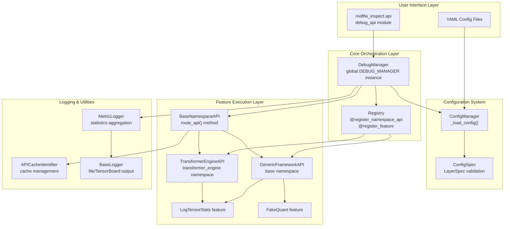
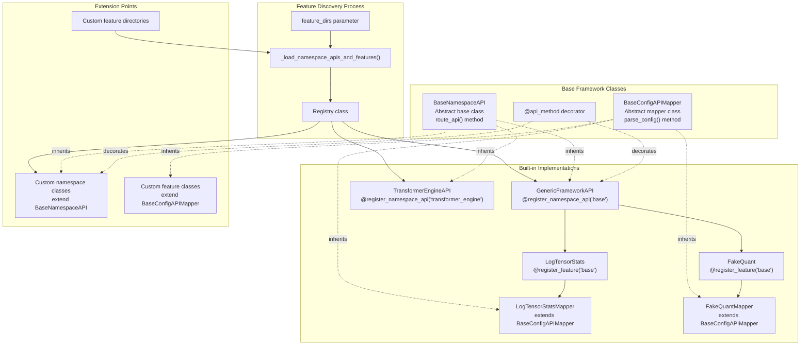
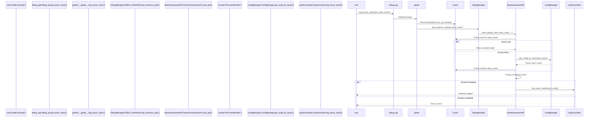
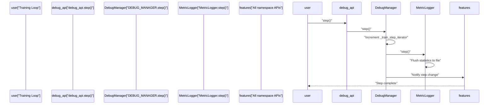

<!-- source: DeepWiki mcp.deepwiki.com · repo NVIDIA/nvidia-dlfw-inspect · page 1 Overview · fetched 2026-10-26 -->

# Overview

<details>
<summary>Relevant source files</summary>

The following files were used as context for generating this wiki page:

- [README.md](README.md)
- [nvdlfw_inspect/api.py](nvdlfw_inspect/api.py)
- [setup.py](setup.py)

</details>


`nvdlfw_inspect` is a configuration-driven debugging framework for identifying and resolving convergence issues in large language model (LLM) training workflows. The tool provides runtime tensor inspection, statistical analysis, and extensible debugging features specifically designed for PyTorch models using NVIDIA libraries (Transformer Engine, Megatron-LM, NeMo).

For detailed installation instructions, see [Installation](#2.1). For step-by-step usage examples, see [Quick Start](#2.2). For information about creating custom debugging features, see [Custom Features and Namespaces](#5.2).

## Purpose and Capabilities

The primary purpose of `nvdlfw_inspect` is to facilitate debugging convergence issues and testing new algorithms/recipes for training LLMs. The tool addresses common debugging challenges through:

- **Tensor Statistics Logging**: Per-layer collection of statistical metrics (mean, std, max, min, L1/L2 norms) from activations, weights, and gradients during training
- **Algorithmic Testing**: Runtime tensor modification capabilities for testing new training recipes (e.g., fake quantization via `FakeQuant` feature, precision control)
- **Selective Layer Targeting**: YAML-based configuration controls which features execute on which model layers using regex patterns, layer numbers, or explicit names
- **Distributed Training Support**: Built-in multi-GPU support with configurable tensor reduction strategies (per-rank, all-gather, or last-rank-only)
- **Framework-Specific Features**: Plugin architecture organized by namespaces enables framework-specific debugging (generic PyTorch, Transformer Engine, or custom frameworks)
- **Minimal Performance Overhead**: API caching via `APICacheIdentifier` and conditional feature execution minimize impact on training performance

Sources: [README.md:1-8](), [setup.py:24]()

## Design Philosophy

The architecture follows several key design principles:

1. **Configuration Over Code**: Features are enabled/disabled through YAML configuration files rather than code modifications, allowing users to debug training runs without changing model implementations
2. **Namespace-Based Organization**: Features are organized into namespaces (generic, framework-specific, custom) to prevent naming conflicts and enable clean separation of concerns
3. **Lazy Evaluation and Caching**: The `BaseNamespaceAPI.route_api()` method and `APICacheIdentifier` class implement caching to minimize performance overhead from repeated API calls
4. **Registry-Based Discovery**: The `Registry` class uses decorator-based registration (`@register_namespace_api`, `@register_feature`) for automatic discovery of features from directories
5. **Global State Management**: A single global `DEBUG_MANAGER` instance in [nvdlfw_inspect/api.py:24]() coordinates all debugging operations across distributed ranks

Sources: [nvdlfw_inspect/api.py:24](), [README.md:1-8]()

## High-Level Architecture

The system implements a five-layer architecture with clear separation of concerns:

### System Architecture Diagram



**Layer Responsibilities:**

| Layer | Components | Responsibilities |
|-------|-----------|-----------------|
| User Interface | `debug_api` module, YAML files | API exposure via `initialize()`, `log_tensor_stats()`, `step()`, `end_debug()` |
| Core Orchestration | `DebugManager`, `Registry` | Coordinate feature execution, manage training step, maintain global state |
| Configuration | `ConfigManager`, `ConfigSpec` | Parse YAML, validate layer selections, cache layer-to-feature mappings |
| Feature Execution | `BaseNamespaceAPI`, namespace classes, feature classes | Route API calls, execute enabled features, apply layer-specific logic |
| Logging & Utilities | `MetricLogger`, `APICacheIdentifier`, `BaseLogger` | Collect statistics, manage caching, write outputs to file/TensorBoard |

Sources: [nvdlfw_inspect/api.py:24-182]()

## Core Components

### API Layer (`nvdlfw_inspect.api` module)

The primary user interface exposes global functions that interact with the singleton `DEBUG_MANAGER` instance at [nvdlfw_inspect/api.py:24](). The module uses Python's `__getattr__()` at [nvdlfw_inspect/api.py:174-182]() to dynamically route namespace-specific API calls.

| Function | Implementation | Purpose |
|----------|---------------|---------|
| `initialize()` | [nvdlfw_inspect/api.py:27-71]() | Creates global `DEBUG_MANAGER`, loads config via `ConfigManager._load_config()`, discovers features |
| `log_tensor_stats()` | Routed via `__getattr__` | Dynamically dispatched to namespace-specific implementations (e.g., `GenericFrameworkAPI`) |
| `step()` | [nvdlfw_inspect/api.py:96-99]() | Calls `DEBUG_MANAGER.step()` to increment training iteration counter |
| `end_debug()` | [nvdlfw_inspect/api.py:83-87]() | Calls `DEBUG_MANAGER.close()` and resets global state |
| `set_tensor_reduction_group()` | [nvdlfw_inspect/api.py:150-163]() | Configures `DEBUG_MANAGER._tensor_reduction_group` for distributed training |
| `infer_and_assign_layer_names()` | [nvdlfw_inspect/api.py:112-148]() | Recursively assigns `.name` attribute to `torch.nn.Module` instances |

Sources: [nvdlfw_inspect/api.py:24-182]()

### Management Components

**`DebugManager` Class**: Central orchestrator that coordinates all debugging operations. It maintains:
- Global training step counter
- Registry of loaded namespace APIs and features
- Tensor reduction group for distributed training
- Statistics logger instances
- Configuration manager reference

The manager is instantiated at initialization in [nvdlfw_inspect/api.py:62-69]() and accessed throughout the API module.

**`ConfigManager` Class**: Parses YAML configuration files and provides layer-to-feature mappings. Key methods include:
- `_load_config()`: Parses YAML files into `ConfigSpec` instances
- `get_config_for_layer()`: Returns enabled features for a given layer name based on regex patterns, layer numbers, or explicit names
- Layer selection caching for runtime performance

**`Registry` Class**: Implements dynamic feature discovery using decorator-based registration:
- `@register_namespace_api`: Registers namespace API classes
- `@register_feature`: Registers feature classes to namespaces
- `validate_and_init()`: Validates feature availability and initializes namespace APIs
- Loads features from directories specified in `feature_dirs` parameter

Sources: [nvdlfw_inspect/api.py:57-70]()

### Feature System Architecture

The feature system uses inheritance and decorator-based registration to enable extensibility:



**Key Design Patterns:**

1. **Registry Pattern**: Features register themselves using decorators (`@register_namespace_api`, `@register_feature`)
2. **Strategy Pattern**: `BaseConfigAPIMapper` subclasses implement feature-specific configuration parsing via `parse_config()`
3. **Template Method Pattern**: `BaseNamespaceAPI.route_api()` defines the API routing algorithm, subclasses implement `routing_condition()`
4. **Plugin Architecture**: Features loaded from `feature_dirs` are dynamically imported and integrated without code changes

Sources: [README.md:50-58]()

## Runtime Execution Flow

The execution flow consists of three phases: initialization, runtime API routing, and cleanup.

### Initialization Sequence

```mermaid
sequenceDiagram
    participant user["User Training Script"]
    participant debug_api["debug_api module"]
    participant DebugManager["DebugManager instance"]
    participant ConfigManager["ConfigManager instance"]
    participant Registry["Registry class"]
    participant features["Feature classes<br/>(LogTensorStats, etc.)"]
    
    user->>debug_api: "initialize(config_file='config.yaml')"
    debug_api->>debug_api: "Create global DEBUG_MANAGER"
    debug_api->>DebugManager: "DebugManager.__init__()"
    DebugManager->>Registry: "_load_namespace_apis_and_features()"
    Registry->>features: "Import and @register_feature"
    Registry-->>DebugManager: "Return namespace_apis, features"
    
    debug_api->>DebugManager: "load_config()"
    DebugManager->>ConfigManager: "_load_config(config_file)"
    ConfigManager->>ConfigManager: "Parse YAML into ConfigSpec"
    ConfigManager-->>DebugManager: "Return config structures"
    DebugManager->>Registry: "validate_and_init(configs)"
    Registry->>features: "Validate feature availability"
    Registry-->>DebugManager: "Initialized namespace APIs"
```

### Runtime API Routing Flow



### Training Step Increment



Sources: [nvdlfw_inspect/api.py:27-182]()

## Configuration-Driven Operation

The system uses YAML configuration files to control which features execute on which layers, without requiring code changes. The `ConfigManager` class parses YAML into `ConfigSpec` and `LayerSpec` instances, which define:

1. **Layer Selection**: Regex patterns, explicit layer names, layer numbers, or the `all` keyword
2. **Feature Enable/Disable**: Per-config-block and per-feature granularity
3. **Feature Parameters**: Feature-specific settings (tensor types, statistics types, temporal controls)
4. **Temporal Controls**: `start_step`, `end_step`, `freq` parameters control when features execute

Example configuration structure:

```yaml
config_name:
  enabled: True
  layers:
    layer_name_regex_pattern: .*(fc1|qkv)  # Matches layers ending with 'fc1' or 'qkv'
  LogTensorStats:
    enabled: True
    tensors_struct:
      - tensor: activation
        stats: [mean, std, l1_norm]
        freq: 4           # Log every 4 steps
        start_step: 20    # Start at training step 20
```

The `ConfigManager.get_config_for_layer()` method performs layer matching and returns applicable features. Results are cached in `BaseNamespaceAPI.route_api()` using `APICacheIdentifier` to avoid repeated regex matching during training.

Sources: [README.md:28-48]()

## Distributed Training Integration

The tool provides built-in support for distributed training environments through configurable tensor reduction strategies. Users can specify reduction groups, enable per-rank statistics, or use global reduction through the `set_tensor_reduction_group()` and related APIs.

The system automatically handles rank-specific logging and provides options for both local and globally-reduced tensor statistics collection.

Sources: [nvdlfw_inspect/api.py:152-174](), [docs/getting_started.md:249-257]()

## Extensibility Model

The architecture supports extensibility through custom namespaces and features. Users can create framework-specific debugging capabilities by implementing `BaseNamespaceAPI` and `BaseConfigAPIMapper` classes, then loading them via the `feature_dirs` parameter during initialization.

Custom features are automatically discovered and integrated into the configuration system, enabling seamless extension of debugging capabilities for specialized frameworks or algorithms.

Sources: [README.md:50-58](), [docs/getting_started.md:144]()

---

