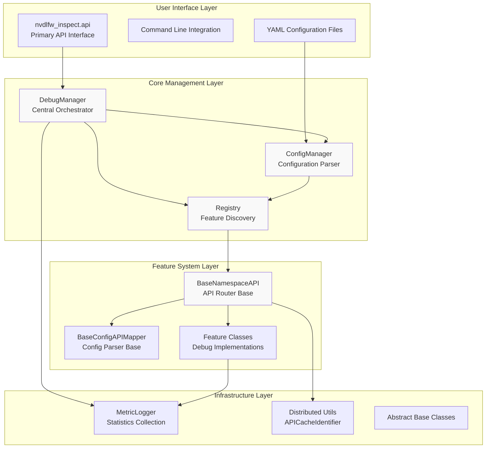
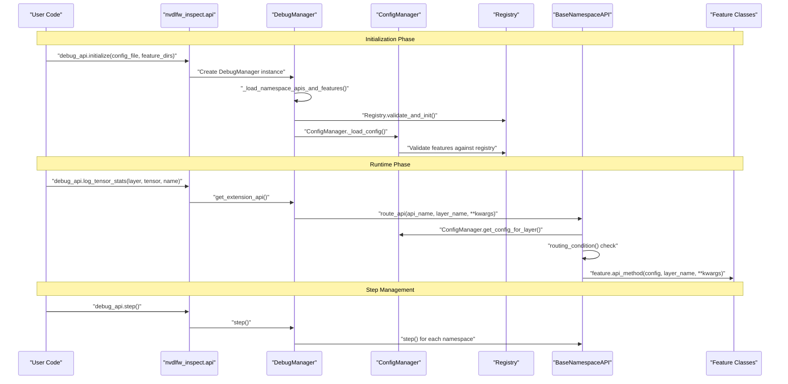
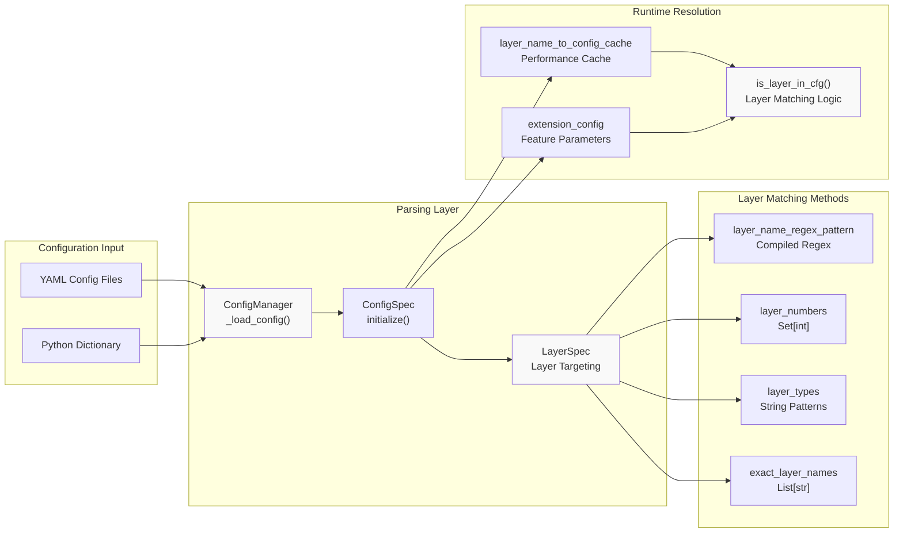
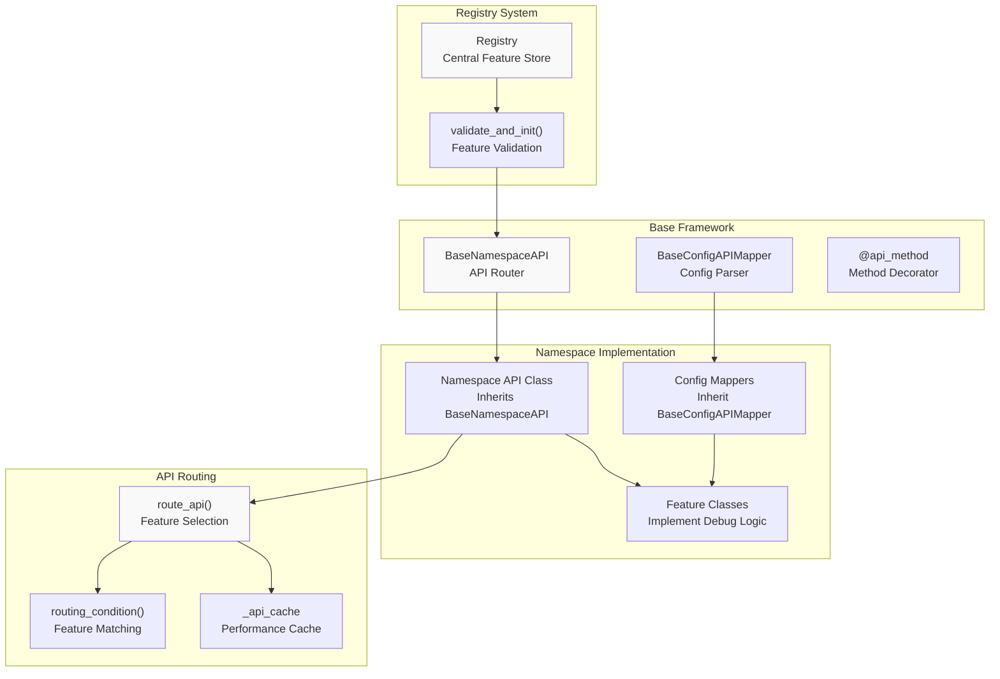
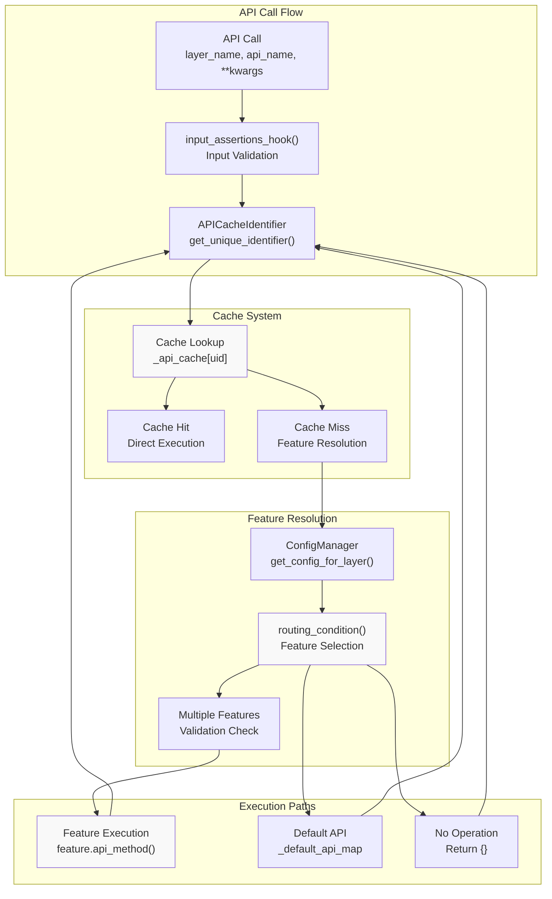

<!-- source: DeepWiki mcp.deepwiki.com · repo NVIDIA/nvidia-dlfw-inspect · page 1.1 Architecture · fetched 2026-10-26 -->

# Architecture

Relevant source files

The following files were used as context for generating this wiki page:

- [nvdlfw_inspect/api.py](nvdlfw_inspect/api.py)
- [nvdlfw_inspect/base.py](nvdlfw_inspect/base.py)
- [nvdlfw_inspect/config_manager.py](nvdlfw_inspect/config_manager.py)
- [nvdlfw_inspect/debug_manager.py](nvdlfw_inspect/debug_manager.py)

This document provides a detailed explanation of the system architecture for nvidia-dlfw-inspect, a debugging and inspection tool for deep learning frameworks. It covers the relationships between core components like `DebugManager`, `ConfigManager`, `Registry`, and the extensible feature system. For information about specific APIs and their usage, see [Main API](#3.1). For details about configuration file structure and layer targeting, see [Configuration System](#4).

## Core Components Overview

The nvidia-dlfw-inspect system follows a layered architecture with clear separation of concerns across four main layers:

**Core Components:**

| Component | File | Primary Responsibility |
|-----------|------|----------------------|
| `DebugManager` | [nvdlfw_inspect/debug_manager.py:32-227]() | Central orchestration of debugging features and lifecycle management |
| `ConfigManager` | [nvdlfw_inspect/config_manager.py:148-248]() | YAML configuration parsing and layer-to-config mapping |
| `Registry` | Referenced in debug_manager.py | Feature discovery, registration, and namespace management |
| `BaseNamespaceAPI` | [nvdlfw_inspect/base.py:61-283]() | API routing and feature invocation base class |
| `BaseConfigAPIMapper` | [nvdlfw_inspect/base.py:27-58]() | Configuration parsing base class for features |

Sources: [nvdlfw_inspect/debug_manager.py:1-227](), [nvdlfw_inspect/config_manager.py:1-305](), [nvdlfw_inspect/base.py:1-283]()

## Component Interaction Flow

The following diagram shows how components interact during a typical debugging session:

**Key Interaction Patterns:**

1. **Initialization Flow**: [nvdlfw_inspect/debug_manager.py:102-150]() loads features from directories, validates them through the Registry, and parses configuration
2. **API Routing**: [nvdlfw_inspect/base.py:146-273]() implements a sophisticated routing system with caching and configuration-based feature selection
3. **Configuration Resolution**: [nvdlfw_inspect/config_manager.py:224-240]() provides layer-to-config mapping with caching for performance

Sources: [nvdlfw_inspect/debug_manager.py:32-227](), [nvdlfw_inspect/base.py:146-273](), [nvdlfw_inspect/config_manager.py:148-248]()

## Configuration Architecture

The configuration system enables fine-grained control over which debugging features apply to which model layers:

**Configuration Classes:**

| Class | Purpose | Key Methods |
|-------|---------|-------------|
| `ConfigSpec` | [nvdlfw_inspect/config_manager.py:125-146]() | Container for layer targeting and feature configuration |
| `LayerSpec` | [nvdlfw_inspect/config_manager.py:58-123]() | Layer matching logic with multiple targeting methods |
| `ConfigManager` | [nvdlfw_inspect/config_manager.py:148-248]() | Configuration parsing and layer-to-config resolution |

**Layer Matching Logic**: The `is_layer_in_cfg()` function [nvdlfw_inspect/config_manager.py:250-304]() implements a hierarchical matching system:
1. Exact layer names take precedence
2. Regex patterns for flexible matching 
3. Layer numbers with range support (e.g., "0-5")
4. Layer types with regex compilation

Sources: [nvdlfw_inspect/config_manager.py:125-304]()

## Feature System Architecture

The feature system uses a namespace-based architecture for organizing debugging capabilities:

**Key Abstractions:**

- **BaseNamespaceAPI**: [nvdlfw_inspect/base.py:61-283]() provides the framework for API routing, feature management, and caching
- **BaseConfigAPIMapper**: [nvdlfw_inspect/base.py:27-58]() handles configuration parsing for features, including tensor-specific configurations
- **Registry Pattern**: Central feature discovery that loads features from directories and validates namespace implementations

**API Routing Mechanism**: The `route_api()` method [nvdlfw_inspect/base.py:146-273]() implements:
1. Input validation through `input_assertions_hook()`
2. Cache lookup using `APICacheIdentifier` 
3. Configuration resolution via `ConfigManager.get_config_for_layer()`
4. Feature selection through `routing_condition()`
5. Multiple feature invocation support with validation

Sources: [nvdlfw_inspect/base.py:61-283](), [nvdlfw_inspect/debug_manager.py:102-160]()

## API Routing and Caching

The system implements sophisticated API routing with performance optimizations:

**Performance Optimizations:**

1. **API Caching**: [nvdlfw_inspect/base.py:174-180]() caches resolved feature methods and configurations to avoid repeated lookup overhead
2. **Layer Configuration Caching**: [nvdlfw_inspect/config_manager.py:225-240]() maintains a `layer_name_to_config_cache` for O(1) layer-to-config resolution
3. **Unique Identification**: `APICacheIdentifier` creates cache keys based on layer name, API name, and relevant kwargs

**Multi-Feature Support**: The system supports executing multiple features for a single API call when `is_multiple_feature_invocation_allowed()` returns True, with validation that all features return identical outputs [nvdlfw_inspect/base.py:217-242]().

Sources: [nvdlfw_inspect/base.py:146-283](), [nvdlfw_inspect/config_manager.py:224-248]()

---

