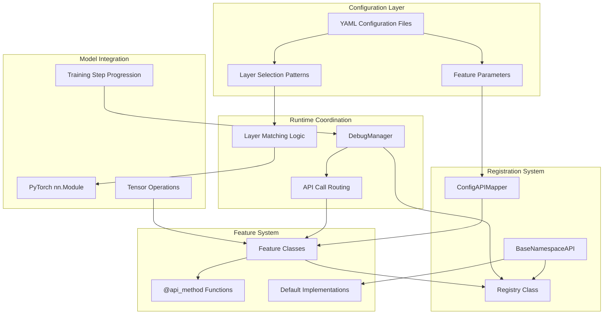
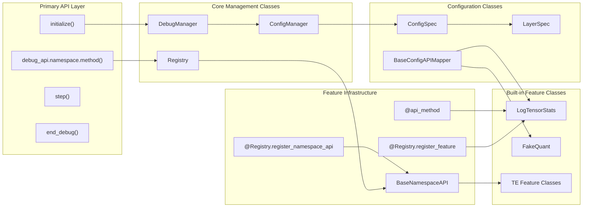

<!-- source: DeepWiki mcp.deepwiki.com · repo NVIDIA/nvidia-dlfw-inspect · page 1.2 Key Concepts · fetched 2026-10-26 -->

# Key Concepts

Relevant source files

The following files were used as context for generating this wiki page:

- [docs/features.md](docs/features.md)
- [docs/namespaces.md](docs/namespaces.md)
- [nvdlfw_inspect/base.py](nvdlfw_inspect/base.py)

This page defines the fundamental concepts and terminology used throughout the nvidia-dlfw-inspect tool. Understanding these concepts is essential for configuring, extending, and using the debugging capabilities effectively.

For detailed architecture information, see [Architecture](#1.1). For practical usage examples, see [Getting Started](#2).

## Core Terminology

### Features

A **feature** is a self-contained debugging capability that implements specific functionality for inspecting or modifying model behavior during training. Features are Python classes that provide APIs for operations like logging tensor statistics, applying quantization, or modifying tensor values.

Each feature must:
- Inherit from a `ConfigAPIMapper` class to parse YAML configurations
- Implement APIs marked with the `@api_method` decorator  
- Be registered to a specific namespace using `@Registry.register_feature(namespace="...")`

**Sources:** [docs/features.md:1-30](), [examples/sample_namespace/sample_feature.py]()

### Namespaces

A **namespace** groups related features by framework or functionality domain. Namespaces provide:
- API routing and method resolution
- Configuration parsing logic shared across features
- Input/output validation hooks
- Default implementations when no features are configured

Common namespaces include:
- `base` - Generic features usable with any framework
- `transformer_engine` - TransformerEngine-specific features  
- `sample_namespace` - Example custom namespace

**Sources:** [docs/namespaces.md:6-12](), [nvdlfw_inspect/base.py]()

### Layers

**Layers** are PyTorch model components (modules) that can be targeted for debugging. The tool identifies layers by:
- Automatically assigned names using `infer_and_assign_layer_names()`
- User-specified names set as module attributes
- Layer numbering for pipeline parallel models

Layer targeting supports multiple selection methods via configuration files.

**Sources:** [nvdlfw_inspect/api.py:114-150]()

### Configuration-Driven Debugging

The tool uses **YAML configuration files** to control which features execute on which layers without modifying training code. Configuration files specify:
- Layer selection patterns (regex, numbers, types, exact names)
- Feature enablement and parameters
- Execution frequency and timing controls

This approach enables non-intrusive debugging that can be toggled on/off via configuration changes.

**Sources:** [docs/namespaces.md:58-99](), [docs/features.md:87-100]()

## System Component Relationships

**Sources:** [nvdlfw_inspect/api.py:27-71](), [nvdlfw_inspect/debug_manager.py](), [nvdlfw_inspect/registry.py]()

## Code Entity Mapping

**Sources:** [nvdlfw_inspect/api.py:176-186](), [nvdlfw_inspect/registry.py](), [nvdlfw_inspect/base.py]()

## API Routing and Execution

The tool implements a sophisticated **API routing system** that maps user calls to appropriate feature implementations:

1. **Dynamic Method Resolution**: Calls like `debug_api.sample_namespace.process_tensor()` are resolved through `__getattr__` in the main API
2. **Feature Discovery**: The Registry locates features registered to the requested namespace  
3. **Configuration Matching**: Layer names and API parameters are matched against YAML configuration patterns
4. **Conditional Execution**: Features execute only when their `routing_condition()` returns True
5. **Result Aggregation**: Multiple features can contribute to a single API call result

**Sources:** [nvdlfw_inspect/api.py:176-186](), [docs/namespaces.md:158-176]()

## Training Integration Concepts

### Training Steps

The tool tracks **training progression** through step counters that features can use for:
- Frequency-based logging (every N steps)  
- Time-windowed analysis (between step ranges)
- Step-synchronized feature activation

**Sources:** [nvdlfw_inspect/api.py:92-102]()

### Tensor Statistics

**Tensor statistics** are numerical summaries computed from model tensors during training:
- Statistical measures: min, max, mean, standard deviation, norms
- Distribution analysis: histograms, quantiles  
- Custom metrics: framework-specific calculations
- Distributed aggregation: reduction across multiple GPUs

**Sources:** [docs/features.md:117-190]()

### Distributed Training Support

The tool provides **distributed training capabilities** including:
- Tensor reduction groups for multi-GPU aggregation
- Per-rank vs. aggregated statistics collection
- Pipeline parallelism awareness through layer numbering
- Process group management for custom reductions

**Sources:** [nvdlfw_inspect/api.py:152-174]()

## Configuration System Concepts

### Layer Selection Patterns

**Layer targeting** uses flexible pattern matching:

| Method | Description | Example |
|--------|-------------|---------|
| `layer_name_regex_pattern` | Regular expression matching | `.*attention.*` |
| `layer_numbers` | Explicit indices | `[0, 2, 5]` |
| `layer_types` | Module type matching | `Linear` |
| `exact_names` | Precise name matching | `model.layer.0.attention` |

**Sources:** Configuration documentation and layer matching logic

### Feature Parameters

**Feature configuration** supports hierarchical parameter specification:
- Global feature settings
- Per-layer parameter overrides  
- Tensor-level granular control
- Runtime parameter validation

Complex features like TransformerEngine support nested configuration structures for different operation types (GEMMs, tensors) with inheritance and override semantics.

**Sources:** [docs/namespaces.md:25-57](), [docs/features.md:87-99]()

---

