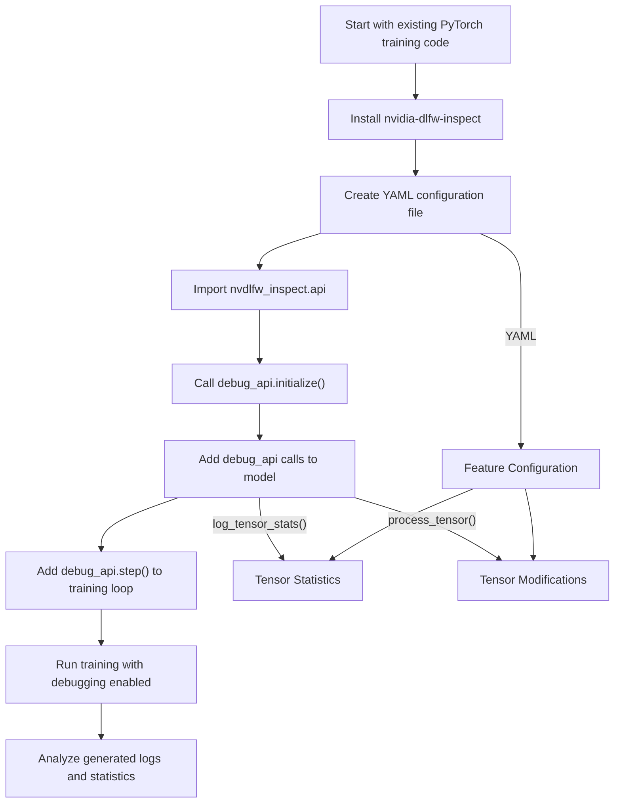
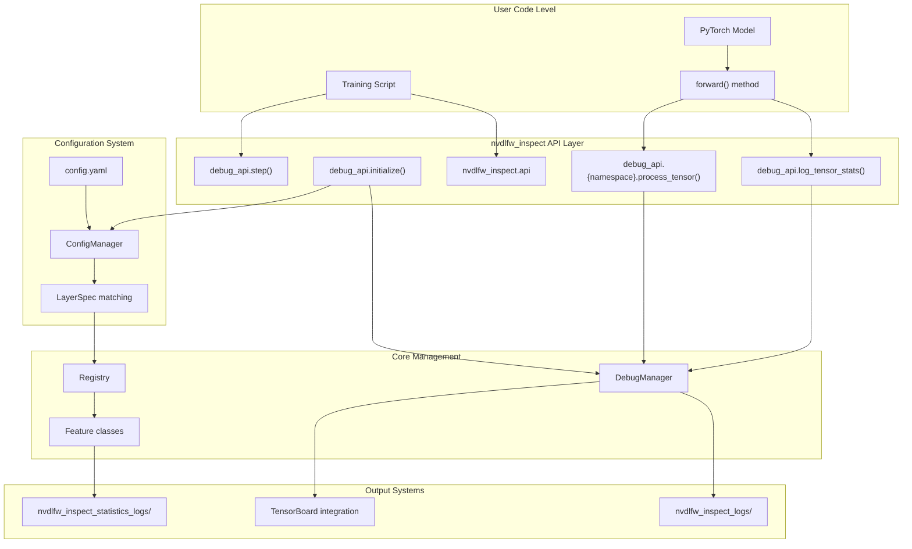
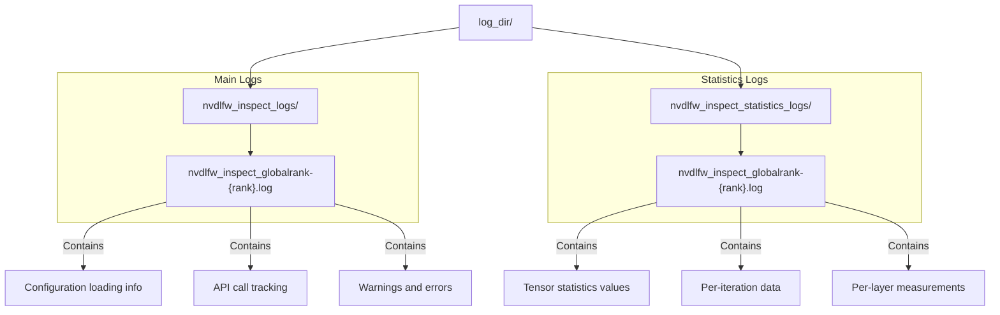

<!-- source: DeepWiki mcp.deepwiki.com · repo NVIDIA/nvidia-dlfw-inspect · page 2 Getting Started · fetched 2026-10-26 -->

# Getting Started

<details>
<summary>Relevant source files</summary>

The following files were used as context for generating this wiki page:

- [docs/getting_started.md](docs/getting_started.md)
- [docs/installation.md](docs/installation.md)

</details>


This page provides an overview of how to begin using the nvidia-dlfw-inspect tool for debugging deep learning models. It covers the essential setup steps, basic concepts, and initial usage patterns to get you productive quickly.

For detailed installation instructions, see [Installation](#2.1). For step-by-step tutorials, see [Quick Start](#2.2). For common usage patterns, see [Basic Usage Examples](#2.3).

## Prerequisites

Before using nvidia-dlfw-inspect, ensure you have:

- PyTorch environment (preferably NVIDIA PyTorch Docker container)
- Python 3.8 or higher
- CUDA-capable GPUs (for distributed training features)
- Basic familiarity with PyTorch model training

## Getting Started Workflow

The typical workflow for integrating nvidia-dlfw-inspect into your training pipeline follows these steps:

### Basic Integration Flow



Sources: [docs/getting_started.md:1-269]()

### Code Integration Mapping



Sources: [docs/getting_started.md:20-137](), [nvdlfw_inspect/api.py](), [nvdlfw_inspect/core/debug_manager.py](), [nvdlfw_inspect/core/config_manager.py]()

## Essential Setup Steps

### 1. Installation

Install the tool using one of these methods:

```bash
# Direct from GitHub
pip install git+https://github.com/NVIDIA/nvidia-dlfw-inspect

# Or clone and install locally
git clone https://github.com/NVIDIA/nvidia-dlfw-inspect
cd nvidia-dlfw-inspect
pip install .
```

### 2. Import the API

Add the import statement to your training script:

```python
import nvdlfw_inspect.api as debug_api
```

Sources: [docs/getting_started.md:121-125]()

### 3. Initialize the Tool

Call the initialization function once per rank before training begins:

```python
debug_api.initialize(
    config_file="path/to/config.yaml",
    feature_dirs=["./custom_features"],  # Optional
    log_dir="/tmp/nvdlfw_inspect"        # Optional
)
```

Key parameters:
- `config_file`: Path to YAML configuration specifying which features to enable
- `feature_dirs`: Directories containing custom debugging features
- `log_dir`: Directory for output logs and statistics

Sources: [docs/getting_started.md:127-149]()

### 4. Create Configuration File

Create a YAML file specifying which layers and features to enable:

```yaml
debug_config_name:
  enabled: true
  layers:
    layer_name_regex_pattern: .*(fc1|fc2|relu)
  LogTensorStats:
    enabled: true
    tensors_struct:
      - tensor: activation
        stats: [max, min, mean]
        freq: 1
        start_step: 0
        end_step: 100
```

Sources: [docs/getting_started.md:150-183]()

## Basic Usage Pattern

### Minimal Integration Example

Here's the minimal code changes needed to add debugging to an existing PyTorch model:

| Integration Point | Code Change | Purpose |
|------------------|-------------|---------|
| Script initialization | `debug_api.initialize("config.yaml")` | Configure debugging features |
| Model forward pass | `debug_api.log_tensor_stats("layer_name", tensor=output, tensor_name="activation")` | Log tensor statistics |
| Training loop | `debug_api.step()` | Update internal step counter |

### Forward Pass Integration

```python
class SimpleModel(nn.Module):
    def forward(self, x):
        # Normal forward computation
        fc1_out = self.fc1(x)
        
        # Add debugging call
        debug_api.log_tensor_stats(
            "fc1", 
            tensor=fc1_out, 
            tensor_name="activation"
        )
        
        # Continue normal computation
        relu_out = self.relu(fc1_out)
        return self.fc2(relu_out)
```

Sources: [docs/getting_started.md:29-68]()

### Training Loop Integration

```python
for step in range(training_iterations):
    # Normal training step
    output = model(input_tensor)
    loss = criterion(output, target)
    optimizer.zero_grad()
    loss.backward()
    optimizer.step()
    
    # Add step counter update
    debug_api.step()
```

Sources: [docs/getting_started.md:91-108]()

## Output and Results

After running your instrumented training script, the tool generates two types of output:

### Log Files Structure



Sources: [docs/getting_started.md:208-244]()

### Example Log Output

Main log shows configuration and API usage:
```
INFO - Reading config from config.yaml
INFO - LAYER=fc1: Feature=LogTensorStats, API=log_tensor_stats, TENSOR=activation: Called
```

Statistics log shows numerical results:
```
INFO - fc1_activation_max    iteration=000020    value=1.4388
INFO - fc1_activation_min    iteration=000020    value=-1.4398
```

Sources: [docs/getting_started.md:214-243]()

## Next Steps

Once you have basic integration working:

1. **Explore Advanced Configuration**: Learn about layer selection patterns and feature parameters in [Configuration System](#4)
2. **Try Built-in Features**: Discover available debugging features in [Built-in Features](#5.1)
3. **Custom Features**: Create domain-specific debugging tools using [Custom Features and Namespaces](#5.2)
4. **Distributed Training**: Configure for multi-GPU environments in [Distributed Training Support](#6.2)

For hands-on tutorials and detailed examples, continue to [Quick Start](#2.2).

Sources: [docs/getting_started.md:1-269](), [docs/installation.md:1-55]()

---

