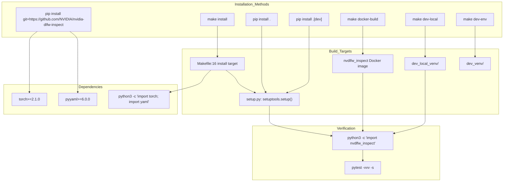
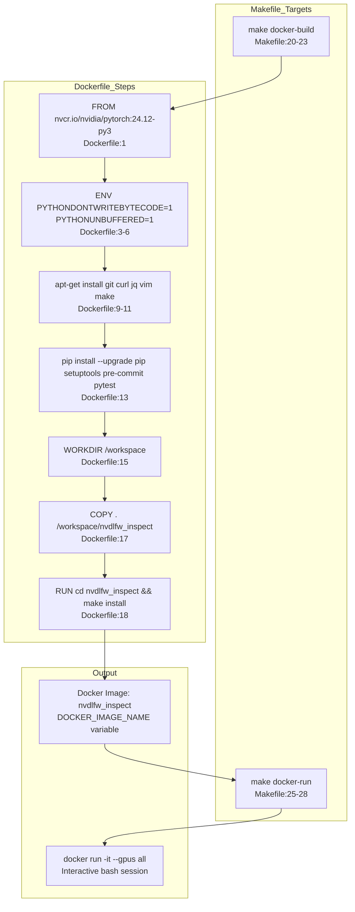

<!-- source: DeepWiki mcp.deepwiki.com · repo NVIDIA/nvidia-dlfw-inspect · page 2.1 Installation · fetched 2026-10-26 -->

# Installation

<details>
<summary>Relevant source files</summary>

The following files were used as context for generating this wiki page:

- [Dockerfile](Dockerfile)
- [Makefile](Makefile)
- [docs/installation.md](docs/installation.md)
- [setup.py](setup.py)

</details>


This document provides comprehensive installation instructions for the `nvdlfw_inspect` tool, covering multiple installation methods including Docker setup, direct pip installation, and development environment configuration. The tool is designed to work with deep learning frameworks, particularly PyTorch, and requires specific dependencies to function properly.

For information about basic usage after installation, see [Quick Start](#2.2). For advanced deployment scenarios, see [Distributed Training Support](#6.2).

## Prerequisites

The `nvdlfw_inspect` tool requires the following dependencies as defined in [setup.py:41-48]():

| Dependency | Minimum Version | Purpose | Verification Command |
|------------|-----------------|---------|---------------------|
| Python | 3.8 | Runtime environment | `python3 --version` |
| PyTorch | 2.1.0 | Deep learning framework integration | `python3 -c "import torch"` |
| PyYAML | 6.0.0 | Configuration file parsing | `python3 -c "import yaml"` |

The installation process includes dependency validation as shown in [Makefile:18](). When using NVIDIA PyTorch Docker containers, PyTorch is typically pre-installed, and the pip installation will skip reinstalling packages that already meet version requirements.

## Installation Methods Overview

**Installation Flow Diagram**



*Sources: [Makefile:15-18](), [setup.py:21-52](), [Dockerfile:1-18](), [docs/installation.md:17-34]()*

## Direct Installation Methods

### GitHub Installation

Install directly from the GitHub repository using pip:

```bash
pip install git+https://github.com/NVIDIA/nvidia-dlfw-inspect
```

This method automatically installs dependencies listed in [setup.py:42-48](). PyTorch should ideally be pre-installed (e.g., in NVIDIA PyTorch containers) to avoid version conflicts.

### Source Installation

Clone the repository and install from source:

```bash
git clone https://github.com/NVIDIA/nvidia-dlfw-inspect
cd nvidia-dlfw-inspect
make install
```

The `make install` target executes the following operations as defined in [Makefile:16-18]():
- Runs `pip install .` to invoke `setuptools.setup()` from [setup.py:21]()
- Validates PyTorch and PyYAML dependencies via `python3 -c "import torch; import yaml"`
- Exits with error code 1 if dependencies are missing

Alternatively, you can use pip directly:

```bash
pip install .        # Standard installation
pip install .[dev]   # Installation with development dependencies
```

*Sources: [Makefile:15-18](), [docs/installation.md:16-21]()*

## Docker Installation

### Docker Build Process

**Docker Build and Execution Flow**



*Sources: [Dockerfile:1-18](), [Makefile:13](), [Makefile:20-28]()*

### Docker Setup Commands

1. **Build the Docker image:**
   ```bash
   make docker-build
   ```
   
   This executes [Makefile:22-23]() to build an image named `nvdlfw_inspect`.

2. **Run the Docker container:**
   ```bash
   make docker-run
   ```
   
   This launches an interactive container with GPU support as defined in [Makefile:27-28]().

The Docker container environment [Dockerfile:1-18]() provides:
- **Base Image**: `nvcr.io/nvidia/pytorch:24.12-py3` with PyTorch pre-installed
- **System Packages**: git, curl, jq, rsync, sshpass, uuid-runtime, vim, wget, make
- **Python Environment**: Upgraded pip, setuptools, pre-commit, pytest
- **Working Directory**: `/workspace/nvdlfw_inspect`
- **GPU Access**: Enabled via `--gpus all` flag in [Makefile:28]()

*Sources: [Dockerfile:1-18](), [Makefile:20-28]()*

## Development Environment Setup

### Development Environment Types

The project provides two development environment configurations:

| Environment | Target | Makefile Target | Virtual Environment |
|-------------|--------|-----------------|-------------------|
| Local Development | Running tool + pre-commit | `make dev-local` | `dev_local_venv` |
| Pre-commit Only | Code quality checks | `make dev-env` | `dev_venv` |

### Local Development Environment

Create a full development environment for running the tool:

```bash
make dev-local
source dev_local_venv/bin/activate
```

This environment setup process [Makefile:30-41]():
- Creates virtual environment `dev_local_venv` using Python venv module
- Upgrades pip via `$(DEV_LOCAL_PIP) install --upgrade pip`
- Installs package in editable mode: `$(DEV_LOCAL_PIP) install -e .[dev]`
- Installs additional development requirements from `requirements-dev-local.txt`
- Provides full tool functionality with development dependencies from [setup.py:50]()

### Pre-commit Development Environment

Create an environment for code quality checks only:

```bash
make dev-env
source dev_venv/bin/activate
make check
```

This lighter environment [Makefile:47-60]():
- Creates virtual environment `dev_venv` using Python venv module
- Upgrades pip via `$(DEV_PIP) install --upgrade pip`
- Installs development dependencies: `$(DEV_PIP) install -e .[dev]`
- Issues warning if PyTorch is not importable (tests will fail)
- Supports pre-commit hooks execution via `make check` [Makefile:63-64]()

*Sources: [Makefile:30-60](), [docs/installation.md:38-42]()*

## Installation Verification

### Import Test

Verify the installation by importing the package:

```bash
python3 -c "import nvdlfw_inspect"
```

This test is mentioned in [docs/installation.md:20]() as the standard verification method.

### Test Suite Execution

Run the complete test suite to verify functionality:

```bash
make test
```

The `make test` target [Makefile:44-45]() executes `pytest` to run all tests.

### Dependency Validation

The installation process automatically validates core dependencies as implemented in [Makefile:18]():

```bash
python3 -c "import torch; import yaml" || { 
    echo >&2 "Error: 'torch' and/or 'yaml' are not installed in your environment. Please ensure they are pre-installed."; 
    exit 1; 
}
```

This validation ensures that the required dependencies listed in [setup.py:42-48]() are available before completing installation.

*Sources: [Makefile:18](), [setup.py:42-48](), [docs/installation.md:33]()*

## Cleanup and Maintenance

### Cleanup Commands

| Command | Purpose | Makefile Location | Removes |
|---------|---------|-------------------|---------|
| `make clean-build` | Remove build artifacts | [Makefile:66-69]() | `.egg-info`, `build/`, `dist/` directories |
| `make clean-venv` | Remove virtual environments | [Makefile:71-74]() | `dev_venv`, `dev_local_venv` directories |
| `make clean-docker` | Remove Docker image | [Makefile:76-80]() | `nvdlfw_inspect` Docker image |
| `make clean` | Complete cleanup | [Makefile:82-84]() | All above targets combined |

### Build Artifacts

For distribution, create wheel packages:

```bash
./scripts/build_wheels.sh
```

The resulting wheel files are placed in the `dist/` directory as noted in [docs/installation.md:50-54]().

*Sources: [Makefile:66-84](), [docs/installation.md:48-54]()*

---

