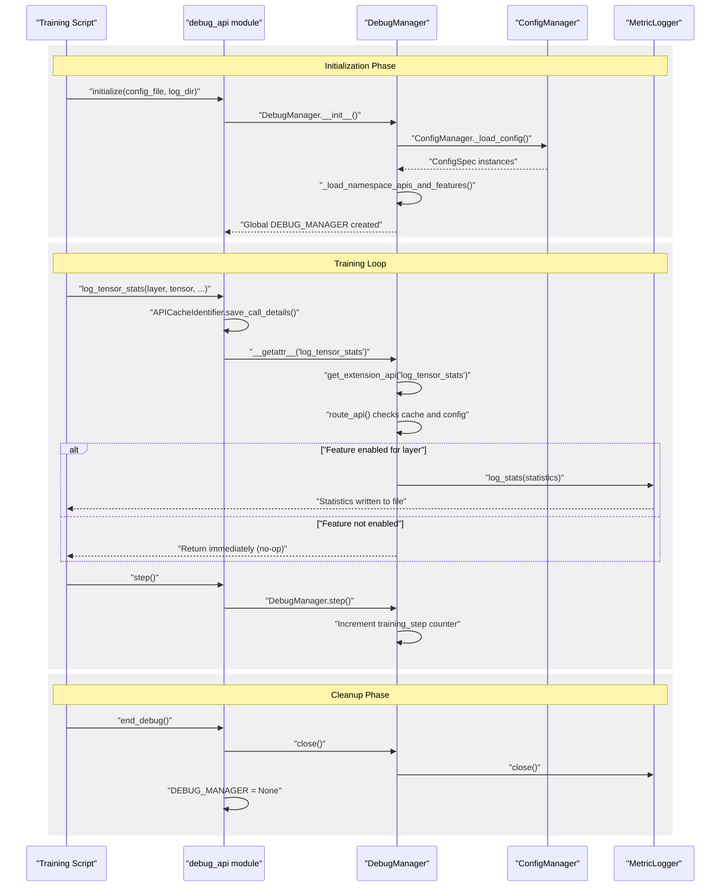
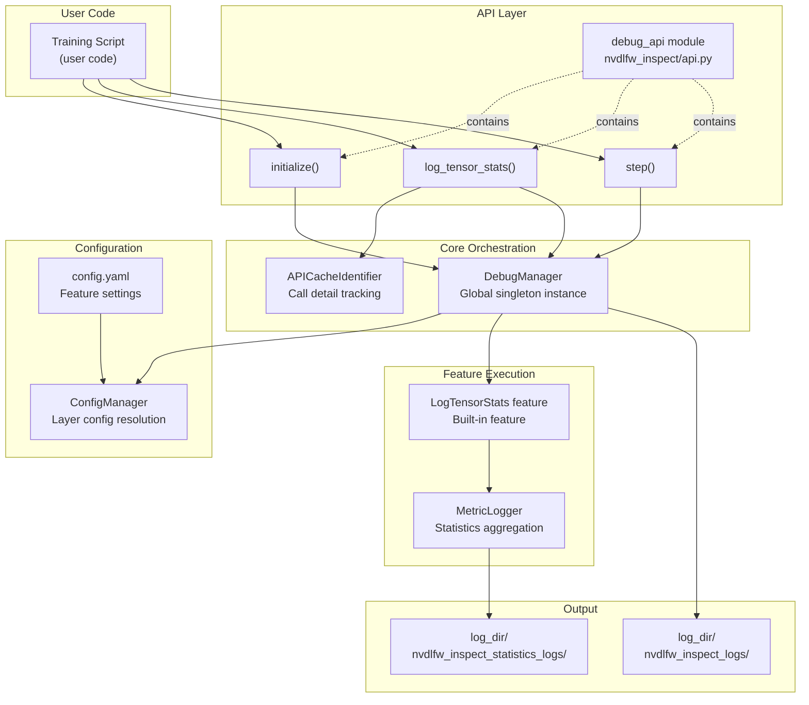
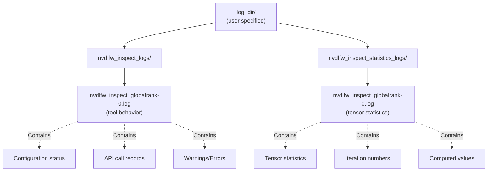

<!-- source: DeepWiki mcp.deepwiki.com · repo NVIDIA/nvidia-dlfw-inspect · page 2.2 Quick Start · fetched 2026-10-26 -->

# Quick Start

<details>
<summary>Relevant source files</summary>

The following files were used as context for generating this wiki page:

- [docs/getting_started.md](docs/getting_started.md)
- [examples/test_simple_model_train.py](examples/test_simple_model_train.py)
- [nvdlfw_inspect/api.py](nvdlfw_inspect/api.py)

</details>


This page provides a minimal working example to help you quickly integrate `nvdlfw_inspect` into a PyTorch training script. You will learn how to initialize the tool, log tensor statistics, and view the resulting outputs.

For installation instructions, see [Installation](#2.1). For more comprehensive usage patterns including distributed training and custom features, see [Basic Usage Examples](#2.3).

---

## Minimal Example

The following example demonstrates the core workflow: initialize the debugging tool, add a single API call to log tensor statistics, increment the step counter, and clean up.

### Simple Training Script

```python
import torch
import torch.nn as nn
import torch.optim as optim
import nvdlfw_inspect.api as debug_api

# Define a simple model
class SimpleModel(nn.Module):
    def __init__(self):
        super().__init__()
        self.fc1 = nn.Linear(10, 5)
        self.fc2 = nn.Linear(5, 2)
    
    def forward(self, x):
        x = self.fc1(x)
        # Log tensor statistics for fc1 output
        debug_api.log_tensor_stats("fc1", tensor=x, tensor_name="output")
        x = torch.relu(x)
        x = self.fc2(x)
        return x

# Initialize the debugging tool
debug_api.initialize(
    config_file="config.yaml",
    log_dir="./debug_output"
)

# Standard training loop
model = SimpleModel()
optimizer = optim.SGD(model.parameters(), lr=0.01)
criterion = nn.MSELoss()

for step in range(10):
    # Forward pass
    inputs = torch.randn(4, 10)
    targets = torch.randn(4, 2)
    outputs = model(inputs)
    loss = criterion(outputs, targets)
    
    # Backward pass
    optimizer.zero_grad()
    loss.backward()
    optimizer.step()
    
    # Increment debug tool step counter
    debug_api.step()
    print(f"Step {step}, Loss: {loss.item():.4f}")

# Clean up
debug_api.end_debug()
```

### Configuration File

Create a file named `config.yaml` with the following content:

```yaml
basic_debug:
  enabled: true
  layers:
    layer_name_regex_pattern: fc1
  LogTensorStats:
    enabled: true
    tensors_struct:
      - tensor: output
        stats: [mean, max, min, std]
        freq: 2
        start_step: 0
        end_step: 10
```

Sources: [nvdlfw_inspect/api.py:27-71](), [examples/test_simple_model_train.py:36-78](), [docs/getting_started.md:18-111]()

---

## Understanding the Code

The minimal example involves four key integration points with `nvdlfw_inspect`:

### 1. Import the API Module

```python
import nvdlfw_inspect.api as debug_api
```

The `debug_api` module provides the public interface to all debugging functionality. All interactions with `nvdlfw_inspect` go through this module.

Sources: [nvdlfw_inspect/api.py:1-24](), [docs/getting_started.md:123-125]()

### 2. Initialize the Tool

```python
debug_api.initialize(
    config_file="config.yaml",
    log_dir="./debug_output"
)
```

The `initialize()` function must be called once before any debugging operations. In distributed training, it must be called on every rank.

**Key Parameters:**

| Parameter | Type | Default | Description |
|-----------|------|---------|-------------|
| `config_file` | `str` | `""` | Path to YAML configuration file specifying features and layers |
| `log_dir` | `str` | `"."` | Directory where logs will be written |
| `feature_dirs` | `List[str]` | `None` | Directories containing custom features (optional) |
| `init_training_step` | `int` | `0` | Initial training step counter value |
| `statistics_logger` | `BaseLogger` | `None` | Custom statistics logger (optional) |

The function creates a global `DebugManager` instance that orchestrates all debugging operations.

Sources: [nvdlfw_inspect/api.py:27-71](), [docs/getting_started.md:127-149]()

### 3. Log Tensor Statistics

```python
debug_api.log_tensor_stats("fc1", tensor=x, tensor_name="output")
```

The `log_tensor_stats()` function logs statistics for a tensor if enabled in the configuration. This call is typically placed immediately after computing a tensor of interest (e.g., layer outputs, gradients).

**Parameters:**
- `layer_name` (positional): String identifier for the layer (must match configuration)
- `tensor`: The PyTorch tensor to log statistics for
- `tensor_name`: Name identifier for the tensor (must match configuration)
- `skip_reduction` (optional): If `True`, log per-rank statistics without reduction
- `reduction_group` (optional): Process group for distributed tensor reduction

If the layer/tensor combination is not enabled in the configuration, this call returns immediately with minimal overhead.

Sources: [nvdlfw_inspect/api.py:174-182](), [docs/getting_started.md:40-66]()

### 4. Increment Step Counter

```python
debug_api.step()
```

The `step()` function increments the internal training step counter. Features use this counter to determine when to activate (e.g., logging between steps 10-20 at frequency 2).

Call this once per training iteration, typically after the optimizer step.

Sources: [nvdlfw_inspect/api.py:96-99](), [docs/getting_started.md:195-207]()

### 5. Clean Up (Optional)

```python
debug_api.end_debug()
```

The `end_debug()` function closes all loggers and releases resources. This is optional but recommended at the end of training.

Sources: [nvdlfw_inspect/api.py:83-87]()

---

## Initialization and API Call Flow



**Diagram: Initialization and Runtime API Flow**

This diagram shows how API calls flow through the system. The `initialize()` function creates the global `DebugManager` instance, which loads configuration and features. During training, `log_tensor_stats()` calls are routed through the manager, which uses caching and configuration to determine whether to execute the feature. The `step()` function updates internal counters used by temporal filters.

Sources: [nvdlfw_inspect/api.py:27-182](), [nvdlfw_inspect/debug_manager.py]()

---

## Component Relationships



**Diagram: Component Relationships for Basic Usage**

This diagram shows the key components involved in a basic debugging session. The training script interacts only with the `debug_api` module. The `DebugManager` singleton orchestrates configuration lookup, feature execution, and logging. The `APICacheIdentifier` optimizes repeated calls to the same layer.

Sources: [nvdlfw_inspect/api.py](), [nvdlfw_inspect/debug_manager.py](), [nvdlfw_inspect/config_manager.py]()

---

## Running the Example

1. **Ensure installation is complete** (see [Installation](#2.1))

2. **Create the configuration file** `config.yaml` with the content shown above

3. **Run the training script:**
   ```bash
   python simple_train.py
   ```

4. **Expected console output:**
   ```
   Step 0, Loss: 0.8234
   Step 1, Loss: 0.7891
   Step 2, Loss: 0.7453
   ...
   ```

Sources: [examples/test_simple_model_train.py:80-136](), [docs/getting_started.md:113-117]()

---

## Viewing Outputs

After running the example, `nvdlfw_inspect` creates two subdirectories in the specified `log_dir`:

### 1. General Logs: `nvdlfw_inspect_logs/`

This directory contains general debugging information about tool behavior.

**File:** `nvdlfw_inspect_globalrank-0.log`

```
INFO - Default logging to file enabled at ./debug_output
INFO - Reading config from config.yaml.
INFO - Loaded configs for dict_keys(['basic_debug']).
INFO - LAYER=fc1: Feature=LogTensorStats, API=log_tensor_stats, TENSOR=output: Called
```

This log shows:
- Configuration loading status
- Which features and APIs were invoked for which layers
- Any warnings or errors

Sources: [docs/getting_started.md:212-226]()

### 2. Statistics Logs: `nvdlfw_inspect_statistics_logs/`

This directory contains the actual tensor statistics collected during training.

**File:** `nvdlfw_inspect_globalrank-0.log`

```
INFO - fc1_output_mean       iteration=000000    value=0.0234
INFO - fc1_output_max        iteration=000000    value=1.2341
INFO - fc1_output_min        iteration=000000    value=-0.9876
INFO - fc1_output_std        iteration=000000    value=0.4123
INFO - fc1_output_mean       iteration=000002    value=0.0198
INFO - fc1_output_max        iteration=000002    value=1.1234
INFO - fc1_output_min        iteration=000002    value=-0.8765
INFO - fc1_output_std        iteration=000002    value=0.3987
```

**Log Format:**
- **Naming:** `{layer_name}_{tensor_name}_{statistic}`
- **Iteration:** Training step when the statistic was logged
- **Value:** The computed statistic value

**Note:** Based on the configuration (`freq: 2`), statistics are logged every 2 steps (iterations 0, 2, 4, 6, 8).

Sources: [docs/getting_started.md:228-243]()

---

## Output Directory Structure



**Diagram: Output Directory Structure**

This diagram shows the organization of output files. In distributed training, each rank produces its own log files with rank-specific suffixes (e.g., `globalrank-0.log`, `globalrank-1.log`).

Sources: [nvdlfw_inspect/api.py:45-46](), [docs/getting_started.md:209-243]()

---

## Configuration Explained

The configuration file controls which layers and tensors are logged, what statistics to compute, and when to log them.

```yaml
basic_debug:                          # Configuration name (can be any identifier)
  enabled: true                       # Master enable/disable switch
  layers:                             # Layer selection rules
    layer_name_regex_pattern: fc1     # Regex pattern matching layer names
  LogTensorStats:                     # Feature name (built-in)
    enabled: true                     # Enable this feature for matched layers
    tensors_struct:                   # List of tensor configurations
      - tensor: output                # Tensor name (matches API call)
        stats: [mean, max, min, std]  # Statistics to compute
        freq: 2                       # Log every 2 training steps
        start_step: 0                 # Begin logging at step 0
        end_step: 10                  # Stop logging after step 10
```

**Key Configuration Elements:**

| Element | Description |
|---------|-------------|
| Configuration Context | Top-level name (`basic_debug`) for grouping settings |
| Layer Selection | Rules for matching layer names (regex, exact match, ranges) |
| Feature Configuration | Settings for each enabled feature |
| Tensor Specification | Which tensors to monitor and what statistics to compute |
| Temporal Controls | When to activate logging (`start_step`, `end_step`, `freq`) |

For detailed configuration options, see [Configuration System](#4).

Sources: [docs/getting_started.md:150-183](), [examples/configs/simple_model_train_sample.yaml]()

---

## Next Steps

Now that you have a working minimal example, you can:

1. **Explore distributed training:** Learn how to use `nvdlfw_inspect` with multi-GPU training in [Basic Usage Examples](#2.3)

2. **Understand features:** See the full list of built-in features and their capabilities in [Built-in Features](#5.1)

3. **Advanced configuration:** Learn about layer selection patterns, multiple configurations, and feature parameters in [Configuration System](#4)

4. **Custom features:** Create your own debugging features tailored to your specific needs in [Custom Features and Namespaces](#5.2)

5. **API reference:** Review all available API functions and their parameters in [Main API](#3.1)

Sources: [docs/getting_started.md]()

---

## Common Patterns

### Pattern 1: Multiple Layers

Log statistics for multiple layers by adjusting the regex pattern:

```yaml
layers:
  layer_name_regex_pattern: .*(fc1|fc2|relu)
```

This matches any layer containing `fc1`, `fc2`, or `relu`.

### Pattern 2: Different Statistics Per Tensor

Configure different statistics for activations versus gradients:

```yaml
tensors_struct:
  - tensor: activation
    stats: [mean, max, min]
  - tensor: gradient
    stats: [norm, max, min]
```

### Pattern 3: Conditional Logging

Log only during specific training phases:

```yaml
tensors_struct:
  - tensor: output
    stats: [mean, std]
    start_end_list: [[0, 10], [50, 60], [100, 110]]
```

This logs during steps 0-10, 50-60, and 100-110 only.

Sources: [docs/getting_started.md:154-182](), [examples/configs/simple_model_train_sample.yaml]()

---

